# Qatlib integration theorem graph

617 source theorems and lemmas · 8 shared library prerequisites · 157 upstream theorem nodes · 1264 dependency edges.

Arrows point from prerequisite to result. Dashed arrows pass through local definitions or compiler-generated helpers. Each diagram includes the prerequisites used by its module. The links below each diagram open the Lean declarations.

[Graph guide and interactive explorer](README.md)

## FQChemKitaev.AmplificationBounds

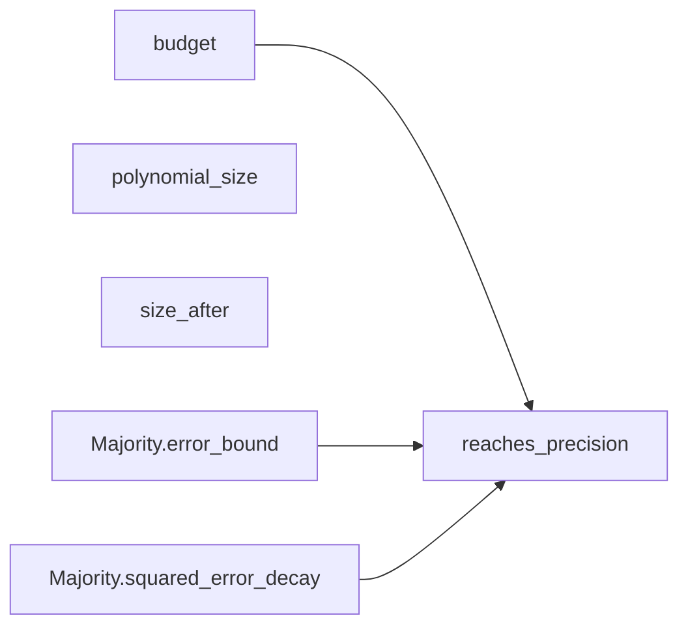

- [budget](../../integrations/qatlib/FQChemKitaev/AmplificationBounds.lean#L43) (private)
- [polynomial_size](../../integrations/qatlib/FQChemKitaev/AmplificationBounds.lean#L31)
- [reaches_precision](../../integrations/qatlib/FQChemKitaev/AmplificationBounds.lean#L72)
- [size_after](../../integrations/qatlib/FQChemKitaev/AmplificationBounds.lean#L20)
- [Majority.error_bound](../../integrations/qatlib/FQChemKitaev/Majority.lean#L220)
- [Majority.squared_error_decay](../../integrations/qatlib/FQChemKitaev/Majority.lean#L247)

## FQChemKitaev.AmplifierCost

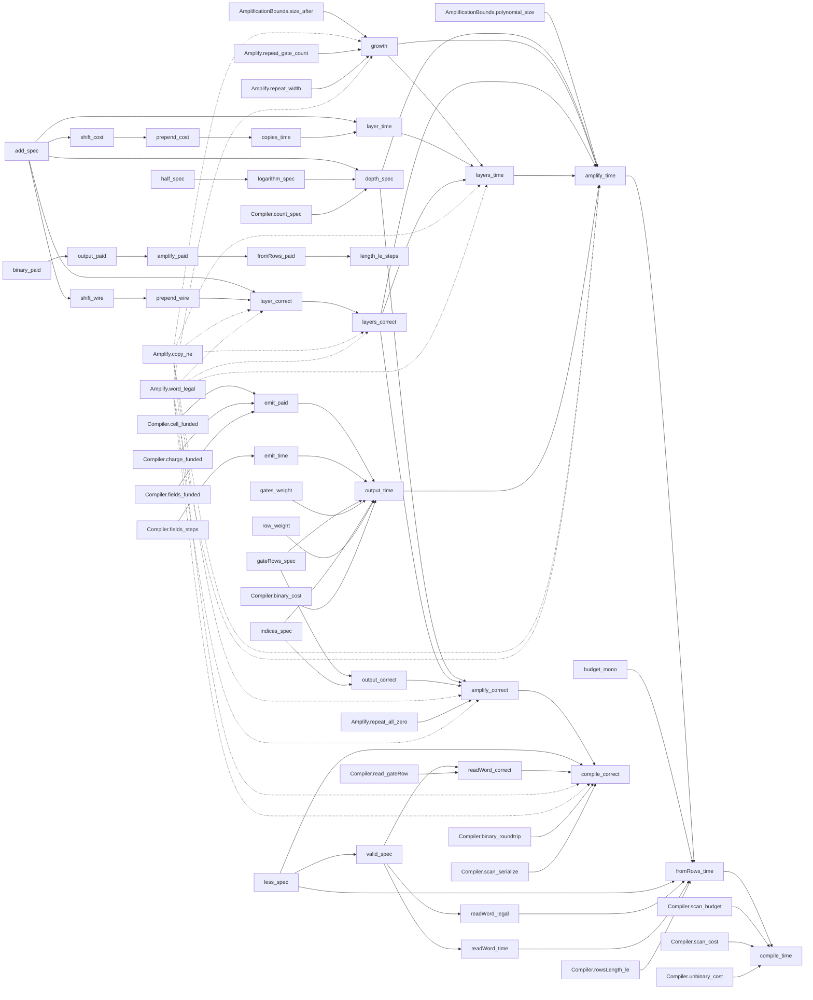

- [AmplificationBounds.polynomial_size](../../integrations/qatlib/FQChemKitaev/AmplificationBounds.lean#L31)
- [AmplificationBounds.size_after](../../integrations/qatlib/FQChemKitaev/AmplificationBounds.lean#L20)
- [add_spec](../../integrations/qatlib/FQChemKitaev/AmplifierCost.lean#L34) (private)
- [amplify_correct](../../integrations/qatlib/FQChemKitaev/AmplifierCost.lean#L330)
- [amplify_paid](../../integrations/qatlib/FQChemKitaev/AmplifierCost.lean#L536) (private)
- [amplify_time](../../integrations/qatlib/FQChemKitaev/AmplifierCost.lean#L341)
- [binary_paid](../../integrations/qatlib/FQChemKitaev/AmplifierCost.lean#L527) (private)
- [budget_mono](../../integrations/qatlib/FQChemKitaev/AmplifierCost.lean#L482) (private)
- [compile_correct](../../integrations/qatlib/FQChemKitaev/AmplifierCost.lean#L473)
- [compile_time](../../integrations/qatlib/FQChemKitaev/AmplifierCost.lean#L515)
- [copies_time](../../integrations/qatlib/FQChemKitaev/AmplifierCost.lean#L115) (private)
- [depth_spec](../../integrations/qatlib/FQChemKitaev/AmplifierCost.lean#L211) (private)
- [emit_paid](../../integrations/qatlib/FQChemKitaev/AmplifierCost.lean#L259) (private)
- [emit_time](../../integrations/qatlib/FQChemKitaev/AmplifierCost.lean#L264) (private)
- [fromRows_paid](../../integrations/qatlib/FQChemKitaev/AmplifierCost.lean#L540) (private)
- [fromRows_time](../../integrations/qatlib/FQChemKitaev/AmplifierCost.lean#L484) (private)
- [gateRows_spec](../../integrations/qatlib/FQChemKitaev/AmplifierCost.lean#L240) (private)
- [gates_weight](../../integrations/qatlib/FQChemKitaev/AmplifierCost.lean#L282) (private)
- [growth](../../integrations/qatlib/FQChemKitaev/AmplifierCost.lean#L143) (private)
- [half_spec](../../integrations/qatlib/FQChemKitaev/AmplifierCost.lean#L167) (private)
- [indices_spec](../../integrations/qatlib/FQChemKitaev/AmplifierCost.lean#L230) (private)
- [layer_correct](../../integrations/qatlib/FQChemKitaev/AmplifierCost.lean#L102)
- [layer_time](../../integrations/qatlib/FQChemKitaev/AmplifierCost.lean#L123) (private)
- [layers_correct](../../integrations/qatlib/FQChemKitaev/AmplifierCost.lean#L137)
- [layers_time](../../integrations/qatlib/FQChemKitaev/AmplifierCost.lean#L148) (private)
- [length_le_steps](../../integrations/qatlib/FQChemKitaev/AmplifierCost.lean#L552)
- [less_spec](../../integrations/qatlib/FQChemKitaev/AmplifierCost.lean#L367) (private)
- [logarithm_spec](../../integrations/qatlib/FQChemKitaev/AmplifierCost.lean#L180) (private)
- [output_correct](../../integrations/qatlib/FQChemKitaev/AmplifierCost.lean#L252) (private)
- [output_paid](../../integrations/qatlib/FQChemKitaev/AmplifierCost.lean#L532) (private)
- [output_time](../../integrations/qatlib/FQChemKitaev/AmplifierCost.lean#L300) (private)
- [prepend_cost](../../integrations/qatlib/FQChemKitaev/AmplifierCost.lean#L69) (private)
- [prepend_wire](../../integrations/qatlib/FQChemKitaev/AmplifierCost.lean#L78) (private)
- [readWord_correct](../../integrations/qatlib/FQChemKitaev/AmplifierCost.lean#L435) (private)
- [readWord_legal](../../integrations/qatlib/FQChemKitaev/AmplifierCost.lean#L422) (private)
- [readWord_time](../../integrations/qatlib/FQChemKitaev/AmplifierCost.lean#L445) (private)
- [row_weight](../../integrations/qatlib/FQChemKitaev/AmplifierCost.lean#L273) (private)
- [shift_cost](../../integrations/qatlib/FQChemKitaev/AmplifierCost.lean#L47) (private)
- [shift_wire](../../integrations/qatlib/FQChemKitaev/AmplifierCost.lean#L50) (private)
- [valid_spec](../../integrations/qatlib/FQChemKitaev/AmplifierCost.lean#L387) (private)
- [Amplify.copy_ne](../../integrations/qatlib/FQChemKitaev/Amplify.lean#L31) (private)
- [Amplify.repeat_all_zero](../../integrations/qatlib/FQChemKitaev/Amplify.lean#L243)
- [Amplify.repeat_gate_count](../../integrations/qatlib/FQChemKitaev/Amplify.lean#L236)
- [Amplify.repeat_width](../../integrations/qatlib/FQChemKitaev/Amplify.lean#L240)
- [Amplify.word_legal](../../integrations/qatlib/FQChemKitaev/Amplify.lean#L139)
- [Compiler.binary_cost](../../integrations/qatlib/FQChemKitaev/Compiler.lean#L636) (private)
- [Compiler.binary_roundtrip](../../integrations/qatlib/FQChemKitaev/Compiler.lean#L633)
- [Compiler.cell_funded](../../integrations/qatlib/FQChemKitaev/Compiler.lean#L523) (private)
- [Compiler.charge_funded](../../integrations/qatlib/FQChemKitaev/Compiler.lean#L520) (private)
- [Compiler.count_spec](../../integrations/qatlib/FQChemKitaev/Compiler.lean#L176)
- [Compiler.fields_funded](../../integrations/qatlib/FQChemKitaev/Compiler.lean#L529) (private)
- [Compiler.fields_steps](../../integrations/qatlib/FQChemKitaev/Compiler.lean#L349) (private)
- [Compiler.read_gateRow](../../integrations/qatlib/FQChemKitaev/Compiler.lean#L133)
- [Compiler.rowsLength_le](../../integrations/qatlib/FQChemKitaev/Compiler.lean#L325) (private)
- [Compiler.scan_budget](../../integrations/qatlib/FQChemKitaev/Compiler.lean#L339) (private)
- [Compiler.scan_cost](../../integrations/qatlib/FQChemKitaev/Compiler.lean#L87)
- [Compiler.scan_serialize](../../integrations/qatlib/FQChemKitaev/Compiler.lean#L113)
- [Compiler.unbinary_cost](../../integrations/qatlib/FQChemKitaev/Compiler.lean#L639) (private)

## FQChemKitaev.Amplify

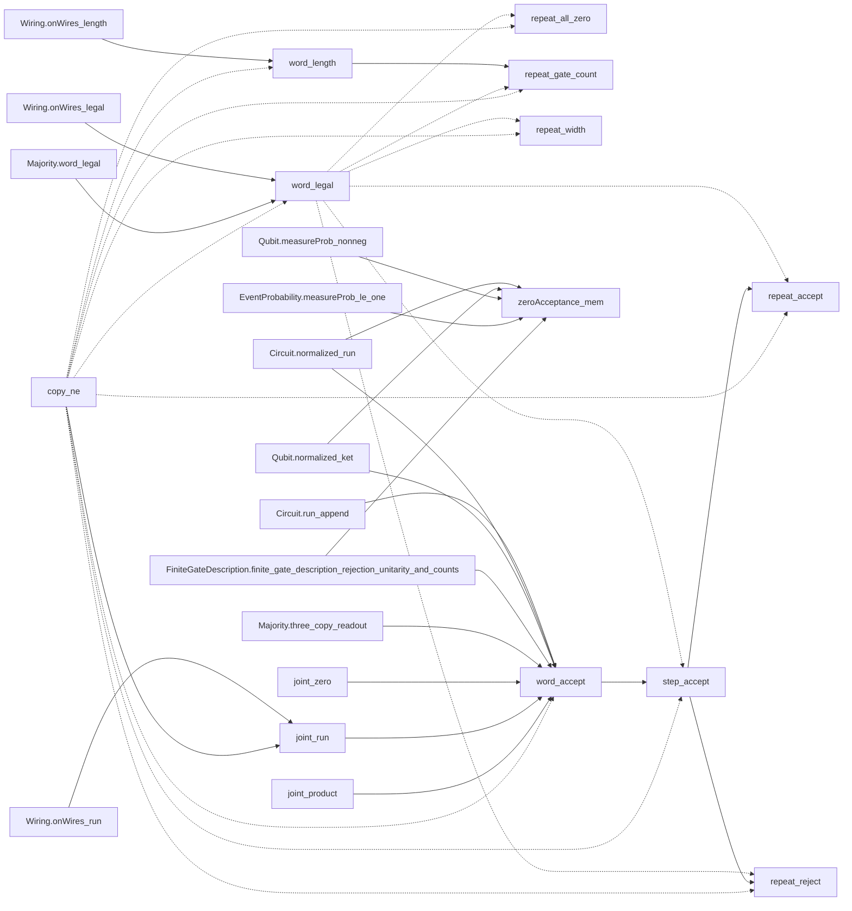

- [copy_ne](../../integrations/qatlib/FQChemKitaev/Amplify.lean#L31) (private)
- [joint_product](../../integrations/qatlib/FQChemKitaev/Amplify.lean#L166) (private)
- [joint_run](../../integrations/qatlib/FQChemKitaev/Amplify.lean#L81) (private)
- [joint_zero](../../integrations/qatlib/FQChemKitaev/Amplify.lean#L146) (private)
- [repeat_accept](../../integrations/qatlib/FQChemKitaev/Amplify.lean#L259)
- [repeat_all_zero](../../integrations/qatlib/FQChemKitaev/Amplify.lean#L243)
- [repeat_gate_count](../../integrations/qatlib/FQChemKitaev/Amplify.lean#L236)
- [repeat_reject](../../integrations/qatlib/FQChemKitaev/Amplify.lean#L265)
- [repeat_width](../../integrations/qatlib/FQChemKitaev/Amplify.lean#L240)
- [step_accept](../../integrations/qatlib/FQChemKitaev/Amplify.lean#L255)
- [word_accept](../../integrations/qatlib/FQChemKitaev/Amplify.lean#L183)
- [word_legal](../../integrations/qatlib/FQChemKitaev/Amplify.lean#L139)
- [word_length](../../integrations/qatlib/FQChemKitaev/Amplify.lean#L136)
- [zeroAcceptance_mem](../../integrations/qatlib/FQChemKitaev/Amplify.lean#L248)
- [Majority.three_copy_readout](../../integrations/qatlib/FQChemKitaev/Majority.lean#L187)
- [Majority.word_legal](../../integrations/qatlib/FQChemKitaev/Majority.lean#L70)
- [Wiring.onWires_legal](../../integrations/qatlib/FQChemKitaev/Wiring.lean#L162)
- [Wiring.onWires_length](../../integrations/qatlib/FQChemKitaev/Wiring.lean#L168)
- [Wiring.onWires_run](../../integrations/qatlib/FQChemKitaev/Wiring.lean#L173)
- [FiniteGateDescription.finite_gate_description_rejection_unitarity_and_counts](https://github.com/quantum-atlas-ai/qatlib/blob/f76f71a7c5cd19a31c251d0feeab09c75a758d69/Qatlib/Concepts/GateVocabulary/FiniteGateDescription.lean#L129)
- [EventProbability.measureProb_le_one](https://github.com/quantum-atlas-ai/qatlib/blob/f76f71a7c5cd19a31c251d0feeab09c75a758d69/Qatlib/Foundations/BornMetrics/EventProbability.lean#L45)
- [Qubit.measureProb_nonneg](https://github.com/quantum-atlas-ai/qatlib/blob/f76f71a7c5cd19a31c251d0feeab09c75a758d69/Qatlib/Foundations/PureStateMath/Qubit.lean#L167)
- [Qubit.normalized_ket](https://github.com/quantum-atlas-ai/qatlib/blob/f76f71a7c5cd19a31c251d0feeab09c75a758d69/Qatlib/Foundations/PureStateMath/Qubit.lean#L152)
- [Circuit.normalized_run](https://github.com/quantum-atlas-ai/qatlib/blob/f76f71a7c5cd19a31c251d0feeab09c75a758d69/Qatlib/Foundations/QueryWordCore/Circuit.lean)
- [Circuit.run_append](https://github.com/quantum-atlas-ai/qatlib/blob/f76f71a7c5cd19a31c251d0feeab09c75a758d69/Qatlib/Foundations/QueryWordCore/Circuit.lean#L249)

## FQChemKitaev.BoundedErrorReduction

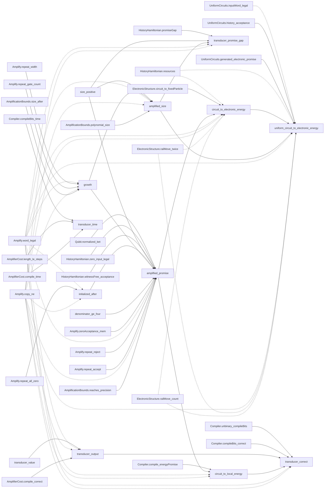

- [ElectronicStructure.railMove_count](../../FQChem/Complexity/ElectronicStructure.lean#L110)
- [ElectronicStructure.railMove_twice](../../FQChem/Complexity/ElectronicStructure.lean#L104)
- [AmplificationBounds.polynomial_size](../../integrations/qatlib/FQChemKitaev/AmplificationBounds.lean#L31)
- [AmplificationBounds.reaches_precision](../../integrations/qatlib/FQChemKitaev/AmplificationBounds.lean#L72)
- [AmplificationBounds.size_after](../../integrations/qatlib/FQChemKitaev/AmplificationBounds.lean#L20)
- [AmplifierCost.compile_correct](../../integrations/qatlib/FQChemKitaev/AmplifierCost.lean#L473)
- [AmplifierCost.compile_time](../../integrations/qatlib/FQChemKitaev/AmplifierCost.lean#L515)
- [AmplifierCost.length_le_steps](../../integrations/qatlib/FQChemKitaev/AmplifierCost.lean#L552)
- [Amplify.copy_ne](../../integrations/qatlib/FQChemKitaev/Amplify.lean#L31) (private)
- [Amplify.repeat_accept](../../integrations/qatlib/FQChemKitaev/Amplify.lean#L259)
- [Amplify.repeat_all_zero](../../integrations/qatlib/FQChemKitaev/Amplify.lean#L243)
- [Amplify.repeat_gate_count](../../integrations/qatlib/FQChemKitaev/Amplify.lean#L236)
- [Amplify.repeat_reject](../../integrations/qatlib/FQChemKitaev/Amplify.lean#L265)
- [Amplify.repeat_width](../../integrations/qatlib/FQChemKitaev/Amplify.lean#L240)
- [Amplify.word_legal](../../integrations/qatlib/FQChemKitaev/Amplify.lean#L139)
- [Amplify.zeroAcceptance_mem](../../integrations/qatlib/FQChemKitaev/Amplify.lean#L248)
- [amplified_promise](../../integrations/qatlib/FQChemKitaev/BoundedErrorReduction.lean#L49)
- [amplified_size](../../integrations/qatlib/FQChemKitaev/BoundedErrorReduction.lean#L35)
- [circuit_to_electronic_energy](../../integrations/qatlib/FQChemKitaev/BoundedErrorReduction.lean#L143)
- [circuit_to_local_energy](../../integrations/qatlib/FQChemKitaev/BoundedErrorReduction.lean#L79)
- [denominator_ge_four](../../integrations/qatlib/FQChemKitaev/BoundedErrorReduction.lean#L44) (private)
- [growth](../../integrations/qatlib/FQChemKitaev/BoundedErrorReduction.lean#L29) (private)
- [initialized_after](../../integrations/qatlib/FQChemKitaev/BoundedErrorReduction.lean#L38) (private)
- [size_positive](../../integrations/qatlib/FQChemKitaev/BoundedErrorReduction.lean#L27) (private)
- [transducer_correct](../../integrations/qatlib/FQChemKitaev/BoundedErrorReduction.lean#L116)
- [transducer_output](../../integrations/qatlib/FQChemKitaev/BoundedErrorReduction.lean#L94) (private)
- [transducer_promise_gap](../../integrations/qatlib/FQChemKitaev/BoundedErrorReduction.lean#L130)
- [transducer_time](../../integrations/qatlib/FQChemKitaev/BoundedErrorReduction.lean#L101)
- [transducer_value](../../integrations/qatlib/FQChemKitaev/BoundedErrorReduction.lean#L91) (private)
- [uniform_circuit_to_electronic_energy](../../integrations/qatlib/FQChemKitaev/BoundedErrorReduction.lean#L156)
- [Compiler.compileBits_correct](../../integrations/qatlib/FQChemKitaev/Compiler.lean#L661)
- [Compiler.compileBits_time](../../integrations/qatlib/FQChemKitaev/Compiler.lean#L667)
- [Compiler.compile_energyPromise](../../integrations/qatlib/FQChemKitaev/Compiler.lean#L480)
- [Compiler.unbinary_compileBits](../../integrations/qatlib/FQChemKitaev/Compiler.lean#L656)
- [ElectronicStructure.circuit_to_fixedParticle](../../integrations/qatlib/FQChemKitaev/ElectronicStructure.lean#L198)
- [HistoryHamiltonian.promiseGap](../../integrations/qatlib/FQChemKitaev/HistoryHamiltonian.lean#L97)
- [HistoryHamiltonian.resources](../../integrations/qatlib/FQChemKitaev/HistoryHamiltonian.lean#L79)
- [HistoryHamiltonian.witnessFree_acceptance](../../integrations/qatlib/FQChemKitaev/HistoryHamiltonian.lean#L187)
- [HistoryHamiltonian.zero_input_legal](../../integrations/qatlib/FQChemKitaev/HistoryHamiltonian.lean#L178)
- [UniformCircuits.generated_electronic_promise](../../integrations/qatlib/FQChemKitaev/UniformCircuits.lean#L139)
- [UniformCircuits.history_acceptance](../../integrations/qatlib/FQChemKitaev/UniformCircuits.lean#L123)
- [UniformCircuits.inputWord_legal](../../integrations/qatlib/FQChemKitaev/UniformCircuits.lean#L60)
- [Qubit.normalized_ket](https://github.com/quantum-atlas-ai/qatlib/blob/f76f71a7c5cd19a31c251d0feeab09c75a758d69/Qatlib/Foundations/PureStateMath/Qubit.lean#L152)

## FQChemKitaev.Compiler

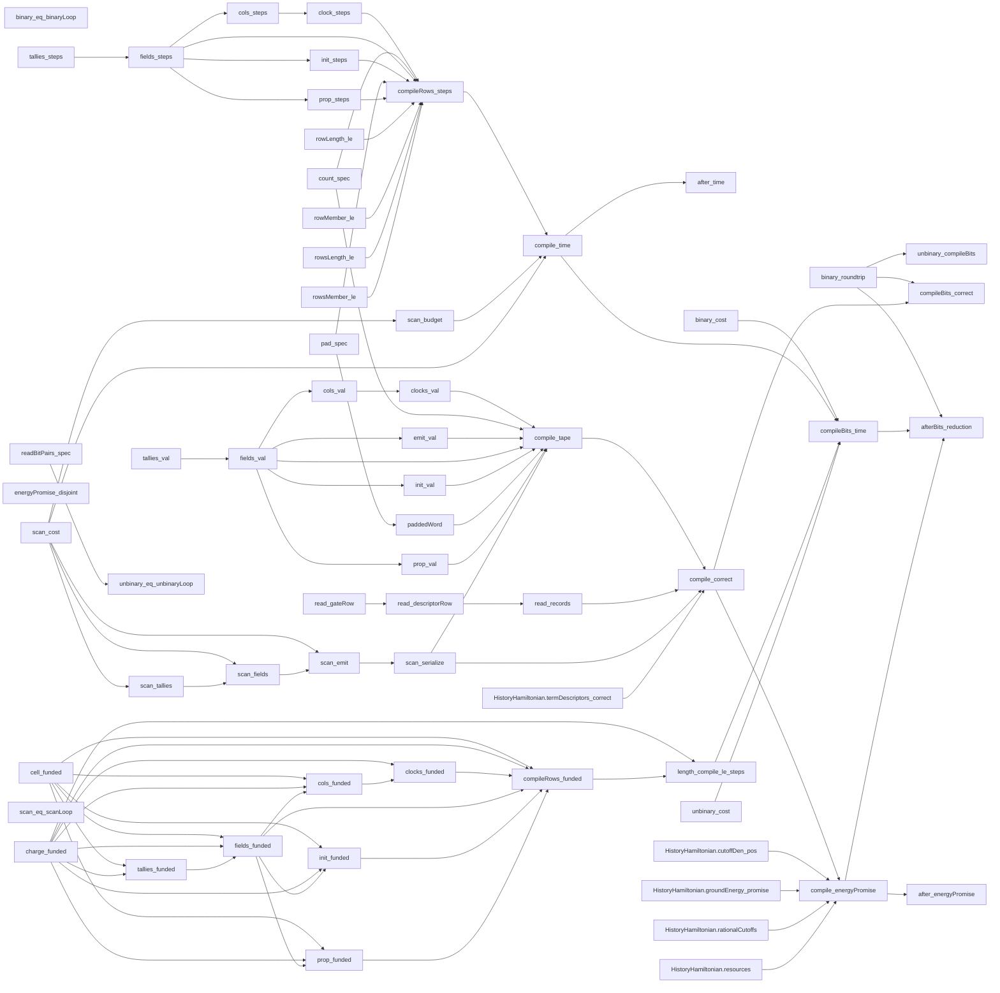

- [afterBits_reduction](../../integrations/qatlib/FQChemKitaev/Compiler.lean#L683)
- [after_energyPromise](../../integrations/qatlib/FQChemKitaev/Compiler.lean#L512)
- [after_time](../../integrations/qatlib/FQChemKitaev/Compiler.lean#L502)
- [binary_cost](../../integrations/qatlib/FQChemKitaev/Compiler.lean#L636) (private)
- [binary_eq_binaryLoop](../../integrations/qatlib/FQChemKitaev/Compiler.lean#L603)
- [binary_roundtrip](../../integrations/qatlib/FQChemKitaev/Compiler.lean#L633)
- [cell_funded](../../integrations/qatlib/FQChemKitaev/Compiler.lean#L523) (private)
- [charge_funded](../../integrations/qatlib/FQChemKitaev/Compiler.lean#L520) (private)
- [clock_steps](../../integrations/qatlib/FQChemKitaev/Compiler.lean#L392) (private)
- [clocks_funded](../../integrations/qatlib/FQChemKitaev/Compiler.lean#L552) (private)
- [clocks_val](../../integrations/qatlib/FQChemKitaev/Compiler.lean#L261) (private)
- [cols_funded](../../integrations/qatlib/FQChemKitaev/Compiler.lean#L546) (private)
- [cols_steps](../../integrations/qatlib/FQChemKitaev/Compiler.lean#L380) (private)
- [cols_val](../../integrations/qatlib/FQChemKitaev/Compiler.lean#L252) (private)
- [compileBits_correct](../../integrations/qatlib/FQChemKitaev/Compiler.lean#L661)
- [compileBits_time](../../integrations/qatlib/FQChemKitaev/Compiler.lean#L667)
- [compileRows_funded](../../integrations/qatlib/FQChemKitaev/Compiler.lean#L558) (private)
- [compileRows_steps](../../integrations/qatlib/FQChemKitaev/Compiler.lean#L403) (private)
- [compile_correct](../../integrations/qatlib/FQChemKitaev/Compiler.lean#L295)
- [compile_energyPromise](../../integrations/qatlib/FQChemKitaev/Compiler.lean#L480)
- [compile_tape](../../integrations/qatlib/FQChemKitaev/Compiler.lean#L277)
- [compile_time](../../integrations/qatlib/FQChemKitaev/Compiler.lean#L451)
- [count_spec](../../integrations/qatlib/FQChemKitaev/Compiler.lean#L176)
- [emit_val](../../integrations/qatlib/FQChemKitaev/Compiler.lean#L235) (private)
- [energyPromise_disjoint](../../integrations/qatlib/FQChemKitaev/Compiler.lean#L473)
- [fields_funded](../../integrations/qatlib/FQChemKitaev/Compiler.lean#L529) (private)
- [fields_steps](../../integrations/qatlib/FQChemKitaev/Compiler.lean#L349) (private)
- [fields_val](../../integrations/qatlib/FQChemKitaev/Compiler.lean#L231) (private)
- [init_funded](../../integrations/qatlib/FQChemKitaev/Compiler.lean#L540) (private)
- [init_steps](../../integrations/qatlib/FQChemKitaev/Compiler.lean#L368) (private)
- [init_val](../../integrations/qatlib/FQChemKitaev/Compiler.lean#L248) (private)
- [length_compile_le_steps](../../integrations/qatlib/FQChemKitaev/Compiler.lean#L570)
- [pad_spec](../../integrations/qatlib/FQChemKitaev/Compiler.lean#L185)
- [paddedWord](../../integrations/qatlib/FQChemKitaev/Compiler.lean#L271) (private)
- [prop_funded](../../integrations/qatlib/FQChemKitaev/Compiler.lean#L534) (private)
- [prop_steps](../../integrations/qatlib/FQChemKitaev/Compiler.lean#L355) (private)
- [prop_val](../../integrations/qatlib/FQChemKitaev/Compiler.lean#L239) (private)
- [readBitPairs_spec](../../integrations/qatlib/FQChemKitaev/Compiler.lean#L615) (private)
- [read_descriptorRow](../../integrations/qatlib/FQChemKitaev/Compiler.lean#L150)
- [read_gateRow](../../integrations/qatlib/FQChemKitaev/Compiler.lean#L133)
- [read_records](../../integrations/qatlib/FQChemKitaev/Compiler.lean#L289) (private)
- [rowLength_le](../../integrations/qatlib/FQChemKitaev/Compiler.lean#L312) (private)
- [rowMember_le](../../integrations/qatlib/FQChemKitaev/Compiler.lean#L315) (private)
- [rowsLength_le](../../integrations/qatlib/FQChemKitaev/Compiler.lean#L325) (private)
- [rowsMember_le](../../integrations/qatlib/FQChemKitaev/Compiler.lean#L328) (private)
- [scan_budget](../../integrations/qatlib/FQChemKitaev/Compiler.lean#L339) (private)
- [scan_cost](../../integrations/qatlib/FQChemKitaev/Compiler.lean#L87)
- [scan_emit](../../integrations/qatlib/FQChemKitaev/Compiler.lean#L104) (private)
- [scan_eq_scanLoop](../../integrations/qatlib/FQChemKitaev/Compiler.lean#L81)
- [scan_fields](../../integrations/qatlib/FQChemKitaev/Compiler.lean#L97) (private)
- [scan_serialize](../../integrations/qatlib/FQChemKitaev/Compiler.lean#L113)
- [scan_tallies](../../integrations/qatlib/FQChemKitaev/Compiler.lean#L90) (private)
- [tallies_funded](../../integrations/qatlib/FQChemKitaev/Compiler.lean#L526) (private)
- [tallies_steps](../../integrations/qatlib/FQChemKitaev/Compiler.lean#L345) (private)
- [tallies_val](../../integrations/qatlib/FQChemKitaev/Compiler.lean#L227) (private)
- [unbinary_compileBits](../../integrations/qatlib/FQChemKitaev/Compiler.lean#L656)
- [unbinary_cost](../../integrations/qatlib/FQChemKitaev/Compiler.lean#L639) (private)
- [unbinary_eq_unbinaryLoop](../../integrations/qatlib/FQChemKitaev/Compiler.lean#L629)
- [HistoryHamiltonian.cutoffDen_pos](../../integrations/qatlib/FQChemKitaev/HistoryHamiltonian.lean#L233)
- [HistoryHamiltonian.groundEnergy_promise](../../integrations/qatlib/FQChemKitaev/HistoryHamiltonian.lean#L139)
- [HistoryHamiltonian.rationalCutoffs](../../integrations/qatlib/FQChemKitaev/HistoryHamiltonian.lean#L238)
- [HistoryHamiltonian.resources](../../integrations/qatlib/FQChemKitaev/HistoryHamiltonian.lean#L79)
- [HistoryHamiltonian.termDescriptors_correct](../../integrations/qatlib/FQChemKitaev/HistoryHamiltonian.lean#L342)

## FQChemKitaev.DyadicCoefficients

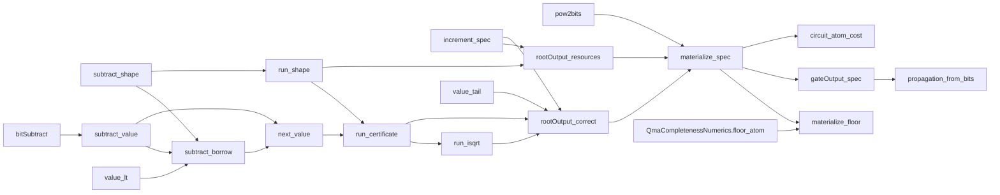

- [bitSubtract](../../integrations/qatlib/FQChemKitaev/DyadicCoefficients.lean#L43) (private)
- [circuit_atom_cost](../../integrations/qatlib/FQChemKitaev/DyadicCoefficients.lean#L296)
- [gateOutput_spec](../../integrations/qatlib/FQChemKitaev/DyadicCoefficients.lean#L282)
- [increment_spec](../../integrations/qatlib/FQChemKitaev/DyadicCoefficients.lean#L196)
- [materialize_floor](../../integrations/qatlib/FQChemKitaev/DyadicCoefficients.lean#L272)
- [materialize_spec](../../integrations/qatlib/FQChemKitaev/DyadicCoefficients.lean#L262)
- [next_value](../../integrations/qatlib/FQChemKitaev/DyadicCoefficients.lean#L128) (private)
- [pow2bits](../../integrations/qatlib/FQChemKitaev/DyadicCoefficients.lean#L256) (private)
- [propagation_from_bits](../../integrations/qatlib/FQChemKitaev/DyadicCoefficients.lean#L306)
- [rootOutput_correct](../../integrations/qatlib/FQChemKitaev/DyadicCoefficients.lean#L224)
- [rootOutput_resources](../../integrations/qatlib/FQChemKitaev/DyadicCoefficients.lean#L240)
- [run_certificate](../../integrations/qatlib/FQChemKitaev/DyadicCoefficients.lean#L165)
- [run_isqrt](../../integrations/qatlib/FQChemKitaev/DyadicCoefficients.lean#L177)
- [run_shape](../../integrations/qatlib/FQChemKitaev/DyadicCoefficients.lean#L115)
- [subtract_borrow](../../integrations/qatlib/FQChemKitaev/DyadicCoefficients.lean#L88)
- [subtract_shape](../../integrations/qatlib/FQChemKitaev/DyadicCoefficients.lean#L63)
- [subtract_value](../../integrations/qatlib/FQChemKitaev/DyadicCoefficients.lean#L72)
- [value_lt](../../integrations/qatlib/FQChemKitaev/DyadicCoefficients.lean#L35)
- [value_tail](../../integrations/qatlib/FQChemKitaev/DyadicCoefficients.lean#L203) (private)
- [QmaCompletenessNumerics.floor_atom](https://github.com/quantum-atlas-ai/qatlib/blob/f76f71a7c5cd19a31c251d0feeab09c75a758d69/Qatlib/Concepts/UniformBqp/FiniteGateWord/QmaCompletenessNumerics.lean#L191)

## FQChemKitaev.ElectronicStructure

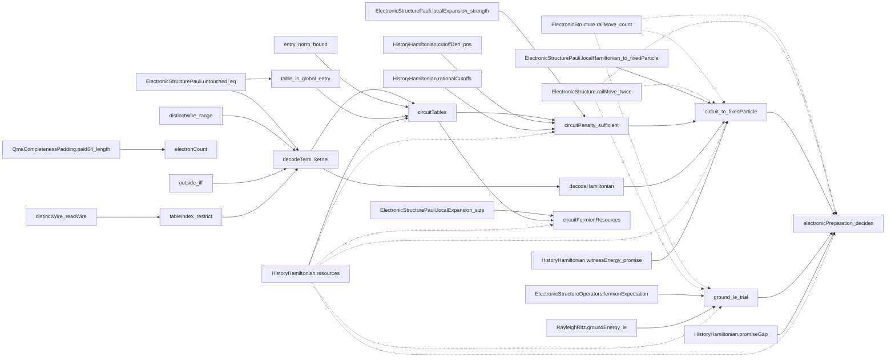

- [ElectronicStructure.railMove_count](../../FQChem/Complexity/ElectronicStructure.lean#L110)
- [ElectronicStructure.railMove_twice](../../FQChem/Complexity/ElectronicStructure.lean#L104)
- [ElectronicStructureOperators.fermionExpectation](../../FQChem/Complexity/ElectronicStructureOperators.lean#L167)
- [ElectronicStructurePauli.localExpansion_size](../../FQChem/Complexity/ElectronicStructurePauli.lean#L198)
- [ElectronicStructurePauli.localExpansion_strength](../../FQChem/Complexity/ElectronicStructurePauli.lean#L232)
- [ElectronicStructurePauli.localHamiltonian_to_fixedParticle](../../FQChem/Complexity/ElectronicStructurePauli.lean#L209)
- [ElectronicStructurePauli.untouched_eq](../../FQChem/Complexity/ElectronicStructurePauli.lean#L114)
- [RayleighRitz.groundEnergy_le](../../FQChem/StatePrep/VariationalOptimization/RayleighRitz.lean#L49)
- [circuitFermionResources](../../integrations/qatlib/FQChemKitaev/ElectronicStructure.lean#L187)
- [circuitPenalty_sufficient](../../integrations/qatlib/FQChemKitaev/ElectronicStructure.lean#L161) (private)
- [circuitTables](../../integrations/qatlib/FQChemKitaev/ElectronicStructure.lean#L150)
- [circuit_to_fixedParticle](../../integrations/qatlib/FQChemKitaev/ElectronicStructure.lean#L198)
- [decodeHamiltonian](../../integrations/qatlib/FQChemKitaev/ElectronicStructure.lean#L112)
- [decodeTerm_kernel](../../integrations/qatlib/FQChemKitaev/ElectronicStructure.lean#L97)
- [distinctWire_range](../../integrations/qatlib/FQChemKitaev/ElectronicStructure.lean#L48)
- [distinctWire_readWire](../../integrations/qatlib/FQChemKitaev/ElectronicStructure.lean#L43)
- [electronCount](../../integrations/qatlib/FQChemKitaev/ElectronicStructure.lean#L176)
- [electronicPreparation_decides](../../integrations/qatlib/FQChemKitaev/ElectronicStructure.lean#L224)
- [entry_norm_bound](../../integrations/qatlib/FQChemKitaev/ElectronicStructure.lean#L138) (private)
- [ground_le_trial](../../integrations/qatlib/FQChemKitaev/ElectronicStructure.lean#L211) (private)
- [outside_iff](../../integrations/qatlib/FQChemKitaev/ElectronicStructure.lean#L83) (private)
- [tableIndex_restrict](../../integrations/qatlib/FQChemKitaev/ElectronicStructure.lean#L61)
- [table_is_global_entry](../../integrations/qatlib/FQChemKitaev/ElectronicStructure.lean#L128) (private)
- [HistoryHamiltonian.cutoffDen_pos](../../integrations/qatlib/FQChemKitaev/HistoryHamiltonian.lean#L233)
- [HistoryHamiltonian.promiseGap](../../integrations/qatlib/FQChemKitaev/HistoryHamiltonian.lean#L97)
- [HistoryHamiltonian.rationalCutoffs](../../integrations/qatlib/FQChemKitaev/HistoryHamiltonian.lean#L238)
- [HistoryHamiltonian.resources](../../integrations/qatlib/FQChemKitaev/HistoryHamiltonian.lean#L79)
- [HistoryHamiltonian.witnessEnergy_promise](../../integrations/qatlib/FQChemKitaev/HistoryHamiltonian.lean#L123)
- [QmaCompletenessPadding.paid64_length](https://github.com/quantum-atlas-ai/qatlib/blob/f76f71a7c5cd19a31c251d0feeab09c75a758d69/Qatlib/Papers/LocalHam06/MainResults/QmaCompletenessPadding.lean#L103)

## FQChemKitaev.HistoryHamiltonian

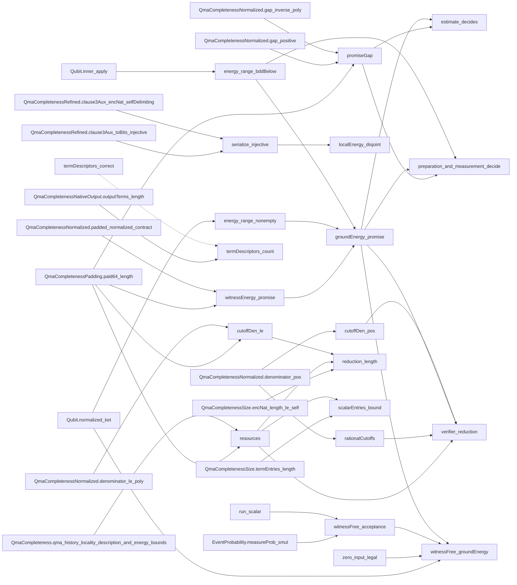

- [cutoffDen_le](../../integrations/qatlib/FQChemKitaev/HistoryHamiltonian.lean#L246)
- [cutoffDen_pos](../../integrations/qatlib/FQChemKitaev/HistoryHamiltonian.lean#L233)
- [energy_range_bddBelow](../../integrations/qatlib/FQChemKitaev/HistoryHamiltonian.lean#L39) (private)
- [energy_range_nonempty](../../integrations/qatlib/FQChemKitaev/HistoryHamiltonian.lean#L35) (private)
- [estimate_decides](../../integrations/qatlib/FQChemKitaev/HistoryHamiltonian.lean#L154)
- [groundEnergy_promise](../../integrations/qatlib/FQChemKitaev/HistoryHamiltonian.lean#L139)
- [localEnergy_disjoint](../../integrations/qatlib/FQChemKitaev/HistoryHamiltonian.lean#L291)
- [preparation_and_measurement_decide](../../integrations/qatlib/FQChemKitaev/HistoryHamiltonian.lean#L389)
- [promiseGap](../../integrations/qatlib/FQChemKitaev/HistoryHamiltonian.lean#L97)
- [rationalCutoffs](../../integrations/qatlib/FQChemKitaev/HistoryHamiltonian.lean#L238)
- [reduction_length](../../integrations/qatlib/FQChemKitaev/HistoryHamiltonian.lean#L274)
- [resources](../../integrations/qatlib/FQChemKitaev/HistoryHamiltonian.lean#L79)
- [run_scalar](../../integrations/qatlib/FQChemKitaev/HistoryHamiltonian.lean#L172) (private)
- [scalarEntries_bound](../../integrations/qatlib/FQChemKitaev/HistoryHamiltonian.lean#L358)
- [serialize_injective](../../integrations/qatlib/FQChemKitaev/HistoryHamiltonian.lean#L268)
- [termDescriptors_correct](../../integrations/qatlib/FQChemKitaev/HistoryHamiltonian.lean#L342)
- [termDescriptors_count](../../integrations/qatlib/FQChemKitaev/HistoryHamiltonian.lean#L350)
- [verifier_reduction](../../integrations/qatlib/FQChemKitaev/HistoryHamiltonian.lean#L300)
- [witnessEnergy_promise](../../integrations/qatlib/FQChemKitaev/HistoryHamiltonian.lean#L123)
- [witnessFree_acceptance](../../integrations/qatlib/FQChemKitaev/HistoryHamiltonian.lean#L187)
- [witnessFree_groundEnergy](../../integrations/qatlib/FQChemKitaev/HistoryHamiltonian.lean#L206)
- [zero_input_legal](../../integrations/qatlib/FQChemKitaev/HistoryHamiltonian.lean#L178)
- [QmaCompletenessRefined.clause3Aux_encNat_selfDelimiting](https://github.com/quantum-atlas-ai/qatlib/blob/f76f71a7c5cd19a31c251d0feeab09c75a758d69/Qatlib/Concepts/QmaCompleteness/HistoryHam/QmaCompletenessRefined.lean#L1056)
- [QmaCompletenessRefined.clause3Aux_toBits_injective](https://github.com/quantum-atlas-ai/qatlib/blob/f76f71a7c5cd19a31c251d0feeab09c75a758d69/Qatlib/Concepts/QmaCompleteness/HistoryHam/QmaCompletenessRefined.lean#L1261)
- [QmaCompletenessNativeOutput.outputTerms_length](https://github.com/quantum-atlas-ai/qatlib/blob/f76f71a7c5cd19a31c251d0feeab09c75a758d69/Qatlib/Concepts/QueryComplexity/DegreeMethod/QmaCompletenessNativeOutput.lean#L274)
- [EventProbability.measureProb_smul](https://github.com/quantum-atlas-ai/qatlib/blob/f76f71a7c5cd19a31c251d0feeab09c75a758d69/Qatlib/Foundations/BornMetrics/EventProbability.lean#L62)
- [Qubit.inner_apply](https://github.com/quantum-atlas-ai/qatlib/blob/f76f71a7c5cd19a31c251d0feeab09c75a758d69/Qatlib/Foundations/PureStateMath/Qubit.lean#L639)
- [Qubit.normalized_ket](https://github.com/quantum-atlas-ai/qatlib/blob/f76f71a7c5cd19a31c251d0feeab09c75a758d69/Qatlib/Foundations/PureStateMath/Qubit.lean#L152)
- [QmaCompleteness.qma_history_locality_description_and_energy_bounds](https://github.com/quantum-atlas-ai/qatlib/blob/f76f71a7c5cd19a31c251d0feeab09c75a758d69/Qatlib/Papers/LocalHam06/MainResults/QmaCompleteness.lean#L98)
- [QmaCompletenessNormalized.denominator_le_poly](https://github.com/quantum-atlas-ai/qatlib/blob/f76f71a7c5cd19a31c251d0feeab09c75a758d69/Qatlib/Papers/LocalHam06/MainResults/QmaCompletenessNormalized.lean#L313)
- [QmaCompletenessNormalized.denominator_pos](https://github.com/quantum-atlas-ai/qatlib/blob/f76f71a7c5cd19a31c251d0feeab09c75a758d69/Qatlib/Papers/LocalHam06/MainResults/QmaCompletenessNormalized.lean#L93)
- [QmaCompletenessNormalized.gap_inverse_poly](https://github.com/quantum-atlas-ai/qatlib/blob/f76f71a7c5cd19a31c251d0feeab09c75a758d69/Qatlib/Papers/LocalHam06/MainResults/QmaCompletenessNormalized.lean#L333)
- [QmaCompletenessNormalized.gap_positive](https://github.com/quantum-atlas-ai/qatlib/blob/f76f71a7c5cd19a31c251d0feeab09c75a758d69/Qatlib/Papers/LocalHam06/MainResults/QmaCompletenessNormalized.lean#L323)
- [QmaCompletenessNormalized.padded_normalized_contract](https://github.com/quantum-atlas-ai/qatlib/blob/f76f71a7c5cd19a31c251d0feeab09c75a758d69/Qatlib/Papers/LocalHam06/MainResults/QmaCompletenessNormalized.lean#L354)
- [QmaCompletenessPadding.paid64_length](https://github.com/quantum-atlas-ai/qatlib/blob/f76f71a7c5cd19a31c251d0feeab09c75a758d69/Qatlib/Papers/LocalHam06/MainResults/QmaCompletenessPadding.lean#L103)
- [QmaCompletenessSize.encNat_length_le_self](https://github.com/quantum-atlas-ai/qatlib/blob/f76f71a7c5cd19a31c251d0feeab09c75a758d69/Qatlib/Papers/LocalHam06/MainResults/QmaCompletenessSize.lean#L97)
- [QmaCompletenessSize.termEntries_length](https://github.com/quantum-atlas-ai/qatlib/blob/f76f71a7c5cd19a31c251d0feeab09c75a758d69/Qatlib/Papers/LocalHam06/MainResults/QmaCompletenessSize.lean#L80)

## FQChemKitaev.Majority

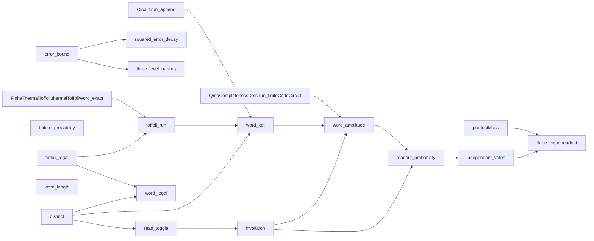

- [distinct](../../integrations/qatlib/FQChemKitaev/Majority.lean#L44) (private)
- [error_bound](../../integrations/qatlib/FQChemKitaev/Majority.lean#L220)
- [failure_probability](../../integrations/qatlib/FQChemKitaev/Majority.lean#L211)
- [independent_votes](../../integrations/qatlib/FQChemKitaev/Majority.lean#L159)
- [involution](../../integrations/qatlib/FQChemKitaev/Majority.lean#L52) (private)
- [productMass](../../integrations/qatlib/FQChemKitaev/Majority.lean#L177) (private)
- [read_toggle](../../integrations/qatlib/FQChemKitaev/Majority.lean#L47) (private)
- [readout_probability](../../integrations/qatlib/FQChemKitaev/Majority.lean#L124)
- [squared_error_decay](../../integrations/qatlib/FQChemKitaev/Majority.lean#L247)
- [three_copy_readout](../../integrations/qatlib/FQChemKitaev/Majority.lean#L187)
- [three_level_halving](../../integrations/qatlib/FQChemKitaev/Majority.lean#L237)
- [toffoli_legal](../../integrations/qatlib/FQChemKitaev/Majority.lean#L63) (private)
- [toffoli_run](../../integrations/qatlib/FQChemKitaev/Majority.lean#L79) (private)
- [word_amplitude](../../integrations/qatlib/FQChemKitaev/Majority.lean#L103)
- [word_ket](../../integrations/qatlib/FQChemKitaev/Majority.lean#L86)
- [word_legal](../../integrations/qatlib/FQChemKitaev/Majority.lean#L70)
- [word_length](../../integrations/qatlib/FQChemKitaev/Majority.lean#L61)
- [QmaCompletenessDefs.run_finiteCodeCircuit](https://github.com/quantum-atlas-ai/qatlib/blob/f76f71a7c5cd19a31c251d0feeab09c75a758d69/Qatlib/Concepts/QmaCompleteness/HistoryHam/QmaCompletenessDefs.lean#L146)
- [FiniteThermalToffoli.thermalToffoliWord_exact](https://github.com/quantum-atlas-ai/qatlib/blob/f76f71a7c5cd19a31c251d0feeab09c75a758d69/Qatlib/Concepts/UniformBqp/FiniteGateWord/FiniteThermal/FiniteThermalToffoli.lean#L60)
- [Circuit.run_append](https://github.com/quantum-atlas-ai/qatlib/blob/f76f71a7c5cd19a31c251d0feeab09c75a758d69/Qatlib/Foundations/QueryWordCore/Circuit.lean#L249)

## FQChemKitaev.UniformCircuits

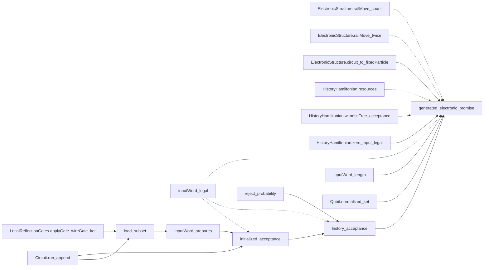

- [ElectronicStructure.railMove_count](../../FQChem/Complexity/ElectronicStructure.lean#L110)
- [ElectronicStructure.railMove_twice](../../FQChem/Complexity/ElectronicStructure.lean#L104)
- [ElectronicStructure.circuit_to_fixedParticle](../../integrations/qatlib/FQChemKitaev/ElectronicStructure.lean#L198)
- [HistoryHamiltonian.resources](../../integrations/qatlib/FQChemKitaev/HistoryHamiltonian.lean#L79)
- [HistoryHamiltonian.witnessFree_acceptance](../../integrations/qatlib/FQChemKitaev/HistoryHamiltonian.lean#L187)
- [HistoryHamiltonian.zero_input_legal](../../integrations/qatlib/FQChemKitaev/HistoryHamiltonian.lean#L178)
- [generated_electronic_promise](../../integrations/qatlib/FQChemKitaev/UniformCircuits.lean#L139)
- [history_acceptance](../../integrations/qatlib/FQChemKitaev/UniformCircuits.lean#L123)
- [initialized_acceptance](../../integrations/qatlib/FQChemKitaev/UniformCircuits.lean#L82)
- [inputWord_legal](../../integrations/qatlib/FQChemKitaev/UniformCircuits.lean#L60)
- [inputWord_length](../../integrations/qatlib/FQChemKitaev/UniformCircuits.lean#L57)
- [inputWord_prepares](../../integrations/qatlib/FQChemKitaev/UniformCircuits.lean#L63)
- [load_subset](../../integrations/qatlib/FQChemKitaev/UniformCircuits.lean#L33) (private)
- [reject_probability](../../integrations/qatlib/FQChemKitaev/UniformCircuits.lean#L110) (private)
- [LocalReflectionGates.applyGate_wireGate_ket](https://github.com/quantum-atlas-ai/qatlib/blob/f76f71a7c5cd19a31c251d0feeab09c75a758d69/Qatlib/Concepts/GateVocabulary/LocalReflectionGates.lean#L343)
- [Qubit.normalized_ket](https://github.com/quantum-atlas-ai/qatlib/blob/f76f71a7c5cd19a31c251d0feeab09c75a758d69/Qatlib/Foundations/PureStateMath/Qubit.lean#L152)
- [Circuit.run_append](https://github.com/quantum-atlas-ai/qatlib/blob/f76f71a7c5cd19a31c251d0feeab09c75a758d69/Qatlib/Foundations/QueryWordCore/Circuit.lean#L249)

## FQChemKitaev.Wiring

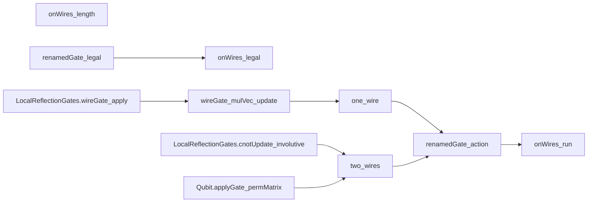

- [onWires_legal](../../integrations/qatlib/FQChemKitaev/Wiring.lean#L162)
- [onWires_length](../../integrations/qatlib/FQChemKitaev/Wiring.lean#L168)
- [onWires_run](../../integrations/qatlib/FQChemKitaev/Wiring.lean#L173)
- [one_wire](../../integrations/qatlib/FQChemKitaev/Wiring.lean#L115) (private)
- [renamedGate_action](../../integrations/qatlib/FQChemKitaev/Wiring.lean#L145) (private)
- [renamedGate_legal](../../integrations/qatlib/FQChemKitaev/Wiring.lean#L133)
- [two_wires](../../integrations/qatlib/FQChemKitaev/Wiring.lean#L124) (private)
- [wireGate_mulVec_update](../../integrations/qatlib/FQChemKitaev/Wiring.lean#L31) (private)
- [LocalReflectionGates.cnotUpdate_involutive](https://github.com/quantum-atlas-ai/qatlib/blob/f76f71a7c5cd19a31c251d0feeab09c75a758d69/Qatlib/Concepts/GateVocabulary/LocalReflectionGates.lean#L184)
- [LocalReflectionGates.wireGate_apply](https://github.com/quantum-atlas-ai/qatlib/blob/f76f71a7c5cd19a31c251d0feeab09c75a758d69/Qatlib/Concepts/GateVocabulary/LocalReflectionGates.lean#L83)
- [Qubit.applyGate_permMatrix](https://github.com/quantum-atlas-ai/qatlib/blob/f76f71a7c5cd19a31c251d0feeab09c75a758d69/Qatlib/Foundations/PureStateMath/Qubit.lean#L307)

## FQChemQatlib.Complexity.QueryAlgorithms

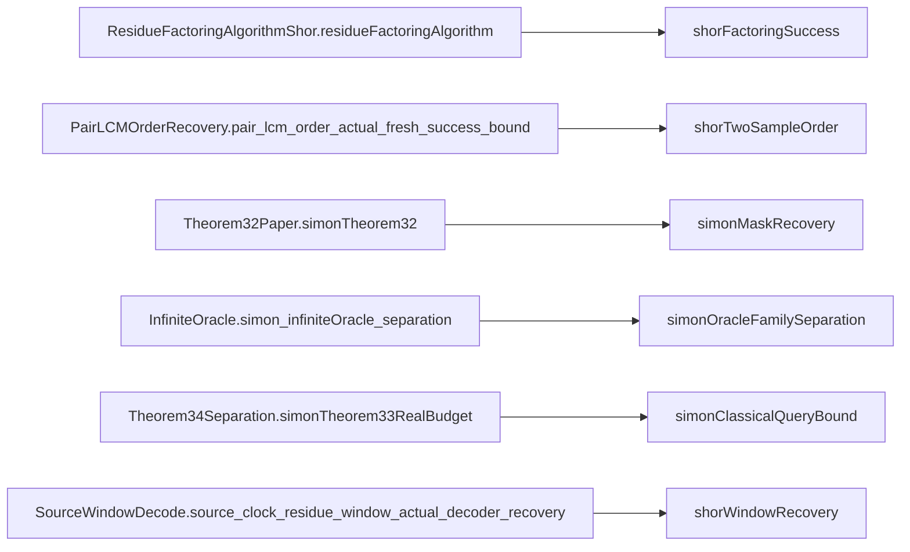

- [shorFactoringSuccess](../../integrations/qatlib/FQChemQatlib/Complexity/QueryAlgorithms.lean#L79)
- [shorTwoSampleOrder](../../integrations/qatlib/FQChemQatlib/Complexity/QueryAlgorithms.lean#L69)
- [shorWindowRecovery](../../integrations/qatlib/FQChemQatlib/Complexity/QueryAlgorithms.lean#L59)
- [simonClassicalQueryBound](../../integrations/qatlib/FQChemQatlib/Complexity/QueryAlgorithms.lean#L41)
- [simonMaskRecovery](../../integrations/qatlib/FQChemQatlib/Complexity/QueryAlgorithms.lean#L34)
- [simonOracleFamilySeparation](../../integrations/qatlib/FQChemQatlib/Complexity/QueryAlgorithms.lean#L49)
- [ResidueFactoringAlgorithmShor.residueFactoringAlgorithm](https://github.com/quantum-atlas-ai/qatlib/blob/f76f71a7c5cd19a31c251d0feeab09c75a758d69/Qatlib/Concepts/PeriodSampling/FactorAlgorithm/ResidueFactoringAlgorithmShor.lean#L132)
- [PairLCMOrderRecovery.pair_lcm_order_actual_fresh_success_bound](https://github.com/quantum-atlas-ai/qatlib/blob/f76f71a7c5cd19a31c251d0feeab09c75a758d69/Qatlib/Concepts/PeriodSampling/OrderRecovery/PairLCMOrderRecovery.lean#L243)
- [Theorem32Paper.simonTheorem32](https://github.com/quantum-atlas-ai/qatlib/blob/f76f71a7c5cd19a31c251d0feeab09c75a758d69/Qatlib/Papers/QPowerSimon97/Recovery/Theorem32Paper.lean#L112)
- [InfiniteOracle.simon_infiniteOracle_separation](https://github.com/quantum-atlas-ai/qatlib/blob/f76f71a7c5cd19a31c251d0feeab09c75a758d69/Qatlib/Papers/QPowerSimon97/StandardModel/InfiniteOracle.lean#L369)
- [Theorem34Separation.simonTheorem33RealBudget](https://github.com/quantum-atlas-ai/qatlib/blob/f76f71a7c5cd19a31c251d0feeab09c75a758d69/Qatlib/Papers/QPowerSimon97/StandardModel/Theorem34Separation.lean#L114)
- [SourceWindowDecode.source_clock_residue_window_actual_decoder_recovery](https://github.com/quantum-atlas-ai/qatlib/blob/f76f71a7c5cd19a31c251d0feeab09c75a758d69/Qatlib/Papers/ShorFactoring97/OrderRecovery/SourceWindowDecode.lean#L299)

## FQChemQatlib.Complexity.SimonOracleMachines

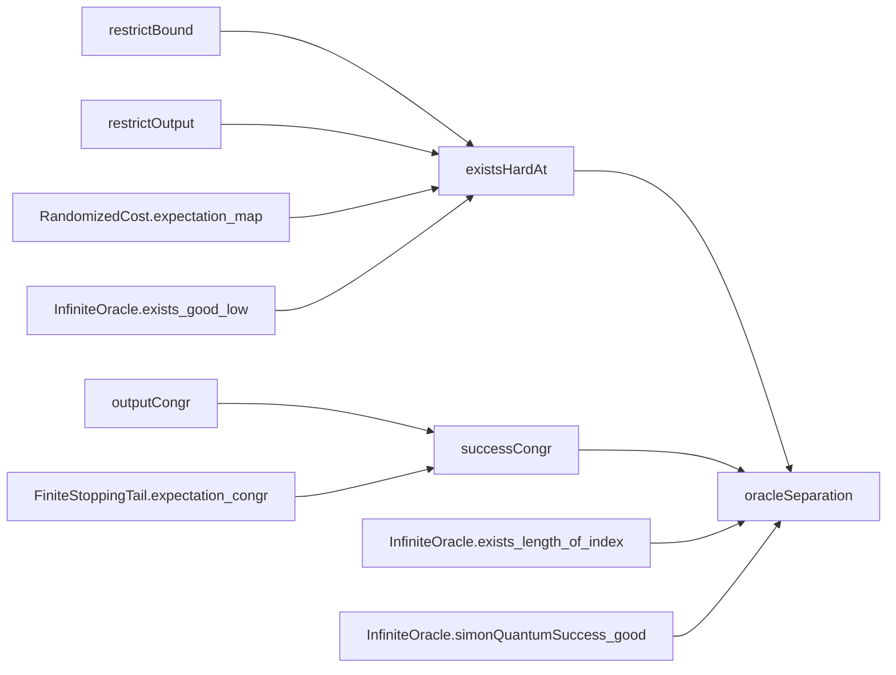

- [existsHardAt](../../integrations/qatlib/FQChemQatlib/Complexity/SimonOracleMachines.lean#L92)
- [outputCongr](../../integrations/qatlib/FQChemQatlib/Complexity/SimonOracleMachines.lean#L74)
- [restrictBound](../../integrations/qatlib/FQChemQatlib/Complexity/SimonOracleMachines.lean#L51)
- [restrictOutput](../../integrations/qatlib/FQChemQatlib/Complexity/SimonOracleMachines.lean#L62)
- [successCongr](../../integrations/qatlib/FQChemQatlib/Complexity/SimonOracleMachines.lean#L84)
- [oracleSeparation](../../integrations/qatlib/FQChemQatlib/Complexity/SimonOracleMachines.lean#L115)
- [FiniteStoppingTail.expectation_congr](https://github.com/quantum-atlas-ai/qatlib/blob/f76f71a7c5cd19a31c251d0feeab09c75a758d69/Qatlib/Concepts/AEMeanReadout/LocalAEBackend/FiniteStoppingTail.lean#L53)
- [RandomizedCost.expectation_map](https://github.com/quantum-atlas-ai/qatlib/blob/f76f71a7c5cd19a31c251d0feeab09c75a758d69/Qatlib/Concepts/LinearLearning/ConcisePipeline/RandomizedCost.lean#L116)
- [InfiniteOracle.exists_good_low](https://github.com/quantum-atlas-ai/qatlib/blob/f76f71a7c5cd19a31c251d0feeab09c75a758d69/Qatlib/Papers/QPowerSimon97/StandardModel/InfiniteOracle.lean#L286)
- [InfiniteOracle.exists_length_of_index](https://github.com/quantum-atlas-ai/qatlib/blob/f76f71a7c5cd19a31c251d0feeab09c75a758d69/Qatlib/Papers/QPowerSimon97/StandardModel/InfiniteOracle.lean#L359)
- [InfiniteOracle.simonQuantumSuccess_good](https://github.com/quantum-atlas-ai/qatlib/blob/f76f71a7c5cd19a31c251d0feeab09c75a758d69/Qatlib/Papers/QPowerSimon97/StandardModel/InfiniteOracle.lean#L186)

## FQChemQatlib.Complexity.SimonTuringSeparation

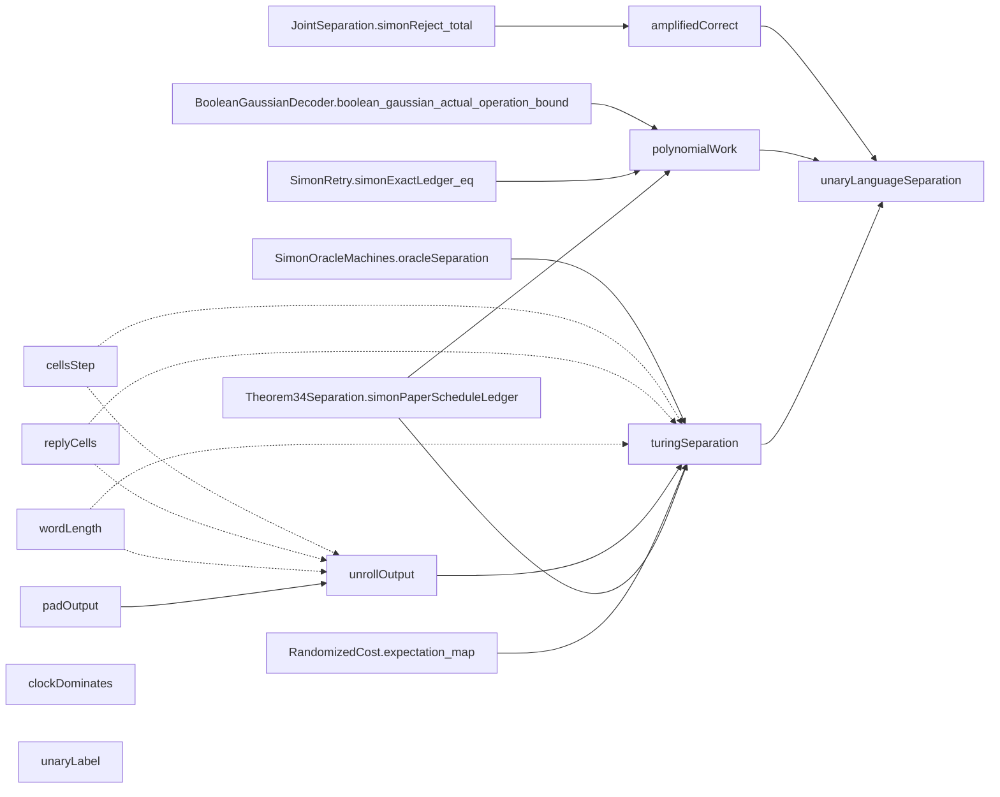

- [SimonOracleMachines.oracleSeparation](../../integrations/qatlib/FQChemQatlib/Complexity/SimonOracleMachines.lean#L115)
- [cellsStep](../../integrations/qatlib/FQChemQatlib/Complexity/SimonTuringSeparation.lean#L58)
- [replyCells](../../integrations/qatlib/FQChemQatlib/Complexity/SimonTuringSeparation.lean#L76)
- [wordLength](../../integrations/qatlib/FQChemQatlib/Complexity/SimonTuringSeparation.lean#L67)
- [padOutput](../../integrations/qatlib/FQChemQatlib/Complexity/SimonTuringSeparation.lean#L139)
- [amplifiedCorrect](../../integrations/qatlib/FQChemQatlib/Complexity/SimonTuringSeparation.lean#L224)
- [clockDominates](../../integrations/qatlib/FQChemQatlib/Complexity/SimonTuringSeparation.lean#L254)
- [polynomialWork](../../integrations/qatlib/FQChemQatlib/Complexity/SimonTuringSeparation.lean#L241)
- [turingSeparation](../../integrations/qatlib/FQChemQatlib/Complexity/SimonTuringSeparation.lean#L191)
- [unaryLabel](../../integrations/qatlib/FQChemQatlib/Complexity/SimonTuringSeparation.lean#L213)
- [unaryLanguageSeparation](../../integrations/qatlib/FQChemQatlib/Complexity/SimonTuringSeparation.lean#L273)
- [unrollOutput](../../integrations/qatlib/FQChemQatlib/Complexity/SimonTuringSeparation.lean#L166)
- [BooleanGaussianDecoder.boolean_gaussian_actual_operation_bound](https://github.com/quantum-atlas-ai/qatlib/blob/f76f71a7c5cd19a31c251d0feeab09c75a758d69/Qatlib/Concepts/HspRecovery/Reduction/BooleanGaussianDecoder.lean#L1764)
- [RandomizedCost.expectation_map](https://github.com/quantum-atlas-ai/qatlib/blob/f76f71a7c5cd19a31c251d0feeab09c75a758d69/Qatlib/Concepts/LinearLearning/ConcisePipeline/RandomizedCost.lean#L116)
- [JointSeparation.simonReject_total](https://github.com/quantum-atlas-ai/qatlib/blob/f76f71a7c5cd19a31c251d0feeab09c75a758d69/Qatlib/Papers/QPowerSimon97/StandardModel/JointSeparation.lean#L122)
- [SimonRetry.simonExactLedger_eq](https://github.com/quantum-atlas-ai/qatlib/blob/f76f71a7c5cd19a31c251d0feeab09c75a758d69/Qatlib/Papers/QPowerSimon97/StandardModel/SimonRetry.lean#L108)
- [Theorem34Separation.simonPaperScheduleLedger](https://github.com/quantum-atlas-ai/qatlib/blob/f76f71a7c5cd19a31c251d0feeab09c75a758d69/Qatlib/Papers/QPowerSimon97/StandardModel/Theorem34Separation.lean#L64)

## FQChemQatlib.Dynamics.AncillaFreeNot

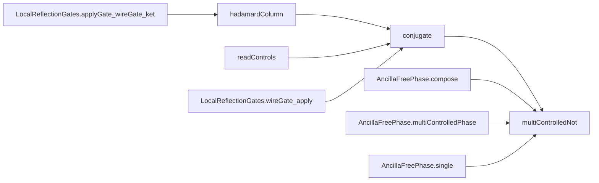

- [conjugate](../../integrations/qatlib/FQChemQatlib/Dynamics/AncillaFreeNot.lean#L40) (private)
- [hadamardColumn](../../integrations/qatlib/FQChemQatlib/Dynamics/AncillaFreeNot.lean#L24) (private)
- [multiControlledNot](../../integrations/qatlib/FQChemQatlib/Dynamics/AncillaFreeNot.lean#L73)
- [readControls](../../integrations/qatlib/FQChemQatlib/Dynamics/AncillaFreeNot.lean#L32) (private)
- [AncillaFreePhase.compose](../../integrations/qatlib/FQChemQatlib/Dynamics/AncillaFreePhase.lean#L59) (private)
- [AncillaFreePhase.multiControlledPhase](../../integrations/qatlib/FQChemQatlib/Dynamics/AncillaFreePhase.lean#L115)
- [AncillaFreePhase.single](../../integrations/qatlib/FQChemQatlib/Dynamics/AncillaFreePhase.lean#L56) (private)
- [LocalReflectionGates.applyGate_wireGate_ket](https://github.com/quantum-atlas-ai/qatlib/blob/f76f71a7c5cd19a31c251d0feeab09c75a758d69/Qatlib/Concepts/GateVocabulary/LocalReflectionGates.lean#L343)
- [LocalReflectionGates.wireGate_apply](https://github.com/quantum-atlas-ai/qatlib/blob/f76f71a7c5cd19a31c251d0feeab09c75a758d69/Qatlib/Concepts/GateVocabulary/LocalReflectionGates.lean#L83)

## FQChemQatlib.Dynamics.AncillaFreePhase

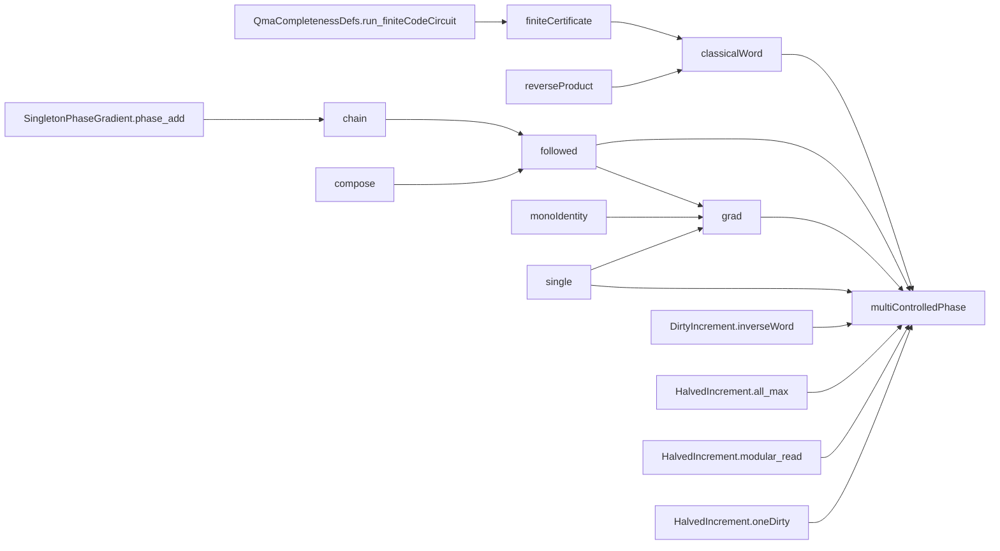

- [chain](../../integrations/qatlib/FQChemQatlib/Dynamics/AncillaFreePhase.lean#L32)
- [classicalWord](../../integrations/qatlib/FQChemQatlib/Dynamics/AncillaFreePhase.lean#L86) (private)
- [compose](../../integrations/qatlib/FQChemQatlib/Dynamics/AncillaFreePhase.lean#L59) (private)
- [finiteCertificate](../../integrations/qatlib/FQChemQatlib/Dynamics/AncillaFreePhase.lean#L69)
- [followed](../../integrations/qatlib/FQChemQatlib/Dynamics/AncillaFreePhase.lean#L64) (private)
- [grad](../../integrations/qatlib/FQChemQatlib/Dynamics/AncillaFreePhase.lean#L96) (private)
- [monoIdentity](../../integrations/qatlib/FQChemQatlib/Dynamics/AncillaFreePhase.lean#L40)
- [multiControlledPhase](../../integrations/qatlib/FQChemQatlib/Dynamics/AncillaFreePhase.lean#L115)
- [reverseProduct](../../integrations/qatlib/FQChemQatlib/Dynamics/AncillaFreePhase.lean#L80)
- [single](../../integrations/qatlib/FQChemQatlib/Dynamics/AncillaFreePhase.lean#L56) (private)
- [DirtyIncrement.inverseWord](../../integrations/qatlib/FQChemQatlib/Dynamics/DirtyIncrement.lean#L27)
- [HalvedIncrement.all_max](../../integrations/qatlib/FQChemQatlib/Dynamics/HalvedIncrement.lean#L128)
- [HalvedIncrement.modular_read](../../integrations/qatlib/FQChemQatlib/Dynamics/HalvedIncrement.lean#L136)
- [HalvedIncrement.oneDirty](../../integrations/qatlib/FQChemQatlib/Dynamics/HalvedIncrement.lean#L262)
- [SingletonPhaseGradient.phase_add](../../integrations/qatlib/FQChemQatlib/Dynamics/SingletonPhaseGradient.lean#L81)
- [QmaCompletenessDefs.run_finiteCodeCircuit](https://github.com/quantum-atlas-ai/qatlib/blob/f76f71a7c5cd19a31c251d0feeab09c75a758d69/Qatlib/Concepts/QmaCompleteness/HistoryHam/QmaCompletenessDefs.lean#L146)

## FQChemQatlib.Dynamics.BorrowedControls

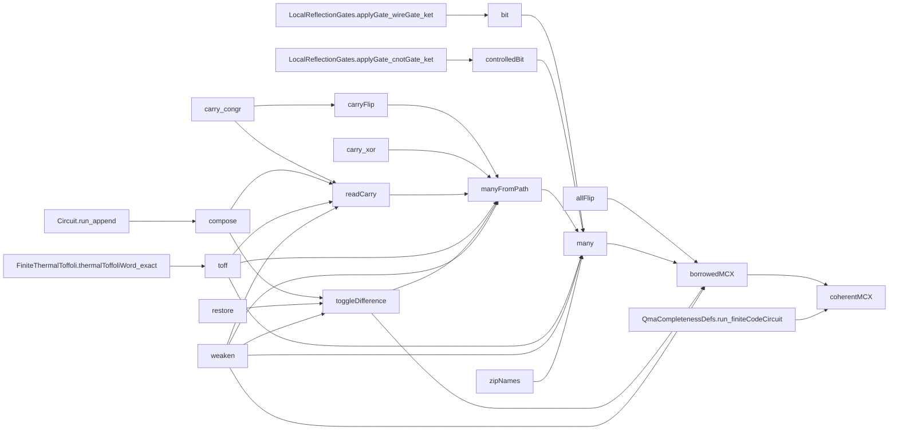

- [allFlip](../../integrations/qatlib/FQChemQatlib/Dynamics/BorrowedControls.lean#L163) (private)
- [bit](../../integrations/qatlib/FQChemQatlib/Dynamics/BorrowedControls.lean#L54)
- [borrowedMCX](../../integrations/qatlib/FQChemQatlib/Dynamics/BorrowedControls.lean#L245)
- [carryFlip](../../integrations/qatlib/FQChemQatlib/Dynamics/BorrowedControls.lean#L171) (private)
- [carry_congr](../../integrations/qatlib/FQChemQatlib/Dynamics/BorrowedControls.lean#L78) (private)
- [carry_xor](../../integrations/qatlib/FQChemQatlib/Dynamics/BorrowedControls.lean#L89) (private)
- [coherentMCX](../../integrations/qatlib/FQChemQatlib/Dynamics/BorrowedControls.lean#L275)
- [compose](../../integrations/qatlib/FQChemQatlib/Dynamics/BorrowedControls.lean#L34)
- [controlledBit](../../integrations/qatlib/FQChemQatlib/Dynamics/BorrowedControls.lean#L62)
- [many](../../integrations/qatlib/FQChemQatlib/Dynamics/BorrowedControls.lean#L216) (private)
- [manyFromPath](../../integrations/qatlib/FQChemQatlib/Dynamics/BorrowedControls.lean#L183) (private)
- [readCarry](../../integrations/qatlib/FQChemQatlib/Dynamics/BorrowedControls.lean#L100) (private)
- [restore](../../integrations/qatlib/FQChemQatlib/Dynamics/BorrowedControls.lean#L140) (private)
- [toff](../../integrations/qatlib/FQChemQatlib/Dynamics/BorrowedControls.lean#L44)
- [toggleDifference](../../integrations/qatlib/FQChemQatlib/Dynamics/BorrowedControls.lean#L148) (private)
- [weaken](../../integrations/qatlib/FQChemQatlib/Dynamics/BorrowedControls.lean#L41)
- [zipNames](../../integrations/qatlib/FQChemQatlib/Dynamics/BorrowedControls.lean#L204) (private)
- [LocalReflectionGates.applyGate_cnotGate_ket](https://github.com/quantum-atlas-ai/qatlib/blob/f76f71a7c5cd19a31c251d0feeab09c75a758d69/Qatlib/Concepts/GateVocabulary/LocalReflectionGates.lean#L205)
- [LocalReflectionGates.applyGate_wireGate_ket](https://github.com/quantum-atlas-ai/qatlib/blob/f76f71a7c5cd19a31c251d0feeab09c75a758d69/Qatlib/Concepts/GateVocabulary/LocalReflectionGates.lean#L343)
- [QmaCompletenessDefs.run_finiteCodeCircuit](https://github.com/quantum-atlas-ai/qatlib/blob/f76f71a7c5cd19a31c251d0feeab09c75a758d69/Qatlib/Concepts/QmaCompleteness/HistoryHam/QmaCompletenessDefs.lean#L146)
- [FiniteThermalToffoli.thermalToffoliWord_exact](https://github.com/quantum-atlas-ai/qatlib/blob/f76f71a7c5cd19a31c251d0feeab09c75a758d69/Qatlib/Concepts/UniformBqp/FiniteGateWord/FiniteThermal/FiniteThermalToffoli.lean#L60)
- [Circuit.run_append](https://github.com/quantum-atlas-ai/qatlib/blob/f76f71a7c5cd19a31c251d0feeab09c75a758d69/Qatlib/Foundations/QueryWordCore/Circuit.lean#L249)

## FQChemQatlib.Dynamics.BorrowedRipple

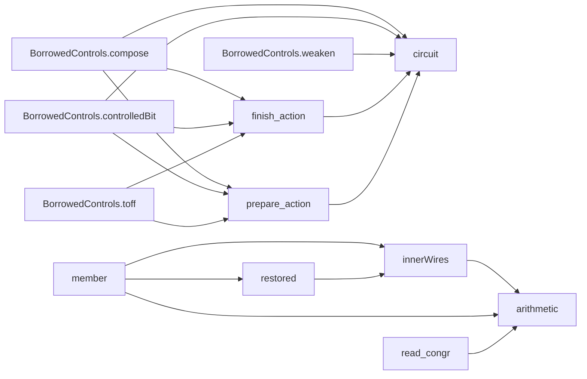

- [BorrowedControls.compose](../../integrations/qatlib/FQChemQatlib/Dynamics/BorrowedControls.lean#L34)
- [BorrowedControls.controlledBit](../../integrations/qatlib/FQChemQatlib/Dynamics/BorrowedControls.lean#L62)
- [BorrowedControls.toff](../../integrations/qatlib/FQChemQatlib/Dynamics/BorrowedControls.lean#L44)
- [BorrowedControls.weaken](../../integrations/qatlib/FQChemQatlib/Dynamics/BorrowedControls.lean#L41)
- [arithmetic](../../integrations/qatlib/FQChemQatlib/Dynamics/BorrowedRipple.lean#L145)
- [circuit](../../integrations/qatlib/FQChemQatlib/Dynamics/BorrowedRipple.lean#L70)
- [finish_action](../../integrations/qatlib/FQChemQatlib/Dynamics/BorrowedRipple.lean#L49) (private)
- [innerWires](../../integrations/qatlib/FQChemQatlib/Dynamics/BorrowedRipple.lean#L127) (private)
- [member](../../integrations/qatlib/FQChemQatlib/Dynamics/BorrowedRipple.lean#L94)
- [prepare_action](../../integrations/qatlib/FQChemQatlib/Dynamics/BorrowedRipple.lean#L35) (private)
- [read_congr](../../integrations/qatlib/FQChemQatlib/Dynamics/BorrowedRipple.lean#L89) (private)
- [restored](../../integrations/qatlib/FQChemQatlib/Dynamics/BorrowedRipple.lean#L99)

## FQChemQatlib.Dynamics.DirtyIncrement

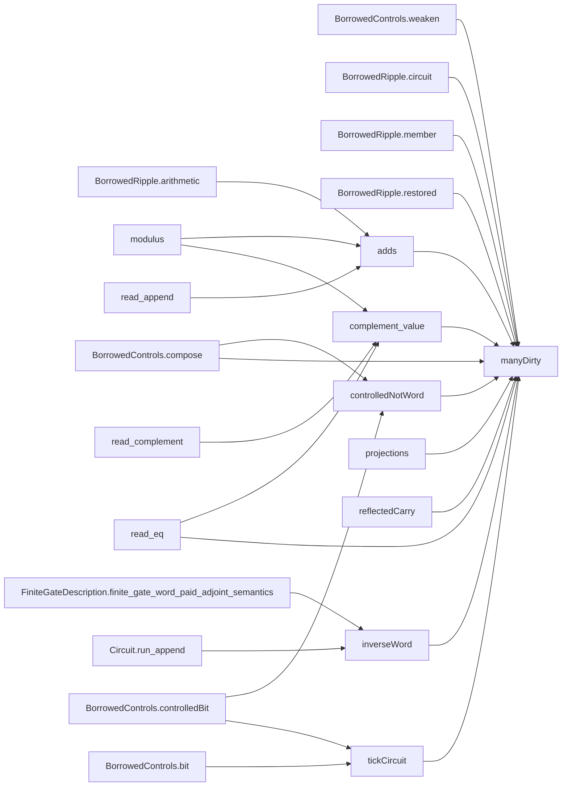

- [BorrowedControls.bit](../../integrations/qatlib/FQChemQatlib/Dynamics/BorrowedControls.lean#L54)
- [BorrowedControls.compose](../../integrations/qatlib/FQChemQatlib/Dynamics/BorrowedControls.lean#L34)
- [BorrowedControls.controlledBit](../../integrations/qatlib/FQChemQatlib/Dynamics/BorrowedControls.lean#L62)
- [BorrowedControls.weaken](../../integrations/qatlib/FQChemQatlib/Dynamics/BorrowedControls.lean#L41)
- [BorrowedRipple.arithmetic](../../integrations/qatlib/FQChemQatlib/Dynamics/BorrowedRipple.lean#L145)
- [BorrowedRipple.circuit](../../integrations/qatlib/FQChemQatlib/Dynamics/BorrowedRipple.lean#L70)
- [BorrowedRipple.member](../../integrations/qatlib/FQChemQatlib/Dynamics/BorrowedRipple.lean#L94)
- [BorrowedRipple.restored](../../integrations/qatlib/FQChemQatlib/Dynamics/BorrowedRipple.lean#L99)
- [adds](../../integrations/qatlib/FQChemQatlib/Dynamics/DirtyIncrement.lean#L96)
- [complement_value](../../integrations/qatlib/FQChemQatlib/Dynamics/DirtyIncrement.lean#L112)
- [controlledNotWord](../../integrations/qatlib/FQChemQatlib/Dynamics/DirtyIncrement.lean#L51)
- [inverseWord](../../integrations/qatlib/FQChemQatlib/Dynamics/DirtyIncrement.lean#L27)
- [manyDirty](../../integrations/qatlib/FQChemQatlib/Dynamics/DirtyIncrement.lean#L156)
- [modulus](../../integrations/qatlib/FQChemQatlib/Dynamics/DirtyIncrement.lean#L90)
- [projections](../../integrations/qatlib/FQChemQatlib/Dynamics/DirtyIncrement.lean#L139)
- [read_append](../../integrations/qatlib/FQChemQatlib/Dynamics/DirtyIncrement.lean#L67)
- [read_complement](../../integrations/qatlib/FQChemQatlib/Dynamics/DirtyIncrement.lean#L78)
- [read_eq](../../integrations/qatlib/FQChemQatlib/Dynamics/DirtyIncrement.lean#L73)
- [reflectedCarry](../../integrations/qatlib/FQChemQatlib/Dynamics/DirtyIncrement.lean#L146)
- [tickCircuit](../../integrations/qatlib/FQChemQatlib/Dynamics/DirtyIncrement.lean#L130)
- [FiniteGateDescription.finite_gate_word_paid_adjoint_semantics](https://github.com/quantum-atlas-ai/qatlib/blob/f76f71a7c5cd19a31c251d0feeab09c75a758d69/Qatlib/Concepts/GateVocabulary/FiniteGateDescription.lean#L206)
- [Circuit.run_append](https://github.com/quantum-atlas-ai/qatlib/blob/f76f71a7c5cd19a31c251d0feeab09c75a758d69/Qatlib/Foundations/QueryWordCore/Circuit.lean#L249)

## FQChemQatlib.Dynamics.HalvedIncrement

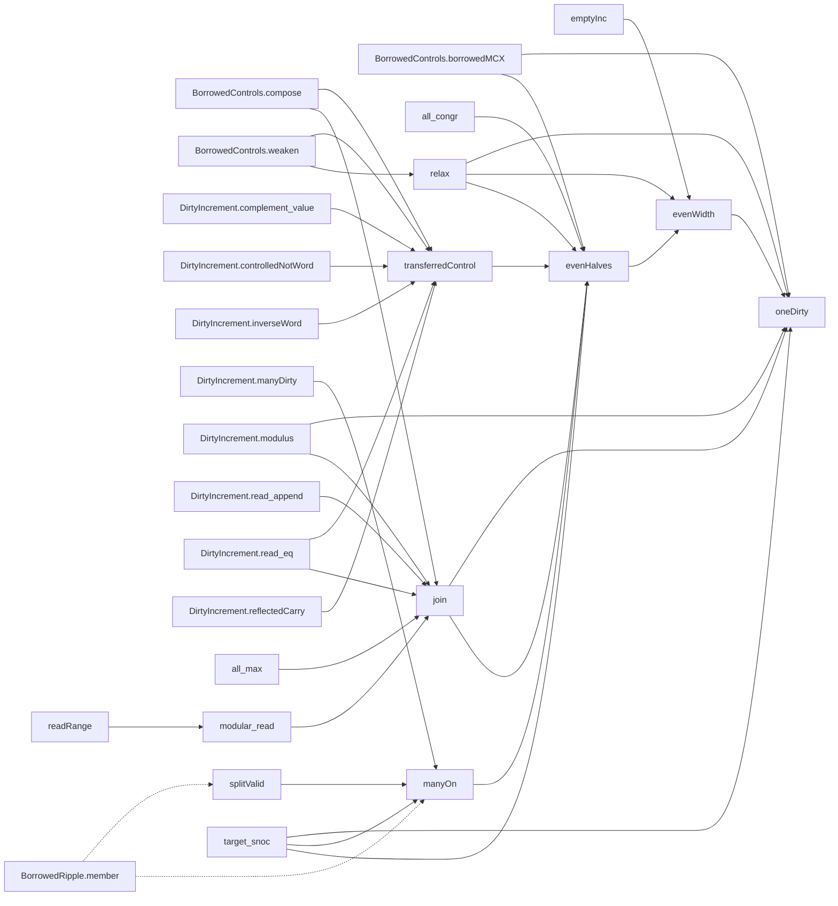

- [BorrowedControls.borrowedMCX](../../integrations/qatlib/FQChemQatlib/Dynamics/BorrowedControls.lean#L245)
- [BorrowedControls.compose](../../integrations/qatlib/FQChemQatlib/Dynamics/BorrowedControls.lean#L34)
- [BorrowedControls.weaken](../../integrations/qatlib/FQChemQatlib/Dynamics/BorrowedControls.lean#L41)
- [BorrowedRipple.member](../../integrations/qatlib/FQChemQatlib/Dynamics/BorrowedRipple.lean#L94)
- [DirtyIncrement.complement_value](../../integrations/qatlib/FQChemQatlib/Dynamics/DirtyIncrement.lean#L112)
- [DirtyIncrement.controlledNotWord](../../integrations/qatlib/FQChemQatlib/Dynamics/DirtyIncrement.lean#L51)
- [DirtyIncrement.inverseWord](../../integrations/qatlib/FQChemQatlib/Dynamics/DirtyIncrement.lean#L27)
- [DirtyIncrement.manyDirty](../../integrations/qatlib/FQChemQatlib/Dynamics/DirtyIncrement.lean#L156)
- [DirtyIncrement.modulus](../../integrations/qatlib/FQChemQatlib/Dynamics/DirtyIncrement.lean#L90)
- [DirtyIncrement.read_append](../../integrations/qatlib/FQChemQatlib/Dynamics/DirtyIncrement.lean#L67)
- [DirtyIncrement.read_eq](../../integrations/qatlib/FQChemQatlib/Dynamics/DirtyIncrement.lean#L73)
- [DirtyIncrement.reflectedCarry](../../integrations/qatlib/FQChemQatlib/Dynamics/DirtyIncrement.lean#L146)
- [all_congr](../../integrations/qatlib/FQChemQatlib/Dynamics/HalvedIncrement.lean#L215) (private)
- [all_max](../../integrations/qatlib/FQChemQatlib/Dynamics/HalvedIncrement.lean#L128)
- [emptyInc](../../integrations/qatlib/FQChemQatlib/Dynamics/HalvedIncrement.lean#L209)
- [evenHalves](../../integrations/qatlib/FQChemQatlib/Dynamics/HalvedIncrement.lean#L220)
- [evenWidth](../../integrations/qatlib/FQChemQatlib/Dynamics/HalvedIncrement.lean#L244)
- [join](../../integrations/qatlib/FQChemQatlib/Dynamics/HalvedIncrement.lean#L157)
- [manyOn](../../integrations/qatlib/FQChemQatlib/Dynamics/HalvedIncrement.lean#L35)
- [modular_read](../../integrations/qatlib/FQChemQatlib/Dynamics/HalvedIncrement.lean#L136)
- [oneDirty](../../integrations/qatlib/FQChemQatlib/Dynamics/HalvedIncrement.lean#L262)
- [readRange](../../integrations/qatlib/FQChemQatlib/Dynamics/HalvedIncrement.lean#L123)
- [relax](../../integrations/qatlib/FQChemQatlib/Dynamics/HalvedIncrement.lean#L206) (private)
- [splitValid](../../integrations/qatlib/FQChemQatlib/Dynamics/HalvedIncrement.lean#L18) (private)
- [target_snoc](../../integrations/qatlib/FQChemQatlib/Dynamics/HalvedIncrement.lean#L29) (private)
- [transferredControl](../../integrations/qatlib/FQChemQatlib/Dynamics/HalvedIncrement.lean#L64)

## FQChemQatlib.Dynamics.LowChuangAllDimensions

```mermaid
flowchart LR
  n313["allFiniteCoordinateSimulation"]
  n314["allFiniteRegisters"]
  n315["allFrameGates"]
  n316["allQubitRegisters"]
  n352["LowChuangElementary.adj_emits"]
  n353["LowChuangElementary.compiles_emits"]
  n354["LowChuangElementary.expand"]
  n357["LowChuangElementary.mul_emits"]
  n359["LowChuangElementary.scalar_flags"]
  n360["LowChuangElementary.scalar_pair"]
  n361["LowChuangElementary.single"]
  n362["LowChuangElementary.weaken"]
  n372["LowChuangFlagGates.localFlip"]
  n373["LowChuangFlagGates.localHadamards"]
  n374["LowChuangFlagGates.localPhase"]
  n375["LowChuangFlagGates.localScalar"]
  n385["LowChuangPadding.coord_iso"]
  n386["LowChuangPadding.evolved_action"]
  n392["LowChuangPadding.pad_hermitian"]
  n395["LowChuangPadding.pad_unit"]
  n396["LowChuangPadding.padded_signal"]
  n404["LowChuangPhysical.testAncilla_compiles"]
  n409["LowChuangQueries.cost_append"]
  n414["LowChuangQueries.fixed_append"]
  n420["LowChuangQueries.run_append"]
  n424["LowChuangReadout.coordinate_acts"]
  n430["LowChuangReflections.cubic_coordinate"]
  n431["LowChuangReflections.fiberPhase_sandwich"]
  n439["LowChuangSingleton.coordinateMark"]
  n567["LowChuangStandardForm.standardFormProgram"]
  n629["Basic.compress_norm_le"]
  n636["Postselection.normalized_mulVec"]
  n746["Qubit.hadamard_unitary"]
  n752["Qubit.pauliX_unitary"]
  n757["Tensor.tensorGate_unitary"]
  n314 --> n313
  n373 --> n313
  n409 --> n313
  n414 --> n313
  n420 --> n313
  n424 --> n313
  n746 --> n313
  n757 --> n313
  n316 --> n314
  n385 --> n314
  n386 --> n314
  n392 --> n314
  n395 --> n314
  n396 --> n314
  n629 --> n314
  n636 --> n314
  n352 --> n315
  n353 --> n315
  n357 --> n315
  n359 --> n315
  n360 --> n315
  n361 --> n315
  n362 --> n315
  n372 --> n315
  n373 --> n315
  n374 --> n315
  n375 --> n315
  n404 --> n315
  n430 --> n315
  n431 --> n315
  n439 --> n315
  n746 --> n315
  n752 --> n315
  n757 --> n315
  n315 --> n316
  n354 --> n316
  n567 --> n316
```

- [allFiniteCoordinateSimulation](../../integrations/qatlib/FQChemQatlib/Dynamics/LowChuangAllDimensions.lean#L141)
- [allFiniteRegisters](../../integrations/qatlib/FQChemQatlib/Dynamics/LowChuangAllDimensions.lean#L96)
- [allFrameGates](../../integrations/qatlib/FQChemQatlib/Dynamics/LowChuangAllDimensions.lean#L35)
- [allQubitRegisters](../../integrations/qatlib/FQChemQatlib/Dynamics/LowChuangAllDimensions.lean#L69)
- [LowChuangElementary.adj_emits](../../integrations/qatlib/FQChemQatlib/Dynamics/LowChuangElementary.lean#L44) (private)
- [LowChuangElementary.compiles_emits](../../integrations/qatlib/FQChemQatlib/Dynamics/LowChuangElementary.lean#L59) (private)
- [LowChuangElementary.expand](../../integrations/qatlib/FQChemQatlib/Dynamics/LowChuangElementary.lean#L127) (private)
- [LowChuangElementary.mul_emits](../../integrations/qatlib/FQChemQatlib/Dynamics/LowChuangElementary.lean#L38) (private)
- [LowChuangElementary.scalar_flags](../../integrations/qatlib/FQChemQatlib/Dynamics/LowChuangElementary.lean#L77) (private)
- [LowChuangElementary.scalar_pair](../../integrations/qatlib/FQChemQatlib/Dynamics/LowChuangElementary.lean#L72) (private)
- [LowChuangElementary.single](../../integrations/qatlib/FQChemQatlib/Dynamics/LowChuangElementary.lean#L35) (private)
- [LowChuangElementary.weaken](../../integrations/qatlib/FQChemQatlib/Dynamics/LowChuangElementary.lean#L55) (private)
- [LowChuangFlagGates.localFlip](../../integrations/qatlib/FQChemQatlib/Dynamics/LowChuangFlagGates.lean#L140)
- [LowChuangFlagGates.localHadamards](../../integrations/qatlib/FQChemQatlib/Dynamics/LowChuangFlagGates.lean#L136)
- [LowChuangFlagGates.localPhase](../../integrations/qatlib/FQChemQatlib/Dynamics/LowChuangFlagGates.lean#L117)
- [LowChuangFlagGates.localScalar](../../integrations/qatlib/FQChemQatlib/Dynamics/LowChuangFlagGates.lean#L146)
- [LowChuangPadding.coord_iso](../../integrations/qatlib/FQChemQatlib/Dynamics/LowChuangPadding.lean#L26)
- [LowChuangPadding.evolved_action](../../integrations/qatlib/FQChemQatlib/Dynamics/LowChuangPadding.lean#L78)
- [LowChuangPadding.pad_hermitian](../../integrations/qatlib/FQChemQatlib/Dynamics/LowChuangPadding.lean#L60)
- [LowChuangPadding.pad_unit](../../integrations/qatlib/FQChemQatlib/Dynamics/LowChuangPadding.lean#L53)
- [LowChuangPadding.padded_signal](../../integrations/qatlib/FQChemQatlib/Dynamics/LowChuangPadding.lean#L132)
- [LowChuangPhysical.testAncilla_compiles](../../integrations/qatlib/FQChemQatlib/Dynamics/LowChuangPhysical.lean#L107)
- [LowChuangQueries.cost_append](../../integrations/qatlib/FQChemQatlib/Dynamics/LowChuangQueries.lean#L50)
- [LowChuangQueries.fixed_append](../../integrations/qatlib/FQChemQatlib/Dynamics/LowChuangQueries.lean#L182)
- [LowChuangQueries.run_append](../../integrations/qatlib/FQChemQatlib/Dynamics/LowChuangQueries.lean#L43)
- [LowChuangReadout.coordinate_acts](../../integrations/qatlib/FQChemQatlib/Dynamics/LowChuangReadout.lean#L31)
- [LowChuangReflections.cubic_coordinate](../../integrations/qatlib/FQChemQatlib/Dynamics/LowChuangReflections.lean#L104)
- [LowChuangReflections.fiberPhase_sandwich](../../integrations/qatlib/FQChemQatlib/Dynamics/LowChuangReflections.lean#L40)
- [LowChuangSingleton.coordinateMark](../../integrations/qatlib/FQChemQatlib/Dynamics/LowChuangSingleton.lean#L160)
- [LowChuangStandardForm.standardFormProgram](../../integrations/qatlib/FQChemQatlib/Dynamics/LowChuangStandardForm.lean#L32)
- [Basic.compress_norm_le](https://github.com/quantum-atlas-ai/qatlib/blob/f76f71a7c5cd19a31c251d0feeab09c75a758d69/Qatlib/Concepts/BlockEncoding/Basic.lean#L207)
- [Postselection.normalized_mulVec](https://github.com/quantum-atlas-ai/qatlib/blob/f76f71a7c5cd19a31c251d0feeab09c75a758d69/Qatlib/Concepts/BlockEncoding/Postselection.lean#L264)
- [Qubit.hadamard_unitary](https://github.com/quantum-atlas-ai/qatlib/blob/f76f71a7c5cd19a31c251d0feeab09c75a758d69/Qatlib/Foundations/PureStateMath/Qubit.lean#L352)
- [Qubit.pauliX_unitary](https://github.com/quantum-atlas-ai/qatlib/blob/f76f71a7c5cd19a31c251d0feeab09c75a758d69/Qatlib/Foundations/PureStateMath/Qubit.lean#L387)
- [Tensor.tensorGate_unitary](https://github.com/quantum-atlas-ai/qatlib/blob/f76f71a7c5cd19a31c251d0feeab09c75a758d69/Qatlib/Foundations/PureStateMath/Tensor.lean#L133)

## FQChemQatlib.Dynamics.LowChuangBinaryCompare

```mermaid
flowchart LR
  n263["BorrowedControls.bit"]
  n269["BorrowedControls.compose"]
  n275["BorrowedControls.toff"]
  n317["address_mem"]
  n318["carry_order"]
  n319["output_address"]
  n320["result_address"]
  n321["ripple_result"]
  n322["ripple_word"]
  n323["step_exact"]
  n324["step_valid"]
  n325["tail_valid"]
  n326["unchanged"]
  n732["FiniteThermalComparator.thermalLexLess_numeric"]
  n318 --> n321
  n319 --> n321
  n325 --> n321
  n326 --> n321
  n732 --> n321
  n269 --> n322
  n323 --> n322
  n324 --> n322
  n325 --> n322
  n263 --> n323
  n269 --> n323
  n275 --> n323
  n320 --> n324
```

- [BorrowedControls.bit](../../integrations/qatlib/FQChemQatlib/Dynamics/BorrowedControls.lean#L54)
- [BorrowedControls.compose](../../integrations/qatlib/FQChemQatlib/Dynamics/BorrowedControls.lean#L34)
- [BorrowedControls.toff](../../integrations/qatlib/FQChemQatlib/Dynamics/BorrowedControls.lean#L44)
- [address_mem](../../integrations/qatlib/FQChemQatlib/Dynamics/LowChuangBinaryCompare.lean#L55) (private)
- [carry_order](../../integrations/qatlib/FQChemQatlib/Dynamics/LowChuangBinaryCompare.lean#L26) (private)
- [output_address](../../integrations/qatlib/FQChemQatlib/Dynamics/LowChuangBinaryCompare.lean#L94) (private)
- [result_address](../../integrations/qatlib/FQChemQatlib/Dynamics/LowChuangBinaryCompare.lean#L58) (private)
- [ripple_result](../../integrations/qatlib/FQChemQatlib/Dynamics/LowChuangBinaryCompare.lean#L101)
- [ripple_word](../../integrations/qatlib/FQChemQatlib/Dynamics/LowChuangBinaryCompare.lean#L84)
- [step_exact](../../integrations/qatlib/FQChemQatlib/Dynamics/LowChuangBinaryCompare.lean#L32) (private)
- [step_valid](../../integrations/qatlib/FQChemQatlib/Dynamics/LowChuangBinaryCompare.lean#L67) (private)
- [tail_valid](../../integrations/qatlib/FQChemQatlib/Dynamics/LowChuangBinaryCompare.lean#L62) (private)
- [unchanged](../../integrations/qatlib/FQChemQatlib/Dynamics/LowChuangBinaryCompare.lean#L74)
- [FiniteThermalComparator.thermalLexLess_numeric](https://github.com/quantum-atlas-ai/qatlib/blob/f76f71a7c5cd19a31c251d0feeab09c75a758d69/Qatlib/Concepts/UniformBqp/FiniteGateWord/FiniteThermal/FiniteThermalComparator.lean#L70)

## FQChemQatlib.Dynamics.LowChuangBinaryDecoder

```mermaid
flowchart LR
  n321["LowChuangBinaryCompare.ripple_result"]
  n322["LowChuangBinaryCompare.ripple_word"]
  n327["built_adj"]
  n328["built_mul"]
  n329["built_unit"]
  n330["built_weaken"]
  n331["built_word"]
  n332["cartesianDecoder"]
  n333["decoder"]
  n334["filled_pulse"]
  n335["gated_phase"]
  n336["local_unit"]
  n337["outside_col"]
  n338["outside_seed"]
  n339["packed_clean"]
  n340["pulse_word"]
  n341["LowChuangBinaryPhase.averaged_sign"]
  n342["LowChuangBinaryPhase.encoded_diagonal"]
  n349["LowChuangDecoderLayout.digits_read"]
  n350["LowChuangDecoderLayout.digits_valid"]
  n351["LowChuangDecoderLayout.protect_branch"]
  n568["LowChuangUniformBits.fill_at"]
  n569["LowChuangUniformBits.fill_out"]
  n570["LowChuangUniformBits.hWord_cost"]
  n571["LowChuangUniformBits.mean_diagonal"]
  n654["FiniteGateDescription.finiteCodeMatrix_unitary"]
  n336 --> n329
  n333 --> n332
  n339 --> n332
  n327 --> n333
  n328 --> n333
  n329 --> n333
  n330 --> n333
  n331 --> n333
  n334 --> n333
  n340 --> n333
  n341 --> n333
  n570 --> n333
  n571 --> n333
  n321 --> n334
  n337 --> n334
  n338 --> n334
  n349 --> n334
  n350 --> n334
  n568 --> n334
  n569 --> n334
  n654 --> n336
  n322 --> n340
  n327 --> n340
  n328 --> n340
  n330 --> n340
  n331 --> n340
  n335 --> n340
  n342 --> n340
  n350 --> n340
  n351 --> n340
```

- [LowChuangBinaryCompare.ripple_result](../../integrations/qatlib/FQChemQatlib/Dynamics/LowChuangBinaryCompare.lean#L101)
- [LowChuangBinaryCompare.ripple_word](../../integrations/qatlib/FQChemQatlib/Dynamics/LowChuangBinaryCompare.lean#L84)
- [built_adj](../../integrations/qatlib/FQChemQatlib/Dynamics/LowChuangBinaryDecoder.lean#L47) (private)
- [built_mul](../../integrations/qatlib/FQChemQatlib/Dynamics/LowChuangBinaryDecoder.lean#L41) (private)
- [built_unit](../../integrations/qatlib/FQChemQatlib/Dynamics/LowChuangBinaryDecoder.lean#L72) (private)
- [built_weaken](../../integrations/qatlib/FQChemQatlib/Dynamics/LowChuangBinaryDecoder.lean#L56) (private)
- [built_word](../../integrations/qatlib/FQChemQatlib/Dynamics/LowChuangBinaryDecoder.lean#L28) (private)
- [cartesianDecoder](../../integrations/qatlib/FQChemQatlib/Dynamics/LowChuangBinaryDecoder.lean#L188)
- [decoder](../../integrations/qatlib/FQChemQatlib/Dynamics/LowChuangBinaryDecoder.lean#L145)
- [filled_pulse](../../integrations/qatlib/FQChemQatlib/Dynamics/LowChuangBinaryDecoder.lean#L117) (private)
- [gated_phase](../../integrations/qatlib/FQChemQatlib/Dynamics/LowChuangBinaryDecoder.lean#L79) (private)
- [local_unit](../../integrations/qatlib/FQChemQatlib/Dynamics/LowChuangBinaryDecoder.lean#L59) (private)
- [outside_col](../../integrations/qatlib/FQChemQatlib/Dynamics/LowChuangBinaryDecoder.lean#L108) (private)
- [outside_seed](../../integrations/qatlib/FQChemQatlib/Dynamics/LowChuangBinaryDecoder.lean#L113) (private)
- [packed_clean](../../integrations/qatlib/FQChemQatlib/Dynamics/LowChuangBinaryDecoder.lean#L179)
- [pulse_word](../../integrations/qatlib/FQChemQatlib/Dynamics/LowChuangBinaryDecoder.lean#L92) (private)
- [LowChuangBinaryPhase.averaged_sign](../../integrations/qatlib/FQChemQatlib/Dynamics/LowChuangBinaryPhase.lean#L26)
- [LowChuangBinaryPhase.encoded_diagonal](../../integrations/qatlib/FQChemQatlib/Dynamics/LowChuangBinaryPhase.lean#L40)
- [LowChuangDecoderLayout.digits_read](../../integrations/qatlib/FQChemQatlib/Dynamics/LowChuangDecoderLayout.lean#L55)
- [LowChuangDecoderLayout.digits_valid](../../integrations/qatlib/FQChemQatlib/Dynamics/LowChuangDecoderLayout.lean#L31)
- [LowChuangDecoderLayout.protect_branch](../../integrations/qatlib/FQChemQatlib/Dynamics/LowChuangDecoderLayout.lean#L61)
- [LowChuangUniformBits.fill_at](../../integrations/qatlib/FQChemQatlib/Dynamics/LowChuangUniformBits.lean#L23)
- [LowChuangUniformBits.fill_out](../../integrations/qatlib/FQChemQatlib/Dynamics/LowChuangUniformBits.lean#L28)
- [LowChuangUniformBits.hWord_cost](../../integrations/qatlib/FQChemQatlib/Dynamics/LowChuangUniformBits.lean#L43)
- [LowChuangUniformBits.mean_diagonal](../../integrations/qatlib/FQChemQatlib/Dynamics/LowChuangUniformBits.lean#L49)
- [FiniteGateDescription.finiteCodeMatrix_unitary](https://github.com/quantum-atlas-ai/qatlib/blob/f76f71a7c5cd19a31c251d0feeab09c75a758d69/Qatlib/Concepts/GateVocabulary/FiniteGateDescription.lean#L100)

## FQChemQatlib.Dynamics.LowChuangBinaryPhase

```mermaid
flowchart LR
  n321["LowChuangBinaryCompare.ripple_result"]
  n322["LowChuangBinaryCompare.ripple_word"]
  n341["averaged_sign"]
  n342["encoded_diagonal"]
  n343["ripple_phase"]
  n690["QmaCompletenessDefs.finiteWordMatrix_unitary"]
  n691["QmaCompletenessDefs.run_finiteCodeCircuit"]
  n731["FiniteThermalComparator.thermalBitValue_bound"]
  n735["FiniteThermalUniformH.thermalUniformBits_less_complex"]
  n731 --> n341
  n735 --> n341
  n690 --> n342
  n691 --> n342
  n321 --> n343
  n322 --> n343
  n342 --> n343
```

- [LowChuangBinaryCompare.ripple_result](../../integrations/qatlib/FQChemQatlib/Dynamics/LowChuangBinaryCompare.lean#L101)
- [LowChuangBinaryCompare.ripple_word](../../integrations/qatlib/FQChemQatlib/Dynamics/LowChuangBinaryCompare.lean#L84)
- [averaged_sign](../../integrations/qatlib/FQChemQatlib/Dynamics/LowChuangBinaryPhase.lean#L26)
- [encoded_diagonal](../../integrations/qatlib/FQChemQatlib/Dynamics/LowChuangBinaryPhase.lean#L40)
- [ripple_phase](../../integrations/qatlib/FQChemQatlib/Dynamics/LowChuangBinaryPhase.lean#L61)
- [QmaCompletenessDefs.finiteWordMatrix_unitary](https://github.com/quantum-atlas-ai/qatlib/blob/f76f71a7c5cd19a31c251d0feeab09c75a758d69/Qatlib/Concepts/QmaCompleteness/HistoryHam/QmaCompletenessDefs.lean#L158)
- [QmaCompletenessDefs.run_finiteCodeCircuit](https://github.com/quantum-atlas-ai/qatlib/blob/f76f71a7c5cd19a31c251d0feeab09c75a758d69/Qatlib/Concepts/QmaCompleteness/HistoryHam/QmaCompletenessDefs.lean#L146)
- [FiniteThermalComparator.thermalBitValue_bound](https://github.com/quantum-atlas-ai/qatlib/blob/f76f71a7c5cd19a31c251d0feeab09c75a758d69/Qatlib/Concepts/UniformBqp/FiniteGateWord/FiniteThermal/FiniteThermalComparator.lean#L54)
- [FiniteThermalUniformH.thermalUniformBits_less_complex](https://github.com/quantum-atlas-ai/qatlib/blob/f76f71a7c5cd19a31c251d0feeab09c75a758d69/Qatlib/Concepts/UniformBqp/FiniteGateWord/FiniteThermal/FiniteThermalUniformH.lean#L207)

## FQChemQatlib.Dynamics.LowChuangCutoff

```mermaid
flowchart LR
  n344["amplifiedTaylorCutoff"]
  n345["doubleTerm"]
  n346["geometricTail"]
  n347["leastCutoff"]
  n348["timeBound"]
  n701["ExponentialPolynomial.exponentialTaylor_eventually_error_lt"]
  n345 --> n344
  n346 --> n344
  n348 --> n344
  n701 --> n347
```

- [amplifiedTaylorCutoff](../../integrations/qatlib/FQChemQatlib/Dynamics/LowChuangCutoff.lean#L69)
- [doubleTerm](../../integrations/qatlib/FQChemQatlib/Dynamics/LowChuangCutoff.lean#L60) (private)
- [geometricTail](../../integrations/qatlib/FQChemQatlib/Dynamics/LowChuangCutoff.lean#L44) (private)
- [leastCutoff](../../integrations/qatlib/FQChemQatlib/Dynamics/LowChuangCutoff.lean#L21)
- [timeBound](../../integrations/qatlib/FQChemQatlib/Dynamics/LowChuangCutoff.lean#L34) (private)
- [ExponentialPolynomial.exponentialTaylor_eventually_error_lt](https://github.com/quantum-atlas-ai/qatlib/blob/f76f71a7c5cd19a31c251d0feeab09c75a758d69/Qatlib/Concepts/QspSimulation/Achievability/ExponentialPolynomial.lean#L178)

## FQChemQatlib.Dynamics.LowChuangDecoderLayout

```mermaid
flowchart LR
  n326["LowChuangBinaryCompare.unchanged"]
  n349["digits_read"]
  n350["digits_valid"]
  n351["protect_branch"]
  n326 --> n351
```

- [LowChuangBinaryCompare.unchanged](../../integrations/qatlib/FQChemQatlib/Dynamics/LowChuangBinaryCompare.lean#L74)
- [digits_read](../../integrations/qatlib/FQChemQatlib/Dynamics/LowChuangDecoderLayout.lean#L55)
- [digits_valid](../../integrations/qatlib/FQChemQatlib/Dynamics/LowChuangDecoderLayout.lean#L31)
- [protect_branch](../../integrations/qatlib/FQChemQatlib/Dynamics/LowChuangDecoderLayout.lean#L61)

## FQChemQatlib.Dynamics.LowChuangElementary

```mermaid
flowchart LR
  n352["adj_emits"]
  n353["compiles_emits"]
  n354["expand"]
  n355["fixed_program"]
  n356["frameGate_emits"]
  n357["mul_emits"]
  n358["qubitRegisterSimulation"]
  n359["scalar_flags"]
  n360["scalar_pair"]
  n361["single"]
  n362["weaken"]
  n365["LowChuangFlagGates.cnotBasis_unit"]
  n368["LowChuangFlagGates.cubic_mark"]
  n372["LowChuangFlagGates.localFlip"]
  n373["LowChuangFlagGates.localHadamards"]
  n374["LowChuangFlagGates.localPhase"]
  n375["LowChuangFlagGates.localScalar"]
  n376["LowChuangFlagGates.onBlocks_apply"]
  n404["LowChuangPhysical.testAncilla_compiles"]
  n405["LowChuangPhysical.testBoth_compiles"]
  n409["LowChuangQueries.cost_append"]
  n414["LowChuangQueries.fixed_append"]
  n420["LowChuangQueries.run_append"]
  n430["LowChuangReflections.cubic_coordinate"]
  n431["LowChuangReflections.fiberPhase_sandwich"]
  n567["LowChuangStandardForm.standardFormProgram"]
  n746["Qubit.hadamard_unitary"]
  n752["Qubit.pauliX_unitary"]
  n757["Tensor.tensorGate_unitary"]
  n357 --> n353
  n361 --> n353
  n362 --> n353
  n355 --> n354
  n409 --> n354
  n414 --> n354
  n420 --> n354
  n352 --> n356
  n353 --> n356
  n357 --> n356
  n359 --> n356
  n360 --> n356
  n361 --> n356
  n362 --> n356
  n365 --> n356
  n368 --> n356
  n372 --> n356
  n373 --> n356
  n374 --> n356
  n375 --> n356
  n404 --> n356
  n405 --> n356
  n430 --> n356
  n431 --> n356
  n746 --> n356
  n752 --> n356
  n757 --> n356
  n354 --> n358
  n356 --> n358
  n567 --> n358
  n376 --> n359
```

- [adj_emits](../../integrations/qatlib/FQChemQatlib/Dynamics/LowChuangElementary.lean#L44) (private)
- [compiles_emits](../../integrations/qatlib/FQChemQatlib/Dynamics/LowChuangElementary.lean#L59) (private)
- [expand](../../integrations/qatlib/FQChemQatlib/Dynamics/LowChuangElementary.lean#L127) (private)
- [fixed_program](../../integrations/qatlib/FQChemQatlib/Dynamics/LowChuangElementary.lean#L119) (private)
- [frameGate_emits](../../integrations/qatlib/FQChemQatlib/Dynamics/LowChuangElementary.lean#L86)
- [mul_emits](../../integrations/qatlib/FQChemQatlib/Dynamics/LowChuangElementary.lean#L38) (private)
- [qubitRegisterSimulation](../../integrations/qatlib/FQChemQatlib/Dynamics/LowChuangElementary.lean#L165)
- [scalar_flags](../../integrations/qatlib/FQChemQatlib/Dynamics/LowChuangElementary.lean#L77) (private)
- [scalar_pair](../../integrations/qatlib/FQChemQatlib/Dynamics/LowChuangElementary.lean#L72) (private)
- [single](../../integrations/qatlib/FQChemQatlib/Dynamics/LowChuangElementary.lean#L35) (private)
- [weaken](../../integrations/qatlib/FQChemQatlib/Dynamics/LowChuangElementary.lean#L55) (private)
- [LowChuangFlagGates.cnotBasis_unit](../../integrations/qatlib/FQChemQatlib/Dynamics/LowChuangFlagGates.lean#L79)
- [LowChuangFlagGates.cubic_mark](../../integrations/qatlib/FQChemQatlib/Dynamics/LowChuangFlagGates.lean#L99)
- [LowChuangFlagGates.localFlip](../../integrations/qatlib/FQChemQatlib/Dynamics/LowChuangFlagGates.lean#L140)
- [LowChuangFlagGates.localHadamards](../../integrations/qatlib/FQChemQatlib/Dynamics/LowChuangFlagGates.lean#L136)
- [LowChuangFlagGates.localPhase](../../integrations/qatlib/FQChemQatlib/Dynamics/LowChuangFlagGates.lean#L117)
- [LowChuangFlagGates.localScalar](../../integrations/qatlib/FQChemQatlib/Dynamics/LowChuangFlagGates.lean#L146)
- [LowChuangFlagGates.onBlocks_apply](../../integrations/qatlib/FQChemQatlib/Dynamics/LowChuangFlagGates.lean#L31)
- [LowChuangPhysical.testAncilla_compiles](../../integrations/qatlib/FQChemQatlib/Dynamics/LowChuangPhysical.lean#L107)
- [LowChuangPhysical.testBoth_compiles](../../integrations/qatlib/FQChemQatlib/Dynamics/LowChuangPhysical.lean#L127)
- [LowChuangQueries.cost_append](../../integrations/qatlib/FQChemQatlib/Dynamics/LowChuangQueries.lean#L50)
- [LowChuangQueries.fixed_append](../../integrations/qatlib/FQChemQatlib/Dynamics/LowChuangQueries.lean#L182)
- [LowChuangQueries.run_append](../../integrations/qatlib/FQChemQatlib/Dynamics/LowChuangQueries.lean#L43)
- [LowChuangReflections.cubic_coordinate](../../integrations/qatlib/FQChemQatlib/Dynamics/LowChuangReflections.lean#L104)
- [LowChuangReflections.fiberPhase_sandwich](../../integrations/qatlib/FQChemQatlib/Dynamics/LowChuangReflections.lean#L40)
- [LowChuangStandardForm.standardFormProgram](../../integrations/qatlib/FQChemQatlib/Dynamics/LowChuangStandardForm.lean#L32)
- [Qubit.hadamard_unitary](https://github.com/quantum-atlas-ai/qatlib/blob/f76f71a7c5cd19a31c251d0feeab09c75a758d69/Qatlib/Foundations/PureStateMath/Qubit.lean#L352)
- [Qubit.pauliX_unitary](https://github.com/quantum-atlas-ai/qatlib/blob/f76f71a7c5cd19a31c251d0feeab09c75a758d69/Qatlib/Foundations/PureStateMath/Qubit.lean#L387)
- [Tensor.tensorGate_unitary](https://github.com/quantum-atlas-ai/qatlib/blob/f76f71a7c5cd19a31c251d0feeab09c75a758d69/Qatlib/Foundations/PureStateMath/Tensor.lean#L133)

## FQChemQatlib.Dynamics.LowChuangFlagGates

```mermaid
flowchart LR
  n363["blocks_mul"]
  n364["blocks_star"]
  n365["cnotBasis_unit"]
  n366["cnot_basis_marker"]
  n367["conditionalCnot"]
  n368["cubic_mark"]
  n369["diagonal_flags"]
  n370["flagsTensor"]
  n371["flags_conjugate"]
  n372["localFlip"]
  n373["localHadamards"]
  n374["localPhase"]
  n375["localScalar"]
  n376["onBlocks_apply"]
  n377["onFlags_unit"]
  n378["parallel_tensor"]
  n433["LowChuangReflections.zero_projector"]
  n650["ParallelQSVT.parallel_select_adjoint"]
  n651["ParallelQSVT.parallel_select_mul"]
  n652["ParallelQSVT.parallel_select_one"]
  n746["Qubit.hadamard_unitary"]
  n752["Qubit.pauliX_unitary"]
  n755["Tensor.tensorGate_mul"]
  n756["Tensor.tensorGate_one"]
  n757["Tensor.tensorGate_unitary"]
  n651 --> n363
  n650 --> n364
  n746 --> n365
  n752 --> n365
  n757 --> n365
  n376 --> n367
  n365 --> n368
  n366 --> n368
  n367 --> n368
  n371 --> n368
  n376 --> n368
  n433 --> n368
  n376 --> n369
  n376 --> n370
  n363 --> n371
  n364 --> n371
  n370 --> n372
  n756 --> n372
  n370 --> n373
  n378 --> n373
  n755 --> n373
  n369 --> n374
  n369 --> n375
  n363 --> n377
  n364 --> n377
  n652 --> n377
```

- [blocks_mul](../../integrations/qatlib/FQChemQatlib/Dynamics/LowChuangFlagGates.lean#L35) (private)
- [blocks_star](../../integrations/qatlib/FQChemQatlib/Dynamics/LowChuangFlagGates.lean#L39) (private)
- [cnotBasis_unit](../../integrations/qatlib/FQChemQatlib/Dynamics/LowChuangFlagGates.lean#L79)
- [cnot_basis_marker](../../integrations/qatlib/FQChemQatlib/Dynamics/LowChuangFlagGates.lean#L82) (private)
- [conditionalCnot](../../integrations/qatlib/FQChemQatlib/Dynamics/LowChuangFlagGates.lean#L91)
- [cubic_mark](../../integrations/qatlib/FQChemQatlib/Dynamics/LowChuangFlagGates.lean#L99)
- [diagonal_flags](../../integrations/qatlib/FQChemQatlib/Dynamics/LowChuangFlagGates.lean#L109) (private)
- [flagsTensor](../../integrations/qatlib/FQChemQatlib/Dynamics/LowChuangFlagGates.lean#L126)
- [flags_conjugate](../../integrations/qatlib/FQChemQatlib/Dynamics/LowChuangFlagGates.lean#L55) (private)
- [localFlip](../../integrations/qatlib/FQChemQatlib/Dynamics/LowChuangFlagGates.lean#L140)
- [localHadamards](../../integrations/qatlib/FQChemQatlib/Dynamics/LowChuangFlagGates.lean#L136)
- [localPhase](../../integrations/qatlib/FQChemQatlib/Dynamics/LowChuangFlagGates.lean#L117)
- [localScalar](../../integrations/qatlib/FQChemQatlib/Dynamics/LowChuangFlagGates.lean#L146)
- [onBlocks_apply](../../integrations/qatlib/FQChemQatlib/Dynamics/LowChuangFlagGates.lean#L31)
- [onFlags_unit](../../integrations/qatlib/FQChemQatlib/Dynamics/LowChuangFlagGates.lean#L44)
- [parallel_tensor](../../integrations/qatlib/FQChemQatlib/Dynamics/LowChuangFlagGates.lean#L131) (private)
- [LowChuangReflections.zero_projector](../../integrations/qatlib/FQChemQatlib/Dynamics/LowChuangReflections.lean#L91)
- [ParallelQSVT.parallel_select_adjoint](https://github.com/quantum-atlas-ai/qatlib/blob/f76f71a7c5cd19a31c251d0feeab09c75a758d69/Qatlib/Concepts/CopyEvolution/Discriminate/ParallelQSVT.lean#L82)
- [ParallelQSVT.parallel_select_mul](https://github.com/quantum-atlas-ai/qatlib/blob/f76f71a7c5cd19a31c251d0feeab09c75a758d69/Qatlib/Concepts/CopyEvolution/Discriminate/ParallelQSVT.lean#L70)
- [ParallelQSVT.parallel_select_one](https://github.com/quantum-atlas-ai/qatlib/blob/f76f71a7c5cd19a31c251d0feeab09c75a758d69/Qatlib/Concepts/CopyEvolution/Discriminate/ParallelQSVT.lean#L93)
- [Qubit.hadamard_unitary](https://github.com/quantum-atlas-ai/qatlib/blob/f76f71a7c5cd19a31c251d0feeab09c75a758d69/Qatlib/Foundations/PureStateMath/Qubit.lean#L352)
- [Qubit.pauliX_unitary](https://github.com/quantum-atlas-ai/qatlib/blob/f76f71a7c5cd19a31c251d0feeab09c75a758d69/Qatlib/Foundations/PureStateMath/Qubit.lean#L387)
- [Tensor.tensorGate_mul](https://github.com/quantum-atlas-ai/qatlib/blob/f76f71a7c5cd19a31c251d0feeab09c75a758d69/Qatlib/Foundations/PureStateMath/Tensor.lean#L114)
- [Tensor.tensorGate_one](https://github.com/quantum-atlas-ai/qatlib/blob/f76f71a7c5cd19a31c251d0feeab09c75a758d69/Qatlib/Foundations/PureStateMath/Tensor.lean#L122)
- [Tensor.tensorGate_unitary](https://github.com/quantum-atlas-ai/qatlib/blob/f76f71a7c5cd19a31c251d0feeab09c75a758d69/Qatlib/Foundations/PureStateMath/Tensor.lean#L133)

## FQChemQatlib.Dynamics.LowChuangGateWord

```mermaid
flowchart LR
  n379["adjoint_gates"]
  n380["amplification_gates"]
  n381["body_gates"]
  n382["controlled_gates"]
  n383["parallel_phase_gates"]
  n384["swapped_gates"]
  n379 --> n380
  n382 --> n381
  n383 --> n381
  n384 --> n383
```

- [adjoint_gates](../../integrations/qatlib/FQChemQatlib/Dynamics/LowChuangGateWord.lean#L87) (private)
- [amplification_gates](../../integrations/qatlib/FQChemQatlib/Dynamics/LowChuangGateWord.lean#L103)
- [body_gates](../../integrations/qatlib/FQChemQatlib/Dynamics/LowChuangGateWord.lean#L71)
- [controlled_gates](../../integrations/qatlib/FQChemQatlib/Dynamics/LowChuangGateWord.lean#L60) (private)
- [parallel_phase_gates](../../integrations/qatlib/FQChemQatlib/Dynamics/LowChuangGateWord.lean#L40) (private)
- [swapped_gates](../../integrations/qatlib/FQChemQatlib/Dynamics/LowChuangGateWord.lean#L34) (private)

## FQChemQatlib.Dynamics.LowChuangPadding

```mermaid
flowchart LR
  n358["LowChuangElementary.qubitRegisterSimulation"]
  n385["coord_iso"]
  n386["evolved_action"]
  n387["exp_action"]
  n388["finiteSimulation"]
  n389["frame_entry"]
  n390["mul_coord"]
  n391["pad_action"]
  n392["pad_hermitian"]
  n393["pad_mul"]
  n394["pad_star"]
  n395["pad_unit"]
  n396["padded_signal"]
  n397["prep_iso"]
  n398["prepared_restrict"]
  n399["star_coord_mul"]
  n629["Basic.compress_norm_le"]
  n631["CoordinateFiber.encodingFiber_isIsometry"]
  n636["Postselection.normalized_mulVec"]
  n757["Tensor.tensorGate_unitary"]
  n387 --> n386
  n391 --> n386
  n358 --> n388
  n385 --> n388
  n386 --> n388
  n392 --> n388
  n395 --> n388
  n396 --> n388
  n629 --> n388
  n636 --> n388
  n394 --> n392
  n391 --> n393
  n393 --> n395
  n394 --> n395
  n385 --> n396
  n395 --> n396
  n397 --> n396
  n398 --> n396
  n631 --> n397
  n757 --> n397
  n385 --> n398
  n389 --> n398
  n390 --> n398
  n391 --> n398
  n399 --> n398
```

- [LowChuangElementary.qubitRegisterSimulation](../../integrations/qatlib/FQChemQatlib/Dynamics/LowChuangElementary.lean#L165)
- [coord_iso](../../integrations/qatlib/FQChemQatlib/Dynamics/LowChuangPadding.lean#L26)
- [evolved_action](../../integrations/qatlib/FQChemQatlib/Dynamics/LowChuangPadding.lean#L78)
- [exp_action](../../integrations/qatlib/FQChemQatlib/Dynamics/LowChuangPadding.lean#L63) (private)
- [finiteSimulation](../../integrations/qatlib/FQChemQatlib/Dynamics/LowChuangPadding.lean#L158)
- [frame_entry](../../integrations/qatlib/FQChemQatlib/Dynamics/LowChuangPadding.lean#L99) (private)
- [mul_coord](../../integrations/qatlib/FQChemQatlib/Dynamics/LowChuangPadding.lean#L90) (private)
- [pad_action](../../integrations/qatlib/FQChemQatlib/Dynamics/LowChuangPadding.lean#L34) (private)
- [pad_hermitian](../../integrations/qatlib/FQChemQatlib/Dynamics/LowChuangPadding.lean#L60)
- [pad_mul](../../integrations/qatlib/FQChemQatlib/Dynamics/LowChuangPadding.lean#L44) (private)
- [pad_star](../../integrations/qatlib/FQChemQatlib/Dynamics/LowChuangPadding.lean#L41) (private)
- [pad_unit](../../integrations/qatlib/FQChemQatlib/Dynamics/LowChuangPadding.lean#L53)
- [padded_signal](../../integrations/qatlib/FQChemQatlib/Dynamics/LowChuangPadding.lean#L132)
- [prep_iso](../../integrations/qatlib/FQChemQatlib/Dynamics/LowChuangPadding.lean#L124) (private)
- [prepared_restrict](../../integrations/qatlib/FQChemQatlib/Dynamics/LowChuangPadding.lean#L106) (private)
- [star_coord_mul](../../integrations/qatlib/FQChemQatlib/Dynamics/LowChuangPadding.lean#L95) (private)
- [Basic.compress_norm_le](https://github.com/quantum-atlas-ai/qatlib/blob/f76f71a7c5cd19a31c251d0feeab09c75a758d69/Qatlib/Concepts/BlockEncoding/Basic.lean#L207)
- [CoordinateFiber.encodingFiber_isIsometry](https://github.com/quantum-atlas-ai/qatlib/blob/f76f71a7c5cd19a31c251d0feeab09c75a758d69/Qatlib/Concepts/BlockEncoding/EncodingCore/CoordinateFiber.lean#L90)
- [Postselection.normalized_mulVec](https://github.com/quantum-atlas-ai/qatlib/blob/f76f71a7c5cd19a31c251d0feeab09c75a758d69/Qatlib/Concepts/BlockEncoding/Postselection.lean#L264)
- [Tensor.tensorGate_unitary](https://github.com/quantum-atlas-ai/qatlib/blob/f76f71a7c5cd19a31c251d0feeab09c75a758d69/Qatlib/Foundations/PureStateMath/Tensor.lean#L133)

## FQChemQatlib.Dynamics.LowChuangPhysical

```mermaid
flowchart LR
  n264["BorrowedControls.borrowedMCX"]
  n400["compileToggle"]
  n401["distinct_anc"]
  n402["positive_controls"]
  n403["succ_ne_inner"]
  n404["testAncilla_compiles"]
  n405["testBoth_compiles"]
  n691["QmaCompletenessDefs.run_finiteCodeCircuit"]
  n264 --> n400
  n691 --> n400
  n400 --> n404
  n401 --> n404
  n402 --> n404
  n403 --> n404
  n400 --> n405
  n401 --> n405
  n402 --> n405
  n403 --> n405
```

- [BorrowedControls.borrowedMCX](../../integrations/qatlib/FQChemQatlib/Dynamics/BorrowedControls.lean#L245)
- [compileToggle](../../integrations/qatlib/FQChemQatlib/Dynamics/LowChuangPhysical.lean#L79) (private)
- [distinct_anc](../../integrations/qatlib/FQChemQatlib/Dynamics/LowChuangPhysical.lean#L62) (private)
- [positive_controls](../../integrations/qatlib/FQChemQatlib/Dynamics/LowChuangPhysical.lean#L49)
- [succ_ne_inner](../../integrations/qatlib/FQChemQatlib/Dynamics/LowChuangPhysical.lean#L99) (private)
- [testAncilla_compiles](../../integrations/qatlib/FQChemQatlib/Dynamics/LowChuangPhysical.lean#L107)
- [testBoth_compiles](../../integrations/qatlib/FQChemQatlib/Dynamics/LowChuangPhysical.lean#L127)
- [QmaCompletenessDefs.run_finiteCodeCircuit](https://github.com/quantum-atlas-ai/qatlib/blob/f76f71a7c5cd19a31c251d0feeab09c75a758d69/Qatlib/Concepts/QmaCompleteness/HistoryHam/QmaCompletenessDefs.lean#L146)

## FQChemQatlib.Dynamics.LowChuangQueries

```mermaid
flowchart LR
  n406["broadcast_adjoint"]
  n407["broadcast_mul"]
  n408["controlledSubstitution"]
  n409["cost_append"]
  n410["cost_controlled"]
  n411["cost_inverse"]
  n412["cost_substitute"]
  n413["covers_substitute"]
  n414["fixed_append"]
  n415["fixed_inverse"]
  n416["fixed_substitute"]
  n417["lift_adjoint"]
  n418["lift_conjugate"]
  n419["lift_mul"]
  n420["run_append"]
  n421["run_controlled"]
  n422["run_inverse"]
  n423["run_substitute"]
  n648["ParallelQSVT.parallelOracle_adjoint"]
  n650["ParallelQSVT.parallel_select_adjoint"]
  n651["ParallelQSVT.parallel_select_mul"]
  n652["ParallelQSVT.parallel_select_one"]
  n681["ControlledQueryCircuit.controlOracle_adjoint"]
  n682["ControlledQueryCircuit.controlOracle_mul"]
  n683["ControlledQueryCircuit.controlOracle_one"]
  n648 --> n406
  n651 --> n407
  n410 --> n408
  n412 --> n408
  n421 --> n408
  n423 --> n408
  n409 --> n411
  n409 --> n412
  n411 --> n412
  n414 --> n415
  n414 --> n416
  n415 --> n416
  n648 --> n417
  n681 --> n417
  n650 --> n418
  n651 --> n418
  n652 --> n418
  n651 --> n419
  n682 --> n419
  n417 --> n421
  n419 --> n421
  n652 --> n421
  n683 --> n421
  n420 --> n422
  n420 --> n423
  n422 --> n423
```

- [broadcast_adjoint](../../integrations/qatlib/FQChemQatlib/Dynamics/LowChuangQueries.lean#L99)
- [broadcast_mul](../../integrations/qatlib/FQChemQatlib/Dynamics/LowChuangQueries.lean#L95)
- [controlledSubstitution](../../integrations/qatlib/FQChemQatlib/Dynamics/LowChuangQueries.lean#L206)
- [cost_append](../../integrations/qatlib/FQChemQatlib/Dynamics/LowChuangQueries.lean#L50)
- [cost_controlled](../../integrations/qatlib/FQChemQatlib/Dynamics/LowChuangQueries.lean#L133) (private)
- [cost_inverse](../../integrations/qatlib/FQChemQatlib/Dynamics/LowChuangQueries.lean#L69)
- [cost_substitute](../../integrations/qatlib/FQChemQatlib/Dynamics/LowChuangQueries.lean#L170)
- [covers_substitute](../../integrations/qatlib/FQChemQatlib/Dynamics/LowChuangQueries.lean#L146)
- [fixed_append](../../integrations/qatlib/FQChemQatlib/Dynamics/LowChuangQueries.lean#L182)
- [fixed_inverse](../../integrations/qatlib/FQChemQatlib/Dynamics/LowChuangQueries.lean#L188) (private)
- [fixed_substitute](../../integrations/qatlib/FQChemQatlib/Dynamics/LowChuangQueries.lean#L197)
- [lift_adjoint](../../integrations/qatlib/FQChemQatlib/Dynamics/LowChuangQueries.lean#L86)
- [lift_conjugate](../../integrations/qatlib/FQChemQatlib/Dynamics/LowChuangQueries.lean#L105)
- [lift_mul](../../integrations/qatlib/FQChemQatlib/Dynamics/LowChuangQueries.lean#L80)
- [run_append](../../integrations/qatlib/FQChemQatlib/Dynamics/LowChuangQueries.lean#L43)
- [run_controlled](../../integrations/qatlib/FQChemQatlib/Dynamics/LowChuangQueries.lean#L119)
- [run_inverse](../../integrations/qatlib/FQChemQatlib/Dynamics/LowChuangQueries.lean#L56)
- [run_substitute](../../integrations/qatlib/FQChemQatlib/Dynamics/LowChuangQueries.lean#L163)
- [ParallelQSVT.parallelOracle_adjoint](https://github.com/quantum-atlas-ai/qatlib/blob/f76f71a7c5cd19a31c251d0feeab09c75a758d69/Qatlib/Concepts/CopyEvolution/Discriminate/ParallelQSVT.lean#L115)
- [ParallelQSVT.parallel_select_adjoint](https://github.com/quantum-atlas-ai/qatlib/blob/f76f71a7c5cd19a31c251d0feeab09c75a758d69/Qatlib/Concepts/CopyEvolution/Discriminate/ParallelQSVT.lean#L82)
- [ParallelQSVT.parallel_select_mul](https://github.com/quantum-atlas-ai/qatlib/blob/f76f71a7c5cd19a31c251d0feeab09c75a758d69/Qatlib/Concepts/CopyEvolution/Discriminate/ParallelQSVT.lean#L70)
- [ParallelQSVT.parallel_select_one](https://github.com/quantum-atlas-ai/qatlib/blob/f76f71a7c5cd19a31c251d0feeab09c75a758d69/Qatlib/Concepts/CopyEvolution/Discriminate/ParallelQSVT.lean#L93)
- [ControlledQueryCircuit.controlOracle_adjoint](https://github.com/quantum-atlas-ai/qatlib/blob/f76f71a7c5cd19a31c251d0feeab09c75a758d69/Qatlib/Concepts/LocalMachine/LocalTransport/ControlledQueryCircuit.lean#L75)
- [ControlledQueryCircuit.controlOracle_mul](https://github.com/quantum-atlas-ai/qatlib/blob/f76f71a7c5cd19a31c251d0feeab09c75a758d69/Qatlib/Concepts/LocalMachine/LocalTransport/ControlledQueryCircuit.lean#L59)
- [ControlledQueryCircuit.controlOracle_one](https://github.com/quantum-atlas-ai/qatlib/blob/f76f71a7c5cd19a31c251d0feeab09c75a758d69/Qatlib/Concepts/LocalMachine/LocalTransport/ControlledQueryCircuit.lean#L69)

## FQChemQatlib.Dynamics.LowChuangReadout

```mermaid
flowchart LR
  n373["LowChuangFlagGates.localHadamards"]
  n388["LowChuangPadding.finiteSimulation"]
  n409["LowChuangQueries.cost_append"]
  n414["LowChuangQueries.fixed_append"]
  n420["LowChuangQueries.run_append"]
  n424["coordinate_acts"]
  n425["coordinate_iso"]
  n426["finiteCoordinateSimulation"]
  n432["LowChuangReflections.hamiltonianFrame_coordinates"]
  n631["CoordinateFiber.encodingFiber_isIsometry"]
  n637["Postselection.postselectionProbability_eq_norm_sq"]
  n706["RealPartQSVT.averageFrame_isIsometry"]
  n718["FiniteInversePhaseProgram.inverseLabelPhase_unit"]
  n746["Qubit.hadamard_unitary"]
  n757["Tensor.tensorGate_unitary"]
  n425 --> n424
  n432 --> n424
  n631 --> n424
  n637 --> n424
  n706 --> n424
  n718 --> n424
  n631 --> n425
  n373 --> n426
  n388 --> n426
  n409 --> n426
  n414 --> n426
  n420 --> n426
  n424 --> n426
  n746 --> n426
  n757 --> n426
```

- [LowChuangFlagGates.localHadamards](../../integrations/qatlib/FQChemQatlib/Dynamics/LowChuangFlagGates.lean#L136)
- [LowChuangPadding.finiteSimulation](../../integrations/qatlib/FQChemQatlib/Dynamics/LowChuangPadding.lean#L158)
- [LowChuangQueries.cost_append](../../integrations/qatlib/FQChemQatlib/Dynamics/LowChuangQueries.lean#L50)
- [LowChuangQueries.fixed_append](../../integrations/qatlib/FQChemQatlib/Dynamics/LowChuangQueries.lean#L182)
- [LowChuangQueries.run_append](../../integrations/qatlib/FQChemQatlib/Dynamics/LowChuangQueries.lean#L43)
- [coordinate_acts](../../integrations/qatlib/FQChemQatlib/Dynamics/LowChuangReadout.lean#L31)
- [coordinate_iso](../../integrations/qatlib/FQChemQatlib/Dynamics/LowChuangReadout.lean#L20) (private)
- [finiteCoordinateSimulation](../../integrations/qatlib/FQChemQatlib/Dynamics/LowChuangReadout.lean#L56)
- [LowChuangReflections.hamiltonianFrame_coordinates](../../integrations/qatlib/FQChemQatlib/Dynamics/LowChuangReflections.lean#L78)
- [CoordinateFiber.encodingFiber_isIsometry](https://github.com/quantum-atlas-ai/qatlib/blob/f76f71a7c5cd19a31c251d0feeab09c75a758d69/Qatlib/Concepts/BlockEncoding/EncodingCore/CoordinateFiber.lean#L90)
- [Postselection.postselectionProbability_eq_norm_sq](https://github.com/quantum-atlas-ai/qatlib/blob/f76f71a7c5cd19a31c251d0feeab09c75a758d69/Qatlib/Concepts/BlockEncoding/Postselection.lean#L315)
- [RealPartQSVT.averageFrame_isIsometry](https://github.com/quantum-atlas-ai/qatlib/blob/f76f71a7c5cd19a31c251d0feeab09c75a758d69/Qatlib/Concepts/QspSimulation/Achievability/RealPartQSVT.lean#L113)
- [FiniteInversePhaseProgram.inverseLabelPhase_unit](https://github.com/quantum-atlas-ai/qatlib/blob/f76f71a7c5cd19a31c251d0feeab09c75a758d69/Qatlib/Concepts/QsvtCore/LinearSystems/FiniteInversePhaseProgram.lean#L241)
- [Qubit.hadamard_unitary](https://github.com/quantum-atlas-ai/qatlib/blob/f76f71a7c5cd19a31c251d0feeab09c75a758d69/Qatlib/Foundations/PureStateMath/Qubit.lean#L352)
- [Tensor.tensorGate_unitary](https://github.com/quantum-atlas-ai/qatlib/blob/f76f71a7c5cd19a31c251d0feeab09c75a758d69/Qatlib/Foundations/PureStateMath/Tensor.lean#L133)

## FQChemQatlib.Dynamics.LowChuangReflections

```mermaid
flowchart LR
  n427["H_unit"]
  n428["coordinate_parallel"]
  n429["coordinate_smul"]
  n430["cubic_coordinate"]
  n431["fiberPhase_sandwich"]
  n432["hamiltonianFrame_coordinates"]
  n433["zero_projector"]
  n640["FiberBridge.rangeProjector_encodingFiber"]
  n649["ParallelQSVT.parallelOracle_unitary"]
  n716["FiniteInversePhaseProgram.averageFrame_labelH"]
  n717["FiniteInversePhaseProgram.coordinatePhaseFrame_apply"]
  n718["FiniteInversePhaseProgram.inverseLabelPhase_unit"]
  n746["Qubit.hadamard_unitary"]
  n757["Tensor.tensorGate_unitary"]
  n649 --> n427
  n746 --> n427
  n757 --> n427
  n717 --> n428
  n717 --> n429
  n427 --> n430
  n432 --> n430
  n718 --> n430
  n640 --> n431
  n428 --> n432
  n429 --> n432
  n716 --> n432
  n717 --> n433
```

- [H_unit](../../integrations/qatlib/FQChemQatlib/Dynamics/LowChuangReflections.lean#L85) (private)
- [coordinate_parallel](../../integrations/qatlib/FQChemQatlib/Dynamics/LowChuangReflections.lean#L67) (private)
- [coordinate_smul](../../integrations/qatlib/FQChemQatlib/Dynamics/LowChuangReflections.lean#L73) (private)
- [cubic_coordinate](../../integrations/qatlib/FQChemQatlib/Dynamics/LowChuangReflections.lean#L104)
- [fiberPhase_sandwich](../../integrations/qatlib/FQChemQatlib/Dynamics/LowChuangReflections.lean#L40)
- [hamiltonianFrame_coordinates](../../integrations/qatlib/FQChemQatlib/Dynamics/LowChuangReflections.lean#L78)
- [zero_projector](../../integrations/qatlib/FQChemQatlib/Dynamics/LowChuangReflections.lean#L91)
- [FiberBridge.rangeProjector_encodingFiber](https://github.com/quantum-atlas-ai/qatlib/blob/f76f71a7c5cd19a31c251d0feeab09c75a758d69/Qatlib/Concepts/BlockEncoding/StateBlockEncoding/FiberBridge.lean#L65)
- [ParallelQSVT.parallelOracle_unitary](https://github.com/quantum-atlas-ai/qatlib/blob/f76f71a7c5cd19a31c251d0feeab09c75a758d69/Qatlib/Concepts/CopyEvolution/Discriminate/ParallelQSVT.lean#L120)
- [FiniteInversePhaseProgram.averageFrame_labelH](https://github.com/quantum-atlas-ai/qatlib/blob/f76f71a7c5cd19a31c251d0feeab09c75a758d69/Qatlib/Concepts/QsvtCore/LinearSystems/FiniteInversePhaseProgram.lean#L259)
- [FiniteInversePhaseProgram.coordinatePhaseFrame_apply](https://github.com/quantum-atlas-ai/qatlib/blob/f76f71a7c5cd19a31c251d0feeab09c75a758d69/Qatlib/Concepts/QsvtCore/LinearSystems/FiniteInversePhaseProgram.lean#L252)
- [FiniteInversePhaseProgram.inverseLabelPhase_unit](https://github.com/quantum-atlas-ai/qatlib/blob/f76f71a7c5cd19a31c251d0feeab09c75a758d69/Qatlib/Concepts/QsvtCore/LinearSystems/FiniteInversePhaseProgram.lean#L241)
- [Qubit.hadamard_unitary](https://github.com/quantum-atlas-ai/qatlib/blob/f76f71a7c5cd19a31c251d0feeab09c75a758d69/Qatlib/Foundations/PureStateMath/Qubit.lean#L352)
- [Tensor.tensorGate_unitary](https://github.com/quantum-atlas-ai/qatlib/blob/f76f71a7c5cd19a31c251d0feeab09c75a758d69/Qatlib/Foundations/PureStateMath/Tensor.lean#L133)

## FQChemQatlib.Dynamics.LowChuangSimulation

```mermaid
flowchart LR
  n344["LowChuangCutoff.amplifiedTaylorCutoff"]
  n347["LowChuangCutoff.leastCutoff"]
  n380["LowChuangGateWord.amplification_gates"]
  n381["LowChuangGateWord.body_gates"]
  n434["amplifiedLevels"]
  n435["attenuatedBody"]
  n436["optimalCutoffEvolution"]
  n437["uniformCutoffWord"]
  n629["Basic.compress_norm_le"]
  n630["Basic.unitary_norm_le_one"]
  n635["Postselection.postselection_probability_lower"]
  n639["Postselection.normalized_iff_stateVector_norm"]
  n642["RobustCoherentImplementation.coherent_oaa_expanded_subroutine"]
  n643["RobustCoherentImplementation.coherent_oaa_word_correct"]
  n644["ScaleEightCoherentAmplification.scaleEightCubic_lipschitz"]
  n645["ScaleEightCoherentAmplification.scaleEightCubic_sin"]
  n646["ScaleEightCoherentAmplification.scaleEight_clean_from_compression"]
  n647["ScaleEightCoherentAmplification.scaleEight_parameter_bounds"]
  n649["ParallelQSVT.parallelOracle_unitary"]
  n684["ControlledQueryCircuit.controlOracle_unitary"]
  n694["CircuitWellFormed.evaluate_unitary"]
  n696["CountedHamiltonian.compileHamiltonian_wellFormed"]
  n697["CountedHamiltonian.counts_compileHamiltonian"]
  n698["CountedHamiltonian.evaluate_compileHamiltonian"]
  n699["ExponentialPolynomial.exponentialTaylorError_nonneg"]
  n700["ExponentialPolynomial.exponentialTaylorPolynomial_error_le"]
  n702["HamiltonianSimulation.exponentialTaylorPolynomial_eq_trig"]
  n703["HamiltonianSimulation.hamiltonian_phase_projectedEncoding"]
  n704["HamiltonianSimulation.hamiltonian_realPart_of_completion"]
  n705["HamiltonianSimulation.hermitian_realPart_projectedEncoding"]
  n706["RealPartQSVT.averageFrame_isIsometry"]
  n707["RealPartQSVT.average_projectedEncoding"]
  n708["RealPolynomial.exists_phases_of_strict"]
  n709["TrigApproximation.cosineTaylorPolynomial_abs_lt_two"]
  n710["TrigApproximation.cosineTaylorPolynomial_comp_neg_X"]
  n711["TrigApproximation.cosineTaylorPolynomial_natDegree_le"]
  n712["TrigApproximation.sineTaylorPolynomial_abs_lt_two"]
  n713["TrigApproximation.sineTaylorPolynomial_comp_neg_X"]
  n714["TrigApproximation.sineTaylorPolynomial_natDegree_le"]
  n715["ComputedSignalSimulation.computed_signal_hermitian_polynomial_error"]
  n747["Qubit.hamiltonianEvolution_unitary"]
  n750["Qubit.normalized_applyGate"]
  n629 --> n434
  n630 --> n434
  n642 --> n434
  n643 --> n434
  n644 --> n434
  n645 --> n434
  n694 --> n434
  n381 --> n435
  n647 --> n435
  n696 --> n435
  n697 --> n435
  n698 --> n435
  n702 --> n435
  n703 --> n435
  n704 --> n435
  n705 --> n435
  n707 --> n435
  n708 --> n435
  n709 --> n435
  n710 --> n435
  n711 --> n435
  n712 --> n435
  n713 --> n435
  n714 --> n435
  n437 --> n436
  n344 --> n437
  n347 --> n437
  n380 --> n437
  n434 --> n437
  n435 --> n437
  n629 --> n437
  n630 --> n437
  n635 --> n437
  n639 --> n437
  n646 --> n437
  n649 --> n437
  n684 --> n437
  n694 --> n437
  n699 --> n437
  n700 --> n437
  n706 --> n437
  n715 --> n437
  n747 --> n437
  n750 --> n437
```

- [LowChuangCutoff.amplifiedTaylorCutoff](../../integrations/qatlib/FQChemQatlib/Dynamics/LowChuangCutoff.lean#L69)
- [LowChuangCutoff.leastCutoff](../../integrations/qatlib/FQChemQatlib/Dynamics/LowChuangCutoff.lean#L21)
- [LowChuangGateWord.amplification_gates](../../integrations/qatlib/FQChemQatlib/Dynamics/LowChuangGateWord.lean#L103)
- [LowChuangGateWord.body_gates](../../integrations/qatlib/FQChemQatlib/Dynamics/LowChuangGateWord.lean#L71)
- [amplifiedLevels](../../integrations/qatlib/FQChemQatlib/Dynamics/LowChuangSimulation.lean#L98) (private)
- [attenuatedBody](../../integrations/qatlib/FQChemQatlib/Dynamics/LowChuangSimulation.lean#L37) (private)
- [optimalCutoffEvolution](../../integrations/qatlib/FQChemQatlib/Dynamics/LowChuangSimulation.lean#L199)
- [uniformCutoffWord](../../integrations/qatlib/FQChemQatlib/Dynamics/LowChuangSimulation.lean#L132)
- [Basic.compress_norm_le](https://github.com/quantum-atlas-ai/qatlib/blob/f76f71a7c5cd19a31c251d0feeab09c75a758d69/Qatlib/Concepts/BlockEncoding/Basic.lean#L207)
- [Basic.unitary_norm_le_one](https://github.com/quantum-atlas-ai/qatlib/blob/f76f71a7c5cd19a31c251d0feeab09c75a758d69/Qatlib/Concepts/BlockEncoding/Basic.lean#L200)
- [Postselection.postselection_probability_lower](https://github.com/quantum-atlas-ai/qatlib/blob/f76f71a7c5cd19a31c251d0feeab09c75a758d69/Qatlib/Concepts/BlockEncoding/Postselection.lean#L437)
- [Postselection.normalized_iff_stateVector_norm](https://github.com/quantum-atlas-ai/qatlib/blob/f76f71a7c5cd19a31c251d0feeab09c75a758d69/Qatlib/Concepts/BlockEncoding/Postselection.lean#L125)
- [RobustCoherentImplementation.coherent_oaa_expanded_subroutine](https://github.com/quantum-atlas-ai/qatlib/blob/f76f71a7c5cd19a31c251d0feeab09c75a758d69/Qatlib/Concepts/CoherentSim/CoherentOAA/RobustCoherentImplementation.lean#L376)
- [RobustCoherentImplementation.coherent_oaa_word_correct](https://github.com/quantum-atlas-ai/qatlib/blob/f76f71a7c5cd19a31c251d0feeab09c75a758d69/Qatlib/Concepts/CoherentSim/CoherentOAA/RobustCoherentImplementation.lean#L141)
- [ScaleEightCoherentAmplification.scaleEightCubic_lipschitz](https://github.com/quantum-atlas-ai/qatlib/blob/f76f71a7c5cd19a31c251d0feeab09c75a758d69/Qatlib/Concepts/CoherentSim/CoherentOAA/ScaleEightCoherentAmplification.lean#L230)
- [ScaleEightCoherentAmplification.scaleEightCubic_sin](https://github.com/quantum-atlas-ai/qatlib/blob/f76f71a7c5cd19a31c251d0feeab09c75a758d69/Qatlib/Concepts/CoherentSim/CoherentOAA/ScaleEightCoherentAmplification.lean#L216)
- [ScaleEightCoherentAmplification.scaleEight_clean_from_compression](https://github.com/quantum-atlas-ai/qatlib/blob/f76f71a7c5cd19a31c251d0feeab09c75a758d69/Qatlib/Concepts/CoherentSim/CoherentOAA/ScaleEightCoherentAmplification.lean#L249)
- [ScaleEightCoherentAmplification.scaleEight_parameter_bounds](https://github.com/quantum-atlas-ai/qatlib/blob/f76f71a7c5cd19a31c251d0feeab09c75a758d69/Qatlib/Concepts/CoherentSim/CoherentOAA/ScaleEightCoherentAmplification.lean#L141)
- [ParallelQSVT.parallelOracle_unitary](https://github.com/quantum-atlas-ai/qatlib/blob/f76f71a7c5cd19a31c251d0feeab09c75a758d69/Qatlib/Concepts/CopyEvolution/Discriminate/ParallelQSVT.lean#L120)
- [ControlledQueryCircuit.controlOracle_unitary](https://github.com/quantum-atlas-ai/qatlib/blob/f76f71a7c5cd19a31c251d0feeab09c75a758d69/Qatlib/Concepts/LocalMachine/LocalTransport/ControlledQueryCircuit.lean#L83)
- [CircuitWellFormed.evaluate_unitary](https://github.com/quantum-atlas-ai/qatlib/blob/f76f71a7c5cd19a31c251d0feeab09c75a758d69/Qatlib/Concepts/QspSimulation/Achievability/CircuitWellFormed.lean#L137)
- [CountedHamiltonian.compileHamiltonian_wellFormed](https://github.com/quantum-atlas-ai/qatlib/blob/f76f71a7c5cd19a31c251d0feeab09c75a758d69/Qatlib/Concepts/QspSimulation/Achievability/CountedHamiltonian.lean#L98)
- [CountedHamiltonian.counts_compileHamiltonian](https://github.com/quantum-atlas-ai/qatlib/blob/f76f71a7c5cd19a31c251d0feeab09c75a758d69/Qatlib/Concepts/QspSimulation/Achievability/CountedHamiltonian.lean#L85)
- [CountedHamiltonian.evaluate_compileHamiltonian](https://github.com/quantum-atlas-ai/qatlib/blob/f76f71a7c5cd19a31c251d0feeab09c75a758d69/Qatlib/Concepts/QspSimulation/Achievability/CountedHamiltonian.lean#L73)
- [ExponentialPolynomial.exponentialTaylorError_nonneg](https://github.com/quantum-atlas-ai/qatlib/blob/f76f71a7c5cd19a31c251d0feeab09c75a758d69/Qatlib/Concepts/QspSimulation/Achievability/ExponentialPolynomial.lean#L135)
- [ExponentialPolynomial.exponentialTaylorPolynomial_error_le](https://github.com/quantum-atlas-ai/qatlib/blob/f76f71a7c5cd19a31c251d0feeab09c75a758d69/Qatlib/Concepts/QspSimulation/Achievability/ExponentialPolynomial.lean#L152)
- [HamiltonianSimulation.exponentialTaylorPolynomial_eq_trig](https://github.com/quantum-atlas-ai/qatlib/blob/f76f71a7c5cd19a31c251d0feeab09c75a758d69/Qatlib/Concepts/QspSimulation/Achievability/HamiltonianSimulation.lean#L173)
- [HamiltonianSimulation.hamiltonian_phase_projectedEncoding](https://github.com/quantum-atlas-ai/qatlib/blob/f76f71a7c5cd19a31c251d0feeab09c75a758d69/Qatlib/Concepts/QspSimulation/Achievability/HamiltonianSimulation.lean#L112)
- [HamiltonianSimulation.hamiltonian_realPart_of_completion](https://github.com/quantum-atlas-ai/qatlib/blob/f76f71a7c5cd19a31c251d0feeab09c75a758d69/Qatlib/Concepts/QspSimulation/Achievability/HamiltonianSimulation.lean#L123)
- [HamiltonianSimulation.hermitian_realPart_projectedEncoding](https://github.com/quantum-atlas-ai/qatlib/blob/f76f71a7c5cd19a31c251d0feeab09c75a758d69/Qatlib/Concepts/QspSimulation/Achievability/HamiltonianSimulation.lean#L97)
- [RealPartQSVT.averageFrame_isIsometry](https://github.com/quantum-atlas-ai/qatlib/blob/f76f71a7c5cd19a31c251d0feeab09c75a758d69/Qatlib/Concepts/QspSimulation/Achievability/RealPartQSVT.lean#L113)
- [RealPartQSVT.average_projectedEncoding](https://github.com/quantum-atlas-ai/qatlib/blob/f76f71a7c5cd19a31c251d0feeab09c75a758d69/Qatlib/Concepts/QspSimulation/Achievability/RealPartQSVT.lean#L158)
- [RealPolynomial.exists_phases_of_strict](https://github.com/quantum-atlas-ai/qatlib/blob/f76f71a7c5cd19a31c251d0feeab09c75a758d69/Qatlib/Concepts/QspSimulation/Achievability/RealPolynomial.lean#L371)
- [TrigApproximation.cosineTaylorPolynomial_abs_lt_two](https://github.com/quantum-atlas-ai/qatlib/blob/f76f71a7c5cd19a31c251d0feeab09c75a758d69/Qatlib/Concepts/QspSimulation/Achievability/TrigApproximation.lean#L178)
- [TrigApproximation.cosineTaylorPolynomial_comp_neg_X](https://github.com/quantum-atlas-ai/qatlib/blob/f76f71a7c5cd19a31c251d0feeab09c75a758d69/Qatlib/Concepts/QspSimulation/Achievability/TrigApproximation.lean#L108)
- [TrigApproximation.cosineTaylorPolynomial_natDegree_le](https://github.com/quantum-atlas-ai/qatlib/blob/f76f71a7c5cd19a31c251d0feeab09c75a758d69/Qatlib/Concepts/QspSimulation/Achievability/TrigApproximation.lean#L122)
- [TrigApproximation.sineTaylorPolynomial_abs_lt_two](https://github.com/quantum-atlas-ai/qatlib/blob/f76f71a7c5cd19a31c251d0feeab09c75a758d69/Qatlib/Concepts/QspSimulation/Achievability/TrigApproximation.lean#L190)
- [TrigApproximation.sineTaylorPolynomial_comp_neg_X](https://github.com/quantum-atlas-ai/qatlib/blob/f76f71a7c5cd19a31c251d0feeab09c75a758d69/Qatlib/Concepts/QspSimulation/Achievability/TrigApproximation.lean#L115)
- [TrigApproximation.sineTaylorPolynomial_natDegree_le](https://github.com/quantum-atlas-ai/qatlib/blob/f76f71a7c5cd19a31c251d0feeab09c75a758d69/Qatlib/Concepts/QspSimulation/Achievability/TrigApproximation.lean#L131)
- [ComputedSignalSimulation.computed_signal_hermitian_polynomial_error](https://github.com/quantum-atlas-ai/qatlib/blob/f76f71a7c5cd19a31c251d0feeab09c75a758d69/Qatlib/Concepts/QspSimulation/JacobiAnger/ComputedSignalSimulation.lean#L309)
- [Qubit.hamiltonianEvolution_unitary](https://github.com/quantum-atlas-ai/qatlib/blob/f76f71a7c5cd19a31c251d0feeab09c75a758d69/Qatlib/Foundations/PureStateMath/Qubit.lean#L604)
- [Qubit.normalized_applyGate](https://github.com/quantum-atlas-ai/qatlib/blob/f76f71a7c5cd19a31c251d0feeab09c75a758d69/Qatlib/Foundations/PureStateMath/Qubit.lean#L266)

## FQChemQatlib.Dynamics.LowChuangSingleton

```mermaid
flowchart LR
  n252["AncillaFreePhase.chain"]
  n255["AncillaFreePhase.finiteCertificate"]
  n259["AncillaFreePhase.multiControlledPhase"]
  n260["AncillaFreePhase.reverseProduct"]
  n263["BorrowedControls.bit"]
  n269["BorrowedControls.compose"]
  n270["BorrowedControls.controlledBit"]
  n376["LowChuangFlagGates.onBlocks_apply"]
  n402["LowChuangPhysical.positive_controls"]
  n433["LowChuangReflections.zero_projector"]
  n438["classicalEmits"]
  n439["coordinateMark"]
  n440["diagonalFlags"]
  n441["flagWires"]
  n442["flagsPhase"]
  n443["merge"]
  n444["onlyGate"]
  n445["phasePi"]
  n446["phaseUnit"]
  n447["physicalPhase"]
  n448["relax"]
  n449["routedPhase"]
  n450["swapWord"]
  n255 --> n438
  n260 --> n438
  n252 --> n439
  n263 --> n439
  n269 --> n439
  n402 --> n439
  n433 --> n439
  n438 --> n439
  n441 --> n439
  n443 --> n439
  n445 --> n439
  n447 --> n439
  n376 --> n440
  n440 --> n442
  n444 --> n442
  n446 --> n442
  n259 --> n447
  n442 --> n447
  n443 --> n447
  n444 --> n447
  n448 --> n447
  n449 --> n447
  n252 --> n449
  n438 --> n449
  n442 --> n449
  n443 --> n449
  n448 --> n449
  n450 --> n449
  n269 --> n450
  n270 --> n450
```

- [AncillaFreePhase.chain](../../integrations/qatlib/FQChemQatlib/Dynamics/AncillaFreePhase.lean#L32)
- [AncillaFreePhase.finiteCertificate](../../integrations/qatlib/FQChemQatlib/Dynamics/AncillaFreePhase.lean#L69)
- [AncillaFreePhase.multiControlledPhase](../../integrations/qatlib/FQChemQatlib/Dynamics/AncillaFreePhase.lean#L115)
- [AncillaFreePhase.reverseProduct](../../integrations/qatlib/FQChemQatlib/Dynamics/AncillaFreePhase.lean#L80)
- [BorrowedControls.bit](../../integrations/qatlib/FQChemQatlib/Dynamics/BorrowedControls.lean#L54)
- [BorrowedControls.compose](../../integrations/qatlib/FQChemQatlib/Dynamics/BorrowedControls.lean#L34)
- [BorrowedControls.controlledBit](../../integrations/qatlib/FQChemQatlib/Dynamics/BorrowedControls.lean#L62)
- [LowChuangFlagGates.onBlocks_apply](../../integrations/qatlib/FQChemQatlib/Dynamics/LowChuangFlagGates.lean#L31)
- [LowChuangPhysical.positive_controls](../../integrations/qatlib/FQChemQatlib/Dynamics/LowChuangPhysical.lean#L49)
- [LowChuangReflections.zero_projector](../../integrations/qatlib/FQChemQatlib/Dynamics/LowChuangReflections.lean#L91)
- [classicalEmits](../../integrations/qatlib/FQChemQatlib/Dynamics/LowChuangSingleton.lean#L35) (private)
- [coordinateMark](../../integrations/qatlib/FQChemQatlib/Dynamics/LowChuangSingleton.lean#L160)
- [diagonalFlags](../../integrations/qatlib/FQChemQatlib/Dynamics/LowChuangSingleton.lean#L63) (private)
- [flagWires](../../integrations/qatlib/FQChemQatlib/Dynamics/LowChuangSingleton.lean#L146) (private)
- [flagsPhase](../../integrations/qatlib/FQChemQatlib/Dynamics/LowChuangSingleton.lean#L73) (private)
- [merge](../../integrations/qatlib/FQChemQatlib/Dynamics/LowChuangSingleton.lean#L27) (private)
- [onlyGate](../../integrations/qatlib/FQChemQatlib/Dynamics/LowChuangSingleton.lean#L24) (private)
- [phasePi](../../integrations/qatlib/FQChemQatlib/Dynamics/LowChuangSingleton.lean#L156) (private)
- [phaseUnit](../../integrations/qatlib/FQChemQatlib/Dynamics/LowChuangSingleton.lean#L69) (private)
- [physicalPhase](../../integrations/qatlib/FQChemQatlib/Dynamics/LowChuangSingleton.lean#L125)
- [relax](../../integrations/qatlib/FQChemQatlib/Dynamics/LowChuangSingleton.lean#L32) (private)
- [routedPhase](../../integrations/qatlib/FQChemQatlib/Dynamics/LowChuangSingleton.lean#L94) (private)
- [swapWord](../../integrations/qatlib/FQChemQatlib/Dynamics/LowChuangSingleton.lean#L50) (private)

## FQChemQatlib.Dynamics.LowChuangSparseAccess

```mermaid
flowchart LR
  n407["LowChuangQueries.broadcast_mul"]
  n418["LowChuangQueries.lift_conjugate"]
  n419["LowChuangQueries.lift_mul"]
  n451["body_spec"]
  n649["ParallelQSVT.parallelOracle_unitary"]
  n676["ExecutionSemantics.permMatrix_unitary_of_injective"]
  n757["Tensor.tensorGate_unitary"]
  n407 --> n451
  n418 --> n451
  n419 --> n451
  n649 --> n451
  n676 --> n451
  n757 --> n451
```

- [LowChuangQueries.broadcast_mul](../../integrations/qatlib/FQChemQatlib/Dynamics/LowChuangQueries.lean#L95)
- [LowChuangQueries.lift_conjugate](../../integrations/qatlib/FQChemQatlib/Dynamics/LowChuangQueries.lean#L105)
- [LowChuangQueries.lift_mul](../../integrations/qatlib/FQChemQatlib/Dynamics/LowChuangQueries.lean#L80)
- [body_spec](../../integrations/qatlib/FQChemQatlib/Dynamics/LowChuangSparseAccess.lean#L40)
- [ParallelQSVT.parallelOracle_unitary](https://github.com/quantum-atlas-ai/qatlib/blob/f76f71a7c5cd19a31c251d0feeab09c75a758d69/Qatlib/Concepts/CopyEvolution/Discriminate/ParallelQSVT.lean#L120)
- [ExecutionSemantics.permMatrix_unitary_of_injective](https://github.com/quantum-atlas-ai/qatlib/blob/f76f71a7c5cd19a31c251d0feeab09c75a758d69/Qatlib/Concepts/HspRecovery/RecordExtract/ExecutionSemantics.lean#L129)
- [Tensor.tensorGate_unitary](https://github.com/quantum-atlas-ai/qatlib/blob/f76f71a7c5cd19a31c251d0feeab09c75a758d69/Qatlib/Foundations/PureStateMath/Tensor.lean#L133)

## FQChemQatlib.Dynamics.LowChuangSparseAccuracy

```mermaid
flowchart LR
  n452["entryRoundoff"]
  n453["normalize_error"]
  n454["roundedHamiltonian"]
  n455["roundedSparseEvolution"]
  n456["successfulOutput"]
  n457["zeroAccess"]
  n538["LowChuangSparseReadout.zeroHamiltonian"]
  n679["StaticNoncommutingLCHS.static_lchs_hamiltonian_evolution_stability"]
  n685["MixedFidelity.pure_trace_distance_le_re_inner"]
  n724["TensorOperatorNorm.l2_norm_mulVec_fromVec_le"]
  n741["RelabelOperatorNorm.l2_norm_relabelGate"]
  n742["RepresentationBridge.inner_euclidean_fromVec"]
  n743["RepresentationBridge.normalized_iff_norm_toEuclidean_fromVec"]
  n750["Qubit.normalized_applyGate"]
  n780["SourceSpectralBounds.spectral_norm_le_rowCol_sums"]
  n741 --> n452
  n780 --> n452
  n679 --> n454
  n452 --> n455
  n454 --> n455
  n453 --> n456
  n685 --> n456
  n724 --> n456
  n742 --> n456
  n743 --> n456
  n750 --> n456
  n538 --> n457
```

- [entryRoundoff](../../integrations/qatlib/FQChemQatlib/Dynamics/LowChuangSparseAccuracy.lean#L37)
- [normalize_error](../../integrations/qatlib/FQChemQatlib/Dynamics/LowChuangSparseAccuracy.lean#L94) (private)
- [roundedHamiltonian](../../integrations/qatlib/FQChemQatlib/Dynamics/LowChuangSparseAccuracy.lean#L28)
- [roundedSparseEvolution](../../integrations/qatlib/FQChemQatlib/Dynamics/LowChuangSparseAccuracy.lean#L70)
- [successfulOutput](../../integrations/qatlib/FQChemQatlib/Dynamics/LowChuangSparseAccuracy.lean#L113)
- [zeroAccess](../../integrations/qatlib/FQChemQatlib/Dynamics/LowChuangSparseAccuracy.lean#L79)
- [LowChuangSparseReadout.zeroHamiltonian](../../integrations/qatlib/FQChemQatlib/Dynamics/LowChuangSparseReadout.lean#L98)
- [StaticNoncommutingLCHS.static_lchs_hamiltonian_evolution_stability](https://github.com/quantum-atlas-ai/qatlib/blob/f76f71a7c5cd19a31c251d0feeab09c75a758d69/Qatlib/Concepts/LchsSimulation/StaticLchs/StaticNoncommutingLCHS.lean#L488)
- [MixedFidelity.pure_trace_distance_le_re_inner](https://github.com/quantum-atlas-ai/qatlib/blob/f76f71a7c5cd19a31c251d0feeab09c75a758d69/Qatlib/Concepts/MixedFidelity/FidelityMetric/MixedFidelity.lean#L781)
- [TensorOperatorNorm.l2_norm_mulVec_fromVec_le](https://github.com/quantum-atlas-ai/qatlib/blob/f76f71a7c5cd19a31c251d0feeab09c75a758d69/Qatlib/Concepts/ReferenceError/RefTraceError/TensorOperatorNorm.lean#L62)
- [RelabelOperatorNorm.l2_norm_relabelGate](https://github.com/quantum-atlas-ai/qatlib/blob/f76f71a7c5cd19a31c251d0feeab09c75a758d69/Qatlib/Foundations/PureStateMath/BornBridge/RelabelOperatorNorm.lean#L101)
- [RepresentationBridge.inner_euclidean_fromVec](https://github.com/quantum-atlas-ai/qatlib/blob/f76f71a7c5cd19a31c251d0feeab09c75a758d69/Qatlib/Foundations/PureStateMath/BornBridge/RepresentationBridge.lean#L90)
- [RepresentationBridge.normalized_iff_norm_toEuclidean_fromVec](https://github.com/quantum-atlas-ai/qatlib/blob/f76f71a7c5cd19a31c251d0feeab09c75a758d69/Qatlib/Foundations/PureStateMath/BornBridge/RepresentationBridge.lean#L116)
- [Qubit.normalized_applyGate](https://github.com/quantum-atlas-ai/qatlib/blob/f76f71a7c5cd19a31c251d0feeab09c75a758d69/Qatlib/Foundations/PureStateMath/Qubit.lean#L266)
- [SourceSpectralBounds.spectral_norm_le_rowCol_sums](https://github.com/quantum-atlas-ai/qatlib/blob/f76f71a7c5cd19a31c251d0feeab09c75a758d69/Qatlib/Papers/ResolventQPE24/MainResults/SpectralTheory/SourceSpectralBounds.lean#L183)

## FQChemQatlib.Dynamics.LowChuangSparseAssembly

```mermaid
flowchart LR
  n409["LowChuangQueries.cost_append"]
  n411["LowChuangQueries.cost_inverse"]
  n414["LowChuangQueries.fixed_append"]
  n420["LowChuangQueries.run_append"]
  n422["LowChuangQueries.run_inverse"]
  n458["compile_cost"]
  n459["compile_fixed"]
  n460["compile_gates"]
  n461["compile_run"]
  n462["inverse_fixed"]
  n463["push_adj"]
  n464["push_mul"]
  n465["push_one"]
  n466["rename_cost"]
  n467["rename_fixed"]
  n468["rename_run"]
  n469["undo"]
  n409 --> n458
  n411 --> n458
  n414 --> n459
  n462 --> n459
  n420 --> n461
  n422 --> n461
  n414 --> n462
  n464 --> n468
  n465 --> n468
```

- [LowChuangQueries.cost_append](../../integrations/qatlib/FQChemQatlib/Dynamics/LowChuangQueries.lean#L50)
- [LowChuangQueries.cost_inverse](../../integrations/qatlib/FQChemQatlib/Dynamics/LowChuangQueries.lean#L69)
- [LowChuangQueries.fixed_append](../../integrations/qatlib/FQChemQatlib/Dynamics/LowChuangQueries.lean#L182)
- [LowChuangQueries.run_append](../../integrations/qatlib/FQChemQatlib/Dynamics/LowChuangQueries.lean#L43)
- [LowChuangQueries.run_inverse](../../integrations/qatlib/FQChemQatlib/Dynamics/LowChuangQueries.lean#L56)
- [compile_cost](../../integrations/qatlib/FQChemQatlib/Dynamics/LowChuangSparseAssembly.lean#L76)
- [compile_fixed](../../integrations/qatlib/FQChemQatlib/Dynamics/LowChuangSparseAssembly.lean#L95)
- [compile_gates](../../integrations/qatlib/FQChemQatlib/Dynamics/LowChuangSparseAssembly.lean#L106)
- [compile_run](../../integrations/qatlib/FQChemQatlib/Dynamics/LowChuangSparseAssembly.lean#L66)
- [inverse_fixed](../../integrations/qatlib/FQChemQatlib/Dynamics/LowChuangSparseAssembly.lean#L86) (private)
- [push_adj](../../integrations/qatlib/FQChemQatlib/Dynamics/LowChuangSparseAssembly.lean#L20)
- [push_mul](../../integrations/qatlib/FQChemQatlib/Dynamics/LowChuangSparseAssembly.lean#L19)
- [push_one](../../integrations/qatlib/FQChemQatlib/Dynamics/LowChuangSparseAssembly.lean#L21)
- [rename_cost](../../integrations/qatlib/FQChemQatlib/Dynamics/LowChuangSparseAssembly.lean#L41)
- [rename_fixed](../../integrations/qatlib/FQChemQatlib/Dynamics/LowChuangSparseAssembly.lean#L48)
- [rename_run](../../integrations/qatlib/FQChemQatlib/Dynamics/LowChuangSparseAssembly.lean#L30)
- [undo](../../integrations/qatlib/FQChemQatlib/Dynamics/LowChuangSparseAssembly.lean#L22)

## FQChemQatlib.Dynamics.LowChuangSparseBlock

```mermaid
flowchart LR
  n470["compression"]
  n471["frame_iso"]
  n472["left_col"]
  n473["loaded_col"]
  n474["oracle_unit"]
  n475["permutation_action"]
  n476["prep_col"]
  n477["right_col"]
  n649["ParallelQSVT.parallelOracle_unitary"]
  n676["ExecutionSemantics.permMatrix_unitary_of_injective"]
  n753["Qubit.permMatrix_conjTranspose"]
  n757["Tensor.tensorGate_unitary"]
  n472 --> n470
  n477 --> n470
  n753 --> n470
  n475 --> n472
  n476 --> n472
  n475 --> n473
  n476 --> n473
  n649 --> n474
  n676 --> n474
  n757 --> n474
  n475 --> n476
  n473 --> n477
```

- [compression](../../integrations/qatlib/FQChemQatlib/Dynamics/LowChuangSparseBlock.lean#L105)
- [frame_iso](../../integrations/qatlib/FQChemQatlib/Dynamics/LowChuangSparseBlock.lean#L25)
- [left_col](../../integrations/qatlib/FQChemQatlib/Dynamics/LowChuangSparseBlock.lean#L84) (private)
- [loaded_col](../../integrations/qatlib/FQChemQatlib/Dynamics/LowChuangSparseBlock.lean#L76) (private)
- [oracle_unit](../../integrations/qatlib/FQChemQatlib/Dynamics/LowChuangSparseBlock.lean#L126)
- [permutation_action](../../integrations/qatlib/FQChemQatlib/Dynamics/LowChuangSparseBlock.lean#L63) (private)
- [prep_col](../../integrations/qatlib/FQChemQatlib/Dynamics/LowChuangSparseBlock.lean#L69) (private)
- [right_col](../../integrations/qatlib/FQChemQatlib/Dynamics/LowChuangSparseBlock.lean#L95) (private)
- [ParallelQSVT.parallelOracle_unitary](https://github.com/quantum-atlas-ai/qatlib/blob/f76f71a7c5cd19a31c251d0feeab09c75a758d69/Qatlib/Concepts/CopyEvolution/Discriminate/ParallelQSVT.lean#L120)
- [ExecutionSemantics.permMatrix_unitary_of_injective](https://github.com/quantum-atlas-ai/qatlib/blob/f76f71a7c5cd19a31c251d0feeab09c75a758d69/Qatlib/Concepts/HspRecovery/RecordExtract/ExecutionSemantics.lean#L129)
- [Qubit.permMatrix_conjTranspose](https://github.com/quantum-atlas-ai/qatlib/blob/f76f71a7c5cd19a31c251d0feeab09c75a758d69/Qatlib/Foundations/PureStateMath/Qubit.lean#L289)
- [Tensor.tensorGate_unitary](https://github.com/quantum-atlas-ai/qatlib/blob/f76f71a7c5cd19a31c251d0feeab09c75a758d69/Qatlib/Foundations/PureStateMath/Tensor.lean#L133)

## FQChemQatlib.Dynamics.LowChuangSparseCartesian

```mermaid
flowchart LR
  n332["LowChuangBinaryDecoder.cartesianDecoder"]
  n470["LowChuangSparseBlock.compression"]
  n471["LowChuangSparseBlock.frame_iso"]
  n474["LowChuangSparseBlock.oracle_unit"]
  n478["cartesianEncoding"]
  n479["padded_slot_bound"]
  n480["slot_supported"]
  n481["slots_column"]
  n482["table_blank"]
  n569["LowChuangUniformBits.fill_out"]
  n570["LowChuangUniformBits.hWord_cost"]
  n690["QmaCompletenessDefs.finiteWordMatrix_unitary"]
  n691["QmaCompletenessDefs.run_finiteCodeCircuit"]
  n737["FiniteThermalUniformH.thermalUniformHWord_zero_column"]
  n332 --> n478
  n470 --> n478
  n471 --> n478
  n474 --> n478
  n480 -.-> n478
  n481 --> n478
  n482 --> n478
  n570 --> n478
  n690 --> n478
  n569 --> n480
  n691 --> n481
  n737 --> n481
```

- [LowChuangBinaryDecoder.cartesianDecoder](../../integrations/qatlib/FQChemQatlib/Dynamics/LowChuangBinaryDecoder.lean#L188)
- [LowChuangSparseBlock.compression](../../integrations/qatlib/FQChemQatlib/Dynamics/LowChuangSparseBlock.lean#L105)
- [LowChuangSparseBlock.frame_iso](../../integrations/qatlib/FQChemQatlib/Dynamics/LowChuangSparseBlock.lean#L25)
- [LowChuangSparseBlock.oracle_unit](../../integrations/qatlib/FQChemQatlib/Dynamics/LowChuangSparseBlock.lean#L126)
- [cartesianEncoding](../../integrations/qatlib/FQChemQatlib/Dynamics/LowChuangSparseCartesian.lean#L73)
- [padded_slot_bound](../../integrations/qatlib/FQChemQatlib/Dynamics/LowChuangSparseCartesian.lean#L56)
- [slot_supported](../../integrations/qatlib/FQChemQatlib/Dynamics/LowChuangSparseCartesian.lean#L53)
- [slots_column](../../integrations/qatlib/FQChemQatlib/Dynamics/LowChuangSparseCartesian.lean#L40)
- [table_blank](../../integrations/qatlib/FQChemQatlib/Dynamics/LowChuangSparseCartesian.lean#L35)
- [LowChuangUniformBits.fill_out](../../integrations/qatlib/FQChemQatlib/Dynamics/LowChuangUniformBits.lean#L28)
- [LowChuangUniformBits.hWord_cost](../../integrations/qatlib/FQChemQatlib/Dynamics/LowChuangUniformBits.lean#L43)
- [QmaCompletenessDefs.finiteWordMatrix_unitary](https://github.com/quantum-atlas-ai/qatlib/blob/f76f71a7c5cd19a31c251d0feeab09c75a758d69/Qatlib/Concepts/QmaCompleteness/HistoryHam/QmaCompletenessDefs.lean#L158)
- [QmaCompletenessDefs.run_finiteCodeCircuit](https://github.com/quantum-atlas-ai/qatlib/blob/f76f71a7c5cd19a31c251d0feeab09c75a758d69/Qatlib/Concepts/QmaCompleteness/HistoryHam/QmaCompletenessDefs.lean#L146)
- [FiniteThermalUniformH.thermalUniformHWord_zero_column](https://github.com/quantum-atlas-ai/qatlib/blob/f76f71a7c5cd19a31c251d0feeab09c75a758d69/Qatlib/Concepts/UniformBqp/FiniteGateWord/FiniteThermal/FiniteThermalUniformH.lean#L302)

## FQChemQatlib.Dynamics.LowChuangSparseControl

```mermaid
flowchart LR
  n417["LowChuangQueries.lift_adjoint"]
  n419["LowChuangQueries.lift_mul"]
  n483["adj"]
  n484["code"]
  n485["concat"]
  n486["controlledCnot"]
  n487["ctrl_mul"]
  n488["ctrl_one"]
  n489["ctrl_star"]
  n490["decoder"]
  n491["empty"]
  n492["localGate"]
  n493["phase"]
  n494["phase_unit"]
  n495["placed"]
  n496["single"]
  n497["toff_invol"]
  n498["weaken"]
  n528["LowChuangSparsePlacement.place_diag"]
  n529["LowChuangSparsePlacement.place_perm"]
  n530["LowChuangSparsePlacement.raw_control_diag"]
  n531["LowChuangSparsePlacement.raw_control_perm"]
  n532["LowChuangSparsePlacement.raw_mul"]
  n566["LowChuangSparseWires.three"]
  n648["ParallelQSVT.parallelOracle_adjoint"]
  n651["ParallelQSVT.parallel_select_mul"]
  n652["ParallelQSVT.parallel_select_one"]
  n661["LocalReflectionGates.tGateAdj_mem_unitary"]
  n662["LocalReflectionGates.tGate_mem_unitary"]
  n683["ControlledQueryCircuit.controlOracle_one"]
  n746["Qubit.hadamard_unitary"]
  n752["Qubit.pauliX_unitary"]
  n754["Qubit.permMatrix_unitary"]
  n486 --> n484
  n496 --> n484
  n498 --> n484
  n661 --> n484
  n662 --> n484
  n746 --> n484
  n752 --> n484
  n495 --> n486
  n497 --> n486
  n529 --> n486
  n531 --> n486
  n566 --> n486
  n754 --> n486
  n419 --> n487
  n532 --> n487
  n651 --> n487
  n652 --> n488
  n683 --> n488
  n417 --> n489
  n648 -.-> n489
  n485 --> n490
  n487 --> n490
  n488 --> n490
  n491 --> n490
  n492 --> n490
  n498 --> n490
  n483 --> n492
  n484 --> n492
  n489 --> n492
  n493 --> n492
  n494 --> n493
  n495 --> n493
  n496 --> n493
  n498 --> n493
  n528 --> n493
  n530 --> n493
  n566 --> n493
```

- [LowChuangQueries.lift_adjoint](../../integrations/qatlib/FQChemQatlib/Dynamics/LowChuangQueries.lean#L86)
- [LowChuangQueries.lift_mul](../../integrations/qatlib/FQChemQatlib/Dynamics/LowChuangQueries.lean#L80)
- [adj](../../integrations/qatlib/FQChemQatlib/Dynamics/LowChuangSparseControl.lean#L55)
- [code](../../integrations/qatlib/FQChemQatlib/Dynamics/LowChuangSparseControl.lean#L148)
- [concat](../../integrations/qatlib/FQChemQatlib/Dynamics/LowChuangSparseControl.lean#L47)
- [controlledCnot](../../integrations/qatlib/FQChemQatlib/Dynamics/LowChuangSparseControl.lean#L113)
- [ctrl_mul](../../integrations/qatlib/FQChemQatlib/Dynamics/LowChuangSparseControl.lean#L66)
- [ctrl_one](../../integrations/qatlib/FQChemQatlib/Dynamics/LowChuangSparseControl.lean#L75)
- [ctrl_star](../../integrations/qatlib/FQChemQatlib/Dynamics/LowChuangSparseControl.lean#L72)
- [decoder](../../integrations/qatlib/FQChemQatlib/Dynamics/LowChuangSparseControl.lean#L181)
- [empty](../../integrations/qatlib/FQChemQatlib/Dynamics/LowChuangSparseControl.lean#L45)
- [localGate](../../integrations/qatlib/FQChemQatlib/Dynamics/LowChuangSparseControl.lean#L172)
- [phase](../../integrations/qatlib/FQChemQatlib/Dynamics/LowChuangSparseControl.lean#L84)
- [phase_unit](../../integrations/qatlib/FQChemQatlib/Dynamics/LowChuangSparseControl.lean#L78) (private)
- [placed](../../integrations/qatlib/FQChemQatlib/Dynamics/LowChuangSparseControl.lean#L63)
- [single](../../integrations/qatlib/FQChemQatlib/Dynamics/LowChuangSparseControl.lean#L42)
- [toff_invol](../../integrations/qatlib/FQChemQatlib/Dynamics/LowChuangSparseControl.lean#L109) (private)
- [weaken](../../integrations/qatlib/FQChemQatlib/Dynamics/LowChuangSparseControl.lean#L52)
- [LowChuangSparsePlacement.place_diag](../../integrations/qatlib/FQChemQatlib/Dynamics/LowChuangSparsePlacement.lean#L35)
- [LowChuangSparsePlacement.place_perm](../../integrations/qatlib/FQChemQatlib/Dynamics/LowChuangSparsePlacement.lean#L55)
- [LowChuangSparsePlacement.raw_control_diag](../../integrations/qatlib/FQChemQatlib/Dynamics/LowChuangSparsePlacement.lean#L104)
- [LowChuangSparsePlacement.raw_control_perm](../../integrations/qatlib/FQChemQatlib/Dynamics/LowChuangSparsePlacement.lean#L117)
- [LowChuangSparsePlacement.raw_mul](../../integrations/qatlib/FQChemQatlib/Dynamics/LowChuangSparsePlacement.lean#L99)
- [LowChuangSparseWires.three](../../integrations/qatlib/FQChemQatlib/Dynamics/LowChuangSparseWires.lean#L97)
- [ParallelQSVT.parallelOracle_adjoint](https://github.com/quantum-atlas-ai/qatlib/blob/f76f71a7c5cd19a31c251d0feeab09c75a758d69/Qatlib/Concepts/CopyEvolution/Discriminate/ParallelQSVT.lean#L115)
- [ParallelQSVT.parallel_select_mul](https://github.com/quantum-atlas-ai/qatlib/blob/f76f71a7c5cd19a31c251d0feeab09c75a758d69/Qatlib/Concepts/CopyEvolution/Discriminate/ParallelQSVT.lean#L70)
- [ParallelQSVT.parallel_select_one](https://github.com/quantum-atlas-ai/qatlib/blob/f76f71a7c5cd19a31c251d0feeab09c75a758d69/Qatlib/Concepts/CopyEvolution/Discriminate/ParallelQSVT.lean#L93)
- [LocalReflectionGates.tGateAdj_mem_unitary](https://github.com/quantum-atlas-ai/qatlib/blob/f76f71a7c5cd19a31c251d0feeab09c75a758d69/Qatlib/Concepts/GateVocabulary/LocalReflectionGates.lean#L315)
- [LocalReflectionGates.tGate_mem_unitary](https://github.com/quantum-atlas-ai/qatlib/blob/f76f71a7c5cd19a31c251d0feeab09c75a758d69/Qatlib/Concepts/GateVocabulary/LocalReflectionGates.lean#L312)
- [ControlledQueryCircuit.controlOracle_one](https://github.com/quantum-atlas-ai/qatlib/blob/f76f71a7c5cd19a31c251d0feeab09c75a758d69/Qatlib/Concepts/LocalMachine/LocalTransport/ControlledQueryCircuit.lean#L69)
- [Qubit.hadamard_unitary](https://github.com/quantum-atlas-ai/qatlib/blob/f76f71a7c5cd19a31c251d0feeab09c75a758d69/Qatlib/Foundations/PureStateMath/Qubit.lean#L352)
- [Qubit.pauliX_unitary](https://github.com/quantum-atlas-ai/qatlib/blob/f76f71a7c5cd19a31c251d0feeab09c75a758d69/Qatlib/Foundations/PureStateMath/Qubit.lean#L387)
- [Qubit.permMatrix_unitary](https://github.com/quantum-atlas-ai/qatlib/blob/f76f71a7c5cd19a31c251d0feeab09c75a758d69/Qatlib/Foundations/PureStateMath/Qubit.lean#L300)

## FQChemQatlib.Dynamics.LowChuangSparseCutoff

```mermaid
flowchart LR
  n499["cartesianCutoff"]
  n500["cutoff_dilation"]
  n501["factorial_block"]
  n502["factorial_dilation"]
  n500 --> n499
  n502 --> n500
  n501 --> n502
```

- [cartesianCutoff](../../integrations/qatlib/FQChemQatlib/Dynamics/LowChuangSparseCutoff.lean#L79)
- [cutoff_dilation](../../integrations/qatlib/FQChemQatlib/Dynamics/LowChuangSparseCutoff.lean#L40)
- [factorial_block](../../integrations/qatlib/FQChemQatlib/Dynamics/LowChuangSparseCutoff.lean#L12) (private)
- [factorial_dilation](../../integrations/qatlib/FQChemQatlib/Dynamics/LowChuangSparseCutoff.lean#L25) (private)

## FQChemQatlib.Dynamics.LowChuangSparseOracle

```mermaid
flowchart LR
  n407["LowChuangQueries.broadcast_mul"]
  n412["LowChuangQueries.cost_substitute"]
  n418["LowChuangQueries.lift_conjugate"]
  n419["LowChuangQueries.lift_mul"]
  n423["LowChuangQueries.run_substitute"]
  n437["LowChuangSimulation.uniformCutoffWord"]
  n503["blockProgram_spec"]
  n504["frame_iso"]
  n505["permutation_action"]
  n506["prepared_column"]
  n507["right_column"]
  n508["rot_unit"]
  n509["rotation_action"]
  n510["slot_norm"]
  n511["sparseOracleEncoding"]
  n512["sparseQuerySimulation"]
  n513["sparseStandardForm"]
  n514["uniform_unit"]
  n515["value_action"]
  n632["PrepareUnitary.nonnegativePrepare_column"]
  n633["PrepareUnitary.nonnegativePrepare_unitary"]
  n634["LCU.select_unitary"]
  n676["ExecutionSemantics.permMatrix_unitary_of_injective"]
  n753["Qubit.permMatrix_conjTranspose"]
  n754["Qubit.permMatrix_unitary"]
  n757["Tensor.tensorGate_unitary"]
  n407 --> n503
  n418 --> n503
  n419 --> n503
  n514 --> n503
  n676 --> n503
  n753 --> n503
  n754 --> n503
  n505 --> n506
  n632 --> n506
  n505 --> n507
  n506 --> n507
  n515 --> n507
  n504 --> n511
  n506 --> n511
  n507 --> n511
  n508 --> n511
  n514 --> n511
  n634 --> n511
  n676 --> n511
  n412 --> n512
  n423 --> n512
  n437 --> n512
  n503 --> n512
  n504 --> n512
  n511 --> n512
  n503 --> n513
  n511 --> n513
  n510 --> n514
  n633 --> n514
  n634 --> n514
  n757 --> n514
  n505 --> n515
  n509 --> n515
```

- [LowChuangQueries.broadcast_mul](../../integrations/qatlib/FQChemQatlib/Dynamics/LowChuangQueries.lean#L95)
- [LowChuangQueries.cost_substitute](../../integrations/qatlib/FQChemQatlib/Dynamics/LowChuangQueries.lean#L170)
- [LowChuangQueries.lift_conjugate](../../integrations/qatlib/FQChemQatlib/Dynamics/LowChuangQueries.lean#L105)
- [LowChuangQueries.lift_mul](../../integrations/qatlib/FQChemQatlib/Dynamics/LowChuangQueries.lean#L80)
- [LowChuangQueries.run_substitute](../../integrations/qatlib/FQChemQatlib/Dynamics/LowChuangQueries.lean#L163)
- [LowChuangSimulation.uniformCutoffWord](../../integrations/qatlib/FQChemQatlib/Dynamics/LowChuangSimulation.lean#L132)
- [blockProgram_spec](../../integrations/qatlib/FQChemQatlib/Dynamics/LowChuangSparseOracle.lean#L236)
- [frame_iso](../../integrations/qatlib/FQChemQatlib/Dynamics/LowChuangSparseOracle.lean#L38) (private)
- [permutation_action](../../integrations/qatlib/FQChemQatlib/Dynamics/LowChuangSparseOracle.lean#L77) (private)
- [prepared_column](../../integrations/qatlib/FQChemQatlib/Dynamics/LowChuangSparseOracle.lean#L120) (private)
- [right_column](../../integrations/qatlib/FQChemQatlib/Dynamics/LowChuangSparseOracle.lean#L149) (private)
- [rot_unit](../../integrations/qatlib/FQChemQatlib/Dynamics/LowChuangSparseOracle.lean#L88) (private)
- [rotation_action](../../integrations/qatlib/FQChemQatlib/Dynamics/LowChuangSparseOracle.lean#L132) (private)
- [slot_norm](../../integrations/qatlib/FQChemQatlib/Dynamics/LowChuangSparseOracle.lean#L46) (private)
- [sparseOracleEncoding](../../integrations/qatlib/FQChemQatlib/Dynamics/LowChuangSparseOracle.lean#L168)
- [sparseQuerySimulation](../../integrations/qatlib/FQChemQatlib/Dynamics/LowChuangSparseOracle.lean#L284)
- [sparseStandardForm](../../integrations/qatlib/FQChemQatlib/Dynamics/LowChuangSparseOracle.lean#L261)
- [uniform_unit](../../integrations/qatlib/FQChemQatlib/Dynamics/LowChuangSparseOracle.lean#L101) (private)
- [value_action](../../integrations/qatlib/FQChemQatlib/Dynamics/LowChuangSparseOracle.lean#L137) (private)
- [PrepareUnitary.nonnegativePrepare_column](https://github.com/quantum-atlas-ai/qatlib/blob/f76f71a7c5cd19a31c251d0feeab09c75a758d69/Qatlib/Concepts/BlockEncoding/EncodingCore/PrepareUnitary.lean#L135)
- [PrepareUnitary.nonnegativePrepare_unitary](https://github.com/quantum-atlas-ai/qatlib/blob/f76f71a7c5cd19a31c251d0feeab09c75a758d69/Qatlib/Concepts/BlockEncoding/EncodingCore/PrepareUnitary.lean#L125)
- [LCU.select_unitary](https://github.com/quantum-atlas-ai/qatlib/blob/f76f71a7c5cd19a31c251d0feeab09c75a758d69/Qatlib/Concepts/BlockEncoding/LCU.lean#L91)
- [ExecutionSemantics.permMatrix_unitary_of_injective](https://github.com/quantum-atlas-ai/qatlib/blob/f76f71a7c5cd19a31c251d0feeab09c75a758d69/Qatlib/Concepts/HspRecovery/RecordExtract/ExecutionSemantics.lean#L129)
- [Qubit.permMatrix_conjTranspose](https://github.com/quantum-atlas-ai/qatlib/blob/f76f71a7c5cd19a31c251d0feeab09c75a758d69/Qatlib/Foundations/PureStateMath/Qubit.lean#L289)
- [Qubit.permMatrix_unitary](https://github.com/quantum-atlas-ai/qatlib/blob/f76f71a7c5cd19a31c251d0feeab09c75a758d69/Qatlib/Foundations/PureStateMath/Qubit.lean#L300)
- [Tensor.tensorGate_unitary](https://github.com/quantum-atlas-ai/qatlib/blob/f76f71a7c5cd19a31c251d0feeab09c75a758d69/Qatlib/Foundations/PureStateMath/Tensor.lean#L133)

## FQChemQatlib.Dynamics.LowChuangSparsePacking

```mermaid
flowchart LR
  n463["LowChuangSparseAssembly.push_adj"]
  n464["LowChuangSparseAssembly.push_mul"]
  n465["LowChuangSparseAssembly.push_one"]
  n516["packed_compression"]
  n517["push_lifted"]
  n518["push_unit"]
  n519["scaledEvolution"]
  n463 --> n518
  n464 --> n518
  n465 --> n518
```

- [LowChuangSparseAssembly.push_adj](../../integrations/qatlib/FQChemQatlib/Dynamics/LowChuangSparseAssembly.lean#L20)
- [LowChuangSparseAssembly.push_mul](../../integrations/qatlib/FQChemQatlib/Dynamics/LowChuangSparseAssembly.lean#L19)
- [LowChuangSparseAssembly.push_one](../../integrations/qatlib/FQChemQatlib/Dynamics/LowChuangSparseAssembly.lean#L21)
- [packed_compression](../../integrations/qatlib/FQChemQatlib/Dynamics/LowChuangSparsePacking.lean#L39)
- [push_lifted](../../integrations/qatlib/FQChemQatlib/Dynamics/LowChuangSparsePacking.lean#L32)
- [push_unit](../../integrations/qatlib/FQChemQatlib/Dynamics/LowChuangSparsePacking.lean#L27)
- [scaledEvolution](../../integrations/qatlib/FQChemQatlib/Dynamics/LowChuangSparsePacking.lean#L56)

## FQChemQatlib.Dynamics.LowChuangSparsePhysicalBlock

```mermaid
flowchart LR
  n407["LowChuangQueries.broadcast_mul"]
  n409["LowChuangQueries.cost_append"]
  n414["LowChuangQueries.fixed_append"]
  n420["LowChuangQueries.run_append"]
  n451["LowChuangSparseAccess.body_spec"]
  n483["LowChuangSparseControl.adj"]
  n485["LowChuangSparseControl.concat"]
  n490["LowChuangSparseControl.decoder"]
  n491["LowChuangSparseControl.empty"]
  n496["LowChuangSparseControl.single"]
  n498["LowChuangSparseControl.weaken"]
  n520["compileFixed"]
  n521["from_raw"]
  n522["physicalBody"]
  n523["raw_from"]
  n524["slot_gates"]
  n525["slot_mul"]
  n526["slot_one"]
  n527["slot_word"]
  n532["LowChuangSparsePlacement.raw_mul"]
  n555["LowChuangSparseSwap.swapGate"]
  n570["LowChuangUniformBits.hWord_cost"]
  n651["ParallelQSVT.parallel_select_mul"]
  n652["ParallelQSVT.parallel_select_one"]
  n690["QmaCompletenessDefs.finiteWordMatrix_unitary"]
  n755["Tensor.tensorGate_mul"]
  n756["Tensor.tensorGate_one"]
  n521 --> n520
  n523 --> n520
  n409 --> n522
  n414 --> n522
  n420 --> n522
  n451 --> n522
  n483 --> n522
  n490 --> n522
  n520 --> n522
  n524 --> n522
  n555 --> n522
  n570 --> n522
  n690 --> n522
  n498 --> n524
  n527 --> n524
  n570 --> n524
  n407 --> n525
  n532 --> n525
  n651 --> n525
  n755 --> n525
  n652 --> n526
  n756 --> n526
  n485 --> n527
  n491 --> n527
  n496 --> n527
  n525 --> n527
  n526 --> n527
```

- [LowChuangQueries.broadcast_mul](../../integrations/qatlib/FQChemQatlib/Dynamics/LowChuangQueries.lean#L95)
- [LowChuangQueries.cost_append](../../integrations/qatlib/FQChemQatlib/Dynamics/LowChuangQueries.lean#L50)
- [LowChuangQueries.fixed_append](../../integrations/qatlib/FQChemQatlib/Dynamics/LowChuangQueries.lean#L182)
- [LowChuangQueries.run_append](../../integrations/qatlib/FQChemQatlib/Dynamics/LowChuangQueries.lean#L43)
- [LowChuangSparseAccess.body_spec](../../integrations/qatlib/FQChemQatlib/Dynamics/LowChuangSparseAccess.lean#L40)
- [LowChuangSparseControl.adj](../../integrations/qatlib/FQChemQatlib/Dynamics/LowChuangSparseControl.lean#L55)
- [LowChuangSparseControl.concat](../../integrations/qatlib/FQChemQatlib/Dynamics/LowChuangSparseControl.lean#L47)
- [LowChuangSparseControl.decoder](../../integrations/qatlib/FQChemQatlib/Dynamics/LowChuangSparseControl.lean#L181)
- [LowChuangSparseControl.empty](../../integrations/qatlib/FQChemQatlib/Dynamics/LowChuangSparseControl.lean#L45)
- [LowChuangSparseControl.single](../../integrations/qatlib/FQChemQatlib/Dynamics/LowChuangSparseControl.lean#L42)
- [LowChuangSparseControl.weaken](../../integrations/qatlib/FQChemQatlib/Dynamics/LowChuangSparseControl.lean#L52)
- [compileFixed](../../integrations/qatlib/FQChemQatlib/Dynamics/LowChuangSparsePhysicalBlock.lean#L65) (private)
- [from_raw](../../integrations/qatlib/FQChemQatlib/Dynamics/LowChuangSparsePhysicalBlock.lean#L57) (private)
- [physicalBody](../../integrations/qatlib/FQChemQatlib/Dynamics/LowChuangSparsePhysicalBlock.lean#L99)
- [raw_from](../../integrations/qatlib/FQChemQatlib/Dynamics/LowChuangSparsePhysicalBlock.lean#L52) (private)
- [slot_gates](../../integrations/qatlib/FQChemQatlib/Dynamics/LowChuangSparsePhysicalBlock.lean#L44)
- [slot_mul](../../integrations/qatlib/FQChemQatlib/Dynamics/LowChuangSparsePhysicalBlock.lean#L24) (private)
- [slot_one](../../integrations/qatlib/FQChemQatlib/Dynamics/LowChuangSparsePhysicalBlock.lean#L32) (private)
- [slot_word](../../integrations/qatlib/FQChemQatlib/Dynamics/LowChuangSparsePhysicalBlock.lean#L35) (private)
- [LowChuangSparsePlacement.raw_mul](../../integrations/qatlib/FQChemQatlib/Dynamics/LowChuangSparsePlacement.lean#L99)
- [LowChuangSparseSwap.swapGate](../../integrations/qatlib/FQChemQatlib/Dynamics/LowChuangSparseSwap.lean#L86)
- [LowChuangUniformBits.hWord_cost](../../integrations/qatlib/FQChemQatlib/Dynamics/LowChuangUniformBits.lean#L43)
- [ParallelQSVT.parallel_select_mul](https://github.com/quantum-atlas-ai/qatlib/blob/f76f71a7c5cd19a31c251d0feeab09c75a758d69/Qatlib/Concepts/CopyEvolution/Discriminate/ParallelQSVT.lean#L70)
- [ParallelQSVT.parallel_select_one](https://github.com/quantum-atlas-ai/qatlib/blob/f76f71a7c5cd19a31c251d0feeab09c75a758d69/Qatlib/Concepts/CopyEvolution/Discriminate/ParallelQSVT.lean#L93)
- [QmaCompletenessDefs.finiteWordMatrix_unitary](https://github.com/quantum-atlas-ai/qatlib/blob/f76f71a7c5cd19a31c251d0feeab09c75a758d69/Qatlib/Concepts/QmaCompleteness/HistoryHam/QmaCompletenessDefs.lean#L158)
- [Tensor.tensorGate_mul](https://github.com/quantum-atlas-ai/qatlib/blob/f76f71a7c5cd19a31c251d0feeab09c75a758d69/Qatlib/Foundations/PureStateMath/Tensor.lean#L114)
- [Tensor.tensorGate_one](https://github.com/quantum-atlas-ai/qatlib/blob/f76f71a7c5cd19a31c251d0feeab09c75a758d69/Qatlib/Foundations/PureStateMath/Tensor.lean#L122)

## FQChemQatlib.Dynamics.LowChuangSparsePlacement

```mermaid
flowchart LR
  n528["place_diag"]
  n529["place_perm"]
  n530["raw_control_diag"]
  n531["raw_control_perm"]
  n532["raw_mul"]
  n533["raw_star"]
  n534["triple_range"]
  n562["LowChuangSparseWires.place_apply"]
  n562 --> n528
  n562 --> n529
```

- [place_diag](../../integrations/qatlib/FQChemQatlib/Dynamics/LowChuangSparsePlacement.lean#L35)
- [place_perm](../../integrations/qatlib/FQChemQatlib/Dynamics/LowChuangSparsePlacement.lean#L55)
- [raw_control_diag](../../integrations/qatlib/FQChemQatlib/Dynamics/LowChuangSparsePlacement.lean#L104)
- [raw_control_perm](../../integrations/qatlib/FQChemQatlib/Dynamics/LowChuangSparsePlacement.lean#L117)
- [raw_mul](../../integrations/qatlib/FQChemQatlib/Dynamics/LowChuangSparsePlacement.lean#L99)
- [raw_star](../../integrations/qatlib/FQChemQatlib/Dynamics/LowChuangSparsePlacement.lean#L102)
- [triple_range](../../integrations/qatlib/FQChemQatlib/Dynamics/LowChuangSparsePlacement.lean#L24)
- [LowChuangSparseWires.place_apply](../../integrations/qatlib/FQChemQatlib/Dynamics/LowChuangSparseWires.lean#L34)

## FQChemQatlib.Dynamics.LowChuangSparseReadout

```mermaid
flowchart LR
  n373["LowChuangFlagGates.localHadamards"]
  n409["LowChuangQueries.cost_append"]
  n414["LowChuangQueries.fixed_append"]
  n420["LowChuangQueries.run_append"]
  n424["LowChuangReadout.coordinate_acts"]
  n535["binaryRange"]
  n536["representable"]
  n537["sparseCoordinateSimulation"]
  n538["zeroHamiltonian"]
  n540["LowChuangSparseResources.sparseResourceBound"]
  n734["FiniteThermalUniformH.thermalBitValue_ofFn"]
  n746["Qubit.hadamard_unitary"]
  n757["Tensor.tensorGate_unitary"]
  n734 --> n536
  n373 --> n537
  n409 --> n537
  n414 --> n537
  n420 --> n537
  n424 --> n537
  n540 --> n537
  n746 --> n537
  n757 --> n537
```

- [LowChuangFlagGates.localHadamards](../../integrations/qatlib/FQChemQatlib/Dynamics/LowChuangFlagGates.lean#L136)
- [LowChuangQueries.cost_append](../../integrations/qatlib/FQChemQatlib/Dynamics/LowChuangQueries.lean#L50)
- [LowChuangQueries.fixed_append](../../integrations/qatlib/FQChemQatlib/Dynamics/LowChuangQueries.lean#L182)
- [LowChuangQueries.run_append](../../integrations/qatlib/FQChemQatlib/Dynamics/LowChuangQueries.lean#L43)
- [LowChuangReadout.coordinate_acts](../../integrations/qatlib/FQChemQatlib/Dynamics/LowChuangReadout.lean#L31)
- [binaryRange](../../integrations/qatlib/FQChemQatlib/Dynamics/LowChuangSparseReadout.lean#L24)
- [representable](../../integrations/qatlib/FQChemQatlib/Dynamics/LowChuangSparseReadout.lean#L35)
- [sparseCoordinateSimulation](../../integrations/qatlib/FQChemQatlib/Dynamics/LowChuangSparseReadout.lean#L56)
- [zeroHamiltonian](../../integrations/qatlib/FQChemQatlib/Dynamics/LowChuangSparseReadout.lean#L98)
- [LowChuangSparseResources.sparseResourceBound](../../integrations/qatlib/FQChemQatlib/Dynamics/LowChuangSparseResources.lean#L58)
- [FiniteThermalUniformH.thermalBitValue_ofFn](https://github.com/quantum-atlas-ai/qatlib/blob/f76f71a7c5cd19a31c251d0feeab09c75a758d69/Qatlib/Concepts/UniformBqp/FiniteGateWord/FiniteThermal/FiniteThermalUniformH.lean#L143)
- [Qubit.hadamard_unitary](https://github.com/quantum-atlas-ai/qatlib/blob/f76f71a7c5cd19a31c251d0feeab09c75a758d69/Qatlib/Foundations/PureStateMath/Qubit.lean#L352)
- [Tensor.tensorGate_unitary](https://github.com/quantum-atlas-ai/qatlib/blob/f76f71a7c5cd19a31c251d0feeab09c75a758d69/Qatlib/Foundations/PureStateMath/Tensor.lean#L133)

## FQChemQatlib.Dynamics.LowChuangSparseResources

```mermaid
flowchart LR
  n347["LowChuangCutoff.leastCutoff"]
  n479["LowChuangSparseCartesian.padded_slot_bound"]
  n500["LowChuangSparseCutoff.cutoff_dilation"]
  n539["budget"]
  n540["sparseResourceBound"]
  n541["time_scale"]
  n548["LowChuangSparseSimulation.elementarySparseSimulation"]
  n347 --> n540
  n500 --> n540
  n539 --> n540
  n541 --> n540
  n548 --> n540
  n479 --> n541
```

- [LowChuangCutoff.leastCutoff](../../integrations/qatlib/FQChemQatlib/Dynamics/LowChuangCutoff.lean#L21)
- [LowChuangSparseCartesian.padded_slot_bound](../../integrations/qatlib/FQChemQatlib/Dynamics/LowChuangSparseCartesian.lean#L56)
- [LowChuangSparseCutoff.cutoff_dilation](../../integrations/qatlib/FQChemQatlib/Dynamics/LowChuangSparseCutoff.lean#L40)
- [budget](../../integrations/qatlib/FQChemQatlib/Dynamics/LowChuangSparseResources.lean#L37) (private)
- [sparseResourceBound](../../integrations/qatlib/FQChemQatlib/Dynamics/LowChuangSparseResources.lean#L58)
- [time_scale](../../integrations/qatlib/FQChemQatlib/Dynamics/LowChuangSparseResources.lean#L25) (private)
- [LowChuangSparseSimulation.elementarySparseSimulation](../../integrations/qatlib/FQChemQatlib/Dynamics/LowChuangSparseSimulation.lean#L70)

## FQChemQatlib.Dynamics.LowChuangSparseScalar

```mermaid
flowchart LR
  n409["LowChuangQueries.cost_append"]
  n414["LowChuangQueries.fixed_append"]
  n420["LowChuangQueries.run_append"]
  n542["conjugate"]
  n543["counts"]
  n544["oneWire_unit"]
  n545["pulses_eval"]
  n546["rotor_add"]
  n547["scalarEvolution"]
  n745["Qubit.diagonal_mem_unitaryGroup"]
  n745 --> n544
  n546 --> n545
  n409 --> n547
  n414 --> n547
  n420 --> n547
  n542 --> n547
  n543 --> n547
  n545 --> n547
  n546 --> n547
```

- [LowChuangQueries.cost_append](../../integrations/qatlib/FQChemQatlib/Dynamics/LowChuangQueries.lean#L50)
- [LowChuangQueries.fixed_append](../../integrations/qatlib/FQChemQatlib/Dynamics/LowChuangQueries.lean#L182)
- [LowChuangQueries.run_append](../../integrations/qatlib/FQChemQatlib/Dynamics/LowChuangQueries.lean#L43)
- [conjugate](../../integrations/qatlib/FQChemQatlib/Dynamics/LowChuangSparseScalar.lean#L68) (private)
- [counts](../../integrations/qatlib/FQChemQatlib/Dynamics/LowChuangSparseScalar.lean#L49) (private)
- [oneWire_unit](../../integrations/qatlib/FQChemQatlib/Dynamics/LowChuangSparseScalar.lean#L79)
- [pulses_eval](../../integrations/qatlib/FQChemQatlib/Dynamics/LowChuangSparseScalar.lean#L39) (private)
- [rotor_add](../../integrations/qatlib/FQChemQatlib/Dynamics/LowChuangSparseScalar.lean#L20) (private)
- [scalarEvolution](../../integrations/qatlib/FQChemQatlib/Dynamics/LowChuangSparseScalar.lean#L93)
- [Qubit.diagonal_mem_unitaryGroup](https://github.com/quantum-atlas-ai/qatlib/blob/f76f71a7c5cd19a31c251d0feeab09c75a758d69/Qatlib/Foundations/PureStateMath/Qubit.lean#L682)

## FQChemQatlib.Dynamics.LowChuangSparseSimulation

```mermaid
flowchart LR
  n358["LowChuangElementary.qubitRegisterSimulation"]
  n458["LowChuangSparseAssembly.compile_cost"]
  n459["LowChuangSparseAssembly.compile_fixed"]
  n460["LowChuangSparseAssembly.compile_gates"]
  n461["LowChuangSparseAssembly.compile_run"]
  n466["LowChuangSparseAssembly.rename_cost"]
  n467["LowChuangSparseAssembly.rename_fixed"]
  n468["LowChuangSparseAssembly.rename_run"]
  n478["LowChuangSparseCartesian.cartesianEncoding"]
  n516["LowChuangSparsePacking.packed_compression"]
  n517["LowChuangSparsePacking.push_lifted"]
  n518["LowChuangSparsePacking.push_unit"]
  n519["LowChuangSparsePacking.scaledEvolution"]
  n522["LowChuangSparsePhysicalBlock.physicalBody"]
  n548["elementarySparseSimulation"]
  n549["instantiate"]
  n550["logical_eq"]
  n551["run_physical"]
  n652["ParallelQSVT.parallel_select_one"]
  n756["Tensor.tensorGate_one"]
  n358 --> n548
  n458 --> n548
  n459 --> n548
  n466 --> n548
  n467 --> n548
  n478 --> n548
  n516 --> n548
  n518 --> n548
  n519 --> n548
  n522 --> n548
  n549 --> n548
  n551 --> n548
  n756 --> n548
  n460 --> n549
  n652 --> n550
  n756 --> n550
  n461 --> n551
  n468 --> n551
  n517 --> n551
  n550 --> n551
```

- [LowChuangElementary.qubitRegisterSimulation](../../integrations/qatlib/FQChemQatlib/Dynamics/LowChuangElementary.lean#L165)
- [LowChuangSparseAssembly.compile_cost](../../integrations/qatlib/FQChemQatlib/Dynamics/LowChuangSparseAssembly.lean#L76)
- [LowChuangSparseAssembly.compile_fixed](../../integrations/qatlib/FQChemQatlib/Dynamics/LowChuangSparseAssembly.lean#L95)
- [LowChuangSparseAssembly.compile_gates](../../integrations/qatlib/FQChemQatlib/Dynamics/LowChuangSparseAssembly.lean#L106)
- [LowChuangSparseAssembly.compile_run](../../integrations/qatlib/FQChemQatlib/Dynamics/LowChuangSparseAssembly.lean#L66)
- [LowChuangSparseAssembly.rename_cost](../../integrations/qatlib/FQChemQatlib/Dynamics/LowChuangSparseAssembly.lean#L41)
- [LowChuangSparseAssembly.rename_fixed](../../integrations/qatlib/FQChemQatlib/Dynamics/LowChuangSparseAssembly.lean#L48)
- [LowChuangSparseAssembly.rename_run](../../integrations/qatlib/FQChemQatlib/Dynamics/LowChuangSparseAssembly.lean#L30)
- [LowChuangSparseCartesian.cartesianEncoding](../../integrations/qatlib/FQChemQatlib/Dynamics/LowChuangSparseCartesian.lean#L73)
- [LowChuangSparsePacking.packed_compression](../../integrations/qatlib/FQChemQatlib/Dynamics/LowChuangSparsePacking.lean#L39)
- [LowChuangSparsePacking.push_lifted](../../integrations/qatlib/FQChemQatlib/Dynamics/LowChuangSparsePacking.lean#L32)
- [LowChuangSparsePacking.push_unit](../../integrations/qatlib/FQChemQatlib/Dynamics/LowChuangSparsePacking.lean#L27)
- [LowChuangSparsePacking.scaledEvolution](../../integrations/qatlib/FQChemQatlib/Dynamics/LowChuangSparsePacking.lean#L56)
- [LowChuangSparsePhysicalBlock.physicalBody](../../integrations/qatlib/FQChemQatlib/Dynamics/LowChuangSparsePhysicalBlock.lean#L99)
- [elementarySparseSimulation](../../integrations/qatlib/FQChemQatlib/Dynamics/LowChuangSparseSimulation.lean#L70)
- [instantiate](../../integrations/qatlib/FQChemQatlib/Dynamics/LowChuangSparseSimulation.lean#L36) (private)
- [logical_eq](../../integrations/qatlib/FQChemQatlib/Dynamics/LowChuangSparseSimulation.lean#L47) (private)
- [run_physical](../../integrations/qatlib/FQChemQatlib/Dynamics/LowChuangSparseSimulation.lean#L53) (private)
- [ParallelQSVT.parallel_select_one](https://github.com/quantum-atlas-ai/qatlib/blob/f76f71a7c5cd19a31c251d0feeab09c75a758d69/Qatlib/Concepts/CopyEvolution/Discriminate/ParallelQSVT.lean#L93)
- [Tensor.tensorGate_one](https://github.com/quantum-atlas-ai/qatlib/blob/f76f71a7c5cd19a31c251d0feeab09c75a758d69/Qatlib/Foundations/PureStateMath/Tensor.lean#L122)

## FQChemQatlib.Dynamics.LowChuangSparseSwap

```mermaid
flowchart LR
  n485["LowChuangSparseControl.concat"]
  n491["LowChuangSparseControl.empty"]
  n495["LowChuangSparseControl.placed"]
  n529["LowChuangSparsePlacement.place_perm"]
  n552["fredkin_inv"]
  n553["insert_swap"]
  n554["perm_comp"]
  n555["swapGate"]
  n556["swapOne"]
  n557["swapSubset"]
  n566["LowChuangSparseWires.three"]
  n754["Qubit.permMatrix_unitary"]
  n557 --> n555
  n495 --> n556
  n529 --> n556
  n552 --> n556
  n566 --> n556
  n754 --> n556
  n485 --> n557
  n491 --> n557
  n553 --> n557
  n554 --> n557
  n556 --> n557
```

- [LowChuangSparseControl.concat](../../integrations/qatlib/FQChemQatlib/Dynamics/LowChuangSparseControl.lean#L47)
- [LowChuangSparseControl.empty](../../integrations/qatlib/FQChemQatlib/Dynamics/LowChuangSparseControl.lean#L45)
- [LowChuangSparseControl.placed](../../integrations/qatlib/FQChemQatlib/Dynamics/LowChuangSparseControl.lean#L63)
- [LowChuangSparsePlacement.place_perm](../../integrations/qatlib/FQChemQatlib/Dynamics/LowChuangSparsePlacement.lean#L55)
- [fredkin_inv](../../integrations/qatlib/FQChemQatlib/Dynamics/LowChuangSparseSwap.lean#L27) (private)
- [insert_swap](../../integrations/qatlib/FQChemQatlib/Dynamics/LowChuangSparseSwap.lean#L54) (private)
- [perm_comp](../../integrations/qatlib/FQChemQatlib/Dynamics/LowChuangSparseSwap.lean#L64) (private)
- [swapGate](../../integrations/qatlib/FQChemQatlib/Dynamics/LowChuangSparseSwap.lean#L86)
- [swapOne](../../integrations/qatlib/FQChemQatlib/Dynamics/LowChuangSparseSwap.lean#L30)
- [swapSubset](../../integrations/qatlib/FQChemQatlib/Dynamics/LowChuangSparseSwap.lean#L69)
- [LowChuangSparseWires.three](../../integrations/qatlib/FQChemQatlib/Dynamics/LowChuangSparseWires.lean#L97)
- [Qubit.permMatrix_unitary](https://github.com/quantum-atlas-ai/qatlib/blob/f76f71a7c5cd19a31c251d0feeab09c75a758d69/Qatlib/Foundations/PureStateMath/Qubit.lean#L300)

## FQChemQatlib.Dynamics.LowChuangSparseWires

```mermaid
flowchart LR
  n558["built_adj"]
  n559["built_mul"]
  n560["built_weaken"]
  n561["place_adjoint"]
  n562["place_apply"]
  n563["place_mul"]
  n564["place_one"]
  n565["reflection_built"]
  n566["three"]
  n653["Section8GrayUniversalityElem.section8GrayUniversality"]
  n660["LocalReflectionGates.run_reflectionCompile"]
  n755["Tensor.tensorGate_mul"]
  n756["Tensor.tensorGate_one"]
  n562 --> n561
  n755 --> n563
  n756 --> n564
  n559 --> n565
  n563 --> n565
  n564 --> n565
  n560 --> n566
  n565 --> n566
  n653 --> n566
  n660 --> n566
```

- [built_adj](../../integrations/qatlib/FQChemQatlib/Dynamics/LowChuangSparseWires.lean#L72)
- [built_mul](../../integrations/qatlib/FQChemQatlib/Dynamics/LowChuangSparseWires.lean#L66)
- [built_weaken](../../integrations/qatlib/FQChemQatlib/Dynamics/LowChuangSparseWires.lean#L80)
- [place_adjoint](../../integrations/qatlib/FQChemQatlib/Dynamics/LowChuangSparseWires.lean#L47)
- [place_apply](../../integrations/qatlib/FQChemQatlib/Dynamics/LowChuangSparseWires.lean#L34)
- [place_mul](../../integrations/qatlib/FQChemQatlib/Dynamics/LowChuangSparseWires.lean#L40)
- [place_one](../../integrations/qatlib/FQChemQatlib/Dynamics/LowChuangSparseWires.lean#L44)
- [reflection_built](../../integrations/qatlib/FQChemQatlib/Dynamics/LowChuangSparseWires.lean#L83) (private)
- [three](../../integrations/qatlib/FQChemQatlib/Dynamics/LowChuangSparseWires.lean#L97)
- [Section8GrayUniversalityElem.section8GrayUniversality](https://github.com/quantum-atlas-ai/qatlib/blob/f76f71a7c5cd19a31c251d0feeab09c75a758d69/Qatlib/Concepts/GateTables/GrayUniversal/Section8GrayUniversalityElem.lean#L51)
- [LocalReflectionGates.run_reflectionCompile](https://github.com/quantum-atlas-ai/qatlib/blob/f76f71a7c5cd19a31c251d0feeab09c75a758d69/Qatlib/Concepts/GateVocabulary/LocalReflectionGates.lean#L227)
- [Tensor.tensorGate_mul](https://github.com/quantum-atlas-ai/qatlib/blob/f76f71a7c5cd19a31c251d0feeab09c75a758d69/Qatlib/Foundations/PureStateMath/Tensor.lean#L114)
- [Tensor.tensorGate_one](https://github.com/quantum-atlas-ai/qatlib/blob/f76f71a7c5cd19a31c251d0feeab09c75a758d69/Qatlib/Foundations/PureStateMath/Tensor.lean#L122)

## FQChemQatlib.Dynamics.LowChuangStandardForm

```mermaid
flowchart LR
  n412["LowChuangQueries.cost_substitute"]
  n413["LowChuangQueries.covers_substitute"]
  n416["LowChuangQueries.fixed_substitute"]
  n418["LowChuangQueries.lift_conjugate"]
  n423["LowChuangQueries.run_substitute"]
  n437["LowChuangSimulation.uniformCutoffWord"]
  n567["standardFormProgram"]
  n631["CoordinateFiber.encodingFiber_isIsometry"]
  n757["Tensor.tensorGate_unitary"]
  n412 --> n567
  n413 --> n567
  n416 --> n567
  n418 --> n567
  n423 --> n567
  n437 --> n567
  n631 --> n567
  n757 --> n567
```

- [LowChuangQueries.cost_substitute](../../integrations/qatlib/FQChemQatlib/Dynamics/LowChuangQueries.lean#L170)
- [LowChuangQueries.covers_substitute](../../integrations/qatlib/FQChemQatlib/Dynamics/LowChuangQueries.lean#L146)
- [LowChuangQueries.fixed_substitute](../../integrations/qatlib/FQChemQatlib/Dynamics/LowChuangQueries.lean#L197)
- [LowChuangQueries.lift_conjugate](../../integrations/qatlib/FQChemQatlib/Dynamics/LowChuangQueries.lean#L105)
- [LowChuangQueries.run_substitute](../../integrations/qatlib/FQChemQatlib/Dynamics/LowChuangQueries.lean#L163)
- [LowChuangSimulation.uniformCutoffWord](../../integrations/qatlib/FQChemQatlib/Dynamics/LowChuangSimulation.lean#L132)
- [standardFormProgram](../../integrations/qatlib/FQChemQatlib/Dynamics/LowChuangStandardForm.lean#L32)
- [CoordinateFiber.encodingFiber_isIsometry](https://github.com/quantum-atlas-ai/qatlib/blob/f76f71a7c5cd19a31c251d0feeab09c75a758d69/Qatlib/Concepts/BlockEncoding/EncodingCore/CoordinateFiber.lean#L90)
- [Tensor.tensorGate_unitary](https://github.com/quantum-atlas-ai/qatlib/blob/f76f71a7c5cd19a31c251d0feeab09c75a758d69/Qatlib/Foundations/PureStateMath/Tensor.lean#L133)

## FQChemQatlib.Dynamics.LowChuangUniformBits

```mermaid
flowchart LR
  n568["fill_at"]
  n569["fill_out"]
  n570["hWord_cost"]
  n571["mean_diagonal"]
  n691["QmaCompletenessDefs.run_finiteCodeCircuit"]
  n736["FiniteThermalUniformH.thermalUniformHWord_legal"]
  n737["FiniteThermalUniformH.thermalUniformHWord_zero_column"]
  n736 --> n570
  n568 -.-> n571
  n569 -.-> n571
  n691 --> n571
  n737 --> n571
```

- [fill_at](../../integrations/qatlib/FQChemQatlib/Dynamics/LowChuangUniformBits.lean#L23)
- [fill_out](../../integrations/qatlib/FQChemQatlib/Dynamics/LowChuangUniformBits.lean#L28)
- [hWord_cost](../../integrations/qatlib/FQChemQatlib/Dynamics/LowChuangUniformBits.lean#L43)
- [mean_diagonal](../../integrations/qatlib/FQChemQatlib/Dynamics/LowChuangUniformBits.lean#L49)
- [QmaCompletenessDefs.run_finiteCodeCircuit](https://github.com/quantum-atlas-ai/qatlib/blob/f76f71a7c5cd19a31c251d0feeab09c75a758d69/Qatlib/Concepts/QmaCompleteness/HistoryHam/QmaCompletenessDefs.lean#L146)
- [FiniteThermalUniformH.thermalUniformHWord_legal](https://github.com/quantum-atlas-ai/qatlib/blob/f76f71a7c5cd19a31c251d0feeab09c75a758d69/Qatlib/Concepts/UniformBqp/FiniteGateWord/FiniteThermal/FiniteThermalUniformH.lean#L168)
- [FiniteThermalUniformH.thermalUniformHWord_zero_column](https://github.com/quantum-atlas-ai/qatlib/blob/f76f71a7c5cd19a31c251d0feeab09c75a758d69/Qatlib/Concepts/UniformBqp/FiniteGateWord/FiniteThermal/FiniteThermalUniformH.lean#L302)

## FQChemQatlib.Dynamics.SingletonPhaseGradient

```mermaid
flowchart LR
  n572["decrement_increment"]
  n573["digitValue_full"]
  n574["gradientCost"]
  n575["incrementValue"]
  n576["matrixWord"]
  n577["maximal"]
  n578["phase_add"]
  n579["runGradient"]
  n580["runWord"]
  n581["run_append"]
  n582["value_lt"]
  n583["wordCost"]
  n582 --> n575
  n580 --> n576
  n572 --> n580
  n573 --> n580
  n575 --> n580
  n577 --> n580
  n579 --> n580
  n581 --> n580
  n574 --> n583
```

- [decrement_increment](../../integrations/qatlib/FQChemQatlib/Dynamics/SingletonPhaseGradient.lean#L36)
- [digitValue_full](../../integrations/qatlib/FQChemQatlib/Dynamics/SingletonPhaseGradient.lean#L112)
- [gradientCost](../../integrations/qatlib/FQChemQatlib/Dynamics/SingletonPhaseGradient.lean#L160)
- [incrementValue](../../integrations/qatlib/FQChemQatlib/Dynamics/SingletonPhaseGradient.lean#L49)
- [matrixWord](../../integrations/qatlib/FQChemQatlib/Dynamics/SingletonPhaseGradient.lean#L148)
- [maximal](../../integrations/qatlib/FQChemQatlib/Dynamics/SingletonPhaseGradient.lean#L59)
- [phase_add](../../integrations/qatlib/FQChemQatlib/Dynamics/SingletonPhaseGradient.lean#L81)
- [runGradient](../../integrations/qatlib/FQChemQatlib/Dynamics/SingletonPhaseGradient.lean#L120)
- [runWord](../../integrations/qatlib/FQChemQatlib/Dynamics/SingletonPhaseGradient.lean#L132)
- [run_append](../../integrations/qatlib/FQChemQatlib/Dynamics/SingletonPhaseGradient.lean#L97)
- [value_lt](../../integrations/qatlib/FQChemQatlib/Dynamics/SingletonPhaseGradient.lean#L43)
- [wordCost](../../integrations/qatlib/FQChemQatlib/Dynamics/SingletonPhaseGradient.lean#L164)

## FQChemQatlib.Dynamics.SingularValueTransformation

```mermaid
flowchart LR
  n584["polynomialSingularValueTransformation"]
  n585["singularValueTransformationOfPhases"]
  n719["Corollary8ComplexPhaseExistenceGily.corollary8ComplexPhaseExistence"]
  n720["ConventionBridge.source_corner_even_eq"]
  n721["ConventionBridge.source_corner_odd_eq"]
  n585 --> n584
  n719 --> n584
  n720 --> n585
  n721 --> n585
```

- [polynomialSingularValueTransformation](../../integrations/qatlib/FQChemQatlib/Dynamics/SingularValueTransformation.lean#L47)
- [singularValueTransformationOfPhases](../../integrations/qatlib/FQChemQatlib/Dynamics/SingularValueTransformation.lean#L32)
- [Corollary8ComplexPhaseExistenceGily.corollary8ComplexPhaseExistence](https://github.com/quantum-atlas-ai/qatlib/blob/f76f71a7c5cd19a31c251d0feeab09c75a758d69/Qatlib/Concepts/QsvtCore/PhaseExistence/Corollary8ComplexPhaseExistenceGily.lean#L70)
- [ConventionBridge.source_corner_even_eq](https://github.com/quantum-atlas-ai/qatlib/blob/f76f71a7c5cd19a31c251d0feeab09c75a758d69/Qatlib/Concepts/QsvtCore/QsVtMain/ConventionBridge.lean#L241)
- [ConventionBridge.source_corner_odd_eq](https://github.com/quantum-atlas-ai/qatlib/blob/f76f71a7c5cd19a31c251d0feeab09c75a758d69/Qatlib/Concepts/QsvtCore/QsVtMain/ConventionBridge.lean#L224)

## FQChemQatlib.Dynamics.SparseHamiltonianSimulation

```mermaid
flowchart LR
  n586["segmentedSparseEvolution"]
  n587["sparseSignalEncoding"]
  n695["ComputedSignalConsumers.computed_signal_full_segmented_program_and_cost"]
  n779["SourceSparse.lemma6_sparse_standard_form"]
  n587 --> n586
  n695 --> n586
  n779 --> n587
```

- [segmentedSparseEvolution](../../integrations/qatlib/FQChemQatlib/Dynamics/SparseHamiltonianSimulation.lean#L53)
- [sparseSignalEncoding](../../integrations/qatlib/FQChemQatlib/Dynamics/SparseHamiltonianSimulation.lean#L34)
- [ComputedSignalConsumers.computed_signal_full_segmented_program_and_cost](https://github.com/quantum-atlas-ai/qatlib/blob/f76f71a7c5cd19a31c251d0feeab09c75a758d69/Qatlib/Concepts/QspSimulation/Achievability/ComputedSignalConsumers.lean#L169)
- [SourceSparse.lemma6_sparse_standard_form](https://github.com/quantum-atlas-ai/qatlib/blob/f76f71a7c5cd19a31c251d0feeab09c75a758d69/Qatlib/Papers/Qubitization19/SparseSim/SourceSparse.lean#L97)

## FQChemQatlib.Properties.AmplitudeEstimation

```mermaid
flowchart LR
  n588["amplitudeEstimation"]
  n589["amplitudeEstimationTail"]
  n625["ComparativeStrictBounds.preparedAeWindow_strict"]
  n627["PreparedAmplitudeEstimation.prepared_ae_access_ledger"]
  n628["PreparedAmplitudeEstimation.prepared_ae_bhmt_error_and_endpoints"]
  n627 --> n588
  n628 --> n588
  n625 --> n589
```

- [amplitudeEstimation](../../integrations/qatlib/FQChemQatlib/Properties/AmplitudeEstimation.lean#L32)
- [amplitudeEstimationTail](../../integrations/qatlib/FQChemQatlib/Properties/AmplitudeEstimation.lean#L43)
- [ComparativeStrictBounds.preparedAeWindow_strict](https://github.com/quantum-atlas-ai/qatlib/blob/f76f71a7c5cd19a31c251d0feeab09c75a758d69/Qatlib/Concepts/AEMeanReadout/LocalAEBackend/ComparativeStrictBounds.lean#L282)
- [PreparedAmplitudeEstimation.prepared_ae_access_ledger](https://github.com/quantum-atlas-ai/qatlib/blob/f76f71a7c5cd19a31c251d0feeab09c75a758d69/Qatlib/Concepts/AmplitudeCore/PreparedReadout/PreparedAmplitudeEstimation.lean#L194)
- [PreparedAmplitudeEstimation.prepared_ae_bhmt_error_and_endpoints](https://github.com/quantum-atlas-ai/qatlib/blob/f76f71a7c5cd19a31c251d0feeab09c75a758d69/Qatlib/Concepts/AmplitudeCore/PreparedReadout/PreparedAmplitudeEstimation.lean#L692)

## FQChemQatlib.Properties.ClassicalShadows

```mermaid
flowchart LR
  n590["shadowNormSquaredMaximum"]
  n591["simultaneousPrediction"]
  n725["FiniteEnsembleShadows.finite_ensemble_same_records_many_observables"]
  n726["FiniteEnsembleShadows.finite_ensemble_second_moment_spectral_maximum"]
  n726 --> n590
  n725 --> n591
```

- [shadowNormSquaredMaximum](../../integrations/qatlib/FQChemQatlib/Properties/ClassicalShadows.lean#L32)
- [simultaneousPrediction](../../integrations/qatlib/FQChemQatlib/Properties/ClassicalShadows.lean#L46)
- [FiniteEnsembleShadows.finite_ensemble_same_records_many_observables](https://github.com/quantum-atlas-ai/qatlib/blob/f76f71a7c5cd19a31c251d0feeab09c75a758d69/Qatlib/Concepts/ShadowModels/ShadowChannel/FiniteEnsembleShadows.lean#L509)
- [FiniteEnsembleShadows.finite_ensemble_second_moment_spectral_maximum](https://github.com/quantum-atlas-ai/qatlib/blob/f76f71a7c5cd19a31c251d0feeab09c75a758d69/Qatlib/Concepts/ShadowModels/ShadowChannel/FiniteEnsembleShadows.lean#L485)

## FQChemQatlib.Properties.LinearSystems

```mermaid
flowchart LR
  n592["signedInverseState"]
  n674["OffGridSignedHHL.uniform_offgrid_signed_hhl_born_and_solution"]
  n675["UniformHHLFilter.uniform_hhl_actual_legal_forward_inverse_ledger"]
  n769["PseudoinverseReadout.pseudoinverse_eq_inv_of_ne_zero"]
  n674 --> n592
  n675 --> n592
  n769 --> n592
```

- [signedInverseState](../../integrations/qatlib/FQChemQatlib/Properties/LinearSystems.lean#L31)
- [OffGridSignedHHL.uniform_offgrid_signed_hhl_born_and_solution](https://github.com/quantum-atlas-ai/qatlib/blob/f76f71a7c5cd19a31c251d0feeab09c75a758d69/Qatlib/Concepts/HhlAlgorithms/UniformHHL/OffGridSignedHHL.lean#L654)
- [UniformHHLFilter.uniform_hhl_actual_legal_forward_inverse_ledger](https://github.com/quantum-atlas-ai/qatlib/blob/f76f71a7c5cd19a31c251d0feeab09c75a758d69/Qatlib/Concepts/HhlAlgorithms/UniformHHL/UniformHHLFilter.lean#L244)
- [PseudoinverseReadout.pseudoinverse_eq_inv_of_ne_zero](https://github.com/quantum-atlas-ai/qatlib/blob/f76f71a7c5cd19a31c251d0feeab09c75a758d69/Qatlib/Papers/QLinearSolver18/MainResults/Readout/PseudoinverseReadout.lean#L72)

## FQChemQatlib.Properties.SignedSineAmplification

```mermaid
flowchart LR
  n593["amplifiedSignedSolution"]
  n594["blockSlice"]
  n595["solverMass"]
  n596["solverOutput"]
  n597["solverUnitary"]
  n598["tensorSlice"]
  n622["SignedSineUncompute.clockUnitary"]
  n623["SignedSineUncompute.forwardKernel"]
  n624["SignedSineUncompute.signedSolution"]
  n664["RationalHHLNoiseConsumers.amplified_postMeasure_phase"]
  n665["RationalHHLNoiseConsumers.mixed_window_avg"]
  n671["QlsHhl.canonicalSignedProgram_rotation"]
  n678["PreparedAmplitudeAmplification.prepared_aa_separate_access_word"]
  n722["LocalCapability.blockDiag_unitary"]
  n750["Qubit.normalized_applyGate"]
  n751["Qubit.normalized_ket"]
  n757["Tensor.tensorGate_unitary"]
  n595 --> n593
  n597 --> n593
  n622 -.-> n593
  n624 --> n593
  n664 --> n593
  n665 --> n593
  n678 --> n593
  n722 -.-> n593
  n750 --> n593
  n751 --> n593
  n596 --> n595
  n622 -.-> n595
  n722 -.-> n595
  n594 --> n596
  n598 --> n596
  n622 -.-> n596
  n623 --> n596
  n722 -.-> n596
  n622 --> n597
  n671 --> n597
  n722 --> n597
  n757 --> n597
```

- [amplifiedSignedSolution](../../integrations/qatlib/FQChemQatlib/Properties/SignedSineAmplification.lean#L119)
- [blockSlice](../../integrations/qatlib/FQChemQatlib/Properties/SignedSineAmplification.lean#L60)
- [solverMass](../../integrations/qatlib/FQChemQatlib/Properties/SignedSineAmplification.lean#L107)
- [solverOutput](../../integrations/qatlib/FQChemQatlib/Properties/SignedSineAmplification.lean#L73)
- [solverUnitary](../../integrations/qatlib/FQChemQatlib/Properties/SignedSineAmplification.lean#L50)
- [tensorSlice](../../integrations/qatlib/FQChemQatlib/Properties/SignedSineAmplification.lean#L66)
- [SignedSineUncompute.clockUnitary](../../integrations/qatlib/FQChemQatlib/Properties/SignedSineUncompute.lean#L26)
- [SignedSineUncompute.forwardKernel](../../integrations/qatlib/FQChemQatlib/Properties/SignedSineUncompute.lean#L42)
- [SignedSineUncompute.signedSolution](../../integrations/qatlib/FQChemQatlib/Properties/SignedSineUncompute.lean#L84)
- [RationalHHLNoiseConsumers.amplified_postMeasure_phase](https://github.com/quantum-atlas-ai/qatlib/blob/f76f71a7c5cd19a31c251d0feeab09c75a758d69/Qatlib/Concepts/HhlAlgorithms/Postselection/RationalHHLNoiseConsumers.lean#L1653)
- [RationalHHLNoiseConsumers.mixed_window_avg](https://github.com/quantum-atlas-ai/qatlib/blob/f76f71a7c5cd19a31c251d0feeab09c75a758d69/Qatlib/Concepts/HhlAlgorithms/Postselection/RationalHHLNoiseConsumers.lean#L758)
- [QlsHhl.canonicalSignedProgram_rotation](https://github.com/quantum-atlas-ai/qatlib/blob/f76f71a7c5cd19a31c251d0feeab09c75a758d69/Qatlib/Concepts/HhlAlgorithms/SinEnvProgram/QlsHhl.lean#L2911)
- [PreparedAmplitudeAmplification.prepared_aa_separate_access_word](https://github.com/quantum-atlas-ai/qatlib/blob/f76f71a7c5cd19a31c251d0feeab09c75a758d69/Qatlib/Concepts/LchsSimulation/StaticLchs/PreparedAmplitudeAmplification.lean#L749)
- [LocalCapability.blockDiag_unitary](https://github.com/quantum-atlas-ai/qatlib/blob/f76f71a7c5cd19a31c251d0feeab09c75a758d69/Qatlib/Concepts/QueryComplexity/DegreeMethod/LocalCapability.lean#L83)
- [Qubit.normalized_applyGate](https://github.com/quantum-atlas-ai/qatlib/blob/f76f71a7c5cd19a31c251d0feeab09c75a758d69/Qatlib/Foundations/PureStateMath/Qubit.lean#L266)
- [Qubit.normalized_ket](https://github.com/quantum-atlas-ai/qatlib/blob/f76f71a7c5cd19a31c251d0feeab09c75a758d69/Qatlib/Foundations/PureStateMath/Qubit.lean#L152)
- [Tensor.tensorGate_unitary](https://github.com/quantum-atlas-ai/qatlib/blob/f76f71a7c5cd19a31c251d0feeab09c75a758d69/Qatlib/Foundations/PureStateMath/Tensor.lean#L133)

## FQChemQatlib.Properties.SignedSineClock

```mermaid
flowchart LR
  n599["decodedDistance"]
  n600["normalizedBranch"]
  n601["regularGain"]
  n602["relativeGain"]
  n603["selectedGain"]
  n604["signedRelativeClock"]
  n605["superpositionError"]
  n638["Postselection.normalize_error_of_gap"]
  n666["SinEnvelopeHHL.sin_envelope_kernel_normalized"]
  n667["SinEnvelopeHHL.sin_envelope_kernel_second_moment"]
  n670["QlsHhl.canonicalSignedFilter_consistent"]
  n671["QlsHhl.canonicalSignedProgram_rotation"]
  n605 --> n600
  n638 --> n600
  n666 --> n600
  n601 --> n602
  n670 --> n602
  n671 --> n603
  n599 --> n604
  n602 --> n604
  n667 --> n604
  n603 --> n605
  n604 --> n605
```

- [decodedDistance](../../integrations/qatlib/FQChemQatlib/Properties/SignedSineClock.lean#L55) (private)
- [normalizedBranch](../../integrations/qatlib/FQChemQatlib/Properties/SignedSineClock.lean#L191)
- [regularGain](../../integrations/qatlib/FQChemQatlib/Properties/SignedSineClock.lean#L27)
- [relativeGain](../../integrations/qatlib/FQChemQatlib/Properties/SignedSineClock.lean#L38)
- [selectedGain](../../integrations/qatlib/FQChemQatlib/Properties/SignedSineClock.lean#L130)
- [signedRelativeClock](../../integrations/qatlib/FQChemQatlib/Properties/SignedSineClock.lean#L92)
- [superpositionError](../../integrations/qatlib/FQChemQatlib/Properties/SignedSineClock.lean#L139)
- [Postselection.normalize_error_of_gap](https://github.com/quantum-atlas-ai/qatlib/blob/f76f71a7c5cd19a31c251d0feeab09c75a758d69/Qatlib/Concepts/BlockEncoding/Postselection.lean#L54)
- [SinEnvelopeHHL.sin_envelope_kernel_normalized](https://github.com/quantum-atlas-ai/qatlib/blob/f76f71a7c5cd19a31c251d0feeab09c75a758d69/Qatlib/Concepts/HhlAlgorithms/SinEnvFilter/SinEnvelopeHHL.lean#L256)
- [SinEnvelopeHHL.sin_envelope_kernel_second_moment](https://github.com/quantum-atlas-ai/qatlib/blob/f76f71a7c5cd19a31c251d0feeab09c75a758d69/Qatlib/Concepts/HhlAlgorithms/SinEnvFilter/SinEnvelopeHHL.lean#L890)
- [QlsHhl.canonicalSignedFilter_consistent](https://github.com/quantum-atlas-ai/qatlib/blob/f76f71a7c5cd19a31c251d0feeab09c75a758d69/Qatlib/Concepts/HhlAlgorithms/SinEnvProgram/QlsHhl.lean#L2863)
- [QlsHhl.canonicalSignedProgram_rotation](https://github.com/quantum-atlas-ai/qatlib/blob/f76f71a7c5cd19a31c251d0feeab09c75a758d69/Qatlib/Concepts/HhlAlgorithms/SinEnvProgram/QlsHhl.lean#L2911)

## FQChemQatlib.Properties.SignedSineHermitian

```mermaid
flowchart LR
  n598["SignedSineAmplification.tensorSlice"]
  n600["SignedSineClock.normalizedBranch"]
  n606["cleanInverse"]
  n607["clockAction"]
  n608["inverseInBasis"]
  n609["mixClock"]
  n610["mixPowers"]
  n611["oracleConjugation"]
  n612["physicalForward"]
  n613["physicalInverse"]
  n614["physicalSolution"]
  n615["SignedSineQueries.clockUndo"]
  n616["SignedSineQueries.forwardQueries"]
  n621["SignedSineUncompute.cleanClock"]
  n622["SignedSineUncompute.clockUnitary"]
  n669["NearGridHHLOutput.continuous_hhl_oracle_unitary"]
  n673["SinEnvelopeHHLConsumers.sin_envelope_phase_circuit_unitary"]
  n684["ControlledQueryCircuit.controlOracle_unitary"]
  n686["CountedHHLProgram.run_eq_evaluate"]
  n687["CountedHHLProgram.wellFormedAdjointCircuit_stepToAdjoint_reverse"]
  n694["CircuitWellFormed.evaluate_unitary"]
  n722["LocalCapability.blockDiag_unitary"]
  n729["OffGridPhaseReadout.phaseFlagEmbed_phaseGate"]
  n730["OffGridPhaseReadout.phaseThresholdLoop_action"]
  n750["Qubit.normalized_applyGate"]
  n757["Tensor.tensorGate_unitary"]
  n759["Circuit.run_append"]
  n598 --> n606
  n608 --> n606
  n621 --> n606
  n622 -.-> n606
  n722 -.-> n606
  n686 --> n607
  n729 --> n607
  n730 --> n607
  n759 --> n607
  n598 --> n609
  n611 --> n610
  n598 --> n612
  n607 --> n612
  n609 --> n612
  n610 --> n612
  n616 --> n612
  n612 --> n613
  n615 --> n613
  n669 --> n613
  n673 --> n613
  n684 --> n613
  n687 --> n613
  n694 --> n613
  n757 --> n613
  n600 --> n614
  n606 --> n614
  n622 -.-> n614
  n722 -.-> n614
  n750 --> n614
  n757 -.-> n614
```

- [SignedSineAmplification.tensorSlice](../../integrations/qatlib/FQChemQatlib/Properties/SignedSineAmplification.lean#L66)
- [SignedSineClock.normalizedBranch](../../integrations/qatlib/FQChemQatlib/Properties/SignedSineClock.lean#L191)
- [cleanInverse](../../integrations/qatlib/FQChemQatlib/Properties/SignedSineHermitian.lean#L173)
- [clockAction](../../integrations/qatlib/FQChemQatlib/Properties/SignedSineHermitian.lean#L82) (private)
- [inverseInBasis](../../integrations/qatlib/FQChemQatlib/Properties/SignedSineHermitian.lean#L136)
- [mixClock](../../integrations/qatlib/FQChemQatlib/Properties/SignedSineHermitian.lean#L55) (private)
- [mixPowers](../../integrations/qatlib/FQChemQatlib/Properties/SignedSineHermitian.lean#L75) (private)
- [oracleConjugation](../../integrations/qatlib/FQChemQatlib/Properties/SignedSineHermitian.lean#L40)
- [physicalForward](../../integrations/qatlib/FQChemQatlib/Properties/SignedSineHermitian.lean#L95)
- [physicalInverse](../../integrations/qatlib/FQChemQatlib/Properties/SignedSineHermitian.lean#L114)
- [physicalSolution](../../integrations/qatlib/FQChemQatlib/Properties/SignedSineHermitian.lean#L206)
- [SignedSineQueries.clockUndo](../../integrations/qatlib/FQChemQatlib/Properties/SignedSineQueries.lean#L80)
- [SignedSineQueries.forwardQueries](../../integrations/qatlib/FQChemQatlib/Properties/SignedSineQueries.lean#L62)
- [SignedSineUncompute.cleanClock](../../integrations/qatlib/FQChemQatlib/Properties/SignedSineUncompute.lean#L62)
- [SignedSineUncompute.clockUnitary](../../integrations/qatlib/FQChemQatlib/Properties/SignedSineUncompute.lean#L26)
- [NearGridHHLOutput.continuous_hhl_oracle_unitary](https://github.com/quantum-atlas-ai/qatlib/blob/f76f71a7c5cd19a31c251d0feeab09c75a758d69/Qatlib/Concepts/HhlAlgorithms/SinEnvProgram/NearGridHHLOutput.lean#L234)
- [SinEnvelopeHHLConsumers.sin_envelope_phase_circuit_unitary](https://github.com/quantum-atlas-ai/qatlib/blob/f76f71a7c5cd19a31c251d0feeab09c75a758d69/Qatlib/Concepts/HhlAlgorithms/SinEnvProgram/SinEnvelopeHHLConsumers.lean#L270)
- [ControlledQueryCircuit.controlOracle_unitary](https://github.com/quantum-atlas-ai/qatlib/blob/f76f71a7c5cd19a31c251d0feeab09c75a758d69/Qatlib/Concepts/LocalMachine/LocalTransport/ControlledQueryCircuit.lean#L83)
- [CountedHHLProgram.run_eq_evaluate](https://github.com/quantum-atlas-ai/qatlib/blob/f76f71a7c5cd19a31c251d0feeab09c75a758d69/Qatlib/Concepts/NativeNumerics/LayeredMean/CountedHHLProgram.lean#L134)
- [CountedHHLProgram.wellFormedAdjointCircuit_stepToAdjoint_reverse](https://github.com/quantum-atlas-ai/qatlib/blob/f76f71a7c5cd19a31c251d0feeab09c75a758d69/Qatlib/Concepts/NativeNumerics/LayeredMean/CountedHHLProgram.lean#L120)
- [CircuitWellFormed.evaluate_unitary](https://github.com/quantum-atlas-ai/qatlib/blob/f76f71a7c5cd19a31c251d0feeab09c75a758d69/Qatlib/Concepts/QspSimulation/Achievability/CircuitWellFormed.lean#L137)
- [LocalCapability.blockDiag_unitary](https://github.com/quantum-atlas-ai/qatlib/blob/f76f71a7c5cd19a31c251d0feeab09c75a758d69/Qatlib/Concepts/QueryComplexity/DegreeMethod/LocalCapability.lean#L83)
- [OffGridPhaseReadout.phaseFlagEmbed_phaseGate](https://github.com/quantum-atlas-ai/qatlib/blob/f76f71a7c5cd19a31c251d0feeab09c75a758d69/Qatlib/Concepts/SpectralReadout/OffGridPhaseReadout.lean#L448)
- [OffGridPhaseReadout.phaseThresholdLoop_action](https://github.com/quantum-atlas-ai/qatlib/blob/f76f71a7c5cd19a31c251d0feeab09c75a758d69/Qatlib/Concepts/SpectralReadout/OffGridPhaseReadout.lean#L429)
- [Qubit.normalized_applyGate](https://github.com/quantum-atlas-ai/qatlib/blob/f76f71a7c5cd19a31c251d0feeab09c75a758d69/Qatlib/Foundations/PureStateMath/Qubit.lean#L266)
- [Tensor.tensorGate_unitary](https://github.com/quantum-atlas-ai/qatlib/blob/f76f71a7c5cd19a31c251d0feeab09c75a758d69/Qatlib/Foundations/PureStateMath/Tensor.lean#L133)
- [Circuit.run_append](https://github.com/quantum-atlas-ai/qatlib/blob/f76f71a7c5cd19a31c251d0feeab09c75a758d69/Qatlib/Foundations/QueryWordCore/Circuit.lean#L249)

## FQChemQatlib.Properties.SignedSineQueries

```mermaid
flowchart LR
  n593["SignedSineAmplification.amplifiedSignedSolution"]
  n594["SignedSineAmplification.blockSlice"]
  n598["SignedSineAmplification.tensorSlice"]
  n600["SignedSineClock.normalizedBranch"]
  n615["clockUndo"]
  n616["forwardQueries"]
  n617["inverseQueries"]
  n618["powers"]
  n619["signedOracleResources"]
  n620["unitaryOracle"]
  n622["SignedSineUncompute.clockUnitary"]
  n641["AdjointWord.adjointQueryCount_adjointCircuit"]
  n672["SinEnvelopeHHLConsumers.sin_envelope_forward_word_counts"]
  n673["SinEnvelopeHHLConsumers.sin_envelope_phase_circuit_unitary"]
  n684["ControlledQueryCircuit.controlOracle_unitary"]
  n686["CountedHHLProgram.run_eq_evaluate"]
  n687["CountedHHLProgram.wellFormedAdjointCircuit_stepToAdjoint_reverse"]
  n694["CircuitWellFormed.evaluate_unitary"]
  n722["LocalCapability.blockDiag_unitary"]
  n727["PhaseEstimation.norm_exp_two_pi_I"]
  n729["OffGridPhaseReadout.phaseFlagEmbed_phaseGate"]
  n730["OffGridPhaseReadout.phaseThresholdLoop_action"]
  n750["Qubit.normalized_applyGate"]
  n751["Qubit.normalized_ket"]
  n757["Tensor.tensorGate_unitary"]
  n759["Circuit.run_append"]
  n594 --> n615
  n622 --> n615
  n594 --> n616
  n598 --> n616
  n618 --> n616
  n686 --> n616
  n729 --> n616
  n730 --> n616
  n759 --> n616
  n615 --> n617
  n616 --> n617
  n620 --> n617
  n673 --> n617
  n684 --> n617
  n687 --> n617
  n694 --> n617
  n757 --> n617
  n593 --> n619
  n600 --> n619
  n622 -.-> n619
  n641 --> n619
  n672 --> n619
  n722 -.-> n619
  n750 --> n619
  n751 --> n619
  n727 --> n620
```

- [SignedSineAmplification.amplifiedSignedSolution](../../integrations/qatlib/FQChemQatlib/Properties/SignedSineAmplification.lean#L119)
- [SignedSineAmplification.blockSlice](../../integrations/qatlib/FQChemQatlib/Properties/SignedSineAmplification.lean#L60)
- [SignedSineAmplification.tensorSlice](../../integrations/qatlib/FQChemQatlib/Properties/SignedSineAmplification.lean#L66)
- [SignedSineClock.normalizedBranch](../../integrations/qatlib/FQChemQatlib/Properties/SignedSineClock.lean#L191)
- [clockUndo](../../integrations/qatlib/FQChemQatlib/Properties/SignedSineQueries.lean#L80)
- [forwardQueries](../../integrations/qatlib/FQChemQatlib/Properties/SignedSineQueries.lean#L62)
- [inverseQueries](../../integrations/qatlib/FQChemQatlib/Properties/SignedSineQueries.lean#L92)
- [powers](../../integrations/qatlib/FQChemQatlib/Properties/SignedSineQueries.lean#L52) (private)
- [signedOracleResources](../../integrations/qatlib/FQChemQatlib/Properties/SignedSineQueries.lean#L113)
- [unitaryOracle](../../integrations/qatlib/FQChemQatlib/Properties/SignedSineQueries.lean#L44) (private)
- [SignedSineUncompute.clockUnitary](../../integrations/qatlib/FQChemQatlib/Properties/SignedSineUncompute.lean#L26)
- [AdjointWord.adjointQueryCount_adjointCircuit](https://github.com/quantum-atlas-ai/qatlib/blob/f76f71a7c5cd19a31c251d0feeab09c75a758d69/Qatlib/Concepts/CoherentSim/CoherentOAA/AdjointWord.lean#L70)
- [SinEnvelopeHHLConsumers.sin_envelope_forward_word_counts](https://github.com/quantum-atlas-ai/qatlib/blob/f76f71a7c5cd19a31c251d0feeab09c75a758d69/Qatlib/Concepts/HhlAlgorithms/SinEnvProgram/SinEnvelopeHHLConsumers.lean#L283)
- [SinEnvelopeHHLConsumers.sin_envelope_phase_circuit_unitary](https://github.com/quantum-atlas-ai/qatlib/blob/f76f71a7c5cd19a31c251d0feeab09c75a758d69/Qatlib/Concepts/HhlAlgorithms/SinEnvProgram/SinEnvelopeHHLConsumers.lean#L270)
- [ControlledQueryCircuit.controlOracle_unitary](https://github.com/quantum-atlas-ai/qatlib/blob/f76f71a7c5cd19a31c251d0feeab09c75a758d69/Qatlib/Concepts/LocalMachine/LocalTransport/ControlledQueryCircuit.lean#L83)
- [CountedHHLProgram.run_eq_evaluate](https://github.com/quantum-atlas-ai/qatlib/blob/f76f71a7c5cd19a31c251d0feeab09c75a758d69/Qatlib/Concepts/NativeNumerics/LayeredMean/CountedHHLProgram.lean#L134)
- [CountedHHLProgram.wellFormedAdjointCircuit_stepToAdjoint_reverse](https://github.com/quantum-atlas-ai/qatlib/blob/f76f71a7c5cd19a31c251d0feeab09c75a758d69/Qatlib/Concepts/NativeNumerics/LayeredMean/CountedHHLProgram.lean#L120)
- [CircuitWellFormed.evaluate_unitary](https://github.com/quantum-atlas-ai/qatlib/blob/f76f71a7c5cd19a31c251d0feeab09c75a758d69/Qatlib/Concepts/QspSimulation/Achievability/CircuitWellFormed.lean#L137)
- [LocalCapability.blockDiag_unitary](https://github.com/quantum-atlas-ai/qatlib/blob/f76f71a7c5cd19a31c251d0feeab09c75a758d69/Qatlib/Concepts/QueryComplexity/DegreeMethod/LocalCapability.lean#L83)
- [PhaseEstimation.norm_exp_two_pi_I](https://github.com/quantum-atlas-ai/qatlib/blob/f76f71a7c5cd19a31c251d0feeab09c75a758d69/Qatlib/Concepts/SpectralFilter/PhaseReadout/PhaseEstimation.lean#L432)
- [OffGridPhaseReadout.phaseFlagEmbed_phaseGate](https://github.com/quantum-atlas-ai/qatlib/blob/f76f71a7c5cd19a31c251d0feeab09c75a758d69/Qatlib/Concepts/SpectralReadout/OffGridPhaseReadout.lean#L448)
- [OffGridPhaseReadout.phaseThresholdLoop_action](https://github.com/quantum-atlas-ai/qatlib/blob/f76f71a7c5cd19a31c251d0feeab09c75a758d69/Qatlib/Concepts/SpectralReadout/OffGridPhaseReadout.lean#L429)
- [Qubit.normalized_applyGate](https://github.com/quantum-atlas-ai/qatlib/blob/f76f71a7c5cd19a31c251d0feeab09c75a758d69/Qatlib/Foundations/PureStateMath/Qubit.lean#L266)
- [Qubit.normalized_ket](https://github.com/quantum-atlas-ai/qatlib/blob/f76f71a7c5cd19a31c251d0feeab09c75a758d69/Qatlib/Foundations/PureStateMath/Qubit.lean#L152)
- [Tensor.tensorGate_unitary](https://github.com/quantum-atlas-ai/qatlib/blob/f76f71a7c5cd19a31c251d0feeab09c75a758d69/Qatlib/Foundations/PureStateMath/Tensor.lean#L133)
- [Circuit.run_append](https://github.com/quantum-atlas-ai/qatlib/blob/f76f71a7c5cd19a31c251d0feeab09c75a758d69/Qatlib/Foundations/QueryWordCore/Circuit.lean#L249)

## FQChemQatlib.Properties.SignedSineUncompute

```mermaid
flowchart LR
  n600["SignedSineClock.normalizedBranch"]
  n621["cleanClock"]
  n622["clockUnitary"]
  n623["forwardKernel"]
  n624["signedSolution"]
  n668["SinEnvelopeHHL.sin_envelope_state_normalized_and_prep"]
  n722["LocalCapability.blockDiag_unitary"]
  n727["PhaseEstimation.norm_exp_two_pi_I"]
  n728["PhaseEstimation.qftMatrix_unitary"]
  n622 --> n621
  n623 --> n621
  n722 -.-> n621
  n668 --> n622
  n727 --> n622
  n728 --> n622
  n668 --> n623
  n600 --> n624
  n621 --> n624
  n622 -.-> n624
  n722 -.-> n624
```

- [SignedSineClock.normalizedBranch](../../integrations/qatlib/FQChemQatlib/Properties/SignedSineClock.lean#L191)
- [cleanClock](../../integrations/qatlib/FQChemQatlib/Properties/SignedSineUncompute.lean#L62)
- [clockUnitary](../../integrations/qatlib/FQChemQatlib/Properties/SignedSineUncompute.lean#L26)
- [forwardKernel](../../integrations/qatlib/FQChemQatlib/Properties/SignedSineUncompute.lean#L42)
- [signedSolution](../../integrations/qatlib/FQChemQatlib/Properties/SignedSineUncompute.lean#L84)
- [SinEnvelopeHHL.sin_envelope_state_normalized_and_prep](https://github.com/quantum-atlas-ai/qatlib/blob/f76f71a7c5cd19a31c251d0feeab09c75a758d69/Qatlib/Concepts/HhlAlgorithms/SinEnvFilter/SinEnvelopeHHL.lean#L230)
- [LocalCapability.blockDiag_unitary](https://github.com/quantum-atlas-ai/qatlib/blob/f76f71a7c5cd19a31c251d0feeab09c75a758d69/Qatlib/Concepts/QueryComplexity/DegreeMethod/LocalCapability.lean#L83)
- [PhaseEstimation.norm_exp_two_pi_I](https://github.com/quantum-atlas-ai/qatlib/blob/f76f71a7c5cd19a31c251d0feeab09c75a758d69/Qatlib/Concepts/SpectralFilter/PhaseReadout/PhaseEstimation.lean#L432)
- [PhaseEstimation.qftMatrix_unitary](https://github.com/quantum-atlas-ai/qatlib/blob/f76f71a7c5cd19a31c251d0feeab09c75a758d69/Qatlib/Concepts/SpectralFilter/PhaseReadout/PhaseEstimation.lean#L148)
