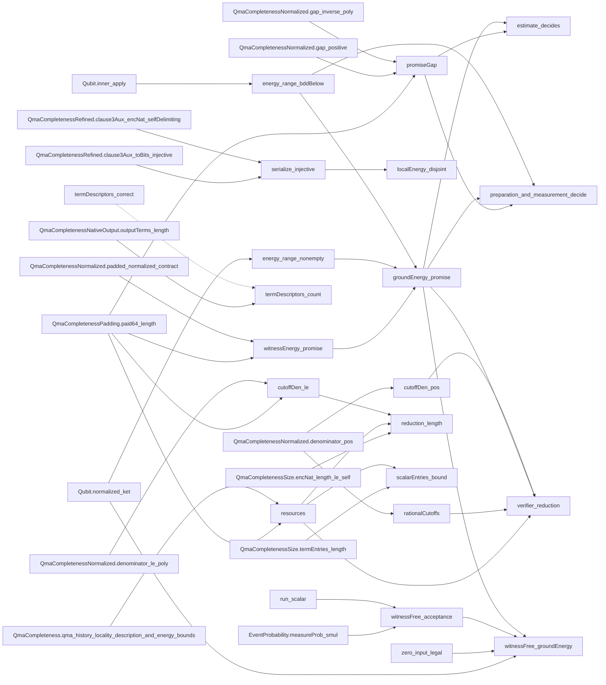
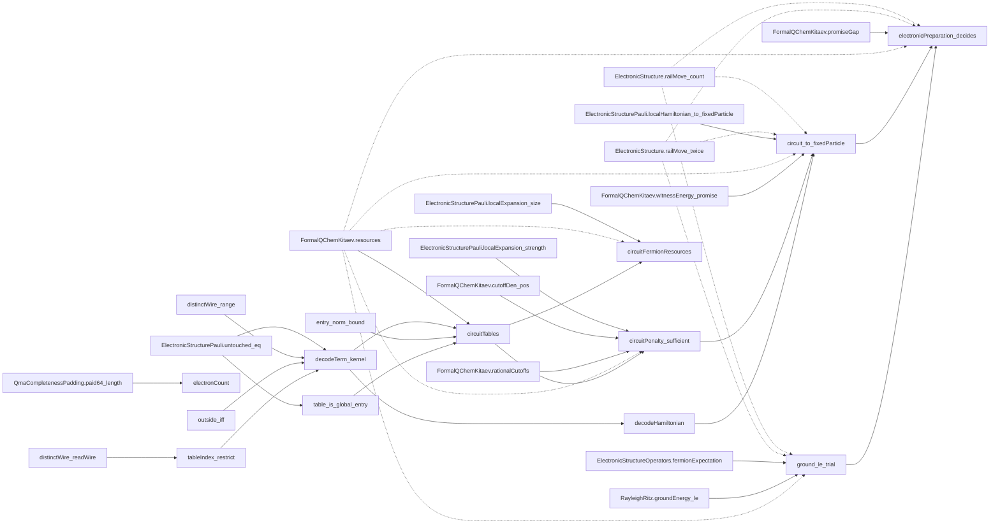

# FormalQChemKitaev theorem graph

37 source theorems and lemmas · 8 shared library prerequisites · 15 upstream theorem nodes · 79 dependency edges.

Arrows point from prerequisite to result. Dashed arrows pass through local definitions or compiler-generated helpers. Each diagram includes the prerequisites used by its module. The links below each diagram open the Lean declarations.

[Graph guide and interactive explorer](README.md)

## FormalQChemKitaev

- [cutoffDen_le](https://github.com/bestquark/formal_qchem/blob/main/integrations/qatlib/FormalQChemKitaev.lean#L246)
- [cutoffDen_pos](https://github.com/bestquark/formal_qchem/blob/main/integrations/qatlib/FormalQChemKitaev.lean#L233)
- [energy_range_bddBelow](https://github.com/bestquark/formal_qchem/blob/main/integrations/qatlib/FormalQChemKitaev.lean#L39) (private)
- [energy_range_nonempty](https://github.com/bestquark/formal_qchem/blob/main/integrations/qatlib/FormalQChemKitaev.lean#L35) (private)
- [estimate_decides](https://github.com/bestquark/formal_qchem/blob/main/integrations/qatlib/FormalQChemKitaev.lean#L154)
- [groundEnergy_promise](https://github.com/bestquark/formal_qchem/blob/main/integrations/qatlib/FormalQChemKitaev.lean#L139)
- [localEnergy_disjoint](https://github.com/bestquark/formal_qchem/blob/main/integrations/qatlib/FormalQChemKitaev.lean#L291)
- [preparation_and_measurement_decide](https://github.com/bestquark/formal_qchem/blob/main/integrations/qatlib/FormalQChemKitaev.lean#L389)
- [promiseGap](https://github.com/bestquark/formal_qchem/blob/main/integrations/qatlib/FormalQChemKitaev.lean#L97)
- [rationalCutoffs](https://github.com/bestquark/formal_qchem/blob/main/integrations/qatlib/FormalQChemKitaev.lean#L238)
- [reduction_length](https://github.com/bestquark/formal_qchem/blob/main/integrations/qatlib/FormalQChemKitaev.lean#L274)
- [resources](https://github.com/bestquark/formal_qchem/blob/main/integrations/qatlib/FormalQChemKitaev.lean#L79)
- [run_scalar](https://github.com/bestquark/formal_qchem/blob/main/integrations/qatlib/FormalQChemKitaev.lean#L172) (private)
- [scalarEntries_bound](https://github.com/bestquark/formal_qchem/blob/main/integrations/qatlib/FormalQChemKitaev.lean#L358)
- [serialize_injective](https://github.com/bestquark/formal_qchem/blob/main/integrations/qatlib/FormalQChemKitaev.lean#L268)
- [termDescriptors_correct](https://github.com/bestquark/formal_qchem/blob/main/integrations/qatlib/FormalQChemKitaev.lean#L342)
- [termDescriptors_count](https://github.com/bestquark/formal_qchem/blob/main/integrations/qatlib/FormalQChemKitaev.lean#L350)
- [verifier_reduction](https://github.com/bestquark/formal_qchem/blob/main/integrations/qatlib/FormalQChemKitaev.lean#L300)
- [witnessEnergy_promise](https://github.com/bestquark/formal_qchem/blob/main/integrations/qatlib/FormalQChemKitaev.lean#L123)
- [witnessFree_acceptance](https://github.com/bestquark/formal_qchem/blob/main/integrations/qatlib/FormalQChemKitaev.lean#L187)
- [witnessFree_groundEnergy](https://github.com/bestquark/formal_qchem/blob/main/integrations/qatlib/FormalQChemKitaev.lean#L206)
- [zero_input_legal](https://github.com/bestquark/formal_qchem/blob/main/integrations/qatlib/FormalQChemKitaev.lean#L178) (private)
- [QmaCompletenessRefined.clause3Aux_encNat_selfDelimiting](https://github.com/quantum-atlas-ai/qatlib/blob/f76f71a7c5cd19a31c251d0feeab09c75a758d69/Qatlib/Concepts/QmaCompleteness/HistoryHam/QmaCompletenessRefined.lean#L1056)
- [QmaCompletenessRefined.clause3Aux_toBits_injective](https://github.com/quantum-atlas-ai/qatlib/blob/f76f71a7c5cd19a31c251d0feeab09c75a758d69/Qatlib/Concepts/QmaCompleteness/HistoryHam/QmaCompletenessRefined.lean#L1261)
- [QmaCompletenessNativeOutput.outputTerms_length](https://github.com/quantum-atlas-ai/qatlib/blob/f76f71a7c5cd19a31c251d0feeab09c75a758d69/Qatlib/Concepts/QueryComplexity/DegreeMethod/QmaCompletenessNativeOutput.lean#L274)
- [EventProbability.measureProb_smul](https://github.com/quantum-atlas-ai/qatlib/blob/f76f71a7c5cd19a31c251d0feeab09c75a758d69/Qatlib/Foundations/BornMetrics/EventProbability.lean#L62)
- [Qubit.inner_apply](https://github.com/quantum-atlas-ai/qatlib/blob/f76f71a7c5cd19a31c251d0feeab09c75a758d69/Qatlib/Foundations/PureStateMath/Qubit.lean#L639)
- [Qubit.normalized_ket](https://github.com/quantum-atlas-ai/qatlib/blob/f76f71a7c5cd19a31c251d0feeab09c75a758d69/Qatlib/Foundations/PureStateMath/Qubit.lean#L152)
- [QmaCompleteness.qma_history_locality_description_and_energy_bounds](https://github.com/quantum-atlas-ai/qatlib/blob/f76f71a7c5cd19a31c251d0feeab09c75a758d69/Qatlib/Papers/LocalHam06/MainResults/QmaCompleteness.lean#L98)
- [QmaCompletenessNormalized.denominator_le_poly](https://github.com/quantum-atlas-ai/qatlib/blob/f76f71a7c5cd19a31c251d0feeab09c75a758d69/Qatlib/Papers/LocalHam06/MainResults/QmaCompletenessNormalized.lean#L313)
- [QmaCompletenessNormalized.denominator_pos](https://github.com/quantum-atlas-ai/qatlib/blob/f76f71a7c5cd19a31c251d0feeab09c75a758d69/Qatlib/Papers/LocalHam06/MainResults/QmaCompletenessNormalized.lean#L93)
- [QmaCompletenessNormalized.gap_inverse_poly](https://github.com/quantum-atlas-ai/qatlib/blob/f76f71a7c5cd19a31c251d0feeab09c75a758d69/Qatlib/Papers/LocalHam06/MainResults/QmaCompletenessNormalized.lean#L333)
- [QmaCompletenessNormalized.gap_positive](https://github.com/quantum-atlas-ai/qatlib/blob/f76f71a7c5cd19a31c251d0feeab09c75a758d69/Qatlib/Papers/LocalHam06/MainResults/QmaCompletenessNormalized.lean#L323)
- [QmaCompletenessNormalized.padded_normalized_contract](https://github.com/quantum-atlas-ai/qatlib/blob/f76f71a7c5cd19a31c251d0feeab09c75a758d69/Qatlib/Papers/LocalHam06/MainResults/QmaCompletenessNormalized.lean#L354)
- [QmaCompletenessPadding.paid64_length](https://github.com/quantum-atlas-ai/qatlib/blob/f76f71a7c5cd19a31c251d0feeab09c75a758d69/Qatlib/Papers/LocalHam06/MainResults/QmaCompletenessPadding.lean#L103)
- [QmaCompletenessSize.encNat_length_le_self](https://github.com/quantum-atlas-ai/qatlib/blob/f76f71a7c5cd19a31c251d0feeab09c75a758d69/Qatlib/Papers/LocalHam06/MainResults/QmaCompletenessSize.lean#L97)
- [QmaCompletenessSize.termEntries_length](https://github.com/quantum-atlas-ai/qatlib/blob/f76f71a7c5cd19a31c251d0feeab09c75a758d69/Qatlib/Papers/LocalHam06/MainResults/QmaCompletenessSize.lean#L80)

## FormalQChemKitaev.ElectronicStructure

- [ElectronicStructure.railMove_count](https://github.com/bestquark/formal_qchem/blob/main/FormalQChem/Complexity/ElectronicStructure.lean#L110)
- [ElectronicStructure.railMove_twice](https://github.com/bestquark/formal_qchem/blob/main/FormalQChem/Complexity/ElectronicStructure.lean#L104)
- [ElectronicStructureOperators.fermionExpectation](https://github.com/bestquark/formal_qchem/blob/main/FormalQChem/Complexity/ElectronicStructureOperators.lean#L167)
- [ElectronicStructurePauli.localExpansion_size](https://github.com/bestquark/formal_qchem/blob/main/FormalQChem/Complexity/ElectronicStructurePauli.lean#L198)
- [ElectronicStructurePauli.localExpansion_strength](https://github.com/bestquark/formal_qchem/blob/main/FormalQChem/Complexity/ElectronicStructurePauli.lean#L232)
- [ElectronicStructurePauli.localHamiltonian_to_fixedParticle](https://github.com/bestquark/formal_qchem/blob/main/FormalQChem/Complexity/ElectronicStructurePauli.lean#L209)
- [ElectronicStructurePauli.untouched_eq](https://github.com/bestquark/formal_qchem/blob/main/FormalQChem/Complexity/ElectronicStructurePauli.lean#L114)
- [RayleighRitz.groundEnergy_le](https://github.com/bestquark/formal_qchem/blob/main/FormalQChem/StatePrep/VariationalOptimization/RayleighRitz.lean#L49)
- [FormalQChemKitaev.cutoffDen_pos](https://github.com/bestquark/formal_qchem/blob/main/integrations/qatlib/FormalQChemKitaev.lean#L233)
- [FormalQChemKitaev.promiseGap](https://github.com/bestquark/formal_qchem/blob/main/integrations/qatlib/FormalQChemKitaev.lean#L97)
- [FormalQChemKitaev.rationalCutoffs](https://github.com/bestquark/formal_qchem/blob/main/integrations/qatlib/FormalQChemKitaev.lean#L238)
- [FormalQChemKitaev.resources](https://github.com/bestquark/formal_qchem/blob/main/integrations/qatlib/FormalQChemKitaev.lean#L79)
- [FormalQChemKitaev.witnessEnergy_promise](https://github.com/bestquark/formal_qchem/blob/main/integrations/qatlib/FormalQChemKitaev.lean#L123)
- [circuitFermionResources](https://github.com/bestquark/formal_qchem/blob/main/integrations/qatlib/FormalQChemKitaev/ElectronicStructure.lean#L187)
- [circuitPenalty_sufficient](https://github.com/bestquark/formal_qchem/blob/main/integrations/qatlib/FormalQChemKitaev/ElectronicStructure.lean#L161) (private)
- [circuitTables](https://github.com/bestquark/formal_qchem/blob/main/integrations/qatlib/FormalQChemKitaev/ElectronicStructure.lean#L150)
- [circuit_to_fixedParticle](https://github.com/bestquark/formal_qchem/blob/main/integrations/qatlib/FormalQChemKitaev/ElectronicStructure.lean#L198)
- [decodeHamiltonian](https://github.com/bestquark/formal_qchem/blob/main/integrations/qatlib/FormalQChemKitaev/ElectronicStructure.lean#L112)
- [decodeTerm_kernel](https://github.com/bestquark/formal_qchem/blob/main/integrations/qatlib/FormalQChemKitaev/ElectronicStructure.lean#L97)
- [distinctWire_range](https://github.com/bestquark/formal_qchem/blob/main/integrations/qatlib/FormalQChemKitaev/ElectronicStructure.lean#L48)
- [distinctWire_readWire](https://github.com/bestquark/formal_qchem/blob/main/integrations/qatlib/FormalQChemKitaev/ElectronicStructure.lean#L43)
- [electronCount](https://github.com/bestquark/formal_qchem/blob/main/integrations/qatlib/FormalQChemKitaev/ElectronicStructure.lean#L176)
- [electronicPreparation_decides](https://github.com/bestquark/formal_qchem/blob/main/integrations/qatlib/FormalQChemKitaev/ElectronicStructure.lean#L224)
- [entry_norm_bound](https://github.com/bestquark/formal_qchem/blob/main/integrations/qatlib/FormalQChemKitaev/ElectronicStructure.lean#L138) (private)
- [ground_le_trial](https://github.com/bestquark/formal_qchem/blob/main/integrations/qatlib/FormalQChemKitaev/ElectronicStructure.lean#L211) (private)
- [outside_iff](https://github.com/bestquark/formal_qchem/blob/main/integrations/qatlib/FormalQChemKitaev/ElectronicStructure.lean#L83) (private)
- [tableIndex_restrict](https://github.com/bestquark/formal_qchem/blob/main/integrations/qatlib/FormalQChemKitaev/ElectronicStructure.lean#L61)
- [table_is_global_entry](https://github.com/bestquark/formal_qchem/blob/main/integrations/qatlib/FormalQChemKitaev/ElectronicStructure.lean#L128) (private)
- [QmaCompletenessPadding.paid64_length](https://github.com/quantum-atlas-ai/qatlib/blob/f76f71a7c5cd19a31c251d0feeab09c75a758d69/Qatlib/Papers/LocalHam06/MainResults/QmaCompletenessPadding.lean#L103)
