# Kitaev integration theorem graph

217 source theorems and lemmas · 8 shared library prerequisites · 27 upstream theorem nodes · 423 dependency edges.

Arrows point from prerequisite to result. Dashed arrows pass through local definitions or compiler-generated helpers. Each diagram includes the prerequisites used by its module. The links below each diagram open the Lean declarations.

[Graph guide and interactive explorer](README.md)

## FQChemKitaev.AmplificationBounds

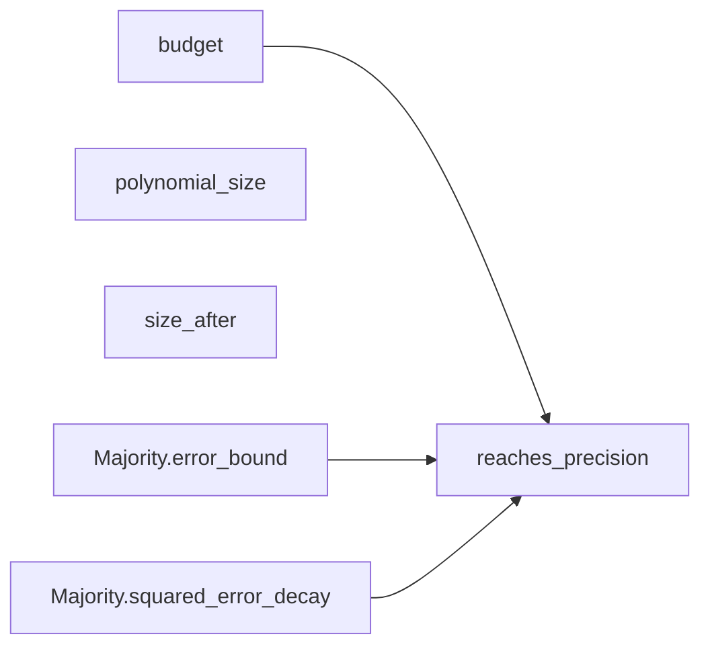

- [budget](../../integrations/qatlib/FQChemKitaev/AmplificationBounds.lean#L43) (private)
- [polynomial_size](../../integrations/qatlib/FQChemKitaev/AmplificationBounds.lean#L31)
- [reaches_precision](../../integrations/qatlib/FQChemKitaev/AmplificationBounds.lean#L72)
- [size_after](../../integrations/qatlib/FQChemKitaev/AmplificationBounds.lean#L20)
- [Majority.error_bound](../../integrations/qatlib/FQChemKitaev/Majority.lean#L220)
- [Majority.squared_error_decay](../../integrations/qatlib/FQChemKitaev/Majority.lean#L247)

## FQChemKitaev.AmplifierCost

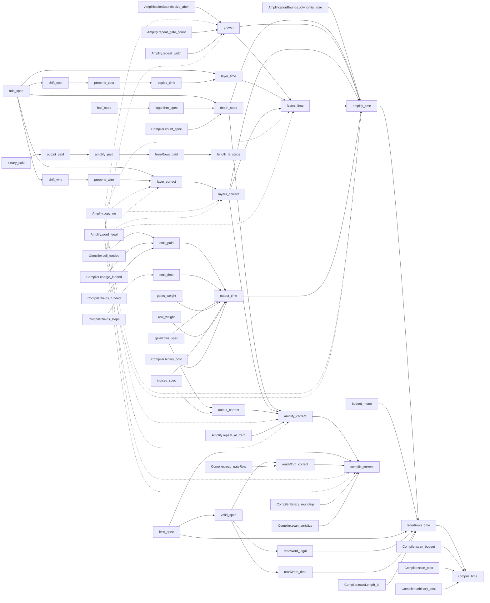

- [AmplificationBounds.polynomial_size](../../integrations/qatlib/FQChemKitaev/AmplificationBounds.lean#L31)
- [AmplificationBounds.size_after](../../integrations/qatlib/FQChemKitaev/AmplificationBounds.lean#L20)
- [add_spec](../../integrations/qatlib/FQChemKitaev/AmplifierCost.lean#L34) (private)
- [amplify_correct](../../integrations/qatlib/FQChemKitaev/AmplifierCost.lean#L330)
- [amplify_paid](../../integrations/qatlib/FQChemKitaev/AmplifierCost.lean#L536) (private)
- [amplify_time](../../integrations/qatlib/FQChemKitaev/AmplifierCost.lean#L341)
- [binary_paid](../../integrations/qatlib/FQChemKitaev/AmplifierCost.lean#L527) (private)
- [budget_mono](../../integrations/qatlib/FQChemKitaev/AmplifierCost.lean#L482) (private)
- [compile_correct](../../integrations/qatlib/FQChemKitaev/AmplifierCost.lean#L473)
- [compile_time](../../integrations/qatlib/FQChemKitaev/AmplifierCost.lean#L515)
- [copies_time](../../integrations/qatlib/FQChemKitaev/AmplifierCost.lean#L115) (private)
- [depth_spec](../../integrations/qatlib/FQChemKitaev/AmplifierCost.lean#L211) (private)
- [emit_paid](../../integrations/qatlib/FQChemKitaev/AmplifierCost.lean#L259) (private)
- [emit_time](../../integrations/qatlib/FQChemKitaev/AmplifierCost.lean#L264) (private)
- [fromRows_paid](../../integrations/qatlib/FQChemKitaev/AmplifierCost.lean#L540) (private)
- [fromRows_time](../../integrations/qatlib/FQChemKitaev/AmplifierCost.lean#L484) (private)
- [gateRows_spec](../../integrations/qatlib/FQChemKitaev/AmplifierCost.lean#L240) (private)
- [gates_weight](../../integrations/qatlib/FQChemKitaev/AmplifierCost.lean#L282) (private)
- [growth](../../integrations/qatlib/FQChemKitaev/AmplifierCost.lean#L143) (private)
- [half_spec](../../integrations/qatlib/FQChemKitaev/AmplifierCost.lean#L167) (private)
- [indices_spec](../../integrations/qatlib/FQChemKitaev/AmplifierCost.lean#L230) (private)
- [layer_correct](../../integrations/qatlib/FQChemKitaev/AmplifierCost.lean#L102)
- [layer_time](../../integrations/qatlib/FQChemKitaev/AmplifierCost.lean#L123) (private)
- [layers_correct](../../integrations/qatlib/FQChemKitaev/AmplifierCost.lean#L137)
- [layers_time](../../integrations/qatlib/FQChemKitaev/AmplifierCost.lean#L148) (private)
- [length_le_steps](../../integrations/qatlib/FQChemKitaev/AmplifierCost.lean#L552)
- [less_spec](../../integrations/qatlib/FQChemKitaev/AmplifierCost.lean#L367) (private)
- [logarithm_spec](../../integrations/qatlib/FQChemKitaev/AmplifierCost.lean#L180) (private)
- [output_correct](../../integrations/qatlib/FQChemKitaev/AmplifierCost.lean#L252) (private)
- [output_paid](../../integrations/qatlib/FQChemKitaev/AmplifierCost.lean#L532) (private)
- [output_time](../../integrations/qatlib/FQChemKitaev/AmplifierCost.lean#L300) (private)
- [prepend_cost](../../integrations/qatlib/FQChemKitaev/AmplifierCost.lean#L69) (private)
- [prepend_wire](../../integrations/qatlib/FQChemKitaev/AmplifierCost.lean#L78) (private)
- [readWord_correct](../../integrations/qatlib/FQChemKitaev/AmplifierCost.lean#L435) (private)
- [readWord_legal](../../integrations/qatlib/FQChemKitaev/AmplifierCost.lean#L422) (private)
- [readWord_time](../../integrations/qatlib/FQChemKitaev/AmplifierCost.lean#L445) (private)
- [row_weight](../../integrations/qatlib/FQChemKitaev/AmplifierCost.lean#L273) (private)
- [shift_cost](../../integrations/qatlib/FQChemKitaev/AmplifierCost.lean#L47) (private)
- [shift_wire](../../integrations/qatlib/FQChemKitaev/AmplifierCost.lean#L50) (private)
- [valid_spec](../../integrations/qatlib/FQChemKitaev/AmplifierCost.lean#L387) (private)
- [Amplify.copy_ne](../../integrations/qatlib/FQChemKitaev/Amplify.lean#L31) (private)
- [Amplify.repeat_all_zero](../../integrations/qatlib/FQChemKitaev/Amplify.lean#L243)
- [Amplify.repeat_gate_count](../../integrations/qatlib/FQChemKitaev/Amplify.lean#L236)
- [Amplify.repeat_width](../../integrations/qatlib/FQChemKitaev/Amplify.lean#L240)
- [Amplify.word_legal](../../integrations/qatlib/FQChemKitaev/Amplify.lean#L139)
- [Compiler.binary_cost](../../integrations/qatlib/FQChemKitaev/Compiler.lean#L636) (private)
- [Compiler.binary_roundtrip](../../integrations/qatlib/FQChemKitaev/Compiler.lean#L633)
- [Compiler.cell_funded](../../integrations/qatlib/FQChemKitaev/Compiler.lean#L523) (private)
- [Compiler.charge_funded](../../integrations/qatlib/FQChemKitaev/Compiler.lean#L520) (private)
- [Compiler.count_spec](../../integrations/qatlib/FQChemKitaev/Compiler.lean#L176)
- [Compiler.fields_funded](../../integrations/qatlib/FQChemKitaev/Compiler.lean#L529) (private)
- [Compiler.fields_steps](../../integrations/qatlib/FQChemKitaev/Compiler.lean#L349) (private)
- [Compiler.read_gateRow](../../integrations/qatlib/FQChemKitaev/Compiler.lean#L133)
- [Compiler.rowsLength_le](../../integrations/qatlib/FQChemKitaev/Compiler.lean#L325) (private)
- [Compiler.scan_budget](../../integrations/qatlib/FQChemKitaev/Compiler.lean#L339) (private)
- [Compiler.scan_cost](../../integrations/qatlib/FQChemKitaev/Compiler.lean#L87)
- [Compiler.scan_serialize](../../integrations/qatlib/FQChemKitaev/Compiler.lean#L113)
- [Compiler.unbinary_cost](../../integrations/qatlib/FQChemKitaev/Compiler.lean#L639) (private)

## FQChemKitaev.Amplify

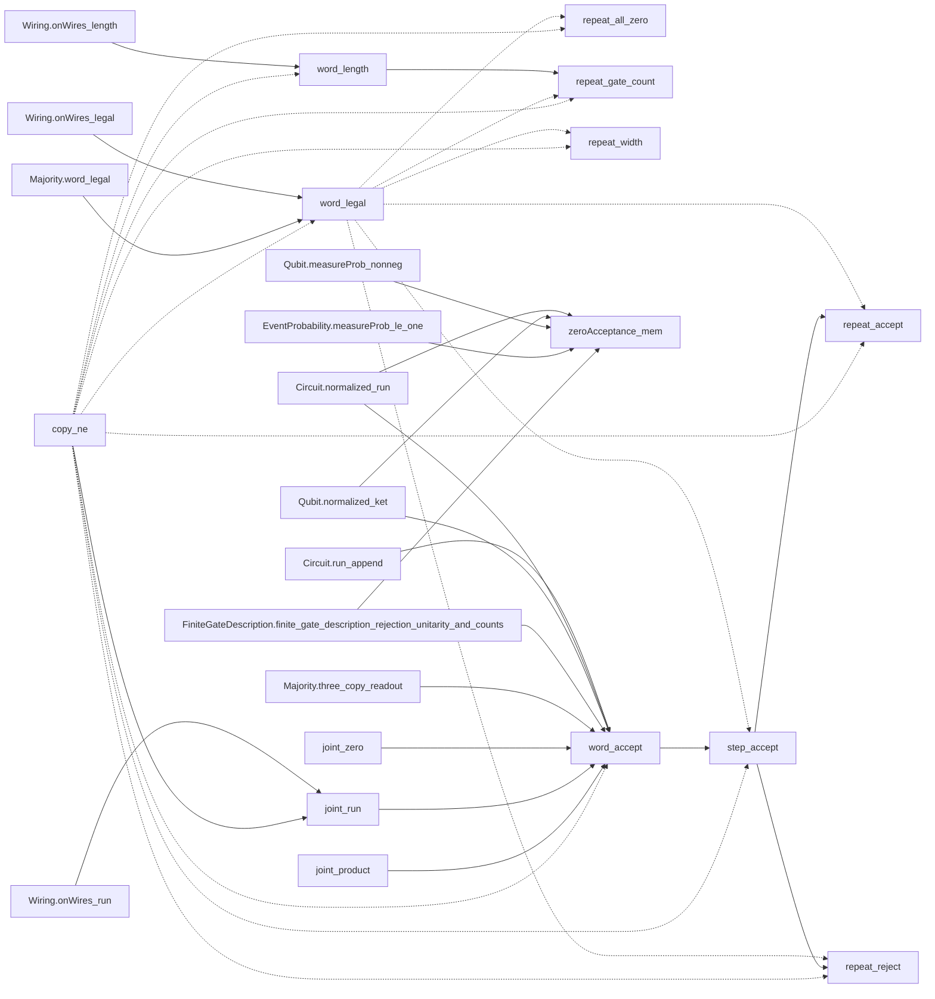

- [copy_ne](../../integrations/qatlib/FQChemKitaev/Amplify.lean#L31) (private)
- [joint_product](../../integrations/qatlib/FQChemKitaev/Amplify.lean#L166) (private)
- [joint_run](../../integrations/qatlib/FQChemKitaev/Amplify.lean#L81) (private)
- [joint_zero](../../integrations/qatlib/FQChemKitaev/Amplify.lean#L146) (private)
- [repeat_accept](../../integrations/qatlib/FQChemKitaev/Amplify.lean#L259)
- [repeat_all_zero](../../integrations/qatlib/FQChemKitaev/Amplify.lean#L243)
- [repeat_gate_count](../../integrations/qatlib/FQChemKitaev/Amplify.lean#L236)
- [repeat_reject](../../integrations/qatlib/FQChemKitaev/Amplify.lean#L265)
- [repeat_width](../../integrations/qatlib/FQChemKitaev/Amplify.lean#L240)
- [step_accept](../../integrations/qatlib/FQChemKitaev/Amplify.lean#L255)
- [word_accept](../../integrations/qatlib/FQChemKitaev/Amplify.lean#L183)
- [word_legal](../../integrations/qatlib/FQChemKitaev/Amplify.lean#L139)
- [word_length](../../integrations/qatlib/FQChemKitaev/Amplify.lean#L136)
- [zeroAcceptance_mem](../../integrations/qatlib/FQChemKitaev/Amplify.lean#L248)
- [Majority.three_copy_readout](../../integrations/qatlib/FQChemKitaev/Majority.lean#L187)
- [Majority.word_legal](../../integrations/qatlib/FQChemKitaev/Majority.lean#L70)
- [Wiring.onWires_legal](../../integrations/qatlib/FQChemKitaev/Wiring.lean#L162)
- [Wiring.onWires_length](../../integrations/qatlib/FQChemKitaev/Wiring.lean#L168)
- [Wiring.onWires_run](../../integrations/qatlib/FQChemKitaev/Wiring.lean#L173)
- [FiniteGateDescription.finite_gate_description_rejection_unitarity_and_counts](https://github.com/quantum-atlas-ai/qatlib/blob/f76f71a7c5cd19a31c251d0feeab09c75a758d69/Qatlib/Concepts/GateVocabulary/FiniteGateDescription.lean#L129)
- [EventProbability.measureProb_le_one](https://github.com/quantum-atlas-ai/qatlib/blob/f76f71a7c5cd19a31c251d0feeab09c75a758d69/Qatlib/Foundations/BornMetrics/EventProbability.lean#L45)
- [Qubit.measureProb_nonneg](https://github.com/quantum-atlas-ai/qatlib/blob/f76f71a7c5cd19a31c251d0feeab09c75a758d69/Qatlib/Foundations/PureStateMath/Qubit.lean#L167)
- [Qubit.normalized_ket](https://github.com/quantum-atlas-ai/qatlib/blob/f76f71a7c5cd19a31c251d0feeab09c75a758d69/Qatlib/Foundations/PureStateMath/Qubit.lean#L152)
- [Circuit.normalized_run](https://github.com/quantum-atlas-ai/qatlib/blob/f76f71a7c5cd19a31c251d0feeab09c75a758d69/Qatlib/Foundations/QueryWordCore/Circuit.lean)
- [Circuit.run_append](https://github.com/quantum-atlas-ai/qatlib/blob/f76f71a7c5cd19a31c251d0feeab09c75a758d69/Qatlib/Foundations/QueryWordCore/Circuit.lean#L249)

## FQChemKitaev.BoundedErrorReduction

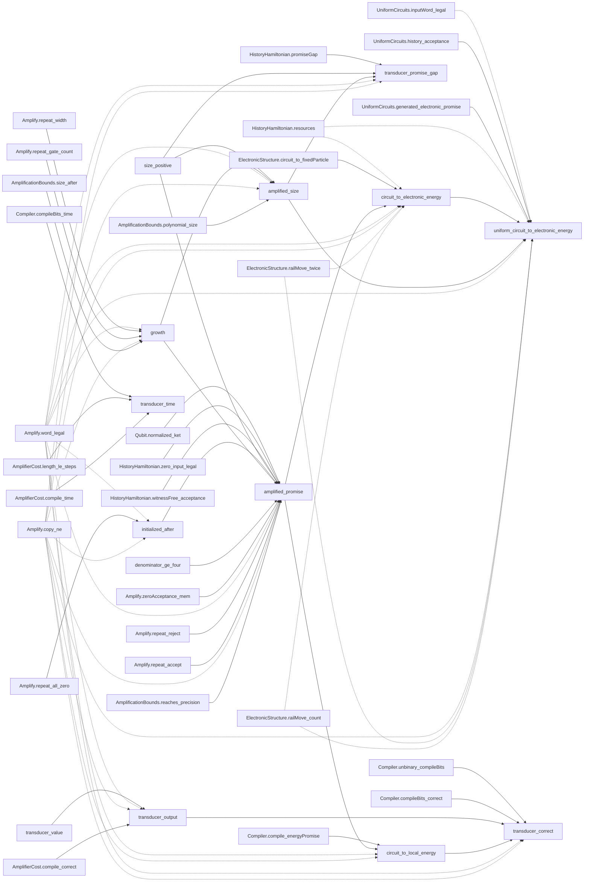

- [ElectronicStructure.railMove_count](../../FQChem/Complexity/ElectronicStructure.lean#L110)
- [ElectronicStructure.railMove_twice](../../FQChem/Complexity/ElectronicStructure.lean#L104)
- [AmplificationBounds.polynomial_size](../../integrations/qatlib/FQChemKitaev/AmplificationBounds.lean#L31)
- [AmplificationBounds.reaches_precision](../../integrations/qatlib/FQChemKitaev/AmplificationBounds.lean#L72)
- [AmplificationBounds.size_after](../../integrations/qatlib/FQChemKitaev/AmplificationBounds.lean#L20)
- [AmplifierCost.compile_correct](../../integrations/qatlib/FQChemKitaev/AmplifierCost.lean#L473)
- [AmplifierCost.compile_time](../../integrations/qatlib/FQChemKitaev/AmplifierCost.lean#L515)
- [AmplifierCost.length_le_steps](../../integrations/qatlib/FQChemKitaev/AmplifierCost.lean#L552)
- [Amplify.copy_ne](../../integrations/qatlib/FQChemKitaev/Amplify.lean#L31) (private)
- [Amplify.repeat_accept](../../integrations/qatlib/FQChemKitaev/Amplify.lean#L259)
- [Amplify.repeat_all_zero](../../integrations/qatlib/FQChemKitaev/Amplify.lean#L243)
- [Amplify.repeat_gate_count](../../integrations/qatlib/FQChemKitaev/Amplify.lean#L236)
- [Amplify.repeat_reject](../../integrations/qatlib/FQChemKitaev/Amplify.lean#L265)
- [Amplify.repeat_width](../../integrations/qatlib/FQChemKitaev/Amplify.lean#L240)
- [Amplify.word_legal](../../integrations/qatlib/FQChemKitaev/Amplify.lean#L139)
- [Amplify.zeroAcceptance_mem](../../integrations/qatlib/FQChemKitaev/Amplify.lean#L248)
- [amplified_promise](../../integrations/qatlib/FQChemKitaev/BoundedErrorReduction.lean#L49)
- [amplified_size](../../integrations/qatlib/FQChemKitaev/BoundedErrorReduction.lean#L35)
- [circuit_to_electronic_energy](../../integrations/qatlib/FQChemKitaev/BoundedErrorReduction.lean#L143)
- [circuit_to_local_energy](../../integrations/qatlib/FQChemKitaev/BoundedErrorReduction.lean#L79)
- [denominator_ge_four](../../integrations/qatlib/FQChemKitaev/BoundedErrorReduction.lean#L44) (private)
- [growth](../../integrations/qatlib/FQChemKitaev/BoundedErrorReduction.lean#L29) (private)
- [initialized_after](../../integrations/qatlib/FQChemKitaev/BoundedErrorReduction.lean#L38) (private)
- [size_positive](../../integrations/qatlib/FQChemKitaev/BoundedErrorReduction.lean#L27) (private)
- [transducer_correct](../../integrations/qatlib/FQChemKitaev/BoundedErrorReduction.lean#L116)
- [transducer_output](../../integrations/qatlib/FQChemKitaev/BoundedErrorReduction.lean#L94) (private)
- [transducer_promise_gap](../../integrations/qatlib/FQChemKitaev/BoundedErrorReduction.lean#L130)
- [transducer_time](../../integrations/qatlib/FQChemKitaev/BoundedErrorReduction.lean#L101)
- [transducer_value](../../integrations/qatlib/FQChemKitaev/BoundedErrorReduction.lean#L91) (private)
- [uniform_circuit_to_electronic_energy](../../integrations/qatlib/FQChemKitaev/BoundedErrorReduction.lean#L156)
- [Compiler.compileBits_correct](../../integrations/qatlib/FQChemKitaev/Compiler.lean#L661)
- [Compiler.compileBits_time](../../integrations/qatlib/FQChemKitaev/Compiler.lean#L667)
- [Compiler.compile_energyPromise](../../integrations/qatlib/FQChemKitaev/Compiler.lean#L480)
- [Compiler.unbinary_compileBits](../../integrations/qatlib/FQChemKitaev/Compiler.lean#L656)
- [ElectronicStructure.circuit_to_fixedParticle](../../integrations/qatlib/FQChemKitaev/ElectronicStructure.lean#L198)
- [HistoryHamiltonian.promiseGap](../../integrations/qatlib/FQChemKitaev/HistoryHamiltonian.lean#L97)
- [HistoryHamiltonian.resources](../../integrations/qatlib/FQChemKitaev/HistoryHamiltonian.lean#L79)
- [HistoryHamiltonian.witnessFree_acceptance](../../integrations/qatlib/FQChemKitaev/HistoryHamiltonian.lean#L187)
- [HistoryHamiltonian.zero_input_legal](../../integrations/qatlib/FQChemKitaev/HistoryHamiltonian.lean#L178)
- [UniformCircuits.generated_electronic_promise](../../integrations/qatlib/FQChemKitaev/UniformCircuits.lean#L139)
- [UniformCircuits.history_acceptance](../../integrations/qatlib/FQChemKitaev/UniformCircuits.lean#L123)
- [UniformCircuits.inputWord_legal](../../integrations/qatlib/FQChemKitaev/UniformCircuits.lean#L60)
- [Qubit.normalized_ket](https://github.com/quantum-atlas-ai/qatlib/blob/f76f71a7c5cd19a31c251d0feeab09c75a758d69/Qatlib/Foundations/PureStateMath/Qubit.lean#L152)

## FQChemKitaev.Compiler

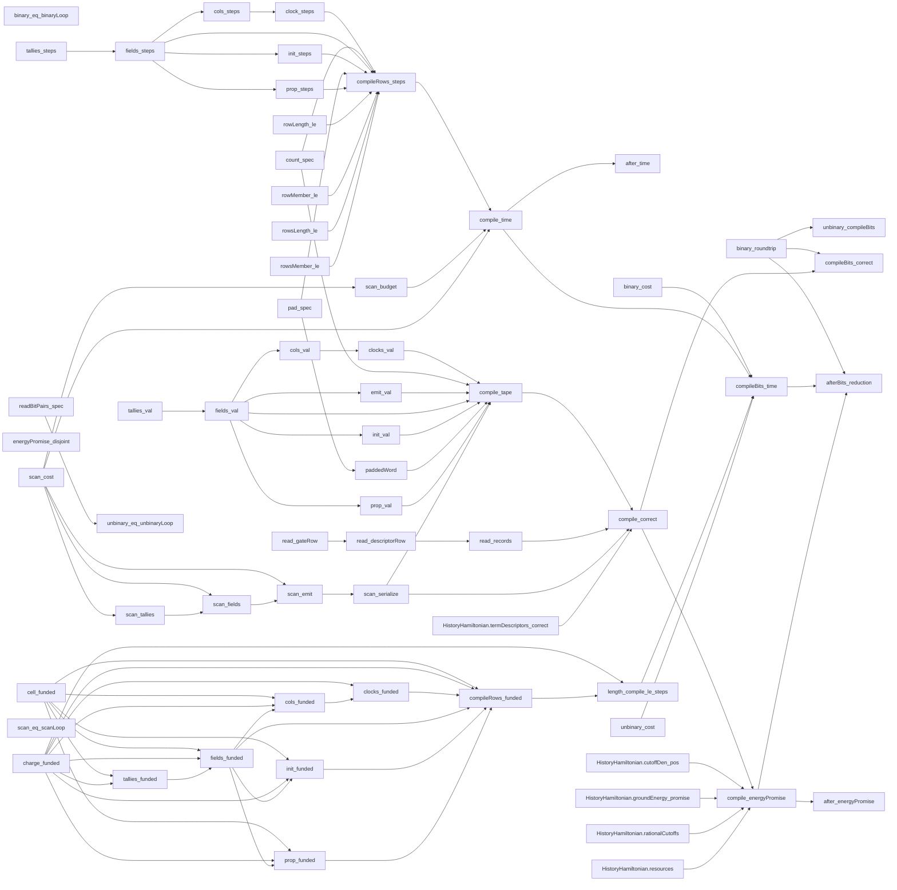

- [afterBits_reduction](../../integrations/qatlib/FQChemKitaev/Compiler.lean#L683)
- [after_energyPromise](../../integrations/qatlib/FQChemKitaev/Compiler.lean#L512)
- [after_time](../../integrations/qatlib/FQChemKitaev/Compiler.lean#L502)
- [binary_cost](../../integrations/qatlib/FQChemKitaev/Compiler.lean#L636) (private)
- [binary_eq_binaryLoop](../../integrations/qatlib/FQChemKitaev/Compiler.lean#L603)
- [binary_roundtrip](../../integrations/qatlib/FQChemKitaev/Compiler.lean#L633)
- [cell_funded](../../integrations/qatlib/FQChemKitaev/Compiler.lean#L523) (private)
- [charge_funded](../../integrations/qatlib/FQChemKitaev/Compiler.lean#L520) (private)
- [clock_steps](../../integrations/qatlib/FQChemKitaev/Compiler.lean#L392) (private)
- [clocks_funded](../../integrations/qatlib/FQChemKitaev/Compiler.lean#L552) (private)
- [clocks_val](../../integrations/qatlib/FQChemKitaev/Compiler.lean#L261) (private)
- [cols_funded](../../integrations/qatlib/FQChemKitaev/Compiler.lean#L546) (private)
- [cols_steps](../../integrations/qatlib/FQChemKitaev/Compiler.lean#L380) (private)
- [cols_val](../../integrations/qatlib/FQChemKitaev/Compiler.lean#L252) (private)
- [compileBits_correct](../../integrations/qatlib/FQChemKitaev/Compiler.lean#L661)
- [compileBits_time](../../integrations/qatlib/FQChemKitaev/Compiler.lean#L667)
- [compileRows_funded](../../integrations/qatlib/FQChemKitaev/Compiler.lean#L558) (private)
- [compileRows_steps](../../integrations/qatlib/FQChemKitaev/Compiler.lean#L403) (private)
- [compile_correct](../../integrations/qatlib/FQChemKitaev/Compiler.lean#L295)
- [compile_energyPromise](../../integrations/qatlib/FQChemKitaev/Compiler.lean#L480)
- [compile_tape](../../integrations/qatlib/FQChemKitaev/Compiler.lean#L277)
- [compile_time](../../integrations/qatlib/FQChemKitaev/Compiler.lean#L451)
- [count_spec](../../integrations/qatlib/FQChemKitaev/Compiler.lean#L176)
- [emit_val](../../integrations/qatlib/FQChemKitaev/Compiler.lean#L235) (private)
- [energyPromise_disjoint](../../integrations/qatlib/FQChemKitaev/Compiler.lean#L473)
- [fields_funded](../../integrations/qatlib/FQChemKitaev/Compiler.lean#L529) (private)
- [fields_steps](../../integrations/qatlib/FQChemKitaev/Compiler.lean#L349) (private)
- [fields_val](../../integrations/qatlib/FQChemKitaev/Compiler.lean#L231) (private)
- [init_funded](../../integrations/qatlib/FQChemKitaev/Compiler.lean#L540) (private)
- [init_steps](../../integrations/qatlib/FQChemKitaev/Compiler.lean#L368) (private)
- [init_val](../../integrations/qatlib/FQChemKitaev/Compiler.lean#L248) (private)
- [length_compile_le_steps](../../integrations/qatlib/FQChemKitaev/Compiler.lean#L570)
- [pad_spec](../../integrations/qatlib/FQChemKitaev/Compiler.lean#L185)
- [paddedWord](../../integrations/qatlib/FQChemKitaev/Compiler.lean#L271) (private)
- [prop_funded](../../integrations/qatlib/FQChemKitaev/Compiler.lean#L534) (private)
- [prop_steps](../../integrations/qatlib/FQChemKitaev/Compiler.lean#L355) (private)
- [prop_val](../../integrations/qatlib/FQChemKitaev/Compiler.lean#L239) (private)
- [readBitPairs_spec](../../integrations/qatlib/FQChemKitaev/Compiler.lean#L615) (private)
- [read_descriptorRow](../../integrations/qatlib/FQChemKitaev/Compiler.lean#L150)
- [read_gateRow](../../integrations/qatlib/FQChemKitaev/Compiler.lean#L133)
- [read_records](../../integrations/qatlib/FQChemKitaev/Compiler.lean#L289) (private)
- [rowLength_le](../../integrations/qatlib/FQChemKitaev/Compiler.lean#L312) (private)
- [rowMember_le](../../integrations/qatlib/FQChemKitaev/Compiler.lean#L315) (private)
- [rowsLength_le](../../integrations/qatlib/FQChemKitaev/Compiler.lean#L325) (private)
- [rowsMember_le](../../integrations/qatlib/FQChemKitaev/Compiler.lean#L328) (private)
- [scan_budget](../../integrations/qatlib/FQChemKitaev/Compiler.lean#L339) (private)
- [scan_cost](../../integrations/qatlib/FQChemKitaev/Compiler.lean#L87)
- [scan_emit](../../integrations/qatlib/FQChemKitaev/Compiler.lean#L104) (private)
- [scan_eq_scanLoop](../../integrations/qatlib/FQChemKitaev/Compiler.lean#L81)
- [scan_fields](../../integrations/qatlib/FQChemKitaev/Compiler.lean#L97) (private)
- [scan_serialize](../../integrations/qatlib/FQChemKitaev/Compiler.lean#L113)
- [scan_tallies](../../integrations/qatlib/FQChemKitaev/Compiler.lean#L90) (private)
- [tallies_funded](../../integrations/qatlib/FQChemKitaev/Compiler.lean#L526) (private)
- [tallies_steps](../../integrations/qatlib/FQChemKitaev/Compiler.lean#L345) (private)
- [tallies_val](../../integrations/qatlib/FQChemKitaev/Compiler.lean#L227) (private)
- [unbinary_compileBits](../../integrations/qatlib/FQChemKitaev/Compiler.lean#L656)
- [unbinary_cost](../../integrations/qatlib/FQChemKitaev/Compiler.lean#L639) (private)
- [unbinary_eq_unbinaryLoop](../../integrations/qatlib/FQChemKitaev/Compiler.lean#L629)
- [HistoryHamiltonian.cutoffDen_pos](../../integrations/qatlib/FQChemKitaev/HistoryHamiltonian.lean#L233)
- [HistoryHamiltonian.groundEnergy_promise](../../integrations/qatlib/FQChemKitaev/HistoryHamiltonian.lean#L139)
- [HistoryHamiltonian.rationalCutoffs](../../integrations/qatlib/FQChemKitaev/HistoryHamiltonian.lean#L238)
- [HistoryHamiltonian.resources](../../integrations/qatlib/FQChemKitaev/HistoryHamiltonian.lean#L79)
- [HistoryHamiltonian.termDescriptors_correct](../../integrations/qatlib/FQChemKitaev/HistoryHamiltonian.lean#L342)

## FQChemKitaev.DyadicCoefficients

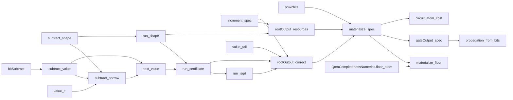

- [bitSubtract](../../integrations/qatlib/FQChemKitaev/DyadicCoefficients.lean#L43) (private)
- [circuit_atom_cost](../../integrations/qatlib/FQChemKitaev/DyadicCoefficients.lean#L296)
- [gateOutput_spec](../../integrations/qatlib/FQChemKitaev/DyadicCoefficients.lean#L282)
- [increment_spec](../../integrations/qatlib/FQChemKitaev/DyadicCoefficients.lean#L196)
- [materialize_floor](../../integrations/qatlib/FQChemKitaev/DyadicCoefficients.lean#L272)
- [materialize_spec](../../integrations/qatlib/FQChemKitaev/DyadicCoefficients.lean#L262)
- [next_value](../../integrations/qatlib/FQChemKitaev/DyadicCoefficients.lean#L128) (private)
- [pow2bits](../../integrations/qatlib/FQChemKitaev/DyadicCoefficients.lean#L256) (private)
- [propagation_from_bits](../../integrations/qatlib/FQChemKitaev/DyadicCoefficients.lean#L306)
- [rootOutput_correct](../../integrations/qatlib/FQChemKitaev/DyadicCoefficients.lean#L224)
- [rootOutput_resources](../../integrations/qatlib/FQChemKitaev/DyadicCoefficients.lean#L240)
- [run_certificate](../../integrations/qatlib/FQChemKitaev/DyadicCoefficients.lean#L165)
- [run_isqrt](../../integrations/qatlib/FQChemKitaev/DyadicCoefficients.lean#L177)
- [run_shape](../../integrations/qatlib/FQChemKitaev/DyadicCoefficients.lean#L115)
- [subtract_borrow](../../integrations/qatlib/FQChemKitaev/DyadicCoefficients.lean#L88)
- [subtract_shape](../../integrations/qatlib/FQChemKitaev/DyadicCoefficients.lean#L63)
- [subtract_value](../../integrations/qatlib/FQChemKitaev/DyadicCoefficients.lean#L72)
- [value_lt](../../integrations/qatlib/FQChemKitaev/DyadicCoefficients.lean#L35)
- [value_tail](../../integrations/qatlib/FQChemKitaev/DyadicCoefficients.lean#L203) (private)
- [QmaCompletenessNumerics.floor_atom](https://github.com/quantum-atlas-ai/qatlib/blob/f76f71a7c5cd19a31c251d0feeab09c75a758d69/Qatlib/Concepts/UniformBqp/FiniteGateWord/QmaCompletenessNumerics.lean#L191)

## FQChemKitaev.ElectronicStructure

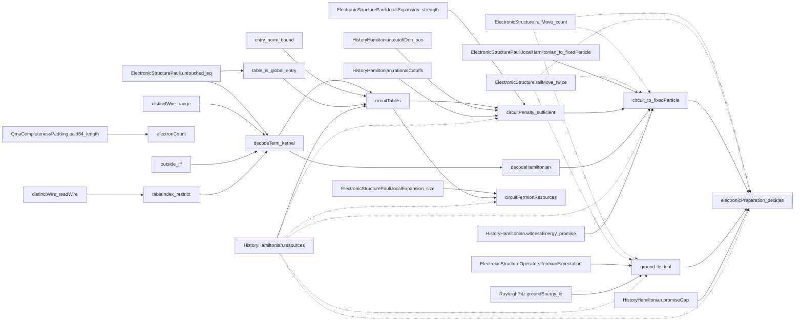

- [ElectronicStructure.railMove_count](../../FQChem/Complexity/ElectronicStructure.lean#L110)
- [ElectronicStructure.railMove_twice](../../FQChem/Complexity/ElectronicStructure.lean#L104)
- [ElectronicStructureOperators.fermionExpectation](../../FQChem/Complexity/ElectronicStructureOperators.lean#L167)
- [ElectronicStructurePauli.localExpansion_size](../../FQChem/Complexity/ElectronicStructurePauli.lean#L198)
- [ElectronicStructurePauli.localExpansion_strength](../../FQChem/Complexity/ElectronicStructurePauli.lean#L232)
- [ElectronicStructurePauli.localHamiltonian_to_fixedParticle](../../FQChem/Complexity/ElectronicStructurePauli.lean#L209)
- [ElectronicStructurePauli.untouched_eq](../../FQChem/Complexity/ElectronicStructurePauli.lean#L114)
- [RayleighRitz.groundEnergy_le](../../FQChem/StatePrep/VariationalOptimization/RayleighRitz.lean#L49)
- [circuitFermionResources](../../integrations/qatlib/FQChemKitaev/ElectronicStructure.lean#L187)
- [circuitPenalty_sufficient](../../integrations/qatlib/FQChemKitaev/ElectronicStructure.lean#L161) (private)
- [circuitTables](../../integrations/qatlib/FQChemKitaev/ElectronicStructure.lean#L150)
- [circuit_to_fixedParticle](../../integrations/qatlib/FQChemKitaev/ElectronicStructure.lean#L198)
- [decodeHamiltonian](../../integrations/qatlib/FQChemKitaev/ElectronicStructure.lean#L112)
- [decodeTerm_kernel](../../integrations/qatlib/FQChemKitaev/ElectronicStructure.lean#L97)
- [distinctWire_range](../../integrations/qatlib/FQChemKitaev/ElectronicStructure.lean#L48)
- [distinctWire_readWire](../../integrations/qatlib/FQChemKitaev/ElectronicStructure.lean#L43)
- [electronCount](../../integrations/qatlib/FQChemKitaev/ElectronicStructure.lean#L176)
- [electronicPreparation_decides](../../integrations/qatlib/FQChemKitaev/ElectronicStructure.lean#L224)
- [entry_norm_bound](../../integrations/qatlib/FQChemKitaev/ElectronicStructure.lean#L138) (private)
- [ground_le_trial](../../integrations/qatlib/FQChemKitaev/ElectronicStructure.lean#L211) (private)
- [outside_iff](../../integrations/qatlib/FQChemKitaev/ElectronicStructure.lean#L83) (private)
- [tableIndex_restrict](../../integrations/qatlib/FQChemKitaev/ElectronicStructure.lean#L61)
- [table_is_global_entry](../../integrations/qatlib/FQChemKitaev/ElectronicStructure.lean#L128) (private)
- [HistoryHamiltonian.cutoffDen_pos](../../integrations/qatlib/FQChemKitaev/HistoryHamiltonian.lean#L233)
- [HistoryHamiltonian.promiseGap](../../integrations/qatlib/FQChemKitaev/HistoryHamiltonian.lean#L97)
- [HistoryHamiltonian.rationalCutoffs](../../integrations/qatlib/FQChemKitaev/HistoryHamiltonian.lean#L238)
- [HistoryHamiltonian.resources](../../integrations/qatlib/FQChemKitaev/HistoryHamiltonian.lean#L79)
- [HistoryHamiltonian.witnessEnergy_promise](../../integrations/qatlib/FQChemKitaev/HistoryHamiltonian.lean#L123)
- [QmaCompletenessPadding.paid64_length](https://github.com/quantum-atlas-ai/qatlib/blob/f76f71a7c5cd19a31c251d0feeab09c75a758d69/Qatlib/Papers/LocalHam06/MainResults/QmaCompletenessPadding.lean#L103)

## FQChemKitaev.HistoryHamiltonian

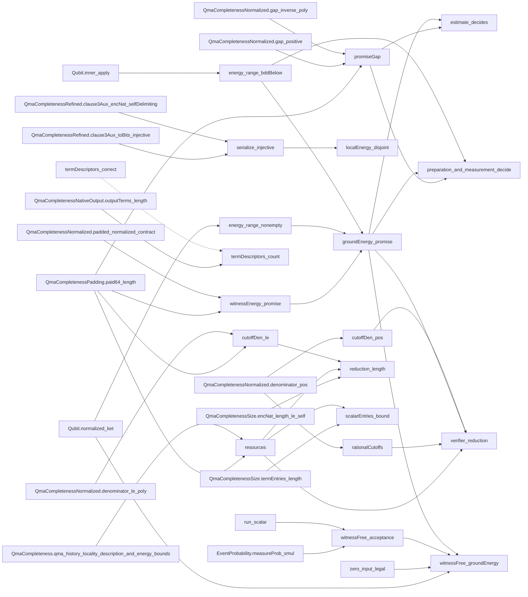

- [cutoffDen_le](../../integrations/qatlib/FQChemKitaev/HistoryHamiltonian.lean#L246)
- [cutoffDen_pos](../../integrations/qatlib/FQChemKitaev/HistoryHamiltonian.lean#L233)
- [energy_range_bddBelow](../../integrations/qatlib/FQChemKitaev/HistoryHamiltonian.lean#L39) (private)
- [energy_range_nonempty](../../integrations/qatlib/FQChemKitaev/HistoryHamiltonian.lean#L35) (private)
- [estimate_decides](../../integrations/qatlib/FQChemKitaev/HistoryHamiltonian.lean#L154)
- [groundEnergy_promise](../../integrations/qatlib/FQChemKitaev/HistoryHamiltonian.lean#L139)
- [localEnergy_disjoint](../../integrations/qatlib/FQChemKitaev/HistoryHamiltonian.lean#L291)
- [preparation_and_measurement_decide](../../integrations/qatlib/FQChemKitaev/HistoryHamiltonian.lean#L389)
- [promiseGap](../../integrations/qatlib/FQChemKitaev/HistoryHamiltonian.lean#L97)
- [rationalCutoffs](../../integrations/qatlib/FQChemKitaev/HistoryHamiltonian.lean#L238)
- [reduction_length](../../integrations/qatlib/FQChemKitaev/HistoryHamiltonian.lean#L274)
- [resources](../../integrations/qatlib/FQChemKitaev/HistoryHamiltonian.lean#L79)
- [run_scalar](../../integrations/qatlib/FQChemKitaev/HistoryHamiltonian.lean#L172) (private)
- [scalarEntries_bound](../../integrations/qatlib/FQChemKitaev/HistoryHamiltonian.lean#L358)
- [serialize_injective](../../integrations/qatlib/FQChemKitaev/HistoryHamiltonian.lean#L268)
- [termDescriptors_correct](../../integrations/qatlib/FQChemKitaev/HistoryHamiltonian.lean#L342)
- [termDescriptors_count](../../integrations/qatlib/FQChemKitaev/HistoryHamiltonian.lean#L350)
- [verifier_reduction](../../integrations/qatlib/FQChemKitaev/HistoryHamiltonian.lean#L300)
- [witnessEnergy_promise](../../integrations/qatlib/FQChemKitaev/HistoryHamiltonian.lean#L123)
- [witnessFree_acceptance](../../integrations/qatlib/FQChemKitaev/HistoryHamiltonian.lean#L187)
- [witnessFree_groundEnergy](../../integrations/qatlib/FQChemKitaev/HistoryHamiltonian.lean#L206)
- [zero_input_legal](../../integrations/qatlib/FQChemKitaev/HistoryHamiltonian.lean#L178)
- [QmaCompletenessRefined.clause3Aux_encNat_selfDelimiting](https://github.com/quantum-atlas-ai/qatlib/blob/f76f71a7c5cd19a31c251d0feeab09c75a758d69/Qatlib/Concepts/QmaCompleteness/HistoryHam/QmaCompletenessRefined.lean#L1056)
- [QmaCompletenessRefined.clause3Aux_toBits_injective](https://github.com/quantum-atlas-ai/qatlib/blob/f76f71a7c5cd19a31c251d0feeab09c75a758d69/Qatlib/Concepts/QmaCompleteness/HistoryHam/QmaCompletenessRefined.lean#L1261)
- [QmaCompletenessNativeOutput.outputTerms_length](https://github.com/quantum-atlas-ai/qatlib/blob/f76f71a7c5cd19a31c251d0feeab09c75a758d69/Qatlib/Concepts/QueryComplexity/DegreeMethod/QmaCompletenessNativeOutput.lean#L274)
- [EventProbability.measureProb_smul](https://github.com/quantum-atlas-ai/qatlib/blob/f76f71a7c5cd19a31c251d0feeab09c75a758d69/Qatlib/Foundations/BornMetrics/EventProbability.lean#L62)
- [Qubit.inner_apply](https://github.com/quantum-atlas-ai/qatlib/blob/f76f71a7c5cd19a31c251d0feeab09c75a758d69/Qatlib/Foundations/PureStateMath/Qubit.lean#L639)
- [Qubit.normalized_ket](https://github.com/quantum-atlas-ai/qatlib/blob/f76f71a7c5cd19a31c251d0feeab09c75a758d69/Qatlib/Foundations/PureStateMath/Qubit.lean#L152)
- [QmaCompleteness.qma_history_locality_description_and_energy_bounds](https://github.com/quantum-atlas-ai/qatlib/blob/f76f71a7c5cd19a31c251d0feeab09c75a758d69/Qatlib/Papers/LocalHam06/MainResults/QmaCompleteness.lean#L98)
- [QmaCompletenessNormalized.denominator_le_poly](https://github.com/quantum-atlas-ai/qatlib/blob/f76f71a7c5cd19a31c251d0feeab09c75a758d69/Qatlib/Papers/LocalHam06/MainResults/QmaCompletenessNormalized.lean#L313)
- [QmaCompletenessNormalized.denominator_pos](https://github.com/quantum-atlas-ai/qatlib/blob/f76f71a7c5cd19a31c251d0feeab09c75a758d69/Qatlib/Papers/LocalHam06/MainResults/QmaCompletenessNormalized.lean#L93)
- [QmaCompletenessNormalized.gap_inverse_poly](https://github.com/quantum-atlas-ai/qatlib/blob/f76f71a7c5cd19a31c251d0feeab09c75a758d69/Qatlib/Papers/LocalHam06/MainResults/QmaCompletenessNormalized.lean#L333)
- [QmaCompletenessNormalized.gap_positive](https://github.com/quantum-atlas-ai/qatlib/blob/f76f71a7c5cd19a31c251d0feeab09c75a758d69/Qatlib/Papers/LocalHam06/MainResults/QmaCompletenessNormalized.lean#L323)
- [QmaCompletenessNormalized.padded_normalized_contract](https://github.com/quantum-atlas-ai/qatlib/blob/f76f71a7c5cd19a31c251d0feeab09c75a758d69/Qatlib/Papers/LocalHam06/MainResults/QmaCompletenessNormalized.lean#L354)
- [QmaCompletenessPadding.paid64_length](https://github.com/quantum-atlas-ai/qatlib/blob/f76f71a7c5cd19a31c251d0feeab09c75a758d69/Qatlib/Papers/LocalHam06/MainResults/QmaCompletenessPadding.lean#L103)
- [QmaCompletenessSize.encNat_length_le_self](https://github.com/quantum-atlas-ai/qatlib/blob/f76f71a7c5cd19a31c251d0feeab09c75a758d69/Qatlib/Papers/LocalHam06/MainResults/QmaCompletenessSize.lean#L97)
- [QmaCompletenessSize.termEntries_length](https://github.com/quantum-atlas-ai/qatlib/blob/f76f71a7c5cd19a31c251d0feeab09c75a758d69/Qatlib/Papers/LocalHam06/MainResults/QmaCompletenessSize.lean#L80)

## FQChemKitaev.Majority

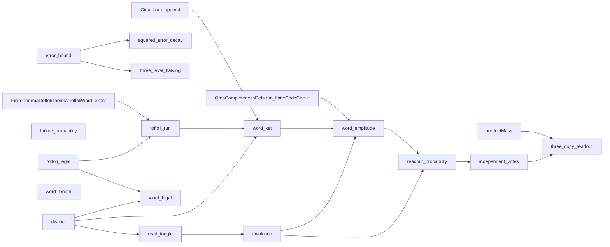

- [distinct](../../integrations/qatlib/FQChemKitaev/Majority.lean#L44) (private)
- [error_bound](../../integrations/qatlib/FQChemKitaev/Majority.lean#L220)
- [failure_probability](../../integrations/qatlib/FQChemKitaev/Majority.lean#L211)
- [independent_votes](../../integrations/qatlib/FQChemKitaev/Majority.lean#L159)
- [involution](../../integrations/qatlib/FQChemKitaev/Majority.lean#L52) (private)
- [productMass](../../integrations/qatlib/FQChemKitaev/Majority.lean#L177) (private)
- [read_toggle](../../integrations/qatlib/FQChemKitaev/Majority.lean#L47) (private)
- [readout_probability](../../integrations/qatlib/FQChemKitaev/Majority.lean#L124)
- [squared_error_decay](../../integrations/qatlib/FQChemKitaev/Majority.lean#L247)
- [three_copy_readout](../../integrations/qatlib/FQChemKitaev/Majority.lean#L187)
- [three_level_halving](../../integrations/qatlib/FQChemKitaev/Majority.lean#L237)
- [toffoli_legal](../../integrations/qatlib/FQChemKitaev/Majority.lean#L63) (private)
- [toffoli_run](../../integrations/qatlib/FQChemKitaev/Majority.lean#L79) (private)
- [word_amplitude](../../integrations/qatlib/FQChemKitaev/Majority.lean#L103)
- [word_ket](../../integrations/qatlib/FQChemKitaev/Majority.lean#L86)
- [word_legal](../../integrations/qatlib/FQChemKitaev/Majority.lean#L70)
- [word_length](../../integrations/qatlib/FQChemKitaev/Majority.lean#L61)
- [QmaCompletenessDefs.run_finiteCodeCircuit](https://github.com/quantum-atlas-ai/qatlib/blob/f76f71a7c5cd19a31c251d0feeab09c75a758d69/Qatlib/Concepts/QmaCompleteness/HistoryHam/QmaCompletenessDefs.lean#L146)
- [FiniteThermalToffoli.thermalToffoliWord_exact](https://github.com/quantum-atlas-ai/qatlib/blob/f76f71a7c5cd19a31c251d0feeab09c75a758d69/Qatlib/Concepts/UniformBqp/FiniteGateWord/FiniteThermal/FiniteThermalToffoli.lean#L60)
- [Circuit.run_append](https://github.com/quantum-atlas-ai/qatlib/blob/f76f71a7c5cd19a31c251d0feeab09c75a758d69/Qatlib/Foundations/QueryWordCore/Circuit.lean#L249)

## FQChemKitaev.UniformCircuits

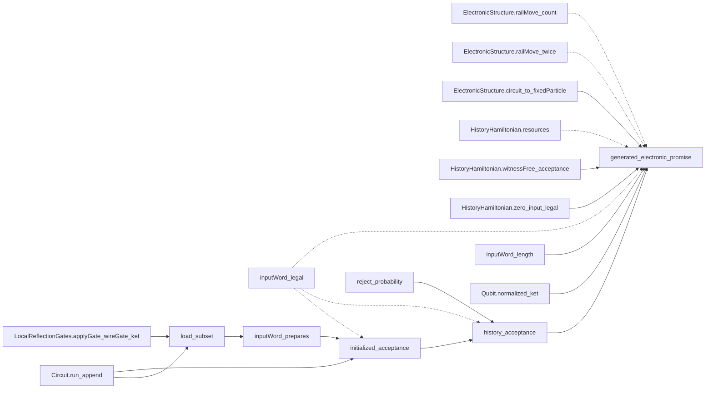

- [ElectronicStructure.railMove_count](../../FQChem/Complexity/ElectronicStructure.lean#L110)
- [ElectronicStructure.railMove_twice](../../FQChem/Complexity/ElectronicStructure.lean#L104)
- [ElectronicStructure.circuit_to_fixedParticle](../../integrations/qatlib/FQChemKitaev/ElectronicStructure.lean#L198)
- [HistoryHamiltonian.resources](../../integrations/qatlib/FQChemKitaev/HistoryHamiltonian.lean#L79)
- [HistoryHamiltonian.witnessFree_acceptance](../../integrations/qatlib/FQChemKitaev/HistoryHamiltonian.lean#L187)
- [HistoryHamiltonian.zero_input_legal](../../integrations/qatlib/FQChemKitaev/HistoryHamiltonian.lean#L178)
- [generated_electronic_promise](../../integrations/qatlib/FQChemKitaev/UniformCircuits.lean#L139)
- [history_acceptance](../../integrations/qatlib/FQChemKitaev/UniformCircuits.lean#L123)
- [initialized_acceptance](../../integrations/qatlib/FQChemKitaev/UniformCircuits.lean#L82)
- [inputWord_legal](../../integrations/qatlib/FQChemKitaev/UniformCircuits.lean#L60)
- [inputWord_length](../../integrations/qatlib/FQChemKitaev/UniformCircuits.lean#L57)
- [inputWord_prepares](../../integrations/qatlib/FQChemKitaev/UniformCircuits.lean#L63)
- [load_subset](../../integrations/qatlib/FQChemKitaev/UniformCircuits.lean#L33) (private)
- [reject_probability](../../integrations/qatlib/FQChemKitaev/UniformCircuits.lean#L110) (private)
- [LocalReflectionGates.applyGate_wireGate_ket](https://github.com/quantum-atlas-ai/qatlib/blob/f76f71a7c5cd19a31c251d0feeab09c75a758d69/Qatlib/Concepts/GateVocabulary/LocalReflectionGates.lean#L343)
- [Qubit.normalized_ket](https://github.com/quantum-atlas-ai/qatlib/blob/f76f71a7c5cd19a31c251d0feeab09c75a758d69/Qatlib/Foundations/PureStateMath/Qubit.lean#L152)
- [Circuit.run_append](https://github.com/quantum-atlas-ai/qatlib/blob/f76f71a7c5cd19a31c251d0feeab09c75a758d69/Qatlib/Foundations/QueryWordCore/Circuit.lean#L249)

## FQChemKitaev.Wiring

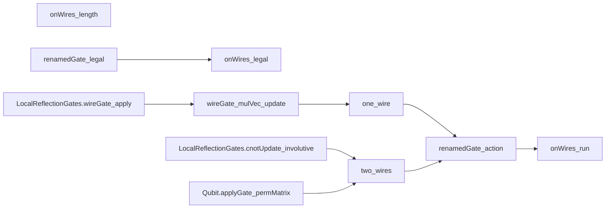

- [onWires_legal](../../integrations/qatlib/FQChemKitaev/Wiring.lean#L162)
- [onWires_length](../../integrations/qatlib/FQChemKitaev/Wiring.lean#L168)
- [onWires_run](../../integrations/qatlib/FQChemKitaev/Wiring.lean#L173)
- [one_wire](../../integrations/qatlib/FQChemKitaev/Wiring.lean#L115) (private)
- [renamedGate_action](../../integrations/qatlib/FQChemKitaev/Wiring.lean#L145) (private)
- [renamedGate_legal](../../integrations/qatlib/FQChemKitaev/Wiring.lean#L133)
- [two_wires](../../integrations/qatlib/FQChemKitaev/Wiring.lean#L124) (private)
- [wireGate_mulVec_update](../../integrations/qatlib/FQChemKitaev/Wiring.lean#L31) (private)
- [LocalReflectionGates.cnotUpdate_involutive](https://github.com/quantum-atlas-ai/qatlib/blob/f76f71a7c5cd19a31c251d0feeab09c75a758d69/Qatlib/Concepts/GateVocabulary/LocalReflectionGates.lean#L184)
- [LocalReflectionGates.wireGate_apply](https://github.com/quantum-atlas-ai/qatlib/blob/f76f71a7c5cd19a31c251d0feeab09c75a758d69/Qatlib/Concepts/GateVocabulary/LocalReflectionGates.lean#L83)
- [Qubit.applyGate_permMatrix](https://github.com/quantum-atlas-ai/qatlib/blob/f76f71a7c5cd19a31c251d0feeab09c75a758d69/Qatlib/Foundations/PureStateMath/Qubit.lean#L307)
