# Qatlib integration theorem graph

416 source theorems and lemmas · 8 shared library prerequisites · 132 upstream theorem nodes · 819 dependency edges.

Arrows point from prerequisite to result. Dashed arrows pass through local definitions or compiler-generated helpers. Each diagram includes the prerequisites used by its module. The links below each diagram open the Lean declarations.

[Graph guide and interactive explorer](README.md)

## FQChemKitaev.AmplificationBounds

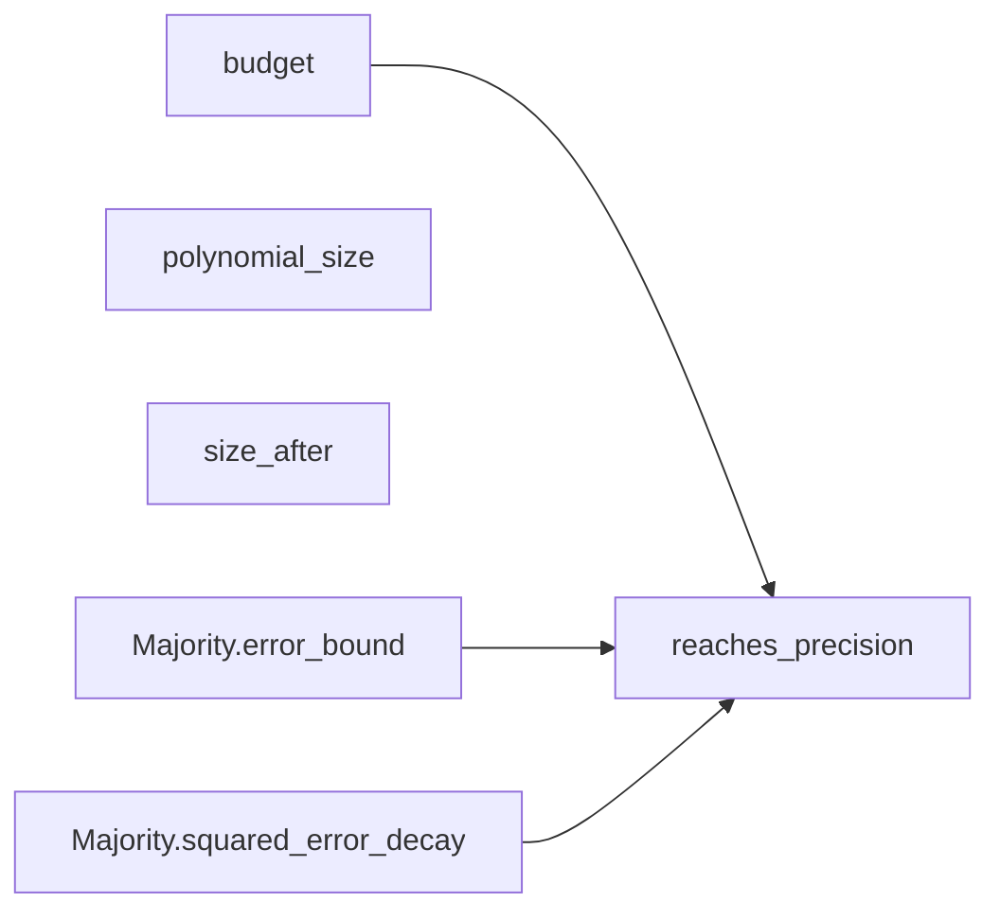

- [budget](../../integrations/qatlib/FQChemKitaev/AmplificationBounds.lean#L43) (private)
- [polynomial_size](../../integrations/qatlib/FQChemKitaev/AmplificationBounds.lean#L31)
- [reaches_precision](../../integrations/qatlib/FQChemKitaev/AmplificationBounds.lean#L72)
- [size_after](../../integrations/qatlib/FQChemKitaev/AmplificationBounds.lean#L20)
- [Majority.error_bound](../../integrations/qatlib/FQChemKitaev/Majority.lean#L220)
- [Majority.squared_error_decay](../../integrations/qatlib/FQChemKitaev/Majority.lean#L247)

## FQChemKitaev.AmplifierCost

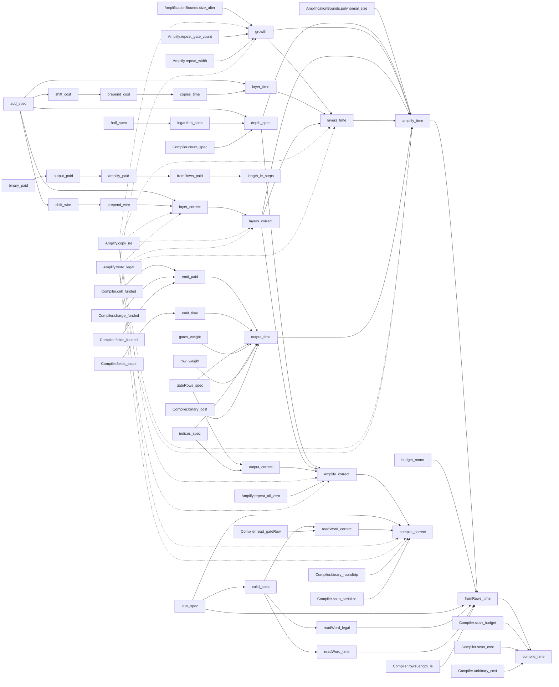

- [AmplificationBounds.polynomial_size](../../integrations/qatlib/FQChemKitaev/AmplificationBounds.lean#L31)
- [AmplificationBounds.size_after](../../integrations/qatlib/FQChemKitaev/AmplificationBounds.lean#L20)
- [add_spec](../../integrations/qatlib/FQChemKitaev/AmplifierCost.lean#L34) (private)
- [amplify_correct](../../integrations/qatlib/FQChemKitaev/AmplifierCost.lean#L330)
- [amplify_paid](../../integrations/qatlib/FQChemKitaev/AmplifierCost.lean#L536) (private)
- [amplify_time](../../integrations/qatlib/FQChemKitaev/AmplifierCost.lean#L341)
- [binary_paid](../../integrations/qatlib/FQChemKitaev/AmplifierCost.lean#L527) (private)
- [budget_mono](../../integrations/qatlib/FQChemKitaev/AmplifierCost.lean#L482) (private)
- [compile_correct](../../integrations/qatlib/FQChemKitaev/AmplifierCost.lean#L473)
- [compile_time](../../integrations/qatlib/FQChemKitaev/AmplifierCost.lean#L515)
- [copies_time](../../integrations/qatlib/FQChemKitaev/AmplifierCost.lean#L115) (private)
- [depth_spec](../../integrations/qatlib/FQChemKitaev/AmplifierCost.lean#L211) (private)
- [emit_paid](../../integrations/qatlib/FQChemKitaev/AmplifierCost.lean#L259) (private)
- [emit_time](../../integrations/qatlib/FQChemKitaev/AmplifierCost.lean#L264) (private)
- [fromRows_paid](../../integrations/qatlib/FQChemKitaev/AmplifierCost.lean#L540) (private)
- [fromRows_time](../../integrations/qatlib/FQChemKitaev/AmplifierCost.lean#L484) (private)
- [gateRows_spec](../../integrations/qatlib/FQChemKitaev/AmplifierCost.lean#L240) (private)
- [gates_weight](../../integrations/qatlib/FQChemKitaev/AmplifierCost.lean#L282) (private)
- [growth](../../integrations/qatlib/FQChemKitaev/AmplifierCost.lean#L143) (private)
- [half_spec](../../integrations/qatlib/FQChemKitaev/AmplifierCost.lean#L167) (private)
- [indices_spec](../../integrations/qatlib/FQChemKitaev/AmplifierCost.lean#L230) (private)
- [layer_correct](../../integrations/qatlib/FQChemKitaev/AmplifierCost.lean#L102)
- [layer_time](../../integrations/qatlib/FQChemKitaev/AmplifierCost.lean#L123) (private)
- [layers_correct](../../integrations/qatlib/FQChemKitaev/AmplifierCost.lean#L137)
- [layers_time](../../integrations/qatlib/FQChemKitaev/AmplifierCost.lean#L148) (private)
- [length_le_steps](../../integrations/qatlib/FQChemKitaev/AmplifierCost.lean#L552)
- [less_spec](../../integrations/qatlib/FQChemKitaev/AmplifierCost.lean#L367) (private)
- [logarithm_spec](../../integrations/qatlib/FQChemKitaev/AmplifierCost.lean#L180) (private)
- [output_correct](../../integrations/qatlib/FQChemKitaev/AmplifierCost.lean#L252) (private)
- [output_paid](../../integrations/qatlib/FQChemKitaev/AmplifierCost.lean#L532) (private)
- [output_time](../../integrations/qatlib/FQChemKitaev/AmplifierCost.lean#L300) (private)
- [prepend_cost](../../integrations/qatlib/FQChemKitaev/AmplifierCost.lean#L69) (private)
- [prepend_wire](../../integrations/qatlib/FQChemKitaev/AmplifierCost.lean#L78) (private)
- [readWord_correct](../../integrations/qatlib/FQChemKitaev/AmplifierCost.lean#L435) (private)
- [readWord_legal](../../integrations/qatlib/FQChemKitaev/AmplifierCost.lean#L422) (private)
- [readWord_time](../../integrations/qatlib/FQChemKitaev/AmplifierCost.lean#L445) (private)
- [row_weight](../../integrations/qatlib/FQChemKitaev/AmplifierCost.lean#L273) (private)
- [shift_cost](../../integrations/qatlib/FQChemKitaev/AmplifierCost.lean#L47) (private)
- [shift_wire](../../integrations/qatlib/FQChemKitaev/AmplifierCost.lean#L50) (private)
- [valid_spec](../../integrations/qatlib/FQChemKitaev/AmplifierCost.lean#L387) (private)
- [Amplify.copy_ne](../../integrations/qatlib/FQChemKitaev/Amplify.lean#L31) (private)
- [Amplify.repeat_all_zero](../../integrations/qatlib/FQChemKitaev/Amplify.lean#L243)
- [Amplify.repeat_gate_count](../../integrations/qatlib/FQChemKitaev/Amplify.lean#L236)
- [Amplify.repeat_width](../../integrations/qatlib/FQChemKitaev/Amplify.lean#L240)
- [Amplify.word_legal](../../integrations/qatlib/FQChemKitaev/Amplify.lean#L139)
- [Compiler.binary_cost](../../integrations/qatlib/FQChemKitaev/Compiler.lean#L636) (private)
- [Compiler.binary_roundtrip](../../integrations/qatlib/FQChemKitaev/Compiler.lean#L633)
- [Compiler.cell_funded](../../integrations/qatlib/FQChemKitaev/Compiler.lean#L523) (private)
- [Compiler.charge_funded](../../integrations/qatlib/FQChemKitaev/Compiler.lean#L520) (private)
- [Compiler.count_spec](../../integrations/qatlib/FQChemKitaev/Compiler.lean#L176)
- [Compiler.fields_funded](../../integrations/qatlib/FQChemKitaev/Compiler.lean#L529) (private)
- [Compiler.fields_steps](../../integrations/qatlib/FQChemKitaev/Compiler.lean#L349) (private)
- [Compiler.read_gateRow](../../integrations/qatlib/FQChemKitaev/Compiler.lean#L133)
- [Compiler.rowsLength_le](../../integrations/qatlib/FQChemKitaev/Compiler.lean#L325) (private)
- [Compiler.scan_budget](../../integrations/qatlib/FQChemKitaev/Compiler.lean#L339) (private)
- [Compiler.scan_cost](../../integrations/qatlib/FQChemKitaev/Compiler.lean#L87)
- [Compiler.scan_serialize](../../integrations/qatlib/FQChemKitaev/Compiler.lean#L113)
- [Compiler.unbinary_cost](../../integrations/qatlib/FQChemKitaev/Compiler.lean#L639) (private)

## FQChemKitaev.Amplify

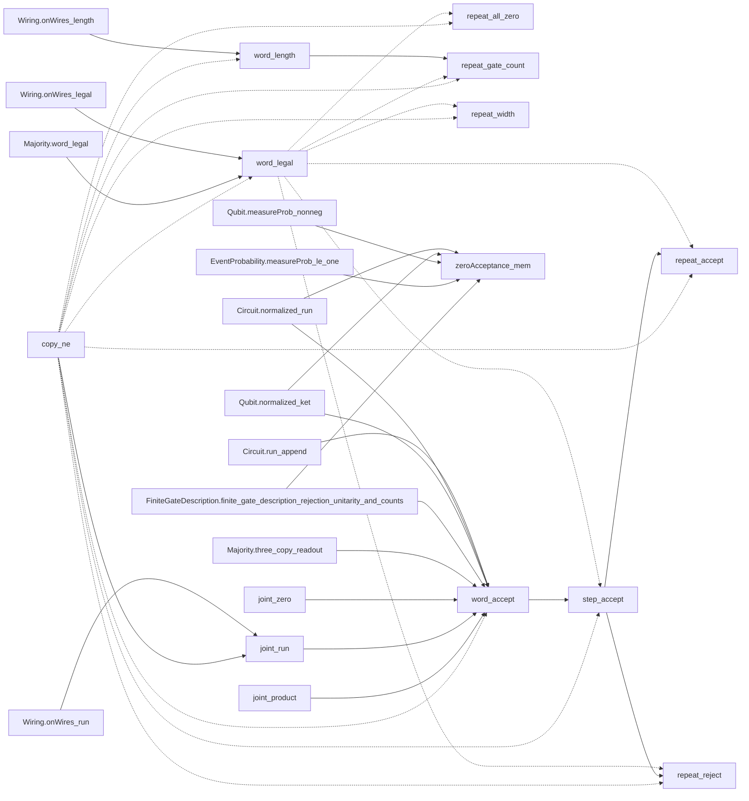

- [copy_ne](../../integrations/qatlib/FQChemKitaev/Amplify.lean#L31) (private)
- [joint_product](../../integrations/qatlib/FQChemKitaev/Amplify.lean#L166) (private)
- [joint_run](../../integrations/qatlib/FQChemKitaev/Amplify.lean#L81) (private)
- [joint_zero](../../integrations/qatlib/FQChemKitaev/Amplify.lean#L146) (private)
- [repeat_accept](../../integrations/qatlib/FQChemKitaev/Amplify.lean#L259)
- [repeat_all_zero](../../integrations/qatlib/FQChemKitaev/Amplify.lean#L243)
- [repeat_gate_count](../../integrations/qatlib/FQChemKitaev/Amplify.lean#L236)
- [repeat_reject](../../integrations/qatlib/FQChemKitaev/Amplify.lean#L265)
- [repeat_width](../../integrations/qatlib/FQChemKitaev/Amplify.lean#L240)
- [step_accept](../../integrations/qatlib/FQChemKitaev/Amplify.lean#L255)
- [word_accept](../../integrations/qatlib/FQChemKitaev/Amplify.lean#L183)
- [word_legal](../../integrations/qatlib/FQChemKitaev/Amplify.lean#L139)
- [word_length](../../integrations/qatlib/FQChemKitaev/Amplify.lean#L136)
- [zeroAcceptance_mem](../../integrations/qatlib/FQChemKitaev/Amplify.lean#L248)
- [Majority.three_copy_readout](../../integrations/qatlib/FQChemKitaev/Majority.lean#L187)
- [Majority.word_legal](../../integrations/qatlib/FQChemKitaev/Majority.lean#L70)
- [Wiring.onWires_legal](../../integrations/qatlib/FQChemKitaev/Wiring.lean#L162)
- [Wiring.onWires_length](../../integrations/qatlib/FQChemKitaev/Wiring.lean#L168)
- [Wiring.onWires_run](../../integrations/qatlib/FQChemKitaev/Wiring.lean#L173)
- [FiniteGateDescription.finite_gate_description_rejection_unitarity_and_counts](https://github.com/quantum-atlas-ai/qatlib/blob/f76f71a7c5cd19a31c251d0feeab09c75a758d69/Qatlib/Concepts/GateVocabulary/FiniteGateDescription.lean#L129)
- [EventProbability.measureProb_le_one](https://github.com/quantum-atlas-ai/qatlib/blob/f76f71a7c5cd19a31c251d0feeab09c75a758d69/Qatlib/Foundations/BornMetrics/EventProbability.lean#L45)
- [Qubit.measureProb_nonneg](https://github.com/quantum-atlas-ai/qatlib/blob/f76f71a7c5cd19a31c251d0feeab09c75a758d69/Qatlib/Foundations/PureStateMath/Qubit.lean#L167)
- [Qubit.normalized_ket](https://github.com/quantum-atlas-ai/qatlib/blob/f76f71a7c5cd19a31c251d0feeab09c75a758d69/Qatlib/Foundations/PureStateMath/Qubit.lean#L152)
- [Circuit.normalized_run](https://github.com/quantum-atlas-ai/qatlib/blob/f76f71a7c5cd19a31c251d0feeab09c75a758d69/Qatlib/Foundations/QueryWordCore/Circuit.lean)
- [Circuit.run_append](https://github.com/quantum-atlas-ai/qatlib/blob/f76f71a7c5cd19a31c251d0feeab09c75a758d69/Qatlib/Foundations/QueryWordCore/Circuit.lean#L249)

## FQChemKitaev.BoundedErrorReduction

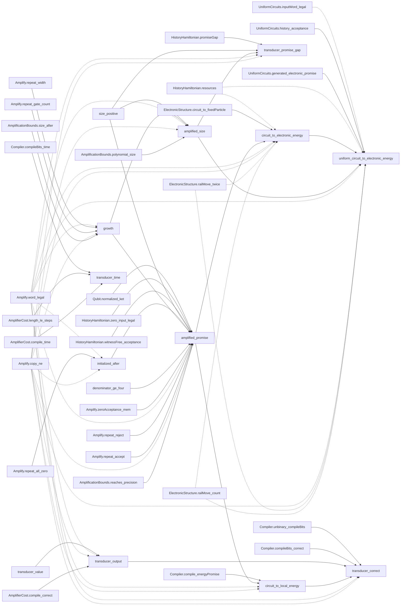

- [ElectronicStructure.railMove_count](../../FQChem/Complexity/ElectronicStructure.lean#L110)
- [ElectronicStructure.railMove_twice](../../FQChem/Complexity/ElectronicStructure.lean#L104)
- [AmplificationBounds.polynomial_size](../../integrations/qatlib/FQChemKitaev/AmplificationBounds.lean#L31)
- [AmplificationBounds.reaches_precision](../../integrations/qatlib/FQChemKitaev/AmplificationBounds.lean#L72)
- [AmplificationBounds.size_after](../../integrations/qatlib/FQChemKitaev/AmplificationBounds.lean#L20)
- [AmplifierCost.compile_correct](../../integrations/qatlib/FQChemKitaev/AmplifierCost.lean#L473)
- [AmplifierCost.compile_time](../../integrations/qatlib/FQChemKitaev/AmplifierCost.lean#L515)
- [AmplifierCost.length_le_steps](../../integrations/qatlib/FQChemKitaev/AmplifierCost.lean#L552)
- [Amplify.copy_ne](../../integrations/qatlib/FQChemKitaev/Amplify.lean#L31) (private)
- [Amplify.repeat_accept](../../integrations/qatlib/FQChemKitaev/Amplify.lean#L259)
- [Amplify.repeat_all_zero](../../integrations/qatlib/FQChemKitaev/Amplify.lean#L243)
- [Amplify.repeat_gate_count](../../integrations/qatlib/FQChemKitaev/Amplify.lean#L236)
- [Amplify.repeat_reject](../../integrations/qatlib/FQChemKitaev/Amplify.lean#L265)
- [Amplify.repeat_width](../../integrations/qatlib/FQChemKitaev/Amplify.lean#L240)
- [Amplify.word_legal](../../integrations/qatlib/FQChemKitaev/Amplify.lean#L139)
- [Amplify.zeroAcceptance_mem](../../integrations/qatlib/FQChemKitaev/Amplify.lean#L248)
- [amplified_promise](../../integrations/qatlib/FQChemKitaev/BoundedErrorReduction.lean#L49)
- [amplified_size](../../integrations/qatlib/FQChemKitaev/BoundedErrorReduction.lean#L35)
- [circuit_to_electronic_energy](../../integrations/qatlib/FQChemKitaev/BoundedErrorReduction.lean#L143)
- [circuit_to_local_energy](../../integrations/qatlib/FQChemKitaev/BoundedErrorReduction.lean#L79)
- [denominator_ge_four](../../integrations/qatlib/FQChemKitaev/BoundedErrorReduction.lean#L44) (private)
- [growth](../../integrations/qatlib/FQChemKitaev/BoundedErrorReduction.lean#L29) (private)
- [initialized_after](../../integrations/qatlib/FQChemKitaev/BoundedErrorReduction.lean#L38) (private)
- [size_positive](../../integrations/qatlib/FQChemKitaev/BoundedErrorReduction.lean#L27) (private)
- [transducer_correct](../../integrations/qatlib/FQChemKitaev/BoundedErrorReduction.lean#L116)
- [transducer_output](../../integrations/qatlib/FQChemKitaev/BoundedErrorReduction.lean#L94) (private)
- [transducer_promise_gap](../../integrations/qatlib/FQChemKitaev/BoundedErrorReduction.lean#L130)
- [transducer_time](../../integrations/qatlib/FQChemKitaev/BoundedErrorReduction.lean#L101)
- [transducer_value](../../integrations/qatlib/FQChemKitaev/BoundedErrorReduction.lean#L91) (private)
- [uniform_circuit_to_electronic_energy](../../integrations/qatlib/FQChemKitaev/BoundedErrorReduction.lean#L156)
- [Compiler.compileBits_correct](../../integrations/qatlib/FQChemKitaev/Compiler.lean#L661)
- [Compiler.compileBits_time](../../integrations/qatlib/FQChemKitaev/Compiler.lean#L667)
- [Compiler.compile_energyPromise](../../integrations/qatlib/FQChemKitaev/Compiler.lean#L480)
- [Compiler.unbinary_compileBits](../../integrations/qatlib/FQChemKitaev/Compiler.lean#L656)
- [ElectronicStructure.circuit_to_fixedParticle](../../integrations/qatlib/FQChemKitaev/ElectronicStructure.lean#L198)
- [HistoryHamiltonian.promiseGap](../../integrations/qatlib/FQChemKitaev/HistoryHamiltonian.lean#L97)
- [HistoryHamiltonian.resources](../../integrations/qatlib/FQChemKitaev/HistoryHamiltonian.lean#L79)
- [HistoryHamiltonian.witnessFree_acceptance](../../integrations/qatlib/FQChemKitaev/HistoryHamiltonian.lean#L187)
- [HistoryHamiltonian.zero_input_legal](../../integrations/qatlib/FQChemKitaev/HistoryHamiltonian.lean#L178)
- [UniformCircuits.generated_electronic_promise](../../integrations/qatlib/FQChemKitaev/UniformCircuits.lean#L139)
- [UniformCircuits.history_acceptance](../../integrations/qatlib/FQChemKitaev/UniformCircuits.lean#L123)
- [UniformCircuits.inputWord_legal](../../integrations/qatlib/FQChemKitaev/UniformCircuits.lean#L60)
- [Qubit.normalized_ket](https://github.com/quantum-atlas-ai/qatlib/blob/f76f71a7c5cd19a31c251d0feeab09c75a758d69/Qatlib/Foundations/PureStateMath/Qubit.lean#L152)

## FQChemKitaev.Compiler

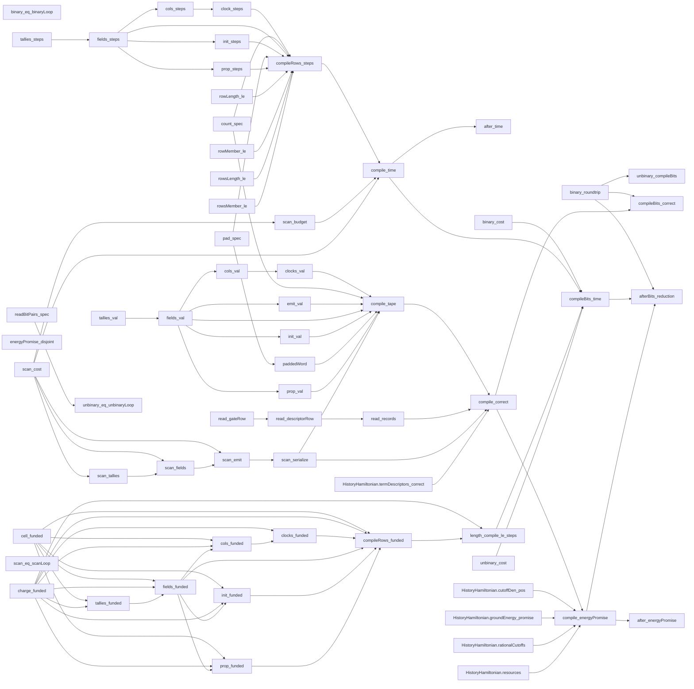

- [afterBits_reduction](../../integrations/qatlib/FQChemKitaev/Compiler.lean#L683)
- [after_energyPromise](../../integrations/qatlib/FQChemKitaev/Compiler.lean#L512)
- [after_time](../../integrations/qatlib/FQChemKitaev/Compiler.lean#L502)
- [binary_cost](../../integrations/qatlib/FQChemKitaev/Compiler.lean#L636) (private)
- [binary_eq_binaryLoop](../../integrations/qatlib/FQChemKitaev/Compiler.lean#L603)
- [binary_roundtrip](../../integrations/qatlib/FQChemKitaev/Compiler.lean#L633)
- [cell_funded](../../integrations/qatlib/FQChemKitaev/Compiler.lean#L523) (private)
- [charge_funded](../../integrations/qatlib/FQChemKitaev/Compiler.lean#L520) (private)
- [clock_steps](../../integrations/qatlib/FQChemKitaev/Compiler.lean#L392) (private)
- [clocks_funded](../../integrations/qatlib/FQChemKitaev/Compiler.lean#L552) (private)
- [clocks_val](../../integrations/qatlib/FQChemKitaev/Compiler.lean#L261) (private)
- [cols_funded](../../integrations/qatlib/FQChemKitaev/Compiler.lean#L546) (private)
- [cols_steps](../../integrations/qatlib/FQChemKitaev/Compiler.lean#L380) (private)
- [cols_val](../../integrations/qatlib/FQChemKitaev/Compiler.lean#L252) (private)
- [compileBits_correct](../../integrations/qatlib/FQChemKitaev/Compiler.lean#L661)
- [compileBits_time](../../integrations/qatlib/FQChemKitaev/Compiler.lean#L667)
- [compileRows_funded](../../integrations/qatlib/FQChemKitaev/Compiler.lean#L558) (private)
- [compileRows_steps](../../integrations/qatlib/FQChemKitaev/Compiler.lean#L403) (private)
- [compile_correct](../../integrations/qatlib/FQChemKitaev/Compiler.lean#L295)
- [compile_energyPromise](../../integrations/qatlib/FQChemKitaev/Compiler.lean#L480)
- [compile_tape](../../integrations/qatlib/FQChemKitaev/Compiler.lean#L277)
- [compile_time](../../integrations/qatlib/FQChemKitaev/Compiler.lean#L451)
- [count_spec](../../integrations/qatlib/FQChemKitaev/Compiler.lean#L176)
- [emit_val](../../integrations/qatlib/FQChemKitaev/Compiler.lean#L235) (private)
- [energyPromise_disjoint](../../integrations/qatlib/FQChemKitaev/Compiler.lean#L473)
- [fields_funded](../../integrations/qatlib/FQChemKitaev/Compiler.lean#L529) (private)
- [fields_steps](../../integrations/qatlib/FQChemKitaev/Compiler.lean#L349) (private)
- [fields_val](../../integrations/qatlib/FQChemKitaev/Compiler.lean#L231) (private)
- [init_funded](../../integrations/qatlib/FQChemKitaev/Compiler.lean#L540) (private)
- [init_steps](../../integrations/qatlib/FQChemKitaev/Compiler.lean#L368) (private)
- [init_val](../../integrations/qatlib/FQChemKitaev/Compiler.lean#L248) (private)
- [length_compile_le_steps](../../integrations/qatlib/FQChemKitaev/Compiler.lean#L570)
- [pad_spec](../../integrations/qatlib/FQChemKitaev/Compiler.lean#L185)
- [paddedWord](../../integrations/qatlib/FQChemKitaev/Compiler.lean#L271) (private)
- [prop_funded](../../integrations/qatlib/FQChemKitaev/Compiler.lean#L534) (private)
- [prop_steps](../../integrations/qatlib/FQChemKitaev/Compiler.lean#L355) (private)
- [prop_val](../../integrations/qatlib/FQChemKitaev/Compiler.lean#L239) (private)
- [readBitPairs_spec](../../integrations/qatlib/FQChemKitaev/Compiler.lean#L615) (private)
- [read_descriptorRow](../../integrations/qatlib/FQChemKitaev/Compiler.lean#L150)
- [read_gateRow](../../integrations/qatlib/FQChemKitaev/Compiler.lean#L133)
- [read_records](../../integrations/qatlib/FQChemKitaev/Compiler.lean#L289) (private)
- [rowLength_le](../../integrations/qatlib/FQChemKitaev/Compiler.lean#L312) (private)
- [rowMember_le](../../integrations/qatlib/FQChemKitaev/Compiler.lean#L315) (private)
- [rowsLength_le](../../integrations/qatlib/FQChemKitaev/Compiler.lean#L325) (private)
- [rowsMember_le](../../integrations/qatlib/FQChemKitaev/Compiler.lean#L328) (private)
- [scan_budget](../../integrations/qatlib/FQChemKitaev/Compiler.lean#L339) (private)
- [scan_cost](../../integrations/qatlib/FQChemKitaev/Compiler.lean#L87)
- [scan_emit](../../integrations/qatlib/FQChemKitaev/Compiler.lean#L104) (private)
- [scan_eq_scanLoop](../../integrations/qatlib/FQChemKitaev/Compiler.lean#L81)
- [scan_fields](../../integrations/qatlib/FQChemKitaev/Compiler.lean#L97) (private)
- [scan_serialize](../../integrations/qatlib/FQChemKitaev/Compiler.lean#L113)
- [scan_tallies](../../integrations/qatlib/FQChemKitaev/Compiler.lean#L90) (private)
- [tallies_funded](../../integrations/qatlib/FQChemKitaev/Compiler.lean#L526) (private)
- [tallies_steps](../../integrations/qatlib/FQChemKitaev/Compiler.lean#L345) (private)
- [tallies_val](../../integrations/qatlib/FQChemKitaev/Compiler.lean#L227) (private)
- [unbinary_compileBits](../../integrations/qatlib/FQChemKitaev/Compiler.lean#L656)
- [unbinary_cost](../../integrations/qatlib/FQChemKitaev/Compiler.lean#L639) (private)
- [unbinary_eq_unbinaryLoop](../../integrations/qatlib/FQChemKitaev/Compiler.lean#L629)
- [HistoryHamiltonian.cutoffDen_pos](../../integrations/qatlib/FQChemKitaev/HistoryHamiltonian.lean#L233)
- [HistoryHamiltonian.groundEnergy_promise](../../integrations/qatlib/FQChemKitaev/HistoryHamiltonian.lean#L139)
- [HistoryHamiltonian.rationalCutoffs](../../integrations/qatlib/FQChemKitaev/HistoryHamiltonian.lean#L238)
- [HistoryHamiltonian.resources](../../integrations/qatlib/FQChemKitaev/HistoryHamiltonian.lean#L79)
- [HistoryHamiltonian.termDescriptors_correct](../../integrations/qatlib/FQChemKitaev/HistoryHamiltonian.lean#L342)

## FQChemKitaev.DyadicCoefficients

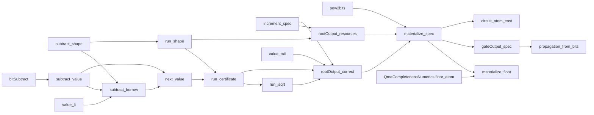

- [bitSubtract](../../integrations/qatlib/FQChemKitaev/DyadicCoefficients.lean#L43) (private)
- [circuit_atom_cost](../../integrations/qatlib/FQChemKitaev/DyadicCoefficients.lean#L296)
- [gateOutput_spec](../../integrations/qatlib/FQChemKitaev/DyadicCoefficients.lean#L282)
- [increment_spec](../../integrations/qatlib/FQChemKitaev/DyadicCoefficients.lean#L196)
- [materialize_floor](../../integrations/qatlib/FQChemKitaev/DyadicCoefficients.lean#L272)
- [materialize_spec](../../integrations/qatlib/FQChemKitaev/DyadicCoefficients.lean#L262)
- [next_value](../../integrations/qatlib/FQChemKitaev/DyadicCoefficients.lean#L128) (private)
- [pow2bits](../../integrations/qatlib/FQChemKitaev/DyadicCoefficients.lean#L256) (private)
- [propagation_from_bits](../../integrations/qatlib/FQChemKitaev/DyadicCoefficients.lean#L306)
- [rootOutput_correct](../../integrations/qatlib/FQChemKitaev/DyadicCoefficients.lean#L224)
- [rootOutput_resources](../../integrations/qatlib/FQChemKitaev/DyadicCoefficients.lean#L240)
- [run_certificate](../../integrations/qatlib/FQChemKitaev/DyadicCoefficients.lean#L165)
- [run_isqrt](../../integrations/qatlib/FQChemKitaev/DyadicCoefficients.lean#L177)
- [run_shape](../../integrations/qatlib/FQChemKitaev/DyadicCoefficients.lean#L115)
- [subtract_borrow](../../integrations/qatlib/FQChemKitaev/DyadicCoefficients.lean#L88)
- [subtract_shape](../../integrations/qatlib/FQChemKitaev/DyadicCoefficients.lean#L63)
- [subtract_value](../../integrations/qatlib/FQChemKitaev/DyadicCoefficients.lean#L72)
- [value_lt](../../integrations/qatlib/FQChemKitaev/DyadicCoefficients.lean#L35)
- [value_tail](../../integrations/qatlib/FQChemKitaev/DyadicCoefficients.lean#L203) (private)
- [QmaCompletenessNumerics.floor_atom](https://github.com/quantum-atlas-ai/qatlib/blob/f76f71a7c5cd19a31c251d0feeab09c75a758d69/Qatlib/Concepts/UniformBqp/FiniteGateWord/QmaCompletenessNumerics.lean#L191)

## FQChemKitaev.ElectronicStructure

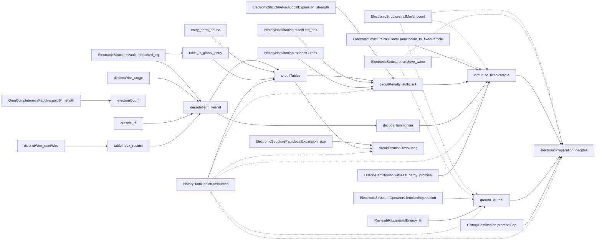

- [ElectronicStructure.railMove_count](../../FQChem/Complexity/ElectronicStructure.lean#L110)
- [ElectronicStructure.railMove_twice](../../FQChem/Complexity/ElectronicStructure.lean#L104)
- [ElectronicStructureOperators.fermionExpectation](../../FQChem/Complexity/ElectronicStructureOperators.lean#L167)
- [ElectronicStructurePauli.localExpansion_size](../../FQChem/Complexity/ElectronicStructurePauli.lean#L198)
- [ElectronicStructurePauli.localExpansion_strength](../../FQChem/Complexity/ElectronicStructurePauli.lean#L232)
- [ElectronicStructurePauli.localHamiltonian_to_fixedParticle](../../FQChem/Complexity/ElectronicStructurePauli.lean#L209)
- [ElectronicStructurePauli.untouched_eq](../../FQChem/Complexity/ElectronicStructurePauli.lean#L114)
- [RayleighRitz.groundEnergy_le](../../FQChem/StatePrep/VariationalOptimization/RayleighRitz.lean#L49)
- [circuitFermionResources](../../integrations/qatlib/FQChemKitaev/ElectronicStructure.lean#L187)
- [circuitPenalty_sufficient](../../integrations/qatlib/FQChemKitaev/ElectronicStructure.lean#L161) (private)
- [circuitTables](../../integrations/qatlib/FQChemKitaev/ElectronicStructure.lean#L150)
- [circuit_to_fixedParticle](../../integrations/qatlib/FQChemKitaev/ElectronicStructure.lean#L198)
- [decodeHamiltonian](../../integrations/qatlib/FQChemKitaev/ElectronicStructure.lean#L112)
- [decodeTerm_kernel](../../integrations/qatlib/FQChemKitaev/ElectronicStructure.lean#L97)
- [distinctWire_range](../../integrations/qatlib/FQChemKitaev/ElectronicStructure.lean#L48)
- [distinctWire_readWire](../../integrations/qatlib/FQChemKitaev/ElectronicStructure.lean#L43)
- [electronCount](../../integrations/qatlib/FQChemKitaev/ElectronicStructure.lean#L176)
- [electronicPreparation_decides](../../integrations/qatlib/FQChemKitaev/ElectronicStructure.lean#L224)
- [entry_norm_bound](../../integrations/qatlib/FQChemKitaev/ElectronicStructure.lean#L138) (private)
- [ground_le_trial](../../integrations/qatlib/FQChemKitaev/ElectronicStructure.lean#L211) (private)
- [outside_iff](../../integrations/qatlib/FQChemKitaev/ElectronicStructure.lean#L83) (private)
- [tableIndex_restrict](../../integrations/qatlib/FQChemKitaev/ElectronicStructure.lean#L61)
- [table_is_global_entry](../../integrations/qatlib/FQChemKitaev/ElectronicStructure.lean#L128) (private)
- [HistoryHamiltonian.cutoffDen_pos](../../integrations/qatlib/FQChemKitaev/HistoryHamiltonian.lean#L233)
- [HistoryHamiltonian.promiseGap](../../integrations/qatlib/FQChemKitaev/HistoryHamiltonian.lean#L97)
- [HistoryHamiltonian.rationalCutoffs](../../integrations/qatlib/FQChemKitaev/HistoryHamiltonian.lean#L238)
- [HistoryHamiltonian.resources](../../integrations/qatlib/FQChemKitaev/HistoryHamiltonian.lean#L79)
- [HistoryHamiltonian.witnessEnergy_promise](../../integrations/qatlib/FQChemKitaev/HistoryHamiltonian.lean#L123)
- [QmaCompletenessPadding.paid64_length](https://github.com/quantum-atlas-ai/qatlib/blob/f76f71a7c5cd19a31c251d0feeab09c75a758d69/Qatlib/Papers/LocalHam06/MainResults/QmaCompletenessPadding.lean#L103)

## FQChemKitaev.HistoryHamiltonian

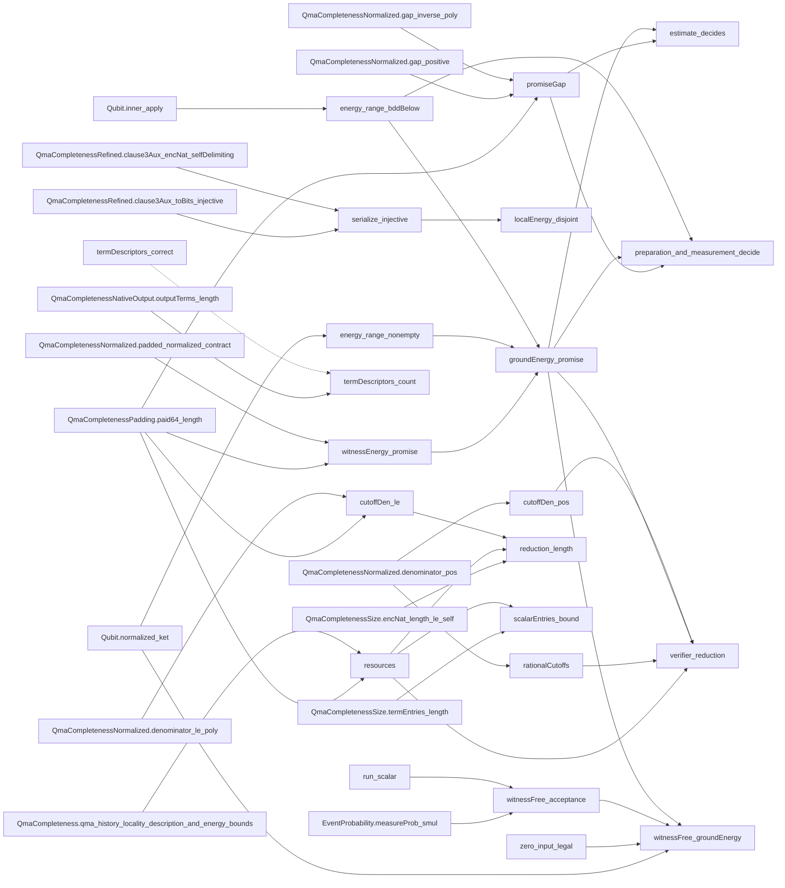

- [cutoffDen_le](../../integrations/qatlib/FQChemKitaev/HistoryHamiltonian.lean#L246)
- [cutoffDen_pos](../../integrations/qatlib/FQChemKitaev/HistoryHamiltonian.lean#L233)
- [energy_range_bddBelow](../../integrations/qatlib/FQChemKitaev/HistoryHamiltonian.lean#L39) (private)
- [energy_range_nonempty](../../integrations/qatlib/FQChemKitaev/HistoryHamiltonian.lean#L35) (private)
- [estimate_decides](../../integrations/qatlib/FQChemKitaev/HistoryHamiltonian.lean#L154)
- [groundEnergy_promise](../../integrations/qatlib/FQChemKitaev/HistoryHamiltonian.lean#L139)
- [localEnergy_disjoint](../../integrations/qatlib/FQChemKitaev/HistoryHamiltonian.lean#L291)
- [preparation_and_measurement_decide](../../integrations/qatlib/FQChemKitaev/HistoryHamiltonian.lean#L389)
- [promiseGap](../../integrations/qatlib/FQChemKitaev/HistoryHamiltonian.lean#L97)
- [rationalCutoffs](../../integrations/qatlib/FQChemKitaev/HistoryHamiltonian.lean#L238)
- [reduction_length](../../integrations/qatlib/FQChemKitaev/HistoryHamiltonian.lean#L274)
- [resources](../../integrations/qatlib/FQChemKitaev/HistoryHamiltonian.lean#L79)
- [run_scalar](../../integrations/qatlib/FQChemKitaev/HistoryHamiltonian.lean#L172) (private)
- [scalarEntries_bound](../../integrations/qatlib/FQChemKitaev/HistoryHamiltonian.lean#L358)
- [serialize_injective](../../integrations/qatlib/FQChemKitaev/HistoryHamiltonian.lean#L268)
- [termDescriptors_correct](../../integrations/qatlib/FQChemKitaev/HistoryHamiltonian.lean#L342)
- [termDescriptors_count](../../integrations/qatlib/FQChemKitaev/HistoryHamiltonian.lean#L350)
- [verifier_reduction](../../integrations/qatlib/FQChemKitaev/HistoryHamiltonian.lean#L300)
- [witnessEnergy_promise](../../integrations/qatlib/FQChemKitaev/HistoryHamiltonian.lean#L123)
- [witnessFree_acceptance](../../integrations/qatlib/FQChemKitaev/HistoryHamiltonian.lean#L187)
- [witnessFree_groundEnergy](../../integrations/qatlib/FQChemKitaev/HistoryHamiltonian.lean#L206)
- [zero_input_legal](../../integrations/qatlib/FQChemKitaev/HistoryHamiltonian.lean#L178)
- [QmaCompletenessRefined.clause3Aux_encNat_selfDelimiting](https://github.com/quantum-atlas-ai/qatlib/blob/f76f71a7c5cd19a31c251d0feeab09c75a758d69/Qatlib/Concepts/QmaCompleteness/HistoryHam/QmaCompletenessRefined.lean#L1056)
- [QmaCompletenessRefined.clause3Aux_toBits_injective](https://github.com/quantum-atlas-ai/qatlib/blob/f76f71a7c5cd19a31c251d0feeab09c75a758d69/Qatlib/Concepts/QmaCompleteness/HistoryHam/QmaCompletenessRefined.lean#L1261)
- [QmaCompletenessNativeOutput.outputTerms_length](https://github.com/quantum-atlas-ai/qatlib/blob/f76f71a7c5cd19a31c251d0feeab09c75a758d69/Qatlib/Concepts/QueryComplexity/DegreeMethod/QmaCompletenessNativeOutput.lean#L274)
- [EventProbability.measureProb_smul](https://github.com/quantum-atlas-ai/qatlib/blob/f76f71a7c5cd19a31c251d0feeab09c75a758d69/Qatlib/Foundations/BornMetrics/EventProbability.lean#L62)
- [Qubit.inner_apply](https://github.com/quantum-atlas-ai/qatlib/blob/f76f71a7c5cd19a31c251d0feeab09c75a758d69/Qatlib/Foundations/PureStateMath/Qubit.lean#L639)
- [Qubit.normalized_ket](https://github.com/quantum-atlas-ai/qatlib/blob/f76f71a7c5cd19a31c251d0feeab09c75a758d69/Qatlib/Foundations/PureStateMath/Qubit.lean#L152)
- [QmaCompleteness.qma_history_locality_description_and_energy_bounds](https://github.com/quantum-atlas-ai/qatlib/blob/f76f71a7c5cd19a31c251d0feeab09c75a758d69/Qatlib/Papers/LocalHam06/MainResults/QmaCompleteness.lean#L98)
- [QmaCompletenessNormalized.denominator_le_poly](https://github.com/quantum-atlas-ai/qatlib/blob/f76f71a7c5cd19a31c251d0feeab09c75a758d69/Qatlib/Papers/LocalHam06/MainResults/QmaCompletenessNormalized.lean#L313)
- [QmaCompletenessNormalized.denominator_pos](https://github.com/quantum-atlas-ai/qatlib/blob/f76f71a7c5cd19a31c251d0feeab09c75a758d69/Qatlib/Papers/LocalHam06/MainResults/QmaCompletenessNormalized.lean#L93)
- [QmaCompletenessNormalized.gap_inverse_poly](https://github.com/quantum-atlas-ai/qatlib/blob/f76f71a7c5cd19a31c251d0feeab09c75a758d69/Qatlib/Papers/LocalHam06/MainResults/QmaCompletenessNormalized.lean#L333)
- [QmaCompletenessNormalized.gap_positive](https://github.com/quantum-atlas-ai/qatlib/blob/f76f71a7c5cd19a31c251d0feeab09c75a758d69/Qatlib/Papers/LocalHam06/MainResults/QmaCompletenessNormalized.lean#L323)
- [QmaCompletenessNormalized.padded_normalized_contract](https://github.com/quantum-atlas-ai/qatlib/blob/f76f71a7c5cd19a31c251d0feeab09c75a758d69/Qatlib/Papers/LocalHam06/MainResults/QmaCompletenessNormalized.lean#L354)
- [QmaCompletenessPadding.paid64_length](https://github.com/quantum-atlas-ai/qatlib/blob/f76f71a7c5cd19a31c251d0feeab09c75a758d69/Qatlib/Papers/LocalHam06/MainResults/QmaCompletenessPadding.lean#L103)
- [QmaCompletenessSize.encNat_length_le_self](https://github.com/quantum-atlas-ai/qatlib/blob/f76f71a7c5cd19a31c251d0feeab09c75a758d69/Qatlib/Papers/LocalHam06/MainResults/QmaCompletenessSize.lean#L97)
- [QmaCompletenessSize.termEntries_length](https://github.com/quantum-atlas-ai/qatlib/blob/f76f71a7c5cd19a31c251d0feeab09c75a758d69/Qatlib/Papers/LocalHam06/MainResults/QmaCompletenessSize.lean#L80)

## FQChemKitaev.Majority

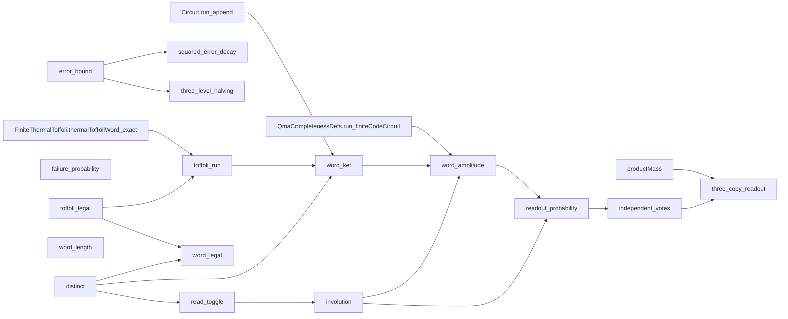

- [distinct](../../integrations/qatlib/FQChemKitaev/Majority.lean#L44) (private)
- [error_bound](../../integrations/qatlib/FQChemKitaev/Majority.lean#L220)
- [failure_probability](../../integrations/qatlib/FQChemKitaev/Majority.lean#L211)
- [independent_votes](../../integrations/qatlib/FQChemKitaev/Majority.lean#L159)
- [involution](../../integrations/qatlib/FQChemKitaev/Majority.lean#L52) (private)
- [productMass](../../integrations/qatlib/FQChemKitaev/Majority.lean#L177) (private)
- [read_toggle](../../integrations/qatlib/FQChemKitaev/Majority.lean#L47) (private)
- [readout_probability](../../integrations/qatlib/FQChemKitaev/Majority.lean#L124)
- [squared_error_decay](../../integrations/qatlib/FQChemKitaev/Majority.lean#L247)
- [three_copy_readout](../../integrations/qatlib/FQChemKitaev/Majority.lean#L187)
- [three_level_halving](../../integrations/qatlib/FQChemKitaev/Majority.lean#L237)
- [toffoli_legal](../../integrations/qatlib/FQChemKitaev/Majority.lean#L63) (private)
- [toffoli_run](../../integrations/qatlib/FQChemKitaev/Majority.lean#L79) (private)
- [word_amplitude](../../integrations/qatlib/FQChemKitaev/Majority.lean#L103)
- [word_ket](../../integrations/qatlib/FQChemKitaev/Majority.lean#L86)
- [word_legal](../../integrations/qatlib/FQChemKitaev/Majority.lean#L70)
- [word_length](../../integrations/qatlib/FQChemKitaev/Majority.lean#L61)
- [QmaCompletenessDefs.run_finiteCodeCircuit](https://github.com/quantum-atlas-ai/qatlib/blob/f76f71a7c5cd19a31c251d0feeab09c75a758d69/Qatlib/Concepts/QmaCompleteness/HistoryHam/QmaCompletenessDefs.lean#L146)
- [FiniteThermalToffoli.thermalToffoliWord_exact](https://github.com/quantum-atlas-ai/qatlib/blob/f76f71a7c5cd19a31c251d0feeab09c75a758d69/Qatlib/Concepts/UniformBqp/FiniteGateWord/FiniteThermal/FiniteThermalToffoli.lean#L60)
- [Circuit.run_append](https://github.com/quantum-atlas-ai/qatlib/blob/f76f71a7c5cd19a31c251d0feeab09c75a758d69/Qatlib/Foundations/QueryWordCore/Circuit.lean#L249)

## FQChemKitaev.UniformCircuits

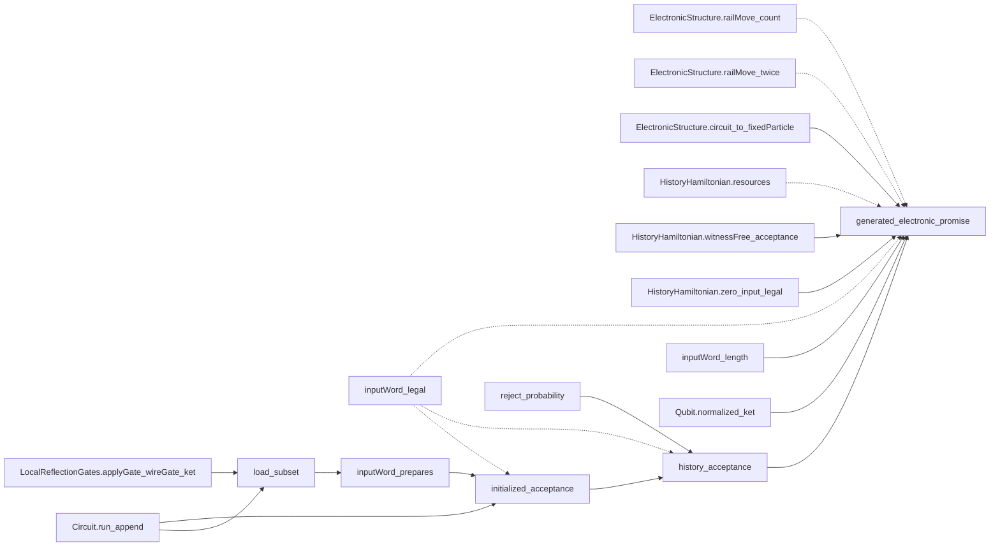

- [ElectronicStructure.railMove_count](../../FQChem/Complexity/ElectronicStructure.lean#L110)
- [ElectronicStructure.railMove_twice](../../FQChem/Complexity/ElectronicStructure.lean#L104)
- [ElectronicStructure.circuit_to_fixedParticle](../../integrations/qatlib/FQChemKitaev/ElectronicStructure.lean#L198)
- [HistoryHamiltonian.resources](../../integrations/qatlib/FQChemKitaev/HistoryHamiltonian.lean#L79)
- [HistoryHamiltonian.witnessFree_acceptance](../../integrations/qatlib/FQChemKitaev/HistoryHamiltonian.lean#L187)
- [HistoryHamiltonian.zero_input_legal](../../integrations/qatlib/FQChemKitaev/HistoryHamiltonian.lean#L178)
- [generated_electronic_promise](../../integrations/qatlib/FQChemKitaev/UniformCircuits.lean#L139)
- [history_acceptance](../../integrations/qatlib/FQChemKitaev/UniformCircuits.lean#L123)
- [initialized_acceptance](../../integrations/qatlib/FQChemKitaev/UniformCircuits.lean#L82)
- [inputWord_legal](../../integrations/qatlib/FQChemKitaev/UniformCircuits.lean#L60)
- [inputWord_length](../../integrations/qatlib/FQChemKitaev/UniformCircuits.lean#L57)
- [inputWord_prepares](../../integrations/qatlib/FQChemKitaev/UniformCircuits.lean#L63)
- [load_subset](../../integrations/qatlib/FQChemKitaev/UniformCircuits.lean#L33) (private)
- [reject_probability](../../integrations/qatlib/FQChemKitaev/UniformCircuits.lean#L110) (private)
- [LocalReflectionGates.applyGate_wireGate_ket](https://github.com/quantum-atlas-ai/qatlib/blob/f76f71a7c5cd19a31c251d0feeab09c75a758d69/Qatlib/Concepts/GateVocabulary/LocalReflectionGates.lean#L343)
- [Qubit.normalized_ket](https://github.com/quantum-atlas-ai/qatlib/blob/f76f71a7c5cd19a31c251d0feeab09c75a758d69/Qatlib/Foundations/PureStateMath/Qubit.lean#L152)
- [Circuit.run_append](https://github.com/quantum-atlas-ai/qatlib/blob/f76f71a7c5cd19a31c251d0feeab09c75a758d69/Qatlib/Foundations/QueryWordCore/Circuit.lean#L249)

## FQChemKitaev.Wiring

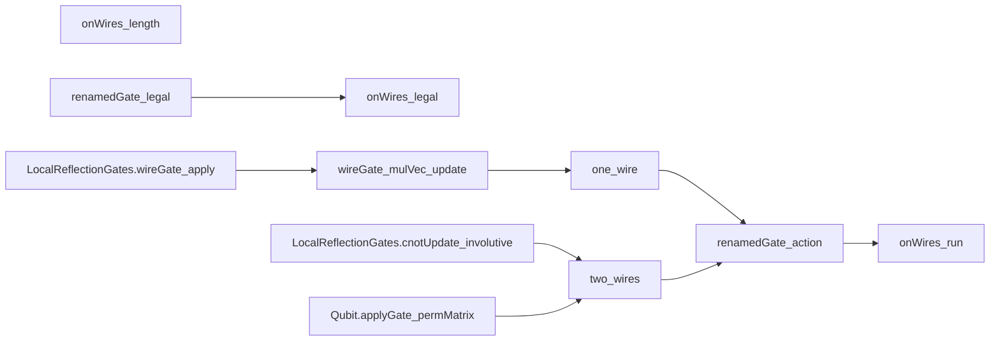

- [onWires_legal](../../integrations/qatlib/FQChemKitaev/Wiring.lean#L162)
- [onWires_length](../../integrations/qatlib/FQChemKitaev/Wiring.lean#L168)
- [onWires_run](../../integrations/qatlib/FQChemKitaev/Wiring.lean#L173)
- [one_wire](../../integrations/qatlib/FQChemKitaev/Wiring.lean#L115) (private)
- [renamedGate_action](../../integrations/qatlib/FQChemKitaev/Wiring.lean#L145) (private)
- [renamedGate_legal](../../integrations/qatlib/FQChemKitaev/Wiring.lean#L133)
- [two_wires](../../integrations/qatlib/FQChemKitaev/Wiring.lean#L124) (private)
- [wireGate_mulVec_update](../../integrations/qatlib/FQChemKitaev/Wiring.lean#L31) (private)
- [LocalReflectionGates.cnotUpdate_involutive](https://github.com/quantum-atlas-ai/qatlib/blob/f76f71a7c5cd19a31c251d0feeab09c75a758d69/Qatlib/Concepts/GateVocabulary/LocalReflectionGates.lean#L184)
- [LocalReflectionGates.wireGate_apply](https://github.com/quantum-atlas-ai/qatlib/blob/f76f71a7c5cd19a31c251d0feeab09c75a758d69/Qatlib/Concepts/GateVocabulary/LocalReflectionGates.lean#L83)
- [Qubit.applyGate_permMatrix](https://github.com/quantum-atlas-ai/qatlib/blob/f76f71a7c5cd19a31c251d0feeab09c75a758d69/Qatlib/Foundations/PureStateMath/Qubit.lean#L307)

## FQChemQatlib.Complexity.QueryAlgorithms

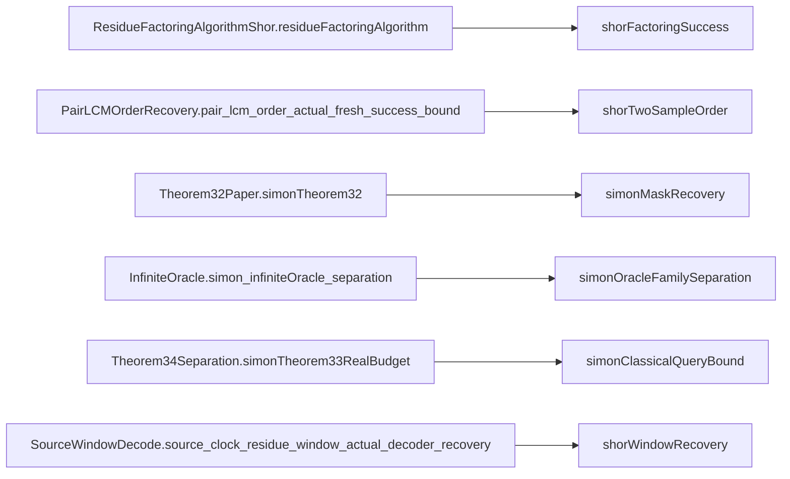

- [shorFactoringSuccess](../../integrations/qatlib/FQChemQatlib/Complexity/QueryAlgorithms.lean#L79)
- [shorTwoSampleOrder](../../integrations/qatlib/FQChemQatlib/Complexity/QueryAlgorithms.lean#L69)
- [shorWindowRecovery](../../integrations/qatlib/FQChemQatlib/Complexity/QueryAlgorithms.lean#L59)
- [simonClassicalQueryBound](../../integrations/qatlib/FQChemQatlib/Complexity/QueryAlgorithms.lean#L41)
- [simonMaskRecovery](../../integrations/qatlib/FQChemQatlib/Complexity/QueryAlgorithms.lean#L34)
- [simonOracleFamilySeparation](../../integrations/qatlib/FQChemQatlib/Complexity/QueryAlgorithms.lean#L49)
- [ResidueFactoringAlgorithmShor.residueFactoringAlgorithm](https://github.com/quantum-atlas-ai/qatlib/blob/f76f71a7c5cd19a31c251d0feeab09c75a758d69/Qatlib/Concepts/PeriodSampling/FactorAlgorithm/ResidueFactoringAlgorithmShor.lean#L132)
- [PairLCMOrderRecovery.pair_lcm_order_actual_fresh_success_bound](https://github.com/quantum-atlas-ai/qatlib/blob/f76f71a7c5cd19a31c251d0feeab09c75a758d69/Qatlib/Concepts/PeriodSampling/OrderRecovery/PairLCMOrderRecovery.lean#L243)
- [Theorem32Paper.simonTheorem32](https://github.com/quantum-atlas-ai/qatlib/blob/f76f71a7c5cd19a31c251d0feeab09c75a758d69/Qatlib/Papers/QPowerSimon97/Recovery/Theorem32Paper.lean#L112)
- [InfiniteOracle.simon_infiniteOracle_separation](https://github.com/quantum-atlas-ai/qatlib/blob/f76f71a7c5cd19a31c251d0feeab09c75a758d69/Qatlib/Papers/QPowerSimon97/StandardModel/InfiniteOracle.lean#L369)
- [Theorem34Separation.simonTheorem33RealBudget](https://github.com/quantum-atlas-ai/qatlib/blob/f76f71a7c5cd19a31c251d0feeab09c75a758d69/Qatlib/Papers/QPowerSimon97/StandardModel/Theorem34Separation.lean#L114)
- [SourceWindowDecode.source_clock_residue_window_actual_decoder_recovery](https://github.com/quantum-atlas-ai/qatlib/blob/f76f71a7c5cd19a31c251d0feeab09c75a758d69/Qatlib/Papers/ShorFactoring97/OrderRecovery/SourceWindowDecode.lean#L299)

## FQChemQatlib.Complexity.SimonOracleMachines

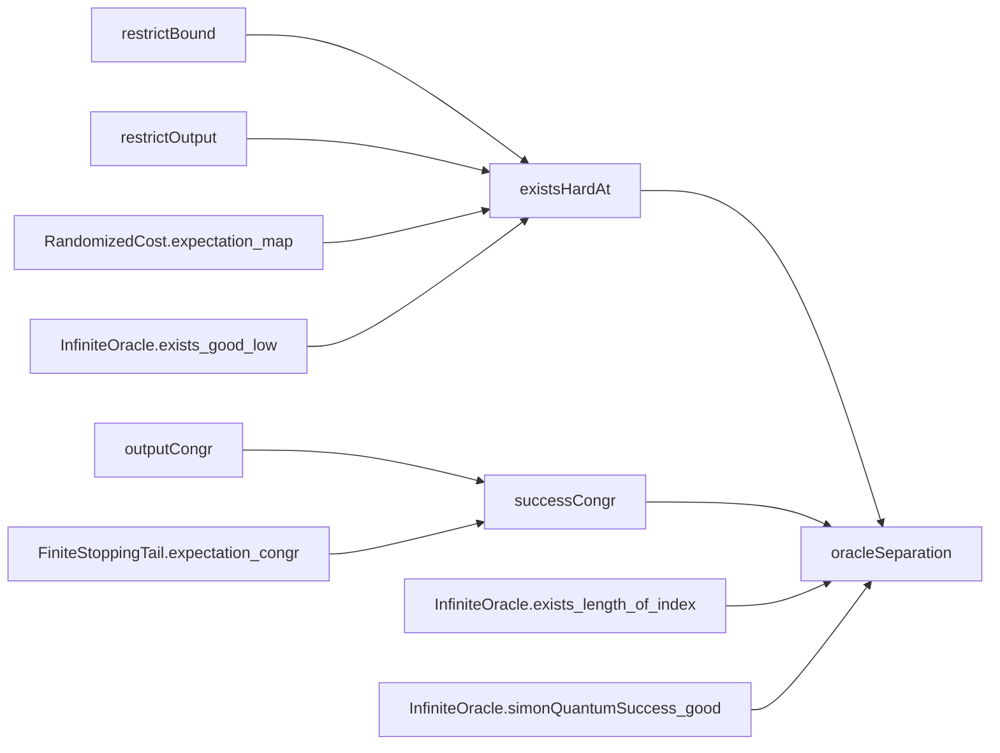

- [existsHardAt](../../integrations/qatlib/FQChemQatlib/Complexity/SimonOracleMachines.lean#L92)
- [outputCongr](../../integrations/qatlib/FQChemQatlib/Complexity/SimonOracleMachines.lean#L74)
- [restrictBound](../../integrations/qatlib/FQChemQatlib/Complexity/SimonOracleMachines.lean#L51)
- [restrictOutput](../../integrations/qatlib/FQChemQatlib/Complexity/SimonOracleMachines.lean#L62)
- [successCongr](../../integrations/qatlib/FQChemQatlib/Complexity/SimonOracleMachines.lean#L84)
- [oracleSeparation](../../integrations/qatlib/FQChemQatlib/Complexity/SimonOracleMachines.lean#L115)
- [FiniteStoppingTail.expectation_congr](https://github.com/quantum-atlas-ai/qatlib/blob/f76f71a7c5cd19a31c251d0feeab09c75a758d69/Qatlib/Concepts/AEMeanReadout/LocalAEBackend/FiniteStoppingTail.lean#L53)
- [RandomizedCost.expectation_map](https://github.com/quantum-atlas-ai/qatlib/blob/f76f71a7c5cd19a31c251d0feeab09c75a758d69/Qatlib/Concepts/LinearLearning/ConcisePipeline/RandomizedCost.lean#L116)
- [InfiniteOracle.exists_good_low](https://github.com/quantum-atlas-ai/qatlib/blob/f76f71a7c5cd19a31c251d0feeab09c75a758d69/Qatlib/Papers/QPowerSimon97/StandardModel/InfiniteOracle.lean#L286)
- [InfiniteOracle.exists_length_of_index](https://github.com/quantum-atlas-ai/qatlib/blob/f76f71a7c5cd19a31c251d0feeab09c75a758d69/Qatlib/Papers/QPowerSimon97/StandardModel/InfiniteOracle.lean#L359)
- [InfiniteOracle.simonQuantumSuccess_good](https://github.com/quantum-atlas-ai/qatlib/blob/f76f71a7c5cd19a31c251d0feeab09c75a758d69/Qatlib/Papers/QPowerSimon97/StandardModel/InfiniteOracle.lean#L186)

## FQChemQatlib.Complexity.SimonTuringSeparation

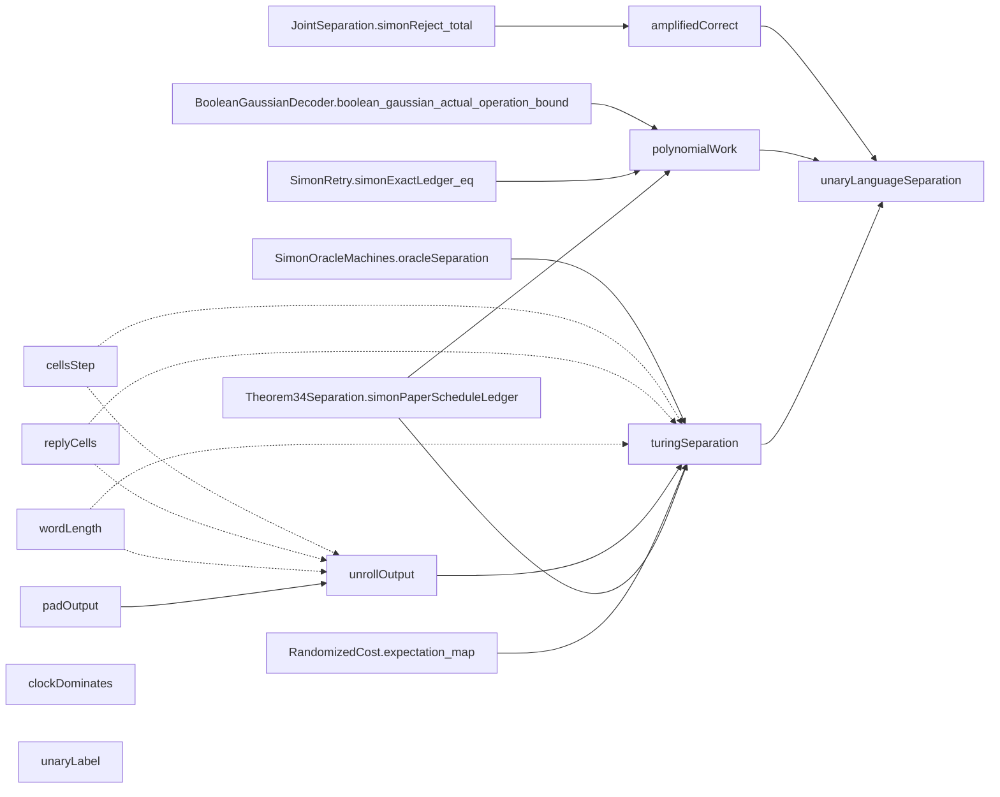

- [SimonOracleMachines.oracleSeparation](../../integrations/qatlib/FQChemQatlib/Complexity/SimonOracleMachines.lean#L115)
- [cellsStep](../../integrations/qatlib/FQChemQatlib/Complexity/SimonTuringSeparation.lean#L58)
- [replyCells](../../integrations/qatlib/FQChemQatlib/Complexity/SimonTuringSeparation.lean#L76)
- [wordLength](../../integrations/qatlib/FQChemQatlib/Complexity/SimonTuringSeparation.lean#L67)
- [padOutput](../../integrations/qatlib/FQChemQatlib/Complexity/SimonTuringSeparation.lean#L139)
- [amplifiedCorrect](../../integrations/qatlib/FQChemQatlib/Complexity/SimonTuringSeparation.lean#L224)
- [clockDominates](../../integrations/qatlib/FQChemQatlib/Complexity/SimonTuringSeparation.lean#L254)
- [polynomialWork](../../integrations/qatlib/FQChemQatlib/Complexity/SimonTuringSeparation.lean#L241)
- [turingSeparation](../../integrations/qatlib/FQChemQatlib/Complexity/SimonTuringSeparation.lean#L191)
- [unaryLabel](../../integrations/qatlib/FQChemQatlib/Complexity/SimonTuringSeparation.lean#L213)
- [unaryLanguageSeparation](../../integrations/qatlib/FQChemQatlib/Complexity/SimonTuringSeparation.lean#L273)
- [unrollOutput](../../integrations/qatlib/FQChemQatlib/Complexity/SimonTuringSeparation.lean#L166)
- [BooleanGaussianDecoder.boolean_gaussian_actual_operation_bound](https://github.com/quantum-atlas-ai/qatlib/blob/f76f71a7c5cd19a31c251d0feeab09c75a758d69/Qatlib/Concepts/HspRecovery/Reduction/BooleanGaussianDecoder.lean#L1764)
- [RandomizedCost.expectation_map](https://github.com/quantum-atlas-ai/qatlib/blob/f76f71a7c5cd19a31c251d0feeab09c75a758d69/Qatlib/Concepts/LinearLearning/ConcisePipeline/RandomizedCost.lean#L116)
- [JointSeparation.simonReject_total](https://github.com/quantum-atlas-ai/qatlib/blob/f76f71a7c5cd19a31c251d0feeab09c75a758d69/Qatlib/Papers/QPowerSimon97/StandardModel/JointSeparation.lean#L122)
- [SimonRetry.simonExactLedger_eq](https://github.com/quantum-atlas-ai/qatlib/blob/f76f71a7c5cd19a31c251d0feeab09c75a758d69/Qatlib/Papers/QPowerSimon97/StandardModel/SimonRetry.lean#L108)
- [Theorem34Separation.simonPaperScheduleLedger](https://github.com/quantum-atlas-ai/qatlib/blob/f76f71a7c5cd19a31c251d0feeab09c75a758d69/Qatlib/Papers/QPowerSimon97/StandardModel/Theorem34Separation.lean#L64)

## FQChemQatlib.Dynamics.BorrowedControls

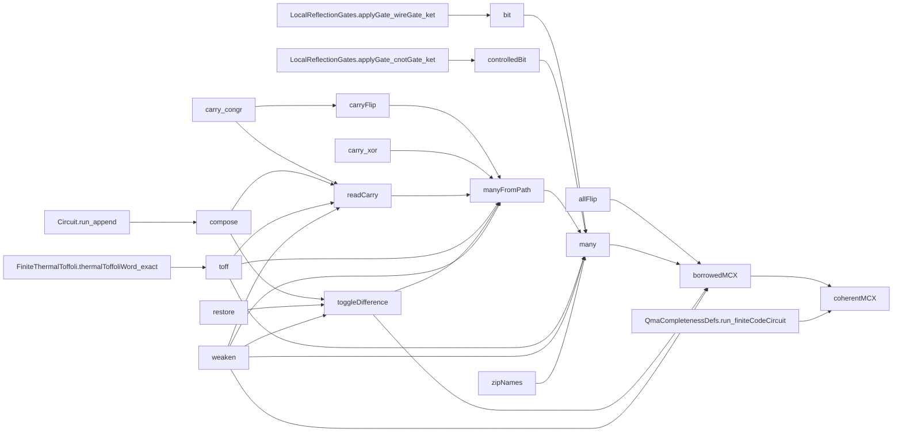

- [allFlip](../../integrations/qatlib/FQChemQatlib/Dynamics/BorrowedControls.lean#L163) (private)
- [bit](../../integrations/qatlib/FQChemQatlib/Dynamics/BorrowedControls.lean#L54)
- [borrowedMCX](../../integrations/qatlib/FQChemQatlib/Dynamics/BorrowedControls.lean#L245)
- [carryFlip](../../integrations/qatlib/FQChemQatlib/Dynamics/BorrowedControls.lean#L171) (private)
- [carry_congr](../../integrations/qatlib/FQChemQatlib/Dynamics/BorrowedControls.lean#L78) (private)
- [carry_xor](../../integrations/qatlib/FQChemQatlib/Dynamics/BorrowedControls.lean#L89) (private)
- [coherentMCX](../../integrations/qatlib/FQChemQatlib/Dynamics/BorrowedControls.lean#L275)
- [compose](../../integrations/qatlib/FQChemQatlib/Dynamics/BorrowedControls.lean#L34)
- [controlledBit](../../integrations/qatlib/FQChemQatlib/Dynamics/BorrowedControls.lean#L62)
- [many](../../integrations/qatlib/FQChemQatlib/Dynamics/BorrowedControls.lean#L216) (private)
- [manyFromPath](../../integrations/qatlib/FQChemQatlib/Dynamics/BorrowedControls.lean#L183) (private)
- [readCarry](../../integrations/qatlib/FQChemQatlib/Dynamics/BorrowedControls.lean#L100) (private)
- [restore](../../integrations/qatlib/FQChemQatlib/Dynamics/BorrowedControls.lean#L140) (private)
- [toff](../../integrations/qatlib/FQChemQatlib/Dynamics/BorrowedControls.lean#L44)
- [toggleDifference](../../integrations/qatlib/FQChemQatlib/Dynamics/BorrowedControls.lean#L148) (private)
- [weaken](../../integrations/qatlib/FQChemQatlib/Dynamics/BorrowedControls.lean#L41)
- [zipNames](../../integrations/qatlib/FQChemQatlib/Dynamics/BorrowedControls.lean#L204) (private)
- [LocalReflectionGates.applyGate_cnotGate_ket](https://github.com/quantum-atlas-ai/qatlib/blob/f76f71a7c5cd19a31c251d0feeab09c75a758d69/Qatlib/Concepts/GateVocabulary/LocalReflectionGates.lean#L205)
- [LocalReflectionGates.applyGate_wireGate_ket](https://github.com/quantum-atlas-ai/qatlib/blob/f76f71a7c5cd19a31c251d0feeab09c75a758d69/Qatlib/Concepts/GateVocabulary/LocalReflectionGates.lean#L343)
- [QmaCompletenessDefs.run_finiteCodeCircuit](https://github.com/quantum-atlas-ai/qatlib/blob/f76f71a7c5cd19a31c251d0feeab09c75a758d69/Qatlib/Concepts/QmaCompleteness/HistoryHam/QmaCompletenessDefs.lean#L146)
- [FiniteThermalToffoli.thermalToffoliWord_exact](https://github.com/quantum-atlas-ai/qatlib/blob/f76f71a7c5cd19a31c251d0feeab09c75a758d69/Qatlib/Concepts/UniformBqp/FiniteGateWord/FiniteThermal/FiniteThermalToffoli.lean#L60)
- [Circuit.run_append](https://github.com/quantum-atlas-ai/qatlib/blob/f76f71a7c5cd19a31c251d0feeab09c75a758d69/Qatlib/Foundations/QueryWordCore/Circuit.lean#L249)

## FQChemQatlib.Dynamics.LowChuangBinaryCompare

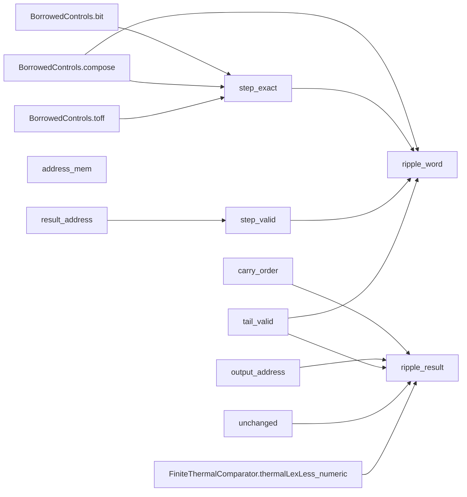

- [BorrowedControls.bit](../../integrations/qatlib/FQChemQatlib/Dynamics/BorrowedControls.lean#L54)
- [BorrowedControls.compose](../../integrations/qatlib/FQChemQatlib/Dynamics/BorrowedControls.lean#L34)
- [BorrowedControls.toff](../../integrations/qatlib/FQChemQatlib/Dynamics/BorrowedControls.lean#L44)
- [address_mem](../../integrations/qatlib/FQChemQatlib/Dynamics/LowChuangBinaryCompare.lean#L55) (private)
- [carry_order](../../integrations/qatlib/FQChemQatlib/Dynamics/LowChuangBinaryCompare.lean#L26) (private)
- [output_address](../../integrations/qatlib/FQChemQatlib/Dynamics/LowChuangBinaryCompare.lean#L94) (private)
- [result_address](../../integrations/qatlib/FQChemQatlib/Dynamics/LowChuangBinaryCompare.lean#L58) (private)
- [ripple_result](../../integrations/qatlib/FQChemQatlib/Dynamics/LowChuangBinaryCompare.lean#L101)
- [ripple_word](../../integrations/qatlib/FQChemQatlib/Dynamics/LowChuangBinaryCompare.lean#L84)
- [step_exact](../../integrations/qatlib/FQChemQatlib/Dynamics/LowChuangBinaryCompare.lean#L32) (private)
- [step_valid](../../integrations/qatlib/FQChemQatlib/Dynamics/LowChuangBinaryCompare.lean#L67) (private)
- [tail_valid](../../integrations/qatlib/FQChemQatlib/Dynamics/LowChuangBinaryCompare.lean#L62) (private)
- [unchanged](../../integrations/qatlib/FQChemQatlib/Dynamics/LowChuangBinaryCompare.lean#L74)
- [FiniteThermalComparator.thermalLexLess_numeric](https://github.com/quantum-atlas-ai/qatlib/blob/f76f71a7c5cd19a31c251d0feeab09c75a758d69/Qatlib/Concepts/UniformBqp/FiniteGateWord/FiniteThermal/FiniteThermalComparator.lean#L70)

## FQChemQatlib.Dynamics.LowChuangBinaryDecoder

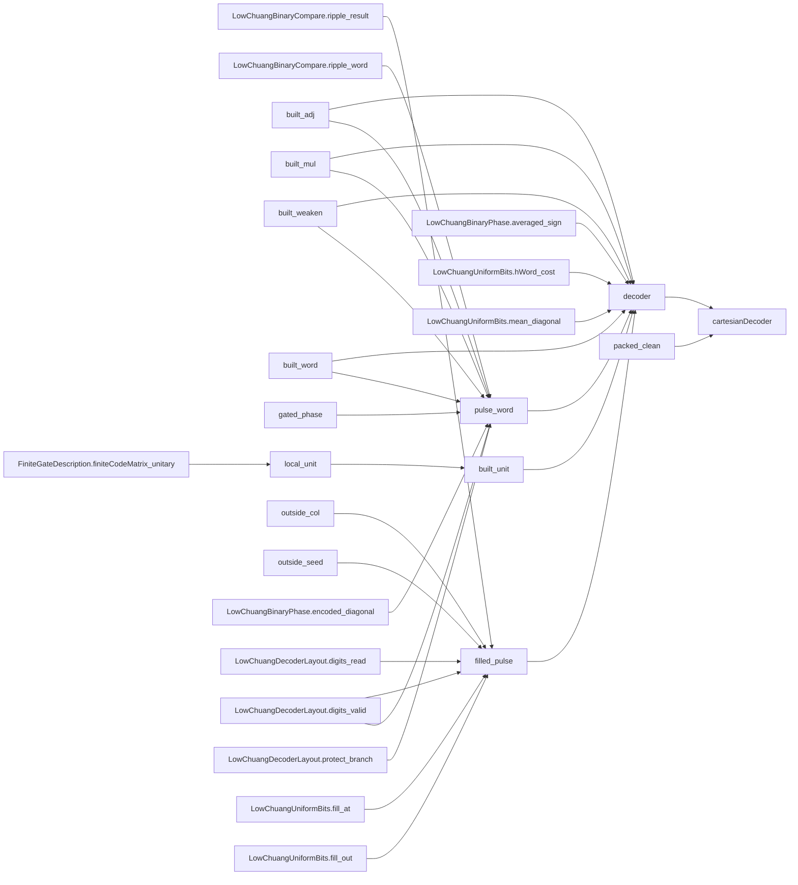

- [LowChuangBinaryCompare.ripple_result](../../integrations/qatlib/FQChemQatlib/Dynamics/LowChuangBinaryCompare.lean#L101)
- [LowChuangBinaryCompare.ripple_word](../../integrations/qatlib/FQChemQatlib/Dynamics/LowChuangBinaryCompare.lean#L84)
- [built_adj](../../integrations/qatlib/FQChemQatlib/Dynamics/LowChuangBinaryDecoder.lean#L47) (private)
- [built_mul](../../integrations/qatlib/FQChemQatlib/Dynamics/LowChuangBinaryDecoder.lean#L41) (private)
- [built_unit](../../integrations/qatlib/FQChemQatlib/Dynamics/LowChuangBinaryDecoder.lean#L72) (private)
- [built_weaken](../../integrations/qatlib/FQChemQatlib/Dynamics/LowChuangBinaryDecoder.lean#L56) (private)
- [built_word](../../integrations/qatlib/FQChemQatlib/Dynamics/LowChuangBinaryDecoder.lean#L28) (private)
- [cartesianDecoder](../../integrations/qatlib/FQChemQatlib/Dynamics/LowChuangBinaryDecoder.lean#L188)
- [decoder](../../integrations/qatlib/FQChemQatlib/Dynamics/LowChuangBinaryDecoder.lean#L145)
- [filled_pulse](../../integrations/qatlib/FQChemQatlib/Dynamics/LowChuangBinaryDecoder.lean#L117) (private)
- [gated_phase](../../integrations/qatlib/FQChemQatlib/Dynamics/LowChuangBinaryDecoder.lean#L79) (private)
- [local_unit](../../integrations/qatlib/FQChemQatlib/Dynamics/LowChuangBinaryDecoder.lean#L59) (private)
- [outside_col](../../integrations/qatlib/FQChemQatlib/Dynamics/LowChuangBinaryDecoder.lean#L108) (private)
- [outside_seed](../../integrations/qatlib/FQChemQatlib/Dynamics/LowChuangBinaryDecoder.lean#L113) (private)
- [packed_clean](../../integrations/qatlib/FQChemQatlib/Dynamics/LowChuangBinaryDecoder.lean#L179)
- [pulse_word](../../integrations/qatlib/FQChemQatlib/Dynamics/LowChuangBinaryDecoder.lean#L92) (private)
- [LowChuangBinaryPhase.averaged_sign](../../integrations/qatlib/FQChemQatlib/Dynamics/LowChuangBinaryPhase.lean#L26)
- [LowChuangBinaryPhase.encoded_diagonal](../../integrations/qatlib/FQChemQatlib/Dynamics/LowChuangBinaryPhase.lean#L40)
- [LowChuangDecoderLayout.digits_read](../../integrations/qatlib/FQChemQatlib/Dynamics/LowChuangDecoderLayout.lean#L55)
- [LowChuangDecoderLayout.digits_valid](../../integrations/qatlib/FQChemQatlib/Dynamics/LowChuangDecoderLayout.lean#L31)
- [LowChuangDecoderLayout.protect_branch](../../integrations/qatlib/FQChemQatlib/Dynamics/LowChuangDecoderLayout.lean#L61)
- [LowChuangUniformBits.fill_at](../../integrations/qatlib/FQChemQatlib/Dynamics/LowChuangUniformBits.lean#L23)
- [LowChuangUniformBits.fill_out](../../integrations/qatlib/FQChemQatlib/Dynamics/LowChuangUniformBits.lean#L28)
- [LowChuangUniformBits.hWord_cost](../../integrations/qatlib/FQChemQatlib/Dynamics/LowChuangUniformBits.lean#L43)
- [LowChuangUniformBits.mean_diagonal](../../integrations/qatlib/FQChemQatlib/Dynamics/LowChuangUniformBits.lean#L49)
- [FiniteGateDescription.finiteCodeMatrix_unitary](https://github.com/quantum-atlas-ai/qatlib/blob/f76f71a7c5cd19a31c251d0feeab09c75a758d69/Qatlib/Concepts/GateVocabulary/FiniteGateDescription.lean#L100)

## FQChemQatlib.Dynamics.LowChuangBinaryPhase

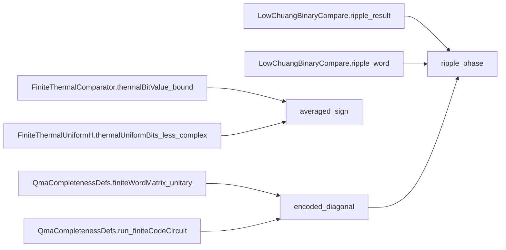

- [LowChuangBinaryCompare.ripple_result](../../integrations/qatlib/FQChemQatlib/Dynamics/LowChuangBinaryCompare.lean#L101)
- [LowChuangBinaryCompare.ripple_word](../../integrations/qatlib/FQChemQatlib/Dynamics/LowChuangBinaryCompare.lean#L84)
- [averaged_sign](../../integrations/qatlib/FQChemQatlib/Dynamics/LowChuangBinaryPhase.lean#L26)
- [encoded_diagonal](../../integrations/qatlib/FQChemQatlib/Dynamics/LowChuangBinaryPhase.lean#L40)
- [ripple_phase](../../integrations/qatlib/FQChemQatlib/Dynamics/LowChuangBinaryPhase.lean#L61)
- [QmaCompletenessDefs.finiteWordMatrix_unitary](https://github.com/quantum-atlas-ai/qatlib/blob/f76f71a7c5cd19a31c251d0feeab09c75a758d69/Qatlib/Concepts/QmaCompleteness/HistoryHam/QmaCompletenessDefs.lean#L158)
- [QmaCompletenessDefs.run_finiteCodeCircuit](https://github.com/quantum-atlas-ai/qatlib/blob/f76f71a7c5cd19a31c251d0feeab09c75a758d69/Qatlib/Concepts/QmaCompleteness/HistoryHam/QmaCompletenessDefs.lean#L146)
- [FiniteThermalComparator.thermalBitValue_bound](https://github.com/quantum-atlas-ai/qatlib/blob/f76f71a7c5cd19a31c251d0feeab09c75a758d69/Qatlib/Concepts/UniformBqp/FiniteGateWord/FiniteThermal/FiniteThermalComparator.lean#L54)
- [FiniteThermalUniformH.thermalUniformBits_less_complex](https://github.com/quantum-atlas-ai/qatlib/blob/f76f71a7c5cd19a31c251d0feeab09c75a758d69/Qatlib/Concepts/UniformBqp/FiniteGateWord/FiniteThermal/FiniteThermalUniformH.lean#L207)

## FQChemQatlib.Dynamics.LowChuangCutoff

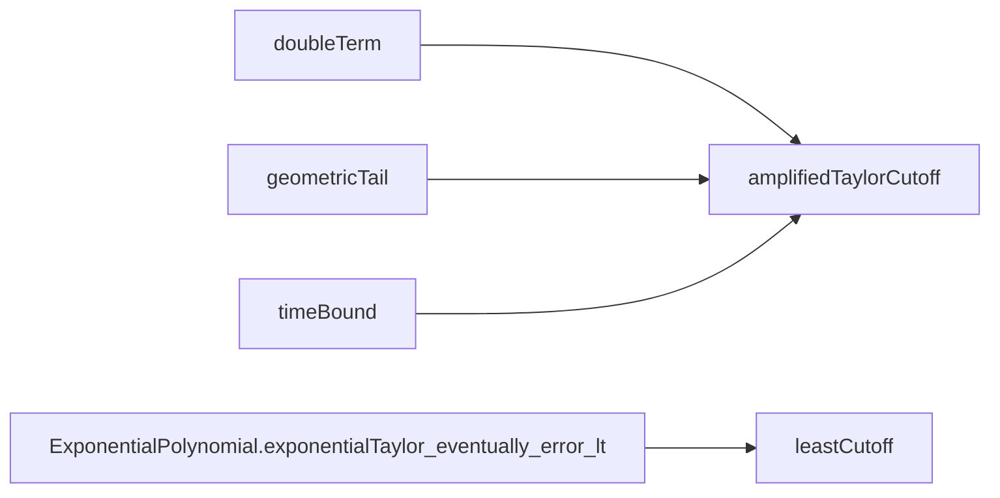

- [amplifiedTaylorCutoff](../../integrations/qatlib/FQChemQatlib/Dynamics/LowChuangCutoff.lean#L69)
- [doubleTerm](../../integrations/qatlib/FQChemQatlib/Dynamics/LowChuangCutoff.lean#L60) (private)
- [geometricTail](../../integrations/qatlib/FQChemQatlib/Dynamics/LowChuangCutoff.lean#L44) (private)
- [leastCutoff](../../integrations/qatlib/FQChemQatlib/Dynamics/LowChuangCutoff.lean#L21)
- [timeBound](../../integrations/qatlib/FQChemQatlib/Dynamics/LowChuangCutoff.lean#L34) (private)
- [ExponentialPolynomial.exponentialTaylor_eventually_error_lt](https://github.com/quantum-atlas-ai/qatlib/blob/f76f71a7c5cd19a31c251d0feeab09c75a758d69/Qatlib/Concepts/QspSimulation/Achievability/ExponentialPolynomial.lean#L178)

## FQChemQatlib.Dynamics.LowChuangDecoderLayout

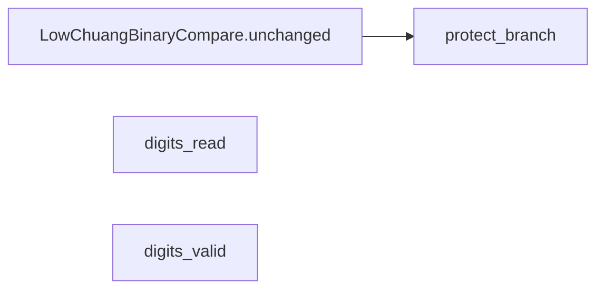

- [LowChuangBinaryCompare.unchanged](../../integrations/qatlib/FQChemQatlib/Dynamics/LowChuangBinaryCompare.lean#L74)
- [digits_read](../../integrations/qatlib/FQChemQatlib/Dynamics/LowChuangDecoderLayout.lean#L55)
- [digits_valid](../../integrations/qatlib/FQChemQatlib/Dynamics/LowChuangDecoderLayout.lean#L31)
- [protect_branch](../../integrations/qatlib/FQChemQatlib/Dynamics/LowChuangDecoderLayout.lean#L61)

## FQChemQatlib.Dynamics.LowChuangElementary

```mermaid
flowchart LR
  n300["adj_emits"]
  n301["compiles_emits"]
  n302["expand"]
  n303["fixed_program"]
  n304["frameGate_emits"]
  n305["mul_emits"]
  n306["qubitRegisterSimulation"]
  n307["scalar_flags"]
  n308["scalar_pair"]
  n309["single"]
  n310["weaken"]
  n313["LowChuangFlagGates.cnotBasis_unit"]
  n316["LowChuangFlagGates.cubic_mark"]
  n320["LowChuangFlagGates.localFlip"]
  n321["LowChuangFlagGates.localHadamards"]
  n322["LowChuangFlagGates.localPhase"]
  n323["LowChuangFlagGates.localScalar"]
  n324["LowChuangFlagGates.onBlocks_apply"]
  n352["LowChuangPhysical.testAncilla_compiles"]
  n353["LowChuangPhysical.testBoth_compiles"]
  n357["LowChuangQueries.cost_append"]
  n362["LowChuangQueries.fixed_append"]
  n368["LowChuangQueries.run_append"]
  n378["LowChuangReflections.cubic_coordinate"]
  n379["LowChuangReflections.fiberPhase_sandwich"]
  n399["LowChuangStandardForm.standardFormProgram"]
  n521["Qubit.hadamard_unitary"]
  n527["Qubit.pauliX_unitary"]
  n532["Tensor.tensorGate_unitary"]
  n305 --> n301
  n309 --> n301
  n310 --> n301
  n303 --> n302
  n357 --> n302
  n362 --> n302
  n368 --> n302
  n300 --> n304
  n301 --> n304
  n305 --> n304
  n307 --> n304
  n308 --> n304
  n309 --> n304
  n310 --> n304
  n313 --> n304
  n316 --> n304
  n320 --> n304
  n321 --> n304
  n322 --> n304
  n323 --> n304
  n352 --> n304
  n353 --> n304
  n378 --> n304
  n379 --> n304
  n521 --> n304
  n527 --> n304
  n532 --> n304
  n302 --> n306
  n304 --> n306
  n399 --> n306
  n324 --> n307
```

- [adj_emits](../../integrations/qatlib/FQChemQatlib/Dynamics/LowChuangElementary.lean#L44) (private)
- [compiles_emits](../../integrations/qatlib/FQChemQatlib/Dynamics/LowChuangElementary.lean#L59) (private)
- [expand](../../integrations/qatlib/FQChemQatlib/Dynamics/LowChuangElementary.lean#L127) (private)
- [fixed_program](../../integrations/qatlib/FQChemQatlib/Dynamics/LowChuangElementary.lean#L119) (private)
- [frameGate_emits](../../integrations/qatlib/FQChemQatlib/Dynamics/LowChuangElementary.lean#L86)
- [mul_emits](../../integrations/qatlib/FQChemQatlib/Dynamics/LowChuangElementary.lean#L38) (private)
- [qubitRegisterSimulation](../../integrations/qatlib/FQChemQatlib/Dynamics/LowChuangElementary.lean#L165)
- [scalar_flags](../../integrations/qatlib/FQChemQatlib/Dynamics/LowChuangElementary.lean#L77) (private)
- [scalar_pair](../../integrations/qatlib/FQChemQatlib/Dynamics/LowChuangElementary.lean#L72) (private)
- [single](../../integrations/qatlib/FQChemQatlib/Dynamics/LowChuangElementary.lean#L35) (private)
- [weaken](../../integrations/qatlib/FQChemQatlib/Dynamics/LowChuangElementary.lean#L55) (private)
- [LowChuangFlagGates.cnotBasis_unit](../../integrations/qatlib/FQChemQatlib/Dynamics/LowChuangFlagGates.lean#L79)
- [LowChuangFlagGates.cubic_mark](../../integrations/qatlib/FQChemQatlib/Dynamics/LowChuangFlagGates.lean#L99)
- [LowChuangFlagGates.localFlip](../../integrations/qatlib/FQChemQatlib/Dynamics/LowChuangFlagGates.lean#L140)
- [LowChuangFlagGates.localHadamards](../../integrations/qatlib/FQChemQatlib/Dynamics/LowChuangFlagGates.lean#L136)
- [LowChuangFlagGates.localPhase](../../integrations/qatlib/FQChemQatlib/Dynamics/LowChuangFlagGates.lean#L117)
- [LowChuangFlagGates.localScalar](../../integrations/qatlib/FQChemQatlib/Dynamics/LowChuangFlagGates.lean#L146)
- [LowChuangFlagGates.onBlocks_apply](../../integrations/qatlib/FQChemQatlib/Dynamics/LowChuangFlagGates.lean#L31)
- [LowChuangPhysical.testAncilla_compiles](../../integrations/qatlib/FQChemQatlib/Dynamics/LowChuangPhysical.lean#L107)
- [LowChuangPhysical.testBoth_compiles](../../integrations/qatlib/FQChemQatlib/Dynamics/LowChuangPhysical.lean#L127)
- [LowChuangQueries.cost_append](../../integrations/qatlib/FQChemQatlib/Dynamics/LowChuangQueries.lean#L50)
- [LowChuangQueries.fixed_append](../../integrations/qatlib/FQChemQatlib/Dynamics/LowChuangQueries.lean#L182)
- [LowChuangQueries.run_append](../../integrations/qatlib/FQChemQatlib/Dynamics/LowChuangQueries.lean#L43)
- [LowChuangReflections.cubic_coordinate](../../integrations/qatlib/FQChemQatlib/Dynamics/LowChuangReflections.lean#L104)
- [LowChuangReflections.fiberPhase_sandwich](../../integrations/qatlib/FQChemQatlib/Dynamics/LowChuangReflections.lean#L40)
- [LowChuangStandardForm.standardFormProgram](../../integrations/qatlib/FQChemQatlib/Dynamics/LowChuangStandardForm.lean#L32)
- [Qubit.hadamard_unitary](https://github.com/quantum-atlas-ai/qatlib/blob/f76f71a7c5cd19a31c251d0feeab09c75a758d69/Qatlib/Foundations/PureStateMath/Qubit.lean#L352)
- [Qubit.pauliX_unitary](https://github.com/quantum-atlas-ai/qatlib/blob/f76f71a7c5cd19a31c251d0feeab09c75a758d69/Qatlib/Foundations/PureStateMath/Qubit.lean#L387)
- [Tensor.tensorGate_unitary](https://github.com/quantum-atlas-ai/qatlib/blob/f76f71a7c5cd19a31c251d0feeab09c75a758d69/Qatlib/Foundations/PureStateMath/Tensor.lean#L133)

## FQChemQatlib.Dynamics.LowChuangFlagGates

```mermaid
flowchart LR
  n311["blocks_mul"]
  n312["blocks_star"]
  n313["cnotBasis_unit"]
  n314["cnot_basis_marker"]
  n315["conditionalCnot"]
  n316["cubic_mark"]
  n317["diagonal_flags"]
  n318["flagsTensor"]
  n319["flags_conjugate"]
  n320["localFlip"]
  n321["localHadamards"]
  n322["localPhase"]
  n323["localScalar"]
  n324["onBlocks_apply"]
  n325["onFlags_unit"]
  n326["parallel_tensor"]
  n381["LowChuangReflections.zero_projector"]
  n448["ParallelQSVT.parallel_select_adjoint"]
  n449["ParallelQSVT.parallel_select_mul"]
  n450["ParallelQSVT.parallel_select_one"]
  n521["Qubit.hadamard_unitary"]
  n527["Qubit.pauliX_unitary"]
  n530["Tensor.tensorGate_mul"]
  n531["Tensor.tensorGate_one"]
  n532["Tensor.tensorGate_unitary"]
  n449 --> n311
  n448 --> n312
  n521 --> n313
  n527 --> n313
  n532 --> n313
  n324 --> n315
  n313 --> n316
  n314 --> n316
  n315 --> n316
  n319 --> n316
  n324 --> n316
  n381 --> n316
  n324 --> n317
  n324 --> n318
  n311 --> n319
  n312 --> n319
  n318 --> n320
  n531 --> n320
  n318 --> n321
  n326 --> n321
  n530 --> n321
  n317 --> n322
  n317 --> n323
  n311 --> n325
  n312 --> n325
  n450 --> n325
```

- [blocks_mul](../../integrations/qatlib/FQChemQatlib/Dynamics/LowChuangFlagGates.lean#L35) (private)
- [blocks_star](../../integrations/qatlib/FQChemQatlib/Dynamics/LowChuangFlagGates.lean#L39) (private)
- [cnotBasis_unit](../../integrations/qatlib/FQChemQatlib/Dynamics/LowChuangFlagGates.lean#L79)
- [cnot_basis_marker](../../integrations/qatlib/FQChemQatlib/Dynamics/LowChuangFlagGates.lean#L82) (private)
- [conditionalCnot](../../integrations/qatlib/FQChemQatlib/Dynamics/LowChuangFlagGates.lean#L91)
- [cubic_mark](../../integrations/qatlib/FQChemQatlib/Dynamics/LowChuangFlagGates.lean#L99)
- [diagonal_flags](../../integrations/qatlib/FQChemQatlib/Dynamics/LowChuangFlagGates.lean#L109) (private)
- [flagsTensor](../../integrations/qatlib/FQChemQatlib/Dynamics/LowChuangFlagGates.lean#L126)
- [flags_conjugate](../../integrations/qatlib/FQChemQatlib/Dynamics/LowChuangFlagGates.lean#L55) (private)
- [localFlip](../../integrations/qatlib/FQChemQatlib/Dynamics/LowChuangFlagGates.lean#L140)
- [localHadamards](../../integrations/qatlib/FQChemQatlib/Dynamics/LowChuangFlagGates.lean#L136)
- [localPhase](../../integrations/qatlib/FQChemQatlib/Dynamics/LowChuangFlagGates.lean#L117)
- [localScalar](../../integrations/qatlib/FQChemQatlib/Dynamics/LowChuangFlagGates.lean#L146)
- [onBlocks_apply](../../integrations/qatlib/FQChemQatlib/Dynamics/LowChuangFlagGates.lean#L31)
- [onFlags_unit](../../integrations/qatlib/FQChemQatlib/Dynamics/LowChuangFlagGates.lean#L44)
- [parallel_tensor](../../integrations/qatlib/FQChemQatlib/Dynamics/LowChuangFlagGates.lean#L131) (private)
- [LowChuangReflections.zero_projector](../../integrations/qatlib/FQChemQatlib/Dynamics/LowChuangReflections.lean#L91)
- [ParallelQSVT.parallel_select_adjoint](https://github.com/quantum-atlas-ai/qatlib/blob/f76f71a7c5cd19a31c251d0feeab09c75a758d69/Qatlib/Concepts/CopyEvolution/Discriminate/ParallelQSVT.lean#L82)
- [ParallelQSVT.parallel_select_mul](https://github.com/quantum-atlas-ai/qatlib/blob/f76f71a7c5cd19a31c251d0feeab09c75a758d69/Qatlib/Concepts/CopyEvolution/Discriminate/ParallelQSVT.lean#L70)
- [ParallelQSVT.parallel_select_one](https://github.com/quantum-atlas-ai/qatlib/blob/f76f71a7c5cd19a31c251d0feeab09c75a758d69/Qatlib/Concepts/CopyEvolution/Discriminate/ParallelQSVT.lean#L93)
- [Qubit.hadamard_unitary](https://github.com/quantum-atlas-ai/qatlib/blob/f76f71a7c5cd19a31c251d0feeab09c75a758d69/Qatlib/Foundations/PureStateMath/Qubit.lean#L352)
- [Qubit.pauliX_unitary](https://github.com/quantum-atlas-ai/qatlib/blob/f76f71a7c5cd19a31c251d0feeab09c75a758d69/Qatlib/Foundations/PureStateMath/Qubit.lean#L387)
- [Tensor.tensorGate_mul](https://github.com/quantum-atlas-ai/qatlib/blob/f76f71a7c5cd19a31c251d0feeab09c75a758d69/Qatlib/Foundations/PureStateMath/Tensor.lean#L114)
- [Tensor.tensorGate_one](https://github.com/quantum-atlas-ai/qatlib/blob/f76f71a7c5cd19a31c251d0feeab09c75a758d69/Qatlib/Foundations/PureStateMath/Tensor.lean#L122)
- [Tensor.tensorGate_unitary](https://github.com/quantum-atlas-ai/qatlib/blob/f76f71a7c5cd19a31c251d0feeab09c75a758d69/Qatlib/Foundations/PureStateMath/Tensor.lean#L133)

## FQChemQatlib.Dynamics.LowChuangGateWord

```mermaid
flowchart LR
  n327["adjoint_gates"]
  n328["amplification_gates"]
  n329["body_gates"]
  n330["controlled_gates"]
  n331["parallel_phase_gates"]
  n332["swapped_gates"]
  n327 --> n328
  n330 --> n329
  n331 --> n329
  n332 --> n331
```

- [adjoint_gates](../../integrations/qatlib/FQChemQatlib/Dynamics/LowChuangGateWord.lean#L87) (private)
- [amplification_gates](../../integrations/qatlib/FQChemQatlib/Dynamics/LowChuangGateWord.lean#L103)
- [body_gates](../../integrations/qatlib/FQChemQatlib/Dynamics/LowChuangGateWord.lean#L71)
- [controlled_gates](../../integrations/qatlib/FQChemQatlib/Dynamics/LowChuangGateWord.lean#L60) (private)
- [parallel_phase_gates](../../integrations/qatlib/FQChemQatlib/Dynamics/LowChuangGateWord.lean#L40) (private)
- [swapped_gates](../../integrations/qatlib/FQChemQatlib/Dynamics/LowChuangGateWord.lean#L34) (private)

## FQChemQatlib.Dynamics.LowChuangPadding

```mermaid
flowchart LR
  n306["LowChuangElementary.qubitRegisterSimulation"]
  n333["coord_iso"]
  n334["evolved_action"]
  n335["exp_action"]
  n336["finiteSimulation"]
  n337["frame_entry"]
  n338["mul_coord"]
  n339["pad_action"]
  n340["pad_hermitian"]
  n341["pad_mul"]
  n342["pad_star"]
  n343["pad_unit"]
  n344["padded_signal"]
  n345["prep_iso"]
  n346["prepared_restrict"]
  n347["star_coord_mul"]
  n428["Basic.compress_norm_le"]
  n430["CoordinateFiber.encodingFiber_isIsometry"]
  n435["Postselection.normalized_mulVec"]
  n532["Tensor.tensorGate_unitary"]
  n335 --> n334
  n339 --> n334
  n306 --> n336
  n333 --> n336
  n334 --> n336
  n340 --> n336
  n343 --> n336
  n344 --> n336
  n428 --> n336
  n435 --> n336
  n342 --> n340
  n339 --> n341
  n341 --> n343
  n342 --> n343
  n333 --> n344
  n343 --> n344
  n345 --> n344
  n346 --> n344
  n430 --> n345
  n532 --> n345
  n333 --> n346
  n337 --> n346
  n338 --> n346
  n339 --> n346
  n347 --> n346
```

- [LowChuangElementary.qubitRegisterSimulation](../../integrations/qatlib/FQChemQatlib/Dynamics/LowChuangElementary.lean#L165)
- [coord_iso](../../integrations/qatlib/FQChemQatlib/Dynamics/LowChuangPadding.lean#L26)
- [evolved_action](../../integrations/qatlib/FQChemQatlib/Dynamics/LowChuangPadding.lean#L78)
- [exp_action](../../integrations/qatlib/FQChemQatlib/Dynamics/LowChuangPadding.lean#L63) (private)
- [finiteSimulation](../../integrations/qatlib/FQChemQatlib/Dynamics/LowChuangPadding.lean#L158)
- [frame_entry](../../integrations/qatlib/FQChemQatlib/Dynamics/LowChuangPadding.lean#L99) (private)
- [mul_coord](../../integrations/qatlib/FQChemQatlib/Dynamics/LowChuangPadding.lean#L90) (private)
- [pad_action](../../integrations/qatlib/FQChemQatlib/Dynamics/LowChuangPadding.lean#L34) (private)
- [pad_hermitian](../../integrations/qatlib/FQChemQatlib/Dynamics/LowChuangPadding.lean#L60)
- [pad_mul](../../integrations/qatlib/FQChemQatlib/Dynamics/LowChuangPadding.lean#L44) (private)
- [pad_star](../../integrations/qatlib/FQChemQatlib/Dynamics/LowChuangPadding.lean#L41) (private)
- [pad_unit](../../integrations/qatlib/FQChemQatlib/Dynamics/LowChuangPadding.lean#L53)
- [padded_signal](../../integrations/qatlib/FQChemQatlib/Dynamics/LowChuangPadding.lean#L132)
- [prep_iso](../../integrations/qatlib/FQChemQatlib/Dynamics/LowChuangPadding.lean#L124) (private)
- [prepared_restrict](../../integrations/qatlib/FQChemQatlib/Dynamics/LowChuangPadding.lean#L106) (private)
- [star_coord_mul](../../integrations/qatlib/FQChemQatlib/Dynamics/LowChuangPadding.lean#L95) (private)
- [Basic.compress_norm_le](https://github.com/quantum-atlas-ai/qatlib/blob/f76f71a7c5cd19a31c251d0feeab09c75a758d69/Qatlib/Concepts/BlockEncoding/Basic.lean#L207)
- [CoordinateFiber.encodingFiber_isIsometry](https://github.com/quantum-atlas-ai/qatlib/blob/f76f71a7c5cd19a31c251d0feeab09c75a758d69/Qatlib/Concepts/BlockEncoding/EncodingCore/CoordinateFiber.lean#L90)
- [Postselection.normalized_mulVec](https://github.com/quantum-atlas-ai/qatlib/blob/f76f71a7c5cd19a31c251d0feeab09c75a758d69/Qatlib/Concepts/BlockEncoding/Postselection.lean#L264)
- [Tensor.tensorGate_unitary](https://github.com/quantum-atlas-ai/qatlib/blob/f76f71a7c5cd19a31c251d0feeab09c75a758d69/Qatlib/Foundations/PureStateMath/Tensor.lean#L133)

## FQChemQatlib.Dynamics.LowChuangPhysical

```mermaid
flowchart LR
  n250["BorrowedControls.borrowedMCX"]
  n348["compileToggle"]
  n349["distinct_anc"]
  n350["positive_controls"]
  n351["succ_ne_inner"]
  n352["testAncilla_compiles"]
  n353["testBoth_compiles"]
  n474["QmaCompletenessDefs.run_finiteCodeCircuit"]
  n250 --> n348
  n474 --> n348
  n348 --> n352
  n349 --> n352
  n350 --> n352
  n351 --> n352
  n348 --> n353
  n349 --> n353
  n350 --> n353
  n351 --> n353
```

- [BorrowedControls.borrowedMCX](../../integrations/qatlib/FQChemQatlib/Dynamics/BorrowedControls.lean#L245)
- [compileToggle](../../integrations/qatlib/FQChemQatlib/Dynamics/LowChuangPhysical.lean#L79) (private)
- [distinct_anc](../../integrations/qatlib/FQChemQatlib/Dynamics/LowChuangPhysical.lean#L62) (private)
- [positive_controls](../../integrations/qatlib/FQChemQatlib/Dynamics/LowChuangPhysical.lean#L49)
- [succ_ne_inner](../../integrations/qatlib/FQChemQatlib/Dynamics/LowChuangPhysical.lean#L99) (private)
- [testAncilla_compiles](../../integrations/qatlib/FQChemQatlib/Dynamics/LowChuangPhysical.lean#L107)
- [testBoth_compiles](../../integrations/qatlib/FQChemQatlib/Dynamics/LowChuangPhysical.lean#L127)
- [QmaCompletenessDefs.run_finiteCodeCircuit](https://github.com/quantum-atlas-ai/qatlib/blob/f76f71a7c5cd19a31c251d0feeab09c75a758d69/Qatlib/Concepts/QmaCompleteness/HistoryHam/QmaCompletenessDefs.lean#L146)

## FQChemQatlib.Dynamics.LowChuangQueries

```mermaid
flowchart LR
  n354["broadcast_adjoint"]
  n355["broadcast_mul"]
  n356["controlledSubstitution"]
  n357["cost_append"]
  n358["cost_controlled"]
  n359["cost_inverse"]
  n360["cost_substitute"]
  n361["covers_substitute"]
  n362["fixed_append"]
  n363["fixed_inverse"]
  n364["fixed_substitute"]
  n365["lift_adjoint"]
  n366["lift_conjugate"]
  n367["lift_mul"]
  n368["run_append"]
  n369["run_controlled"]
  n370["run_inverse"]
  n371["run_substitute"]
  n446["ParallelQSVT.parallelOracle_adjoint"]
  n448["ParallelQSVT.parallel_select_adjoint"]
  n449["ParallelQSVT.parallel_select_mul"]
  n450["ParallelQSVT.parallel_select_one"]
  n467["ControlledQueryCircuit.controlOracle_adjoint"]
  n468["ControlledQueryCircuit.controlOracle_mul"]
  n469["ControlledQueryCircuit.controlOracle_one"]
  n446 --> n354
  n449 --> n355
  n358 --> n356
  n360 --> n356
  n369 --> n356
  n371 --> n356
  n357 --> n359
  n357 --> n360
  n359 --> n360
  n362 --> n363
  n362 --> n364
  n363 --> n364
  n446 --> n365
  n467 --> n365
  n448 --> n366
  n449 --> n366
  n450 --> n366
  n449 --> n367
  n468 --> n367
  n365 --> n369
  n367 --> n369
  n450 --> n369
  n469 --> n369
  n368 --> n370
  n368 --> n371
  n370 --> n371
```

- [broadcast_adjoint](../../integrations/qatlib/FQChemQatlib/Dynamics/LowChuangQueries.lean#L99)
- [broadcast_mul](../../integrations/qatlib/FQChemQatlib/Dynamics/LowChuangQueries.lean#L95)
- [controlledSubstitution](../../integrations/qatlib/FQChemQatlib/Dynamics/LowChuangQueries.lean#L206)
- [cost_append](../../integrations/qatlib/FQChemQatlib/Dynamics/LowChuangQueries.lean#L50)
- [cost_controlled](../../integrations/qatlib/FQChemQatlib/Dynamics/LowChuangQueries.lean#L133) (private)
- [cost_inverse](../../integrations/qatlib/FQChemQatlib/Dynamics/LowChuangQueries.lean#L69)
- [cost_substitute](../../integrations/qatlib/FQChemQatlib/Dynamics/LowChuangQueries.lean#L170)
- [covers_substitute](../../integrations/qatlib/FQChemQatlib/Dynamics/LowChuangQueries.lean#L146)
- [fixed_append](../../integrations/qatlib/FQChemQatlib/Dynamics/LowChuangQueries.lean#L182)
- [fixed_inverse](../../integrations/qatlib/FQChemQatlib/Dynamics/LowChuangQueries.lean#L188) (private)
- [fixed_substitute](../../integrations/qatlib/FQChemQatlib/Dynamics/LowChuangQueries.lean#L197)
- [lift_adjoint](../../integrations/qatlib/FQChemQatlib/Dynamics/LowChuangQueries.lean#L86)
- [lift_conjugate](../../integrations/qatlib/FQChemQatlib/Dynamics/LowChuangQueries.lean#L105)
- [lift_mul](../../integrations/qatlib/FQChemQatlib/Dynamics/LowChuangQueries.lean#L80)
- [run_append](../../integrations/qatlib/FQChemQatlib/Dynamics/LowChuangQueries.lean#L43)
- [run_controlled](../../integrations/qatlib/FQChemQatlib/Dynamics/LowChuangQueries.lean#L119)
- [run_inverse](../../integrations/qatlib/FQChemQatlib/Dynamics/LowChuangQueries.lean#L56)
- [run_substitute](../../integrations/qatlib/FQChemQatlib/Dynamics/LowChuangQueries.lean#L163)
- [ParallelQSVT.parallelOracle_adjoint](https://github.com/quantum-atlas-ai/qatlib/blob/f76f71a7c5cd19a31c251d0feeab09c75a758d69/Qatlib/Concepts/CopyEvolution/Discriminate/ParallelQSVT.lean#L115)
- [ParallelQSVT.parallel_select_adjoint](https://github.com/quantum-atlas-ai/qatlib/blob/f76f71a7c5cd19a31c251d0feeab09c75a758d69/Qatlib/Concepts/CopyEvolution/Discriminate/ParallelQSVT.lean#L82)
- [ParallelQSVT.parallel_select_mul](https://github.com/quantum-atlas-ai/qatlib/blob/f76f71a7c5cd19a31c251d0feeab09c75a758d69/Qatlib/Concepts/CopyEvolution/Discriminate/ParallelQSVT.lean#L70)
- [ParallelQSVT.parallel_select_one](https://github.com/quantum-atlas-ai/qatlib/blob/f76f71a7c5cd19a31c251d0feeab09c75a758d69/Qatlib/Concepts/CopyEvolution/Discriminate/ParallelQSVT.lean#L93)
- [ControlledQueryCircuit.controlOracle_adjoint](https://github.com/quantum-atlas-ai/qatlib/blob/f76f71a7c5cd19a31c251d0feeab09c75a758d69/Qatlib/Concepts/LocalMachine/LocalTransport/ControlledQueryCircuit.lean#L75)
- [ControlledQueryCircuit.controlOracle_mul](https://github.com/quantum-atlas-ai/qatlib/blob/f76f71a7c5cd19a31c251d0feeab09c75a758d69/Qatlib/Concepts/LocalMachine/LocalTransport/ControlledQueryCircuit.lean#L59)
- [ControlledQueryCircuit.controlOracle_one](https://github.com/quantum-atlas-ai/qatlib/blob/f76f71a7c5cd19a31c251d0feeab09c75a758d69/Qatlib/Concepts/LocalMachine/LocalTransport/ControlledQueryCircuit.lean#L69)

## FQChemQatlib.Dynamics.LowChuangReadout

```mermaid
flowchart LR
  n321["LowChuangFlagGates.localHadamards"]
  n336["LowChuangPadding.finiteSimulation"]
  n357["LowChuangQueries.cost_append"]
  n362["LowChuangQueries.fixed_append"]
  n368["LowChuangQueries.run_append"]
  n372["coordinate_acts"]
  n373["coordinate_iso"]
  n374["finiteCoordinateSimulation"]
  n380["LowChuangReflections.hamiltonianFrame_coordinates"]
  n430["CoordinateFiber.encodingFiber_isIsometry"]
  n436["Postselection.postselectionProbability_eq_norm_sq"]
  n489["RealPartQSVT.averageFrame_isIsometry"]
  n501["FiniteInversePhaseProgram.inverseLabelPhase_unit"]
  n521["Qubit.hadamard_unitary"]
  n532["Tensor.tensorGate_unitary"]
  n373 --> n372
  n380 --> n372
  n430 --> n372
  n436 --> n372
  n489 --> n372
  n501 --> n372
  n430 --> n373
  n321 --> n374
  n336 --> n374
  n357 --> n374
  n362 --> n374
  n368 --> n374
  n372 --> n374
  n521 --> n374
  n532 --> n374
```

- [LowChuangFlagGates.localHadamards](../../integrations/qatlib/FQChemQatlib/Dynamics/LowChuangFlagGates.lean#L136)
- [LowChuangPadding.finiteSimulation](../../integrations/qatlib/FQChemQatlib/Dynamics/LowChuangPadding.lean#L158)
- [LowChuangQueries.cost_append](../../integrations/qatlib/FQChemQatlib/Dynamics/LowChuangQueries.lean#L50)
- [LowChuangQueries.fixed_append](../../integrations/qatlib/FQChemQatlib/Dynamics/LowChuangQueries.lean#L182)
- [LowChuangQueries.run_append](../../integrations/qatlib/FQChemQatlib/Dynamics/LowChuangQueries.lean#L43)
- [coordinate_acts](../../integrations/qatlib/FQChemQatlib/Dynamics/LowChuangReadout.lean#L29) (private)
- [coordinate_iso](../../integrations/qatlib/FQChemQatlib/Dynamics/LowChuangReadout.lean#L20) (private)
- [finiteCoordinateSimulation](../../integrations/qatlib/FQChemQatlib/Dynamics/LowChuangReadout.lean#L54)
- [LowChuangReflections.hamiltonianFrame_coordinates](../../integrations/qatlib/FQChemQatlib/Dynamics/LowChuangReflections.lean#L78)
- [CoordinateFiber.encodingFiber_isIsometry](https://github.com/quantum-atlas-ai/qatlib/blob/f76f71a7c5cd19a31c251d0feeab09c75a758d69/Qatlib/Concepts/BlockEncoding/EncodingCore/CoordinateFiber.lean#L90)
- [Postselection.postselectionProbability_eq_norm_sq](https://github.com/quantum-atlas-ai/qatlib/blob/f76f71a7c5cd19a31c251d0feeab09c75a758d69/Qatlib/Concepts/BlockEncoding/Postselection.lean#L315)
- [RealPartQSVT.averageFrame_isIsometry](https://github.com/quantum-atlas-ai/qatlib/blob/f76f71a7c5cd19a31c251d0feeab09c75a758d69/Qatlib/Concepts/QspSimulation/Achievability/RealPartQSVT.lean#L113)
- [FiniteInversePhaseProgram.inverseLabelPhase_unit](https://github.com/quantum-atlas-ai/qatlib/blob/f76f71a7c5cd19a31c251d0feeab09c75a758d69/Qatlib/Concepts/QsvtCore/LinearSystems/FiniteInversePhaseProgram.lean#L241)
- [Qubit.hadamard_unitary](https://github.com/quantum-atlas-ai/qatlib/blob/f76f71a7c5cd19a31c251d0feeab09c75a758d69/Qatlib/Foundations/PureStateMath/Qubit.lean#L352)
- [Tensor.tensorGate_unitary](https://github.com/quantum-atlas-ai/qatlib/blob/f76f71a7c5cd19a31c251d0feeab09c75a758d69/Qatlib/Foundations/PureStateMath/Tensor.lean#L133)

## FQChemQatlib.Dynamics.LowChuangReflections

```mermaid
flowchart LR
  n375["H_unit"]
  n376["coordinate_parallel"]
  n377["coordinate_smul"]
  n378["cubic_coordinate"]
  n379["fiberPhase_sandwich"]
  n380["hamiltonianFrame_coordinates"]
  n381["zero_projector"]
  n439["FiberBridge.rangeProjector_encodingFiber"]
  n447["ParallelQSVT.parallelOracle_unitary"]
  n499["FiniteInversePhaseProgram.averageFrame_labelH"]
  n500["FiniteInversePhaseProgram.coordinatePhaseFrame_apply"]
  n501["FiniteInversePhaseProgram.inverseLabelPhase_unit"]
  n521["Qubit.hadamard_unitary"]
  n532["Tensor.tensorGate_unitary"]
  n447 --> n375
  n521 --> n375
  n532 --> n375
  n500 --> n376
  n500 --> n377
  n375 --> n378
  n380 --> n378
  n501 --> n378
  n439 --> n379
  n376 --> n380
  n377 --> n380
  n499 --> n380
  n500 --> n381
```

- [H_unit](../../integrations/qatlib/FQChemQatlib/Dynamics/LowChuangReflections.lean#L85) (private)
- [coordinate_parallel](../../integrations/qatlib/FQChemQatlib/Dynamics/LowChuangReflections.lean#L67) (private)
- [coordinate_smul](../../integrations/qatlib/FQChemQatlib/Dynamics/LowChuangReflections.lean#L73) (private)
- [cubic_coordinate](../../integrations/qatlib/FQChemQatlib/Dynamics/LowChuangReflections.lean#L104)
- [fiberPhase_sandwich](../../integrations/qatlib/FQChemQatlib/Dynamics/LowChuangReflections.lean#L40)
- [hamiltonianFrame_coordinates](../../integrations/qatlib/FQChemQatlib/Dynamics/LowChuangReflections.lean#L78)
- [zero_projector](../../integrations/qatlib/FQChemQatlib/Dynamics/LowChuangReflections.lean#L91)
- [FiberBridge.rangeProjector_encodingFiber](https://github.com/quantum-atlas-ai/qatlib/blob/f76f71a7c5cd19a31c251d0feeab09c75a758d69/Qatlib/Concepts/BlockEncoding/StateBlockEncoding/FiberBridge.lean#L65)
- [ParallelQSVT.parallelOracle_unitary](https://github.com/quantum-atlas-ai/qatlib/blob/f76f71a7c5cd19a31c251d0feeab09c75a758d69/Qatlib/Concepts/CopyEvolution/Discriminate/ParallelQSVT.lean#L120)
- [FiniteInversePhaseProgram.averageFrame_labelH](https://github.com/quantum-atlas-ai/qatlib/blob/f76f71a7c5cd19a31c251d0feeab09c75a758d69/Qatlib/Concepts/QsvtCore/LinearSystems/FiniteInversePhaseProgram.lean#L259)
- [FiniteInversePhaseProgram.coordinatePhaseFrame_apply](https://github.com/quantum-atlas-ai/qatlib/blob/f76f71a7c5cd19a31c251d0feeab09c75a758d69/Qatlib/Concepts/QsvtCore/LinearSystems/FiniteInversePhaseProgram.lean#L252)
- [FiniteInversePhaseProgram.inverseLabelPhase_unit](https://github.com/quantum-atlas-ai/qatlib/blob/f76f71a7c5cd19a31c251d0feeab09c75a758d69/Qatlib/Concepts/QsvtCore/LinearSystems/FiniteInversePhaseProgram.lean#L241)
- [Qubit.hadamard_unitary](https://github.com/quantum-atlas-ai/qatlib/blob/f76f71a7c5cd19a31c251d0feeab09c75a758d69/Qatlib/Foundations/PureStateMath/Qubit.lean#L352)
- [Tensor.tensorGate_unitary](https://github.com/quantum-atlas-ai/qatlib/blob/f76f71a7c5cd19a31c251d0feeab09c75a758d69/Qatlib/Foundations/PureStateMath/Tensor.lean#L133)

## FQChemQatlib.Dynamics.LowChuangSimulation

```mermaid
flowchart LR
  n292["LowChuangCutoff.amplifiedTaylorCutoff"]
  n295["LowChuangCutoff.leastCutoff"]
  n328["LowChuangGateWord.amplification_gates"]
  n329["LowChuangGateWord.body_gates"]
  n382["amplifiedLevels"]
  n383["attenuatedBody"]
  n384["optimalCutoffEvolution"]
  n385["uniformCutoffWord"]
  n428["Basic.compress_norm_le"]
  n429["Basic.unitary_norm_le_one"]
  n434["Postselection.postselection_probability_lower"]
  n438["Postselection.normalized_iff_stateVector_norm"]
  n440["RobustCoherentImplementation.coherent_oaa_expanded_subroutine"]
  n441["RobustCoherentImplementation.coherent_oaa_word_correct"]
  n442["ScaleEightCoherentAmplification.scaleEightCubic_lipschitz"]
  n443["ScaleEightCoherentAmplification.scaleEightCubic_sin"]
  n444["ScaleEightCoherentAmplification.scaleEight_clean_from_compression"]
  n445["ScaleEightCoherentAmplification.scaleEight_parameter_bounds"]
  n447["ParallelQSVT.parallelOracle_unitary"]
  n470["ControlledQueryCircuit.controlOracle_unitary"]
  n477["CircuitWellFormed.evaluate_unitary"]
  n479["CountedHamiltonian.compileHamiltonian_wellFormed"]
  n480["CountedHamiltonian.counts_compileHamiltonian"]
  n481["CountedHamiltonian.evaluate_compileHamiltonian"]
  n482["ExponentialPolynomial.exponentialTaylorError_nonneg"]
  n483["ExponentialPolynomial.exponentialTaylorPolynomial_error_le"]
  n485["HamiltonianSimulation.exponentialTaylorPolynomial_eq_trig"]
  n486["HamiltonianSimulation.hamiltonian_phase_projectedEncoding"]
  n487["HamiltonianSimulation.hamiltonian_realPart_of_completion"]
  n488["HamiltonianSimulation.hermitian_realPart_projectedEncoding"]
  n489["RealPartQSVT.averageFrame_isIsometry"]
  n490["RealPartQSVT.average_projectedEncoding"]
  n491["RealPolynomial.exists_phases_of_strict"]
  n492["TrigApproximation.cosineTaylorPolynomial_abs_lt_two"]
  n493["TrigApproximation.cosineTaylorPolynomial_comp_neg_X"]
  n494["TrigApproximation.cosineTaylorPolynomial_natDegree_le"]
  n495["TrigApproximation.sineTaylorPolynomial_abs_lt_two"]
  n496["TrigApproximation.sineTaylorPolynomial_comp_neg_X"]
  n497["TrigApproximation.sineTaylorPolynomial_natDegree_le"]
  n498["ComputedSignalSimulation.computed_signal_hermitian_polynomial_error"]
  n522["Qubit.hamiltonianEvolution_unitary"]
  n525["Qubit.normalized_applyGate"]
  n428 --> n382
  n429 --> n382
  n440 --> n382
  n441 --> n382
  n442 --> n382
  n443 --> n382
  n477 --> n382
  n329 --> n383
  n445 --> n383
  n479 --> n383
  n480 --> n383
  n481 --> n383
  n485 --> n383
  n486 --> n383
  n487 --> n383
  n488 --> n383
  n490 --> n383
  n491 --> n383
  n492 --> n383
  n493 --> n383
  n494 --> n383
  n495 --> n383
  n496 --> n383
  n497 --> n383
  n385 --> n384
  n292 --> n385
  n295 --> n385
  n328 --> n385
  n382 --> n385
  n383 --> n385
  n428 --> n385
  n429 --> n385
  n434 --> n385
  n438 --> n385
  n444 --> n385
  n447 --> n385
  n470 --> n385
  n477 --> n385
  n482 --> n385
  n483 --> n385
  n489 --> n385
  n498 --> n385
  n522 --> n385
  n525 --> n385
```

- [LowChuangCutoff.amplifiedTaylorCutoff](../../integrations/qatlib/FQChemQatlib/Dynamics/LowChuangCutoff.lean#L69)
- [LowChuangCutoff.leastCutoff](../../integrations/qatlib/FQChemQatlib/Dynamics/LowChuangCutoff.lean#L21)
- [LowChuangGateWord.amplification_gates](../../integrations/qatlib/FQChemQatlib/Dynamics/LowChuangGateWord.lean#L103)
- [LowChuangGateWord.body_gates](../../integrations/qatlib/FQChemQatlib/Dynamics/LowChuangGateWord.lean#L71)
- [amplifiedLevels](../../integrations/qatlib/FQChemQatlib/Dynamics/LowChuangSimulation.lean#L98) (private)
- [attenuatedBody](../../integrations/qatlib/FQChemQatlib/Dynamics/LowChuangSimulation.lean#L37) (private)
- [optimalCutoffEvolution](../../integrations/qatlib/FQChemQatlib/Dynamics/LowChuangSimulation.lean#L199)
- [uniformCutoffWord](../../integrations/qatlib/FQChemQatlib/Dynamics/LowChuangSimulation.lean#L132)
- [Basic.compress_norm_le](https://github.com/quantum-atlas-ai/qatlib/blob/f76f71a7c5cd19a31c251d0feeab09c75a758d69/Qatlib/Concepts/BlockEncoding/Basic.lean#L207)
- [Basic.unitary_norm_le_one](https://github.com/quantum-atlas-ai/qatlib/blob/f76f71a7c5cd19a31c251d0feeab09c75a758d69/Qatlib/Concepts/BlockEncoding/Basic.lean#L200)
- [Postselection.postselection_probability_lower](https://github.com/quantum-atlas-ai/qatlib/blob/f76f71a7c5cd19a31c251d0feeab09c75a758d69/Qatlib/Concepts/BlockEncoding/Postselection.lean#L437)
- [Postselection.normalized_iff_stateVector_norm](https://github.com/quantum-atlas-ai/qatlib/blob/f76f71a7c5cd19a31c251d0feeab09c75a758d69/Qatlib/Concepts/BlockEncoding/Postselection.lean#L125)
- [RobustCoherentImplementation.coherent_oaa_expanded_subroutine](https://github.com/quantum-atlas-ai/qatlib/blob/f76f71a7c5cd19a31c251d0feeab09c75a758d69/Qatlib/Concepts/CoherentSim/CoherentOAA/RobustCoherentImplementation.lean#L376)
- [RobustCoherentImplementation.coherent_oaa_word_correct](https://github.com/quantum-atlas-ai/qatlib/blob/f76f71a7c5cd19a31c251d0feeab09c75a758d69/Qatlib/Concepts/CoherentSim/CoherentOAA/RobustCoherentImplementation.lean#L141)
- [ScaleEightCoherentAmplification.scaleEightCubic_lipschitz](https://github.com/quantum-atlas-ai/qatlib/blob/f76f71a7c5cd19a31c251d0feeab09c75a758d69/Qatlib/Concepts/CoherentSim/CoherentOAA/ScaleEightCoherentAmplification.lean#L230)
- [ScaleEightCoherentAmplification.scaleEightCubic_sin](https://github.com/quantum-atlas-ai/qatlib/blob/f76f71a7c5cd19a31c251d0feeab09c75a758d69/Qatlib/Concepts/CoherentSim/CoherentOAA/ScaleEightCoherentAmplification.lean#L216)
- [ScaleEightCoherentAmplification.scaleEight_clean_from_compression](https://github.com/quantum-atlas-ai/qatlib/blob/f76f71a7c5cd19a31c251d0feeab09c75a758d69/Qatlib/Concepts/CoherentSim/CoherentOAA/ScaleEightCoherentAmplification.lean#L249)
- [ScaleEightCoherentAmplification.scaleEight_parameter_bounds](https://github.com/quantum-atlas-ai/qatlib/blob/f76f71a7c5cd19a31c251d0feeab09c75a758d69/Qatlib/Concepts/CoherentSim/CoherentOAA/ScaleEightCoherentAmplification.lean#L141)
- [ParallelQSVT.parallelOracle_unitary](https://github.com/quantum-atlas-ai/qatlib/blob/f76f71a7c5cd19a31c251d0feeab09c75a758d69/Qatlib/Concepts/CopyEvolution/Discriminate/ParallelQSVT.lean#L120)
- [ControlledQueryCircuit.controlOracle_unitary](https://github.com/quantum-atlas-ai/qatlib/blob/f76f71a7c5cd19a31c251d0feeab09c75a758d69/Qatlib/Concepts/LocalMachine/LocalTransport/ControlledQueryCircuit.lean#L83)
- [CircuitWellFormed.evaluate_unitary](https://github.com/quantum-atlas-ai/qatlib/blob/f76f71a7c5cd19a31c251d0feeab09c75a758d69/Qatlib/Concepts/QspSimulation/Achievability/CircuitWellFormed.lean#L137)
- [CountedHamiltonian.compileHamiltonian_wellFormed](https://github.com/quantum-atlas-ai/qatlib/blob/f76f71a7c5cd19a31c251d0feeab09c75a758d69/Qatlib/Concepts/QspSimulation/Achievability/CountedHamiltonian.lean#L98)
- [CountedHamiltonian.counts_compileHamiltonian](https://github.com/quantum-atlas-ai/qatlib/blob/f76f71a7c5cd19a31c251d0feeab09c75a758d69/Qatlib/Concepts/QspSimulation/Achievability/CountedHamiltonian.lean#L85)
- [CountedHamiltonian.evaluate_compileHamiltonian](https://github.com/quantum-atlas-ai/qatlib/blob/f76f71a7c5cd19a31c251d0feeab09c75a758d69/Qatlib/Concepts/QspSimulation/Achievability/CountedHamiltonian.lean#L73)
- [ExponentialPolynomial.exponentialTaylorError_nonneg](https://github.com/quantum-atlas-ai/qatlib/blob/f76f71a7c5cd19a31c251d0feeab09c75a758d69/Qatlib/Concepts/QspSimulation/Achievability/ExponentialPolynomial.lean#L135)
- [ExponentialPolynomial.exponentialTaylorPolynomial_error_le](https://github.com/quantum-atlas-ai/qatlib/blob/f76f71a7c5cd19a31c251d0feeab09c75a758d69/Qatlib/Concepts/QspSimulation/Achievability/ExponentialPolynomial.lean#L152)
- [HamiltonianSimulation.exponentialTaylorPolynomial_eq_trig](https://github.com/quantum-atlas-ai/qatlib/blob/f76f71a7c5cd19a31c251d0feeab09c75a758d69/Qatlib/Concepts/QspSimulation/Achievability/HamiltonianSimulation.lean#L173)
- [HamiltonianSimulation.hamiltonian_phase_projectedEncoding](https://github.com/quantum-atlas-ai/qatlib/blob/f76f71a7c5cd19a31c251d0feeab09c75a758d69/Qatlib/Concepts/QspSimulation/Achievability/HamiltonianSimulation.lean#L112)
- [HamiltonianSimulation.hamiltonian_realPart_of_completion](https://github.com/quantum-atlas-ai/qatlib/blob/f76f71a7c5cd19a31c251d0feeab09c75a758d69/Qatlib/Concepts/QspSimulation/Achievability/HamiltonianSimulation.lean#L123)
- [HamiltonianSimulation.hermitian_realPart_projectedEncoding](https://github.com/quantum-atlas-ai/qatlib/blob/f76f71a7c5cd19a31c251d0feeab09c75a758d69/Qatlib/Concepts/QspSimulation/Achievability/HamiltonianSimulation.lean#L97)
- [RealPartQSVT.averageFrame_isIsometry](https://github.com/quantum-atlas-ai/qatlib/blob/f76f71a7c5cd19a31c251d0feeab09c75a758d69/Qatlib/Concepts/QspSimulation/Achievability/RealPartQSVT.lean#L113)
- [RealPartQSVT.average_projectedEncoding](https://github.com/quantum-atlas-ai/qatlib/blob/f76f71a7c5cd19a31c251d0feeab09c75a758d69/Qatlib/Concepts/QspSimulation/Achievability/RealPartQSVT.lean#L158)
- [RealPolynomial.exists_phases_of_strict](https://github.com/quantum-atlas-ai/qatlib/blob/f76f71a7c5cd19a31c251d0feeab09c75a758d69/Qatlib/Concepts/QspSimulation/Achievability/RealPolynomial.lean#L371)
- [TrigApproximation.cosineTaylorPolynomial_abs_lt_two](https://github.com/quantum-atlas-ai/qatlib/blob/f76f71a7c5cd19a31c251d0feeab09c75a758d69/Qatlib/Concepts/QspSimulation/Achievability/TrigApproximation.lean#L178)
- [TrigApproximation.cosineTaylorPolynomial_comp_neg_X](https://github.com/quantum-atlas-ai/qatlib/blob/f76f71a7c5cd19a31c251d0feeab09c75a758d69/Qatlib/Concepts/QspSimulation/Achievability/TrigApproximation.lean#L108)
- [TrigApproximation.cosineTaylorPolynomial_natDegree_le](https://github.com/quantum-atlas-ai/qatlib/blob/f76f71a7c5cd19a31c251d0feeab09c75a758d69/Qatlib/Concepts/QspSimulation/Achievability/TrigApproximation.lean#L122)
- [TrigApproximation.sineTaylorPolynomial_abs_lt_two](https://github.com/quantum-atlas-ai/qatlib/blob/f76f71a7c5cd19a31c251d0feeab09c75a758d69/Qatlib/Concepts/QspSimulation/Achievability/TrigApproximation.lean#L190)
- [TrigApproximation.sineTaylorPolynomial_comp_neg_X](https://github.com/quantum-atlas-ai/qatlib/blob/f76f71a7c5cd19a31c251d0feeab09c75a758d69/Qatlib/Concepts/QspSimulation/Achievability/TrigApproximation.lean#L115)
- [TrigApproximation.sineTaylorPolynomial_natDegree_le](https://github.com/quantum-atlas-ai/qatlib/blob/f76f71a7c5cd19a31c251d0feeab09c75a758d69/Qatlib/Concepts/QspSimulation/Achievability/TrigApproximation.lean#L131)
- [ComputedSignalSimulation.computed_signal_hermitian_polynomial_error](https://github.com/quantum-atlas-ai/qatlib/blob/f76f71a7c5cd19a31c251d0feeab09c75a758d69/Qatlib/Concepts/QspSimulation/JacobiAnger/ComputedSignalSimulation.lean#L309)
- [Qubit.hamiltonianEvolution_unitary](https://github.com/quantum-atlas-ai/qatlib/blob/f76f71a7c5cd19a31c251d0feeab09c75a758d69/Qatlib/Foundations/PureStateMath/Qubit.lean#L604)
- [Qubit.normalized_applyGate](https://github.com/quantum-atlas-ai/qatlib/blob/f76f71a7c5cd19a31c251d0feeab09c75a758d69/Qatlib/Foundations/PureStateMath/Qubit.lean#L266)

## FQChemQatlib.Dynamics.LowChuangSparseOracle

```mermaid
flowchart LR
  n355["LowChuangQueries.broadcast_mul"]
  n360["LowChuangQueries.cost_substitute"]
  n366["LowChuangQueries.lift_conjugate"]
  n367["LowChuangQueries.lift_mul"]
  n371["LowChuangQueries.run_substitute"]
  n385["LowChuangSimulation.uniformCutoffWord"]
  n386["blockProgram_spec"]
  n387["frame_iso"]
  n388["permutation_action"]
  n389["prepared_column"]
  n390["right_column"]
  n391["rot_unit"]
  n392["rotation_action"]
  n393["slot_norm"]
  n394["sparseOracleEncoding"]
  n395["sparseQuerySimulation"]
  n396["sparseStandardForm"]
  n397["uniform_unit"]
  n398["value_action"]
  n431["PrepareUnitary.nonnegativePrepare_column"]
  n432["PrepareUnitary.nonnegativePrepare_unitary"]
  n433["LCU.select_unitary"]
  n464["ExecutionSemantics.permMatrix_unitary_of_injective"]
  n528["Qubit.permMatrix_conjTranspose"]
  n529["Qubit.permMatrix_unitary"]
  n532["Tensor.tensorGate_unitary"]
  n355 --> n386
  n366 --> n386
  n367 --> n386
  n397 --> n386
  n464 --> n386
  n528 --> n386
  n529 --> n386
  n388 --> n389
  n431 --> n389
  n388 --> n390
  n389 --> n390
  n398 --> n390
  n387 --> n394
  n389 --> n394
  n390 --> n394
  n391 --> n394
  n397 --> n394
  n433 --> n394
  n464 --> n394
  n360 --> n395
  n371 --> n395
  n385 --> n395
  n386 --> n395
  n387 --> n395
  n394 --> n395
  n386 --> n396
  n394 --> n396
  n393 --> n397
  n432 --> n397
  n433 --> n397
  n532 --> n397
  n388 --> n398
  n392 --> n398
```

- [LowChuangQueries.broadcast_mul](../../integrations/qatlib/FQChemQatlib/Dynamics/LowChuangQueries.lean#L95)
- [LowChuangQueries.cost_substitute](../../integrations/qatlib/FQChemQatlib/Dynamics/LowChuangQueries.lean#L170)
- [LowChuangQueries.lift_conjugate](../../integrations/qatlib/FQChemQatlib/Dynamics/LowChuangQueries.lean#L105)
- [LowChuangQueries.lift_mul](../../integrations/qatlib/FQChemQatlib/Dynamics/LowChuangQueries.lean#L80)
- [LowChuangQueries.run_substitute](../../integrations/qatlib/FQChemQatlib/Dynamics/LowChuangQueries.lean#L163)
- [LowChuangSimulation.uniformCutoffWord](../../integrations/qatlib/FQChemQatlib/Dynamics/LowChuangSimulation.lean#L132)
- [blockProgram_spec](../../integrations/qatlib/FQChemQatlib/Dynamics/LowChuangSparseOracle.lean#L236)
- [frame_iso](../../integrations/qatlib/FQChemQatlib/Dynamics/LowChuangSparseOracle.lean#L38) (private)
- [permutation_action](../../integrations/qatlib/FQChemQatlib/Dynamics/LowChuangSparseOracle.lean#L77) (private)
- [prepared_column](../../integrations/qatlib/FQChemQatlib/Dynamics/LowChuangSparseOracle.lean#L120) (private)
- [right_column](../../integrations/qatlib/FQChemQatlib/Dynamics/LowChuangSparseOracle.lean#L149) (private)
- [rot_unit](../../integrations/qatlib/FQChemQatlib/Dynamics/LowChuangSparseOracle.lean#L88) (private)
- [rotation_action](../../integrations/qatlib/FQChemQatlib/Dynamics/LowChuangSparseOracle.lean#L132) (private)
- [slot_norm](../../integrations/qatlib/FQChemQatlib/Dynamics/LowChuangSparseOracle.lean#L46) (private)
- [sparseOracleEncoding](../../integrations/qatlib/FQChemQatlib/Dynamics/LowChuangSparseOracle.lean#L168)
- [sparseQuerySimulation](../../integrations/qatlib/FQChemQatlib/Dynamics/LowChuangSparseOracle.lean#L284)
- [sparseStandardForm](../../integrations/qatlib/FQChemQatlib/Dynamics/LowChuangSparseOracle.lean#L261)
- [uniform_unit](../../integrations/qatlib/FQChemQatlib/Dynamics/LowChuangSparseOracle.lean#L101) (private)
- [value_action](../../integrations/qatlib/FQChemQatlib/Dynamics/LowChuangSparseOracle.lean#L137) (private)
- [PrepareUnitary.nonnegativePrepare_column](https://github.com/quantum-atlas-ai/qatlib/blob/f76f71a7c5cd19a31c251d0feeab09c75a758d69/Qatlib/Concepts/BlockEncoding/EncodingCore/PrepareUnitary.lean#L135)
- [PrepareUnitary.nonnegativePrepare_unitary](https://github.com/quantum-atlas-ai/qatlib/blob/f76f71a7c5cd19a31c251d0feeab09c75a758d69/Qatlib/Concepts/BlockEncoding/EncodingCore/PrepareUnitary.lean#L125)
- [LCU.select_unitary](https://github.com/quantum-atlas-ai/qatlib/blob/f76f71a7c5cd19a31c251d0feeab09c75a758d69/Qatlib/Concepts/BlockEncoding/LCU.lean#L91)
- [ExecutionSemantics.permMatrix_unitary_of_injective](https://github.com/quantum-atlas-ai/qatlib/blob/f76f71a7c5cd19a31c251d0feeab09c75a758d69/Qatlib/Concepts/HspRecovery/RecordExtract/ExecutionSemantics.lean#L129)
- [Qubit.permMatrix_conjTranspose](https://github.com/quantum-atlas-ai/qatlib/blob/f76f71a7c5cd19a31c251d0feeab09c75a758d69/Qatlib/Foundations/PureStateMath/Qubit.lean#L289)
- [Qubit.permMatrix_unitary](https://github.com/quantum-atlas-ai/qatlib/blob/f76f71a7c5cd19a31c251d0feeab09c75a758d69/Qatlib/Foundations/PureStateMath/Qubit.lean#L300)
- [Tensor.tensorGate_unitary](https://github.com/quantum-atlas-ai/qatlib/blob/f76f71a7c5cd19a31c251d0feeab09c75a758d69/Qatlib/Foundations/PureStateMath/Tensor.lean#L133)

## FQChemQatlib.Dynamics.LowChuangStandardForm

```mermaid
flowchart LR
  n360["LowChuangQueries.cost_substitute"]
  n361["LowChuangQueries.covers_substitute"]
  n364["LowChuangQueries.fixed_substitute"]
  n366["LowChuangQueries.lift_conjugate"]
  n371["LowChuangQueries.run_substitute"]
  n385["LowChuangSimulation.uniformCutoffWord"]
  n399["standardFormProgram"]
  n430["CoordinateFiber.encodingFiber_isIsometry"]
  n532["Tensor.tensorGate_unitary"]
  n360 --> n399
  n361 --> n399
  n364 --> n399
  n366 --> n399
  n371 --> n399
  n385 --> n399
  n430 --> n399
  n532 --> n399
```

- [LowChuangQueries.cost_substitute](../../integrations/qatlib/FQChemQatlib/Dynamics/LowChuangQueries.lean#L170)
- [LowChuangQueries.covers_substitute](../../integrations/qatlib/FQChemQatlib/Dynamics/LowChuangQueries.lean#L146)
- [LowChuangQueries.fixed_substitute](../../integrations/qatlib/FQChemQatlib/Dynamics/LowChuangQueries.lean#L197)
- [LowChuangQueries.lift_conjugate](../../integrations/qatlib/FQChemQatlib/Dynamics/LowChuangQueries.lean#L105)
- [LowChuangQueries.run_substitute](../../integrations/qatlib/FQChemQatlib/Dynamics/LowChuangQueries.lean#L163)
- [LowChuangSimulation.uniformCutoffWord](../../integrations/qatlib/FQChemQatlib/Dynamics/LowChuangSimulation.lean#L132)
- [standardFormProgram](../../integrations/qatlib/FQChemQatlib/Dynamics/LowChuangStandardForm.lean#L32)
- [CoordinateFiber.encodingFiber_isIsometry](https://github.com/quantum-atlas-ai/qatlib/blob/f76f71a7c5cd19a31c251d0feeab09c75a758d69/Qatlib/Concepts/BlockEncoding/EncodingCore/CoordinateFiber.lean#L90)
- [Tensor.tensorGate_unitary](https://github.com/quantum-atlas-ai/qatlib/blob/f76f71a7c5cd19a31c251d0feeab09c75a758d69/Qatlib/Foundations/PureStateMath/Tensor.lean#L133)

## FQChemQatlib.Dynamics.LowChuangUniformBits

```mermaid
flowchart LR
  n400["fill_at"]
  n401["fill_out"]
  n402["hWord_cost"]
  n403["mean_diagonal"]
  n474["QmaCompletenessDefs.run_finiteCodeCircuit"]
  n515["FiniteThermalUniformH.thermalUniformHWord_legal"]
  n516["FiniteThermalUniformH.thermalUniformHWord_zero_column"]
  n515 --> n402
  n400 -.-> n403
  n401 -.-> n403
  n474 --> n403
  n516 --> n403
```

- [fill_at](../../integrations/qatlib/FQChemQatlib/Dynamics/LowChuangUniformBits.lean#L23)
- [fill_out](../../integrations/qatlib/FQChemQatlib/Dynamics/LowChuangUniformBits.lean#L28)
- [hWord_cost](../../integrations/qatlib/FQChemQatlib/Dynamics/LowChuangUniformBits.lean#L43)
- [mean_diagonal](../../integrations/qatlib/FQChemQatlib/Dynamics/LowChuangUniformBits.lean#L49)
- [QmaCompletenessDefs.run_finiteCodeCircuit](https://github.com/quantum-atlas-ai/qatlib/blob/f76f71a7c5cd19a31c251d0feeab09c75a758d69/Qatlib/Concepts/QmaCompleteness/HistoryHam/QmaCompletenessDefs.lean#L146)
- [FiniteThermalUniformH.thermalUniformHWord_legal](https://github.com/quantum-atlas-ai/qatlib/blob/f76f71a7c5cd19a31c251d0feeab09c75a758d69/Qatlib/Concepts/UniformBqp/FiniteGateWord/FiniteThermal/FiniteThermalUniformH.lean#L168)
- [FiniteThermalUniformH.thermalUniformHWord_zero_column](https://github.com/quantum-atlas-ai/qatlib/blob/f76f71a7c5cd19a31c251d0feeab09c75a758d69/Qatlib/Concepts/UniformBqp/FiniteGateWord/FiniteThermal/FiniteThermalUniformH.lean#L302)

## FQChemQatlib.Dynamics.SingularValueTransformation

```mermaid
flowchart LR
  n404["polynomialSingularValueTransformation"]
  n405["singularValueTransformationOfPhases"]
  n502["Corollary8ComplexPhaseExistenceGily.corollary8ComplexPhaseExistence"]
  n503["ConventionBridge.source_corner_even_eq"]
  n504["ConventionBridge.source_corner_odd_eq"]
  n405 --> n404
  n502 --> n404
  n503 --> n405
  n504 --> n405
```

- [polynomialSingularValueTransformation](../../integrations/qatlib/FQChemQatlib/Dynamics/SingularValueTransformation.lean#L47)
- [singularValueTransformationOfPhases](../../integrations/qatlib/FQChemQatlib/Dynamics/SingularValueTransformation.lean#L32)
- [Corollary8ComplexPhaseExistenceGily.corollary8ComplexPhaseExistence](https://github.com/quantum-atlas-ai/qatlib/blob/f76f71a7c5cd19a31c251d0feeab09c75a758d69/Qatlib/Concepts/QsvtCore/PhaseExistence/Corollary8ComplexPhaseExistenceGily.lean#L70)
- [ConventionBridge.source_corner_even_eq](https://github.com/quantum-atlas-ai/qatlib/blob/f76f71a7c5cd19a31c251d0feeab09c75a758d69/Qatlib/Concepts/QsvtCore/QsVtMain/ConventionBridge.lean#L241)
- [ConventionBridge.source_corner_odd_eq](https://github.com/quantum-atlas-ai/qatlib/blob/f76f71a7c5cd19a31c251d0feeab09c75a758d69/Qatlib/Concepts/QsvtCore/QsVtMain/ConventionBridge.lean#L224)

## FQChemQatlib.Dynamics.SparseHamiltonianSimulation

```mermaid
flowchart LR
  n406["segmentedSparseEvolution"]
  n407["sparseSignalEncoding"]
  n478["ComputedSignalConsumers.computed_signal_full_segmented_program_and_cost"]
  n554["SourceSparse.lemma6_sparse_standard_form"]
  n407 --> n406
  n478 --> n406
  n554 --> n407
```

- [segmentedSparseEvolution](../../integrations/qatlib/FQChemQatlib/Dynamics/SparseHamiltonianSimulation.lean#L53)
- [sparseSignalEncoding](../../integrations/qatlib/FQChemQatlib/Dynamics/SparseHamiltonianSimulation.lean#L34)
- [ComputedSignalConsumers.computed_signal_full_segmented_program_and_cost](https://github.com/quantum-atlas-ai/qatlib/blob/f76f71a7c5cd19a31c251d0feeab09c75a758d69/Qatlib/Concepts/QspSimulation/Achievability/ComputedSignalConsumers.lean#L169)
- [SourceSparse.lemma6_sparse_standard_form](https://github.com/quantum-atlas-ai/qatlib/blob/f76f71a7c5cd19a31c251d0feeab09c75a758d69/Qatlib/Papers/Qubitization19/SparseSim/SourceSparse.lean#L97)

## FQChemQatlib.Properties.AmplitudeEstimation

```mermaid
flowchart LR
  n408["amplitudeEstimation"]
  n409["amplitudeEstimationTail"]
  n424["ComparativeStrictBounds.preparedAeWindow_strict"]
  n426["PreparedAmplitudeEstimation.prepared_ae_access_ledger"]
  n427["PreparedAmplitudeEstimation.prepared_ae_bhmt_error_and_endpoints"]
  n426 --> n408
  n427 --> n408
  n424 --> n409
```

- [amplitudeEstimation](../../integrations/qatlib/FQChemQatlib/Properties/AmplitudeEstimation.lean#L32)
- [amplitudeEstimationTail](../../integrations/qatlib/FQChemQatlib/Properties/AmplitudeEstimation.lean#L43)
- [ComparativeStrictBounds.preparedAeWindow_strict](https://github.com/quantum-atlas-ai/qatlib/blob/f76f71a7c5cd19a31c251d0feeab09c75a758d69/Qatlib/Concepts/AEMeanReadout/LocalAEBackend/ComparativeStrictBounds.lean#L282)
- [PreparedAmplitudeEstimation.prepared_ae_access_ledger](https://github.com/quantum-atlas-ai/qatlib/blob/f76f71a7c5cd19a31c251d0feeab09c75a758d69/Qatlib/Concepts/AmplitudeCore/PreparedReadout/PreparedAmplitudeEstimation.lean#L194)
- [PreparedAmplitudeEstimation.prepared_ae_bhmt_error_and_endpoints](https://github.com/quantum-atlas-ai/qatlib/blob/f76f71a7c5cd19a31c251d0feeab09c75a758d69/Qatlib/Concepts/AmplitudeCore/PreparedReadout/PreparedAmplitudeEstimation.lean#L692)

## FQChemQatlib.Properties.ClassicalShadows

```mermaid
flowchart LR
  n410["shadowNormSquaredMaximum"]
  n411["simultaneousPrediction"]
  n507["FiniteEnsembleShadows.finite_ensemble_same_records_many_observables"]
  n508["FiniteEnsembleShadows.finite_ensemble_second_moment_spectral_maximum"]
  n508 --> n410
  n507 --> n411
```

- [shadowNormSquaredMaximum](../../integrations/qatlib/FQChemQatlib/Properties/ClassicalShadows.lean#L32)
- [simultaneousPrediction](../../integrations/qatlib/FQChemQatlib/Properties/ClassicalShadows.lean#L46)
- [FiniteEnsembleShadows.finite_ensemble_same_records_many_observables](https://github.com/quantum-atlas-ai/qatlib/blob/f76f71a7c5cd19a31c251d0feeab09c75a758d69/Qatlib/Concepts/ShadowModels/ShadowChannel/FiniteEnsembleShadows.lean#L509)
- [FiniteEnsembleShadows.finite_ensemble_second_moment_spectral_maximum](https://github.com/quantum-atlas-ai/qatlib/blob/f76f71a7c5cd19a31c251d0feeab09c75a758d69/Qatlib/Concepts/ShadowModels/ShadowChannel/FiniteEnsembleShadows.lean#L485)

## FQChemQatlib.Properties.LinearSystems

```mermaid
flowchart LR
  n412["signedInverseState"]
  n462["OffGridSignedHHL.uniform_offgrid_signed_hhl_born_and_solution"]
  n463["UniformHHLFilter.uniform_hhl_actual_legal_forward_inverse_ledger"]
  n544["PseudoinverseReadout.pseudoinverse_eq_inv_of_ne_zero"]
  n462 --> n412
  n463 --> n412
  n544 --> n412
```

- [signedInverseState](../../integrations/qatlib/FQChemQatlib/Properties/LinearSystems.lean#L31)
- [OffGridSignedHHL.uniform_offgrid_signed_hhl_born_and_solution](https://github.com/quantum-atlas-ai/qatlib/blob/f76f71a7c5cd19a31c251d0feeab09c75a758d69/Qatlib/Concepts/HhlAlgorithms/UniformHHL/OffGridSignedHHL.lean#L654)
- [UniformHHLFilter.uniform_hhl_actual_legal_forward_inverse_ledger](https://github.com/quantum-atlas-ai/qatlib/blob/f76f71a7c5cd19a31c251d0feeab09c75a758d69/Qatlib/Concepts/HhlAlgorithms/UniformHHL/UniformHHLFilter.lean#L244)
- [PseudoinverseReadout.pseudoinverse_eq_inv_of_ne_zero](https://github.com/quantum-atlas-ai/qatlib/blob/f76f71a7c5cd19a31c251d0feeab09c75a758d69/Qatlib/Papers/QLinearSolver18/MainResults/Readout/PseudoinverseReadout.lean#L72)

## FQChemQatlib.Properties.SignedSineClock

```mermaid
flowchart LR
  n413["decodedDistance"]
  n414["normalizedBranch"]
  n415["regularGain"]
  n416["relativeGain"]
  n417["selectedGain"]
  n418["signedRelativeClock"]
  n419["superpositionError"]
  n437["Postselection.normalize_error_of_gap"]
  n457["SinEnvelopeHHL.sin_envelope_kernel_normalized"]
  n458["SinEnvelopeHHL.sin_envelope_kernel_second_moment"]
  n460["QlsHhl.canonicalSignedFilter_consistent"]
  n461["QlsHhl.canonicalSignedProgram_rotation"]
  n419 --> n414
  n437 --> n414
  n457 --> n414
  n415 --> n416
  n460 --> n416
  n461 --> n417
  n413 --> n418
  n416 --> n418
  n458 --> n418
  n417 --> n419
  n418 --> n419
```

- [decodedDistance](../../integrations/qatlib/FQChemQatlib/Properties/SignedSineClock.lean#L55) (private)
- [normalizedBranch](../../integrations/qatlib/FQChemQatlib/Properties/SignedSineClock.lean#L191)
- [regularGain](../../integrations/qatlib/FQChemQatlib/Properties/SignedSineClock.lean#L27)
- [relativeGain](../../integrations/qatlib/FQChemQatlib/Properties/SignedSineClock.lean#L38)
- [selectedGain](../../integrations/qatlib/FQChemQatlib/Properties/SignedSineClock.lean#L130)
- [signedRelativeClock](../../integrations/qatlib/FQChemQatlib/Properties/SignedSineClock.lean#L92)
- [superpositionError](../../integrations/qatlib/FQChemQatlib/Properties/SignedSineClock.lean#L139)
- [Postselection.normalize_error_of_gap](https://github.com/quantum-atlas-ai/qatlib/blob/f76f71a7c5cd19a31c251d0feeab09c75a758d69/Qatlib/Concepts/BlockEncoding/Postselection.lean#L54)
- [SinEnvelopeHHL.sin_envelope_kernel_normalized](https://github.com/quantum-atlas-ai/qatlib/blob/f76f71a7c5cd19a31c251d0feeab09c75a758d69/Qatlib/Concepts/HhlAlgorithms/SinEnvFilter/SinEnvelopeHHL.lean#L256)
- [SinEnvelopeHHL.sin_envelope_kernel_second_moment](https://github.com/quantum-atlas-ai/qatlib/blob/f76f71a7c5cd19a31c251d0feeab09c75a758d69/Qatlib/Concepts/HhlAlgorithms/SinEnvFilter/SinEnvelopeHHL.lean#L890)
- [QlsHhl.canonicalSignedFilter_consistent](https://github.com/quantum-atlas-ai/qatlib/blob/f76f71a7c5cd19a31c251d0feeab09c75a758d69/Qatlib/Concepts/HhlAlgorithms/SinEnvProgram/QlsHhl.lean#L2863)
- [QlsHhl.canonicalSignedProgram_rotation](https://github.com/quantum-atlas-ai/qatlib/blob/f76f71a7c5cd19a31c251d0feeab09c75a758d69/Qatlib/Concepts/HhlAlgorithms/SinEnvProgram/QlsHhl.lean#L2911)

## FQChemQatlib.Properties.SignedSineUncompute

```mermaid
flowchart LR
  n414["SignedSineClock.normalizedBranch"]
  n420["cleanClock"]
  n421["clockUnitary"]
  n422["forwardKernel"]
  n423["signedSolution"]
  n459["SinEnvelopeHHL.sin_envelope_state_normalized_and_prep"]
  n505["LocalCapability.blockDiag_unitary"]
  n509["PhaseEstimation.norm_exp_two_pi_I"]
  n510["PhaseEstimation.qftMatrix_unitary"]
  n421 --> n420
  n422 --> n420
  n505 -.-> n420
  n459 --> n421
  n509 --> n421
  n510 --> n421
  n459 --> n422
  n414 --> n423
  n420 --> n423
  n421 -.-> n423
  n505 -.-> n423
```

- [SignedSineClock.normalizedBranch](../../integrations/qatlib/FQChemQatlib/Properties/SignedSineClock.lean#L191)
- [cleanClock](../../integrations/qatlib/FQChemQatlib/Properties/SignedSineUncompute.lean#L62)
- [clockUnitary](../../integrations/qatlib/FQChemQatlib/Properties/SignedSineUncompute.lean#L26)
- [forwardKernel](../../integrations/qatlib/FQChemQatlib/Properties/SignedSineUncompute.lean#L42)
- [signedSolution](../../integrations/qatlib/FQChemQatlib/Properties/SignedSineUncompute.lean#L84)
- [SinEnvelopeHHL.sin_envelope_state_normalized_and_prep](https://github.com/quantum-atlas-ai/qatlib/blob/f76f71a7c5cd19a31c251d0feeab09c75a758d69/Qatlib/Concepts/HhlAlgorithms/SinEnvFilter/SinEnvelopeHHL.lean#L230)
- [LocalCapability.blockDiag_unitary](https://github.com/quantum-atlas-ai/qatlib/blob/f76f71a7c5cd19a31c251d0feeab09c75a758d69/Qatlib/Concepts/QueryComplexity/DegreeMethod/LocalCapability.lean#L83)
- [PhaseEstimation.norm_exp_two_pi_I](https://github.com/quantum-atlas-ai/qatlib/blob/f76f71a7c5cd19a31c251d0feeab09c75a758d69/Qatlib/Concepts/SpectralFilter/PhaseReadout/PhaseEstimation.lean#L432)
- [PhaseEstimation.qftMatrix_unitary](https://github.com/quantum-atlas-ai/qatlib/blob/f76f71a7c5cd19a31c251d0feeab09c75a758d69/Qatlib/Concepts/SpectralFilter/PhaseReadout/PhaseEstimation.lean#L148)
