# FormalQChem theorem graph

362 source theorems and lemmas · 0 shared library prerequisites · 2 upstream theorem nodes · 348 dependency edges.

Arrows point from prerequisite to result. Dashed arrows pass through local definitions or compiler-generated helpers. Each diagram includes the prerequisites used by its module. The links below each diagram open the Lean declarations.

[Graph guide and interactive explorer](README.md)

## FormalQChem.Complexity.AaronsonAmbainis

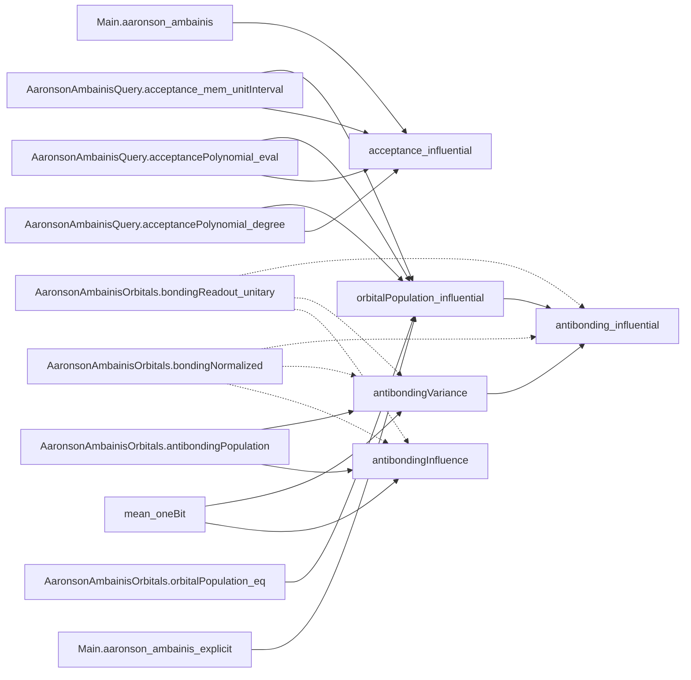

- [Main.aaronson_ambainis](https://github.com/physical-superintelligence/aaronson-ambainis/blob/2a6ceaef872ae993708950f951989134084b851a/AaronsonAmbainis/Main.lean#L33)
- [Main.aaronson_ambainis_explicit](https://github.com/physical-superintelligence/aaronson-ambainis/blob/2a6ceaef872ae993708950f951989134084b851a/AaronsonAmbainis/Main.lean#L38)
- [acceptance_influential](https://github.com/bestquark/formal_qchem/blob/main/FormalQChem/Complexity/AaronsonAmbainis.lean#L36)
- [antibondingInfluence](https://github.com/bestquark/formal_qchem/blob/main/FormalQChem/Complexity/AaronsonAmbainis.lean#L78)
- [antibondingVariance](https://github.com/bestquark/formal_qchem/blob/main/FormalQChem/Complexity/AaronsonAmbainis.lean#L74)
- [antibonding_influential](https://github.com/bestquark/formal_qchem/blob/main/FormalQChem/Complexity/AaronsonAmbainis.lean#L84)
- [mean_oneBit](https://github.com/bestquark/formal_qchem/blob/main/FormalQChem/Complexity/AaronsonAmbainis.lean#L67) (private)
- [orbitalPopulation_influential](https://github.com/bestquark/formal_qchem/blob/main/FormalQChem/Complexity/AaronsonAmbainis.lean#L51)
- [AaronsonAmbainisOrbitals.antibondingPopulation](https://github.com/bestquark/formal_qchem/blob/main/FormalQChem/Complexity/AaronsonAmbainisOrbitals.lean#L106)
- [AaronsonAmbainisOrbitals.bondingNormalized](https://github.com/bestquark/formal_qchem/blob/main/FormalQChem/Complexity/AaronsonAmbainisOrbitals.lean#L86)
- [AaronsonAmbainisOrbitals.bondingReadout_unitary](https://github.com/bestquark/formal_qchem/blob/main/FormalQChem/Complexity/AaronsonAmbainisOrbitals.lean#L93)
- [AaronsonAmbainisOrbitals.orbitalPopulation_eq](https://github.com/bestquark/formal_qchem/blob/main/FormalQChem/Complexity/AaronsonAmbainisOrbitals.lean#L74)
- [AaronsonAmbainisQuery.acceptancePolynomial_degree](https://github.com/bestquark/formal_qchem/blob/main/FormalQChem/Complexity/AaronsonAmbainisQuery.lean#L173)
- [AaronsonAmbainisQuery.acceptancePolynomial_eval](https://github.com/bestquark/formal_qchem/blob/main/FormalQChem/Complexity/AaronsonAmbainisQuery.lean#L164)
- [AaronsonAmbainisQuery.acceptance_mem_unitInterval](https://github.com/bestquark/formal_qchem/blob/main/FormalQChem/Complexity/AaronsonAmbainisQuery.lean#L181)

## FormalQChem.Complexity.AaronsonAmbainisOrbitals

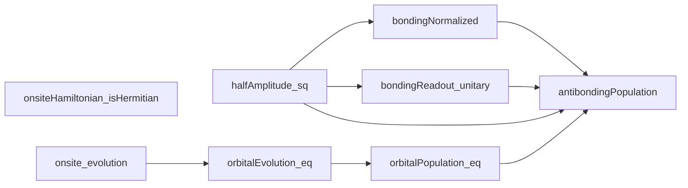

- [antibondingPopulation](https://github.com/bestquark/formal_qchem/blob/main/FormalQChem/Complexity/AaronsonAmbainisOrbitals.lean#L106)
- [bondingNormalized](https://github.com/bestquark/formal_qchem/blob/main/FormalQChem/Complexity/AaronsonAmbainisOrbitals.lean#L86)
- [bondingReadout_unitary](https://github.com/bestquark/formal_qchem/blob/main/FormalQChem/Complexity/AaronsonAmbainisOrbitals.lean#L93)
- [halfAmplitude_sq](https://github.com/bestquark/formal_qchem/blob/main/FormalQChem/Complexity/AaronsonAmbainisOrbitals.lean#L80) (private)
- [onsiteHamiltonian_isHermitian](https://github.com/bestquark/formal_qchem/blob/main/FormalQChem/Complexity/AaronsonAmbainisOrbitals.lean#L37)
- [onsite_evolution](https://github.com/bestquark/formal_qchem/blob/main/FormalQChem/Complexity/AaronsonAmbainisOrbitals.lean#L42)
- [orbitalEvolution_eq](https://github.com/bestquark/formal_qchem/blob/main/FormalQChem/Complexity/AaronsonAmbainisOrbitals.lean#L61)
- [orbitalPopulation_eq](https://github.com/bestquark/formal_qchem/blob/main/FormalQChem/Complexity/AaronsonAmbainisOrbitals.lean#L74)

## FormalQChem.Complexity.AaronsonAmbainisQuery

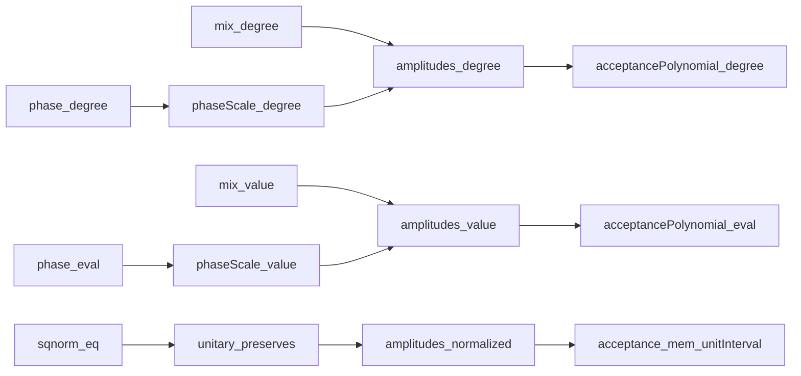

- [acceptancePolynomial_degree](https://github.com/bestquark/formal_qchem/blob/main/FormalQChem/Complexity/AaronsonAmbainisQuery.lean#L173)
- [acceptancePolynomial_eval](https://github.com/bestquark/formal_qchem/blob/main/FormalQChem/Complexity/AaronsonAmbainisQuery.lean#L164)
- [acceptance_mem_unitInterval](https://github.com/bestquark/formal_qchem/blob/main/FormalQChem/Complexity/AaronsonAmbainisQuery.lean#L181)
- [amplitudes_degree](https://github.com/bestquark/formal_qchem/blob/main/FormalQChem/Complexity/AaronsonAmbainisQuery.lean#L149) (private)
- [amplitudes_normalized](https://github.com/bestquark/formal_qchem/blob/main/FormalQChem/Complexity/AaronsonAmbainisQuery.lean#L78)
- [amplitudes_value](https://github.com/bestquark/formal_qchem/blob/main/FormalQChem/Complexity/AaronsonAmbainisQuery.lean#L142) (private)
- [mix_degree](https://github.com/bestquark/formal_qchem/blob/main/FormalQChem/Complexity/AaronsonAmbainisQuery.lean#L128) (private)
- [mix_value](https://github.com/bestquark/formal_qchem/blob/main/FormalQChem/Complexity/AaronsonAmbainisQuery.lean#L121) (private)
- [phaseScale_degree](https://github.com/bestquark/formal_qchem/blob/main/FormalQChem/Complexity/AaronsonAmbainisQuery.lean#L109) (private)
- [phaseScale_value](https://github.com/bestquark/formal_qchem/blob/main/FormalQChem/Complexity/AaronsonAmbainisQuery.lean#L104) (private)
- [phase_degree](https://github.com/bestquark/formal_qchem/blob/main/FormalQChem/Complexity/AaronsonAmbainisQuery.lean#L46) (private)
- [phase_eval](https://github.com/bestquark/formal_qchem/blob/main/FormalQChem/Complexity/AaronsonAmbainisQuery.lean#L40) (private)
- [sqnorm_eq](https://github.com/bestquark/formal_qchem/blob/main/FormalQChem/Complexity/AaronsonAmbainisQuery.lean#L68) (private)
- [unitary_preserves](https://github.com/bestquark/formal_qchem/blob/main/FormalQChem/Complexity/AaronsonAmbainisQuery.lean#L72) (private)

## FormalQChem.Complexity.ElectronicStructure

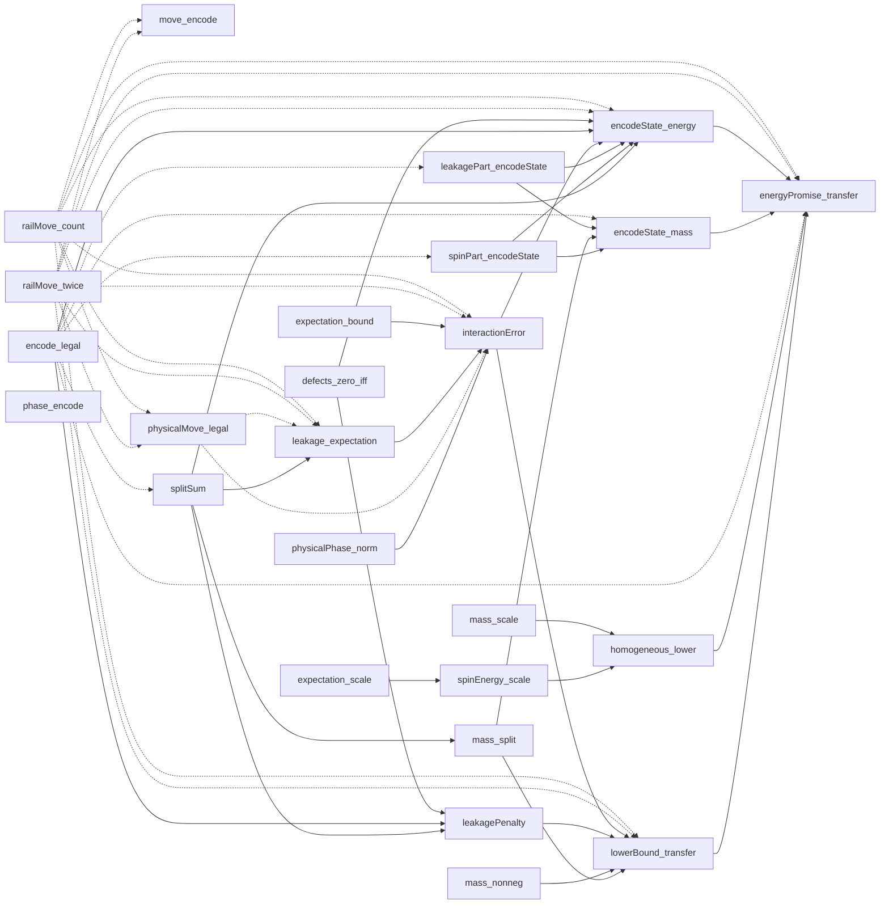

- [railMove_count](https://github.com/bestquark/formal_qchem/blob/main/FormalQChem/Complexity/ElectronicStructure.lean#L110)
- [railMove_twice](https://github.com/bestquark/formal_qchem/blob/main/FormalQChem/Complexity/ElectronicStructure.lean#L104)
- [defects_zero_iff](https://github.com/bestquark/formal_qchem/blob/main/FormalQChem/Complexity/ElectronicStructure.lean#L81)
- [encodeState_energy](https://github.com/bestquark/formal_qchem/blob/main/FormalQChem/Complexity/ElectronicStructure.lean#L252)
- [encodeState_mass](https://github.com/bestquark/formal_qchem/blob/main/FormalQChem/Complexity/ElectronicStructure.lean#L248)
- [encode_legal](https://github.com/bestquark/formal_qchem/blob/main/FormalQChem/Complexity/ElectronicStructure.lean#L58)
- [energyPromise_transfer](https://github.com/bestquark/formal_qchem/blob/main/FormalQChem/Complexity/ElectronicStructure.lean#L319)
- [expectation_bound](https://github.com/bestquark/formal_qchem/blob/main/FormalQChem/Complexity/ElectronicStructure.lean#L167) (private)
- [expectation_scale](https://github.com/bestquark/formal_qchem/blob/main/FormalQChem/Complexity/ElectronicStructure.lean#L282) (private)
- [homogeneous_lower](https://github.com/bestquark/formal_qchem/blob/main/FormalQChem/Complexity/ElectronicStructure.lean#L300) (private)
- [interactionError](https://github.com/bestquark/formal_qchem/blob/main/FormalQChem/Complexity/ElectronicStructure.lean#L214)
- [leakagePart_encodeState](https://github.com/bestquark/formal_qchem/blob/main/FormalQChem/Complexity/ElectronicStructure.lean#L243)
- [leakagePenalty](https://github.com/bestquark/formal_qchem/blob/main/FormalQChem/Complexity/ElectronicStructure.lean#L225)
- [leakage_expectation](https://github.com/bestquark/formal_qchem/blob/main/FormalQChem/Complexity/ElectronicStructure.lean#L209) (private)
- [lowerBound_transfer](https://github.com/bestquark/formal_qchem/blob/main/FormalQChem/Complexity/ElectronicStructure.lean#L268)
- [mass_nonneg](https://github.com/bestquark/formal_qchem/blob/main/FormalQChem/Complexity/ElectronicStructure.lean#L263) (private)
- [mass_scale](https://github.com/bestquark/formal_qchem/blob/main/FormalQChem/Complexity/ElectronicStructure.lean#L278) (private)
- [mass_split](https://github.com/bestquark/formal_qchem/blob/main/FormalQChem/Complexity/ElectronicStructure.lean#L193)
- [move_encode](https://github.com/bestquark/formal_qchem/blob/main/FormalQChem/Complexity/ElectronicStructure.lean#L127)
- [phase_encode](https://github.com/bestquark/formal_qchem/blob/main/FormalQChem/Complexity/ElectronicStructure.lean#L149)
- [physicalMove_legal](https://github.com/bestquark/formal_qchem/blob/main/FormalQChem/Complexity/ElectronicStructure.lean#L130)
- [physicalPhase_norm](https://github.com/bestquark/formal_qchem/blob/main/FormalQChem/Complexity/ElectronicStructure.lean#L152) (private)
- [spinEnergy_scale](https://github.com/bestquark/formal_qchem/blob/main/FormalQChem/Complexity/ElectronicStructure.lean#L293) (private)
- [spinPart_encodeState](https://github.com/bestquark/formal_qchem/blob/main/FormalQChem/Complexity/ElectronicStructure.lean#L238)
- [splitSum](https://github.com/bestquark/formal_qchem/blob/main/FormalQChem/Complexity/ElectronicStructure.lean#L188) (private)

## FormalQChem.Complexity.ElectronicStructureOperators

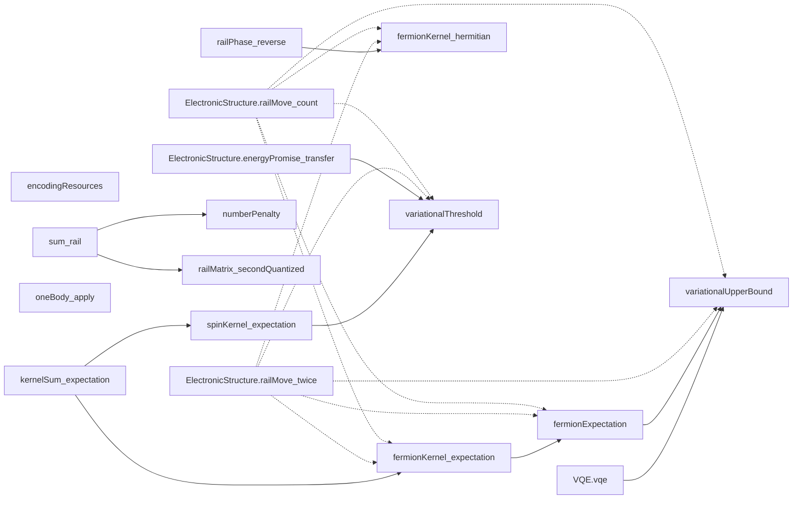

- [ElectronicStructure.railMove_count](https://github.com/bestquark/formal_qchem/blob/main/FormalQChem/Complexity/ElectronicStructure.lean#L110)
- [ElectronicStructure.railMove_twice](https://github.com/bestquark/formal_qchem/blob/main/FormalQChem/Complexity/ElectronicStructure.lean#L104)
- [ElectronicStructure.energyPromise_transfer](https://github.com/bestquark/formal_qchem/blob/main/FormalQChem/Complexity/ElectronicStructure.lean#L319)
- [encodingResources](https://github.com/bestquark/formal_qchem/blob/main/FormalQChem/Complexity/ElectronicStructureOperators.lean#L72)
- [fermionExpectation](https://github.com/bestquark/formal_qchem/blob/main/FormalQChem/Complexity/ElectronicStructureOperators.lean#L167)
- [fermionKernel_expectation](https://github.com/bestquark/formal_qchem/blob/main/FormalQChem/Complexity/ElectronicStructureOperators.lean#L150)
- [fermionKernel_hermitian](https://github.com/bestquark/formal_qchem/blob/main/FormalQChem/Complexity/ElectronicStructureOperators.lean#L130)
- [kernelSum_expectation](https://github.com/bestquark/formal_qchem/blob/main/FormalQChem/Complexity/ElectronicStructureOperators.lean#L90) (private)
- [numberPenalty](https://github.com/bestquark/formal_qchem/blob/main/FormalQChem/Complexity/ElectronicStructureOperators.lean#L57)
- [oneBody_apply](https://github.com/bestquark/formal_qchem/blob/main/FormalQChem/Complexity/ElectronicStructureOperators.lean#L31) (private)
- [railMatrix_secondQuantized](https://github.com/bestquark/formal_qchem/blob/main/FormalQChem/Complexity/ElectronicStructureOperators.lean#L45)
- [railPhase_reverse](https://github.com/bestquark/formal_qchem/blob/main/FormalQChem/Complexity/ElectronicStructureOperators.lean#L122) (private)
- [spinKernel_expectation](https://github.com/bestquark/formal_qchem/blob/main/FormalQChem/Complexity/ElectronicStructureOperators.lean#L114)
- [sum_rail](https://github.com/bestquark/formal_qchem/blob/main/FormalQChem/Complexity/ElectronicStructureOperators.lean#L37) (private)
- [variationalThreshold](https://github.com/bestquark/formal_qchem/blob/main/FormalQChem/Complexity/ElectronicStructureOperators.lean#L190)
- [variationalUpperBound](https://github.com/bestquark/formal_qchem/blob/main/FormalQChem/Complexity/ElectronicStructureOperators.lean#L180)
- [VQE.vqe](https://github.com/bestquark/formal_qchem/blob/main/FormalQChem/StatePrep/VariationalOptimization/VQE.lean#L28)

## FormalQChem.Complexity.ElectronicStructurePauli

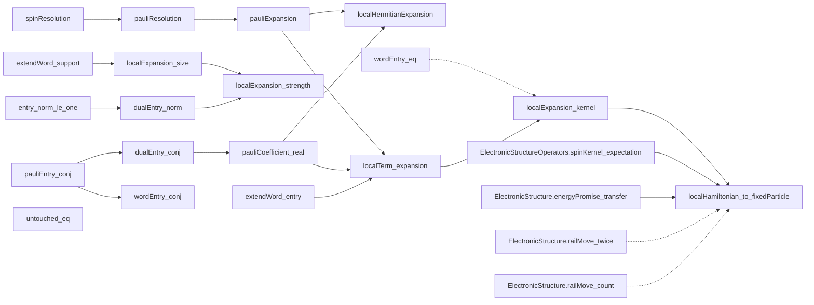

- [ElectronicStructure.railMove_count](https://github.com/bestquark/formal_qchem/blob/main/FormalQChem/Complexity/ElectronicStructure.lean#L110)
- [ElectronicStructure.railMove_twice](https://github.com/bestquark/formal_qchem/blob/main/FormalQChem/Complexity/ElectronicStructure.lean#L104)
- [ElectronicStructure.energyPromise_transfer](https://github.com/bestquark/formal_qchem/blob/main/FormalQChem/Complexity/ElectronicStructure.lean#L319)
- [ElectronicStructureOperators.spinKernel_expectation](https://github.com/bestquark/formal_qchem/blob/main/FormalQChem/Complexity/ElectronicStructureOperators.lean#L114)
- [dualEntry_conj](https://github.com/bestquark/formal_qchem/blob/main/FormalQChem/Complexity/ElectronicStructurePauli.lean#L80) (private)
- [dualEntry_norm](https://github.com/bestquark/formal_qchem/blob/main/FormalQChem/Complexity/ElectronicStructurePauli.lean#L222) (private)
- [entry_norm_le_one](https://github.com/bestquark/formal_qchem/blob/main/FormalQChem/Complexity/ElectronicStructurePauli.lean#L219) (private)
- [extendWord_entry](https://github.com/bestquark/formal_qchem/blob/main/FormalQChem/Complexity/ElectronicStructurePauli.lean#L126)
- [extendWord_support](https://github.com/bestquark/formal_qchem/blob/main/FormalQChem/Complexity/ElectronicStructurePauli.lean#L139)
- [localExpansion_kernel](https://github.com/bestquark/formal_qchem/blob/main/FormalQChem/Complexity/ElectronicStructurePauli.lean#L184)
- [localExpansion_size](https://github.com/bestquark/formal_qchem/blob/main/FormalQChem/Complexity/ElectronicStructurePauli.lean#L198)
- [localExpansion_strength](https://github.com/bestquark/formal_qchem/blob/main/FormalQChem/Complexity/ElectronicStructurePauli.lean#L232)
- [localHamiltonian_to_fixedParticle](https://github.com/bestquark/formal_qchem/blob/main/FormalQChem/Complexity/ElectronicStructurePauli.lean#L209)
- [localHermitianExpansion](https://github.com/bestquark/formal_qchem/blob/main/FormalQChem/Complexity/ElectronicStructurePauli.lean#L97)
- [localTerm_expansion](https://github.com/bestquark/formal_qchem/blob/main/FormalQChem/Complexity/ElectronicStructurePauli.lean#L175) (private)
- [pauliCoefficient_real](https://github.com/bestquark/formal_qchem/blob/main/FormalQChem/Complexity/ElectronicStructurePauli.lean#L84)
- [pauliEntry_conj](https://github.com/bestquark/formal_qchem/blob/main/FormalQChem/Complexity/ElectronicStructurePauli.lean#L29) (private)
- [pauliExpansion](https://github.com/bestquark/formal_qchem/blob/main/FormalQChem/Complexity/ElectronicStructurePauli.lean#L67)
- [pauliResolution](https://github.com/bestquark/formal_qchem/blob/main/FormalQChem/Complexity/ElectronicStructurePauli.lean#L54)
- [spinResolution](https://github.com/bestquark/formal_qchem/blob/main/FormalQChem/Complexity/ElectronicStructurePauli.lean#L33) (private)
- [untouched_eq](https://github.com/bestquark/formal_qchem/blob/main/FormalQChem/Complexity/ElectronicStructurePauli.lean#L114)
- [wordEntry_conj](https://github.com/bestquark/formal_qchem/blob/main/FormalQChem/Complexity/ElectronicStructurePauli.lean#L48) (private)
- [wordEntry_eq](https://github.com/bestquark/formal_qchem/blob/main/FormalQChem/Complexity/ElectronicStructurePauli.lean#L42)

## FormalQChem.Complexity.GroundStateSearch

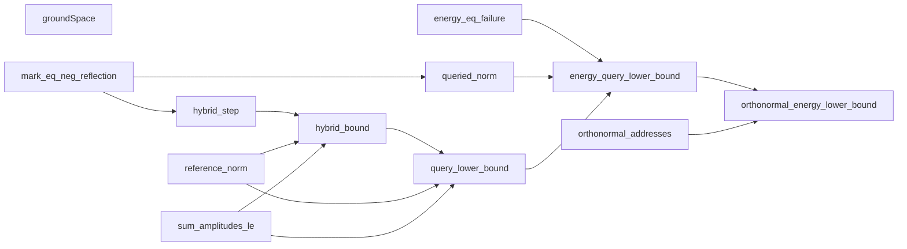

- [energy_eq_failure](https://github.com/bestquark/formal_qchem/blob/main/FormalQChem/Complexity/GroundStateSearch.lean#L35)
- [energy_query_lower_bound](https://github.com/bestquark/formal_qchem/blob/main/FormalQChem/Complexity/GroundStateSearch.lean#L141)
- [groundSpace](https://github.com/bestquark/formal_qchem/blob/main/FormalQChem/Complexity/GroundStateSearch.lean#L30)
- [hybrid_bound](https://github.com/bestquark/formal_qchem/blob/main/FormalQChem/Complexity/GroundStateSearch.lean#L103)
- [hybrid_step](https://github.com/bestquark/formal_qchem/blob/main/FormalQChem/Complexity/GroundStateSearch.lean#L69) (private)
- [mark_eq_neg_reflection](https://github.com/bestquark/formal_qchem/blob/main/FormalQChem/Complexity/GroundStateSearch.lean#L44) (private)
- [orthonormal_addresses](https://github.com/bestquark/formal_qchem/blob/main/FormalQChem/Complexity/GroundStateSearch.lean#L86)
- [orthonormal_energy_lower_bound](https://github.com/bestquark/formal_qchem/blob/main/FormalQChem/Complexity/GroundStateSearch.lean#L154)
- [queried_norm](https://github.com/bestquark/formal_qchem/blob/main/FormalQChem/Complexity/GroundStateSearch.lean#L64)
- [query_lower_bound](https://github.com/bestquark/formal_qchem/blob/main/FormalQChem/Complexity/GroundStateSearch.lean#L116)
- [reference_norm](https://github.com/bestquark/formal_qchem/blob/main/FormalQChem/Complexity/GroundStateSearch.lean#L59)
- [sum_amplitudes_le](https://github.com/bestquark/formal_qchem/blob/main/FormalQChem/Complexity/GroundStateSearch.lean#L92) (private)

## FormalQChem.Complexity.OrbitalSimulation

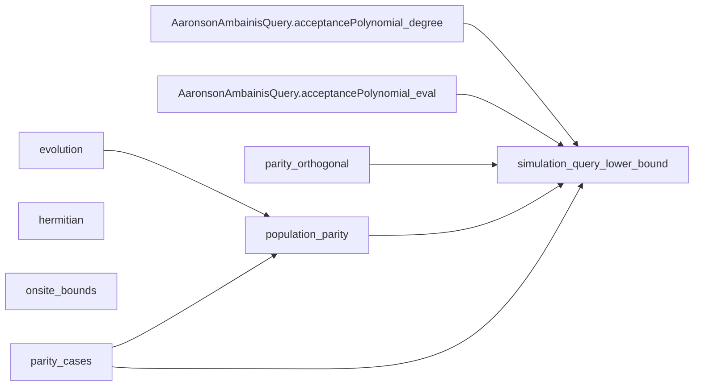

- [AaronsonAmbainisQuery.acceptancePolynomial_degree](https://github.com/bestquark/formal_qchem/blob/main/FormalQChem/Complexity/AaronsonAmbainisQuery.lean#L173)
- [AaronsonAmbainisQuery.acceptancePolynomial_eval](https://github.com/bestquark/formal_qchem/blob/main/FormalQChem/Complexity/AaronsonAmbainisQuery.lean#L164)
- [evolution](https://github.com/bestquark/formal_qchem/blob/main/FormalQChem/Complexity/OrbitalSimulation.lean#L77)
- [hermitian](https://github.com/bestquark/formal_qchem/blob/main/FormalQChem/Complexity/OrbitalSimulation.lean#L71)
- [onsite_bounds](https://github.com/bestquark/formal_qchem/blob/main/FormalQChem/Complexity/OrbitalSimulation.lean#L57)
- [parity_cases](https://github.com/bestquark/formal_qchem/blob/main/FormalQChem/Complexity/OrbitalSimulation.lean#L29) (private)
- [parity_orthogonal](https://github.com/bestquark/formal_qchem/blob/main/FormalQChem/Complexity/OrbitalSimulation.lean#L35)
- [population_parity](https://github.com/bestquark/formal_qchem/blob/main/FormalQChem/Complexity/OrbitalSimulation.lean#L101)
- [simulation_query_lower_bound](https://github.com/bestquark/formal_qchem/blob/main/FormalQChem/Complexity/OrbitalSimulation.lean#L113)

## FormalQChem.Dynamics.DigitalAlgorithms.CommutingTerms


- [commutingProductFormula](https://github.com/bestquark/formal_qchem/blob/main/FormalQChem/Dynamics/DigitalAlgorithms/CommutingTerms.lean#L18)

## FormalQChem.Dynamics.DigitalAlgorithms.LieTrotter

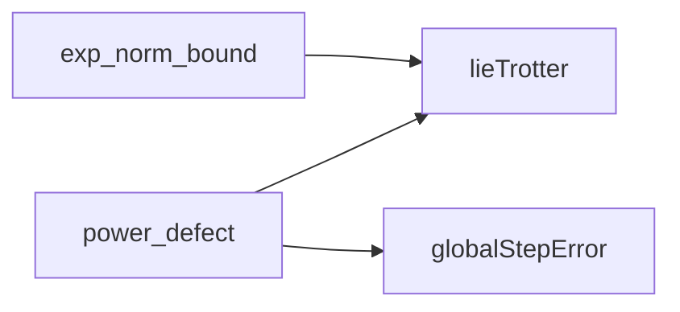

- [exp_norm_bound](https://github.com/bestquark/formal_qchem/blob/main/FormalQChem/Dynamics/DigitalAlgorithms/LieTrotter.lean#L62) (private)
- [globalStepError](https://github.com/bestquark/formal_qchem/blob/main/FormalQChem/Dynamics/DigitalAlgorithms/LieTrotter.lean#L55)
- [lieTrotter](https://github.com/bestquark/formal_qchem/blob/main/FormalQChem/Dynamics/DigitalAlgorithms/LieTrotter.lean#L73)
- [power_defect](https://github.com/bestquark/formal_qchem/blob/main/FormalQChem/Dynamics/DigitalAlgorithms/LieTrotter.lean#L36) (private)

## FormalQChem.Dynamics.DigitalAlgorithms.LinearCombinationOfUnitaries

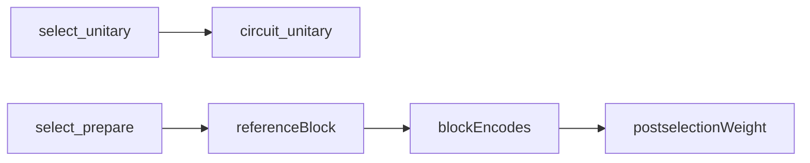

- [blockEncodes](https://github.com/bestquark/formal_qchem/blob/main/FormalQChem/Dynamics/DigitalAlgorithms/LinearCombinationOfUnitaries.lean#L69)
- [circuit_unitary](https://github.com/bestquark/formal_qchem/blob/main/FormalQChem/Dynamics/DigitalAlgorithms/LinearCombinationOfUnitaries.lean#L40)
- [postselectionWeight](https://github.com/bestquark/formal_qchem/blob/main/FormalQChem/Dynamics/DigitalAlgorithms/LinearCombinationOfUnitaries.lean#L81)
- [referenceBlock](https://github.com/bestquark/formal_qchem/blob/main/FormalQChem/Dynamics/DigitalAlgorithms/LinearCombinationOfUnitaries.lean#L55)
- [select_prepare](https://github.com/bestquark/formal_qchem/blob/main/FormalQChem/Dynamics/DigitalAlgorithms/LinearCombinationOfUnitaries.lean#L47) (private)
- [select_unitary](https://github.com/bestquark/formal_qchem/blob/main/FormalQChem/Dynamics/DigitalAlgorithms/LinearCombinationOfUnitaries.lean#L30)

## FormalQChem.Dynamics.DigitalAlgorithms.Qubitization

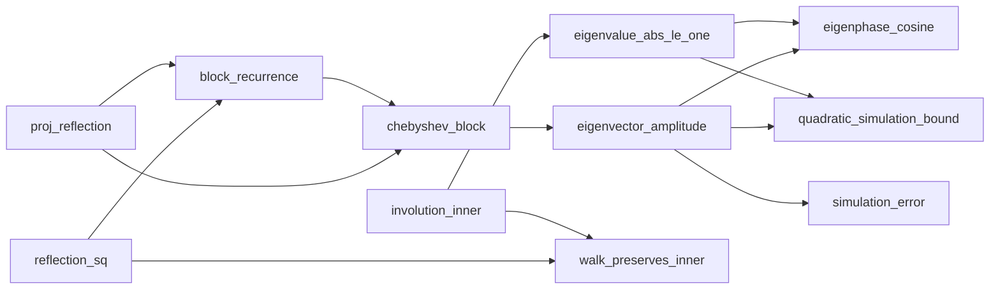

- [block_recurrence](https://github.com/bestquark/formal_qchem/blob/main/FormalQChem/Dynamics/DigitalAlgorithms/Qubitization.lean#L74) (private)
- [chebyshev_block](https://github.com/bestquark/formal_qchem/blob/main/FormalQChem/Dynamics/DigitalAlgorithms/Qubitization.lean#L100)
- [eigenphase_cosine](https://github.com/bestquark/formal_qchem/blob/main/FormalQChem/Dynamics/DigitalAlgorithms/Qubitization.lean#L150)
- [eigenvalue_abs_le_one](https://github.com/bestquark/formal_qchem/blob/main/FormalQChem/Dynamics/DigitalAlgorithms/Qubitization.lean#L135)
- [eigenvector_amplitude](https://github.com/bestquark/formal_qchem/blob/main/FormalQChem/Dynamics/DigitalAlgorithms/Qubitization.lean#L115)
- [involution_inner](https://github.com/bestquark/formal_qchem/blob/main/FormalQChem/Dynamics/DigitalAlgorithms/Qubitization.lean#L62) (private)
- [proj_reflection](https://github.com/bestquark/formal_qchem/blob/main/FormalQChem/Dynamics/DigitalAlgorithms/Qubitization.lean#L59) (private)
- [quadratic_simulation_bound](https://github.com/bestquark/formal_qchem/blob/main/FormalQChem/Dynamics/DigitalAlgorithms/Qubitization.lean#L169)
- [reflection_sq](https://github.com/bestquark/formal_qchem/blob/main/FormalQChem/Dynamics/DigitalAlgorithms/Qubitization.lean#L55) (private)
- [simulation_error](https://github.com/bestquark/formal_qchem/blob/main/FormalQChem/Dynamics/DigitalAlgorithms/Qubitization.lean#L125)
- [walk_preserves_inner](https://github.com/bestquark/formal_qchem/blob/main/FormalQChem/Dynamics/DigitalAlgorithms/Qubitization.lean#L67)

## FormalQChem.Dynamics.DigitalAlgorithms.TruncatedTaylor

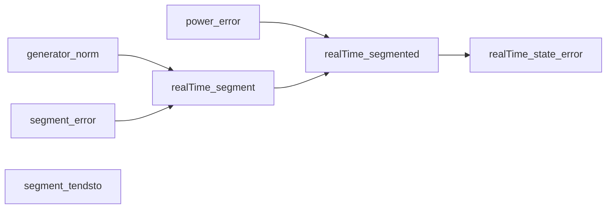

- [generator_norm](https://github.com/bestquark/formal_qchem/blob/main/FormalQChem/Dynamics/DigitalAlgorithms/TruncatedTaylor.lean#L104) (private)
- [power_error](https://github.com/bestquark/formal_qchem/blob/main/FormalQChem/Dynamics/DigitalAlgorithms/TruncatedTaylor.lean#L74) (private)
- [realTime_segment](https://github.com/bestquark/formal_qchem/blob/main/FormalQChem/Dynamics/DigitalAlgorithms/TruncatedTaylor.lean#L109)
- [realTime_segmented](https://github.com/bestquark/formal_qchem/blob/main/FormalQChem/Dynamics/DigitalAlgorithms/TruncatedTaylor.lean#L116)
- [realTime_state_error](https://github.com/bestquark/formal_qchem/blob/main/FormalQChem/Dynamics/DigitalAlgorithms/TruncatedTaylor.lean#L140)
- [segment_error](https://github.com/bestquark/formal_qchem/blob/main/FormalQChem/Dynamics/DigitalAlgorithms/TruncatedTaylor.lean#L41)
- [segment_tendsto](https://github.com/bestquark/formal_qchem/blob/main/FormalQChem/Dynamics/DigitalAlgorithms/TruncatedTaylor.lean#L70)

## FormalQChem.Dynamics.LearnedSurrogates


- [invariantDirectionalForce](https://github.com/bestquark/formal_qchem/blob/main/FormalQChem/Dynamics/LearnedSurrogates.lean#L28)

## FormalQChem.Dynamics.OpenSystems.Kraus

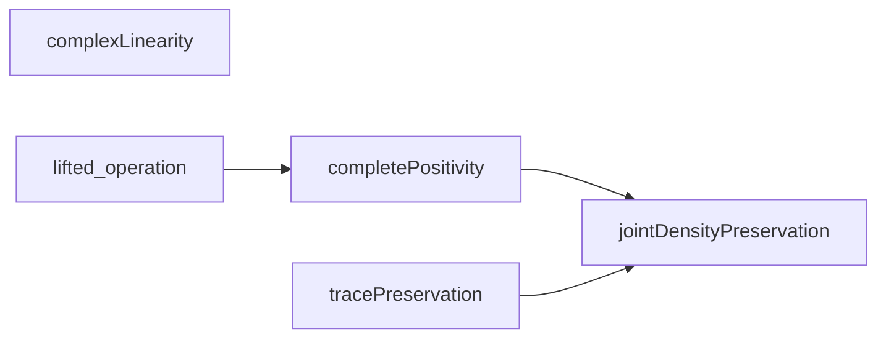

- [completePositivity](https://github.com/bestquark/formal_qchem/blob/main/FormalQChem/Dynamics/OpenSystems/Kraus.lean#L74)
- [complexLinearity](https://github.com/bestquark/formal_qchem/blob/main/FormalQChem/Dynamics/OpenSystems/Kraus.lean#L69)
- [jointDensityPreservation](https://github.com/bestquark/formal_qchem/blob/main/FormalQChem/Dynamics/OpenSystems/Kraus.lean#L86)
- [lifted_operation](https://github.com/bestquark/formal_qchem/blob/main/FormalQChem/Dynamics/OpenSystems/Kraus.lean#L59) (private)
- [tracePreservation](https://github.com/bestquark/formal_qchem/blob/main/FormalQChem/Dynamics/OpenSystems/Kraus.lean#L79)

## FormalQChem.Dynamics.OpenSystems.TracePreservation

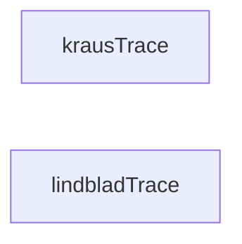

- [krausTrace](https://github.com/bestquark/formal_qchem/blob/main/FormalQChem/Dynamics/OpenSystems/TracePreservation.lean#L37)
- [lindbladTrace](https://github.com/bestquark/formal_qchem/blob/main/FormalQChem/Dynamics/OpenSystems/TracePreservation.lean#L30)

## FormalQChem.Dynamics.RealTimePropagation.BornOppenheimer


- [bornOppenheimerEnergy](https://github.com/bestquark/formal_qchem/blob/main/FormalQChem/Dynamics/RealTimePropagation/BornOppenheimer.lean#L27)

## FormalQChem.Dynamics.RealTimePropagation.ClusterExpansions


- [linkedClusterInversion](https://github.com/bestquark/formal_qchem/blob/main/FormalQChem/Dynamics/RealTimePropagation/ClusterExpansions.lean#L20)

## FormalQChem.Dynamics.RealTimePropagation.HeisenbergPicture

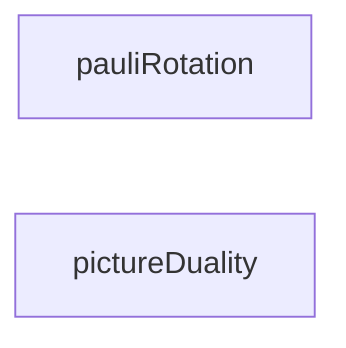

- [pauliRotation](https://github.com/bestquark/formal_qchem/blob/main/FormalQChem/Dynamics/RealTimePropagation/HeisenbergPicture.lean#L38)
- [pictureDuality](https://github.com/bestquark/formal_qchem/blob/main/FormalQChem/Dynamics/RealTimePropagation/HeisenbergPicture.lean#L33)

## FormalQChem.Dynamics.RealTimePropagation.KrylovPropagation

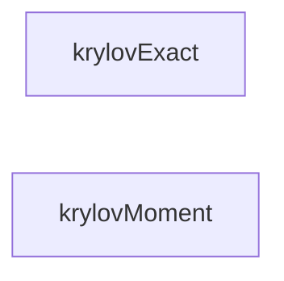

- [krylovExact](https://github.com/bestquark/formal_qchem/blob/main/FormalQChem/Dynamics/RealTimePropagation/KrylovPropagation.lean#L34)
- [krylovMoment](https://github.com/bestquark/formal_qchem/blob/main/FormalQChem/Dynamics/RealTimePropagation/KrylovPropagation.lean#L42)

## FormalQChem.Dynamics.RealTimePropagation.PathSampling

```mermaid
flowchart LR
  n149["realTimeReweighting"]
```

- [realTimeReweighting](https://github.com/bestquark/formal_qchem/blob/main/FormalQChem/Dynamics/RealTimePropagation/PathSampling.lean#L22)

## FormalQChem.Dynamics.RealTimePropagation.RingPolymer

```mermaid
flowchart LR
  n150["ringPolymerSpringForce"]
```

- [ringPolymerSpringForce](https://github.com/bestquark/formal_qchem/blob/main/FormalQChem/Dynamics/RealTimePropagation/RingPolymer.lean#L26)

## FormalQChem.Dynamics.RealTimePropagation.SchrodingerGroup

```mermaid
flowchart LR
  n151["unitaryEvolution"]
```

- [unitaryEvolution](https://github.com/bestquark/formal_qchem/blob/main/FormalQChem/Dynamics/RealTimePropagation/SchrodingerGroup.lean#L41)

## FormalQChem.Dynamics.RealTimePropagation.SplitOperator

```mermaid
flowchart LR
  n152["splitOperator"]
```

- [splitOperator](https://github.com/bestquark/formal_qchem/blob/main/FormalQChem/Dynamics/RealTimePropagation/SplitOperator.lean#L26)

## FormalQChem.Dynamics.RealTimePropagation.TimeDependentCI

```mermaid
flowchart LR
  n153["tdConfigurationInteraction"]
```

- [tdConfigurationInteraction](https://github.com/bestquark/formal_qchem/blob/main/FormalQChem/Dynamics/RealTimePropagation/TimeDependentCI.lean#L28)

## FormalQChem.Dynamics.RealTimePropagation.VariationalEvolution

```mermaid
flowchart LR
  n154["mcLachlanProjection"]
  n155["sampledTangentMetric"]
```

- [mcLachlanProjection](https://github.com/bestquark/formal_qchem/blob/main/FormalQChem/Dynamics/RealTimePropagation/VariationalEvolution.lean#L56)
- [sampledTangentMetric](https://github.com/bestquark/formal_qchem/blob/main/FormalQChem/Dynamics/RealTimePropagation/VariationalEvolution.lean#L38)

## FormalQChem.Multiscale.ChoosingLayers.ClassicalEnvironments

```mermaid
flowchart LR
  n156["layeredForce"]
```

- [layeredForce](https://github.com/bestquark/formal_qchem/blob/main/FormalQChem/Multiscale/ChoosingLayers/ClassicalEnvironments.lean#L26)

## FormalQChem.Multiscale.ChoosingLayers.Fragments

```mermaid
flowchart LR
  n157["pairReconstruction"]
```

- [pairReconstruction](https://github.com/bestquark/formal_qchem/blob/main/FormalQChem/Multiscale/ChoosingLayers/Fragments.lean#L27)

## FormalQChem.Multiscale.ChoosingLayers.LearnedEnvironments

```mermaid
flowchart LR
  n158["deltaLearningGap"]
```

- [deltaLearningGap](https://github.com/bestquark/formal_qchem/blob/main/FormalQChem/Multiscale/ChoosingLayers/LearnedEnvironments.lean#L23)

## FormalQChem.Multiscale.ChoosingLayers.Partitions

```mermaid
flowchart LR
  n159["overlapAccounting"]
```

- [overlapAccounting](https://github.com/bestquark/formal_qchem/blob/main/FormalQChem/Multiscale/ChoosingLayers/Partitions.lean#L36)

## FormalQChem.Multiscale.ChoosingLayers.QuantumEnvironments

```mermaid
flowchart LR
  n160["frozenDensityDerivative"]
  n161["frozenSearch"]
```

- [frozenDensityDerivative](https://github.com/bestquark/formal_qchem/blob/main/FormalQChem/Multiscale/ChoosingLayers/QuantumEnvironments.lean#L37)
- [frozenSearch](https://github.com/bestquark/formal_qchem/blob/main/FormalQChem/Multiscale/ChoosingLayers/QuantumEnvironments.lean#L41)

## FormalQChem.Multiscale.StitchingSolutions.EmbeddedSolvers

```mermaid
flowchart LR
  n162["feshbachReduction"]
```

- [feshbachReduction](https://github.com/bestquark/formal_qchem/blob/main/FormalQChem/Multiscale/StitchingSolutions/EmbeddedSolvers.lean#L30)

## FormalQChem.Multiscale.StitchingSolutions.ErrorPropagation

```mermaid
flowchart LR
  n163["barrierRateError"]
```

- [barrierRateError](https://github.com/bestquark/formal_qchem/blob/main/FormalQChem/Multiscale/StitchingSolutions/ErrorPropagation.lean#L23)

## FormalQChem.Multiscale.StitchingSolutions.Observables

```mermaid
flowchart LR
  n164["zwanzig"]
```

- [zwanzig](https://github.com/bestquark/formal_qchem/blob/main/FormalQChem/Multiscale/StitchingSolutions/Observables.lean#L33)

## FormalQChem.Properties.LinearSystems.DirichletPoisson

```mermaid
flowchart LR
  n165["dirichletPoissonMode"]
```

- [dirichletPoissonMode](https://github.com/bestquark/formal_qchem/blob/main/FormalQChem/Properties/LinearSystems/DirichletPoisson.lean#L20)

## FormalQChem.Properties.LinearSystems.HHL

```mermaid
flowchart LR
  n166["hhlSpectralInversion"]
```

- [hhlSpectralInversion](https://github.com/bestquark/formal_qchem/blob/main/FormalQChem/Properties/LinearSystems/HHL.lean#L18)

## FormalQChem.Properties.MeasurementTheory

```mermaid
flowchart LR
  n167["bornCompleteness"]
  n168["projectiveRepeatability"]
  n169["unsharpQubit"]
```

- [bornCompleteness](https://github.com/bestquark/formal_qchem/blob/main/FormalQChem/Properties/MeasurementTheory.lean#L69)
- [projectiveRepeatability](https://github.com/bestquark/formal_qchem/blob/main/FormalQChem/Properties/MeasurementTheory.lean#L78)
- [unsharpQubit](https://github.com/bestquark/formal_qchem/blob/main/FormalQChem/Properties/MeasurementTheory.lean#L96)

## FormalQChem.Properties.PhaseEstimation

```mermaid
flowchart LR
  n170["exactGridQPE"]
```

- [exactGridQPE](https://github.com/bestquark/formal_qchem/blob/main/FormalQChem/Properties/PhaseEstimation.lean#L17)

## FormalQChem.Properties.ResponseAndEstimation.HellmannFeynman

```mermaid
flowchart LR
  n171["hellmannFeynman"]
```

- [hellmannFeynman](https://github.com/bestquark/formal_qchem/blob/main/FormalQChem/Properties/ResponseAndEstimation/HellmannFeynman.lean#L39)

## FormalQChem.Properties.ResponseAndEstimation.SpectralReconstruction

```mermaid
flowchart LR
  n172["spectralIdentification"]
```

- [spectralIdentification](https://github.com/bestquark/formal_qchem/blob/main/FormalQChem/Properties/ResponseAndEstimation/SpectralReconstruction.lean#L21)

## FormalQChem.Properties.ResponseAndEstimation.VQEMeasurement

```mermaid
flowchart LR
  n173["energyReconstruction"]
  n174["finiteShotVQE"]
  n175["shotStatistics"]
  n173 --> n174
  n175 --> n174
```

- [energyReconstruction](https://github.com/bestquark/formal_qchem/blob/main/FormalQChem/Properties/ResponseAndEstimation/VQEMeasurement.lean#L67)
- [finiteShotVQE](https://github.com/bestquark/formal_qchem/blob/main/FormalQChem/Properties/ResponseAndEstimation/VQEMeasurement.lean#L118)
- [shotStatistics](https://github.com/bestquark/formal_qchem/blob/main/FormalQChem/Properties/ResponseAndEstimation/VQEMeasurement.lean#L74)

## FormalQChem.StatePrep.AdiabaticPreparation.AdiabaticTheorem

```mermaid
flowchart LR
  n176["adiabaticIntertwining"]
  n177["gappedBandPreparation"]
  n178["gappedBandPreparation_limit"]
  n179["katoTransport"]
  n180["projectionDerivative"]
  n181["reducedResolventPreparation"]
  n182["sandwichBound"]
  n183["transportedDerivative"]
  n182 --> n176
  n183 --> n176
  n176 --> n177
  n180 --> n177
  n177 --> n178
  n180 --> n179
  n183 --> n179
  n176 --> n181
  n180 --> n181
```

- [adiabaticIntertwining](https://github.com/bestquark/formal_qchem/blob/main/FormalQChem/StatePrep/AdiabaticPreparation/AdiabaticTheorem.lean#L135)
- [gappedBandPreparation](https://github.com/bestquark/formal_qchem/blob/main/FormalQChem/StatePrep/AdiabaticPreparation/AdiabaticTheorem.lean#L216)
- [gappedBandPreparation_limit](https://github.com/bestquark/formal_qchem/blob/main/FormalQChem/StatePrep/AdiabaticPreparation/AdiabaticTheorem.lean#L311)
- [katoTransport](https://github.com/bestquark/formal_qchem/blob/main/FormalQChem/StatePrep/AdiabaticPreparation/AdiabaticTheorem.lean#L186)
- [projectionDerivative](https://github.com/bestquark/formal_qchem/blob/main/FormalQChem/StatePrep/AdiabaticPreparation/AdiabaticTheorem.lean#L174) (private)
- [reducedResolventPreparation](https://github.com/bestquark/formal_qchem/blob/main/FormalQChem/StatePrep/AdiabaticPreparation/AdiabaticTheorem.lean#L264)
- [sandwichBound](https://github.com/bestquark/formal_qchem/blob/main/FormalQChem/StatePrep/AdiabaticPreparation/AdiabaticTheorem.lean#L129) (private)
- [transportedDerivative](https://github.com/bestquark/formal_qchem/blob/main/FormalQChem/StatePrep/AdiabaticPreparation/AdiabaticTheorem.lean#L119) (private)

## FormalQChem.StatePrep.AdiabaticPreparation.RydbergBlockade

```mermaid
flowchart LR
  n184["rydbergBlockade"]
```

- [rydbergBlockade](https://github.com/bestquark/formal_qchem/blob/main/FormalQChem/StatePrep/AdiabaticPreparation/RydbergBlockade.lean#L28)

## FormalQChem.StatePrep.CircuitPreparation.AmplitudeAmplification

```mermaid
flowchart LR
  n185["inner_states"]
  n186["inverse_sqrt_queries"]
  n187["iterate_state"]
  n188["mark_state"]
  n189["project_state"]
  n190["rounded_success"]
  n191["state_normalized"]
  n192["step_rotates"]
  n193["success_law"]
  n190 --> n186
  n193 --> n186
  n192 --> n187
  n189 --> n188
  n193 --> n190
  n185 --> n191
  n185 --> n192
  n188 --> n192
  n187 --> n193
  n189 --> n193
```

- [inner_states](https://github.com/bestquark/formal_qchem/blob/main/FormalQChem/StatePrep/CircuitPreparation/AmplitudeAmplification.lean#L52) (private)
- [inverse_sqrt_queries](https://github.com/bestquark/formal_qchem/blob/main/FormalQChem/StatePrep/CircuitPreparation/AmplitudeAmplification.lean#L138)
- [iterate_state](https://github.com/bestquark/formal_qchem/blob/main/FormalQChem/StatePrep/CircuitPreparation/AmplitudeAmplification.lean#L98)
- [mark_state](https://github.com/bestquark/formal_qchem/blob/main/FormalQChem/StatePrep/CircuitPreparation/AmplitudeAmplification.lean#L70) (private)
- [project_state](https://github.com/bestquark/formal_qchem/blob/main/FormalQChem/StatePrep/CircuitPreparation/AmplitudeAmplification.lean#L46) (private)
- [rounded_success](https://github.com/bestquark/formal_qchem/blob/main/FormalQChem/StatePrep/CircuitPreparation/AmplitudeAmplification.lean#L117)
- [state_normalized](https://github.com/bestquark/formal_qchem/blob/main/FormalQChem/StatePrep/CircuitPreparation/AmplitudeAmplification.lean#L63)
- [step_rotates](https://github.com/bestquark/formal_qchem/blob/main/FormalQChem/StatePrep/CircuitPreparation/AmplitudeAmplification.lean#L77)
- [success_law](https://github.com/bestquark/formal_qchem/blob/main/FormalQChem/StatePrep/CircuitPreparation/AmplitudeAmplification.lean#L110)

## FormalQChem.StatePrep.CircuitPreparation.ControlledRotations

```mermaid
flowchart LR
  n194["blockCount"]
  n195["normalized"]
  n196["preservesNorm"]
  n197["exactPreparation"]
  n198["preparePair_correct"]
  n199["radius_sq"]
  n200["registerCard"]
  n200 --> n194
  n196 --> n195
  n198 --> n197
  n199 --> n197
  n199 --> n198
```

- [blockCount](https://github.com/bestquark/formal_qchem/blob/main/FormalQChem/StatePrep/CircuitPreparation/ControlledRotations.lean#L113)
- [normalized](https://github.com/bestquark/formal_qchem/blob/main/FormalQChem/StatePrep/CircuitPreparation/ControlledRotations.lean#L87)
- [preservesNorm](https://github.com/bestquark/formal_qchem/blob/main/FormalQChem/StatePrep/CircuitPreparation/ControlledRotations.lean#L42)
- [exactPreparation](https://github.com/bestquark/formal_qchem/blob/main/FormalQChem/StatePrep/CircuitPreparation/ControlledRotations.lean#L122)
- [preparePair_correct](https://github.com/bestquark/formal_qchem/blob/main/FormalQChem/StatePrep/CircuitPreparation/ControlledRotations.lean#L64)
- [radius_sq](https://github.com/bestquark/formal_qchem/blob/main/FormalQChem/StatePrep/CircuitPreparation/ControlledRotations.lean#L54) (private)
- [registerCard](https://github.com/bestquark/formal_qchem/blob/main/FormalQChem/StatePrep/CircuitPreparation/ControlledRotations.lean#L107) (private)

## FormalQChem.StatePrep.CircuitPreparation.SlaterDeterminants

```mermaid
flowchart LR
  n201["coordinate_of_fixed"]
  n202["eliminateCoefficient"]
  n203["existsOrbitalUnitary"]
  n204["existsSlaterPreparation"]
  n205["existsTwoModeFactorization"]
  n206["existsTwoModeSlaterPreparation"]
  n207["exteriorGate_product"]
  n208["gateForPair"]
  n209["listProduct_fixed"]
  n210["occupationAmplitude"]
  n211["prepareVector"]
  n208 --> n202
  n203 --> n204
  n209 --> n205
  n211 --> n205
  n204 --> n206
  n205 --> n206
  n207 --> n206
  n201 --> n211
  n202 --> n211
  n208 --> n211
```

- [coordinate_of_fixed](https://github.com/bestquark/formal_qchem/blob/main/FormalQChem/StatePrep/CircuitPreparation/SlaterDeterminants.lean#L89) (private)
- [eliminateCoefficient](https://github.com/bestquark/formal_qchem/blob/main/FormalQChem/StatePrep/CircuitPreparation/SlaterDeterminants.lean#L130) (private)
- [existsOrbitalUnitary](https://github.com/bestquark/formal_qchem/blob/main/FormalQChem/StatePrep/CircuitPreparation/SlaterDeterminants.lean#L39)
- [existsSlaterPreparation](https://github.com/bestquark/formal_qchem/blob/main/FormalQChem/StatePrep/CircuitPreparation/SlaterDeterminants.lean#L60)
- [existsTwoModeFactorization](https://github.com/bestquark/formal_qchem/blob/main/FormalQChem/StatePrep/CircuitPreparation/SlaterDeterminants.lean#L197)
- [existsTwoModeSlaterPreparation](https://github.com/bestquark/formal_qchem/blob/main/FormalQChem/StatePrep/CircuitPreparation/SlaterDeterminants.lean#L247)
- [exteriorGate_product](https://github.com/bestquark/formal_qchem/blob/main/FormalQChem/StatePrep/CircuitPreparation/SlaterDeterminants.lean#L235)
- [gateForPair](https://github.com/bestquark/formal_qchem/blob/main/FormalQChem/StatePrep/CircuitPreparation/SlaterDeterminants.lean#L94) (private)
- [listProduct_fixed](https://github.com/bestquark/formal_qchem/blob/main/FormalQChem/StatePrep/CircuitPreparation/SlaterDeterminants.lean#L187) (private)
- [occupationAmplitude](https://github.com/bestquark/formal_qchem/blob/main/FormalQChem/StatePrep/CircuitPreparation/SlaterDeterminants.lean#L71)
- [prepareVector](https://github.com/bestquark/formal_qchem/blob/main/FormalQChem/StatePrep/CircuitPreparation/SlaterDeterminants.lean#L151) (private)

## FormalQChem.StatePrep.ImaginaryTimeProjection.AFQMC

```mermaid
flowchart LR
  n212["exactTrialLocalEnergy"]
  n213["fieldHistoryExpansion"]
  n214["freeProjection"]
  n215["hirschLattice"]
  n216["hirschLocal"]
  n217["hubbardFreeProjection"]
  n218["mixedEstimator"]
  n219["phaselessWeightLoss"]
  n220["projectedOverlap"]
  n221["realHirschParameter"]
  n222["slaterHistory"]
  n223["spinOrbitalFactorization"]
  n213 --> n214
  n222 --> n214
  n216 --> n215
  n213 --> n217
  n215 --> n217
  n214 --> n220
```

- [exactTrialLocalEnergy](https://github.com/bestquark/formal_qchem/blob/main/FormalQChem/StatePrep/ImaginaryTimeProjection/AFQMC.lean#L176)
- [fieldHistoryExpansion](https://github.com/bestquark/formal_qchem/blob/main/FormalQChem/StatePrep/ImaginaryTimeProjection/AFQMC.lean#L83)
- [freeProjection](https://github.com/bestquark/formal_qchem/blob/main/FormalQChem/StatePrep/ImaginaryTimeProjection/AFQMC.lean#L139)
- [hirschLattice](https://github.com/bestquark/formal_qchem/blob/main/FormalQChem/StatePrep/ImaginaryTimeProjection/AFQMC.lean#L68)
- [hirschLocal](https://github.com/bestquark/formal_qchem/blob/main/FormalQChem/StatePrep/ImaginaryTimeProjection/AFQMC.lean#L44)
- [hubbardFreeProjection](https://github.com/bestquark/formal_qchem/blob/main/FormalQChem/StatePrep/ImaginaryTimeProjection/AFQMC.lean#L103)
- [mixedEstimator](https://github.com/bestquark/formal_qchem/blob/main/FormalQChem/StatePrep/ImaginaryTimeProjection/AFQMC.lean#L163)
- [phaselessWeightLoss](https://github.com/bestquark/formal_qchem/blob/main/FormalQChem/StatePrep/ImaginaryTimeProjection/AFQMC.lean#L187)
- [projectedOverlap](https://github.com/bestquark/formal_qchem/blob/main/FormalQChem/StatePrep/ImaginaryTimeProjection/AFQMC.lean#L148)
- [realHirschParameter](https://github.com/bestquark/formal_qchem/blob/main/FormalQChem/StatePrep/ImaginaryTimeProjection/AFQMC.lean#L39)
- [slaterHistory](https://github.com/bestquark/formal_qchem/blob/main/FormalQChem/StatePrep/ImaginaryTimeProjection/AFQMC.lean#L124)
- [spinOrbitalFactorization](https://github.com/bestquark/formal_qchem/blob/main/FormalQChem/StatePrep/ImaginaryTimeProjection/AFQMC.lean#L58)

## FormalQChem.StatePrep.ImaginaryTimeProjection.DiffusionMonteCarlo

```mermaid
flowchart LR
  n224["branchingLocalEnergy"]
  n225["constantBranchingIff"]
  n226["exactFixedNode"]
  n227["exactGuideGroundEnergy"]
  n228["exactGuideStationarity"]
  n229["fixedNodeEqualityIff"]
  n230["fixedNodeShift"]
  n231["fixedNodeUpperBound"]
  n232["guidedFeynmanKac"]
  n233["penalty_nonneg"]
  n234["transitionMarkov"]
  n229 --> n226
  n231 --> n226
  n226 --> n227
  n234 --> n228
  n230 --> n229
  n233 --> n229
  n230 --> n231
  n233 --> n231
```

- [branchingLocalEnergy](https://github.com/bestquark/formal_qchem/blob/main/FormalQChem/StatePrep/ImaginaryTimeProjection/DiffusionMonteCarlo.lean#L95)
- [constantBranchingIff](https://github.com/bestquark/formal_qchem/blob/main/FormalQChem/StatePrep/ImaginaryTimeProjection/DiffusionMonteCarlo.lean#L68)
- [exactFixedNode](https://github.com/bestquark/formal_qchem/blob/main/FormalQChem/StatePrep/ImaginaryTimeProjection/DiffusionMonteCarlo.lean#L186)
- [exactGuideGroundEnergy](https://github.com/bestquark/formal_qchem/blob/main/FormalQChem/StatePrep/ImaginaryTimeProjection/DiffusionMonteCarlo.lean#L197)
- [exactGuideStationarity](https://github.com/bestquark/formal_qchem/blob/main/FormalQChem/StatePrep/ImaginaryTimeProjection/DiffusionMonteCarlo.lean#L75)
- [fixedNodeEqualityIff](https://github.com/bestquark/formal_qchem/blob/main/FormalQChem/StatePrep/ImaginaryTimeProjection/DiffusionMonteCarlo.lean#L153)
- [fixedNodeShift](https://github.com/bestquark/formal_qchem/blob/main/FormalQChem/StatePrep/ImaginaryTimeProjection/DiffusionMonteCarlo.lean#L132)
- [fixedNodeUpperBound](https://github.com/bestquark/formal_qchem/blob/main/FormalQChem/StatePrep/ImaginaryTimeProjection/DiffusionMonteCarlo.lean#L176)
- [guidedFeynmanKac](https://github.com/bestquark/formal_qchem/blob/main/FormalQChem/StatePrep/ImaginaryTimeProjection/DiffusionMonteCarlo.lean#L50)
- [penalty_nonneg](https://github.com/bestquark/formal_qchem/blob/main/FormalQChem/StatePrep/ImaginaryTimeProjection/DiffusionMonteCarlo.lean#L145) (private)
- [transitionMarkov](https://github.com/bestquark/formal_qchem/blob/main/FormalQChem/StatePrep/ImaginaryTimeProjection/DiffusionMonteCarlo.lean#L32)

## FormalQChem.StatePrep.ImaginaryTimeProjection.FCIQMC

```mermaid
flowchart LR
  n235["annihilationPreserves"]
  n236["outcomeMass_nonneg"]
  n237["outcomeMass_sum"]
  n238["populationFirstMoment"]
  n239["populationMass_probability"]
  n240["productMarginal"]
  n241["roundedCounts"]
  n242["roundingFirstMoment"]
  n243["roundingMass_nonneg"]
  n244["roundingMass_sum"]
  n245["survivorsSignedCount"]
  n246["walkerFirstMoment"]
  n243 --> n236
  n244 --> n237
  n237 --> n238
  n240 --> n238
  n246 --> n238
  n236 --> n239
  n237 --> n239
  n235 --> n245
  n241 --> n246
```

- [annihilationPreserves](https://github.com/bestquark/formal_qchem/blob/main/FormalQChem/StatePrep/ImaginaryTimeProjection/FCIQMC.lean#L142)
- [outcomeMass_nonneg](https://github.com/bestquark/formal_qchem/blob/main/FormalQChem/StatePrep/ImaginaryTimeProjection/FCIQMC.lean#L81)
- [outcomeMass_sum](https://github.com/bestquark/formal_qchem/blob/main/FormalQChem/StatePrep/ImaginaryTimeProjection/FCIQMC.lean#L85)
- [populationFirstMoment](https://github.com/bestquark/formal_qchem/blob/main/FormalQChem/StatePrep/ImaginaryTimeProjection/FCIQMC.lean#L184)
- [populationMass_probability](https://github.com/bestquark/formal_qchem/blob/main/FormalQChem/StatePrep/ImaginaryTimeProjection/FCIQMC.lean#L174)
- [productMarginal](https://github.com/bestquark/formal_qchem/blob/main/FormalQChem/StatePrep/ImaginaryTimeProjection/FCIQMC.lean#L150) (private)
- [roundedCounts](https://github.com/bestquark/formal_qchem/blob/main/FormalQChem/StatePrep/ImaginaryTimeProjection/FCIQMC.lean#L94) (private)
- [roundingFirstMoment](https://github.com/bestquark/formal_qchem/blob/main/FormalQChem/StatePrep/ImaginaryTimeProjection/FCIQMC.lean#L39)
- [roundingMass_nonneg](https://github.com/bestquark/formal_qchem/blob/main/FormalQChem/StatePrep/ImaginaryTimeProjection/FCIQMC.lean#L30)
- [roundingMass_sum](https://github.com/bestquark/formal_qchem/blob/main/FormalQChem/StatePrep/ImaginaryTimeProjection/FCIQMC.lean#L35)
- [survivorsSignedCount](https://github.com/bestquark/formal_qchem/blob/main/FormalQChem/StatePrep/ImaginaryTimeProjection/FCIQMC.lean#L215)
- [walkerFirstMoment](https://github.com/bestquark/formal_qchem/blob/main/FormalQChem/StatePrep/ImaginaryTimeProjection/FCIQMC.lean#L102)

## FormalQChem.StatePrep.ImaginaryTimeProjection.GaussianAuxiliaryField

```mermaid
flowchart LR
  n247["gaussianHubbardStratonovich"]
  n248["gaussianPhaseAverage"]
  n248 --> n247
```

- [gaussianHubbardStratonovich](https://github.com/bestquark/formal_qchem/blob/main/FormalQChem/StatePrep/ImaginaryTimeProjection/GaussianAuxiliaryField.lean#L46)
- [gaussianPhaseAverage](https://github.com/bestquark/formal_qchem/blob/main/FormalQChem/StatePrep/ImaginaryTimeProjection/GaussianAuxiliaryField.lean#L34)

## FormalQChem.StatePrep.ImaginaryTimeProjection.GroundStateProjection

```mermaid
flowchart LR
  n249["bornWeight"]
  n250["boundTendstoZero"]
  n251["energyBound"]
  n252["energyLimit"]
  n253["excitedBound"]
  n254["excited_nonneg"]
  n255["infidelity"]
  n256["normalization"]
  n257["projectionBound"]
  n258["projectionLimit"]
  n259["total_pos"]
  n259 --> n249
  n249 --> n251
  n255 --> n251
  n257 --> n251
  n250 --> n252
  n251 --> n252
  n249 --> n255
  n259 --> n255
  n249 --> n256
  n259 --> n256
  n253 --> n257
  n254 --> n257
  n255 --> n257
  n259 --> n257
  n250 --> n258
  n257 --> n258
  n254 --> n259
```

- [bornWeight](https://github.com/bestquark/formal_qchem/blob/main/FormalQChem/StatePrep/ImaginaryTimeProjection/GroundStateProjection.lean#L78) (private)
- [boundTendstoZero](https://github.com/bestquark/formal_qchem/blob/main/FormalQChem/StatePrep/ImaginaryTimeProjection/GroundStateProjection.lean#L121) (private)
- [energyBound](https://github.com/bestquark/formal_qchem/blob/main/FormalQChem/StatePrep/ImaginaryTimeProjection/GroundStateProjection.lean#L139)
- [energyLimit](https://github.com/bestquark/formal_qchem/blob/main/FormalQChem/StatePrep/ImaginaryTimeProjection/GroundStateProjection.lean#L150)
- [excitedBound](https://github.com/bestquark/formal_qchem/blob/main/FormalQChem/StatePrep/ImaginaryTimeProjection/GroundStateProjection.lean#L95) (private)
- [excited_nonneg](https://github.com/bestquark/formal_qchem/blob/main/FormalQChem/StatePrep/ImaginaryTimeProjection/GroundStateProjection.lean#L72) (private)
- [infidelity](https://github.com/bestquark/formal_qchem/blob/main/FormalQChem/StatePrep/ImaginaryTimeProjection/GroundStateProjection.lean#L89) (private)
- [normalization](https://github.com/bestquark/formal_qchem/blob/main/FormalQChem/StatePrep/ImaginaryTimeProjection/GroundStateProjection.lean#L83)
- [projectionBound](https://github.com/bestquark/formal_qchem/blob/main/FormalQChem/StatePrep/ImaginaryTimeProjection/GroundStateProjection.lean#L106)
- [projectionLimit](https://github.com/bestquark/formal_qchem/blob/main/FormalQChem/StatePrep/ImaginaryTimeProjection/GroundStateProjection.lean#L132)
- [total_pos](https://github.com/bestquark/formal_qchem/blob/main/FormalQChem/StatePrep/ImaginaryTimeProjection/GroundStateProjection.lean#L75) (private)

## FormalQChem.StatePrep.ImaginaryTimeProjection.HubbardProjection

```mermaid
flowchart LR
  n109["LieTrotter.lieTrotter"]
  n217["AFQMC.hubbardFreeProjection"]
  n260["hirschHistoryMean_eq_split"]
  n261["hirschHistoryMean_mulVec_tendsto"]
  n262["hirschHistoryMean_tendsto"]
  n263["interactionStep_eq_exp"]
  n217 --> n260
  n263 --> n260
  n262 --> n261
  n109 --> n262
  n260 --> n262
```

- [LieTrotter.lieTrotter](https://github.com/bestquark/formal_qchem/blob/main/FormalQChem/Dynamics/DigitalAlgorithms/LieTrotter.lean#L73)
- [AFQMC.hubbardFreeProjection](https://github.com/bestquark/formal_qchem/blob/main/FormalQChem/StatePrep/ImaginaryTimeProjection/AFQMC.lean#L103)
- [hirschHistoryMean_eq_split](https://github.com/bestquark/formal_qchem/blob/main/FormalQChem/StatePrep/ImaginaryTimeProjection/HubbardProjection.lean#L69)
- [hirschHistoryMean_mulVec_tendsto](https://github.com/bestquark/formal_qchem/blob/main/FormalQChem/StatePrep/ImaginaryTimeProjection/HubbardProjection.lean#L93)
- [hirschHistoryMean_tendsto](https://github.com/bestquark/formal_qchem/blob/main/FormalQChem/StatePrep/ImaginaryTimeProjection/HubbardProjection.lean#L78)
- [interactionStep_eq_exp](https://github.com/bestquark/formal_qchem/blob/main/FormalQChem/StatePrep/ImaginaryTimeProjection/HubbardProjection.lean#L42)

## FormalQChem.StatePrep.ImaginaryTimeProjection.PhaseEstimationFilter

```mermaid
flowchart LR
  n264["branchWeight"]
  n265["branch_normalized"]
  n266["conditional_amplitudes"]
  n267["exact_grid_preparation"]
  n268["fidelity_eq"]
  n269["heralding_pos"]
  n270["heralding_probability"]
  n271["kernel_at_distinct_grid_phase"]
  n272["kernel_at_target"]
  n273["kernel_norm_le_one"]
  n274["kernel_suppression"]
  n275["leakage_nonneg"]
  n276["separated_preparation"]
  n269 --> n264
  n264 --> n265
  n269 --> n265
  n272 --> n266
  n268 --> n267
  n271 --> n267
  n264 --> n268
  n275 --> n269
  n269 --> n270
  n273 --> n270
  n268 --> n276
  n269 --> n276
  n274 --> n276
  n275 --> n276
```

- [branchWeight](https://github.com/bestquark/formal_qchem/blob/main/FormalQChem/StatePrep/ImaginaryTimeProjection/PhaseEstimationFilter.lean#L88) (private)
- [branch_normalized](https://github.com/bestquark/formal_qchem/blob/main/FormalQChem/StatePrep/ImaginaryTimeProjection/PhaseEstimationFilter.lean#L93)
- [conditional_amplitudes](https://github.com/bestquark/formal_qchem/blob/main/FormalQChem/StatePrep/ImaginaryTimeProjection/PhaseEstimationFilter.lean#L71)
- [exact_grid_preparation](https://github.com/bestquark/formal_qchem/blob/main/FormalQChem/StatePrep/ImaginaryTimeProjection/PhaseEstimationFilter.lean#L122)
- [fidelity_eq](https://github.com/bestquark/formal_qchem/blob/main/FormalQChem/StatePrep/ImaginaryTimeProjection/PhaseEstimationFilter.lean#L99)
- [heralding_pos](https://github.com/bestquark/formal_qchem/blob/main/FormalQChem/StatePrep/ImaginaryTimeProjection/PhaseEstimationFilter.lean#L85) (private)
- [heralding_probability](https://github.com/bestquark/formal_qchem/blob/main/FormalQChem/StatePrep/ImaginaryTimeProjection/PhaseEstimationFilter.lean#L104)
- [kernel_at_distinct_grid_phase](https://github.com/bestquark/formal_qchem/blob/main/FormalQChem/StatePrep/ImaginaryTimeProjection/PhaseEstimationFilter.lean#L28)
- [kernel_at_target](https://github.com/bestquark/formal_qchem/blob/main/FormalQChem/StatePrep/ImaginaryTimeProjection/PhaseEstimationFilter.lean#L25)
- [kernel_norm_le_one](https://github.com/bestquark/formal_qchem/blob/main/FormalQChem/StatePrep/ImaginaryTimeProjection/PhaseEstimationFilter.lean#L34)
- [kernel_suppression](https://github.com/bestquark/formal_qchem/blob/main/FormalQChem/StatePrep/ImaginaryTimeProjection/PhaseEstimationFilter.lean#L41)
- [leakage_nonneg](https://github.com/bestquark/formal_qchem/blob/main/FormalQChem/StatePrep/ImaginaryTimeProjection/PhaseEstimationFilter.lean#L82) (private)
- [separated_preparation](https://github.com/bestquark/formal_qchem/blob/main/FormalQChem/StatePrep/ImaginaryTimeProjection/PhaseEstimationFilter.lean#L137)

## FormalQChem.StatePrep.ImaginaryTimeProjection.SignProblem

```mermaid
flowchart LR
  n175["VQEMeasurement.shotStatistics"]
  n277["absMean_sign"]
  n278["abs_mul_sign"]
  n279["factorizedSign"]
  n280["productMeanSign"]
  n281["productSampleCost"]
  n282["reweighting"]
  n283["signStatistics"]
  n278 --> n277
  n279 --> n280
  n280 --> n281
  n283 --> n281
  n278 --> n282
  n175 --> n283
  n277 --> n283
```

- [VQEMeasurement.shotStatistics](https://github.com/bestquark/formal_qchem/blob/main/FormalQChem/Properties/ResponseAndEstimation/VQEMeasurement.lean#L74)
- [absMean_sign](https://github.com/bestquark/formal_qchem/blob/main/FormalQChem/StatePrep/ImaginaryTimeProjection/SignProblem.lean#L33)
- [abs_mul_sign](https://github.com/bestquark/formal_qchem/blob/main/FormalQChem/StatePrep/ImaginaryTimeProjection/SignProblem.lean#L28) (private)
- [factorizedSign](https://github.com/bestquark/formal_qchem/blob/main/FormalQChem/StatePrep/ImaginaryTimeProjection/SignProblem.lean#L48)
- [productMeanSign](https://github.com/bestquark/formal_qchem/blob/main/FormalQChem/StatePrep/ImaginaryTimeProjection/SignProblem.lean#L56)
- [productSampleCost](https://github.com/bestquark/formal_qchem/blob/main/FormalQChem/StatePrep/ImaginaryTimeProjection/SignProblem.lean#L96)
- [reweighting](https://github.com/bestquark/formal_qchem/blob/main/FormalQChem/StatePrep/ImaginaryTimeProjection/SignProblem.lean#L38)
- [signStatistics](https://github.com/bestquark/formal_qchem/blob/main/FormalQChem/StatePrep/ImaginaryTimeProjection/SignProblem.lean#L78)

## FormalQChem.StatePrep.ImaginaryTimeProjection.SpectralFiltering

```mermaid
flowchart LR
  n284["geometricFiltering"]
```

- [geometricFiltering](https://github.com/bestquark/formal_qchem/blob/main/FormalQChem/StatePrep/ImaginaryTimeProjection/SpectralFiltering.lean#L45)

## FormalQChem.StatePrep.PerturbationTheory.CoupledCluster

```mermaid
flowchart LR
  n285["coupledCluster"]
```

- [coupledCluster](https://github.com/bestquark/formal_qchem/blob/main/FormalQChem/StatePrep/PerturbationTheory/CoupledCluster.lean#L18)

## FormalQChem.StatePrep.PerturbationTheory.Multireference

```mermaid
flowchart LR
  n286["mrpt2Shift"]
```

- [mrpt2Shift](https://github.com/bestquark/formal_qchem/blob/main/FormalQChem/StatePrep/PerturbationTheory/Multireference.lean#L17)

## FormalQChem.StatePrep.PerturbationTheory.RayleighSchrodinger

```mermaid
flowchart LR
  n287["gap_ne_zero"]
  n288["nondegenerateExpansion"]
  n289["residualIdentity_of_coefficients"]
  n290["secondOrderQuasimode"]
  n291["shift_sum"]
  n287 --> n288
  n291 --> n288
  n288 --> n290
  n289 --> n290
```

- [gap_ne_zero](https://github.com/bestquark/formal_qchem/blob/main/FormalQChem/StatePrep/PerturbationTheory/RayleighSchrodinger.lean#L81) (private)
- [nondegenerateExpansion](https://github.com/bestquark/formal_qchem/blob/main/FormalQChem/StatePrep/PerturbationTheory/RayleighSchrodinger.lean#L95)
- [residualIdentity_of_coefficients](https://github.com/bestquark/formal_qchem/blob/main/FormalQChem/StatePrep/PerturbationTheory/RayleighSchrodinger.lean#L144)
- [secondOrderQuasimode](https://github.com/bestquark/formal_qchem/blob/main/FormalQChem/StatePrep/PerturbationTheory/RayleighSchrodinger.lean#L165)
- [shift_sum](https://github.com/bestquark/formal_qchem/blob/main/FormalQChem/StatePrep/PerturbationTheory/RayleighSchrodinger.lean#L85) (private)

## FormalQChem.StatePrep.SubspaceDiagonalization.ConfigurationInteraction

```mermaid
flowchart LR
  n292["sampledDiagonalization"]
  n293["selectedCI"]
  n336["RayleighRitz.basisEnlargement"]
  n340["RayleighRitz.ritzEnergy_le"]
  n336 --> n292
  n340 --> n292
  n336 --> n293
```

- [sampledDiagonalization](https://github.com/bestquark/formal_qchem/blob/main/FormalQChem/StatePrep/SubspaceDiagonalization/ConfigurationInteraction.lean#L33)
- [selectedCI](https://github.com/bestquark/formal_qchem/blob/main/FormalQChem/StatePrep/SubspaceDiagonalization/ConfigurationInteraction.lean#L27)
- [RayleighRitz.basisEnlargement](https://github.com/bestquark/formal_qchem/blob/main/FormalQChem/StatePrep/VariationalOptimization/RayleighRitz.lean#L65)
- [RayleighRitz.ritzEnergy_le](https://github.com/bestquark/formal_qchem/blob/main/FormalQChem/StatePrep/VariationalOptimization/RayleighRitz.lean#L54)

## FormalQChem.StatePrep.SubspaceDiagonalization.Interlacing

```mermaid
flowchart LR
  n294["ritzInterlacing"]
  n295["spectral_lower"]
  n296["spectral_upper"]
  n297["spectral_witness"]
  n335["GapCertificate.spectralExpectation"]
  n295 --> n294
  n296 --> n294
  n297 --> n294
  n335 --> n295
  n335 --> n296
```

- [ritzInterlacing](https://github.com/bestquark/formal_qchem/blob/main/FormalQChem/StatePrep/SubspaceDiagonalization/Interlacing.lean#L97)
- [spectral_lower](https://github.com/bestquark/formal_qchem/blob/main/FormalQChem/StatePrep/SubspaceDiagonalization/Interlacing.lean#L73) (private)
- [spectral_upper](https://github.com/bestquark/formal_qchem/blob/main/FormalQChem/StatePrep/SubspaceDiagonalization/Interlacing.lean#L85) (private)
- [spectral_witness](https://github.com/bestquark/formal_qchem/blob/main/FormalQChem/StatePrep/SubspaceDiagonalization/Interlacing.lean#L48) (private)
- [GapCertificate.spectralExpectation](https://github.com/bestquark/formal_qchem/blob/main/FormalQChem/StatePrep/VariationalOptimization/GapCertificate.lean#L38)

## FormalQChem.StatePrep.SubspaceDiagonalization.Krylov

```mermaid
flowchart LR
  n298["classicalKrylov"]
  n299["orbit_step"]
  n300["quantumKrylov"]
  n336["RayleighRitz.basisEnlargement"]
  n299 --> n298
  n336 --> n299
  n299 --> n300
```

- [classicalKrylov](https://github.com/bestquark/formal_qchem/blob/main/FormalQChem/StatePrep/SubspaceDiagonalization/Krylov.lean#L32)
- [orbit_step](https://github.com/bestquark/formal_qchem/blob/main/FormalQChem/StatePrep/SubspaceDiagonalization/Krylov.lean#L26) (private)
- [quantumKrylov](https://github.com/bestquark/formal_qchem/blob/main/FormalQChem/StatePrep/SubspaceDiagonalization/Krylov.lean#L35)
- [RayleighRitz.basisEnlargement](https://github.com/bestquark/formal_qchem/blob/main/FormalQChem/StatePrep/VariationalOptimization/RayleighRitz.lean#L65)

## FormalQChem.StatePrep.SubspaceDiagonalization.RitzGalerkin

```mermaid
flowchart LR
  n301["residualCriterion"]
```

- [residualCriterion](https://github.com/bestquark/formal_qchem/blob/main/FormalQChem/StatePrep/SubspaceDiagonalization/RitzGalerkin.lean#L32)

## FormalQChem.StatePrep.VariationalOptimization.DensityFunctionals.Continuum

```mermaid
flowchart LR
  n302["commonStateConstantLift"]
  n303["energy_le_functional_add"]
  n304["energy_le_trial"]
  n305["euler_lagrange"]
  n306["functional_le_internal"]
  n307["groundDensityExactness"]
  n308["h0_expand"]
  n309["hohenbergKohn"]
  n310["integral_expand"]
  n311["ip_expand"]
  n312["liebVariationalPrinciple"]
  n313["lin_coeff_zero"]
  n314["pf_expand"]
  n315["strong_hk_of_ucp"]
  n316["universalFunctionalExists"]
  n317["weak_hk"]
  n305 --> n302
  n308 --> n305
  n311 --> n305
  n313 --> n305
  n314 --> n305
  n304 --> n306
  n304 --> n307
  n306 --> n307
  n315 --> n309
  n317 --> n309
  n310 --> n311
  n303 --> n312
  n306 --> n312
  n310 --> n314
  n302 --> n315
  n312 --> n316
```

- [commonStateConstantLift](https://github.com/bestquark/formal_qchem/blob/main/FormalQChem/StatePrep/VariationalOptimization/DensityFunctionals/Continuum.lean#L214)
- [energy_le_functional_add](https://github.com/bestquark/formal_qchem/blob/main/FormalQChem/StatePrep/VariationalOptimization/DensityFunctionals/Continuum.lean#L261) (private)
- [energy_le_trial](https://github.com/bestquark/formal_qchem/blob/main/FormalQChem/StatePrep/VariationalOptimization/DensityFunctionals/Continuum.lean#L258) (private)
- [euler_lagrange](https://github.com/bestquark/formal_qchem/blob/main/FormalQChem/StatePrep/VariationalOptimization/DensityFunctionals/Continuum.lean#L173)
- [functional_le_internal](https://github.com/bestquark/formal_qchem/blob/main/FormalQChem/StatePrep/VariationalOptimization/DensityFunctionals/Continuum.lean#L266) (private)
- [groundDensityExactness](https://github.com/bestquark/formal_qchem/blob/main/FormalQChem/StatePrep/VariationalOptimization/DensityFunctionals/Continuum.lean#L288)
- [h0_expand](https://github.com/bestquark/formal_qchem/blob/main/FormalQChem/StatePrep/VariationalOptimization/DensityFunctionals/Continuum.lean#L162)
- [hohenbergKohn](https://github.com/bestquark/formal_qchem/blob/main/FormalQChem/StatePrep/VariationalOptimization/DensityFunctionals/Continuum.lean#L254)
- [integral_expand](https://github.com/bestquark/formal_qchem/blob/main/FormalQChem/StatePrep/VariationalOptimization/DensityFunctionals/Continuum.lean#L130)
- [ip_expand](https://github.com/bestquark/formal_qchem/blob/main/FormalQChem/StatePrep/VariationalOptimization/DensityFunctionals/Continuum.lean#L149)
- [liebVariationalPrinciple](https://github.com/bestquark/formal_qchem/blob/main/FormalQChem/StatePrep/VariationalOptimization/DensityFunctionals/Continuum.lean#L273)
- [lin_coeff_zero](https://github.com/bestquark/formal_qchem/blob/main/FormalQChem/StatePrep/VariationalOptimization/DensityFunctionals/Continuum.lean#L119) (private)
- [pf_expand](https://github.com/bestquark/formal_qchem/blob/main/FormalQChem/StatePrep/VariationalOptimization/DensityFunctionals/Continuum.lean#L157)
- [strong_hk_of_ucp](https://github.com/bestquark/formal_qchem/blob/main/FormalQChem/StatePrep/VariationalOptimization/DensityFunctionals/Continuum.lean#L246)
- [universalFunctionalExists](https://github.com/bestquark/formal_qchem/blob/main/FormalQChem/StatePrep/VariationalOptimization/DensityFunctionals/Continuum.lean#L285)
- [weak_hk](https://github.com/bestquark/formal_qchem/blob/main/FormalQChem/StatePrep/VariationalOptimization/DensityFunctionals/Continuum.lean#L194)

## FormalQChem.StatePrep.VariationalOptimization.DensityFunctionals.CoulombIntegrability

```mermaid
flowchart LR
  n318["coulombConstrainedSearch"]
  n319["coulombLocallyIntegrable"]
  n320["locallyIntegrable_coordinate"]
  n321["nuclearAttractionIntegrable"]
  n323["MolecularConstrainedSearch.constrainedSearch"]
  n321 --> n318
  n323 --> n318
  n319 --> n321
  n320 --> n321
```

- [coulombConstrainedSearch](https://github.com/bestquark/formal_qchem/blob/main/FormalQChem/StatePrep/VariationalOptimization/DensityFunctionals/CoulombIntegrability.lean#L88)
- [coulombLocallyIntegrable](https://github.com/bestquark/formal_qchem/blob/main/FormalQChem/StatePrep/VariationalOptimization/DensityFunctionals/CoulombIntegrability.lean#L38)
- [locallyIntegrable_coordinate](https://github.com/bestquark/formal_qchem/blob/main/FormalQChem/StatePrep/VariationalOptimization/DensityFunctionals/CoulombIntegrability.lean#L54) (private)
- [nuclearAttractionIntegrable](https://github.com/bestquark/formal_qchem/blob/main/FormalQChem/StatePrep/VariationalOptimization/DensityFunctionals/CoulombIntegrability.lean#L70)
- [MolecularConstrainedSearch.constrainedSearch](https://github.com/bestquark/formal_qchem/blob/main/FormalQChem/StatePrep/VariationalOptimization/DensityFunctionals/MolecularConstrainedSearch.lean#L104)

## FormalQChem.StatePrep.VariationalOptimization.DensityFunctionals.MolecularConstrainedSearch

```mermaid
flowchart LR
  n322["born_mass"]
  n323["constrainedSearch"]
  n324["density_mass"]
  n325["density_pairing"]
  n326["molecularConstrainedSearch"]
  n325 --> n323
  n322 --> n324
  n323 --> n326
```

- [born_mass](https://github.com/bestquark/formal_qchem/blob/main/FormalQChem/StatePrep/VariationalOptimization/DensityFunctionals/MolecularConstrainedSearch.lean#L81)
- [constrainedSearch](https://github.com/bestquark/formal_qchem/blob/main/FormalQChem/StatePrep/VariationalOptimization/DensityFunctionals/MolecularConstrainedSearch.lean#L104)
- [density_mass](https://github.com/bestquark/formal_qchem/blob/main/FormalQChem/StatePrep/VariationalOptimization/DensityFunctionals/MolecularConstrainedSearch.lean#L89)
- [density_pairing](https://github.com/bestquark/formal_qchem/blob/main/FormalQChem/StatePrep/VariationalOptimization/DensityFunctionals/MolecularConstrainedSearch.lean#L94)
- [molecularConstrainedSearch](https://github.com/bestquark/formal_qchem/blob/main/FormalQChem/StatePrep/VariationalOptimization/DensityFunctionals/MolecularConstrainedSearch.lean#L127)

## FormalQChem.StatePrep.VariationalOptimization.DensityFunctionals.MolecularHohenbergKohn

```mermaid
flowchart LR
  n302["Continuum.commonStateConstantLift"]
  n317["Continuum.weak_hk"]
  n327["molecularHohenbergKohn"]
  n328["oneBodyRigidity"]
  n302 --> n327
  n317 --> n327
  n328 --> n327
```

- [Continuum.commonStateConstantLift](https://github.com/bestquark/formal_qchem/blob/main/FormalQChem/StatePrep/VariationalOptimization/DensityFunctionals/Continuum.lean#L214)
- [Continuum.weak_hk](https://github.com/bestquark/formal_qchem/blob/main/FormalQChem/StatePrep/VariationalOptimization/DensityFunctionals/Continuum.lean#L194)
- [molecularHohenbergKohn](https://github.com/bestquark/formal_qchem/blob/main/FormalQChem/StatePrep/VariationalOptimization/DensityFunctionals/MolecularHohenbergKohn.lean#L84)
- [oneBodyRigidity](https://github.com/bestquark/formal_qchem/blob/main/FormalQChem/StatePrep/VariationalOptimization/DensityFunctionals/MolecularHohenbergKohn.lean#L66)

## FormalQChem.StatePrep.VariationalOptimization.ExcitedStates

```mermaid
flowchart LR
  n329["excitedStateBound"]
  n330["quantumDeflation"]
  n331["weighted_bound"]
  n331 --> n329
  n331 --> n330
```

- [excitedStateBound](https://github.com/bestquark/formal_qchem/blob/main/FormalQChem/StatePrep/VariationalOptimization/ExcitedStates.lean#L31)
- [quantumDeflation](https://github.com/bestquark/formal_qchem/blob/main/FormalQChem/StatePrep/VariationalOptimization/ExcitedStates.lean#L39)
- [weighted_bound](https://github.com/bestquark/formal_qchem/blob/main/FormalQChem/StatePrep/VariationalOptimization/ExcitedStates.lean#L26) (private)

## FormalQChem.StatePrep.VariationalOptimization.FermionicAnsatz

```mermaid
flowchart LR
  n332["neuralAntisymmetry"]
  n333["slaterTrialBound"]
  n340["RayleighRitz.ritzEnergy_le"]
  n340 --> n333
```

- [neuralAntisymmetry](https://github.com/bestquark/formal_qchem/blob/main/FormalQChem/StatePrep/VariationalOptimization/FermionicAnsatz.lean#L54)
- [slaterTrialBound](https://github.com/bestquark/formal_qchem/blob/main/FormalQChem/StatePrep/VariationalOptimization/FermionicAnsatz.lean#L47)
- [RayleighRitz.ritzEnergy_le](https://github.com/bestquark/formal_qchem/blob/main/FormalQChem/StatePrep/VariationalOptimization/RayleighRitz.lean#L54)

## FormalQChem.StatePrep.VariationalOptimization.GapCertificate

```mermaid
flowchart LR
  n334["gapCertificate"]
  n335["spectralExpectation"]
  n335 --> n334
```

- [gapCertificate](https://github.com/bestquark/formal_qchem/blob/main/FormalQChem/StatePrep/VariationalOptimization/GapCertificate.lean#L48)
- [spectralExpectation](https://github.com/bestquark/formal_qchem/blob/main/FormalQChem/StatePrep/VariationalOptimization/GapCertificate.lean#L38)

## FormalQChem.StatePrep.VariationalOptimization.RayleighRitz

```mermaid
flowchart LR
  n336["basisEnlargement"]
  n337["groundEnergyPrinciple"]
  n338["groundEnergy_le"]
  n339["rayleigh_bddBelow"]
  n340["ritzEnergy_le"]
  n338 --> n336
  n339 --> n336
  n338 --> n337
  n339 --> n338
  n339 --> n340
```

- [basisEnlargement](https://github.com/bestquark/formal_qchem/blob/main/FormalQChem/StatePrep/VariationalOptimization/RayleighRitz.lean#L65)
- [groundEnergyPrinciple](https://github.com/bestquark/formal_qchem/blob/main/FormalQChem/StatePrep/VariationalOptimization/RayleighRitz.lean#L59)
- [groundEnergy_le](https://github.com/bestquark/formal_qchem/blob/main/FormalQChem/StatePrep/VariationalOptimization/RayleighRitz.lean#L49)
- [rayleigh_bddBelow](https://github.com/bestquark/formal_qchem/blob/main/FormalQChem/StatePrep/VariationalOptimization/RayleighRitz.lean#L42) (private)
- [ritzEnergy_le](https://github.com/bestquark/formal_qchem/blob/main/FormalQChem/StatePrep/VariationalOptimization/RayleighRitz.lean#L54)

## FormalQChem.StatePrep.VariationalOptimization.TensorNetworks.DMRG

```mermaid
flowchart LR
  n337["RayleighRitz.groundEnergyPrinciple"]
  n341["canonicalUpdate"]
  n342["effective_symmetric"]
  n343["energy_identity"]
  n344["environmentMap_apply"]
  n345["oneSiteUpdate"]
  n337 --> n341
  n342 --> n341
  n343 --> n341
  n343 --> n345
```

- [RayleighRitz.groundEnergyPrinciple](https://github.com/bestquark/formal_qchem/blob/main/FormalQChem/StatePrep/VariationalOptimization/RayleighRitz.lean#L59)
- [canonicalUpdate](https://github.com/bestquark/formal_qchem/blob/main/FormalQChem/StatePrep/VariationalOptimization/TensorNetworks/DMRG.lean#L100)
- [effective_symmetric](https://github.com/bestquark/formal_qchem/blob/main/FormalQChem/StatePrep/VariationalOptimization/TensorNetworks/DMRG.lean#L93) (private)
- [energy_identity](https://github.com/bestquark/formal_qchem/blob/main/FormalQChem/StatePrep/VariationalOptimization/TensorNetworks/DMRG.lean#L80)
- [environmentMap_apply](https://github.com/bestquark/formal_qchem/blob/main/FormalQChem/StatePrep/VariationalOptimization/TensorNetworks/DMRG.lean#L68)
- [oneSiteUpdate](https://github.com/bestquark/formal_qchem/blob/main/FormalQChem/StatePrep/VariationalOptimization/TensorNetworks/DMRG.lean#L86)

## FormalQChem.StatePrep.VariationalOptimization.TensorNetworks.MatrixProductStates

```mermaid
flowchart LR
  n346["exactCutFactorization"]
  n347["mpsCutBound"]
```

- [exactCutFactorization](https://github.com/bestquark/formal_qchem/blob/main/FormalQChem/StatePrep/VariationalOptimization/TensorNetworks/MatrixProductStates.lean#L41)
- [mpsCutBound](https://github.com/bestquark/formal_qchem/blob/main/FormalQChem/StatePrep/VariationalOptimization/TensorNetworks/MatrixProductStates.lean#L30)

## FormalQChem.StatePrep.VariationalOptimization.VQE

```mermaid
flowchart LR
  n338["RayleighRitz.groundEnergy_le"]
  n348["reachableVQEMinimum"]
  n349["vqe"]
  n349 --> n348
  n338 --> n349
```

- [RayleighRitz.groundEnergy_le](https://github.com/bestquark/formal_qchem/blob/main/FormalQChem/StatePrep/VariationalOptimization/RayleighRitz.lean#L49)
- [reachableVQEMinimum](https://github.com/bestquark/formal_qchem/blob/main/FormalQChem/StatePrep/VariationalOptimization/VQE.lean#L38)
- [vqe](https://github.com/bestquark/formal_qchem/blob/main/FormalQChem/StatePrep/VariationalOptimization/VQE.lean#L28)

## FormalQChem.StatePrep.VariationalOptimization.VariationalMonteCarlo

```mermaid
flowchart LR
  n337["RayleighRitz.groundEnergyPrinciple"]
  n350["variationalMonteCarlo"]
  n351["acceptedFlow"]
  n352["bornMean"]
  n353["bornStationary"]
  n354["detailedBalance"]
  n355["eigenstateZeroVariance"]
  n356["energyGradient"]
  n357["residualDecomposition"]
  n358["rowSum"]
  n359["stationary"]
  n360["sum_weight"]
  n361["transitionNonnegative"]
  n362["variationalBound"]
  n363["zeroVarianceIff"]
  n358 --> n353
  n359 --> n353
  n360 --> n353
  n361 --> n353
  n351 --> n354
  n363 --> n355
  n354 --> n359
  n358 --> n359
  n337 --> n362
  n352 --> n362
  n357 --> n363
```

- [RayleighRitz.groundEnergyPrinciple](https://github.com/bestquark/formal_qchem/blob/main/FormalQChem/StatePrep/VariationalOptimization/RayleighRitz.lean#L59)
- [variationalMonteCarlo](https://github.com/bestquark/formal_qchem/blob/main/FormalQChem/StatePrep/VariationalOptimization/VariationalMonteCarlo.lean#L38)
- [acceptedFlow](https://github.com/bestquark/formal_qchem/blob/main/FormalQChem/StatePrep/VariationalOptimization/VariationalMonteCarlo.lean#L141) (private)
- [bornMean](https://github.com/bestquark/formal_qchem/blob/main/FormalQChem/StatePrep/VariationalOptimization/VariationalMonteCarlo.lean#L66)
- [bornStationary](https://github.com/bestquark/formal_qchem/blob/main/FormalQChem/StatePrep/VariationalOptimization/VariationalMonteCarlo.lean#L186)
- [detailedBalance](https://github.com/bestquark/formal_qchem/blob/main/FormalQChem/StatePrep/VariationalOptimization/VariationalMonteCarlo.lean#L147)
- [eigenstateZeroVariance](https://github.com/bestquark/formal_qchem/blob/main/FormalQChem/StatePrep/VariationalOptimization/VariationalMonteCarlo.lean#L123)
- [energyGradient](https://github.com/bestquark/formal_qchem/blob/main/FormalQChem/StatePrep/VariationalOptimization/VariationalMonteCarlo.lean#L209)
- [residualDecomposition](https://github.com/bestquark/formal_qchem/blob/main/FormalQChem/StatePrep/VariationalOptimization/VariationalMonteCarlo.lean#L95)
- [rowSum](https://github.com/bestquark/formal_qchem/blob/main/FormalQChem/StatePrep/VariationalOptimization/VariationalMonteCarlo.lean#L155)
- [stationary](https://github.com/bestquark/formal_qchem/blob/main/FormalQChem/StatePrep/VariationalOptimization/VariationalMonteCarlo.lean#L180)
- [sum_weight](https://github.com/bestquark/formal_qchem/blob/main/FormalQChem/StatePrep/VariationalOptimization/VariationalMonteCarlo.lean#L60)
- [transitionNonnegative](https://github.com/bestquark/formal_qchem/blob/main/FormalQChem/StatePrep/VariationalOptimization/VariationalMonteCarlo.lean#L160)
- [variationalBound](https://github.com/bestquark/formal_qchem/blob/main/FormalQChem/StatePrep/VariationalOptimization/VariationalMonteCarlo.lean#L77)
- [zeroVarianceIff](https://github.com/bestquark/formal_qchem/blob/main/FormalQChem/StatePrep/VariationalOptimization/VariationalMonteCarlo.lean#L110)
