# fqchem theorem graph

857 source theorems and lemmas · 0 shared library prerequisites · 30 upstream theorem nodes · 1139 dependency edges.

Arrows point from prerequisite to result. Dashed arrows pass through local definitions or compiler-generated helpers. Each diagram includes the prerequisites used by its module. The links below each diagram open the Lean declarations.

[Graph guide and interactive explorer](README.md)

## FQChem.Complexity.AaronsonAmbainis

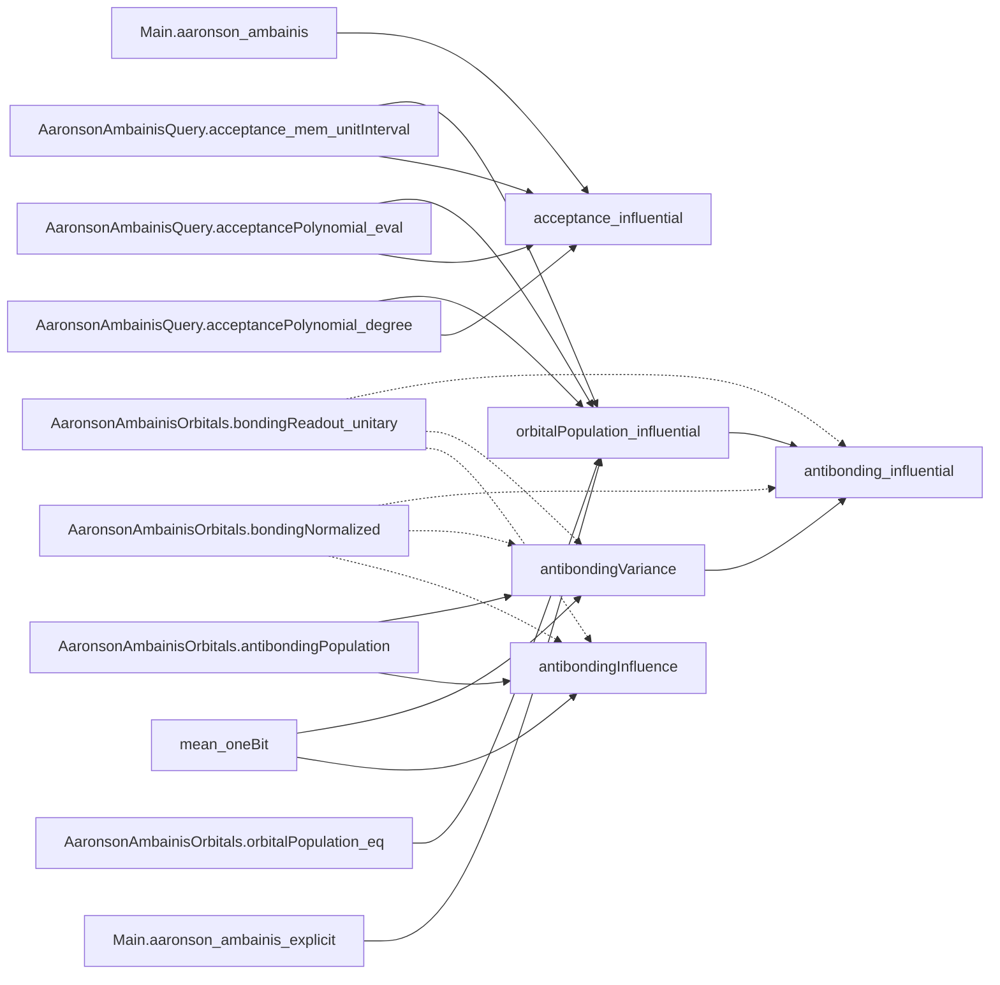

- [Main.aaronson_ambainis](https://github.com/physical-superintelligence/aaronson-ambainis/blob/2a6ceaef872ae993708950f951989134084b851a/AaronsonAmbainis/Main.lean#L33)
- [Main.aaronson_ambainis_explicit](https://github.com/physical-superintelligence/aaronson-ambainis/blob/2a6ceaef872ae993708950f951989134084b851a/AaronsonAmbainis/Main.lean#L38)
- [acceptance_influential](../../FQChem/Complexity/AaronsonAmbainis.lean#L36)
- [antibondingInfluence](../../FQChem/Complexity/AaronsonAmbainis.lean#L78)
- [antibondingVariance](../../FQChem/Complexity/AaronsonAmbainis.lean#L74)
- [antibonding_influential](../../FQChem/Complexity/AaronsonAmbainis.lean#L84)
- [mean_oneBit](../../FQChem/Complexity/AaronsonAmbainis.lean#L67) (private)
- [orbitalPopulation_influential](../../FQChem/Complexity/AaronsonAmbainis.lean#L51)
- [AaronsonAmbainisOrbitals.antibondingPopulation](../../FQChem/Complexity/AaronsonAmbainisOrbitals.lean#L106)
- [AaronsonAmbainisOrbitals.bondingNormalized](../../FQChem/Complexity/AaronsonAmbainisOrbitals.lean#L86)
- [AaronsonAmbainisOrbitals.bondingReadout_unitary](../../FQChem/Complexity/AaronsonAmbainisOrbitals.lean#L93)
- [AaronsonAmbainisOrbitals.orbitalPopulation_eq](../../FQChem/Complexity/AaronsonAmbainisOrbitals.lean#L74)
- [AaronsonAmbainisQuery.acceptancePolynomial_degree](../../FQChem/Complexity/AaronsonAmbainisQuery.lean#L173)
- [AaronsonAmbainisQuery.acceptancePolynomial_eval](../../FQChem/Complexity/AaronsonAmbainisQuery.lean#L164)
- [AaronsonAmbainisQuery.acceptance_mem_unitInterval](../../FQChem/Complexity/AaronsonAmbainisQuery.lean#L181)

## FQChem.Complexity.AaronsonAmbainisOrbitals

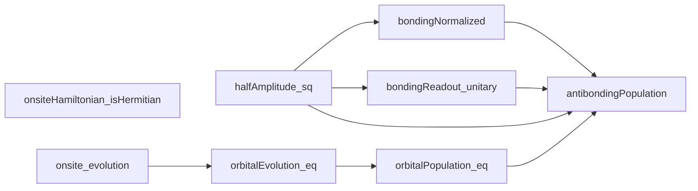

- [antibondingPopulation](../../FQChem/Complexity/AaronsonAmbainisOrbitals.lean#L106)
- [bondingNormalized](../../FQChem/Complexity/AaronsonAmbainisOrbitals.lean#L86)
- [bondingReadout_unitary](../../FQChem/Complexity/AaronsonAmbainisOrbitals.lean#L93)
- [halfAmplitude_sq](../../FQChem/Complexity/AaronsonAmbainisOrbitals.lean#L80) (private)
- [onsiteHamiltonian_isHermitian](../../FQChem/Complexity/AaronsonAmbainisOrbitals.lean#L37)
- [onsite_evolution](../../FQChem/Complexity/AaronsonAmbainisOrbitals.lean#L42)
- [orbitalEvolution_eq](../../FQChem/Complexity/AaronsonAmbainisOrbitals.lean#L61)
- [orbitalPopulation_eq](../../FQChem/Complexity/AaronsonAmbainisOrbitals.lean#L74)

## FQChem.Complexity.AaronsonAmbainisQuery

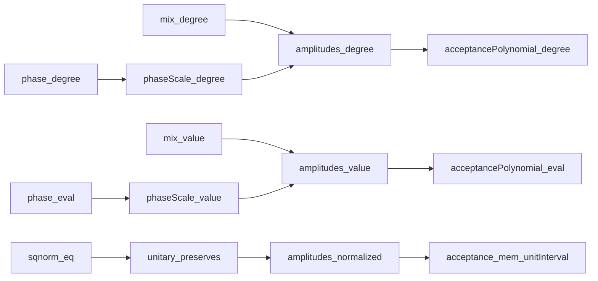

- [acceptancePolynomial_degree](../../FQChem/Complexity/AaronsonAmbainisQuery.lean#L173)
- [acceptancePolynomial_eval](../../FQChem/Complexity/AaronsonAmbainisQuery.lean#L164)
- [acceptance_mem_unitInterval](../../FQChem/Complexity/AaronsonAmbainisQuery.lean#L181)
- [amplitudes_degree](../../FQChem/Complexity/AaronsonAmbainisQuery.lean#L149) (private)
- [amplitudes_normalized](../../FQChem/Complexity/AaronsonAmbainisQuery.lean#L78)
- [amplitudes_value](../../FQChem/Complexity/AaronsonAmbainisQuery.lean#L142) (private)
- [mix_degree](../../FQChem/Complexity/AaronsonAmbainisQuery.lean#L128) (private)
- [mix_value](../../FQChem/Complexity/AaronsonAmbainisQuery.lean#L121) (private)
- [phaseScale_degree](../../FQChem/Complexity/AaronsonAmbainisQuery.lean#L109) (private)
- [phaseScale_value](../../FQChem/Complexity/AaronsonAmbainisQuery.lean#L104) (private)
- [phase_degree](../../FQChem/Complexity/AaronsonAmbainisQuery.lean#L46) (private)
- [phase_eval](../../FQChem/Complexity/AaronsonAmbainisQuery.lean#L40) (private)
- [sqnorm_eq](../../FQChem/Complexity/AaronsonAmbainisQuery.lean#L68) (private)
- [unitary_preserves](../../FQChem/Complexity/AaronsonAmbainisQuery.lean#L72) (private)

## FQChem.Complexity.ElectronicStructure

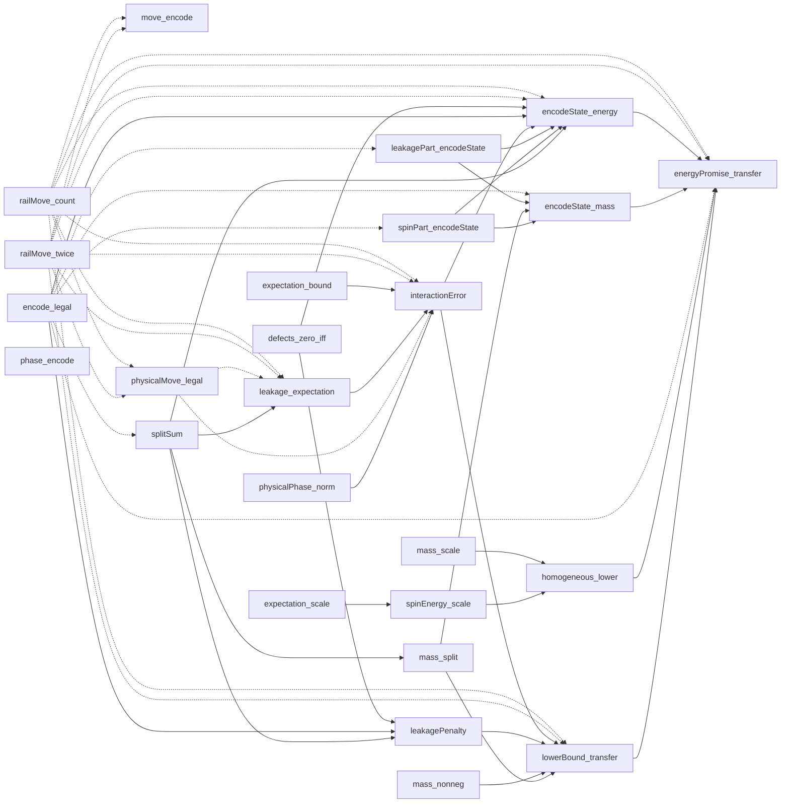

- [railMove_count](../../FQChem/Complexity/ElectronicStructure.lean#L110)
- [railMove_twice](../../FQChem/Complexity/ElectronicStructure.lean#L104)
- [defects_zero_iff](../../FQChem/Complexity/ElectronicStructure.lean#L81)
- [encodeState_energy](../../FQChem/Complexity/ElectronicStructure.lean#L252)
- [encodeState_mass](../../FQChem/Complexity/ElectronicStructure.lean#L248)
- [encode_legal](../../FQChem/Complexity/ElectronicStructure.lean#L58)
- [energyPromise_transfer](../../FQChem/Complexity/ElectronicStructure.lean#L319)
- [expectation_bound](../../FQChem/Complexity/ElectronicStructure.lean#L167) (private)
- [expectation_scale](../../FQChem/Complexity/ElectronicStructure.lean#L282) (private)
- [homogeneous_lower](../../FQChem/Complexity/ElectronicStructure.lean#L300) (private)
- [interactionError](../../FQChem/Complexity/ElectronicStructure.lean#L214)
- [leakagePart_encodeState](../../FQChem/Complexity/ElectronicStructure.lean#L243)
- [leakagePenalty](../../FQChem/Complexity/ElectronicStructure.lean#L225)
- [leakage_expectation](../../FQChem/Complexity/ElectronicStructure.lean#L209) (private)
- [lowerBound_transfer](../../FQChem/Complexity/ElectronicStructure.lean#L268)
- [mass_nonneg](../../FQChem/Complexity/ElectronicStructure.lean#L263) (private)
- [mass_scale](../../FQChem/Complexity/ElectronicStructure.lean#L278) (private)
- [mass_split](../../FQChem/Complexity/ElectronicStructure.lean#L193)
- [move_encode](../../FQChem/Complexity/ElectronicStructure.lean#L127)
- [phase_encode](../../FQChem/Complexity/ElectronicStructure.lean#L149)
- [physicalMove_legal](../../FQChem/Complexity/ElectronicStructure.lean#L130)
- [physicalPhase_norm](../../FQChem/Complexity/ElectronicStructure.lean#L152) (private)
- [spinEnergy_scale](../../FQChem/Complexity/ElectronicStructure.lean#L293) (private)
- [spinPart_encodeState](../../FQChem/Complexity/ElectronicStructure.lean#L238)
- [splitSum](../../FQChem/Complexity/ElectronicStructure.lean#L188) (private)

## FQChem.Complexity.ElectronicStructureOperators

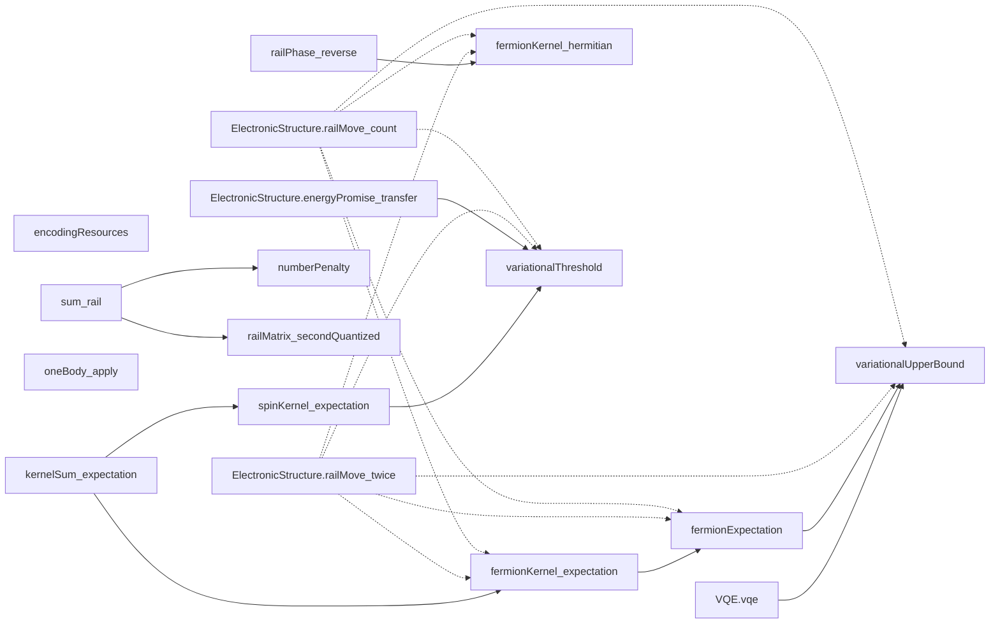

- [ElectronicStructure.railMove_count](../../FQChem/Complexity/ElectronicStructure.lean#L110)
- [ElectronicStructure.railMove_twice](../../FQChem/Complexity/ElectronicStructure.lean#L104)
- [ElectronicStructure.energyPromise_transfer](../../FQChem/Complexity/ElectronicStructure.lean#L319)
- [encodingResources](../../FQChem/Complexity/ElectronicStructureOperators.lean#L72)
- [fermionExpectation](../../FQChem/Complexity/ElectronicStructureOperators.lean#L167)
- [fermionKernel_expectation](../../FQChem/Complexity/ElectronicStructureOperators.lean#L150)
- [fermionKernel_hermitian](../../FQChem/Complexity/ElectronicStructureOperators.lean#L130)
- [kernelSum_expectation](../../FQChem/Complexity/ElectronicStructureOperators.lean#L90) (private)
- [numberPenalty](../../FQChem/Complexity/ElectronicStructureOperators.lean#L57)
- [oneBody_apply](../../FQChem/Complexity/ElectronicStructureOperators.lean#L31) (private)
- [railMatrix_secondQuantized](../../FQChem/Complexity/ElectronicStructureOperators.lean#L45)
- [railPhase_reverse](../../FQChem/Complexity/ElectronicStructureOperators.lean#L122) (private)
- [spinKernel_expectation](../../FQChem/Complexity/ElectronicStructureOperators.lean#L114)
- [sum_rail](../../FQChem/Complexity/ElectronicStructureOperators.lean#L37) (private)
- [variationalThreshold](../../FQChem/Complexity/ElectronicStructureOperators.lean#L190)
- [variationalUpperBound](../../FQChem/Complexity/ElectronicStructureOperators.lean#L180)
- [VQE.vqe](../../FQChem/StatePrep/VariationalOptimization/VQE.lean#L28)

## FQChem.Complexity.ElectronicStructurePauli

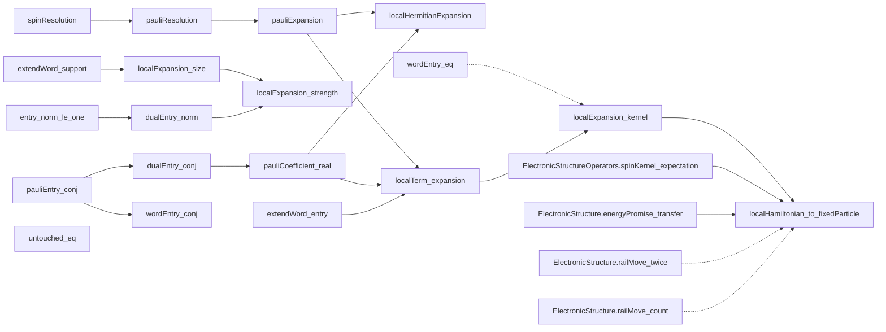

- [ElectronicStructure.railMove_count](../../FQChem/Complexity/ElectronicStructure.lean#L110)
- [ElectronicStructure.railMove_twice](../../FQChem/Complexity/ElectronicStructure.lean#L104)
- [ElectronicStructure.energyPromise_transfer](../../FQChem/Complexity/ElectronicStructure.lean#L319)
- [ElectronicStructureOperators.spinKernel_expectation](../../FQChem/Complexity/ElectronicStructureOperators.lean#L114)
- [dualEntry_conj](../../FQChem/Complexity/ElectronicStructurePauli.lean#L80) (private)
- [dualEntry_norm](../../FQChem/Complexity/ElectronicStructurePauli.lean#L222) (private)
- [entry_norm_le_one](../../FQChem/Complexity/ElectronicStructurePauli.lean#L219) (private)
- [extendWord_entry](../../FQChem/Complexity/ElectronicStructurePauli.lean#L126)
- [extendWord_support](../../FQChem/Complexity/ElectronicStructurePauli.lean#L139)
- [localExpansion_kernel](../../FQChem/Complexity/ElectronicStructurePauli.lean#L184)
- [localExpansion_size](../../FQChem/Complexity/ElectronicStructurePauli.lean#L198)
- [localExpansion_strength](../../FQChem/Complexity/ElectronicStructurePauli.lean#L232)
- [localHamiltonian_to_fixedParticle](../../FQChem/Complexity/ElectronicStructurePauli.lean#L209)
- [localHermitianExpansion](../../FQChem/Complexity/ElectronicStructurePauli.lean#L97)
- [localTerm_expansion](../../FQChem/Complexity/ElectronicStructurePauli.lean#L175) (private)
- [pauliCoefficient_real](../../FQChem/Complexity/ElectronicStructurePauli.lean#L84)
- [pauliEntry_conj](../../FQChem/Complexity/ElectronicStructurePauli.lean#L29) (private)
- [pauliExpansion](../../FQChem/Complexity/ElectronicStructurePauli.lean#L67)
- [pauliResolution](../../FQChem/Complexity/ElectronicStructurePauli.lean#L54)
- [spinResolution](../../FQChem/Complexity/ElectronicStructurePauli.lean#L33) (private)
- [untouched_eq](../../FQChem/Complexity/ElectronicStructurePauli.lean#L114)
- [wordEntry_conj](../../FQChem/Complexity/ElectronicStructurePauli.lean#L48) (private)
- [wordEntry_eq](../../FQChem/Complexity/ElectronicStructurePauli.lean#L42)

## FQChem.Complexity.FactoringBitCost

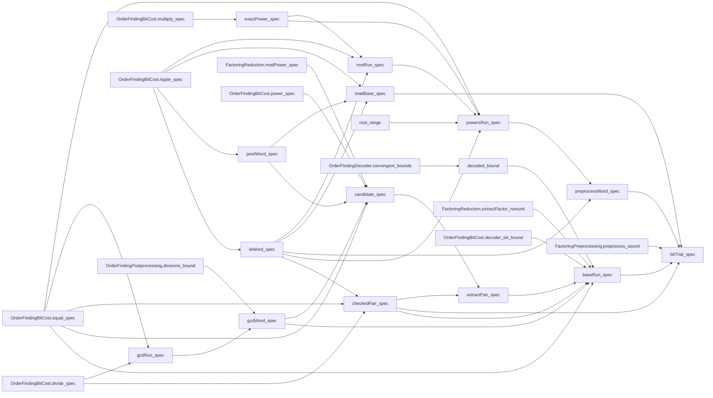

- [baseRun_spec](../../FQChem/Complexity/FactoringBitCost.lean#L381)
- [bitTrial_spec](../../FQChem/Complexity/FactoringBitCost.lean#L434)
- [candidate_spec](../../FQChem/Complexity/FactoringBitCost.lean#L286)
- [checkedPair_spec](../../FQChem/Complexity/FactoringBitCost.lean#L250)
- [decoded_bound](../../FQChem/Complexity/FactoringBitCost.lean#L357)
- [exactPower_spec](../../FQChem/Complexity/FactoringBitCost.lean#L97)
- [extractPair_spec](../../FQChem/Complexity/FactoringBitCost.lean#L315)
- [gcdRun_spec](../../FQChem/Complexity/FactoringBitCost.lean#L56) (private)
- [gcdWord_spec](../../FQChem/Complexity/FactoringBitCost.lean#L80)
- [leWord_spec](../../FQChem/Complexity/FactoringBitCost.lean#L25)
- [powersRun_spec](../../FQChem/Complexity/FactoringBitCost.lean#L174)
- [predWord_spec](../../FQChem/Complexity/FactoringBitCost.lean#L38)
- [preprocessWord_spec](../../FQChem/Complexity/FactoringBitCost.lean#L213)
- [readBase_spec](../../FQChem/Complexity/FactoringBitCost.lean#L341)
- [rootRun_spec](../../FQChem/Complexity/FactoringBitCost.lean#L132)
- [root_range](../../FQChem/Complexity/FactoringBitCost.lean#L112) (private)
- [FactoringPreprocessing.preprocess_sound](../../FQChem/Complexity/FactoringPreprocessing.lean#L103)
- [FactoringReduction.extractFactor_nonunit](../../FQChem/Complexity/FactoringReduction.lean#L349)
- [FactoringReduction.modPower_spec](../../FQChem/Complexity/FactoringReduction.lean#L52)
- [OrderFindingBitCost.decoder_bit_bound](../../FQChem/Complexity/OrderFindingBitCost.lean#L441)
- [OrderFindingBitCost.divide_spec](../../FQChem/Complexity/OrderFindingBitCost.lean#L161)
- [OrderFindingBitCost.equal_spec](../../FQChem/Complexity/OrderFindingBitCost.lean#L208)
- [OrderFindingBitCost.multiply_spec](../../FQChem/Complexity/OrderFindingBitCost.lean#L115)
- [OrderFindingBitCost.power_spec](../../FQChem/Complexity/OrderFindingBitCost.lean#L317)
- [OrderFindingBitCost.ripple_spec](../../FQChem/Complexity/OrderFindingBitCost.lean#L51)
- [OrderFindingDecoder.convergent_bounds](../../FQChem/Complexity/OrderFindingDecoder.lean#L62)
- [OrderFindingPostprocessing.divisions_bound](../../FQChem/Complexity/OrderFindingPostprocessing.lean#L32)

## FQChem.Complexity.FactoringPreprocessing

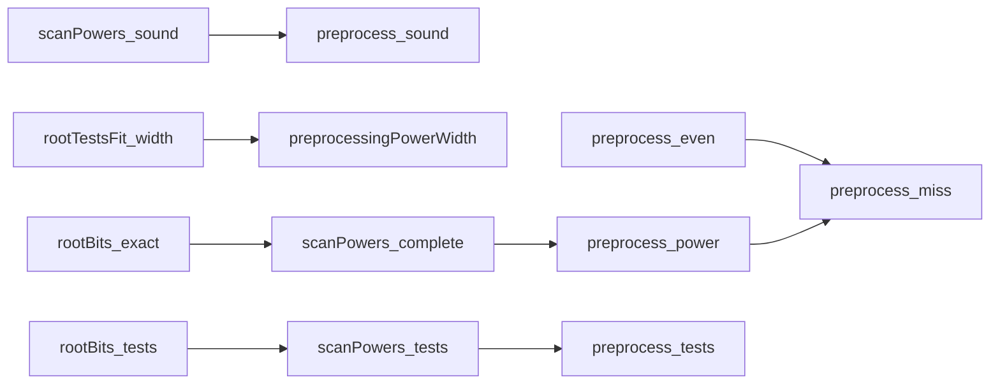

- [preprocess_even](../../FQChem/Complexity/FactoringPreprocessing.lean#L112)
- [preprocess_miss](../../FQChem/Complexity/FactoringPreprocessing.lean#L139)
- [preprocess_power](../../FQChem/Complexity/FactoringPreprocessing.lean#L115)
- [preprocess_sound](../../FQChem/Complexity/FactoringPreprocessing.lean#L103)
- [preprocess_tests](../../FQChem/Complexity/FactoringPreprocessing.lean#L130)
- [preprocessingPowerWidth](../../FQChem/Complexity/FactoringPreprocessing.lean#L183)
- [rootBits_exact](../../FQChem/Complexity/FactoringPreprocessing.lean#L34) (private)
- [rootBits_tests](../../FQChem/Complexity/FactoringPreprocessing.lean#L29)
- [rootTestsFit_width](../../FQChem/Complexity/FactoringPreprocessing.lean#L168) (private)
- [scanPowers_complete](../../FQChem/Complexity/FactoringPreprocessing.lean#L70) (private)
- [scanPowers_sound](../../FQChem/Complexity/FactoringPreprocessing.lean#L56) (private)
- [scanPowers_tests](../../FQChem/Complexity/FactoringPreprocessing.lean#L88) (private)

## FQChem.Complexity.FactoringRecursion

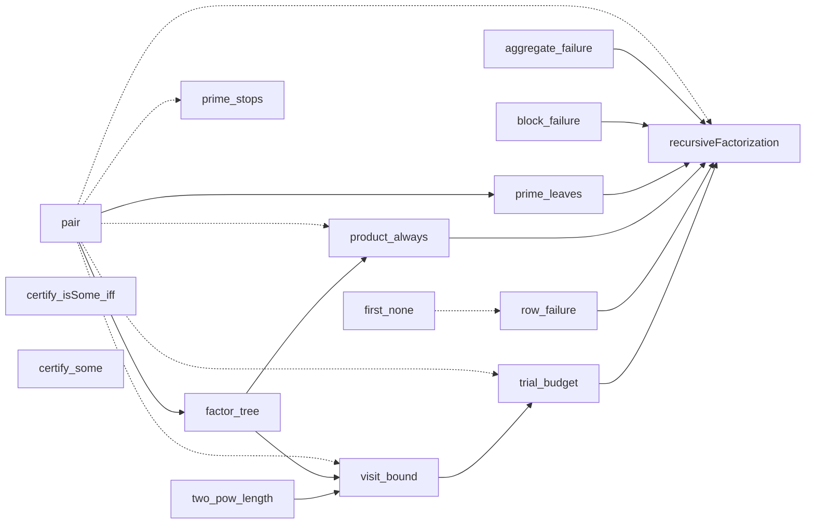

- [pair](../../FQChem/Complexity/FactoringRecursion.lean#L41)
- [aggregate_failure](../../FQChem/Complexity/FactoringRecursion.lean#L231) (private)
- [block_failure](../../FQChem/Complexity/FactoringRecursion.lean#L216)
- [certify_isSome_iff](../../FQChem/Complexity/FactoringRecursion.lean#L187)
- [certify_some](../../FQChem/Complexity/FactoringRecursion.lean#L36)
- [factor_tree](../../FQChem/Complexity/FactoringRecursion.lean#L104)
- [first_none](../../FQChem/Complexity/FactoringRecursion.lean#L58)
- [prime_leaves](../../FQChem/Complexity/FactoringRecursion.lean#L148)
- [prime_stops](../../FQChem/Complexity/FactoringRecursion.lean#L89)
- [product_always](../../FQChem/Complexity/FactoringRecursion.lean#L123)
- [recursiveFactorization](../../FQChem/Complexity/FactoringRecursion.lean#L246)
- [row_failure](../../FQChem/Complexity/FactoringRecursion.lean#L204)
- [trial_budget](../../FQChem/Complexity/FactoringRecursion.lean#L182)
- [two_pow_length](../../FQChem/Complexity/FactoringRecursion.lean#L129) (private)
- [visit_bound](../../FQChem/Complexity/FactoringRecursion.lean#L136)

## FQChem.Complexity.FactoringReduction

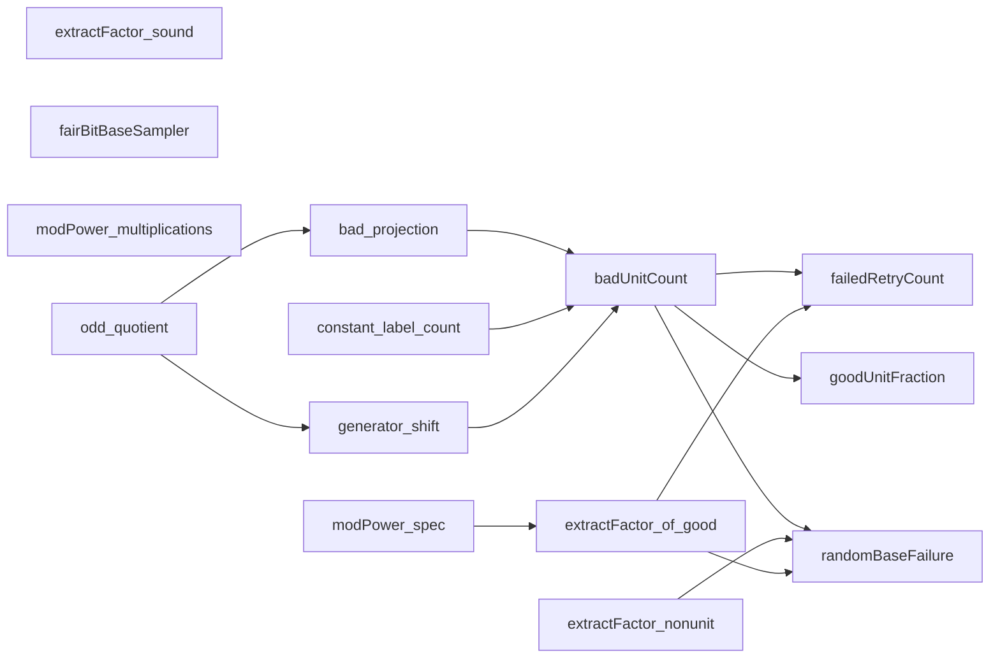

- [badUnitCount](../../FQChem/Complexity/FactoringReduction.lean#L197)
- [bad_projection](../../FQChem/Complexity/FactoringReduction.lean#L162) (private)
- [constant_label_count](../../FQChem/Complexity/FactoringReduction.lean#L125) (private)
- [extractFactor_nonunit](../../FQChem/Complexity/FactoringReduction.lean#L349)
- [extractFactor_of_good](../../FQChem/Complexity/FactoringReduction.lean#L273)
- [extractFactor_sound](../../FQChem/Complexity/FactoringReduction.lean#L74)
- [failedRetryCount](../../FQChem/Complexity/FactoringReduction.lean#L327)
- [fairBitBaseSampler](../../FQChem/Complexity/FactoringReduction.lean#L401)
- [generator_shift](../../FQChem/Complexity/FactoringReduction.lean#L99) (private)
- [goodUnitFraction](../../FQChem/Complexity/FactoringReduction.lean#L244)
- [modPower_multiplications](../../FQChem/Complexity/FactoringReduction.lean#L37)
- [modPower_spec](../../FQChem/Complexity/FactoringReduction.lean#L52)
- [odd_quotient](../../FQChem/Complexity/FactoringReduction.lean#L88) (private)
- [randomBaseFailure](../../FQChem/Complexity/FactoringReduction.lean#L359)

## FQChem.Complexity.FastForwarding

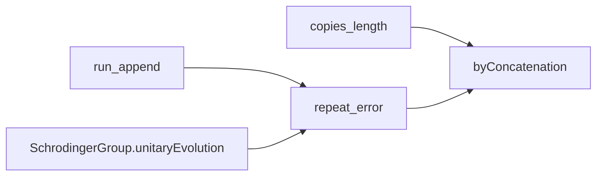

- [byConcatenation](../../FQChem/Complexity/FastForwarding.lean#L81)
- [copies_length](../../FQChem/Complexity/FastForwarding.lean#L37)
- [repeat_error](../../FQChem/Complexity/FastForwarding.lean#L58)
- [run_append](../../FQChem/Complexity/FastForwarding.lean#L42) (private)
- [SchrodingerGroup.unitaryEvolution](../../FQChem/Dynamics/RealTimePropagation/SchrodingerGroup.lean#L41)

## FQChem.Complexity.GroundStateSearch

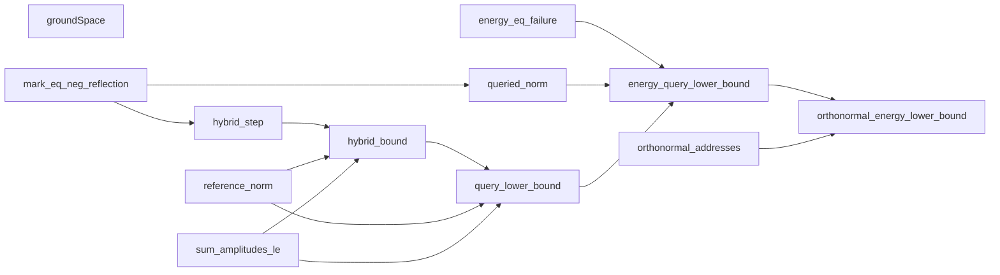

- [energy_eq_failure](../../FQChem/Complexity/GroundStateSearch.lean#L35)
- [energy_query_lower_bound](../../FQChem/Complexity/GroundStateSearch.lean#L141)
- [groundSpace](../../FQChem/Complexity/GroundStateSearch.lean#L30)
- [hybrid_bound](../../FQChem/Complexity/GroundStateSearch.lean#L103)
- [hybrid_step](../../FQChem/Complexity/GroundStateSearch.lean#L69) (private)
- [mark_eq_neg_reflection](../../FQChem/Complexity/GroundStateSearch.lean#L44) (private)
- [orthonormal_addresses](../../FQChem/Complexity/GroundStateSearch.lean#L86)
- [orthonormal_energy_lower_bound](../../FQChem/Complexity/GroundStateSearch.lean#L154)
- [queried_norm](../../FQChem/Complexity/GroundStateSearch.lean#L64)
- [query_lower_bound](../../FQChem/Complexity/GroundStateSearch.lean#L116)
- [reference_norm](../../FQChem/Complexity/GroundStateSearch.lean#L59)
- [sum_amplitudes_le](../../FQChem/Complexity/GroundStateSearch.lean#L92) (private)

## FQChem.Complexity.LocalHamiltonianVerification

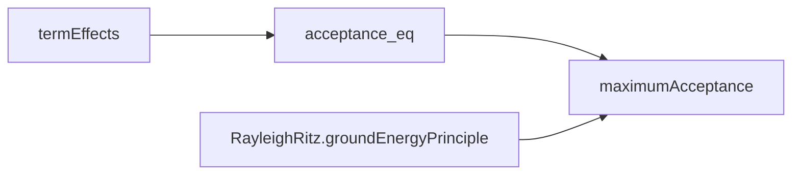

- [acceptance_eq](../../FQChem/Complexity/LocalHamiltonianVerification.lean#L43)
- [maximumAcceptance](../../FQChem/Complexity/LocalHamiltonianVerification.lean#L66)
- [termEffects](../../FQChem/Complexity/LocalHamiltonianVerification.lean#L31)
- [RayleighRitz.groundEnergyPrinciple](../../FQChem/StatePrep/VariationalOptimization/RayleighRitz.lean#L59)

## FQChem.Complexity.ModularInverse

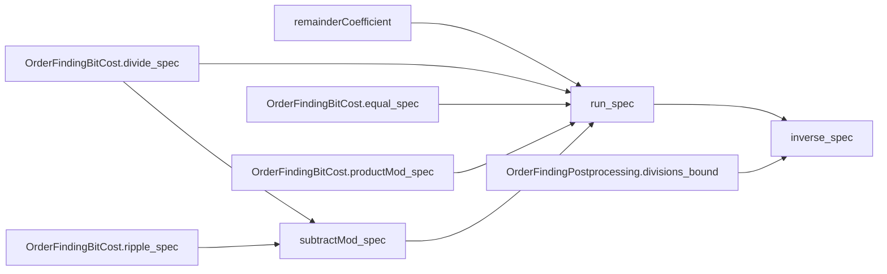

- [inverse_spec](../../FQChem/Complexity/ModularInverse.lean#L102)
- [remainderCoefficient](../../FQChem/Complexity/ModularInverse.lean#L55) (private)
- [run_spec](../../FQChem/Complexity/ModularInverse.lean#L65) (private)
- [subtractMod_spec](../../FQChem/Complexity/ModularInverse.lean#L25)
- [OrderFindingBitCost.divide_spec](../../FQChem/Complexity/OrderFindingBitCost.lean#L161)
- [OrderFindingBitCost.equal_spec](../../FQChem/Complexity/OrderFindingBitCost.lean#L208)
- [OrderFindingBitCost.productMod_spec](../../FQChem/Complexity/OrderFindingBitCost.lean#L294)
- [OrderFindingBitCost.ripple_spec](../../FQChem/Complexity/OrderFindingBitCost.lean#L51)
- [OrderFindingPostprocessing.divisions_bound](../../FQChem/Complexity/OrderFindingPostprocessing.lean#L32)

## FQChem.Complexity.OrbitalSimulation

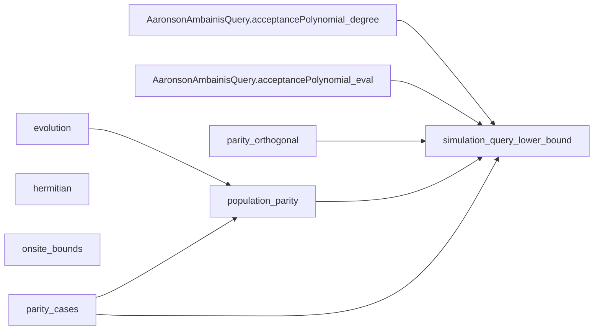

- [AaronsonAmbainisQuery.acceptancePolynomial_degree](../../FQChem/Complexity/AaronsonAmbainisQuery.lean#L173)
- [AaronsonAmbainisQuery.acceptancePolynomial_eval](../../FQChem/Complexity/AaronsonAmbainisQuery.lean#L164)
- [evolution](../../FQChem/Complexity/OrbitalSimulation.lean#L77)
- [hermitian](../../FQChem/Complexity/OrbitalSimulation.lean#L71)
- [onsite_bounds](../../FQChem/Complexity/OrbitalSimulation.lean#L57)
- [parity_cases](../../FQChem/Complexity/OrbitalSimulation.lean#L29) (private)
- [parity_orthogonal](../../FQChem/Complexity/OrbitalSimulation.lean#L35)
- [population_parity](../../FQChem/Complexity/OrbitalSimulation.lean#L101)
- [simulation_query_lower_bound](../../FQChem/Complexity/OrbitalSimulation.lean#L113)

## FQChem.Complexity.OrderFindingBitCost

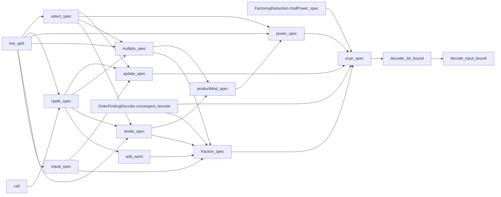

- [FactoringReduction.modPower_spec](../../FQChem/Complexity/FactoringReduction.lean#L52)
- [add_word](../../FQChem/Complexity/OrderFindingBitCost.lean#L249) (private)
- [cell](../../FQChem/Complexity/OrderFindingBitCost.lean#L44) (private)
- [decode_input_bound](../../FQChem/Complexity/OrderFindingBitCost.lean#L459)
- [decoder_bit_bound](../../FQChem/Complexity/OrderFindingBitCost.lean#L441)
- [divide_spec](../../FQChem/Complexity/OrderFindingBitCost.lean#L161)
- [equal_spec](../../FQChem/Complexity/OrderFindingBitCost.lean#L208)
- [fraction_spec](../../FQChem/Complexity/OrderFindingBitCost.lean#L255)
- [low_split](../../FQChem/Complexity/OrderFindingBitCost.lean#L20) (private)
- [multiply_spec](../../FQChem/Complexity/OrderFindingBitCost.lean#L115)
- [power_spec](../../FQChem/Complexity/OrderFindingBitCost.lean#L317)
- [productMod_spec](../../FQChem/Complexity/OrderFindingBitCost.lean#L294)
- [ripple_spec](../../FQChem/Complexity/OrderFindingBitCost.lean#L51)
- [scan_spec](../../FQChem/Complexity/OrderFindingBitCost.lean#L400) (private)
- [select_spec](../../FQChem/Complexity/OrderFindingBitCost.lean#L93) (private)
- [update_spec](../../FQChem/Complexity/OrderFindingBitCost.lean#L355)
- [OrderFindingDecoder.convergent_bounds](../../FQChem/Complexity/OrderFindingDecoder.lean#L62)

## FQChem.Complexity.OrderFindingDecoder

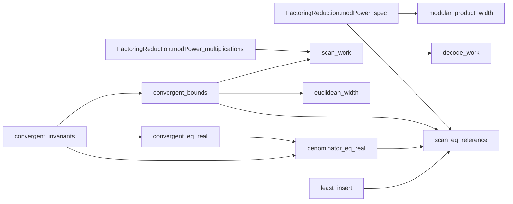

- [FactoringReduction.modPower_multiplications](../../FQChem/Complexity/FactoringReduction.lean#L37)
- [FactoringReduction.modPower_spec](../../FQChem/Complexity/FactoringReduction.lean#L52)
- [convergent_bounds](../../FQChem/Complexity/OrderFindingDecoder.lean#L62)
- [convergent_eq_real](../../FQChem/Complexity/OrderFindingDecoder.lean#L70)
- [convergent_invariants](../../FQChem/Complexity/OrderFindingDecoder.lean#L36) (private)
- [decode_work](../../FQChem/Complexity/OrderFindingDecoder.lean#L180)
- [denominator_eq_real](../../FQChem/Complexity/OrderFindingDecoder.lean#L90)
- [euclidean_width](../../FQChem/Complexity/OrderFindingDecoder.lean#L199)
- [least_insert](../../FQChem/Complexity/OrderFindingDecoder.lean#L128)
- [modular_product_width](../../FQChem/Complexity/OrderFindingDecoder.lean#L216)
- [scan_eq_reference](../../FQChem/Complexity/OrderFindingDecoder.lean#L140)
- [scan_work](../../FQChem/Complexity/OrderFindingDecoder.lean#L163)

## FQChem.Complexity.OrderFindingPostprocessing

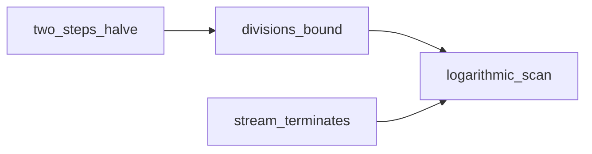

- [divisions_bound](../../FQChem/Complexity/OrderFindingPostprocessing.lean#L32)
- [logarithmic_scan](../../FQChem/Complexity/OrderFindingPostprocessing.lean#L73)
- [stream_terminates](../../FQChem/Complexity/OrderFindingPostprocessing.lean#L56) (private)
- [two_steps_halve](../../FQChem/Complexity/OrderFindingPostprocessing.lean#L23) (private)

## FQChem.Complexity.SearchOptimality

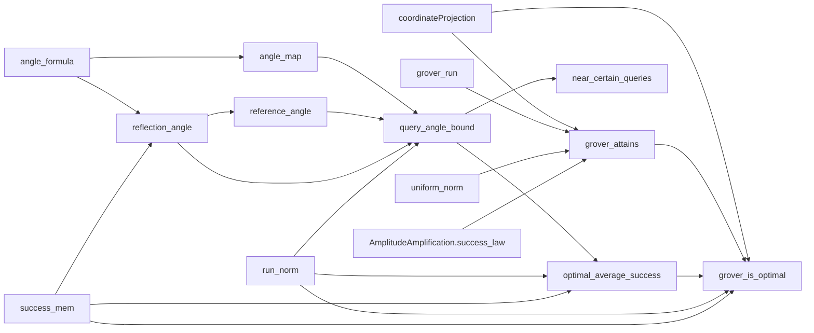

- [angle_formula](../../FQChem/Complexity/SearchOptimality.lean#L52) (private)
- [angle_map](../../FQChem/Complexity/SearchOptimality.lean#L65) (private)
- [coordinateProjection](../../FQChem/Complexity/SearchOptimality.lean#L200) (private)
- [grover_attains](../../FQChem/Complexity/SearchOptimality.lean#L242)
- [grover_is_optimal](../../FQChem/Complexity/SearchOptimality.lean#L295)
- [grover_run](../../FQChem/Complexity/SearchOptimality.lean#L225) (private)
- [near_certain_queries](../../FQChem/Complexity/SearchOptimality.lean#L319)
- [optimal_average_success](../../FQChem/Complexity/SearchOptimality.lean#L181)
- [query_angle_bound](../../FQChem/Complexity/SearchOptimality.lean#L132)
- [reference_angle](../../FQChem/Complexity/SearchOptimality.lean#L109) (private)
- [reflection_angle](../../FQChem/Complexity/SearchOptimality.lean#L80) (private)
- [run_norm](../../FQChem/Complexity/SearchOptimality.lean#L125) (private)
- [success_mem](../../FQChem/Complexity/SearchOptimality.lean#L71) (private)
- [uniform_norm](../../FQChem/Complexity/SearchOptimality.lean#L216) (private)
- [AmplitudeAmplification.success_law](../../FQChem/StatePrep/CircuitPreparation/AmplitudeAmplification.lean#L110)

## FQChem.Complexity.SparseNoFastForwarding

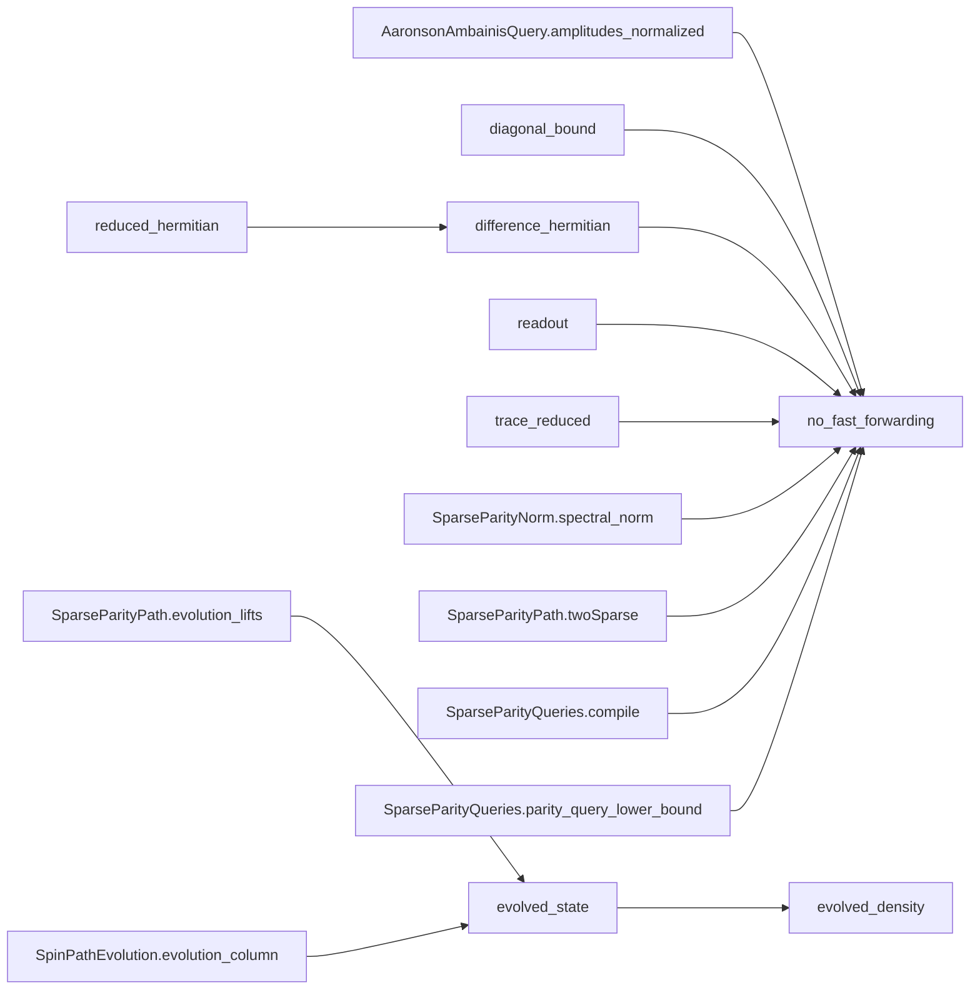

- [AaronsonAmbainisQuery.amplitudes_normalized](../../FQChem/Complexity/AaronsonAmbainisQuery.lean#L78)
- [diagonal_bound](../../FQChem/Complexity/SparseNoFastForwarding.lean#L30) (private)
- [difference_hermitian](../../FQChem/Complexity/SparseNoFastForwarding.lean#L106)
- [evolved_density](../../FQChem/Complexity/SparseNoFastForwarding.lean#L96)
- [evolved_state](../../FQChem/Complexity/SparseNoFastForwarding.lean#L73)
- [no_fast_forwarding](../../FQChem/Complexity/SparseNoFastForwarding.lean#L119)
- [readout](../../FQChem/Complexity/SparseNoFastForwarding.lean#L111) (private)
- [reduced_hermitian](../../FQChem/Complexity/SparseNoFastForwarding.lean#L64) (private)
- [trace_reduced](../../FQChem/Complexity/SparseNoFastForwarding.lean#L68) (private)
- [SparseParityNorm.spectral_norm](../../FQChem/Complexity/SparseParityNorm.lean#L81)
- [SparseParityPath.evolution_lifts](../../FQChem/Complexity/SparseParityPath.lean#L131)
- [SparseParityPath.twoSparse](../../FQChem/Complexity/SparseParityPath.lean#L74)
- [SparseParityQueries.compile](../../FQChem/Complexity/SparseParityQueries.lean#L130)
- [SparseParityQueries.parity_query_lower_bound](../../FQChem/Complexity/SparseParityQueries.lean#L229)
- [SpinPathEvolution.evolution_column](../../FQChem/Complexity/SpinPathEvolution.lean#L177)

## FQChem.Complexity.SparseParityNorm

```mermaid
flowchart LR
  n225["eigen"]
  n226["eigenvalue_bound"]
  n227["positive_entries"]
  n228["row_mass"]
  n229["spectral_norm"]
  n230["w_pos"]
  n231["SparseParityPath.crossed_eq_lift"]
  n234["SparseParityPath.hermitian"]
  n254["SpinPathEvolution.binomial_eigenvector"]
  n231 --> n225
  n254 --> n225
  n228 --> n226
  n230 --> n226
  n225 --> n228
  n227 --> n228
  n225 --> n229
  n226 --> n229
  n230 --> n229
  n234 --> n229
```

- [eigen](../../FQChem/Complexity/SparseParityNorm.lean#L28) (private)
- [eigenvalue_bound](../../FQChem/Complexity/SparseParityNorm.lean#L55) (private)
- [positive_entries](../../FQChem/Complexity/SparseParityNorm.lean#L43) (private)
- [row_mass](../../FQChem/Complexity/SparseParityNorm.lean#L48) (private)
- [spectral_norm](../../FQChem/Complexity/SparseParityNorm.lean#L81)
- [w_pos](../../FQChem/Complexity/SparseParityNorm.lean#L25) (private)
- [SparseParityPath.crossed_eq_lift](../../FQChem/Complexity/SparseParityPath.lean#L116)
- [SparseParityPath.hermitian](../../FQChem/Complexity/SparseParityPath.lean#L49)
- [SpinPathEvolution.binomial_eigenvector](../../FQChem/Complexity/SpinPathEvolution.lean#L108)

## FQChem.Complexity.SparseParityPath

```mermaid
flowchart LR
  n231["crossed_eq_lift"]
  n232["endpoint_amplitude"]
  n233["evolution_lifts"]
  n234["hermitian"]
  n235["lift_entry"]
  n236["row_from_adjacent_bits"]
  n237["twoSparse"]
  n233 --> n232
  n235 --> n232
  n231 --> n233
```

- [crossed_eq_lift](../../FQChem/Complexity/SparseParityPath.lean#L116)
- [endpoint_amplitude](../../FQChem/Complexity/SparseParityPath.lean#L151)
- [evolution_lifts](../../FQChem/Complexity/SparseParityPath.lean#L131)
- [hermitian](../../FQChem/Complexity/SparseParityPath.lean#L49)
- [lift_entry](../../FQChem/Complexity/SparseParityPath.lean#L109) (private)
- [row_from_adjacent_bits](../../FQChem/Complexity/SparseParityPath.lean#L61)
- [twoSparse](../../FQChem/Complexity/SparseParityPath.lean#L74)

## FQChem.Complexity.SparseParityQueries

```mermaid
flowchart LR
  n20["AaronsonAmbainisQuery.amplitudes_normalized"]
  n172["OrbitalSimulation.population_parity"]
  n173["OrbitalSimulation.simulation_query_lower_bound"]
  n232["SparseParityPath.endpoint_amplitude"]
  n238["apply_gate"]
  n239["basis_unitary"]
  n240["coherent_lookup"]
  n241["compile"]
  n242["endpoint_query_lower_bound"]
  n243["parity_eq"]
  n244["parity_query_lower_bound"]
  n245["response_decodes"]
  n246["row_character"]
  n247["sign_prefixParity"]
  n248["unitary_product"]
  n249["walsh_adjoint"]
  n250["walsh_lookup"]
  n251["walsh_square"]
  n252["xor_character"]
  n253["xor_step"]
  n258["SpinPathEvolution.perfect_transfer"]
  n20 --> n238
  n248 --> n238
  n249 --> n239
  n251 --> n239
  n250 --> n240
  n246 --> n241
  n232 --> n242
  n244 --> n242
  n258 --> n242
  n247 --> n243
  n172 --> n244
  n173 --> n244
  n241 --> n244
  n243 --> n244
  n238 --> n253
  n239 --> n253
  n240 --> n253
  n248 --> n253
```

- [AaronsonAmbainisQuery.amplitudes_normalized](../../FQChem/Complexity/AaronsonAmbainisQuery.lean#L78)
- [OrbitalSimulation.population_parity](../../FQChem/Complexity/OrbitalSimulation.lean#L101)
- [OrbitalSimulation.simulation_query_lower_bound](../../FQChem/Complexity/OrbitalSimulation.lean#L113)
- [SparseParityPath.endpoint_amplitude](../../FQChem/Complexity/SparseParityPath.lean#L151)
- [apply_gate](../../FQChem/Complexity/SparseParityQueries.lean#L149) (private)
- [basis_unitary](../../FQChem/Complexity/SparseParityQueries.lean#L174) (private)
- [coherent_lookup](../../FQChem/Complexity/SparseParityQueries.lean#L179) (private)
- [compile](../../FQChem/Complexity/SparseParityQueries.lean#L130)
- [endpoint_query_lower_bound](../../FQChem/Complexity/SparseParityQueries.lean#L245)
- [parity_eq](../../FQChem/Complexity/SparseParityQueries.lean#L222) (private)
- [parity_query_lower_bound](../../FQChem/Complexity/SparseParityQueries.lean#L229)
- [response_decodes](../../FQChem/Complexity/SparseParityQueries.lean#L63)
- [row_character](../../FQChem/Complexity/SparseParityQueries.lean#L104)
- [sign_prefixParity](../../FQChem/Complexity/SparseParityQueries.lean#L213) (private)
- [unitary_product](../../FQChem/Complexity/SparseParityQueries.lean#L144) (private)
- [walsh_adjoint](../../FQChem/Complexity/SparseParityQueries.lean#L83) (private)
- [walsh_lookup](../../FQChem/Complexity/SparseParityQueries.lean#L96)
- [walsh_square](../../FQChem/Complexity/SparseParityQueries.lean#L88) (private)
- [xor_character](../../FQChem/Complexity/SparseParityQueries.lean#L46)
- [xor_step](../../FQChem/Complexity/SparseParityQueries.lean#L189)
- [SpinPathEvolution.perfect_transfer](../../FQChem/Complexity/SpinPathEvolution.lean#L197)

## FQChem.Complexity.SpinPathEvolution

```mermaid
flowchart LR
  n254["binomial_eigenvector"]
  n255["couplings"]
  n256["evolution_column"]
  n257["exp_column"]
  n258["perfect_transfer"]
  n259["row_action"]
  n260["state_deriv"]
  n261["state_zero"]
  n262["transfer_amplitude"]
  n259 --> n254
  n257 --> n256
  n260 --> n256
  n261 --> n256
  n262 --> n258
  n255 --> n259
  n259 --> n260
  n256 --> n262
```

- [binomial_eigenvector](../../FQChem/Complexity/SpinPathEvolution.lean#L108)
- [couplings](../../FQChem/Complexity/SpinPathEvolution.lean#L28) (private)
- [evolution_column](../../FQChem/Complexity/SpinPathEvolution.lean#L177)
- [exp_column](../../FQChem/Complexity/SpinPathEvolution.lean#L144) (private)
- [perfect_transfer](../../FQChem/Complexity/SpinPathEvolution.lean#L197)
- [row_action](../../FQChem/Complexity/SpinPathEvolution.lean#L55) (private)
- [state_deriv](../../FQChem/Complexity/SpinPathEvolution.lean#L120) (private)
- [state_zero](../../FQChem/Complexity/SpinPathEvolution.lean#L168) (private)
- [transfer_amplitude](../../FQChem/Complexity/SpinPathEvolution.lean#L190)

## FQChem.Dynamics.DigitalAlgorithms.CommutingTerms

```mermaid
flowchart LR
  n263["commutingProductFormula"]
```

- [commutingProductFormula](../../FQChem/Dynamics/DigitalAlgorithms/CommutingTerms.lean#L18)

## FQChem.Dynamics.DigitalAlgorithms.LieTrotter

```mermaid
flowchart LR
  n264["exp_norm_bound"]
  n265["globalStepError"]
  n266["lieTrotter"]
  n267["power_defect"]
  n267 --> n265
  n264 --> n266
  n267 --> n266
```

- [exp_norm_bound](../../FQChem/Dynamics/DigitalAlgorithms/LieTrotter.lean#L62) (private)
- [globalStepError](../../FQChem/Dynamics/DigitalAlgorithms/LieTrotter.lean#L55)
- [lieTrotter](../../FQChem/Dynamics/DigitalAlgorithms/LieTrotter.lean#L73)
- [power_defect](../../FQChem/Dynamics/DigitalAlgorithms/LieTrotter.lean#L36) (private)

## FQChem.Dynamics.DigitalAlgorithms.LinearCombinationOfUnitaries

```mermaid
flowchart LR
  n268["blockEncodes"]
  n269["circuit_unitary"]
  n270["postselectionWeight"]
  n271["referenceBlock"]
  n272["select_prepare"]
  n273["select_unitary"]
  n271 --> n268
  n273 --> n269
  n268 --> n270
  n272 --> n271
```

- [blockEncodes](../../FQChem/Dynamics/DigitalAlgorithms/LinearCombinationOfUnitaries.lean#L69)
- [circuit_unitary](../../FQChem/Dynamics/DigitalAlgorithms/LinearCombinationOfUnitaries.lean#L40)
- [postselectionWeight](../../FQChem/Dynamics/DigitalAlgorithms/LinearCombinationOfUnitaries.lean#L81)
- [referenceBlock](../../FQChem/Dynamics/DigitalAlgorithms/LinearCombinationOfUnitaries.lean#L55)
- [select_prepare](../../FQChem/Dynamics/DigitalAlgorithms/LinearCombinationOfUnitaries.lean#L47) (private)
- [select_unitary](../../FQChem/Dynamics/DigitalAlgorithms/LinearCombinationOfUnitaries.lean#L30)

## FQChem.Dynamics.DigitalAlgorithms.Qubitization

```mermaid
flowchart LR
  n274["block_recurrence"]
  n275["chebyshev_block"]
  n276["eigenphase_cosine"]
  n277["eigenvalue_abs_le_one"]
  n278["eigenvector_amplitude"]
  n279["involution_inner"]
  n280["proj_reflection"]
  n281["quadratic_simulation_bound"]
  n282["reflection_sq"]
  n283["simulation_error"]
  n284["walk_preserves_inner"]
  n280 --> n274
  n282 --> n274
  n274 --> n275
  n280 --> n275
  n277 --> n276
  n278 --> n276
  n279 --> n277
  n275 --> n278
  n277 --> n281
  n278 --> n281
  n278 --> n283
  n279 --> n284
  n282 --> n284
```

- [block_recurrence](../../FQChem/Dynamics/DigitalAlgorithms/Qubitization.lean#L74) (private)
- [chebyshev_block](../../FQChem/Dynamics/DigitalAlgorithms/Qubitization.lean#L100)
- [eigenphase_cosine](../../FQChem/Dynamics/DigitalAlgorithms/Qubitization.lean#L150)
- [eigenvalue_abs_le_one](../../FQChem/Dynamics/DigitalAlgorithms/Qubitization.lean#L135)
- [eigenvector_amplitude](../../FQChem/Dynamics/DigitalAlgorithms/Qubitization.lean#L115)
- [involution_inner](../../FQChem/Dynamics/DigitalAlgorithms/Qubitization.lean#L62) (private)
- [proj_reflection](../../FQChem/Dynamics/DigitalAlgorithms/Qubitization.lean#L59) (private)
- [quadratic_simulation_bound](../../FQChem/Dynamics/DigitalAlgorithms/Qubitization.lean#L169)
- [reflection_sq](../../FQChem/Dynamics/DigitalAlgorithms/Qubitization.lean#L55) (private)
- [simulation_error](../../FQChem/Dynamics/DigitalAlgorithms/Qubitization.lean#L125)
- [walk_preserves_inner](../../FQChem/Dynamics/DigitalAlgorithms/Qubitization.lean#L67)

## FQChem.Dynamics.DigitalAlgorithms.TruncatedTaylor

```mermaid
flowchart LR
  n285["generator_norm"]
  n286["power_error"]
  n287["realTime_segment"]
  n288["realTime_segmented"]
  n289["realTime_state_error"]
  n290["segment_error"]
  n291["segment_tendsto"]
  n285 --> n287
  n290 --> n287
  n286 --> n288
  n287 --> n288
  n288 --> n289
```

- [generator_norm](../../FQChem/Dynamics/DigitalAlgorithms/TruncatedTaylor.lean#L104) (private)
- [power_error](../../FQChem/Dynamics/DigitalAlgorithms/TruncatedTaylor.lean#L74) (private)
- [realTime_segment](../../FQChem/Dynamics/DigitalAlgorithms/TruncatedTaylor.lean#L109)
- [realTime_segmented](../../FQChem/Dynamics/DigitalAlgorithms/TruncatedTaylor.lean#L116)
- [realTime_state_error](../../FQChem/Dynamics/DigitalAlgorithms/TruncatedTaylor.lean#L140)
- [segment_error](../../FQChem/Dynamics/DigitalAlgorithms/TruncatedTaylor.lean#L41)
- [segment_tendsto](../../FQChem/Dynamics/DigitalAlgorithms/TruncatedTaylor.lean#L70)

## FQChem.Dynamics.LearnedSurrogates

```mermaid
flowchart LR
  n292["invariantDirectionalForce"]
```

- [invariantDirectionalForce](../../FQChem/Dynamics/LearnedSurrogates.lean#L28)

## FQChem.Dynamics.OpenSystems.Kraus

```mermaid
flowchart LR
  n293["completePositivity"]
  n294["complexLinearity"]
  n295["jointDensityPreservation"]
  n296["lifted_operation"]
  n297["tracePreservation"]
  n296 --> n293
  n293 --> n295
  n297 --> n295
```

- [completePositivity](../../FQChem/Dynamics/OpenSystems/Kraus.lean#L74)
- [complexLinearity](../../FQChem/Dynamics/OpenSystems/Kraus.lean#L69)
- [jointDensityPreservation](../../FQChem/Dynamics/OpenSystems/Kraus.lean#L86)
- [lifted_operation](../../FQChem/Dynamics/OpenSystems/Kraus.lean#L59) (private)
- [tracePreservation](../../FQChem/Dynamics/OpenSystems/Kraus.lean#L79)

## FQChem.Dynamics.OpenSystems.TracePreservation

```mermaid
flowchart LR
  n298["krausTrace"]
  n299["lindbladTrace"]
```

- [krausTrace](../../FQChem/Dynamics/OpenSystems/TracePreservation.lean#L37)
- [lindbladTrace](../../FQChem/Dynamics/OpenSystems/TracePreservation.lean#L30)

## FQChem.Dynamics.RealTimePropagation.BornOppenheimer

```mermaid
flowchart LR
  n300["bornOppenheimerEnergy"]
```

- [bornOppenheimerEnergy](../../FQChem/Dynamics/RealTimePropagation/BornOppenheimer.lean#L27)

## FQChem.Dynamics.RealTimePropagation.ClusterExpansions

```mermaid
flowchart LR
  n301["linkedClusterInversion"]
```

- [linkedClusterInversion](../../FQChem/Dynamics/RealTimePropagation/ClusterExpansions.lean#L20)

## FQChem.Dynamics.RealTimePropagation.HeisenbergPicture

```mermaid
flowchart LR
  n302["pauliRotation"]
  n303["pictureDuality"]
```

- [pauliRotation](../../FQChem/Dynamics/RealTimePropagation/HeisenbergPicture.lean#L38)
- [pictureDuality](../../FQChem/Dynamics/RealTimePropagation/HeisenbergPicture.lean#L33)

## FQChem.Dynamics.RealTimePropagation.KrylovPropagation

```mermaid
flowchart LR
  n304["krylovExact"]
  n305["krylovMoment"]
```

- [krylovExact](../../FQChem/Dynamics/RealTimePropagation/KrylovPropagation.lean#L34)
- [krylovMoment](../../FQChem/Dynamics/RealTimePropagation/KrylovPropagation.lean#L42)

## FQChem.Dynamics.RealTimePropagation.OutOfTimeOrder

```mermaid
flowchart LR
  n79["ElectronicStructurePauli.pauliCoefficient_real"]
  n81["ElectronicStructurePauli.pauliExpansion"]
  n86["ElectronicStructurePauli.wordEntry_eq"]
  n306["butterflyMass"]
  n307["discardedWeightError"]
  n308["dualEntry_trace"]
  n309["expansion"]
  n310["firstOrder_eq_anticommutingMass"]
  n311["invariantTails"]
  n312["swapTrace"]
  n313["traceCoefficient"]
  n314["traceExpansion"]
  n315["twoCopyReadout"]
  n316["zConjugation"]
  n79 --> n306
  n309 --> n306
  n314 --> n306
  n310 --> n307
  n81 --> n309
  n79 --> n310
  n306 --> n310
  n309 --> n310
  n314 --> n310
  n316 --> n310
  n308 --> n313
  n313 --> n314
  n312 --> n315
  n86 --> n316
```

- [ElectronicStructurePauli.pauliCoefficient_real](../../FQChem/Complexity/ElectronicStructurePauli.lean#L84)
- [ElectronicStructurePauli.pauliExpansion](../../FQChem/Complexity/ElectronicStructurePauli.lean#L67)
- [ElectronicStructurePauli.wordEntry_eq](../../FQChem/Complexity/ElectronicStructurePauli.lean#L42)
- [butterflyMass](../../FQChem/Dynamics/RealTimePropagation/OutOfTimeOrder.lean#L81)
- [discardedWeightError](../../FQChem/Dynamics/RealTimePropagation/OutOfTimeOrder.lean#L119)
- [dualEntry_trace](../../FQChem/Dynamics/RealTimePropagation/OutOfTimeOrder.lean#L38) (private)
- [expansion](../../FQChem/Dynamics/RealTimePropagation/OutOfTimeOrder.lean#L51) (private)
- [firstOrder_eq_anticommutingMass](../../FQChem/Dynamics/RealTimePropagation/OutOfTimeOrder.lean#L93)
- [invariantTails](../../FQChem/Dynamics/RealTimePropagation/OutOfTimeOrder.lean#L156)
- [swapTrace](../../FQChem/Dynamics/RealTimePropagation/OutOfTimeOrder.lean#L142)
- [traceCoefficient](../../FQChem/Dynamics/RealTimePropagation/OutOfTimeOrder.lean#L45)
- [traceExpansion](../../FQChem/Dynamics/RealTimePropagation/OutOfTimeOrder.lean#L73) (private)
- [twoCopyReadout](../../FQChem/Dynamics/RealTimePropagation/OutOfTimeOrder.lean#L148)
- [zConjugation](../../FQChem/Dynamics/RealTimePropagation/OutOfTimeOrder.lean#L59)

## FQChem.Dynamics.RealTimePropagation.PathSampling

```mermaid
flowchart LR
  n317["realTimeReweighting"]
```

- [realTimeReweighting](../../FQChem/Dynamics/RealTimePropagation/PathSampling.lean#L22)

## FQChem.Dynamics.RealTimePropagation.RingPolymer

```mermaid
flowchart LR
  n318["ringPolymerSpringForce"]
```

- [ringPolymerSpringForce](../../FQChem/Dynamics/RealTimePropagation/RingPolymer.lean#L26)

## FQChem.Dynamics.RealTimePropagation.SchrodingerGroup

```mermaid
flowchart LR
  n319["unitaryEvolution"]
```

- [unitaryEvolution](../../FQChem/Dynamics/RealTimePropagation/SchrodingerGroup.lean#L41)

## FQChem.Dynamics.RealTimePropagation.SplitOperator

```mermaid
flowchart LR
  n320["splitOperator"]
```

- [splitOperator](../../FQChem/Dynamics/RealTimePropagation/SplitOperator.lean#L26)

## FQChem.Dynamics.RealTimePropagation.TimeDependentCI

```mermaid
flowchart LR
  n321["tdConfigurationInteraction"]
```

- [tdConfigurationInteraction](../../FQChem/Dynamics/RealTimePropagation/TimeDependentCI.lean#L28)

## FQChem.Dynamics.RealTimePropagation.VariationalEvolution

```mermaid
flowchart LR
  n322["mcLachlanProjection"]
  n323["sampledTangentMetric"]
```

- [mcLachlanProjection](../../FQChem/Dynamics/RealTimePropagation/VariationalEvolution.lean#L56)
- [sampledTangentMetric](../../FQChem/Dynamics/RealTimePropagation/VariationalEvolution.lean#L38)

## FQChem.Multiscale.ChoosingLayers.ClassicalEnvironments

```mermaid
flowchart LR
  n324["layeredForce"]
```

- [layeredForce](../../FQChem/Multiscale/ChoosingLayers/ClassicalEnvironments.lean#L26)

## FQChem.Multiscale.ChoosingLayers.Fragments

```mermaid
flowchart LR
  n325["pairReconstruction"]
```

- [pairReconstruction](../../FQChem/Multiscale/ChoosingLayers/Fragments.lean#L27)

## FQChem.Multiscale.ChoosingLayers.FrozenMolecularDensity

```mermaid
flowchart LR
  n326["frozenMolecularEnergy"]
  n330["QuantumEnvironments.frozenSearch"]
  n632["CoulombIntegrability.coulombConstrainedSearch"]
  n330 --> n326
  n632 --> n326
```

- [frozenMolecularEnergy](../../FQChem/Multiscale/ChoosingLayers/FrozenMolecularDensity.lean#L15)
- [QuantumEnvironments.frozenSearch](../../FQChem/Multiscale/ChoosingLayers/QuantumEnvironments.lean#L41)
- [CoulombIntegrability.coulombConstrainedSearch](../../FQChem/StatePrep/VariationalOptimization/DensityFunctionals/CoulombIntegrability.lean#L88)

## FQChem.Multiscale.ChoosingLayers.LearnedEnvironments

```mermaid
flowchart LR
  n327["deltaLearningGap"]
```

- [deltaLearningGap](../../FQChem/Multiscale/ChoosingLayers/LearnedEnvironments.lean#L23)

## FQChem.Multiscale.ChoosingLayers.Partitions

```mermaid
flowchart LR
  n328["overlapAccounting"]
```

- [overlapAccounting](../../FQChem/Multiscale/ChoosingLayers/Partitions.lean#L36)

## FQChem.Multiscale.ChoosingLayers.QuantumEnvironments

```mermaid
flowchart LR
  n329["frozenDensityDerivative"]
  n330["frozenSearch"]
```

- [frozenDensityDerivative](../../FQChem/Multiscale/ChoosingLayers/QuantumEnvironments.lean#L37)
- [frozenSearch](../../FQChem/Multiscale/ChoosingLayers/QuantumEnvironments.lean#L41)

## FQChem.Multiscale.StitchingSolutions.EmbeddedSolvers

```mermaid
flowchart LR
  n331["feshbachReduction"]
```

- [feshbachReduction](../../FQChem/Multiscale/StitchingSolutions/EmbeddedSolvers.lean#L30)

## FQChem.Multiscale.StitchingSolutions.ErrorPropagation

```mermaid
flowchart LR
  n332["barrierRateError"]
```

- [barrierRateError](../../FQChem/Multiscale/StitchingSolutions/ErrorPropagation.lean#L23)

## FQChem.Multiscale.StitchingSolutions.LayeredQM

```mermaid
flowchart LR
  n300["BornOppenheimer.bornOppenheimerEnergy"]
  n324["ClassicalEnvironments.layeredForce"]
  n333["layeredBornOppenheimerEnergy"]
  n334["layeredEigenForce"]
  n335["layeredProjectionError"]
  n336["layeredProjectionLimit"]
  n337["projectedLayeredEnergy_eq"]
  n378["HellmannFeynman.hellmannFeynman"]
  n523["GroundStateProjection.energyBound"]
  n524["GroundStateProjection.energyLimit"]
  n300 --> n333
  n334 --> n333
  n324 --> n334
  n378 --> n334
  n337 --> n335
  n523 --> n335
  n337 --> n336
  n524 --> n336
```

- [BornOppenheimer.bornOppenheimerEnergy](../../FQChem/Dynamics/RealTimePropagation/BornOppenheimer.lean#L27)
- [ClassicalEnvironments.layeredForce](../../FQChem/Multiscale/ChoosingLayers/ClassicalEnvironments.lean#L26)
- [layeredBornOppenheimerEnergy](../../FQChem/Multiscale/StitchingSolutions/LayeredQM.lean#L73)
- [layeredEigenForce](../../FQChem/Multiscale/StitchingSolutions/LayeredQM.lean#L61)
- [layeredProjectionError](../../FQChem/Multiscale/StitchingSolutions/LayeredQM.lean#L34)
- [layeredProjectionLimit](../../FQChem/Multiscale/StitchingSolutions/LayeredQM.lean#L44)
- [projectedLayeredEnergy_eq](../../FQChem/Multiscale/StitchingSolutions/LayeredQM.lean#L26)
- [HellmannFeynman.hellmannFeynman](../../FQChem/Properties/ResponseAndEstimation/HellmannFeynman.lean#L39)
- [GroundStateProjection.energyBound](../../FQChem/StatePrep/ImaginaryTimeProjection/GroundStateProjection.lean#L139)
- [GroundStateProjection.energyLimit](../../FQChem/StatePrep/ImaginaryTimeProjection/GroundStateProjection.lean#L150)

## FQChem.Multiscale.StitchingSolutions.Observables

```mermaid
flowchart LR
  n338["zwanzig"]
```

- [zwanzig](../../FQChem/Multiscale/StitchingSolutions/Observables.lean#L33)

## FQChem.Properties.LinearSystems.DirichletPoisson

```mermaid
flowchart LR
  n339["dirichletPoissonMode"]
```

- [dirichletPoissonMode](../../FQChem/Properties/LinearSystems/DirichletPoisson.lean#L20)

## FQChem.Properties.LinearSystems.HHL

```mermaid
flowchart LR
  n340["hhlSpectralInversion"]
```

- [hhlSpectralInversion](../../FQChem/Properties/LinearSystems/HHL.lean#L18)

## FQChem.Properties.MeasurementTheory

```mermaid
flowchart LR
  n341["bornCompleteness"]
  n342["projectiveRepeatability"]
  n343["unsharpQubit"]
```

- [bornCompleteness](../../FQChem/Properties/MeasurementTheory.lean#L69)
- [projectiveRepeatability](../../FQChem/Properties/MeasurementTheory.lean#L78)
- [unsharpQubit](../../FQChem/Properties/MeasurementTheory.lean#L96)

## FQChem.Properties.PhaseEstimation

```mermaid
flowchart LR
  n344["exactGridQPE"]
```

- [exactGridQPE](../../FQChem/Properties/PhaseEstimation.lean#L17)

## FQChem.Properties.ResponseAndEstimation.AdaptivePauliPrediction

```mermaid
flowchart LR
  n345["alternativeNonneg"]
  n346["bornHard"]
  n347["bornSum"]
  n348["copyLowerBound"]
  n349["leafError"]
  n350["leafNormalization"]
  n351["massRatio"]
  n352["mixtureLower"]
  n353["nullIndependent"]
  n354["nullNonnegative"]
  n355["pathPositive"]
  n356["productLoss"]
  n357["randomizedCopyLowerBound"]
  n358["signMixture"]
  n383["PauliPrediction.nonidentityCount"]
  n384["PauliPrediction.nonidentitySecondMoment"]
  n390["PauliPrediction.responseAbs"]
  n351 --> n345
  n354 --> n345
  n355 --> n345
  n390 --> n345
  n349 --> n348
  n350 --> n348
  n354 --> n348
  n355 --> n348
  n383 --> n348
  n384 --> n348
  n345 --> n349
  n352 --> n349
  n353 --> n349
  n354 --> n349
  n347 --> n350
  n346 --> n351
  n355 --> n351
  n351 --> n352
  n354 --> n352
  n355 --> n352
  n358 --> n352
  n390 --> n352
  n346 --> n354
  n355 --> n354
  n348 --> n357
  n356 --> n358
```

- [alternativeNonneg](../../FQChem/Properties/ResponseAndEstimation/AdaptivePauliPrediction.lean#L171) (private)
- [bornHard](../../FQChem/Properties/ResponseAndEstimation/AdaptivePauliPrediction.lean#L73) (private)
- [bornSum](../../FQChem/Properties/ResponseAndEstimation/AdaptivePauliPrediction.lean#L54) (private)
- [copyLowerBound](../../FQChem/Properties/ResponseAndEstimation/AdaptivePauliPrediction.lean#L201)
- [leafError](../../FQChem/Properties/ResponseAndEstimation/AdaptivePauliPrediction.lean#L181) (private)
- [leafNormalization](../../FQChem/Properties/ResponseAndEstimation/AdaptivePauliPrediction.lean#L59)
- [massRatio](../../FQChem/Properties/ResponseAndEstimation/AdaptivePauliPrediction.lean#L90) (private)
- [mixtureLower](../../FQChem/Properties/ResponseAndEstimation/AdaptivePauliPrediction.lean#L148) (private)
- [nullIndependent](../../FQChem/Properties/ResponseAndEstimation/AdaptivePauliPrediction.lean#L104) (private)
- [nullNonnegative](../../FQChem/Properties/ResponseAndEstimation/AdaptivePauliPrediction.lean#L96) (private)
- [pathPositive](../../FQChem/Properties/ResponseAndEstimation/AdaptivePauliPrediction.lean#L42) (private)
- [productLoss](../../FQChem/Properties/ResponseAndEstimation/AdaptivePauliPrediction.lean#L108) (private)
- [randomizedCopyLowerBound](../../FQChem/Properties/ResponseAndEstimation/AdaptivePauliPrediction.lean#L240)
- [signMixture](../../FQChem/Properties/ResponseAndEstimation/AdaptivePauliPrediction.lean#L122) (private)
- [PauliPrediction.nonidentityCount](../../FQChem/Properties/ResponseAndEstimation/PauliPrediction.lean#L103)
- [PauliPrediction.nonidentitySecondMoment](../../FQChem/Properties/ResponseAndEstimation/PauliPrediction.lean#L115)
- [PauliPrediction.responseAbs](../../FQChem/Properties/ResponseAndEstimation/PauliPrediction.lean#L132)

## FQChem.Properties.ResponseAndEstimation.BellConfidence

```mermaid
flowchart LR
  n86["ElectronicStructurePauli.wordEntry_eq"]
  n359["clipped_error"]
  n360["hiddenMagnitude"]
  n361["meanFailure"]
  n362["predictMagnitude"]
  n363["projector_gram"]
  n364["score_mean"]
  n365["score_sign"]
  n366["selectHiddenWord"]
  n367["traceDifferent"]
  n368["weight_nonneg"]
  n369["weight_sum"]
  n371["BellSampling.magnitudeSquaredPauliExpectation"]
  n372["BellSampling.squaredPauliExpectation"]
  n379["PauliPrediction.hardStatePositive"]
  n380["PauliPrediction.hardStateTrace"]
  n381["PauliPrediction.hardStateTracePairing"]
  n388["PauliPrediction.pauliTrace"]
  n367 --> n360
  n379 -.-> n360
  n380 -.-> n360
  n381 --> n360
  n388 --> n360
  n364 --> n361
  n365 --> n361
  n368 -.-> n361
  n369 -.-> n361
  n359 --> n362
  n361 --> n362
  n368 -.-> n362
  n369 -.-> n362
  n365 --> n364
  n368 --> n364
  n369 -.-> n364
  n371 --> n364
  n360 --> n366
  n361 --> n366
  n368 -.-> n366
  n369 -.-> n366
  n379 -.-> n366
  n380 -.-> n366
  n363 --> n368
  n86 --> n369
  n372 --> n369
```

- [ElectronicStructurePauli.wordEntry_eq](../../FQChem/Complexity/ElectronicStructurePauli.lean#L42)
- [clipped_error](../../FQChem/Properties/ResponseAndEstimation/BellConfidence.lean#L162) (private)
- [hiddenMagnitude](../../FQChem/Properties/ResponseAndEstimation/BellConfidence.lean#L223)
- [meanFailure](../../FQChem/Properties/ResponseAndEstimation/BellConfidence.lean#L110)
- [predictMagnitude](../../FQChem/Properties/ResponseAndEstimation/BellConfidence.lean#L178)
- [projector_gram](../../FQChem/Properties/ResponseAndEstimation/BellConfidence.lean#L36) (private)
- [score_mean](../../FQChem/Properties/ResponseAndEstimation/BellConfidence.lean#L89)
- [score_sign](../../FQChem/Properties/ResponseAndEstimation/BellConfidence.lean#L78) (private)
- [selectHiddenWord](../../FQChem/Properties/ResponseAndEstimation/BellConfidence.lean#L241)
- [traceDifferent](../../FQChem/Properties/ResponseAndEstimation/BellConfidence.lean#L200) (private)
- [weight_nonneg](../../FQChem/Properties/ResponseAndEstimation/BellConfidence.lean#L43)
- [weight_sum](../../FQChem/Properties/ResponseAndEstimation/BellConfidence.lean#L62)
- [BellSampling.magnitudeSquaredPauliExpectation](../../FQChem/Properties/ResponseAndEstimation/BellSampling.lean#L88)
- [BellSampling.squaredPauliExpectation](../../FQChem/Properties/ResponseAndEstimation/BellSampling.lean#L56)
- [PauliPrediction.hardStatePositive](../../FQChem/Properties/ResponseAndEstimation/PauliPrediction.lean#L171)
- [PauliPrediction.hardStateTrace](../../FQChem/Properties/ResponseAndEstimation/PauliPrediction.lean#L158)
- [PauliPrediction.hardStateTracePairing](../../FQChem/Properties/ResponseAndEstimation/PauliPrediction.lean#L164)
- [PauliPrediction.pauliTrace](../../FQChem/Properties/ResponseAndEstimation/PauliPrediction.lean#L57)

## FQChem.Properties.ResponseAndEstimation.BellSampling

```mermaid
flowchart LR
  n85["ElectronicStructurePauli.wordEntry_conj"]
  n370["bellResolution"]
  n371["magnitudeSquaredPauliExpectation"]
  n372["squaredPauliExpectation"]
  n85 --> n371
  n372 --> n371
  n370 --> n372
```

- [ElectronicStructurePauli.wordEntry_conj](../../FQChem/Complexity/ElectronicStructurePauli.lean#L48) (private)
- [bellResolution](../../FQChem/Properties/ResponseAndEstimation/BellSampling.lean#L41)
- [magnitudeSquaredPauliExpectation](../../FQChem/Properties/ResponseAndEstimation/BellSampling.lean#L88)
- [squaredPauliExpectation](../../FQChem/Properties/ResponseAndEstimation/BellSampling.lean#L56)

## FQChem.Properties.ResponseAndEstimation.ClassicalShadows

```mermaid
flowchart LR
  n373["projector_sum"]
  n374["secondMoment"]
  n375["signed_projector_sum"]
  n376["unbiased"]
  n377["weighted_sum"]
  n373 --> n374
  n377 --> n374
  n375 --> n376
  n377 --> n376
```

- [projector_sum](../../FQChem/Properties/ResponseAndEstimation/ClassicalShadows.lean#L33) (private)
- [secondMoment](../../FQChem/Properties/ResponseAndEstimation/ClassicalShadows.lean#L91)
- [signed_projector_sum](../../FQChem/Properties/ResponseAndEstimation/ClassicalShadows.lean#L38) (private)
- [unbiased](../../FQChem/Properties/ResponseAndEstimation/ClassicalShadows.lean#L71)
- [weighted_sum](../../FQChem/Properties/ResponseAndEstimation/ClassicalShadows.lean#L56) (private)

## FQChem.Properties.ResponseAndEstimation.HellmannFeynman

```mermaid
flowchart LR
  n378["hellmannFeynman"]
```

- [hellmannFeynman](../../FQChem/Properties/ResponseAndEstimation/HellmannFeynman.lean#L39)

## FQChem.Properties.ResponseAndEstimation.PauliPrediction

```mermaid
flowchart LR
  n79["ElectronicStructurePauli.pauliCoefficient_real"]
  n81["ElectronicStructurePauli.pauliExpansion"]
  n86["ElectronicStructurePauli.wordEntry_eq"]
  n313["OutOfTimeOrder.traceCoefficient"]
  n379["hardStatePositive"]
  n380["hardStateTrace"]
  n381["hardStateTracePairing"]
  n382["identityMatrix"]
  n383["nonidentityCount"]
  n384["nonidentitySecondMoment"]
  n385["parseval"]
  n386["pauliHermitian"]
  n387["pauliSquare"]
  n388["pauliTrace"]
  n389["purityBound"]
  n390["responseAbs"]
  n386 --> n379
  n387 --> n379
  n388 --> n380
  n387 --> n381
  n388 --> n381
  n86 --> n382
  n382 --> n384
  n385 --> n384
  n389 --> n384
  n79 --> n385
  n81 --> n385
  n313 --> n385
  n386 --> n390
  n387 --> n390
```

- [ElectronicStructurePauli.pauliCoefficient_real](../../FQChem/Complexity/ElectronicStructurePauli.lean#L84)
- [ElectronicStructurePauli.pauliExpansion](../../FQChem/Complexity/ElectronicStructurePauli.lean#L67)
- [ElectronicStructurePauli.wordEntry_eq](../../FQChem/Complexity/ElectronicStructurePauli.lean#L42)
- [OutOfTimeOrder.traceCoefficient](../../FQChem/Dynamics/RealTimePropagation/OutOfTimeOrder.lean#L45)
- [hardStatePositive](../../FQChem/Properties/ResponseAndEstimation/PauliPrediction.lean#L171)
- [hardStateTrace](../../FQChem/Properties/ResponseAndEstimation/PauliPrediction.lean#L158)
- [hardStateTracePairing](../../FQChem/Properties/ResponseAndEstimation/PauliPrediction.lean#L164)
- [identityMatrix](../../FQChem/Properties/ResponseAndEstimation/PauliPrediction.lean#L32)
- [nonidentityCount](../../FQChem/Properties/ResponseAndEstimation/PauliPrediction.lean#L103)
- [nonidentitySecondMoment](../../FQChem/Properties/ResponseAndEstimation/PauliPrediction.lean#L115)
- [parseval](../../FQChem/Properties/ResponseAndEstimation/PauliPrediction.lean#L79) (private)
- [pauliHermitian](../../FQChem/Properties/ResponseAndEstimation/PauliPrediction.lean#L38)
- [pauliSquare](../../FQChem/Properties/ResponseAndEstimation/PauliPrediction.lean#L45)
- [pauliTrace](../../FQChem/Properties/ResponseAndEstimation/PauliPrediction.lean#L57)
- [purityBound](../../FQChem/Properties/ResponseAndEstimation/PauliPrediction.lean#L66) (private)
- [responseAbs](../../FQChem/Properties/ResponseAndEstimation/PauliPrediction.lean#L132)

## FQChem.Properties.ResponseAndEstimation.QuantumMemorySeparation

```mermaid
flowchart LR
  n357["AdaptivePauliPrediction.randomizedCopyLowerBound"]
  n360["BellConfidence.hiddenMagnitude"]
  n362["BellConfidence.predictMagnitude"]
  n368["BellConfidence.weight_nonneg"]
  n369["BellConfidence.weight_sum"]
  n379["PauliPrediction.hardStatePositive"]
  n380["PauliPrediction.hardStateTrace"]
  n391["separation"]
  n357 --> n391
  n360 --> n391
  n362 --> n391
  n368 -.-> n391
  n369 -.-> n391
  n379 -.-> n391
  n380 -.-> n391
```

- [AdaptivePauliPrediction.randomizedCopyLowerBound](../../FQChem/Properties/ResponseAndEstimation/AdaptivePauliPrediction.lean#L240)
- [BellConfidence.hiddenMagnitude](../../FQChem/Properties/ResponseAndEstimation/BellConfidence.lean#L223)
- [BellConfidence.predictMagnitude](../../FQChem/Properties/ResponseAndEstimation/BellConfidence.lean#L178)
- [BellConfidence.weight_nonneg](../../FQChem/Properties/ResponseAndEstimation/BellConfidence.lean#L43)
- [BellConfidence.weight_sum](../../FQChem/Properties/ResponseAndEstimation/BellConfidence.lean#L62)
- [PauliPrediction.hardStatePositive](../../FQChem/Properties/ResponseAndEstimation/PauliPrediction.lean#L171)
- [PauliPrediction.hardStateTrace](../../FQChem/Properties/ResponseAndEstimation/PauliPrediction.lean#L158)
- [separation](../../FQChem/Properties/ResponseAndEstimation/QuantumMemorySeparation.lean#L30)

## FQChem.Properties.ResponseAndEstimation.ShadowConfidence

```mermaid
flowchart LR
  n392["blockFailure"]
  n393["blocks_pos"]
  n394["confidence"]
  n395["medianFailure"]
  n396["medianWitness"]
  n397["productDraw"]
  n398["simultaneousConfidence"]
  n396 --> n395
  n392 --> n398
  n393 --> n398
  n394 --> n398
  n395 --> n398
```

- [blockFailure](../../FQChem/Properties/ResponseAndEstimation/ShadowConfidence.lean#L68) (private)
- [blocks_pos](../../FQChem/Properties/ResponseAndEstimation/ShadowConfidence.lean#L174)
- [confidence](../../FQChem/Properties/ResponseAndEstimation/ShadowConfidence.lean#L181) (private)
- [medianFailure](../../FQChem/Properties/ResponseAndEstimation/ShadowConfidence.lean#L133) (private)
- [medianWitness](../../FQChem/Properties/ResponseAndEstimation/ShadowConfidence.lean#L106) (private)
- [productDraw](../../FQChem/Properties/ResponseAndEstimation/ShadowConfidence.lean#L39)
- [simultaneousConfidence](../../FQChem/Properties/ResponseAndEstimation/ShadowConfidence.lean#L197)

## FQChem.Properties.ResponseAndEstimation.ShadowMeasurement

```mermaid
flowchart LR
  n393["ShadowConfidence.blocks_pos"]
  n397["ShadowConfidence.productDraw"]
  n398["ShadowConfidence.simultaneousConfidence"]
  n399["basisEntry"]
  n400["bornSecondMoment"]
  n401["centeredVariance"]
  n402["channelOne"]
  n403["channelSymmetric"]
  n404["hermitianScore"]
  n405["iidSampleComplexity"]
  n406["inverseHermitian"]
  n407["inverseSnapshotScore"]
  n408["moment_le"]
  n409["pairingAdjoint"]
  n410["pairingBound"]
  n411["pairingMeasurable"]
  n412["projectorHermitian"]
  n413["projectorMeasurable"]
  n414["sampleComplexity"]
  n415["scoreCentered"]
  n416["scoreLp"]
  n417["scoreMean"]
  n418["scoreMeasurable"]
  n419["sumProjector"]
  n420["traceProjector"]
  n420 --> n399
  n404 --> n400
  n410 --> n400
  n418 --> n400
  n408 --> n401
  n415 --> n401
  n416 --> n401
  n418 --> n401
  n419 --> n402
  n420 --> n402
  n406 --> n404
  n409 --> n404
  n412 --> n404
  n393 --> n405
  n397 --> n405
  n414 --> n405
  n409 --> n406
  n412 --> n406
  n403 --> n407
  n410 --> n408
  n416 --> n408
  n399 --> n410
  n413 --> n411
  n393 --> n414
  n398 --> n414
  n401 --> n414
  n416 --> n414
  n417 --> n414
  n418 --> n414
  n402 --> n415
  n420 --> n415
  n410 --> n416
  n418 --> n416
  n410 --> n417
  n411 --> n417
  n411 --> n418
```

- [ShadowConfidence.blocks_pos](../../FQChem/Properties/ResponseAndEstimation/ShadowConfidence.lean#L174)
- [ShadowConfidence.productDraw](../../FQChem/Properties/ResponseAndEstimation/ShadowConfidence.lean#L39)
- [ShadowConfidence.simultaneousConfidence](../../FQChem/Properties/ResponseAndEstimation/ShadowConfidence.lean#L197)
- [basisEntry](../../FQChem/Properties/ResponseAndEstimation/ShadowMeasurement.lean#L69) (private)
- [bornSecondMoment](../../FQChem/Properties/ResponseAndEstimation/ShadowMeasurement.lean#L193)
- [centeredVariance](../../FQChem/Properties/ResponseAndEstimation/ShadowMeasurement.lean#L226)
- [channelOne](../../FQChem/Properties/ResponseAndEstimation/ShadowMeasurement.lean#L136) (private)
- [channelSymmetric](../../FQChem/Properties/ResponseAndEstimation/ShadowMeasurement.lean#L106) (private)
- [hermitianScore](../../FQChem/Properties/ResponseAndEstimation/ShadowMeasurement.lean#L185)
- [iidSampleComplexity](../../FQChem/Properties/ResponseAndEstimation/ShadowMeasurement.lean#L262)
- [inverseHermitian](../../FQChem/Properties/ResponseAndEstimation/ShadowMeasurement.lean#L120) (private)
- [inverseSnapshotScore](../../FQChem/Properties/ResponseAndEstimation/ShadowMeasurement.lean#L150)
- [moment_le](../../FQChem/Properties/ResponseAndEstimation/ShadowMeasurement.lean#L211) (private)
- [pairingAdjoint](../../FQChem/Properties/ResponseAndEstimation/ShadowMeasurement.lean#L112) (private)
- [pairingBound](../../FQChem/Properties/ResponseAndEstimation/ShadowMeasurement.lean#L94) (private)
- [pairingMeasurable](../../FQChem/Properties/ResponseAndEstimation/ShadowMeasurement.lean#L88) (private)
- [projectorHermitian](../../FQChem/Properties/ResponseAndEstimation/ShadowMeasurement.lean#L116) (private)
- [projectorMeasurable](../../FQChem/Properties/ResponseAndEstimation/ShadowMeasurement.lean#L80) (private)
- [sampleComplexity](../../FQChem/Properties/ResponseAndEstimation/ShadowMeasurement.lean#L242)
- [scoreCentered](../../FQChem/Properties/ResponseAndEstimation/ShadowMeasurement.lean#L179) (private)
- [scoreLp](../../FQChem/Properties/ResponseAndEstimation/ShadowMeasurement.lean#L158) (private)
- [scoreMean](../../FQChem/Properties/ResponseAndEstimation/ShadowMeasurement.lean#L163)
- [scoreMeasurable](../../FQChem/Properties/ResponseAndEstimation/ShadowMeasurement.lean#L155) (private)
- [sumProjector](../../FQChem/Properties/ResponseAndEstimation/ShadowMeasurement.lean#L63) (private)
- [traceProjector](../../FQChem/Properties/ResponseAndEstimation/ShadowMeasurement.lean#L58) (private)

## FQChem.Properties.ResponseAndEstimation.ShadowPrediction

```mermaid
flowchart LR
  n374["ClassicalShadows.secondMoment"]
  n376["ClassicalShadows.unbiased"]
  n421["blockPrediction"]
  n422["estimate_real"]
  n423["median_failure"]
  n424["median_witness"]
  n425["predictionAtConfidence"]
  n426["simultaneousPrediction"]
  n374 --> n421
  n376 --> n421
  n422 --> n421
  n424 --> n423
  n426 --> n425
  n421 --> n426
  n423 --> n426
```

- [ClassicalShadows.secondMoment](../../FQChem/Properties/ResponseAndEstimation/ClassicalShadows.lean#L91)
- [ClassicalShadows.unbiased](../../FQChem/Properties/ResponseAndEstimation/ClassicalShadows.lean#L71)
- [blockPrediction](../../FQChem/Properties/ResponseAndEstimation/ShadowPrediction.lean#L70)
- [estimate_real](../../FQChem/Properties/ResponseAndEstimation/ShadowPrediction.lean#L62) (private)
- [median_failure](../../FQChem/Properties/ResponseAndEstimation/ShadowPrediction.lean#L158) (private)
- [median_witness](../../FQChem/Properties/ResponseAndEstimation/ShadowPrediction.lean#L127) (private)
- [predictionAtConfidence](../../FQChem/Properties/ResponseAndEstimation/ShadowPrediction.lean#L235)
- [simultaneousPrediction](../../FQChem/Properties/ResponseAndEstimation/ShadowPrediction.lean#L205)

## FQChem.Properties.ResponseAndEstimation.SpectralReconstruction

```mermaid
flowchart LR
  n427["spectralIdentification"]
```

- [spectralIdentification](../../FQChem/Properties/ResponseAndEstimation/SpectralReconstruction.lean#L21)

## FQChem.Properties.ResponseAndEstimation.VQEMeasurement

```mermaid
flowchart LR
  n428["energyReconstruction"]
  n429["finiteShotVQE"]
  n430["shotStatistics"]
  n428 --> n429
  n430 --> n429
```

- [energyReconstruction](../../FQChem/Properties/ResponseAndEstimation/VQEMeasurement.lean#L67)
- [finiteShotVQE](../../FQChem/Properties/ResponseAndEstimation/VQEMeasurement.lean#L118)
- [shotStatistics](../../FQChem/Properties/ResponseAndEstimation/VQEMeasurement.lean#L74)

## FQChem.StatePrep.AdiabaticPreparation.AdiabaticTheorem

```mermaid
flowchart LR
  n431["adiabaticIntertwining"]
  n432["gappedBandPreparation"]
  n433["gappedBandPreparation_limit"]
  n434["katoTransport"]
  n435["projectionDerivative"]
  n436["reducedResolventPreparation"]
  n437["sandwichBound"]
  n438["transportedDerivative"]
  n437 --> n431
  n438 --> n431
  n431 --> n432
  n435 --> n432
  n432 --> n433
  n435 --> n434
  n438 --> n434
  n431 --> n436
  n435 --> n436
```

- [adiabaticIntertwining](../../FQChem/StatePrep/AdiabaticPreparation/AdiabaticTheorem.lean#L135)
- [gappedBandPreparation](../../FQChem/StatePrep/AdiabaticPreparation/AdiabaticTheorem.lean#L216)
- [gappedBandPreparation_limit](../../FQChem/StatePrep/AdiabaticPreparation/AdiabaticTheorem.lean#L311)
- [katoTransport](../../FQChem/StatePrep/AdiabaticPreparation/AdiabaticTheorem.lean#L186)
- [projectionDerivative](../../FQChem/StatePrep/AdiabaticPreparation/AdiabaticTheorem.lean#L174) (private)
- [reducedResolventPreparation](../../FQChem/StatePrep/AdiabaticPreparation/AdiabaticTheorem.lean#L264)
- [sandwichBound](../../FQChem/StatePrep/AdiabaticPreparation/AdiabaticTheorem.lean#L129)
- [transportedDerivative](../../FQChem/StatePrep/AdiabaticPreparation/AdiabaticTheorem.lean#L119)

## FQChem.StatePrep.AdiabaticPreparation.ApproximateCommutator

```mermaid
flowchart LR
  n437["AdiabaticTheorem.sandwichBound"]
  n438["AdiabaticTheorem.transportedDerivative"]
  n439["approximateCommutatorTransport"]
  n440["interval_defect"]
  n440 --> n439
  n437 --> n440
  n438 --> n440
```

- [AdiabaticTheorem.sandwichBound](../../FQChem/StatePrep/AdiabaticPreparation/AdiabaticTheorem.lean#L129)
- [AdiabaticTheorem.transportedDerivative](../../FQChem/StatePrep/AdiabaticPreparation/AdiabaticTheorem.lean#L119)
- [approximateCommutatorTransport](../../FQChem/StatePrep/AdiabaticPreparation/ApproximateCommutator.lean#L63)
- [interval_defect](../../FQChem/StatePrep/AdiabaticPreparation/ApproximateCommutator.lean#L22) (private)

## FQChem.StatePrep.AdiabaticPreparation.GaplessAdiabatic

```mermaid
flowchart LR
  n439["ApproximateCommutator.approximateCommutatorTransport"]
  n441["approximateSpectralCommutator"]
  n442["band_commutes"]
  n443["band_idempotent"]
  n444["band_selfAdjoint"]
  n445["comm_rankOne"]
  n446["gaplessAdiabatic"]
  n447["gaplessAdiabaticDistance"]
  n448["rankOne_comm_closure"]
  n449["star_comm_closure"]
  n443 --> n441
  n444 --> n441
  n448 --> n441
  n449 --> n441
  n445 --> n442
  n439 --> n446
  n441 --> n446
  n442 --> n446
  n443 --> n446
  n444 --> n446
  n446 --> n447
  n445 --> n448
```

- [ApproximateCommutator.approximateCommutatorTransport](../../FQChem/StatePrep/AdiabaticPreparation/ApproximateCommutator.lean#L63)
- [approximateSpectralCommutator](../../FQChem/StatePrep/AdiabaticPreparation/GaplessAdiabatic.lean#L107)
- [band_commutes](../../FQChem/StatePrep/AdiabaticPreparation/GaplessAdiabatic.lean#L65) (private)
- [band_idempotent](../../FQChem/StatePrep/AdiabaticPreparation/GaplessAdiabatic.lean#L47) (private)
- [band_selfAdjoint](../../FQChem/StatePrep/AdiabaticPreparation/GaplessAdiabatic.lean#L40) (private)
- [comm_rankOne](../../FQChem/StatePrep/AdiabaticPreparation/GaplessAdiabatic.lean#L56) (private)
- [gaplessAdiabatic](../../FQChem/StatePrep/AdiabaticPreparation/GaplessAdiabatic.lean#L143)
- [gaplessAdiabaticDistance](../../FQChem/StatePrep/AdiabaticPreparation/GaplessAdiabatic.lean#L203)
- [rankOne_comm_closure](../../FQChem/StatePrep/AdiabaticPreparation/GaplessAdiabatic.lean#L87) (private)
- [star_comm_closure](../../FQChem/StatePrep/AdiabaticPreparation/GaplessAdiabatic.lean#L78) (private)

## FQChem.StatePrep.AdiabaticPreparation.RydbergBlockade

```mermaid
flowchart LR
  n450["rydbergBlockade"]
```

- [rydbergBlockade](../../FQChem/StatePrep/AdiabaticPreparation/RydbergBlockade.lean#L28)

## FQChem.StatePrep.CircuitPreparation.AmplitudeAmplification

```mermaid
flowchart LR
  n451["inner_states"]
  n452["inverse_sqrt_queries"]
  n453["iterate_state"]
  n454["mark_state"]
  n455["project_state"]
  n456["rounded_success"]
  n457["state_normalized"]
  n458["step_rotates"]
  n459["success_law"]
  n456 --> n452
  n459 --> n452
  n458 --> n453
  n455 --> n454
  n459 --> n456
  n451 --> n457
  n451 --> n458
  n454 --> n458
  n453 --> n459
  n455 --> n459
```

- [inner_states](../../FQChem/StatePrep/CircuitPreparation/AmplitudeAmplification.lean#L52) (private)
- [inverse_sqrt_queries](../../FQChem/StatePrep/CircuitPreparation/AmplitudeAmplification.lean#L138)
- [iterate_state](../../FQChem/StatePrep/CircuitPreparation/AmplitudeAmplification.lean#L98)
- [mark_state](../../FQChem/StatePrep/CircuitPreparation/AmplitudeAmplification.lean#L70) (private)
- [project_state](../../FQChem/StatePrep/CircuitPreparation/AmplitudeAmplification.lean#L46) (private)
- [rounded_success](../../FQChem/StatePrep/CircuitPreparation/AmplitudeAmplification.lean#L117)
- [state_normalized](../../FQChem/StatePrep/CircuitPreparation/AmplitudeAmplification.lean#L63)
- [step_rotates](../../FQChem/StatePrep/CircuitPreparation/AmplitudeAmplification.lean#L77)
- [success_law](../../FQChem/StatePrep/CircuitPreparation/AmplitudeAmplification.lean#L110)

## FQChem.StatePrep.CircuitPreparation.ControlledRotations

```mermaid
flowchart LR
  n460["blockCount"]
  n461["normalized"]
  n462["preservesNorm"]
  n463["exactPreparation"]
  n464["preparePair_correct"]
  n465["radius_sq"]
  n466["registerCard"]
  n466 --> n460
  n462 --> n461
  n464 --> n463
  n465 --> n463
  n465 --> n464
```

- [blockCount](../../FQChem/StatePrep/CircuitPreparation/ControlledRotations.lean#L113)
- [normalized](../../FQChem/StatePrep/CircuitPreparation/ControlledRotations.lean#L87)
- [preservesNorm](../../FQChem/StatePrep/CircuitPreparation/ControlledRotations.lean#L42)
- [exactPreparation](../../FQChem/StatePrep/CircuitPreparation/ControlledRotations.lean#L122)
- [preparePair_correct](../../FQChem/StatePrep/CircuitPreparation/ControlledRotations.lean#L64)
- [radius_sq](../../FQChem/StatePrep/CircuitPreparation/ControlledRotations.lean#L54) (private)
- [registerCard](../../FQChem/StatePrep/CircuitPreparation/ControlledRotations.lean#L107) (private)

## FQChem.StatePrep.CircuitPreparation.SlaterDeterminants

```mermaid
flowchart LR
  n467["coordinate_of_fixed"]
  n468["eliminateCoefficient"]
  n469["existsOrbitalUnitary"]
  n470["existsSlaterPreparation"]
  n471["existsTwoModeFactorization"]
  n472["existsTwoModeSlaterPreparation"]
  n473["exteriorGate_product"]
  n474["gateForPair"]
  n475["listProduct_fixed"]
  n476["occupationAmplitude"]
  n477["prepareVector"]
  n474 --> n468
  n469 --> n470
  n475 --> n471
  n477 --> n471
  n470 --> n472
  n471 --> n472
  n473 --> n472
  n467 --> n477
  n468 --> n477
  n474 --> n477
```

- [coordinate_of_fixed](../../FQChem/StatePrep/CircuitPreparation/SlaterDeterminants.lean#L89) (private)
- [eliminateCoefficient](../../FQChem/StatePrep/CircuitPreparation/SlaterDeterminants.lean#L130) (private)
- [existsOrbitalUnitary](../../FQChem/StatePrep/CircuitPreparation/SlaterDeterminants.lean#L39)
- [existsSlaterPreparation](../../FQChem/StatePrep/CircuitPreparation/SlaterDeterminants.lean#L60)
- [existsTwoModeFactorization](../../FQChem/StatePrep/CircuitPreparation/SlaterDeterminants.lean#L197)
- [existsTwoModeSlaterPreparation](../../FQChem/StatePrep/CircuitPreparation/SlaterDeterminants.lean#L247)
- [exteriorGate_product](../../FQChem/StatePrep/CircuitPreparation/SlaterDeterminants.lean#L235)
- [gateForPair](../../FQChem/StatePrep/CircuitPreparation/SlaterDeterminants.lean#L94) (private)
- [listProduct_fixed](../../FQChem/StatePrep/CircuitPreparation/SlaterDeterminants.lean#L187) (private)
- [occupationAmplitude](../../FQChem/StatePrep/CircuitPreparation/SlaterDeterminants.lean#L71)
- [prepareVector](../../FQChem/StatePrep/CircuitPreparation/SlaterDeterminants.lean#L151) (private)

## FQChem.StatePrep.ImaginaryTimeProjection.AFQMC

```mermaid
flowchart LR
  n478["exactTrialLocalEnergy"]
  n479["fieldHistoryExpansion"]
  n480["freeProjection"]
  n481["hirschLattice"]
  n482["hirschLocal"]
  n483["hubbardFreeProjection"]
  n484["mixedEstimator"]
  n485["phaselessWeightLoss"]
  n486["projectedOverlap"]
  n487["realHirschParameter"]
  n488["slaterHistory"]
  n489["spinOrbitalFactorization"]
  n479 --> n480
  n488 --> n480
  n482 --> n481
  n479 --> n483
  n481 --> n483
  n480 --> n486
```

- [exactTrialLocalEnergy](../../FQChem/StatePrep/ImaginaryTimeProjection/AFQMC.lean#L176)
- [fieldHistoryExpansion](../../FQChem/StatePrep/ImaginaryTimeProjection/AFQMC.lean#L83)
- [freeProjection](../../FQChem/StatePrep/ImaginaryTimeProjection/AFQMC.lean#L139)
- [hirschLattice](../../FQChem/StatePrep/ImaginaryTimeProjection/AFQMC.lean#L68)
- [hirschLocal](../../FQChem/StatePrep/ImaginaryTimeProjection/AFQMC.lean#L44)
- [hubbardFreeProjection](../../FQChem/StatePrep/ImaginaryTimeProjection/AFQMC.lean#L103)
- [mixedEstimator](../../FQChem/StatePrep/ImaginaryTimeProjection/AFQMC.lean#L163)
- [phaselessWeightLoss](../../FQChem/StatePrep/ImaginaryTimeProjection/AFQMC.lean#L187)
- [projectedOverlap](../../FQChem/StatePrep/ImaginaryTimeProjection/AFQMC.lean#L148)
- [realHirschParameter](../../FQChem/StatePrep/ImaginaryTimeProjection/AFQMC.lean#L39)
- [slaterHistory](../../FQChem/StatePrep/ImaginaryTimeProjection/AFQMC.lean#L124)
- [spinOrbitalFactorization](../../FQChem/StatePrep/ImaginaryTimeProjection/AFQMC.lean#L58)

## FQChem.StatePrep.ImaginaryTimeProjection.CubicSpinGlass

```mermaid
flowchart LR
  n490["cubicBondCount"]
  n491["cubicDecision"]
  n516["FerromagneticComparison.bosonicDecisionEstimate"]
  n563["SignDecisionEstimator.statisticalDecision"]
  n490 --> n491
  n516 --> n491
  n563 --> n491
```

- [cubicBondCount](../../FQChem/StatePrep/ImaginaryTimeProjection/CubicSpinGlass.lean#L47)
- [cubicDecision](../../FQChem/StatePrep/ImaginaryTimeProjection/CubicSpinGlass.lean#L55)
- [FerromagneticComparison.bosonicDecisionEstimate](../../FQChem/StatePrep/ImaginaryTimeProjection/FerromagneticComparison.lean#L50)
- [SignDecisionEstimator.statisticalDecision](../../FQChem/StatePrep/ImaginaryTimeProjection/SignDecisionEstimator.lean#L38)

## FQChem.StatePrep.ImaginaryTimeProjection.DiffusionMonteCarlo

```mermaid
flowchart LR
  n492["branchingLocalEnergy"]
  n493["constantBranchingIff"]
  n494["exactFixedNode"]
  n495["exactGuideGroundEnergy"]
  n496["exactGuideStationarity"]
  n497["fixedNodeEqualityIff"]
  n498["fixedNodeShift"]
  n499["fixedNodeUpperBound"]
  n500["guidedFeynmanKac"]
  n501["penalty_nonneg"]
  n502["transitionMarkov"]
  n497 --> n494
  n499 --> n494
  n494 --> n495
  n502 --> n496
  n498 --> n497
  n501 --> n497
  n498 --> n499
  n501 --> n499
```

- [branchingLocalEnergy](../../FQChem/StatePrep/ImaginaryTimeProjection/DiffusionMonteCarlo.lean#L95)
- [constantBranchingIff](../../FQChem/StatePrep/ImaginaryTimeProjection/DiffusionMonteCarlo.lean#L68)
- [exactFixedNode](../../FQChem/StatePrep/ImaginaryTimeProjection/DiffusionMonteCarlo.lean#L186)
- [exactGuideGroundEnergy](../../FQChem/StatePrep/ImaginaryTimeProjection/DiffusionMonteCarlo.lean#L197)
- [exactGuideStationarity](../../FQChem/StatePrep/ImaginaryTimeProjection/DiffusionMonteCarlo.lean#L75)
- [fixedNodeEqualityIff](../../FQChem/StatePrep/ImaginaryTimeProjection/DiffusionMonteCarlo.lean#L153)
- [fixedNodeShift](../../FQChem/StatePrep/ImaginaryTimeProjection/DiffusionMonteCarlo.lean#L132)
- [fixedNodeUpperBound](../../FQChem/StatePrep/ImaginaryTimeProjection/DiffusionMonteCarlo.lean#L176)
- [guidedFeynmanKac](../../FQChem/StatePrep/ImaginaryTimeProjection/DiffusionMonteCarlo.lean#L50)
- [penalty_nonneg](../../FQChem/StatePrep/ImaginaryTimeProjection/DiffusionMonteCarlo.lean#L145) (private)
- [transitionMarkov](../../FQChem/StatePrep/ImaginaryTimeProjection/DiffusionMonteCarlo.lean#L32)

## FQChem.StatePrep.ImaginaryTimeProjection.FCIQMC

```mermaid
flowchart LR
  n503["annihilationPreserves"]
  n504["outcomeMass_nonneg"]
  n505["outcomeMass_sum"]
  n506["populationFirstMoment"]
  n507["populationMass_probability"]
  n508["productMarginal"]
  n509["roundedCounts"]
  n510["roundingFirstMoment"]
  n511["roundingMass_nonneg"]
  n512["roundingMass_sum"]
  n513["survivorsSignedCount"]
  n514["walkerFirstMoment"]
  n511 --> n504
  n512 --> n505
  n505 --> n506
  n508 --> n506
  n514 --> n506
  n504 --> n507
  n505 --> n507
  n503 --> n513
  n509 --> n514
```

- [annihilationPreserves](../../FQChem/StatePrep/ImaginaryTimeProjection/FCIQMC.lean#L142)
- [outcomeMass_nonneg](../../FQChem/StatePrep/ImaginaryTimeProjection/FCIQMC.lean#L81)
- [outcomeMass_sum](../../FQChem/StatePrep/ImaginaryTimeProjection/FCIQMC.lean#L85)
- [populationFirstMoment](../../FQChem/StatePrep/ImaginaryTimeProjection/FCIQMC.lean#L184)
- [populationMass_probability](../../FQChem/StatePrep/ImaginaryTimeProjection/FCIQMC.lean#L174)
- [productMarginal](../../FQChem/StatePrep/ImaginaryTimeProjection/FCIQMC.lean#L150) (private)
- [roundedCounts](../../FQChem/StatePrep/ImaginaryTimeProjection/FCIQMC.lean#L94) (private)
- [roundingFirstMoment](../../FQChem/StatePrep/ImaginaryTimeProjection/FCIQMC.lean#L39)
- [roundingMass_nonneg](../../FQChem/StatePrep/ImaginaryTimeProjection/FCIQMC.lean#L30)
- [roundingMass_sum](../../FQChem/StatePrep/ImaginaryTimeProjection/FCIQMC.lean#L35)
- [survivorsSignedCount](../../FQChem/StatePrep/ImaginaryTimeProjection/FCIQMC.lean#L215)
- [walkerFirstMoment](../../FQChem/StatePrep/ImaginaryTimeProjection/FCIQMC.lean#L102)

## FQChem.StatePrep.ImaginaryTimeProjection.FerromagneticComparison

```mermaid
flowchart LR
  n515["aligned_energy"]
  n516["bosonicDecisionEstimate"]
  n517["exponentBudget"]
  n518["ferromagneticGround"]
  n541["IsingSign.energy_bound"]
  n564["SignDecisionEstimator.thermalBound"]
  n574["SpinGlassDecision.energyRange"]
  n575["SpinGlassDecision.excitationEstimate"]
  n515 --> n516
  n517 --> n516
  n518 --> n516
  n564 --> n516
  n574 --> n516
  n575 --> n516
  n515 --> n518
  n541 --> n518
```

- [aligned_energy](../../FQChem/StatePrep/ImaginaryTimeProjection/FerromagneticComparison.lean#L22)
- [bosonicDecisionEstimate](../../FQChem/StatePrep/ImaginaryTimeProjection/FerromagneticComparison.lean#L50)
- [exponentBudget](../../FQChem/StatePrep/ImaginaryTimeProjection/FerromagneticComparison.lean#L31) (private)
- [ferromagneticGround](../../FQChem/StatePrep/ImaginaryTimeProjection/FerromagneticComparison.lean#L26)
- [IsingSign.energy_bound](../../FQChem/StatePrep/ImaginaryTimeProjection/IsingSign.lean#L65)
- [SignDecisionEstimator.thermalBound](../../FQChem/StatePrep/ImaginaryTimeProjection/SignDecisionEstimator.lean#L21)
- [SpinGlassDecision.energyRange](../../FQChem/StatePrep/ImaginaryTimeProjection/SpinGlassDecision.lean#L95)
- [SpinGlassDecision.excitationEstimate](../../FQChem/StatePrep/ImaginaryTimeProjection/SpinGlassDecision.lean#L61)

## FQChem.StatePrep.ImaginaryTimeProjection.GaussianAuxiliaryField

```mermaid
flowchart LR
  n519["gaussianHubbardStratonovich"]
  n520["gaussianPhaseAverage"]
  n520 --> n519
```

- [gaussianHubbardStratonovich](../../FQChem/StatePrep/ImaginaryTimeProjection/GaussianAuxiliaryField.lean#L46)
- [gaussianPhaseAverage](../../FQChem/StatePrep/ImaginaryTimeProjection/GaussianAuxiliaryField.lean#L34)

## FQChem.StatePrep.ImaginaryTimeProjection.GroundStateProjection

```mermaid
flowchart LR
  n521["bornWeight"]
  n522["boundTendstoZero"]
  n523["energyBound"]
  n524["energyLimit"]
  n525["excitedBound"]
  n526["excited_nonneg"]
  n527["infidelity"]
  n528["normalization"]
  n529["projectionBound"]
  n530["projectionLimit"]
  n531["total_pos"]
  n531 --> n521
  n521 --> n523
  n527 --> n523
  n529 --> n523
  n522 --> n524
  n523 --> n524
  n521 --> n527
  n531 --> n527
  n521 --> n528
  n531 --> n528
  n525 --> n529
  n526 --> n529
  n527 --> n529
  n531 --> n529
  n522 --> n530
  n529 --> n530
  n526 --> n531
```

- [bornWeight](../../FQChem/StatePrep/ImaginaryTimeProjection/GroundStateProjection.lean#L78) (private)
- [boundTendstoZero](../../FQChem/StatePrep/ImaginaryTimeProjection/GroundStateProjection.lean#L121) (private)
- [energyBound](../../FQChem/StatePrep/ImaginaryTimeProjection/GroundStateProjection.lean#L139)
- [energyLimit](../../FQChem/StatePrep/ImaginaryTimeProjection/GroundStateProjection.lean#L150)
- [excitedBound](../../FQChem/StatePrep/ImaginaryTimeProjection/GroundStateProjection.lean#L95) (private)
- [excited_nonneg](../../FQChem/StatePrep/ImaginaryTimeProjection/GroundStateProjection.lean#L72) (private)
- [infidelity](../../FQChem/StatePrep/ImaginaryTimeProjection/GroundStateProjection.lean#L89) (private)
- [normalization](../../FQChem/StatePrep/ImaginaryTimeProjection/GroundStateProjection.lean#L83)
- [projectionBound](../../FQChem/StatePrep/ImaginaryTimeProjection/GroundStateProjection.lean#L106)
- [projectionLimit](../../FQChem/StatePrep/ImaginaryTimeProjection/GroundStateProjection.lean#L132)
- [total_pos](../../FQChem/StatePrep/ImaginaryTimeProjection/GroundStateProjection.lean#L75) (private)

## FQChem.StatePrep.ImaginaryTimeProjection.HubbardProjection

```mermaid
flowchart LR
  n266["LieTrotter.lieTrotter"]
  n483["AFQMC.hubbardFreeProjection"]
  n532["hirschHistoryMean_eq_split"]
  n533["hirschHistoryMean_mulVec_tendsto"]
  n534["hirschHistoryMean_tendsto"]
  n535["interactionStep_eq_exp"]
  n483 --> n532
  n535 --> n532
  n534 --> n533
  n266 --> n534
  n532 --> n534
```

- [LieTrotter.lieTrotter](../../FQChem/Dynamics/DigitalAlgorithms/LieTrotter.lean#L73)
- [AFQMC.hubbardFreeProjection](../../FQChem/StatePrep/ImaginaryTimeProjection/AFQMC.lean#L103)
- [hirschHistoryMean_eq_split](../../FQChem/StatePrep/ImaginaryTimeProjection/HubbardProjection.lean#L69)
- [hirschHistoryMean_mulVec_tendsto](../../FQChem/StatePrep/ImaginaryTimeProjection/HubbardProjection.lean#L93)
- [hirschHistoryMean_tendsto](../../FQChem/StatePrep/ImaginaryTimeProjection/HubbardProjection.lean#L78)
- [interactionStep_eq_exp](../../FQChem/StatePrep/ImaginaryTimeProjection/HubbardProjection.lean#L42)

## FQChem.StatePrep.ImaginaryTimeProjection.IsingSign

```mermaid
flowchart LR
  n536["abs_character"]
  n537["abs_kernel"]
  n538["absolute_path"]
  n539["character_exchange"]
  n540["character_pair"]
  n541["energy_bound"]
  n542["ferro_coupling"]
  n543["frustratedSquare"]
  n544["hamiltonian_conjugate"]
  n545["path_cast"]
  n546["pauliExpansion"]
  n547["thermal_identity"]
  n548["walsh_eigen"]
  n549["walsh_square"]
  n542 --> n537
  n537 --> n538
  n536 --> n541
  n538 --> n543
  n545 --> n543
  n548 --> n544
  n549 -.-> n544
  n544 --> n547
  n549 -.-> n547
  n539 --> n548
```

- [abs_character](../../FQChem/StatePrep/ImaginaryTimeProjection/IsingSign.lean#L45)
- [abs_kernel](../../FQChem/StatePrep/ImaginaryTimeProjection/IsingSign.lean#L90)
- [absolute_path](../../FQChem/StatePrep/ImaginaryTimeProjection/IsingSign.lean#L100)
- [character_exchange](../../FQChem/StatePrep/ImaginaryTimeProjection/IsingSign.lean#L139) (private)
- [character_pair](../../FQChem/StatePrep/ImaginaryTimeProjection/IsingSign.lean#L50)
- [energy_bound](../../FQChem/StatePrep/ImaginaryTimeProjection/IsingSign.lean#L65)
- [ferro_coupling](../../FQChem/StatePrep/ImaginaryTimeProjection/IsingSign.lean#L36)
- [frustratedSquare](../../FQChem/StatePrep/ImaginaryTimeProjection/IsingSign.lean#L130)
- [hamiltonian_conjugate](../../FQChem/StatePrep/ImaginaryTimeProjection/IsingSign.lean#L193)
- [path_cast](../../FQChem/StatePrep/ImaginaryTimeProjection/IsingSign.lean#L110) (private)
- [pauliExpansion](../../FQChem/StatePrep/ImaginaryTimeProjection/IsingSign.lean#L80)
- [thermal_identity](../../FQChem/StatePrep/ImaginaryTimeProjection/IsingSign.lean#L209)
- [walsh_eigen](../../FQChem/StatePrep/ImaginaryTimeProjection/IsingSign.lean#L167)
- [walsh_square](../../FQChem/StatePrep/ImaginaryTimeProjection/IsingSign.lean#L148)

## FQChem.StatePrep.ImaginaryTimeProjection.PhaseEstimationFilter

```mermaid
flowchart LR
  n550["branchWeight"]
  n551["branch_normalized"]
  n552["conditional_amplitudes"]
  n553["exact_grid_preparation"]
  n554["fidelity_eq"]
  n555["heralding_pos"]
  n556["heralding_probability"]
  n557["kernel_at_distinct_grid_phase"]
  n558["kernel_at_target"]
  n559["kernel_norm_le_one"]
  n560["kernel_suppression"]
  n561["leakage_nonneg"]
  n562["separated_preparation"]
  n555 --> n550
  n550 --> n551
  n555 --> n551
  n558 --> n552
  n554 --> n553
  n557 --> n553
  n550 --> n554
  n561 --> n555
  n555 --> n556
  n559 --> n556
  n554 --> n562
  n555 --> n562
  n560 --> n562
  n561 --> n562
```

- [branchWeight](../../FQChem/StatePrep/ImaginaryTimeProjection/PhaseEstimationFilter.lean#L88) (private)
- [branch_normalized](../../FQChem/StatePrep/ImaginaryTimeProjection/PhaseEstimationFilter.lean#L93)
- [conditional_amplitudes](../../FQChem/StatePrep/ImaginaryTimeProjection/PhaseEstimationFilter.lean#L71)
- [exact_grid_preparation](../../FQChem/StatePrep/ImaginaryTimeProjection/PhaseEstimationFilter.lean#L122)
- [fidelity_eq](../../FQChem/StatePrep/ImaginaryTimeProjection/PhaseEstimationFilter.lean#L99)
- [heralding_pos](../../FQChem/StatePrep/ImaginaryTimeProjection/PhaseEstimationFilter.lean#L85) (private)
- [heralding_probability](../../FQChem/StatePrep/ImaginaryTimeProjection/PhaseEstimationFilter.lean#L104)
- [kernel_at_distinct_grid_phase](../../FQChem/StatePrep/ImaginaryTimeProjection/PhaseEstimationFilter.lean#L28)
- [kernel_at_target](../../FQChem/StatePrep/ImaginaryTimeProjection/PhaseEstimationFilter.lean#L25)
- [kernel_norm_le_one](../../FQChem/StatePrep/ImaginaryTimeProjection/PhaseEstimationFilter.lean#L34)
- [kernel_suppression](../../FQChem/StatePrep/ImaginaryTimeProjection/PhaseEstimationFilter.lean#L41)
- [leakage_nonneg](../../FQChem/StatePrep/ImaginaryTimeProjection/PhaseEstimationFilter.lean#L82) (private)
- [separated_preparation](../../FQChem/StatePrep/ImaginaryTimeProjection/PhaseEstimationFilter.lean#L137)

## FQChem.StatePrep.ImaginaryTimeProjection.SignDecisionEstimator

```mermaid
flowchart LR
  n541["IsingSign.energy_bound"]
  n547["IsingSign.thermal_identity"]
  n563["statisticalDecision"]
  n564["thermalBound"]
  n579["SpinGlassDecision.polynomialTemperature"]
  n581["SpinGlassDecision.thermalSeparation"]
  n564 --> n563
  n579 --> n563
  n581 --> n563
  n541 --> n564
  n547 --> n564
```

- [IsingSign.energy_bound](../../FQChem/StatePrep/ImaginaryTimeProjection/IsingSign.lean#L65)
- [IsingSign.thermal_identity](../../FQChem/StatePrep/ImaginaryTimeProjection/IsingSign.lean#L209)
- [statisticalDecision](../../FQChem/StatePrep/ImaginaryTimeProjection/SignDecisionEstimator.lean#L38)
- [thermalBound](../../FQChem/StatePrep/ImaginaryTimeProjection/SignDecisionEstimator.lean#L21)
- [SpinGlassDecision.polynomialTemperature](../../FQChem/StatePrep/ImaginaryTimeProjection/SpinGlassDecision.lean#L165)
- [SpinGlassDecision.thermalSeparation](../../FQChem/StatePrep/ImaginaryTimeProjection/SpinGlassDecision.lean#L127)

## FQChem.StatePrep.ImaginaryTimeProjection.SignProblem

```mermaid
flowchart LR
  n430["VQEMeasurement.shotStatistics"]
  n565["absMean_sign"]
  n566["abs_mul_sign"]
  n567["factorizedSign"]
  n568["productMeanSign"]
  n569["productSampleCost"]
  n570["reweighting"]
  n571["signStatistics"]
  n566 --> n565
  n567 --> n568
  n568 --> n569
  n571 --> n569
  n566 --> n570
  n430 --> n571
  n565 --> n571
```

- [VQEMeasurement.shotStatistics](../../FQChem/Properties/ResponseAndEstimation/VQEMeasurement.lean#L74)
- [absMean_sign](../../FQChem/StatePrep/ImaginaryTimeProjection/SignProblem.lean#L33)
- [abs_mul_sign](../../FQChem/StatePrep/ImaginaryTimeProjection/SignProblem.lean#L28) (private)
- [factorizedSign](../../FQChem/StatePrep/ImaginaryTimeProjection/SignProblem.lean#L48)
- [productMeanSign](../../FQChem/StatePrep/ImaginaryTimeProjection/SignProblem.lean#L56)
- [productSampleCost](../../FQChem/StatePrep/ImaginaryTimeProjection/SignProblem.lean#L96)
- [reweighting](../../FQChem/StatePrep/ImaginaryTimeProjection/SignProblem.lean#L38)
- [signStatistics](../../FQChem/StatePrep/ImaginaryTimeProjection/SignProblem.lean#L78)

## FQChem.StatePrep.ImaginaryTimeProjection.SpectralFiltering

```mermaid
flowchart LR
  n572["geometricFiltering"]
```

- [geometricFiltering](../../FQChem/StatePrep/ImaginaryTimeProjection/SpectralFiltering.lean#L45)

## FQChem.StatePrep.ImaginaryTimeProjection.SpinGlassDecision

```mermaid
flowchart LR
  n541["IsingSign.energy_bound"]
  n547["IsingSign.thermal_identity"]
  n573["coldEnergy"]
  n574["energyRange"]
  n575["excitationEstimate"]
  n576["minimum"]
  n577["physicalScaling"]
  n578["physicalSeparation"]
  n579["polynomialTemperature"]
  n580["shiftedThermal"]
  n581["thermalSeparation"]
  n582["weightSum"]
  n574 --> n573
  n575 --> n573
  n541 --> n574
  n547 --> n575
  n580 --> n575
  n582 --> n575
  n577 --> n578
  n581 --> n578
  n582 --> n580
  n573 --> n581
  n576 --> n581
```

- [IsingSign.energy_bound](../../FQChem/StatePrep/ImaginaryTimeProjection/IsingSign.lean#L65)
- [IsingSign.thermal_identity](../../FQChem/StatePrep/ImaginaryTimeProjection/IsingSign.lean#L209)
- [coldEnergy](../../FQChem/StatePrep/ImaginaryTimeProjection/SpinGlassDecision.lean#L102)
- [energyRange](../../FQChem/StatePrep/ImaginaryTimeProjection/SpinGlassDecision.lean#L95)
- [excitationEstimate](../../FQChem/StatePrep/ImaginaryTimeProjection/SpinGlassDecision.lean#L61)
- [minimum](../../FQChem/StatePrep/ImaginaryTimeProjection/SpinGlassDecision.lean#L20) (private)
- [physicalScaling](../../FQChem/StatePrep/ImaginaryTimeProjection/SpinGlassDecision.lean#L146)
- [physicalSeparation](../../FQChem/StatePrep/ImaginaryTimeProjection/SpinGlassDecision.lean#L152)
- [polynomialTemperature](../../FQChem/StatePrep/ImaginaryTimeProjection/SpinGlassDecision.lean#L165)
- [shiftedThermal](../../FQChem/StatePrep/ImaginaryTimeProjection/SpinGlassDecision.lean#L34)
- [thermalSeparation](../../FQChem/StatePrep/ImaginaryTimeProjection/SpinGlassDecision.lean#L127)
- [weightSum](../../FQChem/StatePrep/ImaginaryTimeProjection/SpinGlassDecision.lean#L27) (private)

## FQChem.StatePrep.ImaginaryTimeProjection.SpinGlassPaths

```mermaid
flowchart LR
  n538["IsingSign.absolute_path"]
  n565["SignProblem.absMean_sign"]
  n570["SignProblem.reweighting"]
  n583["kernelPaths"]
  n584["taylorAbsolute"]
  n585["taylorPartition"]
  n586["taylorReweighting"]
  n587["taylorTrace"]
  n538 --> n584
  n587 --> n585
  n565 --> n586
  n570 --> n586
  n584 --> n586
  n583 --> n587
```

- [IsingSign.absolute_path](../../FQChem/StatePrep/ImaginaryTimeProjection/IsingSign.lean#L100)
- [SignProblem.absMean_sign](../../FQChem/StatePrep/ImaginaryTimeProjection/SignProblem.lean#L33)
- [SignProblem.reweighting](../../FQChem/StatePrep/ImaginaryTimeProjection/SignProblem.lean#L38)
- [kernelPaths](../../FQChem/StatePrep/ImaginaryTimeProjection/SpinGlassPaths.lean#L22)
- [taylorAbsolute](../../FQChem/StatePrep/ImaginaryTimeProjection/SpinGlassPaths.lean#L72)
- [taylorPartition](../../FQChem/StatePrep/ImaginaryTimeProjection/SpinGlassPaths.lean#L51)
- [taylorReweighting](../../FQChem/StatePrep/ImaginaryTimeProjection/SpinGlassPaths.lean#L82)
- [taylorTrace](../../FQChem/StatePrep/ImaginaryTimeProjection/SpinGlassPaths.lean#L43)

## FQChem.StatePrep.PerturbationTheory.CoupledCluster

```mermaid
flowchart LR
  n588["coupledCluster"]
  n589["expClusterInverse"]
  n589 --> n588
```

- [coupledCluster](../../FQChem/StatePrep/PerturbationTheory/CoupledCluster.lean#L27)
- [expClusterInverse](../../FQChem/StatePrep/PerturbationTheory/CoupledCluster.lean#L17)

## FQChem.StatePrep.PerturbationTheory.CoupledClusterReplicas

```mermaid
flowchart LR
  n589["CoupledCluster.expClusterInverse"]
  n590["expRight"]
  n591["expSeparated"]
  n592["groundCopies"]
  n593["groundSeparated"]
  n594["projectedCopies"]
  n595["projectedSeparated"]
  n596["replicaScaling"]
  n597["tensorAction"]
  n598["transformedSeparated"]
  n590 --> n591
  n593 --> n592
  n597 --> n593
  n595 --> n594
  n598 --> n595
  n592 --> n596
  n594 --> n596
  n589 --> n598
  n591 --> n598
```

- [CoupledCluster.expClusterInverse](../../FQChem/StatePrep/PerturbationTheory/CoupledCluster.lean#L17)
- [expRight](../../FQChem/StatePrep/PerturbationTheory/CoupledClusterReplicas.lean#L29) (private)
- [expSeparated](../../FQChem/StatePrep/PerturbationTheory/CoupledClusterReplicas.lean#L46)
- [groundCopies](../../FQChem/StatePrep/PerturbationTheory/CoupledClusterReplicas.lean#L154)
- [groundSeparated](../../FQChem/StatePrep/PerturbationTheory/CoupledClusterReplicas.lean#L100)
- [projectedCopies](../../FQChem/StatePrep/PerturbationTheory/CoupledClusterReplicas.lean#L147)
- [projectedSeparated](../../FQChem/StatePrep/PerturbationTheory/CoupledClusterReplicas.lean#L75)
- [replicaScaling](../../FQChem/StatePrep/PerturbationTheory/CoupledClusterReplicas.lean#L173)
- [tensorAction](../../FQChem/StatePrep/PerturbationTheory/CoupledClusterReplicas.lean#L87) (private)
- [transformedSeparated](../../FQChem/StatePrep/PerturbationTheory/CoupledClusterReplicas.lean#L61)

## FQChem.StatePrep.PerturbationTheory.Multireference

```mermaid
flowchart LR
  n599["mrpt2Shift"]
```

- [mrpt2Shift](../../FQChem/StatePrep/PerturbationTheory/Multireference.lean#L17)

## FQChem.StatePrep.PerturbationTheory.RayleighSchrodinger

```mermaid
flowchart LR
  n600["gap_ne_zero"]
  n601["nondegenerateExpansion"]
  n602["residualIdentity_of_coefficients"]
  n603["secondOrderQuasimode"]
  n604["shift_sum"]
  n600 --> n601
  n604 --> n601
  n601 --> n603
  n602 --> n603
```

- [gap_ne_zero](../../FQChem/StatePrep/PerturbationTheory/RayleighSchrodinger.lean#L81) (private)
- [nondegenerateExpansion](../../FQChem/StatePrep/PerturbationTheory/RayleighSchrodinger.lean#L95)
- [residualIdentity_of_coefficients](../../FQChem/StatePrep/PerturbationTheory/RayleighSchrodinger.lean#L144)
- [secondOrderQuasimode](../../FQChem/StatePrep/PerturbationTheory/RayleighSchrodinger.lean#L165)
- [shift_sum](../../FQChem/StatePrep/PerturbationTheory/RayleighSchrodinger.lean#L85) (private)

## FQChem.StatePrep.PerturbationTheory.TruncationScaling

```mermaid
flowchart LR
  n605["fixedRankBoundsDoNotGiveJointPolynomial"]
```

- [fixedRankBoundsDoNotGiveJointPolynomial](../../FQChem/StatePrep/PerturbationTheory/TruncationScaling.lean#L21)

## FQChem.StatePrep.SubspaceDiagonalization.ConfigurationInteraction

```mermaid
flowchart LR
  n606["sampledDiagonalization"]
  n607["selectedCI"]
  n650["RayleighRitz.basisEnlargement"]
  n654["RayleighRitz.ritzEnergy_le"]
  n650 --> n606
  n654 --> n606
  n650 --> n607
```

- [sampledDiagonalization](../../FQChem/StatePrep/SubspaceDiagonalization/ConfigurationInteraction.lean#L33)
- [selectedCI](../../FQChem/StatePrep/SubspaceDiagonalization/ConfigurationInteraction.lean#L27)
- [RayleighRitz.basisEnlargement](../../FQChem/StatePrep/VariationalOptimization/RayleighRitz.lean#L65)
- [RayleighRitz.ritzEnergy_le](../../FQChem/StatePrep/VariationalOptimization/RayleighRitz.lean#L54)

## FQChem.StatePrep.SubspaceDiagonalization.Interlacing

```mermaid
flowchart LR
  n608["ritzInterlacing"]
  n609["spectral_lower"]
  n610["spectral_upper"]
  n611["spectral_witness"]
  n649["GapCertificate.spectralExpectation"]
  n609 --> n608
  n610 --> n608
  n611 --> n608
  n649 --> n609
  n649 --> n610
```

- [ritzInterlacing](../../FQChem/StatePrep/SubspaceDiagonalization/Interlacing.lean#L97)
- [spectral_lower](../../FQChem/StatePrep/SubspaceDiagonalization/Interlacing.lean#L73) (private)
- [spectral_upper](../../FQChem/StatePrep/SubspaceDiagonalization/Interlacing.lean#L85) (private)
- [spectral_witness](../../FQChem/StatePrep/SubspaceDiagonalization/Interlacing.lean#L48) (private)
- [GapCertificate.spectralExpectation](../../FQChem/StatePrep/VariationalOptimization/GapCertificate.lean#L38)

## FQChem.StatePrep.SubspaceDiagonalization.Krylov

```mermaid
flowchart LR
  n612["classicalKrylov"]
  n613["orbit_step"]
  n614["quantumKrylov"]
  n650["RayleighRitz.basisEnlargement"]
  n613 --> n612
  n650 --> n613
  n613 --> n614
```

- [classicalKrylov](../../FQChem/StatePrep/SubspaceDiagonalization/Krylov.lean#L32)
- [orbit_step](../../FQChem/StatePrep/SubspaceDiagonalization/Krylov.lean#L26) (private)
- [quantumKrylov](../../FQChem/StatePrep/SubspaceDiagonalization/Krylov.lean#L35)
- [RayleighRitz.basisEnlargement](../../FQChem/StatePrep/VariationalOptimization/RayleighRitz.lean#L65)

## FQChem.StatePrep.SubspaceDiagonalization.RitzGalerkin

```mermaid
flowchart LR
  n615["residualCriterion"]
```

- [residualCriterion](../../FQChem/StatePrep/SubspaceDiagonalization/RitzGalerkin.lean#L32)

## FQChem.StatePrep.VariationalOptimization.DensityFunctionals.Continuum

```mermaid
flowchart LR
  n616["commonStateConstantLift"]
  n617["energy_le_functional_add"]
  n618["energy_le_trial"]
  n619["euler_lagrange"]
  n620["functional_le_internal"]
  n621["groundDensityExactness"]
  n622["h0_expand"]
  n623["hohenbergKohn"]
  n624["integral_expand"]
  n625["ip_expand"]
  n626["liebVariationalPrinciple"]
  n627["lin_coeff_zero"]
  n628["pf_expand"]
  n629["strong_hk_of_ucp"]
  n630["universalFunctionalExists"]
  n631["weak_hk"]
  n619 --> n616
  n622 --> n619
  n625 --> n619
  n627 --> n619
  n628 --> n619
  n618 --> n620
  n618 --> n621
  n620 --> n621
  n629 --> n623
  n631 --> n623
  n624 --> n625
  n617 --> n626
  n620 --> n626
  n624 --> n628
  n616 --> n629
  n626 --> n630
```

- [commonStateConstantLift](../../FQChem/StatePrep/VariationalOptimization/DensityFunctionals/Continuum.lean#L214)
- [energy_le_functional_add](../../FQChem/StatePrep/VariationalOptimization/DensityFunctionals/Continuum.lean#L261) (private)
- [energy_le_trial](../../FQChem/StatePrep/VariationalOptimization/DensityFunctionals/Continuum.lean#L258) (private)
- [euler_lagrange](../../FQChem/StatePrep/VariationalOptimization/DensityFunctionals/Continuum.lean#L173)
- [functional_le_internal](../../FQChem/StatePrep/VariationalOptimization/DensityFunctionals/Continuum.lean#L266) (private)
- [groundDensityExactness](../../FQChem/StatePrep/VariationalOptimization/DensityFunctionals/Continuum.lean#L288)
- [h0_expand](../../FQChem/StatePrep/VariationalOptimization/DensityFunctionals/Continuum.lean#L162)
- [hohenbergKohn](../../FQChem/StatePrep/VariationalOptimization/DensityFunctionals/Continuum.lean#L254)
- [integral_expand](../../FQChem/StatePrep/VariationalOptimization/DensityFunctionals/Continuum.lean#L130)
- [ip_expand](../../FQChem/StatePrep/VariationalOptimization/DensityFunctionals/Continuum.lean#L149)
- [liebVariationalPrinciple](../../FQChem/StatePrep/VariationalOptimization/DensityFunctionals/Continuum.lean#L273)
- [lin_coeff_zero](../../FQChem/StatePrep/VariationalOptimization/DensityFunctionals/Continuum.lean#L119) (private)
- [pf_expand](../../FQChem/StatePrep/VariationalOptimization/DensityFunctionals/Continuum.lean#L157)
- [strong_hk_of_ucp](../../FQChem/StatePrep/VariationalOptimization/DensityFunctionals/Continuum.lean#L246)
- [universalFunctionalExists](../../FQChem/StatePrep/VariationalOptimization/DensityFunctionals/Continuum.lean#L285)
- [weak_hk](../../FQChem/StatePrep/VariationalOptimization/DensityFunctionals/Continuum.lean#L194)

## FQChem.StatePrep.VariationalOptimization.DensityFunctionals.CoulombIntegrability

```mermaid
flowchart LR
  n632["coulombConstrainedSearch"]
  n633["coulombLocallyIntegrable"]
  n634["locallyIntegrable_coordinate"]
  n635["nuclearAttractionIntegrable"]
  n637["MolecularConstrainedSearch.constrainedSearch"]
  n635 --> n632
  n637 --> n632
  n633 --> n635
  n634 --> n635
```

- [coulombConstrainedSearch](../../FQChem/StatePrep/VariationalOptimization/DensityFunctionals/CoulombIntegrability.lean#L88)
- [coulombLocallyIntegrable](../../FQChem/StatePrep/VariationalOptimization/DensityFunctionals/CoulombIntegrability.lean#L38)
- [locallyIntegrable_coordinate](../../FQChem/StatePrep/VariationalOptimization/DensityFunctionals/CoulombIntegrability.lean#L54) (private)
- [nuclearAttractionIntegrable](../../FQChem/StatePrep/VariationalOptimization/DensityFunctionals/CoulombIntegrability.lean#L70)
- [MolecularConstrainedSearch.constrainedSearch](../../FQChem/StatePrep/VariationalOptimization/DensityFunctionals/MolecularConstrainedSearch.lean#L104)

## FQChem.StatePrep.VariationalOptimization.DensityFunctionals.MolecularConstrainedSearch

```mermaid
flowchart LR
  n636["born_mass"]
  n637["constrainedSearch"]
  n638["density_mass"]
  n639["density_pairing"]
  n640["molecularConstrainedSearch"]
  n639 --> n637
  n636 --> n638
  n637 --> n640
```

- [born_mass](../../FQChem/StatePrep/VariationalOptimization/DensityFunctionals/MolecularConstrainedSearch.lean#L81)
- [constrainedSearch](../../FQChem/StatePrep/VariationalOptimization/DensityFunctionals/MolecularConstrainedSearch.lean#L104)
- [density_mass](../../FQChem/StatePrep/VariationalOptimization/DensityFunctionals/MolecularConstrainedSearch.lean#L89)
- [density_pairing](../../FQChem/StatePrep/VariationalOptimization/DensityFunctionals/MolecularConstrainedSearch.lean#L94)
- [molecularConstrainedSearch](../../FQChem/StatePrep/VariationalOptimization/DensityFunctionals/MolecularConstrainedSearch.lean#L127)

## FQChem.StatePrep.VariationalOptimization.DensityFunctionals.MolecularHohenbergKohn

```mermaid
flowchart LR
  n616["Continuum.commonStateConstantLift"]
  n631["Continuum.weak_hk"]
  n641["molecularHohenbergKohn"]
  n642["oneBodyRigidity"]
  n616 --> n641
  n631 --> n641
  n642 --> n641
```

- [Continuum.commonStateConstantLift](../../FQChem/StatePrep/VariationalOptimization/DensityFunctionals/Continuum.lean#L214)
- [Continuum.weak_hk](../../FQChem/StatePrep/VariationalOptimization/DensityFunctionals/Continuum.lean#L194)
- [molecularHohenbergKohn](../../FQChem/StatePrep/VariationalOptimization/DensityFunctionals/MolecularHohenbergKohn.lean#L84)
- [oneBodyRigidity](../../FQChem/StatePrep/VariationalOptimization/DensityFunctionals/MolecularHohenbergKohn.lean#L66)

## FQChem.StatePrep.VariationalOptimization.ExcitedStates

```mermaid
flowchart LR
  n643["excitedStateBound"]
  n644["quantumDeflation"]
  n645["weighted_bound"]
  n645 --> n643
  n645 --> n644
```

- [excitedStateBound](../../FQChem/StatePrep/VariationalOptimization/ExcitedStates.lean#L31)
- [quantumDeflation](../../FQChem/StatePrep/VariationalOptimization/ExcitedStates.lean#L39)
- [weighted_bound](../../FQChem/StatePrep/VariationalOptimization/ExcitedStates.lean#L26) (private)

## FQChem.StatePrep.VariationalOptimization.FermionicAnsatz

```mermaid
flowchart LR
  n646["neuralAntisymmetry"]
  n647["slaterTrialBound"]
  n654["RayleighRitz.ritzEnergy_le"]
  n654 --> n647
```

- [neuralAntisymmetry](../../FQChem/StatePrep/VariationalOptimization/FermionicAnsatz.lean#L54)
- [slaterTrialBound](../../FQChem/StatePrep/VariationalOptimization/FermionicAnsatz.lean#L47)
- [RayleighRitz.ritzEnergy_le](../../FQChem/StatePrep/VariationalOptimization/RayleighRitz.lean#L54)

## FQChem.StatePrep.VariationalOptimization.GapCertificate

```mermaid
flowchart LR
  n648["gapCertificate"]
  n649["spectralExpectation"]
  n649 --> n648
```

- [gapCertificate](../../FQChem/StatePrep/VariationalOptimization/GapCertificate.lean#L48)
- [spectralExpectation](../../FQChem/StatePrep/VariationalOptimization/GapCertificate.lean#L38)

## FQChem.StatePrep.VariationalOptimization.RayleighRitz

```mermaid
flowchart LR
  n650["basisEnlargement"]
  n651["groundEnergyPrinciple"]
  n652["groundEnergy_le"]
  n653["rayleigh_bddBelow"]
  n654["ritzEnergy_le"]
  n652 --> n650
  n653 --> n650
  n652 --> n651
  n653 --> n652
  n653 --> n654
```

- [basisEnlargement](../../FQChem/StatePrep/VariationalOptimization/RayleighRitz.lean#L65)
- [groundEnergyPrinciple](../../FQChem/StatePrep/VariationalOptimization/RayleighRitz.lean#L59)
- [groundEnergy_le](../../FQChem/StatePrep/VariationalOptimization/RayleighRitz.lean#L49)
- [rayleigh_bddBelow](../../FQChem/StatePrep/VariationalOptimization/RayleighRitz.lean#L42) (private)
- [ritzEnergy_le](../../FQChem/StatePrep/VariationalOptimization/RayleighRitz.lean#L54)

## FQChem.StatePrep.VariationalOptimization.TensorNetworks.CircuitMeasurement

```mermaid
flowchart LR
  n655["final_measurement"]
  n656["final_width"]
  n657["measurement_work"]
  n658["readout_scratch"]
  n659["total_space"]
  n663["CircuitReadout.readout_exact"]
  n664["CircuitReadout.readout_work"]
  n667["CircuitSimulation.left_le_width"]
  n668["CircuitSimulation.simulate_exact"]
  n669["CircuitSimulation.simulate_work"]
  n670["CircuitSimulation.stored_le"]
  n755["Storage.simulate_space"]
  n663 --> n655
  n668 --> n655
  n656 --> n657
  n664 --> n657
  n669 --> n657
  n667 --> n658
  n656 --> n659
  n658 --> n659
  n670 --> n659
  n755 --> n659
```

- [final_measurement](../../FQChem/StatePrep/VariationalOptimization/TensorNetworks/CircuitMeasurement.lean#L19)
- [final_width](../../FQChem/StatePrep/VariationalOptimization/TensorNetworks/CircuitMeasurement.lean#L30)
- [measurement_work](../../FQChem/StatePrep/VariationalOptimization/TensorNetworks/CircuitMeasurement.lean#L38)
- [readout_scratch](../../FQChem/StatePrep/VariationalOptimization/TensorNetworks/CircuitMeasurement.lean#L52)
- [total_space](../../FQChem/StatePrep/VariationalOptimization/TensorNetworks/CircuitMeasurement.lean#L73)
- [CircuitReadout.readout_exact](../../FQChem/StatePrep/VariationalOptimization/TensorNetworks/CircuitReadout.lean#L87)
- [CircuitReadout.readout_work](../../FQChem/StatePrep/VariationalOptimization/TensorNetworks/CircuitReadout.lean#L112)
- [CircuitSimulation.left_le_width](../../FQChem/StatePrep/VariationalOptimization/TensorNetworks/CircuitSimulation.lean#L41)
- [CircuitSimulation.simulate_exact](../../FQChem/StatePrep/VariationalOptimization/TensorNetworks/CircuitSimulation.lean#L142)
- [CircuitSimulation.simulate_work](../../FQChem/StatePrep/VariationalOptimization/TensorNetworks/CircuitSimulation.lean#L157)
- [CircuitSimulation.stored_le](../../FQChem/StatePrep/VariationalOptimization/TensorNetworks/CircuitSimulation.lean#L48)
- [Storage.simulate_space](../../FQChem/StatePrep/VariationalOptimization/TensorNetworks/Storage.lean#L73)

## FQChem.StatePrep.VariationalOptimization.TensorNetworks.CircuitReadout

```mermaid
flowchart LR
  n660["localTransfer_eq"]
  n661["mulTable_eq"]
  n662["pattern_bits"]
  n663["readout_exact"]
  n664["readout_work"]
  n667["CircuitSimulation.left_le_width"]
  n720["RankRevealing.table_apply"]
  n661 --> n660
  n720 --> n660
  n720 --> n661
  n660 --> n663
  n667 --> n664
```

- [localTransfer_eq](../../FQChem/StatePrep/VariationalOptimization/TensorNetworks/CircuitReadout.lean#L73)
- [mulTable_eq](../../FQChem/StatePrep/VariationalOptimization/TensorNetworks/CircuitReadout.lean#L60)
- [pattern_bits](../../FQChem/StatePrep/VariationalOptimization/TensorNetworks/CircuitReadout.lean#L45)
- [readout_exact](../../FQChem/StatePrep/VariationalOptimization/TensorNetworks/CircuitReadout.lean#L87)
- [readout_work](../../FQChem/StatePrep/VariationalOptimization/TensorNetworks/CircuitReadout.lean#L112)
- [CircuitSimulation.left_le_width](../../FQChem/StatePrep/VariationalOptimization/TensorNetworks/CircuitSimulation.lean#L41)
- [RankRevealing.table_apply](../../FQChem/StatePrep/VariationalOptimization/TensorNetworks/RankRevealing.lean#L52)

## FQChem.StatePrep.VariationalOptimization.TensorNetworks.CircuitSimulation

```mermaid
flowchart LR
  n665["advance_exact"]
  n666["advance_work"]
  n667["left_le_width"]
  n668["simulate_exact"]
  n669["simulate_work"]
  n670["stored_le"]
  n673["CircuitUpdate.pair_entry"]
  n674["CircuitUpdate.pair_work"]
  n673 --> n665
  n667 --> n666
  n674 --> n666
  n665 --> n668
  n666 --> n669
  n667 --> n670
```

- [advance_exact](../../FQChem/StatePrep/VariationalOptimization/TensorNetworks/CircuitSimulation.lean#L81)
- [advance_work](../../FQChem/StatePrep/VariationalOptimization/TensorNetworks/CircuitSimulation.lean#L118)
- [left_le_width](../../FQChem/StatePrep/VariationalOptimization/TensorNetworks/CircuitSimulation.lean#L41)
- [simulate_exact](../../FQChem/StatePrep/VariationalOptimization/TensorNetworks/CircuitSimulation.lean#L142)
- [simulate_work](../../FQChem/StatePrep/VariationalOptimization/TensorNetworks/CircuitSimulation.lean#L157)
- [stored_le](../../FQChem/StatePrep/VariationalOptimization/TensorNetworks/CircuitSimulation.lean#L48)
- [CircuitUpdate.pair_entry](../../FQChem/StatePrep/VariationalOptimization/TensorNetworks/CircuitUpdate.lean#L91)
- [CircuitUpdate.pair_work](../../FQChem/StatePrep/VariationalOptimization/TensorNetworks/CircuitUpdate.lean#L110)

## FQChem.StatePrep.VariationalOptimization.TensorNetworks.CircuitUpdate

```mermaid
flowchart LR
  n671["newBond"]
  n672["oneSite_amplitude"]
  n673["pair_entry"]
  n674["pair_work"]
  n675["physicalBond"]
  n676["theta_entry"]
  n713["RankRevealing.factor_matrix"]
  n714["RankRevealing.factor_minimal"]
  n716["RankRevealing.factor_work"]
  n720["RankRevealing.table_apply"]
  n714 --> n671
  n720 --> n672
  n676 --> n673
  n713 --> n673
  n720 --> n673
  n716 --> n674
  n671 --> n675
  n720 --> n676
```

- [newBond](../../FQChem/StatePrep/VariationalOptimization/TensorNetworks/CircuitUpdate.lean#L87)
- [oneSite_amplitude](../../FQChem/StatePrep/VariationalOptimization/TensorNetworks/CircuitUpdate.lean#L29)
- [pair_entry](../../FQChem/StatePrep/VariationalOptimization/TensorNetworks/CircuitUpdate.lean#L91)
- [pair_work](../../FQChem/StatePrep/VariationalOptimization/TensorNetworks/CircuitUpdate.lean#L110)
- [physicalBond](../../FQChem/StatePrep/VariationalOptimization/TensorNetworks/CircuitUpdate.lean#L122)
- [theta_entry](../../FQChem/StatePrep/VariationalOptimization/TensorNetworks/CircuitUpdate.lean#L61)
- [RankRevealing.factor_matrix](../../FQChem/StatePrep/VariationalOptimization/TensorNetworks/RankRevealing.lean#L154)
- [RankRevealing.factor_minimal](../../FQChem/StatePrep/VariationalOptimization/TensorNetworks/RankRevealing.lean#L168)
- [RankRevealing.factor_work](../../FQChem/StatePrep/VariationalOptimization/TensorNetworks/RankRevealing.lean#L179)
- [RankRevealing.table_apply](../../FQChem/StatePrep/VariationalOptimization/TensorNetworks/RankRevealing.lean#L52)

## FQChem.StatePrep.VariationalOptimization.TensorNetworks.DMRG

```mermaid
flowchart LR
  n651["RayleighRitz.groundEnergyPrinciple"]
  n677["canonicalUpdate"]
  n678["effective_symmetric"]
  n679["energy_identity"]
  n680["environmentMap_apply"]
  n681["oneSiteUpdate"]
  n651 --> n677
  n678 --> n677
  n679 --> n677
  n679 --> n681
```

- [RayleighRitz.groundEnergyPrinciple](../../FQChem/StatePrep/VariationalOptimization/RayleighRitz.lean#L59)
- [canonicalUpdate](../../FQChem/StatePrep/VariationalOptimization/TensorNetworks/DMRG.lean#L100)
- [effective_symmetric](../../FQChem/StatePrep/VariationalOptimization/TensorNetworks/DMRG.lean#L93) (private)
- [energy_identity](../../FQChem/StatePrep/VariationalOptimization/TensorNetworks/DMRG.lean#L80)
- [environmentMap_apply](../../FQChem/StatePrep/VariationalOptimization/TensorNetworks/DMRG.lean#L68)
- [oneSiteUpdate](../../FQChem/StatePrep/VariationalOptimization/TensorNetworks/DMRG.lean#L86)

## FQChem.StatePrep.VariationalOptimization.TensorNetworks.GateRouting

```mermaid
flowchart LR
  n682["coverage"]
  n683["exact"]
  n684["exact_window"]
  n685["gate_count"]
  n686["exchange_twice"]
  n687["input_eq"]
  n688["invertible"]
  n689["swap_act"]
  n690["at_gap"]
  n691["exact_window"]
  n692["hops_le"]
  n693["exact"]
  n694["gate_count"]
  n695["invertible"]
  n696["lift_hops"]
  n697["lift_window"]
  n698["dense_append"]
  n699["swap_inverse"]
  n690 --> n682
  n684 --> n683
  n693 --> n683
  n691 --> n684
  n697 --> n684
  n692 --> n685
  n694 --> n685
  n696 --> n685
  n697 --> n691
  n696 --> n692
  n687 --> n693
  n689 --> n693
  n698 --> n693
  n688 --> n695
  n699 --> n695
```

- [coverage](../../FQChem/StatePrep/VariationalOptimization/TensorNetworks/GateRouting.lean#L213)
- [exact](../../FQChem/StatePrep/VariationalOptimization/TensorNetworks/GateRouting.lean#L236)
- [exact_window](../../FQChem/StatePrep/VariationalOptimization/TensorNetworks/GateRouting.lean#L183)
- [gate_count](../../FQChem/StatePrep/VariationalOptimization/TensorNetworks/GateRouting.lean#L189)
- [exchange_twice](../../FQChem/StatePrep/VariationalOptimization/TensorNetworks/GateRouting.lean#L62)
- [input_eq](../../FQChem/StatePrep/VariationalOptimization/TensorNetworks/GateRouting.lean#L56)
- [invertible](../../FQChem/StatePrep/VariationalOptimization/TensorNetworks/GateRouting.lean#L49)
- [swap_act](../../FQChem/StatePrep/VariationalOptimization/TensorNetworks/GateRouting.lean#L67)
- [at_gap](../../FQChem/StatePrep/VariationalOptimization/TensorNetworks/GateRouting.lean#L204)
- [exact_window](../../FQChem/StatePrep/VariationalOptimization/TensorNetworks/GateRouting.lean#L154)
- [hops_le](../../FQChem/StatePrep/VariationalOptimization/TensorNetworks/GateRouting.lean#L165)
- [exact](../../FQChem/StatePrep/VariationalOptimization/TensorNetworks/GateRouting.lean#L133)
- [gate_count](../../FQChem/StatePrep/VariationalOptimization/TensorNetworks/GateRouting.lean#L109)
- [invertible](../../FQChem/StatePrep/VariationalOptimization/TensorNetworks/GateRouting.lean#L115)
- [lift_hops](../../FQChem/StatePrep/VariationalOptimization/TensorNetworks/GateRouting.lean#L104)
- [lift_window](../../FQChem/StatePrep/VariationalOptimization/TensorNetworks/GateRouting.lean#L90)
- [dense_append](../../FQChem/StatePrep/VariationalOptimization/TensorNetworks/GateRouting.lean#L127)
- [swap_inverse](../../FQChem/StatePrep/VariationalOptimization/TensorNetworks/GateRouting.lean#L41)

## FQChem.StatePrep.VariationalOptimization.TensorNetworks.MatrixProductStates

```mermaid
flowchart LR
  n700["exactCutFactorization"]
  n701["mpsCutBound"]
```

- [exactCutFactorization](../../FQChem/StatePrep/VariationalOptimization/TensorNetworks/MatrixProductStates.lean#L41)
- [mpsCutBound](../../FQChem/StatePrep/VariationalOptimization/TensorNetworks/MatrixProductStates.lean#L30)

## FQChem.StatePrep.VariationalOptimization.TensorNetworks.MinimalBonds

```mermaid
flowchart LR
  n671["CircuitUpdate.newBond"]
  n673["CircuitUpdate.pair_entry"]
  n676["CircuitUpdate.theta_entry"]
  n702["advance_full"]
  n703["fullPair"]
  n704["injective_of_rank"]
  n705["innerFull"]
  n706["left_of_rank"]
  n707["recover_slices"]
  n708["right_of_rank"]
  n709["slice_update"]
  n703 --> n702
  n705 --> n703
  n707 --> n703
  n671 --> n705
  n673 --> n705
  n676 --> n705
  n706 --> n705
  n708 --> n705
  n704 --> n706
  n709 --> n707
  n704 --> n708
  n673 --> n709
```

- [CircuitUpdate.newBond](../../FQChem/StatePrep/VariationalOptimization/TensorNetworks/CircuitUpdate.lean#L87)
- [CircuitUpdate.pair_entry](../../FQChem/StatePrep/VariationalOptimization/TensorNetworks/CircuitUpdate.lean#L91)
- [CircuitUpdate.theta_entry](../../FQChem/StatePrep/VariationalOptimization/TensorNetworks/CircuitUpdate.lean#L61)
- [advance_full](../../FQChem/StatePrep/VariationalOptimization/TensorNetworks/MinimalBonds.lean#L126)
- [fullPair](../../FQChem/StatePrep/VariationalOptimization/TensorNetworks/MinimalBonds.lean#L93)
- [injective_of_rank](../../FQChem/StatePrep/VariationalOptimization/TensorNetworks/MinimalBonds.lean#L32) (private)
- [innerFull](../../FQChem/StatePrep/VariationalOptimization/TensorNetworks/MinimalBonds.lean#L69)
- [left_of_rank](../../FQChem/StatePrep/VariationalOptimization/TensorNetworks/MinimalBonds.lean#L41) (private)
- [recover_slices](../../FQChem/StatePrep/VariationalOptimization/TensorNetworks/MinimalBonds.lean#L84) (private)
- [right_of_rank](../../FQChem/StatePrep/VariationalOptimization/TensorNetworks/MinimalBonds.lean#L51) (private)
- [slice_update](../../FQChem/StatePrep/VariationalOptimization/TensorNetworks/MinimalBonds.lean#L61)

## FQChem.StatePrep.VariationalOptimization.TensorNetworks.RankRevealing

```mermaid
flowchart LR
  n710["expand_succ"]
  n711["expand_zero"]
  n712["factor_exact"]
  n713["factor_matrix"]
  n714["factor_minimal"]
  n715["factor_rank"]
  n716["factor_work"]
  n717["pivot_none"]
  n718["pivot_nonzero"]
  n719["residual_rank"]
  n720["table_apply"]
  n710 --> n712
  n711 --> n712
  n717 --> n712
  n720 --> n712
  n712 --> n713
  n713 --> n714
  n715 --> n714
  n718 --> n715
  n719 --> n715
  n720 --> n719
```

- [expand_succ](../../FQChem/StatePrep/VariationalOptimization/TensorNetworks/RankRevealing.lean#L40) (private)
- [expand_zero](../../FQChem/StatePrep/VariationalOptimization/TensorNetworks/RankRevealing.lean#L35) (private)
- [factor_exact](../../FQChem/StatePrep/VariationalOptimization/TensorNetworks/RankRevealing.lean#L98)
- [factor_matrix](../../FQChem/StatePrep/VariationalOptimization/TensorNetworks/RankRevealing.lean#L154)
- [factor_minimal](../../FQChem/StatePrep/VariationalOptimization/TensorNetworks/RankRevealing.lean#L168)
- [factor_rank](../../FQChem/StatePrep/VariationalOptimization/TensorNetworks/RankRevealing.lean#L140)
- [factor_work](../../FQChem/StatePrep/VariationalOptimization/TensorNetworks/RankRevealing.lean#L179)
- [pivot_none](../../FQChem/StatePrep/VariationalOptimization/TensorNetworks/RankRevealing.lean#L89) (private)
- [pivot_nonzero](../../FQChem/StatePrep/VariationalOptimization/TensorNetworks/RankRevealing.lean#L84) (private)
- [residual_rank](../../FQChem/StatePrep/VariationalOptimization/TensorNetworks/RankRevealing.lean#L118) (private)
- [table_apply](../../FQChem/StatePrep/VariationalOptimization/TensorNetworks/RankRevealing.lean#L52)

## FQChem.StatePrep.VariationalOptimization.TensorNetworks.RoutedSimulation

```mermaid
flowchart LR
  n683["GateRouting.exact"]
  n685["GateRouting.gate_count"]
  n686["GateRouting.exchange_twice"]
  n689["GateRouting.swap_act"]
  n695["GateRouting.invertible"]
  n698["GateRouting.dense_append"]
  n721["physical"]
  n722["swap"]
  n723["exchange_digit"]
  n724["index_involutive"]
  n725["trajectory"]
  n726["compile_exact"]
  n727["compile_invertible"]
  n728["compile_length"]
  n729["compile_trajectory"]
  n730["digit_tabulate"]
  n731["promised_first"]
  n732["tabulate_digit"]
  n733["trajectory_append"]
  n732 --> n721
  n689 --> n722
  n723 --> n722
  n724 -.-> n722
  n730 --> n722
  n732 --> n722
  n686 --> n725
  n689 --> n725
  n698 --> n725
  n721 --> n725
  n722 --> n725
  n733 --> n725
  n683 --> n726
  n698 --> n726
  n695 --> n727
  n685 --> n728
  n683 --> n729
  n721 --> n729
  n725 --> n729
  n731 --> n729
  n733 --> n729
```

- [GateRouting.exact](../../FQChem/StatePrep/VariationalOptimization/TensorNetworks/GateRouting.lean#L236)
- [GateRouting.gate_count](../../FQChem/StatePrep/VariationalOptimization/TensorNetworks/GateRouting.lean#L189)
- [GateRouting.exchange_twice](../../FQChem/StatePrep/VariationalOptimization/TensorNetworks/GateRouting.lean#L62)
- [GateRouting.swap_act](../../FQChem/StatePrep/VariationalOptimization/TensorNetworks/GateRouting.lean#L67)
- [GateRouting.invertible](../../FQChem/StatePrep/VariationalOptimization/TensorNetworks/GateRouting.lean#L115)
- [GateRouting.dense_append](../../FQChem/StatePrep/VariationalOptimization/TensorNetworks/GateRouting.lean#L127)
- [physical](../../FQChem/StatePrep/VariationalOptimization/TensorNetworks/RoutedSimulation.lean#L67)
- [swap](../../FQChem/StatePrep/VariationalOptimization/TensorNetworks/RoutedSimulation.lean#L70)
- [exchange_digit](../../FQChem/StatePrep/VariationalOptimization/TensorNetworks/RoutedSimulation.lean#L49)
- [index_involutive](../../FQChem/StatePrep/VariationalOptimization/TensorNetworks/RoutedSimulation.lean#L41)
- [trajectory](../../FQChem/StatePrep/VariationalOptimization/TensorNetworks/RoutedSimulation.lean#L90)
- [compile_exact](../../FQChem/StatePrep/VariationalOptimization/TensorNetworks/RoutedSimulation.lean#L129)
- [compile_invertible](../../FQChem/StatePrep/VariationalOptimization/TensorNetworks/RoutedSimulation.lean#L146)
- [compile_length](../../FQChem/StatePrep/VariationalOptimization/TensorNetworks/RoutedSimulation.lean#L137)
- [compile_trajectory](../../FQChem/StatePrep/VariationalOptimization/TensorNetworks/RoutedSimulation.lean#L153)
- [digit_tabulate](../../FQChem/StatePrep/VariationalOptimization/TensorNetworks/RoutedSimulation.lean#L25)
- [promised_first](../../FQChem/StatePrep/VariationalOptimization/TensorNetworks/RoutedSimulation.lean#L123)
- [tabulate_digit](../../FQChem/StatePrep/VariationalOptimization/TensorNetworks/RoutedSimulation.lean#L31)
- [trajectory_append](../../FQChem/StatePrep/VariationalOptimization/TensorNetworks/RoutedSimulation.lean#L81)

## FQChem.StatePrep.VariationalOptimization.TensorNetworks.SchmidtSimulation

```mermaid
flowchart LR
  n665["CircuitSimulation.advance_exact"]
  n668["CircuitSimulation.simulate_exact"]
  n669["CircuitSimulation.simulate_work"]
  n702["MinimalBonds.advance_full"]
  n734["current_cut"]
  n735["frame_injective"]
  n736["front_dim"]
  n737["initialWidth"]
  n738["product_amplitude"]
  n739["product_full"]
  n740["rank_of_kernel"]
  n741["schmidtCircuit"]
  n742["suffix_injective"]
  n743["suffix_rank"]
  n744["trajectory_width"]
  n745["width_of_cuts"]
  n734 --> n736
  n740 --> n736
  n743 --> n736
  n745 --> n737
  n668 --> n741
  n669 --> n741
  n739 --> n741
  n744 --> n741
  n740 --> n743
  n742 --> n743
  n665 --> n744
  n702 --> n744
  n737 --> n744
  n735 --> n745
  n736 --> n745
```

- [CircuitSimulation.advance_exact](../../FQChem/StatePrep/VariationalOptimization/TensorNetworks/CircuitSimulation.lean#L81)
- [CircuitSimulation.simulate_exact](../../FQChem/StatePrep/VariationalOptimization/TensorNetworks/CircuitSimulation.lean#L142)
- [CircuitSimulation.simulate_work](../../FQChem/StatePrep/VariationalOptimization/TensorNetworks/CircuitSimulation.lean#L157)
- [MinimalBonds.advance_full](../../FQChem/StatePrep/VariationalOptimization/TensorNetworks/MinimalBonds.lean#L126)
- [current_cut](../../FQChem/StatePrep/VariationalOptimization/TensorNetworks/SchmidtSimulation.lean#L72) (private)
- [frame_injective](../../FQChem/StatePrep/VariationalOptimization/TensorNetworks/SchmidtSimulation.lean#L61) (private)
- [front_dim](../../FQChem/StatePrep/VariationalOptimization/TensorNetworks/SchmidtSimulation.lean#L79) (private)
- [initialWidth](../../FQChem/StatePrep/VariationalOptimization/TensorNetworks/SchmidtSimulation.lean#L115) (private)
- [product_amplitude](../../FQChem/StatePrep/VariationalOptimization/TensorNetworks/SchmidtSimulation.lean#L151)
- [product_full](../../FQChem/StatePrep/VariationalOptimization/TensorNetworks/SchmidtSimulation.lean#L161)
- [rank_of_kernel](../../FQChem/StatePrep/VariationalOptimization/TensorNetworks/SchmidtSimulation.lean#L21) (private)
- [schmidtCircuit](../../FQChem/StatePrep/VariationalOptimization/TensorNetworks/SchmidtSimulation.lean#L183)
- [suffix_injective](../../FQChem/StatePrep/VariationalOptimization/TensorNetworks/SchmidtSimulation.lean#L33) (private)
- [suffix_rank](../../FQChem/StatePrep/VariationalOptimization/TensorNetworks/SchmidtSimulation.lean#L46) (private)
- [trajectory_width](../../FQChem/StatePrep/VariationalOptimization/TensorNetworks/SchmidtSimulation.lean#L127)
- [width_of_cuts](../../FQChem/StatePrep/VariationalOptimization/TensorNetworks/SchmidtSimulation.lean#L93)

## FQChem.StatePrep.VariationalOptimization.TensorNetworks.SingleSiteGates

```mermaid
flowchart LR
  n720["RankRevealing.table_apply"]
  n746["encoded_exact"]
  n747["encoded_inverse"]
  n748["embedLeft_act"]
  n749["embedRight_act"]
  n750["oneWire"]
  n751["oneWireCircuit"]
  n748 --> n746
  n749 --> n746
  n720 --> n751
```

- [RankRevealing.table_apply](../../FQChem/StatePrep/VariationalOptimization/TensorNetworks/RankRevealing.lean#L52)
- [encoded_exact](../../FQChem/StatePrep/VariationalOptimization/TensorNetworks/SingleSiteGates.lean#L74)
- [encoded_inverse](../../FQChem/StatePrep/VariationalOptimization/TensorNetworks/SingleSiteGates.lean#L93)
- [embedLeft_act](../../FQChem/StatePrep/VariationalOptimization/TensorNetworks/SingleSiteGates.lean#L61) (private)
- [embedRight_act](../../FQChem/StatePrep/VariationalOptimization/TensorNetworks/SingleSiteGates.lean#L67) (private)
- [oneWire](../../FQChem/StatePrep/VariationalOptimization/TensorNetworks/SingleSiteGates.lean#L31)
- [oneWireCircuit](../../FQChem/StatePrep/VariationalOptimization/TensorNetworks/SingleSiteGates.lean#L43)

## FQChem.StatePrep.VariationalOptimization.TensorNetworks.Storage

```mermaid
flowchart LR
  n667["CircuitSimulation.left_le_width"]
  n670["CircuitSimulation.stored_le"]
  n671["CircuitUpdate.newBond"]
  n752["elimination_space"]
  n753["gate_space"]
  n754["pair_space"]
  n755["simulate_space"]
  n667 --> n753
  n754 --> n753
  n671 --> n754
  n752 --> n754
  n670 --> n755
  n753 --> n755
```

- [CircuitSimulation.left_le_width](../../FQChem/StatePrep/VariationalOptimization/TensorNetworks/CircuitSimulation.lean#L41)
- [CircuitSimulation.stored_le](../../FQChem/StatePrep/VariationalOptimization/TensorNetworks/CircuitSimulation.lean#L48)
- [CircuitUpdate.newBond](../../FQChem/StatePrep/VariationalOptimization/TensorNetworks/CircuitUpdate.lean#L87)
- [elimination_space](../../FQChem/StatePrep/VariationalOptimization/TensorNetworks/Storage.lean#L23)
- [gate_space](../../FQChem/StatePrep/VariationalOptimization/TensorNetworks/Storage.lean#L57) (private)
- [pair_space](../../FQChem/StatePrep/VariationalOptimization/TensorNetworks/Storage.lean#L37)
- [simulate_space](../../FQChem/StatePrep/VariationalOptimization/TensorNetworks/Storage.lean#L73)

## FQChem.StatePrep.VariationalOptimization.TensorNetworks.VidalSimulation

```mermaid
flowchart LR
  n655["CircuitMeasurement.final_measurement"]
  n657["CircuitMeasurement.measurement_work"]
  n659["CircuitMeasurement.total_space"]
  n726["RoutedSimulation.compile_exact"]
  n727["RoutedSimulation.compile_invertible"]
  n728["RoutedSimulation.compile_length"]
  n729["RoutedSimulation.compile_trajectory"]
  n741["SchmidtSimulation.schmidtCircuit"]
  n746["SingleSiteGates.encoded_exact"]
  n747["SingleSiteGates.encoded_inverse"]
  n751["SingleSiteGates.oneWireCircuit"]
  n756["encode_exact"]
  n757["encode_invertible"]
  n758["chainMeasurement_spec"]
  n759["encode_promise"]
  n760["encode_reference"]
  n761["oneMatrix_act"]
  n762["oneState_spec"]
  n763["vidal_simulation"]
  n746 --> n756
  n747 --> n757
  n655 --> n758
  n657 --> n758
  n659 --> n758
  n726 --> n758
  n727 --> n758
  n728 --> n758
  n729 --> n758
  n741 --> n758
  n757 --> n758
  n759 --> n758
  n760 --> n758
  n756 --> n759
  n756 --> n760
  n751 --> n762
  n761 --> n762
  n758 --> n763
  n762 --> n763
```

- [CircuitMeasurement.final_measurement](../../FQChem/StatePrep/VariationalOptimization/TensorNetworks/CircuitMeasurement.lean#L19)
- [CircuitMeasurement.measurement_work](../../FQChem/StatePrep/VariationalOptimization/TensorNetworks/CircuitMeasurement.lean#L38)
- [CircuitMeasurement.total_space](../../FQChem/StatePrep/VariationalOptimization/TensorNetworks/CircuitMeasurement.lean#L73)
- [RoutedSimulation.compile_exact](../../FQChem/StatePrep/VariationalOptimization/TensorNetworks/RoutedSimulation.lean#L129)
- [RoutedSimulation.compile_invertible](../../FQChem/StatePrep/VariationalOptimization/TensorNetworks/RoutedSimulation.lean#L146)
- [RoutedSimulation.compile_length](../../FQChem/StatePrep/VariationalOptimization/TensorNetworks/RoutedSimulation.lean#L137)
- [RoutedSimulation.compile_trajectory](../../FQChem/StatePrep/VariationalOptimization/TensorNetworks/RoutedSimulation.lean#L153)
- [SchmidtSimulation.schmidtCircuit](../../FQChem/StatePrep/VariationalOptimization/TensorNetworks/SchmidtSimulation.lean#L183)
- [SingleSiteGates.encoded_exact](../../FQChem/StatePrep/VariationalOptimization/TensorNetworks/SingleSiteGates.lean#L74)
- [SingleSiteGates.encoded_inverse](../../FQChem/StatePrep/VariationalOptimization/TensorNetworks/SingleSiteGates.lean#L93)
- [SingleSiteGates.oneWireCircuit](../../FQChem/StatePrep/VariationalOptimization/TensorNetworks/SingleSiteGates.lean#L43)
- [encode_exact](../../FQChem/StatePrep/VariationalOptimization/TensorNetworks/VidalSimulation.lean#L37)
- [encode_invertible](../../FQChem/StatePrep/VariationalOptimization/TensorNetworks/VidalSimulation.lean#L43)
- [chainMeasurement_spec](../../FQChem/StatePrep/VariationalOptimization/TensorNetworks/VidalSimulation.lean#L93)
- [encode_promise](../../FQChem/StatePrep/VariationalOptimization/TensorNetworks/VidalSimulation.lean#L66)
- [encode_reference](../../FQChem/StatePrep/VariationalOptimization/TensorNetworks/VidalSimulation.lean#L57)
- [oneMatrix_act](../../FQChem/StatePrep/VariationalOptimization/TensorNetworks/VidalSimulation.lean#L121) (private)
- [oneState_spec](../../FQChem/StatePrep/VariationalOptimization/TensorNetworks/VidalSimulation.lean#L131) (private)
- [vidal_simulation](../../FQChem/StatePrep/VariationalOptimization/TensorNetworks/VidalSimulation.lean#L160)

## FQChem.StatePrep.VariationalOptimization.VQE

```mermaid
flowchart LR
  n652["RayleighRitz.groundEnergy_le"]
  n764["reachableVQEMinimum"]
  n765["vqe"]
  n765 --> n764
  n652 --> n765
```

- [RayleighRitz.groundEnergy_le](../../FQChem/StatePrep/VariationalOptimization/RayleighRitz.lean#L49)
- [reachableVQEMinimum](../../FQChem/StatePrep/VariationalOptimization/VQE.lean#L38)
- [vqe](../../FQChem/StatePrep/VariationalOptimization/VQE.lean#L28)

## FQChem.StatePrep.VariationalOptimization.VariationalMonteCarlo

```mermaid
flowchart LR
  n651["RayleighRitz.groundEnergyPrinciple"]
  n766["variationalMonteCarlo"]
  n767["acceptedFlow"]
  n768["bornMean"]
  n769["bornStationary"]
  n770["detailedBalance"]
  n771["eigenstateZeroVariance"]
  n772["energyGradient"]
  n773["residualDecomposition"]
  n774["rowSum"]
  n775["stationary"]
  n776["sum_weight"]
  n777["transitionNonnegative"]
  n778["variationalBound"]
  n779["zeroVarianceIff"]
  n774 --> n769
  n775 --> n769
  n776 --> n769
  n777 --> n769
  n767 --> n770
  n779 --> n771
  n770 --> n775
  n774 --> n775
  n651 --> n778
  n768 --> n778
  n773 --> n779
```

- [RayleighRitz.groundEnergyPrinciple](../../FQChem/StatePrep/VariationalOptimization/RayleighRitz.lean#L59)
- [variationalMonteCarlo](../../FQChem/StatePrep/VariationalOptimization/VariationalMonteCarlo.lean#L38)
- [acceptedFlow](../../FQChem/StatePrep/VariationalOptimization/VariationalMonteCarlo.lean#L141) (private)
- [bornMean](../../FQChem/StatePrep/VariationalOptimization/VariationalMonteCarlo.lean#L66)
- [bornStationary](../../FQChem/StatePrep/VariationalOptimization/VariationalMonteCarlo.lean#L186)
- [detailedBalance](../../FQChem/StatePrep/VariationalOptimization/VariationalMonteCarlo.lean#L147)
- [eigenstateZeroVariance](../../FQChem/StatePrep/VariationalOptimization/VariationalMonteCarlo.lean#L123)
- [energyGradient](../../FQChem/StatePrep/VariationalOptimization/VariationalMonteCarlo.lean#L209)
- [residualDecomposition](../../FQChem/StatePrep/VariationalOptimization/VariationalMonteCarlo.lean#L95)
- [rowSum](../../FQChem/StatePrep/VariationalOptimization/VariationalMonteCarlo.lean#L155)
- [stationary](../../FQChem/StatePrep/VariationalOptimization/VariationalMonteCarlo.lean#L180)
- [sum_weight](../../FQChem/StatePrep/VariationalOptimization/VariationalMonteCarlo.lean#L60)
- [transitionNonnegative](../../FQChem/StatePrep/VariationalOptimization/VariationalMonteCarlo.lean#L160)
- [variationalBound](../../FQChem/StatePrep/VariationalOptimization/VariationalMonteCarlo.lean#L77)
- [zeroVarianceIff](../../FQChem/StatePrep/VariationalOptimization/VariationalMonteCarlo.lean#L110)

## FQChemForShor.CompiledSampling

```mermaid
flowchart LR
  n780["mass_pos"]
  n781["normalized"]
  n882["Workspace.workspace"]
  n883["Denote.denote_unitary"]
  n885["Measure.proj_mul_apply"]
  n886["Basis.mToNat_lt"]
  n882 -.-> n780
  n882 -.-> n781
  n883 --> n781
  n885 --> n781
  n886 --> n781
```

- [mass_pos](../../integrations/forshor/FQChemForShor/CompiledSampling.lean#L39)
- [normalized](../../integrations/forshor/FQChemForShor/CompiledSampling.lean#L12)
- [Workspace.workspace](https://github.com/VerifiedQC/ForShor/blob/a4628e560f4082df75491b9490b0585013bf99ac/ForShor/ShorVerification/Implementation/Shor/Proofs/Workspace.lean#L793)
- [Denote.denote_unitary](https://github.com/VerifiedQC/ForShor/blob/a4628e560f4082df75491b9490b0585013bf99ac/ForShor/ShorVerification/Model/QuantumLib/Denote.lean#L491)
- [Measure.proj_mul_apply](https://github.com/VerifiedQC/ForShor/blob/a4628e560f4082df75491b9490b0585013bf99ac/ForShor/ShorVerification/Model/QuantumLib/Measure.lean#L37)
- [Basis.mToNat_lt](https://github.com/VerifiedQC/ForShor/blob/a4628e560f4082df75491b9490b0585013bf99ac/ForShor/ShorVerification/Model/Standard/Basis.lean#L177)

## FQChemForShor.FactoringLaw

```mermaid
flowchart LR
  n104["FactoringPreprocessing.preprocess_miss"]
  n106["FactoringPreprocessing.preprocess_sound"]
  n115["FactoringRecursion.pair"]
  n119["FactoringRecursion.certify_some"]
  n125["FactoringRecursion.recursiveFactorization"]
  n133["FactoringReduction.extractFactor_nonunit"]
  n135["FactoringReduction.extractFactor_sound"]
  n780["CompiledSampling.mass_pos"]
  n781["CompiledSampling.normalized"]
  n782["baseLaw_certified"]
  n783["compositeShot"]
  n784["drawLaw_certified"]
  n785["input_ext"]
  n786["primeFactorization"]
  n787["unitLaw_certified"]
  n788["unitLaw_success"]
  n789["wordBounds"]
  n843["QuantumFactoring.positiveBaseFactorProbability"]
  n870["Correctness.κ_pos"]
  n882["Workspace.workspace"]
  n119 --> n782
  n133 --> n782
  n135 --> n782
  n780 -.-> n782
  n781 -.-> n782
  n785 --> n782
  n787 --> n782
  n882 -.-> n782
  n104 --> n783
  n106 --> n783
  n119 --> n783
  n780 -.-> n783
  n781 -.-> n783
  n784 --> n783
  n870 --> n783
  n882 -.-> n783
  n780 -.-> n784
  n781 -.-> n784
  n782 --> n784
  n789 --> n784
  n843 --> n784
  n870 --> n784
  n882 -.-> n784
  n115 -.-> n786
  n125 --> n786
  n780 -.-> n786
  n781 -.-> n786
  n783 --> n786
  n789 -.-> n786
  n882 -.-> n786
  n135 --> n787
  n780 -.-> n787
  n781 -.-> n787
  n788 --> n787
  n882 -.-> n787
  n780 -.-> n788
  n781 -.-> n788
  n882 -.-> n788
```

- [FactoringPreprocessing.preprocess_miss](../../FQChem/Complexity/FactoringPreprocessing.lean#L139)
- [FactoringPreprocessing.preprocess_sound](../../FQChem/Complexity/FactoringPreprocessing.lean#L103)
- [FactoringRecursion.pair](../../FQChem/Complexity/FactoringRecursion.lean#L41)
- [FactoringRecursion.certify_some](../../FQChem/Complexity/FactoringRecursion.lean#L36)
- [FactoringRecursion.recursiveFactorization](../../FQChem/Complexity/FactoringRecursion.lean#L246)
- [FactoringReduction.extractFactor_nonunit](../../FQChem/Complexity/FactoringReduction.lean#L349)
- [FactoringReduction.extractFactor_sound](../../FQChem/Complexity/FactoringReduction.lean#L74)
- [CompiledSampling.mass_pos](../../integrations/forshor/FQChemForShor/CompiledSampling.lean#L39)
- [CompiledSampling.normalized](../../integrations/forshor/FQChemForShor/CompiledSampling.lean#L12)
- [baseLaw_certified](../../integrations/forshor/FQChemForShor/FactoringLaw.lean#L93) (private)
- [compositeShot](../../integrations/forshor/FQChemForShor/FactoringLaw.lean#L155)
- [drawLaw_certified](../../integrations/forshor/FQChemForShor/FactoringLaw.lean#L111)
- [input_ext](../../integrations/forshor/FQChemForShor/FactoringLaw.lean#L90) (private)
- [primeFactorization](../../integrations/forshor/FQChemForShor/FactoringLaw.lean#L205)
- [unitLaw_certified](../../integrations/forshor/FQChemForShor/FactoringLaw.lean#L76) (private)
- [unitLaw_success](../../integrations/forshor/FQChemForShor/FactoringLaw.lean#L26)
- [wordBounds](../../integrations/forshor/FQChemForShor/FactoringLaw.lean#L52) (private)
- [QuantumFactoring.positiveBaseFactorProbability](../../integrations/forshor/FQChemForShor/QuantumFactoring.lean#L131)
- [Correctness.κ_pos](https://github.com/VerifiedQC/ForShor/blob/a4628e560f4082df75491b9490b0585013bf99ac/ForShor/ShorVerification/Implementation/Shor/Proofs/Correctness.lean#L1089)
- [Workspace.workspace](https://github.com/VerifiedQC/ForShor/blob/a4628e560f4082df75491b9490b0585013bf99ac/ForShor/ShorVerification/Implementation/Shor/Proofs/Workspace.lean#L793)

## FQChemForShor.FactoringResources

```mermaid
flowchart LR
  n88["FactoringBitCost.bitTrial_spec"]
  n106["FactoringPreprocessing.preprocess_sound"]
  n115["FactoringRecursion.pair"]
  n120["FactoringRecursion.factor_tree"]
  n129["FactoringRecursion.visit_bound"]
  n133["FactoringReduction.extractFactor_nonunit"]
  n780["CompiledSampling.mass_pos"]
  n781["CompiledSampling.normalized"]
  n786["FactoringLaw.primeFactorization"]
  n790["allWidths"]
  n791["classicalCap_le"]
  n792["clockFits"]
  n793["factoringPolynomialResources"]
  n794["gateCap_covers"]
  n795["leavesFit"]
  n796["log_mono"]
  n797["measuredRecord"]
  n798["nonunitRecord"]
  n799["preprocessedRecord"]
  n800["recordCost"]
  n801["rejectedRecord"]
  n802["totalClassicalBits"]
  n803["totalFairBits"]
  n804["totalOutputBits"]
  n805["totalQuantumGates"]
  n806["treeCharge_le"]
  n807["wordFits"]
  n834["OrderFinding.programGateCount"]
  n852["VerifiedOrderFinding.physicalClock"]
  n882["Workspace.workspace"]
  n834 --> n790
  n882 -.-> n790
  n88 --> n791
  n792 --> n791
  n807 --> n791
  n115 -.-> n793
  n780 -.-> n793
  n781 -.-> n793
  n786 --> n793
  n802 --> n793
  n803 --> n793
  n804 --> n793
  n805 --> n793
  n882 -.-> n793
  n882 -.-> n794
  n115 -.-> n795
  n120 --> n795
  n129 --> n795
  n88 --> n797
  n792 --> n797
  n852 --> n797
  n882 -.-> n797
  n88 --> n798
  n133 --> n798
  n792 --> n798
  n88 --> n799
  n106 --> n799
  n792 --> n799
  n807 --> n799
  n88 --> n801
  n792 --> n801
  n807 --> n801
  n115 -.-> n802
  n129 --> n802
  n791 --> n802
  n796 --> n802
  n806 --> n802
  n115 -.-> n803
  n129 --> n803
  n796 --> n803
  n806 --> n803
  n115 -.-> n804
  n129 --> n804
  n795 --> n804
  n796 --> n804
  n806 --> n804
  n115 -.-> n805
  n129 --> n805
  n790 --> n805
  n806 --> n805
  n882 -.-> n805
  n115 --> n806
```

- [FactoringBitCost.bitTrial_spec](../../FQChem/Complexity/FactoringBitCost.lean#L434)
- [FactoringPreprocessing.preprocess_sound](../../FQChem/Complexity/FactoringPreprocessing.lean#L103)
- [FactoringRecursion.pair](../../FQChem/Complexity/FactoringRecursion.lean#L41)
- [FactoringRecursion.factor_tree](../../FQChem/Complexity/FactoringRecursion.lean#L104)
- [FactoringRecursion.visit_bound](../../FQChem/Complexity/FactoringRecursion.lean#L136)
- [FactoringReduction.extractFactor_nonunit](../../FQChem/Complexity/FactoringReduction.lean#L349)
- [CompiledSampling.mass_pos](../../integrations/forshor/FQChemForShor/CompiledSampling.lean#L39)
- [CompiledSampling.normalized](../../integrations/forshor/FQChemForShor/CompiledSampling.lean#L12)
- [FactoringLaw.primeFactorization](../../integrations/forshor/FQChemForShor/FactoringLaw.lean#L205)
- [allWidths](../../integrations/forshor/FQChemForShor/FactoringResources.lean#L32)
- [classicalCap_le](../../integrations/forshor/FQChemForShor/FactoringResources.lean#L145)
- [clockFits](../../integrations/forshor/FQChemForShor/FactoringResources.lean#L123) (private)
- [factoringPolynomialResources](../../integrations/forshor/FQChemForShor/FactoringResources.lean#L271)
- [gateCap_covers](../../integrations/forshor/FQChemForShor/FactoringResources.lean#L24)
- [leavesFit](../../integrations/forshor/FQChemForShor/FactoringResources.lean#L234)
- [log_mono](../../integrations/forshor/FQChemForShor/FactoringResources.lean#L202) (private)
- [measuredRecord](../../integrations/forshor/FQChemForShor/FactoringResources.lean#L154)
- [nonunitRecord](../../integrations/forshor/FQChemForShor/FactoringResources.lean#L170)
- [preprocessedRecord](../../integrations/forshor/FQChemForShor/FactoringResources.lean#L186)
- [recordCost](../../integrations/forshor/FQChemForShor/FactoringResources.lean#L138)
- [rejectedRecord](../../integrations/forshor/FQChemForShor/FactoringResources.lean#L180)
- [totalClassicalBits](../../integrations/forshor/FQChemForShor/FactoringResources.lean#L207)
- [totalFairBits](../../integrations/forshor/FQChemForShor/FactoringResources.lean#L218)
- [totalOutputBits](../../integrations/forshor/FQChemForShor/FactoringResources.lean#L249)
- [totalQuantumGates](../../integrations/forshor/FQChemForShor/FactoringResources.lean#L95)
- [treeCharge_le](../../integrations/forshor/FQChemForShor/FactoringResources.lean#L70)
- [wordFits](../../integrations/forshor/FQChemForShor/FactoringResources.lean#L116) (private)
- [OrderFinding.programGateCount](../../integrations/forshor/FQChemForShor/OrderFinding.lean#L203)
- [VerifiedOrderFinding.physicalClock](../../integrations/forshor/FQChemForShor/VerifiedOrderFinding.lean#L49)
- [Workspace.workspace](https://github.com/VerifiedQC/ForShor/blob/a4628e560f4082df75491b9490b0585013bf99ac/ForShor/ShorVerification/Implementation/Shor/Proofs/Workspace.lean#L793)

## FQChemForShor.FourierOrbit

```mermaid
flowchart LR
  n197["OrderFindingDecoder.scan_eq_reference"]
  n200["OrderFindingPostprocessing.logarithmic_scan"]
  n808["amplitude_expand"]
  n809["amplitude_label"]
  n810["born_eq_period_formula"]
  n811["born_normalized"]
  n812["good_decodes"]
  n813["idealRecovery"]
  n814["inverseFourier_unitary"]
  n815["label_injective"]
  n816["omega_norm"]
  n817["paperClock_bounds"]
  n818["phase_cross"]
  n819["powerRegister_normalized"]
  n820["power_residue"]
  n821["publishedClockRecovery"]
  n822["scale_sq"]
  n823["total_trace"]
  n861["QftPhase.norm_qftPhase_one_shor"]
  n874["OrderFindingAnalysis.goodOutcome_card_ge_totient"]
  n875["OrderFindingAnalysis.goodOutcome_mass_lower_bound_from_card_and_pointwise"]
  n877["OrderFindingAnalysis.shor_paper_goodOutcome_lower_bound"]
  n880["Preliminaries.goodOutcome_r_found_one"]
  n822 --> n808
  n808 --> n809
  n815 --> n809
  n820 --> n809
  n808 --> n810
  n809 --> n810
  n815 --> n810
  n820 --> n810
  n814 --> n811
  n819 --> n811
  n823 --> n811
  n197 --> n812
  n200 --> n812
  n880 --> n812
  n810 --> n813
  n812 --> n813
  n874 --> n813
  n875 --> n813
  n877 --> n813
  n818 --> n814
  n822 --> n814
  n861 --> n816
  n816 --> n818
  n822 --> n819
  n813 --> n821
  n817 --> n821
```

- [OrderFindingDecoder.scan_eq_reference](../../FQChem/Complexity/OrderFindingDecoder.lean#L140)
- [OrderFindingPostprocessing.logarithmic_scan](../../FQChem/Complexity/OrderFindingPostprocessing.lean#L73)
- [amplitude_expand](../../integrations/forshor/FQChemForShor/FourierOrbit.lean#L68) (private)
- [amplitude_label](../../integrations/forshor/FQChemForShor/FourierOrbit.lean#L80) (private)
- [born_eq_period_formula](../../integrations/forshor/FQChemForShor/FourierOrbit.lean#L95)
- [born_normalized](../../integrations/forshor/FQChemForShor/FourierOrbit.lean#L169)
- [good_decodes](../../integrations/forshor/FQChemForShor/FourierOrbit.lean#L177) (private)
- [idealRecovery](../../integrations/forshor/FQChemForShor/FourierOrbit.lean#L191)
- [inverseFourier_unitary](../../integrations/forshor/FQChemForShor/FourierOrbit.lean#L144)
- [label_injective](../../integrations/forshor/FQChemForShor/FourierOrbit.lean#L56) (private)
- [omega_norm](../../integrations/forshor/FQChemForShor/FourierOrbit.lean#L114) (private)
- [paperClock_bounds](../../integrations/forshor/FQChemForShor/FourierOrbit.lean#L223)
- [phase_cross](../../integrations/forshor/FQChemForShor/FourierOrbit.lean#L117) (private)
- [powerRegister_normalized](../../integrations/forshor/FQChemForShor/FourierOrbit.lean#L37)
- [power_residue](../../integrations/forshor/FQChemForShor/FourierOrbit.lean#L64) (private)
- [publishedClockRecovery](../../integrations/forshor/FQChemForShor/FourierOrbit.lean#L237)
- [scale_sq](../../integrations/forshor/FQChemForShor/FourierOrbit.lean#L33) (private)
- [total_trace](../../integrations/forshor/FQChemForShor/FourierOrbit.lean#L157) (private)
- [QftPhase.norm_qftPhase_one_shor](https://github.com/VerifiedQC/ForShor/blob/a4628e560f4082df75491b9490b0585013bf99ac/ForShor/ShorVerification/Implementation/QFT/Proofs/QftPhase.lean#L54)
- [OrderFindingAnalysis.goodOutcome_card_ge_totient](https://github.com/VerifiedQC/ForShor/blob/a4628e560f4082df75491b9490b0585013bf99ac/ForShor/ShorVerification/Implementation/Shor/Proofs/NaiveShor/OrderFindingAnalysis.lean#L1041)
- [OrderFindingAnalysis.goodOutcome_mass_lower_bound_from_card_and_pointwise](https://github.com/VerifiedQC/ForShor/blob/a4628e560f4082df75491b9490b0585013bf99ac/ForShor/ShorVerification/Implementation/Shor/Proofs/NaiveShor/OrderFindingAnalysis.lean#L1115)
- [OrderFindingAnalysis.shor_paper_goodOutcome_lower_bound](https://github.com/VerifiedQC/ForShor/blob/a4628e560f4082df75491b9490b0585013bf99ac/ForShor/ShorVerification/Implementation/Shor/Proofs/NaiveShor/OrderFindingAnalysis.lean#L735)
- [Preliminaries.goodOutcome_r_found_one](https://github.com/VerifiedQC/ForShor/blob/a4628e560f4082df75491b9490b0585013bf99ac/ForShor/ShorVerification/Implementation/Shor/Proofs/NaiveShor/Preliminaries.lean#L52)

## FQChemForShor.ModularConstants

```mermaid
flowchart LR
  n163["ModularInverse.inverse_spec"]
  n166["ModularInverse.subtractMod_spec"]
  n184["OrderFindingBitCost.productMod_spec"]
  n824["cleanup_constant"]
  n825["compile_constants"]
  n826["steps_spec"]
  n163 --> n825
  n826 --> n825
  n166 --> n826
  n184 --> n826
  n824 --> n826
```

- [ModularInverse.inverse_spec](../../FQChem/Complexity/ModularInverse.lean#L102)
- [ModularInverse.subtractMod_spec](../../FQChem/Complexity/ModularInverse.lean#L25)
- [OrderFindingBitCost.productMod_spec](../../FQChem/Complexity/OrderFindingBitCost.lean#L294)
- [cleanup_constant](../../integrations/forshor/FQChemForShor/ModularConstants.lean#L14) (private)
- [compile_constants](../../integrations/forshor/FQChemForShor/ModularConstants.lean#L97)
- [steps_spec](../../integrations/forshor/FQChemForShor/ModularConstants.lean#L53) (private)

## FQChemForShor.OrderFinding

```mermaid
flowchart LR
  n197["OrderFindingDecoder.scan_eq_reference"]
  n200["OrderFindingPostprocessing.logarithmic_scan"]
  n827["compiledRecovery"]
  n828["complete"]
  n829["executableDecoder"]
  n830["extraBits_linear"]
  n831["fourierRecovery"]
  n832["independentTrialBound"]
  n833["oneRun"]
  n834["programGateCount"]
  n835["programRecovery"]
  n836["referencePrecision_le"]
  n859["Policy.constPolicy_admissible"]
  n860["Policy.table_admissible"]
  n862["Main.referenceSubmittedProgram_correct"]
  n863["Layout.algorithm1ExtraBits_referencePrecision"]
  n864["Layout.allocateReferenceLayout_data_width"]
  n865["Layout.allocateReferenceLayout_x_width"]
  n867["Success.referenceSuccessProbability_pos"]
  n868["Main.Shor_correct_approx_lowered"]
  n869["Main.shorGateCountBound_of_setup"]
  n870["Correctness.κ_pos"]
  n871["GateCount.shorPrecision_inv_le"]
  n872["TotientBoundsLarge.shor_totient_ratio"]
  n873["GoodOutcomeMassLowerBound.eval_orderFindingIdeal_prefix"]
  n874["OrderFindingAnalysis.goodOutcome_card_ge_totient"]
  n875["OrderFindingAnalysis.goodOutcome_mass_lower_bound_from_card_and_pointwise"]
  n877["OrderFindingAnalysis.shor_paper_goodOutcome_lower_bound"]
  n878["PhaseEstimation.measProbAfter_orderFindingIdeal_eq_paper_formula"]
  n879["Preliminaries.goodOutcome_mass_le_probability_of_success"]
  n881["Preliminaries.shor_order_parameter_bounds"]
  n882["Workspace.workspace"]
  n884["Measure.probability_of_success_eq"]
  n828 --> n827
  n859 --> n827
  n860 --> n827
  n862 --> n827
  n867 --> n827
  n884 --> n827
  n200 --> n828
  n197 --> n829
  n863 --> n830
  n828 --> n831
  n873 --> n831
  n874 --> n831
  n875 --> n831
  n877 --> n831
  n878 --> n831
  n879 --> n831
  n881 --> n831
  n872 --> n832
  n831 --> n833
  n830 --> n834
  n864 --> n834
  n865 --> n834
  n869 --> n834
  n882 --> n834
  n828 --> n835
  n836 --> n835
  n859 --> n835
  n860 --> n835
  n864 --> n835
  n865 --> n835
  n868 --> n835
  n882 --> n835
  n884 --> n835
  n870 --> n836
  n871 --> n836
```

- [OrderFindingDecoder.scan_eq_reference](../../FQChem/Complexity/OrderFindingDecoder.lean#L140)
- [OrderFindingPostprocessing.logarithmic_scan](../../FQChem/Complexity/OrderFindingPostprocessing.lean#L73)
- [compiledRecovery](../../integrations/forshor/FQChemForShor/OrderFinding.lean#L113)
- [complete](../../integrations/forshor/FQChemForShor/OrderFinding.lean#L22)
- [executableDecoder](../../integrations/forshor/FQChemForShor/OrderFinding.lean#L27)
- [extraBits_linear](../../integrations/forshor/FQChemForShor/OrderFinding.lean#L156) (private)
- [fourierRecovery](../../integrations/forshor/FQChemForShor/OrderFinding.lean#L35)
- [independentTrialBound](../../integrations/forshor/FQChemForShor/OrderFinding.lean#L80)
- [oneRun](../../integrations/forshor/FQChemForShor/OrderFinding.lean#L58)
- [programGateCount](../../integrations/forshor/FQChemForShor/OrderFinding.lean#L203)
- [programRecovery](../../integrations/forshor/FQChemForShor/OrderFinding.lean#L185)
- [referencePrecision_le](../../integrations/forshor/FQChemForShor/OrderFinding.lean#L129) (private)
- [Policy.constPolicy_admissible](https://github.com/VerifiedQC/ForShor/blob/a4628e560f4082df75491b9490b0585013bf99ac/ForShor/ShorVerification/Framework/Policy.lean#L254)
- [Policy.table_admissible](https://github.com/VerifiedQC/ForShor/blob/a4628e560f4082df75491b9490b0585013bf99ac/ForShor/ShorVerification/Framework/Policy.lean#L105)
- [Main.referenceSubmittedProgram_correct](https://github.com/VerifiedQC/ForShor/blob/a4628e560f4082df75491b9490b0585013bf99ac/ForShor/ShorVerification/Implementation/Reference/Standard/Main.lean#L144)
- [Layout.algorithm1ExtraBits_referencePrecision](https://github.com/VerifiedQC/ForShor/blob/a4628e560f4082df75491b9490b0585013bf99ac/ForShor/ShorVerification/Implementation/Reference/Standard/Proofs/Layout.lean#L29)
- [Layout.allocateReferenceLayout_data_width](https://github.com/VerifiedQC/ForShor/blob/a4628e560f4082df75491b9490b0585013bf99ac/ForShor/ShorVerification/Implementation/Reference/Standard/Proofs/Layout.lean#L76)
- [Layout.allocateReferenceLayout_x_width](https://github.com/VerifiedQC/ForShor/blob/a4628e560f4082df75491b9490b0585013bf99ac/ForShor/ShorVerification/Implementation/Reference/Standard/Proofs/Layout.lean#L72)
- [Success.referenceSuccessProbability_pos](https://github.com/VerifiedQC/ForShor/blob/a4628e560f4082df75491b9490b0585013bf99ac/ForShor/ShorVerification/Implementation/Reference/Standard/Proofs/Success.lean#L187)
- [Main.Shor_correct_approx_lowered](https://github.com/VerifiedQC/ForShor/blob/a4628e560f4082df75491b9490b0585013bf99ac/ForShor/ShorVerification/Implementation/Shor/Main.lean#L38)
- [Main.shorGateCountBound_of_setup](https://github.com/VerifiedQC/ForShor/blob/a4628e560f4082df75491b9490b0585013bf99ac/ForShor/ShorVerification/Implementation/Shor/Main.lean#L59)
- [Correctness.κ_pos](https://github.com/VerifiedQC/ForShor/blob/a4628e560f4082df75491b9490b0585013bf99ac/ForShor/ShorVerification/Implementation/Shor/Proofs/Correctness.lean#L1089)
- [GateCount.shorPrecision_inv_le](https://github.com/VerifiedQC/ForShor/blob/a4628e560f4082df75491b9490b0585013bf99ac/ForShor/ShorVerification/Implementation/Shor/Proofs/GateCount.lean#L2276)
- [TotientBoundsLarge.shor_totient_ratio](https://github.com/VerifiedQC/ForShor/blob/a4628e560f4082df75491b9490b0585013bf99ac/ForShor/ShorVerification/Implementation/Shor/Proofs/Math/TotientBoundsLarge.lean#L273)
- [GoodOutcomeMassLowerBound.eval_orderFindingIdeal_prefix](https://github.com/VerifiedQC/ForShor/blob/a4628e560f4082df75491b9490b0585013bf99ac/ForShor/ShorVerification/Implementation/Shor/Proofs/NaiveShor/GoodOutcomeMassLowerBound.lean#L578)
- [OrderFindingAnalysis.goodOutcome_card_ge_totient](https://github.com/VerifiedQC/ForShor/blob/a4628e560f4082df75491b9490b0585013bf99ac/ForShor/ShorVerification/Implementation/Shor/Proofs/NaiveShor/OrderFindingAnalysis.lean#L1041)
- [OrderFindingAnalysis.goodOutcome_mass_lower_bound_from_card_and_pointwise](https://github.com/VerifiedQC/ForShor/blob/a4628e560f4082df75491b9490b0585013bf99ac/ForShor/ShorVerification/Implementation/Shor/Proofs/NaiveShor/OrderFindingAnalysis.lean#L1115)
- [OrderFindingAnalysis.shor_paper_goodOutcome_lower_bound](https://github.com/VerifiedQC/ForShor/blob/a4628e560f4082df75491b9490b0585013bf99ac/ForShor/ShorVerification/Implementation/Shor/Proofs/NaiveShor/OrderFindingAnalysis.lean#L735)
- [PhaseEstimation.measProbAfter_orderFindingIdeal_eq_paper_formula](https://github.com/VerifiedQC/ForShor/blob/a4628e560f4082df75491b9490b0585013bf99ac/ForShor/ShorVerification/Implementation/Shor/Proofs/NaiveShor/PhaseEstimation.lean#L1164)
- [Preliminaries.goodOutcome_mass_le_probability_of_success](https://github.com/VerifiedQC/ForShor/blob/a4628e560f4082df75491b9490b0585013bf99ac/ForShor/ShorVerification/Implementation/Shor/Proofs/NaiveShor/Preliminaries.lean#L449)
- [Preliminaries.shor_order_parameter_bounds](https://github.com/VerifiedQC/ForShor/blob/a4628e560f4082df75491b9490b0585013bf99ac/ForShor/ShorVerification/Implementation/Shor/Proofs/NaiveShor/Preliminaries.lean#L518)
- [Workspace.workspace](https://github.com/VerifiedQC/ForShor/blob/a4628e560f4082df75491b9490b0585013bf99ac/ForShor/ShorVerification/Implementation/Shor/Proofs/Workspace.lean#L793)
- [Measure.probability_of_success_eq](https://github.com/VerifiedQC/ForShor/blob/a4628e560f4082df75491b9490b0585013bf99ac/ForShor/ShorVerification/Model/QuantumLib/Measure.lean#L94)

## FQChemForShor.OrderFindingTrials

```mermaid
flowchart LR
  n811["FourierOrbit.born_normalized"]
  n817["FourierOrbit.paperClock_bounds"]
  n821["FourierOrbit.publishedClockRecovery"]
  n829["OrderFinding.executableDecoder"]
  n832["OrderFinding.independentTrialBound"]
  n837["boundedErrorOrderFinding"]
  n838["selected_if_hit"]
  n876["OrderFindingAnalysis.ord_le_of_pow_mod_eq_one"]
  n811 --> n837
  n817 --> n837
  n821 --> n837
  n832 --> n837
  n838 --> n837
  n829 --> n838
  n876 --> n838
```

- [FourierOrbit.born_normalized](../../integrations/forshor/FQChemForShor/FourierOrbit.lean#L169)
- [FourierOrbit.paperClock_bounds](../../integrations/forshor/FQChemForShor/FourierOrbit.lean#L223)
- [FourierOrbit.publishedClockRecovery](../../integrations/forshor/FQChemForShor/FourierOrbit.lean#L237)
- [OrderFinding.executableDecoder](../../integrations/forshor/FQChemForShor/OrderFinding.lean#L27)
- [OrderFinding.independentTrialBound](../../integrations/forshor/FQChemForShor/OrderFinding.lean#L80)
- [boundedErrorOrderFinding](../../integrations/forshor/FQChemForShor/OrderFindingTrials.lean#L54)
- [selected_if_hit](../../integrations/forshor/FQChemForShor/OrderFindingTrials.lean#L19)
- [OrderFindingAnalysis.ord_le_of_pow_mod_eq_one](https://github.com/VerifiedQC/ForShor/blob/a4628e560f4082df75491b9490b0585013bf99ac/ForShor/ShorVerification/Implementation/Shor/Proofs/NaiveShor/OrderFindingAnalysis.lean#L46)

## FQChemForShor.QuantumFactoring

```mermaid
flowchart LR
  n134["FactoringReduction.extractFactor_of_good"]
  n139["FactoringReduction.goodUnitFraction"]
  n143["FactoringReduction.randomBaseFailure"]
  n829["OrderFinding.executableDecoder"]
  n835["OrderFinding.programRecovery"]
  n839["acceptedOrder"]
  n840["factorProbability_nonneg"]
  n841["goodBaseRecovery"]
  n842["mass_nonneg"]
  n843["positiveBaseFactorProbability"]
  n844["representative"]
  n845["uniformFactorProbability"]
  n846["unitOrder"]
  n870["Correctness.κ_pos"]
  n882["Workspace.workspace"]
  n829 --> n839
  n835 --> n839
  n842 -.-> n839
  n846 --> n839
  n882 -.-> n839
  n842 -.-> n840
  n882 -.-> n840
  n134 --> n841
  n839 --> n841
  n882 -.-> n841
  n882 -.-> n842
  n143 --> n843
  n839 --> n843
  n840 -.-> n843
  n844 --> n843
  n870 --> n843
  n882 -.-> n843
  n139 --> n845
  n840 --> n845
  n841 --> n845
  n870 --> n845
  n882 -.-> n845
```

- [FactoringReduction.extractFactor_of_good](../../FQChem/Complexity/FactoringReduction.lean#L273)
- [FactoringReduction.goodUnitFraction](../../FQChem/Complexity/FactoringReduction.lean#L244)
- [FactoringReduction.randomBaseFailure](../../FQChem/Complexity/FactoringReduction.lean#L359)
- [OrderFinding.executableDecoder](../../integrations/forshor/FQChemForShor/OrderFinding.lean#L27)
- [OrderFinding.programRecovery](../../integrations/forshor/FQChemForShor/OrderFinding.lean#L185)
- [acceptedOrder](../../integrations/forshor/FQChemForShor/QuantumFactoring.lean#L50) (private)
- [factorProbability_nonneg](../../integrations/forshor/FQChemForShor/QuantumFactoring.lean#L32) (private)
- [goodBaseRecovery](../../integrations/forshor/FQChemForShor/QuantumFactoring.lean#L77)
- [mass_nonneg](../../integrations/forshor/FQChemForShor/QuantumFactoring.lean#L28) (private)
- [positiveBaseFactorProbability](../../integrations/forshor/FQChemForShor/QuantumFactoring.lean#L131)
- [representative](../../integrations/forshor/FQChemForShor/QuantumFactoring.lean#L116) (private)
- [uniformFactorProbability](../../integrations/forshor/FQChemForShor/QuantumFactoring.lean#L84)
- [unitOrder](../../integrations/forshor/FQChemForShor/QuantumFactoring.lean#L43) (private)
- [Correctness.κ_pos](https://github.com/VerifiedQC/ForShor/blob/a4628e560f4082df75491b9490b0585013bf99ac/ForShor/ShorVerification/Implementation/Shor/Proofs/Correctness.lean#L1089)
- [Workspace.workspace](https://github.com/VerifiedQC/ForShor/blob/a4628e560f4082df75491b9490b0585013bf99ac/ForShor/ShorVerification/Implementation/Shor/Proofs/Workspace.lean#L793)

## FQChemForShor.VerifiedOrderFinding

```mermaid
flowchart LR
  n176["OrderFindingBitCost.decode_input_bound"]
  n179["OrderFindingBitCost.equal_spec"]
  n188["OrderFindingBitCost.update_spec"]
  n189["OrderFindingDecoder.convergent_bounds"]
  n195["OrderFindingDecoder.least_insert"]
  n780["CompiledSampling.mass_pos"]
  n781["CompiledSampling.normalized"]
  n821["FourierOrbit.publishedClockRecovery"]
  n829["OrderFinding.executableDecoder"]
  n834["OrderFinding.programGateCount"]
  n835["OrderFinding.programRecovery"]
  n837["OrderFindingTrials.boundedErrorOrderFinding"]
  n838["OrderFindingTrials.selected_if_hit"]
  n847["compiledError"]
  n848["decoded_le_clock"]
  n849["expNegTwo_lt_third"]
  n850["joint_born_mass"]
  n851["oneShot"]
  n852["physicalClock"]
  n853["physical_bounded_error"]
  n854["polynomialWork"]
  n855["records_spec"]
  n856["select_cons"]
  n857["shorOrderFinding"]
  n858["trial_inverse"]
  n866["Layout.regSize_interval"]
  n882["Workspace.workspace"]
  n780 -.-> n847
  n781 --> n847
  n838 --> n847
  n851 --> n847
  n882 -.-> n847
  n189 --> n848
  n781 --> n850
  n882 -.-> n850
  n829 --> n851
  n835 --> n851
  n858 --> n851
  n882 -.-> n851
  n866 --> n852
  n882 -.-> n852
  n847 --> n853
  n849 --> n853
  n855 --> n853
  n882 -.-> n853
  n834 --> n854
  n852 --> n854
  n855 --> n854
  n882 -.-> n854
  n176 --> n855
  n179 --> n855
  n188 --> n855
  n848 --> n855
  n856 --> n855
  n195 --> n856
  n821 --> n857
  n837 --> n857
  n850 --> n857
  n853 --> n857
  n854 --> n857
  n882 -.-> n857
```

- [OrderFindingBitCost.decode_input_bound](../../FQChem/Complexity/OrderFindingBitCost.lean#L459)
- [OrderFindingBitCost.equal_spec](../../FQChem/Complexity/OrderFindingBitCost.lean#L208)
- [OrderFindingBitCost.update_spec](../../FQChem/Complexity/OrderFindingBitCost.lean#L355)
- [OrderFindingDecoder.convergent_bounds](../../FQChem/Complexity/OrderFindingDecoder.lean#L62)
- [OrderFindingDecoder.least_insert](../../FQChem/Complexity/OrderFindingDecoder.lean#L128)
- [CompiledSampling.mass_pos](../../integrations/forshor/FQChemForShor/CompiledSampling.lean#L39)
- [CompiledSampling.normalized](../../integrations/forshor/FQChemForShor/CompiledSampling.lean#L12)
- [FourierOrbit.publishedClockRecovery](../../integrations/forshor/FQChemForShor/FourierOrbit.lean#L237)
- [OrderFinding.executableDecoder](../../integrations/forshor/FQChemForShor/OrderFinding.lean#L27)
- [OrderFinding.programGateCount](../../integrations/forshor/FQChemForShor/OrderFinding.lean#L203)
- [OrderFinding.programRecovery](../../integrations/forshor/FQChemForShor/OrderFinding.lean#L185)
- [OrderFindingTrials.boundedErrorOrderFinding](../../integrations/forshor/FQChemForShor/OrderFindingTrials.lean#L54)
- [OrderFindingTrials.selected_if_hit](../../integrations/forshor/FQChemForShor/OrderFindingTrials.lean#L19)
- [compiledError](../../integrations/forshor/FQChemForShor/VerifiedOrderFinding.lean#L75)
- [decoded_le_clock](../../integrations/forshor/FQChemForShor/VerifiedOrderFinding.lean#L118) (private)
- [expNegTwo_lt_third](../../integrations/forshor/FQChemForShor/VerifiedOrderFinding.lean#L112) (private)
- [joint_born_mass](../../integrations/forshor/FQChemForShor/VerifiedOrderFinding.lean#L236)
- [oneShot](../../integrations/forshor/FQChemForShor/VerifiedOrderFinding.lean#L56) (private)
- [physicalClock](../../integrations/forshor/FQChemForShor/VerifiedOrderFinding.lean#L49)
- [physical_bounded_error](../../integrations/forshor/FQChemForShor/VerifiedOrderFinding.lean#L226)
- [polynomialWork](../../integrations/forshor/FQChemForShor/VerifiedOrderFinding.lean#L244)
- [records_spec](../../integrations/forshor/FQChemForShor/VerifiedOrderFinding.lean#L162) (private)
- [select_cons](../../integrations/forshor/FQChemForShor/VerifiedOrderFinding.lean#L141) (private)
- [shorOrderFinding](../../integrations/forshor/FQChemForShor/VerifiedOrderFinding.lean#L325)
- [trial_inverse](../../integrations/forshor/FQChemForShor/VerifiedOrderFinding.lean#L22) (private)
- [Layout.regSize_interval](https://github.com/VerifiedQC/ForShor/blob/a4628e560f4082df75491b9490b0585013bf99ac/ForShor/ShorVerification/Implementation/Reference/Standard/Proofs/Layout.lean#L55)
- [Workspace.workspace](https://github.com/VerifiedQC/ForShor/blob/a4628e560f4082df75491b9490b0585013bf99ac/ForShor/ShorVerification/Implementation/Shor/Proofs/Workspace.lean#L793)
