# fqchem theorem graph

538 source theorems and lemmas · 0 shared library prerequisites · 2 upstream theorem nodes · 595 dependency edges.

Arrows point from prerequisite to result. Dashed arrows pass through local definitions or compiler-generated helpers. Each diagram includes the prerequisites used by its module. The links below each diagram open the Lean declarations.

[Graph guide and interactive explorer](README.md)

## FQChem.Complexity.AaronsonAmbainis

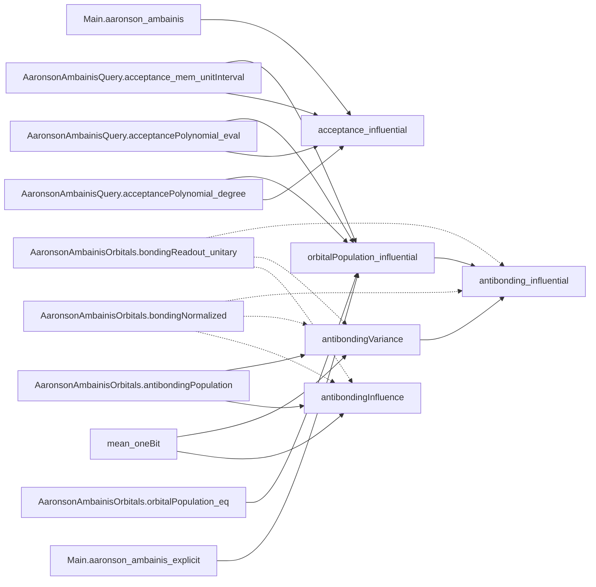

- [Main.aaronson_ambainis](https://github.com/physical-superintelligence/aaronson-ambainis/blob/2a6ceaef872ae993708950f951989134084b851a/AaronsonAmbainis/Main.lean#L33)
- [Main.aaronson_ambainis_explicit](https://github.com/physical-superintelligence/aaronson-ambainis/blob/2a6ceaef872ae993708950f951989134084b851a/AaronsonAmbainis/Main.lean#L38)
- [acceptance_influential](../../FQChem/Complexity/AaronsonAmbainis.lean#L36)
- [antibondingInfluence](../../FQChem/Complexity/AaronsonAmbainis.lean#L78)
- [antibondingVariance](../../FQChem/Complexity/AaronsonAmbainis.lean#L74)
- [antibonding_influential](../../FQChem/Complexity/AaronsonAmbainis.lean#L84)
- [mean_oneBit](../../FQChem/Complexity/AaronsonAmbainis.lean#L67) (private)
- [orbitalPopulation_influential](../../FQChem/Complexity/AaronsonAmbainis.lean#L51)
- [AaronsonAmbainisOrbitals.antibondingPopulation](../../FQChem/Complexity/AaronsonAmbainisOrbitals.lean#L106)
- [AaronsonAmbainisOrbitals.bondingNormalized](../../FQChem/Complexity/AaronsonAmbainisOrbitals.lean#L86)
- [AaronsonAmbainisOrbitals.bondingReadout_unitary](../../FQChem/Complexity/AaronsonAmbainisOrbitals.lean#L93)
- [AaronsonAmbainisOrbitals.orbitalPopulation_eq](../../FQChem/Complexity/AaronsonAmbainisOrbitals.lean#L74)
- [AaronsonAmbainisQuery.acceptancePolynomial_degree](../../FQChem/Complexity/AaronsonAmbainisQuery.lean#L173)
- [AaronsonAmbainisQuery.acceptancePolynomial_eval](../../FQChem/Complexity/AaronsonAmbainisQuery.lean#L164)
- [AaronsonAmbainisQuery.acceptance_mem_unitInterval](../../FQChem/Complexity/AaronsonAmbainisQuery.lean#L181)

## FQChem.Complexity.AaronsonAmbainisOrbitals

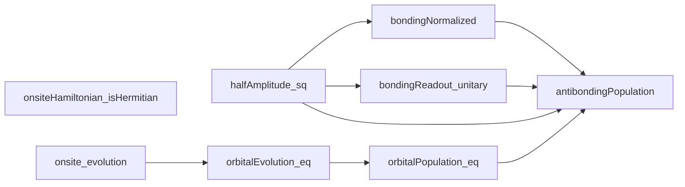

- [antibondingPopulation](../../FQChem/Complexity/AaronsonAmbainisOrbitals.lean#L106)
- [bondingNormalized](../../FQChem/Complexity/AaronsonAmbainisOrbitals.lean#L86)
- [bondingReadout_unitary](../../FQChem/Complexity/AaronsonAmbainisOrbitals.lean#L93)
- [halfAmplitude_sq](../../FQChem/Complexity/AaronsonAmbainisOrbitals.lean#L80) (private)
- [onsiteHamiltonian_isHermitian](../../FQChem/Complexity/AaronsonAmbainisOrbitals.lean#L37)
- [onsite_evolution](../../FQChem/Complexity/AaronsonAmbainisOrbitals.lean#L42)
- [orbitalEvolution_eq](../../FQChem/Complexity/AaronsonAmbainisOrbitals.lean#L61)
- [orbitalPopulation_eq](../../FQChem/Complexity/AaronsonAmbainisOrbitals.lean#L74)

## FQChem.Complexity.AaronsonAmbainisQuery

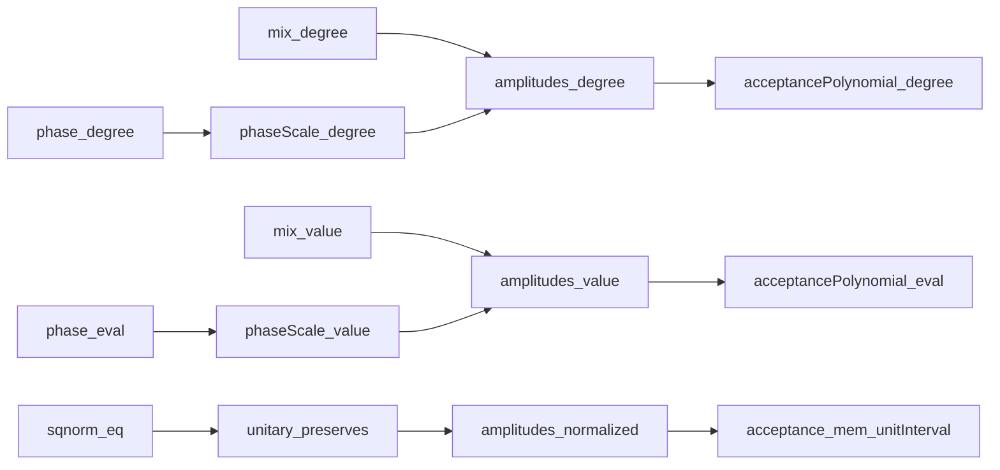

- [acceptancePolynomial_degree](../../FQChem/Complexity/AaronsonAmbainisQuery.lean#L173)
- [acceptancePolynomial_eval](../../FQChem/Complexity/AaronsonAmbainisQuery.lean#L164)
- [acceptance_mem_unitInterval](../../FQChem/Complexity/AaronsonAmbainisQuery.lean#L181)
- [amplitudes_degree](../../FQChem/Complexity/AaronsonAmbainisQuery.lean#L149) (private)
- [amplitudes_normalized](../../FQChem/Complexity/AaronsonAmbainisQuery.lean#L78)
- [amplitudes_value](../../FQChem/Complexity/AaronsonAmbainisQuery.lean#L142) (private)
- [mix_degree](../../FQChem/Complexity/AaronsonAmbainisQuery.lean#L128) (private)
- [mix_value](../../FQChem/Complexity/AaronsonAmbainisQuery.lean#L121) (private)
- [phaseScale_degree](../../FQChem/Complexity/AaronsonAmbainisQuery.lean#L109) (private)
- [phaseScale_value](../../FQChem/Complexity/AaronsonAmbainisQuery.lean#L104) (private)
- [phase_degree](../../FQChem/Complexity/AaronsonAmbainisQuery.lean#L46) (private)
- [phase_eval](../../FQChem/Complexity/AaronsonAmbainisQuery.lean#L40) (private)
- [sqnorm_eq](../../FQChem/Complexity/AaronsonAmbainisQuery.lean#L68) (private)
- [unitary_preserves](../../FQChem/Complexity/AaronsonAmbainisQuery.lean#L72) (private)

## FQChem.Complexity.ElectronicStructure

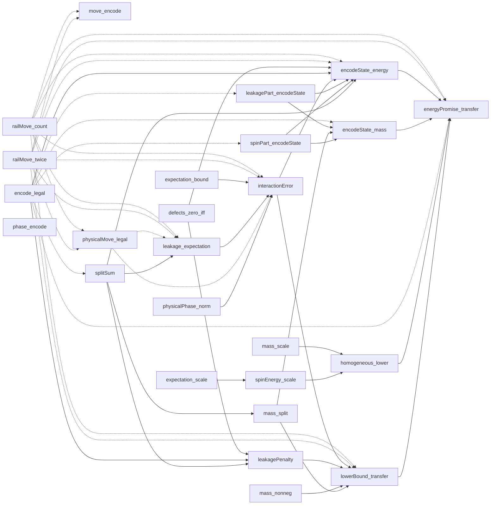

- [railMove_count](../../FQChem/Complexity/ElectronicStructure.lean#L110)
- [railMove_twice](../../FQChem/Complexity/ElectronicStructure.lean#L104)
- [defects_zero_iff](../../FQChem/Complexity/ElectronicStructure.lean#L81)
- [encodeState_energy](../../FQChem/Complexity/ElectronicStructure.lean#L252)
- [encodeState_mass](../../FQChem/Complexity/ElectronicStructure.lean#L248)
- [encode_legal](../../FQChem/Complexity/ElectronicStructure.lean#L58)
- [energyPromise_transfer](../../FQChem/Complexity/ElectronicStructure.lean#L319)
- [expectation_bound](../../FQChem/Complexity/ElectronicStructure.lean#L167) (private)
- [expectation_scale](../../FQChem/Complexity/ElectronicStructure.lean#L282) (private)
- [homogeneous_lower](../../FQChem/Complexity/ElectronicStructure.lean#L300) (private)
- [interactionError](../../FQChem/Complexity/ElectronicStructure.lean#L214)
- [leakagePart_encodeState](../../FQChem/Complexity/ElectronicStructure.lean#L243)
- [leakagePenalty](../../FQChem/Complexity/ElectronicStructure.lean#L225)
- [leakage_expectation](../../FQChem/Complexity/ElectronicStructure.lean#L209) (private)
- [lowerBound_transfer](../../FQChem/Complexity/ElectronicStructure.lean#L268)
- [mass_nonneg](../../FQChem/Complexity/ElectronicStructure.lean#L263) (private)
- [mass_scale](../../FQChem/Complexity/ElectronicStructure.lean#L278) (private)
- [mass_split](../../FQChem/Complexity/ElectronicStructure.lean#L193)
- [move_encode](../../FQChem/Complexity/ElectronicStructure.lean#L127)
- [phase_encode](../../FQChem/Complexity/ElectronicStructure.lean#L149)
- [physicalMove_legal](../../FQChem/Complexity/ElectronicStructure.lean#L130)
- [physicalPhase_norm](../../FQChem/Complexity/ElectronicStructure.lean#L152) (private)
- [spinEnergy_scale](../../FQChem/Complexity/ElectronicStructure.lean#L293) (private)
- [spinPart_encodeState](../../FQChem/Complexity/ElectronicStructure.lean#L238)
- [splitSum](../../FQChem/Complexity/ElectronicStructure.lean#L188) (private)

## FQChem.Complexity.ElectronicStructureOperators

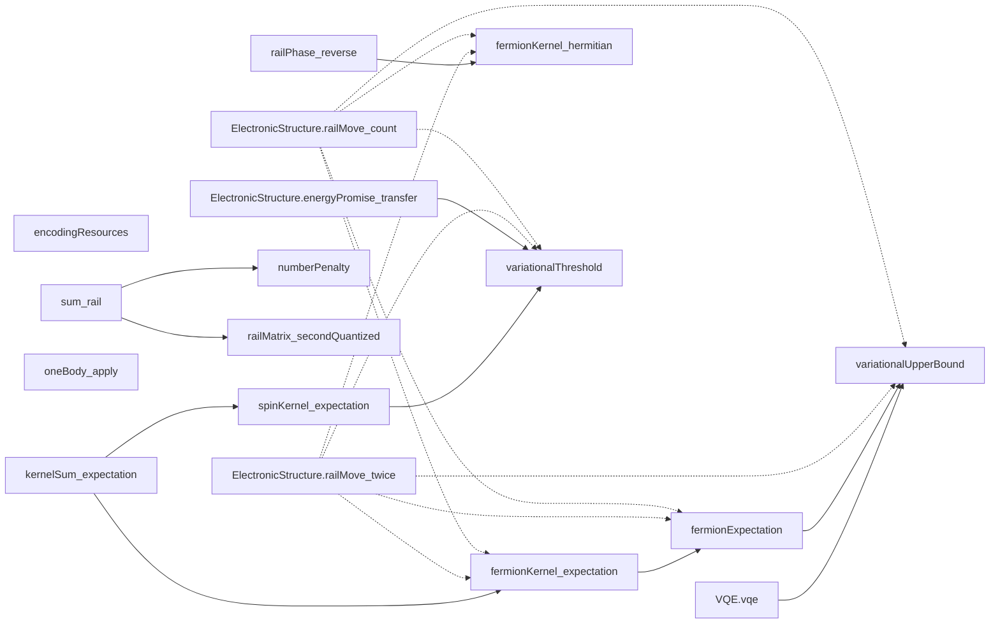

- [ElectronicStructure.railMove_count](../../FQChem/Complexity/ElectronicStructure.lean#L110)
- [ElectronicStructure.railMove_twice](../../FQChem/Complexity/ElectronicStructure.lean#L104)
- [ElectronicStructure.energyPromise_transfer](../../FQChem/Complexity/ElectronicStructure.lean#L319)
- [encodingResources](../../FQChem/Complexity/ElectronicStructureOperators.lean#L72)
- [fermionExpectation](../../FQChem/Complexity/ElectronicStructureOperators.lean#L167)
- [fermionKernel_expectation](../../FQChem/Complexity/ElectronicStructureOperators.lean#L150)
- [fermionKernel_hermitian](../../FQChem/Complexity/ElectronicStructureOperators.lean#L130)
- [kernelSum_expectation](../../FQChem/Complexity/ElectronicStructureOperators.lean#L90) (private)
- [numberPenalty](../../FQChem/Complexity/ElectronicStructureOperators.lean#L57)
- [oneBody_apply](../../FQChem/Complexity/ElectronicStructureOperators.lean#L31) (private)
- [railMatrix_secondQuantized](../../FQChem/Complexity/ElectronicStructureOperators.lean#L45)
- [railPhase_reverse](../../FQChem/Complexity/ElectronicStructureOperators.lean#L122) (private)
- [spinKernel_expectation](../../FQChem/Complexity/ElectronicStructureOperators.lean#L114)
- [sum_rail](../../FQChem/Complexity/ElectronicStructureOperators.lean#L37) (private)
- [variationalThreshold](../../FQChem/Complexity/ElectronicStructureOperators.lean#L190)
- [variationalUpperBound](../../FQChem/Complexity/ElectronicStructureOperators.lean#L180)
- [VQE.vqe](../../FQChem/StatePrep/VariationalOptimization/VQE.lean#L28)

## FQChem.Complexity.ElectronicStructurePauli

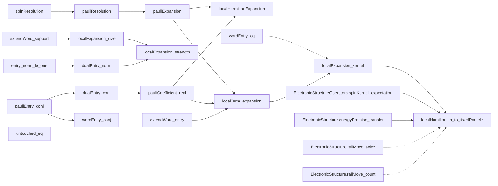

- [ElectronicStructure.railMove_count](../../FQChem/Complexity/ElectronicStructure.lean#L110)
- [ElectronicStructure.railMove_twice](../../FQChem/Complexity/ElectronicStructure.lean#L104)
- [ElectronicStructure.energyPromise_transfer](../../FQChem/Complexity/ElectronicStructure.lean#L319)
- [ElectronicStructureOperators.spinKernel_expectation](../../FQChem/Complexity/ElectronicStructureOperators.lean#L114)
- [dualEntry_conj](../../FQChem/Complexity/ElectronicStructurePauli.lean#L80) (private)
- [dualEntry_norm](../../FQChem/Complexity/ElectronicStructurePauli.lean#L222) (private)
- [entry_norm_le_one](../../FQChem/Complexity/ElectronicStructurePauli.lean#L219) (private)
- [extendWord_entry](../../FQChem/Complexity/ElectronicStructurePauli.lean#L126)
- [extendWord_support](../../FQChem/Complexity/ElectronicStructurePauli.lean#L139)
- [localExpansion_kernel](../../FQChem/Complexity/ElectronicStructurePauli.lean#L184)
- [localExpansion_size](../../FQChem/Complexity/ElectronicStructurePauli.lean#L198)
- [localExpansion_strength](../../FQChem/Complexity/ElectronicStructurePauli.lean#L232)
- [localHamiltonian_to_fixedParticle](../../FQChem/Complexity/ElectronicStructurePauli.lean#L209)
- [localHermitianExpansion](../../FQChem/Complexity/ElectronicStructurePauli.lean#L97)
- [localTerm_expansion](../../FQChem/Complexity/ElectronicStructurePauli.lean#L175) (private)
- [pauliCoefficient_real](../../FQChem/Complexity/ElectronicStructurePauli.lean#L84)
- [pauliEntry_conj](../../FQChem/Complexity/ElectronicStructurePauli.lean#L29) (private)
- [pauliExpansion](../../FQChem/Complexity/ElectronicStructurePauli.lean#L67)
- [pauliResolution](../../FQChem/Complexity/ElectronicStructurePauli.lean#L54)
- [spinResolution](../../FQChem/Complexity/ElectronicStructurePauli.lean#L33) (private)
- [untouched_eq](../../FQChem/Complexity/ElectronicStructurePauli.lean#L114)
- [wordEntry_conj](../../FQChem/Complexity/ElectronicStructurePauli.lean#L48) (private)
- [wordEntry_eq](../../FQChem/Complexity/ElectronicStructurePauli.lean#L42)

## FQChem.Complexity.FastForwarding

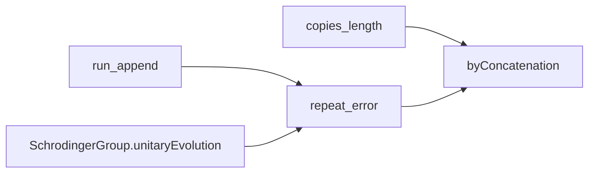

- [byConcatenation](../../FQChem/Complexity/FastForwarding.lean#L81)
- [copies_length](../../FQChem/Complexity/FastForwarding.lean#L37)
- [repeat_error](../../FQChem/Complexity/FastForwarding.lean#L58)
- [run_append](../../FQChem/Complexity/FastForwarding.lean#L42) (private)
- [SchrodingerGroup.unitaryEvolution](../../FQChem/Dynamics/RealTimePropagation/SchrodingerGroup.lean#L41)

## FQChem.Complexity.GroundStateSearch

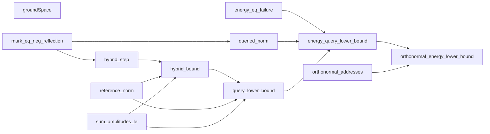

- [energy_eq_failure](../../FQChem/Complexity/GroundStateSearch.lean#L35)
- [energy_query_lower_bound](../../FQChem/Complexity/GroundStateSearch.lean#L141)
- [groundSpace](../../FQChem/Complexity/GroundStateSearch.lean#L30)
- [hybrid_bound](../../FQChem/Complexity/GroundStateSearch.lean#L103)
- [hybrid_step](../../FQChem/Complexity/GroundStateSearch.lean#L69) (private)
- [mark_eq_neg_reflection](../../FQChem/Complexity/GroundStateSearch.lean#L44) (private)
- [orthonormal_addresses](../../FQChem/Complexity/GroundStateSearch.lean#L86)
- [orthonormal_energy_lower_bound](../../FQChem/Complexity/GroundStateSearch.lean#L154)
- [queried_norm](../../FQChem/Complexity/GroundStateSearch.lean#L64)
- [query_lower_bound](../../FQChem/Complexity/GroundStateSearch.lean#L116)
- [reference_norm](../../FQChem/Complexity/GroundStateSearch.lean#L59)
- [sum_amplitudes_le](../../FQChem/Complexity/GroundStateSearch.lean#L92) (private)

## FQChem.Complexity.LocalHamiltonianVerification

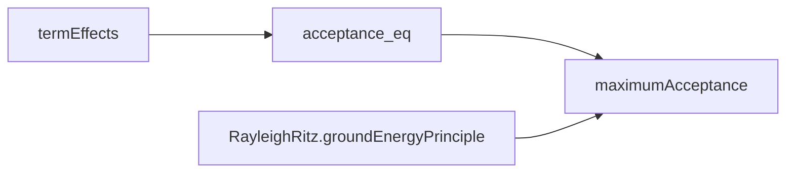

- [acceptance_eq](../../FQChem/Complexity/LocalHamiltonianVerification.lean#L43)
- [maximumAcceptance](../../FQChem/Complexity/LocalHamiltonianVerification.lean#L66)
- [termEffects](../../FQChem/Complexity/LocalHamiltonianVerification.lean#L31)
- [RayleighRitz.groundEnergyPrinciple](../../FQChem/StatePrep/VariationalOptimization/RayleighRitz.lean#L59)

## FQChem.Complexity.OrbitalSimulation

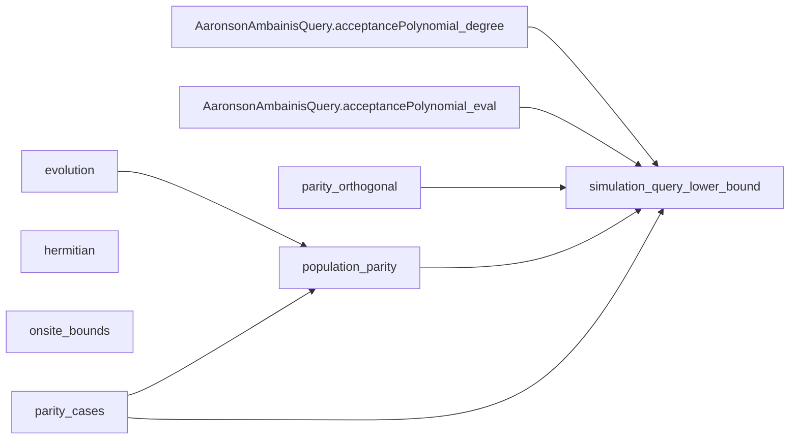

- [AaronsonAmbainisQuery.acceptancePolynomial_degree](../../FQChem/Complexity/AaronsonAmbainisQuery.lean#L173)
- [AaronsonAmbainisQuery.acceptancePolynomial_eval](../../FQChem/Complexity/AaronsonAmbainisQuery.lean#L164)
- [evolution](../../FQChem/Complexity/OrbitalSimulation.lean#L77)
- [hermitian](../../FQChem/Complexity/OrbitalSimulation.lean#L71)
- [onsite_bounds](../../FQChem/Complexity/OrbitalSimulation.lean#L57)
- [parity_cases](../../FQChem/Complexity/OrbitalSimulation.lean#L29) (private)
- [parity_orthogonal](../../FQChem/Complexity/OrbitalSimulation.lean#L35)
- [population_parity](../../FQChem/Complexity/OrbitalSimulation.lean#L101)
- [simulation_query_lower_bound](../../FQChem/Complexity/OrbitalSimulation.lean#L113)

## FQChem.Complexity.SearchOptimality

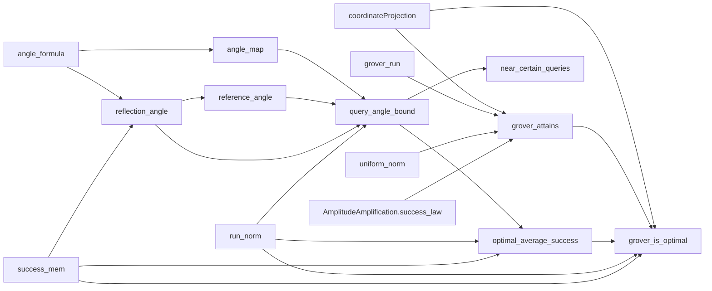

- [angle_formula](../../FQChem/Complexity/SearchOptimality.lean#L52) (private)
- [angle_map](../../FQChem/Complexity/SearchOptimality.lean#L65) (private)
- [coordinateProjection](../../FQChem/Complexity/SearchOptimality.lean#L200) (private)
- [grover_attains](../../FQChem/Complexity/SearchOptimality.lean#L242)
- [grover_is_optimal](../../FQChem/Complexity/SearchOptimality.lean#L295)
- [grover_run](../../FQChem/Complexity/SearchOptimality.lean#L225) (private)
- [near_certain_queries](../../FQChem/Complexity/SearchOptimality.lean#L319)
- [optimal_average_success](../../FQChem/Complexity/SearchOptimality.lean#L181)
- [query_angle_bound](../../FQChem/Complexity/SearchOptimality.lean#L132)
- [reference_angle](../../FQChem/Complexity/SearchOptimality.lean#L109) (private)
- [reflection_angle](../../FQChem/Complexity/SearchOptimality.lean#L80) (private)
- [run_norm](../../FQChem/Complexity/SearchOptimality.lean#L125) (private)
- [success_mem](../../FQChem/Complexity/SearchOptimality.lean#L71) (private)
- [uniform_norm](../../FQChem/Complexity/SearchOptimality.lean#L216) (private)
- [AmplitudeAmplification.success_law](../../FQChem/StatePrep/CircuitPreparation/AmplitudeAmplification.lean#L110)

## FQChem.Complexity.SparseNoFastForwarding

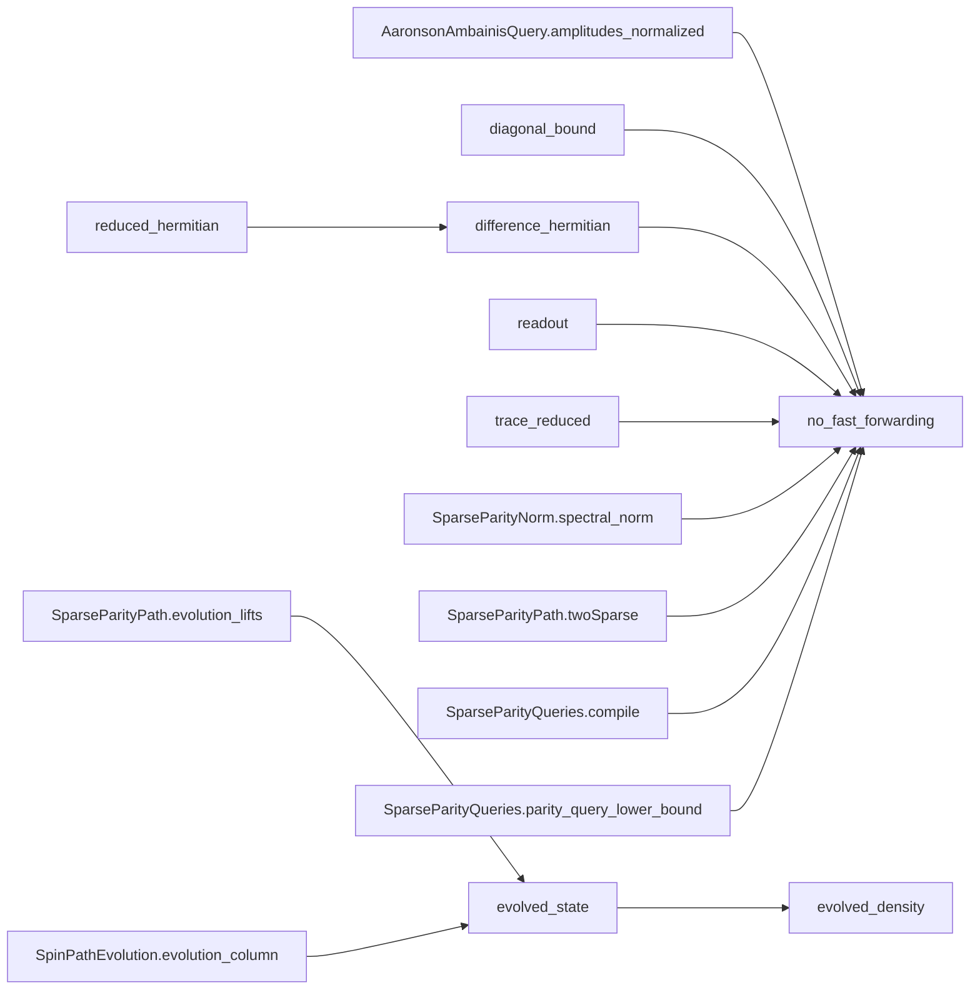

- [AaronsonAmbainisQuery.amplitudes_normalized](../../FQChem/Complexity/AaronsonAmbainisQuery.lean#L78)
- [diagonal_bound](../../FQChem/Complexity/SparseNoFastForwarding.lean#L30) (private)
- [difference_hermitian](../../FQChem/Complexity/SparseNoFastForwarding.lean#L106)
- [evolved_density](../../FQChem/Complexity/SparseNoFastForwarding.lean#L96)
- [evolved_state](../../FQChem/Complexity/SparseNoFastForwarding.lean#L73)
- [no_fast_forwarding](../../FQChem/Complexity/SparseNoFastForwarding.lean#L119)
- [readout](../../FQChem/Complexity/SparseNoFastForwarding.lean#L111) (private)
- [reduced_hermitian](../../FQChem/Complexity/SparseNoFastForwarding.lean#L64) (private)
- [trace_reduced](../../FQChem/Complexity/SparseNoFastForwarding.lean#L68) (private)
- [SparseParityNorm.spectral_norm](../../FQChem/Complexity/SparseParityNorm.lean#L81)
- [SparseParityPath.evolution_lifts](../../FQChem/Complexity/SparseParityPath.lean#L131)
- [SparseParityPath.twoSparse](../../FQChem/Complexity/SparseParityPath.lean#L74)
- [SparseParityQueries.compile](../../FQChem/Complexity/SparseParityQueries.lean#L130)
- [SparseParityQueries.parity_query_lower_bound](../../FQChem/Complexity/SparseParityQueries.lean#L229)
- [SpinPathEvolution.evolution_column](../../FQChem/Complexity/SpinPathEvolution.lean#L177)

## FQChem.Complexity.SparseParityNorm

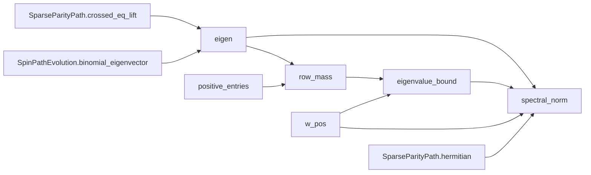

- [eigen](../../FQChem/Complexity/SparseParityNorm.lean#L28) (private)
- [eigenvalue_bound](../../FQChem/Complexity/SparseParityNorm.lean#L55) (private)
- [positive_entries](../../FQChem/Complexity/SparseParityNorm.lean#L43) (private)
- [row_mass](../../FQChem/Complexity/SparseParityNorm.lean#L48) (private)
- [spectral_norm](../../FQChem/Complexity/SparseParityNorm.lean#L81)
- [w_pos](../../FQChem/Complexity/SparseParityNorm.lean#L25) (private)
- [SparseParityPath.crossed_eq_lift](../../FQChem/Complexity/SparseParityPath.lean#L116)
- [SparseParityPath.hermitian](../../FQChem/Complexity/SparseParityPath.lean#L49)
- [SpinPathEvolution.binomial_eigenvector](../../FQChem/Complexity/SpinPathEvolution.lean#L108)

## FQChem.Complexity.SparseParityPath

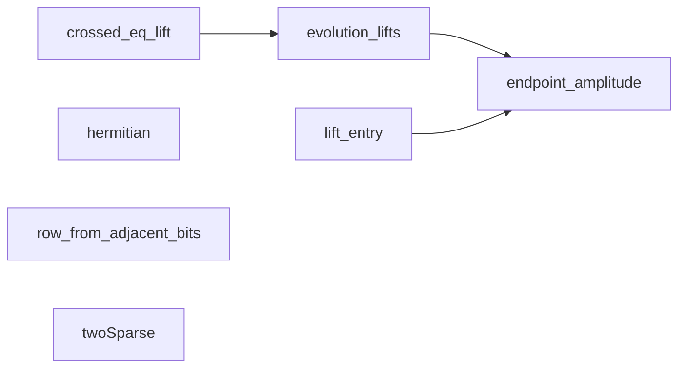

- [crossed_eq_lift](../../FQChem/Complexity/SparseParityPath.lean#L116)
- [endpoint_amplitude](../../FQChem/Complexity/SparseParityPath.lean#L151)
- [evolution_lifts](../../FQChem/Complexity/SparseParityPath.lean#L131)
- [hermitian](../../FQChem/Complexity/SparseParityPath.lean#L49)
- [lift_entry](../../FQChem/Complexity/SparseParityPath.lean#L109) (private)
- [row_from_adjacent_bits](../../FQChem/Complexity/SparseParityPath.lean#L61)
- [twoSparse](../../FQChem/Complexity/SparseParityPath.lean#L74)

## FQChem.Complexity.SparseParityQueries

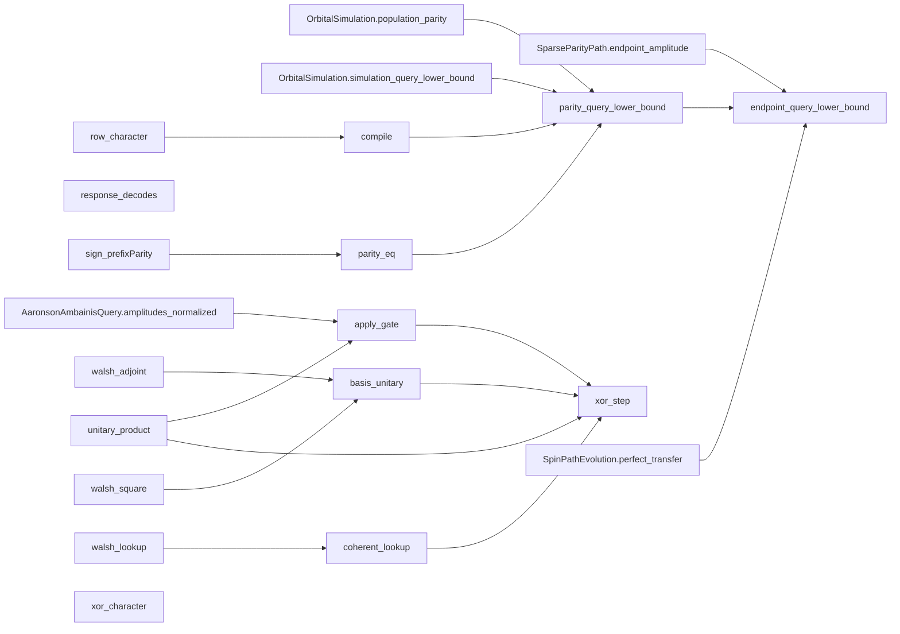

- [AaronsonAmbainisQuery.amplitudes_normalized](../../FQChem/Complexity/AaronsonAmbainisQuery.lean#L78)
- [OrbitalSimulation.population_parity](../../FQChem/Complexity/OrbitalSimulation.lean#L101)
- [OrbitalSimulation.simulation_query_lower_bound](../../FQChem/Complexity/OrbitalSimulation.lean#L113)
- [SparseParityPath.endpoint_amplitude](../../FQChem/Complexity/SparseParityPath.lean#L151)
- [apply_gate](../../FQChem/Complexity/SparseParityQueries.lean#L149) (private)
- [basis_unitary](../../FQChem/Complexity/SparseParityQueries.lean#L174) (private)
- [coherent_lookup](../../FQChem/Complexity/SparseParityQueries.lean#L179) (private)
- [compile](../../FQChem/Complexity/SparseParityQueries.lean#L130)
- [endpoint_query_lower_bound](../../FQChem/Complexity/SparseParityQueries.lean#L245)
- [parity_eq](../../FQChem/Complexity/SparseParityQueries.lean#L222) (private)
- [parity_query_lower_bound](../../FQChem/Complexity/SparseParityQueries.lean#L229)
- [response_decodes](../../FQChem/Complexity/SparseParityQueries.lean#L63)
- [row_character](../../FQChem/Complexity/SparseParityQueries.lean#L104)
- [sign_prefixParity](../../FQChem/Complexity/SparseParityQueries.lean#L213) (private)
- [unitary_product](../../FQChem/Complexity/SparseParityQueries.lean#L144) (private)
- [walsh_adjoint](../../FQChem/Complexity/SparseParityQueries.lean#L83) (private)
- [walsh_lookup](../../FQChem/Complexity/SparseParityQueries.lean#L96)
- [walsh_square](../../FQChem/Complexity/SparseParityQueries.lean#L88) (private)
- [xor_character](../../FQChem/Complexity/SparseParityQueries.lean#L46)
- [xor_step](../../FQChem/Complexity/SparseParityQueries.lean#L189)
- [SpinPathEvolution.perfect_transfer](../../FQChem/Complexity/SpinPathEvolution.lean#L197)

## FQChem.Complexity.SpinPathEvolution

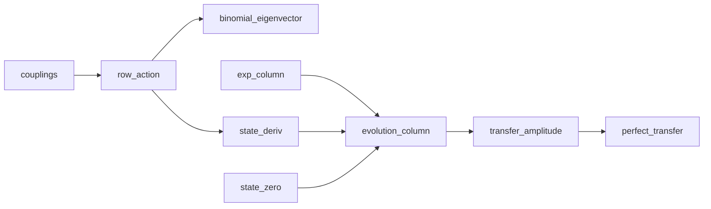

- [binomial_eigenvector](../../FQChem/Complexity/SpinPathEvolution.lean#L108)
- [couplings](../../FQChem/Complexity/SpinPathEvolution.lean#L28) (private)
- [evolution_column](../../FQChem/Complexity/SpinPathEvolution.lean#L177)
- [exp_column](../../FQChem/Complexity/SpinPathEvolution.lean#L144) (private)
- [perfect_transfer](../../FQChem/Complexity/SpinPathEvolution.lean#L197)
- [row_action](../../FQChem/Complexity/SpinPathEvolution.lean#L55) (private)
- [state_deriv](../../FQChem/Complexity/SpinPathEvolution.lean#L120) (private)
- [state_zero](../../FQChem/Complexity/SpinPathEvolution.lean#L168) (private)
- [transfer_amplitude](../../FQChem/Complexity/SpinPathEvolution.lean#L190)

## FQChem.Dynamics.DigitalAlgorithms.CommutingTerms


- [commutingProductFormula](../../FQChem/Dynamics/DigitalAlgorithms/CommutingTerms.lean#L18)

## FQChem.Dynamics.DigitalAlgorithms.LieTrotter

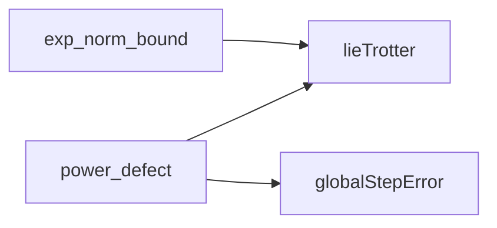

- [exp_norm_bound](../../FQChem/Dynamics/DigitalAlgorithms/LieTrotter.lean#L62) (private)
- [globalStepError](../../FQChem/Dynamics/DigitalAlgorithms/LieTrotter.lean#L55)
- [lieTrotter](../../FQChem/Dynamics/DigitalAlgorithms/LieTrotter.lean#L73)
- [power_defect](../../FQChem/Dynamics/DigitalAlgorithms/LieTrotter.lean#L36) (private)

## FQChem.Dynamics.DigitalAlgorithms.LinearCombinationOfUnitaries

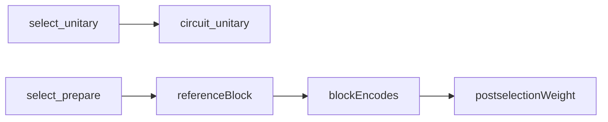

- [blockEncodes](../../FQChem/Dynamics/DigitalAlgorithms/LinearCombinationOfUnitaries.lean#L69)
- [circuit_unitary](../../FQChem/Dynamics/DigitalAlgorithms/LinearCombinationOfUnitaries.lean#L40)
- [postselectionWeight](../../FQChem/Dynamics/DigitalAlgorithms/LinearCombinationOfUnitaries.lean#L81)
- [referenceBlock](../../FQChem/Dynamics/DigitalAlgorithms/LinearCombinationOfUnitaries.lean#L55)
- [select_prepare](../../FQChem/Dynamics/DigitalAlgorithms/LinearCombinationOfUnitaries.lean#L47) (private)
- [select_unitary](../../FQChem/Dynamics/DigitalAlgorithms/LinearCombinationOfUnitaries.lean#L30)

## FQChem.Dynamics.DigitalAlgorithms.Qubitization

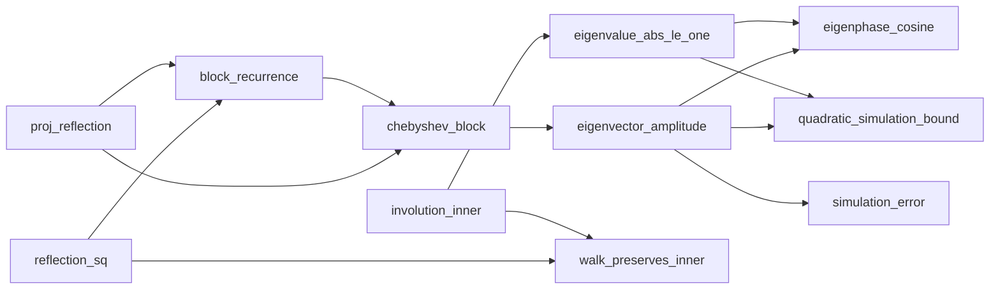

- [block_recurrence](../../FQChem/Dynamics/DigitalAlgorithms/Qubitization.lean#L74) (private)
- [chebyshev_block](../../FQChem/Dynamics/DigitalAlgorithms/Qubitization.lean#L100)
- [eigenphase_cosine](../../FQChem/Dynamics/DigitalAlgorithms/Qubitization.lean#L150)
- [eigenvalue_abs_le_one](../../FQChem/Dynamics/DigitalAlgorithms/Qubitization.lean#L135)
- [eigenvector_amplitude](../../FQChem/Dynamics/DigitalAlgorithms/Qubitization.lean#L115)
- [involution_inner](../../FQChem/Dynamics/DigitalAlgorithms/Qubitization.lean#L62) (private)
- [proj_reflection](../../FQChem/Dynamics/DigitalAlgorithms/Qubitization.lean#L59) (private)
- [quadratic_simulation_bound](../../FQChem/Dynamics/DigitalAlgorithms/Qubitization.lean#L169)
- [reflection_sq](../../FQChem/Dynamics/DigitalAlgorithms/Qubitization.lean#L55) (private)
- [simulation_error](../../FQChem/Dynamics/DigitalAlgorithms/Qubitization.lean#L125)
- [walk_preserves_inner](../../FQChem/Dynamics/DigitalAlgorithms/Qubitization.lean#L67)

## FQChem.Dynamics.DigitalAlgorithms.TruncatedTaylor

```mermaid
flowchart LR
  n195["generator_norm"]
  n196["power_error"]
  n197["realTime_segment"]
  n198["realTime_segmented"]
  n199["realTime_state_error"]
  n200["segment_error"]
  n201["segment_tendsto"]
  n195 --> n197
  n200 --> n197
  n196 --> n198
  n197 --> n198
  n198 --> n199
```

- [generator_norm](../../FQChem/Dynamics/DigitalAlgorithms/TruncatedTaylor.lean#L104) (private)
- [power_error](../../FQChem/Dynamics/DigitalAlgorithms/TruncatedTaylor.lean#L74) (private)
- [realTime_segment](../../FQChem/Dynamics/DigitalAlgorithms/TruncatedTaylor.lean#L109)
- [realTime_segmented](../../FQChem/Dynamics/DigitalAlgorithms/TruncatedTaylor.lean#L116)
- [realTime_state_error](../../FQChem/Dynamics/DigitalAlgorithms/TruncatedTaylor.lean#L140)
- [segment_error](../../FQChem/Dynamics/DigitalAlgorithms/TruncatedTaylor.lean#L41)
- [segment_tendsto](../../FQChem/Dynamics/DigitalAlgorithms/TruncatedTaylor.lean#L70)

## FQChem.Dynamics.LearnedSurrogates

```mermaid
flowchart LR
  n202["invariantDirectionalForce"]
```

- [invariantDirectionalForce](../../FQChem/Dynamics/LearnedSurrogates.lean#L28)

## FQChem.Dynamics.OpenSystems.Kraus

```mermaid
flowchart LR
  n203["completePositivity"]
  n204["complexLinearity"]
  n205["jointDensityPreservation"]
  n206["lifted_operation"]
  n207["tracePreservation"]
  n206 --> n203
  n203 --> n205
  n207 --> n205
```

- [completePositivity](../../FQChem/Dynamics/OpenSystems/Kraus.lean#L74)
- [complexLinearity](../../FQChem/Dynamics/OpenSystems/Kraus.lean#L69)
- [jointDensityPreservation](../../FQChem/Dynamics/OpenSystems/Kraus.lean#L86)
- [lifted_operation](../../FQChem/Dynamics/OpenSystems/Kraus.lean#L59) (private)
- [tracePreservation](../../FQChem/Dynamics/OpenSystems/Kraus.lean#L79)

## FQChem.Dynamics.OpenSystems.TracePreservation

```mermaid
flowchart LR
  n208["krausTrace"]
  n209["lindbladTrace"]
```

- [krausTrace](../../FQChem/Dynamics/OpenSystems/TracePreservation.lean#L37)
- [lindbladTrace](../../FQChem/Dynamics/OpenSystems/TracePreservation.lean#L30)

## FQChem.Dynamics.RealTimePropagation.BornOppenheimer

```mermaid
flowchart LR
  n210["bornOppenheimerEnergy"]
```

- [bornOppenheimerEnergy](../../FQChem/Dynamics/RealTimePropagation/BornOppenheimer.lean#L27)

## FQChem.Dynamics.RealTimePropagation.ClusterExpansions

```mermaid
flowchart LR
  n211["linkedClusterInversion"]
```

- [linkedClusterInversion](../../FQChem/Dynamics/RealTimePropagation/ClusterExpansions.lean#L20)

## FQChem.Dynamics.RealTimePropagation.HeisenbergPicture

```mermaid
flowchart LR
  n212["pauliRotation"]
  n213["pictureDuality"]
```

- [pauliRotation](../../FQChem/Dynamics/RealTimePropagation/HeisenbergPicture.lean#L38)
- [pictureDuality](../../FQChem/Dynamics/RealTimePropagation/HeisenbergPicture.lean#L33)

## FQChem.Dynamics.RealTimePropagation.KrylovPropagation

```mermaid
flowchart LR
  n214["krylovExact"]
  n215["krylovMoment"]
```

- [krylovExact](../../FQChem/Dynamics/RealTimePropagation/KrylovPropagation.lean#L34)
- [krylovMoment](../../FQChem/Dynamics/RealTimePropagation/KrylovPropagation.lean#L42)

## FQChem.Dynamics.RealTimePropagation.OutOfTimeOrder

```mermaid
flowchart LR
  n79["ElectronicStructurePauli.pauliCoefficient_real"]
  n81["ElectronicStructurePauli.pauliExpansion"]
  n86["ElectronicStructurePauli.wordEntry_eq"]
  n216["butterflyMass"]
  n217["discardedWeightError"]
  n218["dualEntry_trace"]
  n219["expansion"]
  n220["firstOrder_eq_anticommutingMass"]
  n221["invariantTails"]
  n222["swapTrace"]
  n223["traceCoefficient"]
  n224["traceExpansion"]
  n225["twoCopyReadout"]
  n226["zConjugation"]
  n79 --> n216
  n219 --> n216
  n224 --> n216
  n220 --> n217
  n81 --> n219
  n79 --> n220
  n216 --> n220
  n219 --> n220
  n224 --> n220
  n226 --> n220
  n218 --> n223
  n223 --> n224
  n222 --> n225
  n86 --> n226
```

- [ElectronicStructurePauli.pauliCoefficient_real](../../FQChem/Complexity/ElectronicStructurePauli.lean#L84)
- [ElectronicStructurePauli.pauliExpansion](../../FQChem/Complexity/ElectronicStructurePauli.lean#L67)
- [ElectronicStructurePauli.wordEntry_eq](../../FQChem/Complexity/ElectronicStructurePauli.lean#L42)
- [butterflyMass](../../FQChem/Dynamics/RealTimePropagation/OutOfTimeOrder.lean#L81)
- [discardedWeightError](../../FQChem/Dynamics/RealTimePropagation/OutOfTimeOrder.lean#L119)
- [dualEntry_trace](../../FQChem/Dynamics/RealTimePropagation/OutOfTimeOrder.lean#L38) (private)
- [expansion](../../FQChem/Dynamics/RealTimePropagation/OutOfTimeOrder.lean#L51) (private)
- [firstOrder_eq_anticommutingMass](../../FQChem/Dynamics/RealTimePropagation/OutOfTimeOrder.lean#L93)
- [invariantTails](../../FQChem/Dynamics/RealTimePropagation/OutOfTimeOrder.lean#L156)
- [swapTrace](../../FQChem/Dynamics/RealTimePropagation/OutOfTimeOrder.lean#L142)
- [traceCoefficient](../../FQChem/Dynamics/RealTimePropagation/OutOfTimeOrder.lean#L45)
- [traceExpansion](../../FQChem/Dynamics/RealTimePropagation/OutOfTimeOrder.lean#L73) (private)
- [twoCopyReadout](../../FQChem/Dynamics/RealTimePropagation/OutOfTimeOrder.lean#L148)
- [zConjugation](../../FQChem/Dynamics/RealTimePropagation/OutOfTimeOrder.lean#L59)

## FQChem.Dynamics.RealTimePropagation.PathSampling

```mermaid
flowchart LR
  n227["realTimeReweighting"]
```

- [realTimeReweighting](../../FQChem/Dynamics/RealTimePropagation/PathSampling.lean#L22)

## FQChem.Dynamics.RealTimePropagation.RingPolymer

```mermaid
flowchart LR
  n228["ringPolymerSpringForce"]
```

- [ringPolymerSpringForce](../../FQChem/Dynamics/RealTimePropagation/RingPolymer.lean#L26)

## FQChem.Dynamics.RealTimePropagation.SchrodingerGroup

```mermaid
flowchart LR
  n229["unitaryEvolution"]
```

- [unitaryEvolution](../../FQChem/Dynamics/RealTimePropagation/SchrodingerGroup.lean#L41)

## FQChem.Dynamics.RealTimePropagation.SplitOperator

```mermaid
flowchart LR
  n230["splitOperator"]
```

- [splitOperator](../../FQChem/Dynamics/RealTimePropagation/SplitOperator.lean#L26)

## FQChem.Dynamics.RealTimePropagation.TimeDependentCI

```mermaid
flowchart LR
  n231["tdConfigurationInteraction"]
```

- [tdConfigurationInteraction](../../FQChem/Dynamics/RealTimePropagation/TimeDependentCI.lean#L28)

## FQChem.Dynamics.RealTimePropagation.VariationalEvolution

```mermaid
flowchart LR
  n232["mcLachlanProjection"]
  n233["sampledTangentMetric"]
```

- [mcLachlanProjection](../../FQChem/Dynamics/RealTimePropagation/VariationalEvolution.lean#L56)
- [sampledTangentMetric](../../FQChem/Dynamics/RealTimePropagation/VariationalEvolution.lean#L38)

## FQChem.Multiscale.ChoosingLayers.ClassicalEnvironments

```mermaid
flowchart LR
  n234["layeredForce"]
```

- [layeredForce](../../FQChem/Multiscale/ChoosingLayers/ClassicalEnvironments.lean#L26)

## FQChem.Multiscale.ChoosingLayers.Fragments

```mermaid
flowchart LR
  n235["pairReconstruction"]
```

- [pairReconstruction](../../FQChem/Multiscale/ChoosingLayers/Fragments.lean#L27)

## FQChem.Multiscale.ChoosingLayers.FrozenMolecularDensity

```mermaid
flowchart LR
  n236["frozenMolecularEnergy"]
  n240["QuantumEnvironments.frozenSearch"]
  n494["CoulombIntegrability.coulombConstrainedSearch"]
  n240 --> n236
  n494 --> n236
```

- [frozenMolecularEnergy](../../FQChem/Multiscale/ChoosingLayers/FrozenMolecularDensity.lean#L15)
- [QuantumEnvironments.frozenSearch](../../FQChem/Multiscale/ChoosingLayers/QuantumEnvironments.lean#L41)
- [CoulombIntegrability.coulombConstrainedSearch](../../FQChem/StatePrep/VariationalOptimization/DensityFunctionals/CoulombIntegrability.lean#L88)

## FQChem.Multiscale.ChoosingLayers.LearnedEnvironments

```mermaid
flowchart LR
  n237["deltaLearningGap"]
```

- [deltaLearningGap](../../FQChem/Multiscale/ChoosingLayers/LearnedEnvironments.lean#L23)

## FQChem.Multiscale.ChoosingLayers.Partitions

```mermaid
flowchart LR
  n238["overlapAccounting"]
```

- [overlapAccounting](../../FQChem/Multiscale/ChoosingLayers/Partitions.lean#L36)

## FQChem.Multiscale.ChoosingLayers.QuantumEnvironments

```mermaid
flowchart LR
  n239["frozenDensityDerivative"]
  n240["frozenSearch"]
```

- [frozenDensityDerivative](../../FQChem/Multiscale/ChoosingLayers/QuantumEnvironments.lean#L37)
- [frozenSearch](../../FQChem/Multiscale/ChoosingLayers/QuantumEnvironments.lean#L41)

## FQChem.Multiscale.StitchingSolutions.EmbeddedSolvers

```mermaid
flowchart LR
  n241["feshbachReduction"]
```

- [feshbachReduction](../../FQChem/Multiscale/StitchingSolutions/EmbeddedSolvers.lean#L30)

## FQChem.Multiscale.StitchingSolutions.ErrorPropagation

```mermaid
flowchart LR
  n242["barrierRateError"]
```

- [barrierRateError](../../FQChem/Multiscale/StitchingSolutions/ErrorPropagation.lean#L23)

## FQChem.Multiscale.StitchingSolutions.LayeredQM

```mermaid
flowchart LR
  n210["BornOppenheimer.bornOppenheimerEnergy"]
  n234["ClassicalEnvironments.layeredForce"]
  n243["layeredBornOppenheimerEnergy"]
  n244["layeredEigenForce"]
  n245["layeredProjectionError"]
  n246["layeredProjectionLimit"]
  n247["projectedLayeredEnergy_eq"]
  n288["HellmannFeynman.hellmannFeynman"]
  n427["GroundStateProjection.energyBound"]
  n428["GroundStateProjection.energyLimit"]
  n210 --> n243
  n244 --> n243
  n234 --> n244
  n288 --> n244
  n247 --> n245
  n427 --> n245
  n247 --> n246
  n428 --> n246
```

- [BornOppenheimer.bornOppenheimerEnergy](../../FQChem/Dynamics/RealTimePropagation/BornOppenheimer.lean#L27)
- [ClassicalEnvironments.layeredForce](../../FQChem/Multiscale/ChoosingLayers/ClassicalEnvironments.lean#L26)
- [layeredBornOppenheimerEnergy](../../FQChem/Multiscale/StitchingSolutions/LayeredQM.lean#L73)
- [layeredEigenForce](../../FQChem/Multiscale/StitchingSolutions/LayeredQM.lean#L61)
- [layeredProjectionError](../../FQChem/Multiscale/StitchingSolutions/LayeredQM.lean#L34)
- [layeredProjectionLimit](../../FQChem/Multiscale/StitchingSolutions/LayeredQM.lean#L44)
- [projectedLayeredEnergy_eq](../../FQChem/Multiscale/StitchingSolutions/LayeredQM.lean#L26)
- [HellmannFeynman.hellmannFeynman](../../FQChem/Properties/ResponseAndEstimation/HellmannFeynman.lean#L39)
- [GroundStateProjection.energyBound](../../FQChem/StatePrep/ImaginaryTimeProjection/GroundStateProjection.lean#L139)
- [GroundStateProjection.energyLimit](../../FQChem/StatePrep/ImaginaryTimeProjection/GroundStateProjection.lean#L150)

## FQChem.Multiscale.StitchingSolutions.Observables

```mermaid
flowchart LR
  n248["zwanzig"]
```

- [zwanzig](../../FQChem/Multiscale/StitchingSolutions/Observables.lean#L33)

## FQChem.Properties.LinearSystems.DirichletPoisson

```mermaid
flowchart LR
  n249["dirichletPoissonMode"]
```

- [dirichletPoissonMode](../../FQChem/Properties/LinearSystems/DirichletPoisson.lean#L20)

## FQChem.Properties.LinearSystems.HHL

```mermaid
flowchart LR
  n250["hhlSpectralInversion"]
```

- [hhlSpectralInversion](../../FQChem/Properties/LinearSystems/HHL.lean#L18)

## FQChem.Properties.MeasurementTheory

```mermaid
flowchart LR
  n251["bornCompleteness"]
  n252["projectiveRepeatability"]
  n253["unsharpQubit"]
```

- [bornCompleteness](../../FQChem/Properties/MeasurementTheory.lean#L69)
- [projectiveRepeatability](../../FQChem/Properties/MeasurementTheory.lean#L78)
- [unsharpQubit](../../FQChem/Properties/MeasurementTheory.lean#L96)

## FQChem.Properties.PhaseEstimation

```mermaid
flowchart LR
  n254["exactGridQPE"]
```

- [exactGridQPE](../../FQChem/Properties/PhaseEstimation.lean#L17)

## FQChem.Properties.ResponseAndEstimation.AdaptivePauliPrediction

```mermaid
flowchart LR
  n255["alternativeNonneg"]
  n256["bornHard"]
  n257["bornSum"]
  n258["copyLowerBound"]
  n259["leafError"]
  n260["leafNormalization"]
  n261["massRatio"]
  n262["mixtureLower"]
  n263["nullIndependent"]
  n264["nullNonnegative"]
  n265["pathPositive"]
  n266["productLoss"]
  n267["randomizedCopyLowerBound"]
  n268["signMixture"]
  n293["PauliPrediction.nonidentityCount"]
  n294["PauliPrediction.nonidentitySecondMoment"]
  n300["PauliPrediction.responseAbs"]
  n261 --> n255
  n264 --> n255
  n265 --> n255
  n300 --> n255
  n259 --> n258
  n260 --> n258
  n264 --> n258
  n265 --> n258
  n293 --> n258
  n294 --> n258
  n255 --> n259
  n262 --> n259
  n263 --> n259
  n264 --> n259
  n257 --> n260
  n256 --> n261
  n265 --> n261
  n261 --> n262
  n264 --> n262
  n265 --> n262
  n268 --> n262
  n300 --> n262
  n256 --> n264
  n265 --> n264
  n258 --> n267
  n266 --> n268
```

- [alternativeNonneg](../../FQChem/Properties/ResponseAndEstimation/AdaptivePauliPrediction.lean#L171) (private)
- [bornHard](../../FQChem/Properties/ResponseAndEstimation/AdaptivePauliPrediction.lean#L73) (private)
- [bornSum](../../FQChem/Properties/ResponseAndEstimation/AdaptivePauliPrediction.lean#L54) (private)
- [copyLowerBound](../../FQChem/Properties/ResponseAndEstimation/AdaptivePauliPrediction.lean#L201)
- [leafError](../../FQChem/Properties/ResponseAndEstimation/AdaptivePauliPrediction.lean#L181) (private)
- [leafNormalization](../../FQChem/Properties/ResponseAndEstimation/AdaptivePauliPrediction.lean#L59)
- [massRatio](../../FQChem/Properties/ResponseAndEstimation/AdaptivePauliPrediction.lean#L90) (private)
- [mixtureLower](../../FQChem/Properties/ResponseAndEstimation/AdaptivePauliPrediction.lean#L148) (private)
- [nullIndependent](../../FQChem/Properties/ResponseAndEstimation/AdaptivePauliPrediction.lean#L104) (private)
- [nullNonnegative](../../FQChem/Properties/ResponseAndEstimation/AdaptivePauliPrediction.lean#L96) (private)
- [pathPositive](../../FQChem/Properties/ResponseAndEstimation/AdaptivePauliPrediction.lean#L42) (private)
- [productLoss](../../FQChem/Properties/ResponseAndEstimation/AdaptivePauliPrediction.lean#L108) (private)
- [randomizedCopyLowerBound](../../FQChem/Properties/ResponseAndEstimation/AdaptivePauliPrediction.lean#L240)
- [signMixture](../../FQChem/Properties/ResponseAndEstimation/AdaptivePauliPrediction.lean#L122) (private)
- [PauliPrediction.nonidentityCount](../../FQChem/Properties/ResponseAndEstimation/PauliPrediction.lean#L103)
- [PauliPrediction.nonidentitySecondMoment](../../FQChem/Properties/ResponseAndEstimation/PauliPrediction.lean#L115)
- [PauliPrediction.responseAbs](../../FQChem/Properties/ResponseAndEstimation/PauliPrediction.lean#L132)

## FQChem.Properties.ResponseAndEstimation.BellConfidence

```mermaid
flowchart LR
  n86["ElectronicStructurePauli.wordEntry_eq"]
  n269["clipped_error"]
  n270["hiddenMagnitude"]
  n271["meanFailure"]
  n272["predictMagnitude"]
  n273["projector_gram"]
  n274["score_mean"]
  n275["score_sign"]
  n276["selectHiddenWord"]
  n277["traceDifferent"]
  n278["weight_nonneg"]
  n279["weight_sum"]
  n281["BellSampling.magnitudeSquaredPauliExpectation"]
  n282["BellSampling.squaredPauliExpectation"]
  n289["PauliPrediction.hardStatePositive"]
  n290["PauliPrediction.hardStateTrace"]
  n291["PauliPrediction.hardStateTracePairing"]
  n298["PauliPrediction.pauliTrace"]
  n277 --> n270
  n289 -.-> n270
  n290 -.-> n270
  n291 --> n270
  n298 --> n270
  n274 --> n271
  n275 --> n271
  n278 -.-> n271
  n279 -.-> n271
  n269 --> n272
  n271 --> n272
  n278 -.-> n272
  n279 -.-> n272
  n275 --> n274
  n278 --> n274
  n279 -.-> n274
  n281 --> n274
  n270 --> n276
  n271 --> n276
  n278 -.-> n276
  n279 -.-> n276
  n289 -.-> n276
  n290 -.-> n276
  n273 --> n278
  n86 --> n279
  n282 --> n279
```

- [ElectronicStructurePauli.wordEntry_eq](../../FQChem/Complexity/ElectronicStructurePauli.lean#L42)
- [clipped_error](../../FQChem/Properties/ResponseAndEstimation/BellConfidence.lean#L162) (private)
- [hiddenMagnitude](../../FQChem/Properties/ResponseAndEstimation/BellConfidence.lean#L223)
- [meanFailure](../../FQChem/Properties/ResponseAndEstimation/BellConfidence.lean#L110)
- [predictMagnitude](../../FQChem/Properties/ResponseAndEstimation/BellConfidence.lean#L178)
- [projector_gram](../../FQChem/Properties/ResponseAndEstimation/BellConfidence.lean#L36) (private)
- [score_mean](../../FQChem/Properties/ResponseAndEstimation/BellConfidence.lean#L89)
- [score_sign](../../FQChem/Properties/ResponseAndEstimation/BellConfidence.lean#L78) (private)
- [selectHiddenWord](../../FQChem/Properties/ResponseAndEstimation/BellConfidence.lean#L241)
- [traceDifferent](../../FQChem/Properties/ResponseAndEstimation/BellConfidence.lean#L200) (private)
- [weight_nonneg](../../FQChem/Properties/ResponseAndEstimation/BellConfidence.lean#L43)
- [weight_sum](../../FQChem/Properties/ResponseAndEstimation/BellConfidence.lean#L62)
- [BellSampling.magnitudeSquaredPauliExpectation](../../FQChem/Properties/ResponseAndEstimation/BellSampling.lean#L88)
- [BellSampling.squaredPauliExpectation](../../FQChem/Properties/ResponseAndEstimation/BellSampling.lean#L56)
- [PauliPrediction.hardStatePositive](../../FQChem/Properties/ResponseAndEstimation/PauliPrediction.lean#L171)
- [PauliPrediction.hardStateTrace](../../FQChem/Properties/ResponseAndEstimation/PauliPrediction.lean#L158)
- [PauliPrediction.hardStateTracePairing](../../FQChem/Properties/ResponseAndEstimation/PauliPrediction.lean#L164)
- [PauliPrediction.pauliTrace](../../FQChem/Properties/ResponseAndEstimation/PauliPrediction.lean#L57)

## FQChem.Properties.ResponseAndEstimation.BellSampling

```mermaid
flowchart LR
  n85["ElectronicStructurePauli.wordEntry_conj"]
  n280["bellResolution"]
  n281["magnitudeSquaredPauliExpectation"]
  n282["squaredPauliExpectation"]
  n85 --> n281
  n282 --> n281
  n280 --> n282
```

- [ElectronicStructurePauli.wordEntry_conj](../../FQChem/Complexity/ElectronicStructurePauli.lean#L48) (private)
- [bellResolution](../../FQChem/Properties/ResponseAndEstimation/BellSampling.lean#L41)
- [magnitudeSquaredPauliExpectation](../../FQChem/Properties/ResponseAndEstimation/BellSampling.lean#L88)
- [squaredPauliExpectation](../../FQChem/Properties/ResponseAndEstimation/BellSampling.lean#L56)

## FQChem.Properties.ResponseAndEstimation.ClassicalShadows

```mermaid
flowchart LR
  n283["projector_sum"]
  n284["secondMoment"]
  n285["signed_projector_sum"]
  n286["unbiased"]
  n287["weighted_sum"]
  n283 --> n284
  n287 --> n284
  n285 --> n286
  n287 --> n286
```

- [projector_sum](../../FQChem/Properties/ResponseAndEstimation/ClassicalShadows.lean#L33) (private)
- [secondMoment](../../FQChem/Properties/ResponseAndEstimation/ClassicalShadows.lean#L91)
- [signed_projector_sum](../../FQChem/Properties/ResponseAndEstimation/ClassicalShadows.lean#L38) (private)
- [unbiased](../../FQChem/Properties/ResponseAndEstimation/ClassicalShadows.lean#L71)
- [weighted_sum](../../FQChem/Properties/ResponseAndEstimation/ClassicalShadows.lean#L56) (private)

## FQChem.Properties.ResponseAndEstimation.HellmannFeynman

```mermaid
flowchart LR
  n288["hellmannFeynman"]
```

- [hellmannFeynman](../../FQChem/Properties/ResponseAndEstimation/HellmannFeynman.lean#L39)

## FQChem.Properties.ResponseAndEstimation.PauliPrediction

```mermaid
flowchart LR
  n79["ElectronicStructurePauli.pauliCoefficient_real"]
  n81["ElectronicStructurePauli.pauliExpansion"]
  n86["ElectronicStructurePauli.wordEntry_eq"]
  n223["OutOfTimeOrder.traceCoefficient"]
  n289["hardStatePositive"]
  n290["hardStateTrace"]
  n291["hardStateTracePairing"]
  n292["identityMatrix"]
  n293["nonidentityCount"]
  n294["nonidentitySecondMoment"]
  n295["parseval"]
  n296["pauliHermitian"]
  n297["pauliSquare"]
  n298["pauliTrace"]
  n299["purityBound"]
  n300["responseAbs"]
  n296 --> n289
  n297 --> n289
  n298 --> n290
  n297 --> n291
  n298 --> n291
  n86 --> n292
  n292 --> n294
  n295 --> n294
  n299 --> n294
  n79 --> n295
  n81 --> n295
  n223 --> n295
  n296 --> n300
  n297 --> n300
```

- [ElectronicStructurePauli.pauliCoefficient_real](../../FQChem/Complexity/ElectronicStructurePauli.lean#L84)
- [ElectronicStructurePauli.pauliExpansion](../../FQChem/Complexity/ElectronicStructurePauli.lean#L67)
- [ElectronicStructurePauli.wordEntry_eq](../../FQChem/Complexity/ElectronicStructurePauli.lean#L42)
- [OutOfTimeOrder.traceCoefficient](../../FQChem/Dynamics/RealTimePropagation/OutOfTimeOrder.lean#L45)
- [hardStatePositive](../../FQChem/Properties/ResponseAndEstimation/PauliPrediction.lean#L171)
- [hardStateTrace](../../FQChem/Properties/ResponseAndEstimation/PauliPrediction.lean#L158)
- [hardStateTracePairing](../../FQChem/Properties/ResponseAndEstimation/PauliPrediction.lean#L164)
- [identityMatrix](../../FQChem/Properties/ResponseAndEstimation/PauliPrediction.lean#L32)
- [nonidentityCount](../../FQChem/Properties/ResponseAndEstimation/PauliPrediction.lean#L103)
- [nonidentitySecondMoment](../../FQChem/Properties/ResponseAndEstimation/PauliPrediction.lean#L115)
- [parseval](../../FQChem/Properties/ResponseAndEstimation/PauliPrediction.lean#L79) (private)
- [pauliHermitian](../../FQChem/Properties/ResponseAndEstimation/PauliPrediction.lean#L38)
- [pauliSquare](../../FQChem/Properties/ResponseAndEstimation/PauliPrediction.lean#L45)
- [pauliTrace](../../FQChem/Properties/ResponseAndEstimation/PauliPrediction.lean#L57)
- [purityBound](../../FQChem/Properties/ResponseAndEstimation/PauliPrediction.lean#L66) (private)
- [responseAbs](../../FQChem/Properties/ResponseAndEstimation/PauliPrediction.lean#L132)

## FQChem.Properties.ResponseAndEstimation.QuantumMemorySeparation

```mermaid
flowchart LR
  n267["AdaptivePauliPrediction.randomizedCopyLowerBound"]
  n270["BellConfidence.hiddenMagnitude"]
  n272["BellConfidence.predictMagnitude"]
  n278["BellConfidence.weight_nonneg"]
  n279["BellConfidence.weight_sum"]
  n289["PauliPrediction.hardStatePositive"]
  n290["PauliPrediction.hardStateTrace"]
  n301["separation"]
  n267 --> n301
  n270 --> n301
  n272 --> n301
  n278 -.-> n301
  n279 -.-> n301
  n289 -.-> n301
  n290 -.-> n301
```

- [AdaptivePauliPrediction.randomizedCopyLowerBound](../../FQChem/Properties/ResponseAndEstimation/AdaptivePauliPrediction.lean#L240)
- [BellConfidence.hiddenMagnitude](../../FQChem/Properties/ResponseAndEstimation/BellConfidence.lean#L223)
- [BellConfidence.predictMagnitude](../../FQChem/Properties/ResponseAndEstimation/BellConfidence.lean#L178)
- [BellConfidence.weight_nonneg](../../FQChem/Properties/ResponseAndEstimation/BellConfidence.lean#L43)
- [BellConfidence.weight_sum](../../FQChem/Properties/ResponseAndEstimation/BellConfidence.lean#L62)
- [PauliPrediction.hardStatePositive](../../FQChem/Properties/ResponseAndEstimation/PauliPrediction.lean#L171)
- [PauliPrediction.hardStateTrace](../../FQChem/Properties/ResponseAndEstimation/PauliPrediction.lean#L158)
- [separation](../../FQChem/Properties/ResponseAndEstimation/QuantumMemorySeparation.lean#L30)

## FQChem.Properties.ResponseAndEstimation.ShadowConfidence

```mermaid
flowchart LR
  n302["blockFailure"]
  n303["blocks_pos"]
  n304["confidence"]
  n305["medianFailure"]
  n306["medianWitness"]
  n307["productDraw"]
  n308["simultaneousConfidence"]
  n306 --> n305
  n302 --> n308
  n303 --> n308
  n304 --> n308
  n305 --> n308
```

- [blockFailure](../../FQChem/Properties/ResponseAndEstimation/ShadowConfidence.lean#L68) (private)
- [blocks_pos](../../FQChem/Properties/ResponseAndEstimation/ShadowConfidence.lean#L174)
- [confidence](../../FQChem/Properties/ResponseAndEstimation/ShadowConfidence.lean#L181) (private)
- [medianFailure](../../FQChem/Properties/ResponseAndEstimation/ShadowConfidence.lean#L133) (private)
- [medianWitness](../../FQChem/Properties/ResponseAndEstimation/ShadowConfidence.lean#L106) (private)
- [productDraw](../../FQChem/Properties/ResponseAndEstimation/ShadowConfidence.lean#L39)
- [simultaneousConfidence](../../FQChem/Properties/ResponseAndEstimation/ShadowConfidence.lean#L197)

## FQChem.Properties.ResponseAndEstimation.ShadowMeasurement

```mermaid
flowchart LR
  n303["ShadowConfidence.blocks_pos"]
  n307["ShadowConfidence.productDraw"]
  n308["ShadowConfidence.simultaneousConfidence"]
  n309["basisEntry"]
  n310["bornSecondMoment"]
  n311["centeredVariance"]
  n312["channelOne"]
  n313["channelSymmetric"]
  n314["hermitianScore"]
  n315["iidSampleComplexity"]
  n316["inverseHermitian"]
  n317["inverseSnapshotScore"]
  n318["moment_le"]
  n319["pairingAdjoint"]
  n320["pairingBound"]
  n321["pairingMeasurable"]
  n322["projectorHermitian"]
  n323["projectorMeasurable"]
  n324["sampleComplexity"]
  n325["scoreCentered"]
  n326["scoreLp"]
  n327["scoreMean"]
  n328["scoreMeasurable"]
  n329["sumProjector"]
  n330["traceProjector"]
  n330 --> n309
  n314 --> n310
  n320 --> n310
  n328 --> n310
  n318 --> n311
  n325 --> n311
  n326 --> n311
  n328 --> n311
  n329 --> n312
  n330 --> n312
  n316 --> n314
  n319 --> n314
  n322 --> n314
  n303 --> n315
  n307 --> n315
  n324 --> n315
  n319 --> n316
  n322 --> n316
  n313 --> n317
  n320 --> n318
  n326 --> n318
  n309 --> n320
  n323 --> n321
  n303 --> n324
  n308 --> n324
  n311 --> n324
  n326 --> n324
  n327 --> n324
  n328 --> n324
  n312 --> n325
  n330 --> n325
  n320 --> n326
  n328 --> n326
  n320 --> n327
  n321 --> n327
  n321 --> n328
```

- [ShadowConfidence.blocks_pos](../../FQChem/Properties/ResponseAndEstimation/ShadowConfidence.lean#L174)
- [ShadowConfidence.productDraw](../../FQChem/Properties/ResponseAndEstimation/ShadowConfidence.lean#L39)
- [ShadowConfidence.simultaneousConfidence](../../FQChem/Properties/ResponseAndEstimation/ShadowConfidence.lean#L197)
- [basisEntry](../../FQChem/Properties/ResponseAndEstimation/ShadowMeasurement.lean#L69) (private)
- [bornSecondMoment](../../FQChem/Properties/ResponseAndEstimation/ShadowMeasurement.lean#L193)
- [centeredVariance](../../FQChem/Properties/ResponseAndEstimation/ShadowMeasurement.lean#L226)
- [channelOne](../../FQChem/Properties/ResponseAndEstimation/ShadowMeasurement.lean#L136) (private)
- [channelSymmetric](../../FQChem/Properties/ResponseAndEstimation/ShadowMeasurement.lean#L106) (private)
- [hermitianScore](../../FQChem/Properties/ResponseAndEstimation/ShadowMeasurement.lean#L185)
- [iidSampleComplexity](../../FQChem/Properties/ResponseAndEstimation/ShadowMeasurement.lean#L262)
- [inverseHermitian](../../FQChem/Properties/ResponseAndEstimation/ShadowMeasurement.lean#L120) (private)
- [inverseSnapshotScore](../../FQChem/Properties/ResponseAndEstimation/ShadowMeasurement.lean#L150)
- [moment_le](../../FQChem/Properties/ResponseAndEstimation/ShadowMeasurement.lean#L211) (private)
- [pairingAdjoint](../../FQChem/Properties/ResponseAndEstimation/ShadowMeasurement.lean#L112) (private)
- [pairingBound](../../FQChem/Properties/ResponseAndEstimation/ShadowMeasurement.lean#L94) (private)
- [pairingMeasurable](../../FQChem/Properties/ResponseAndEstimation/ShadowMeasurement.lean#L88) (private)
- [projectorHermitian](../../FQChem/Properties/ResponseAndEstimation/ShadowMeasurement.lean#L116) (private)
- [projectorMeasurable](../../FQChem/Properties/ResponseAndEstimation/ShadowMeasurement.lean#L80) (private)
- [sampleComplexity](../../FQChem/Properties/ResponseAndEstimation/ShadowMeasurement.lean#L242)
- [scoreCentered](../../FQChem/Properties/ResponseAndEstimation/ShadowMeasurement.lean#L179) (private)
- [scoreLp](../../FQChem/Properties/ResponseAndEstimation/ShadowMeasurement.lean#L158) (private)
- [scoreMean](../../FQChem/Properties/ResponseAndEstimation/ShadowMeasurement.lean#L163)
- [scoreMeasurable](../../FQChem/Properties/ResponseAndEstimation/ShadowMeasurement.lean#L155) (private)
- [sumProjector](../../FQChem/Properties/ResponseAndEstimation/ShadowMeasurement.lean#L63) (private)
- [traceProjector](../../FQChem/Properties/ResponseAndEstimation/ShadowMeasurement.lean#L58) (private)

## FQChem.Properties.ResponseAndEstimation.ShadowPrediction

```mermaid
flowchart LR
  n284["ClassicalShadows.secondMoment"]
  n286["ClassicalShadows.unbiased"]
  n331["blockPrediction"]
  n332["estimate_real"]
  n333["median_failure"]
  n334["median_witness"]
  n335["predictionAtConfidence"]
  n336["simultaneousPrediction"]
  n284 --> n331
  n286 --> n331
  n332 --> n331
  n334 --> n333
  n336 --> n335
  n331 --> n336
  n333 --> n336
```

- [ClassicalShadows.secondMoment](../../FQChem/Properties/ResponseAndEstimation/ClassicalShadows.lean#L91)
- [ClassicalShadows.unbiased](../../FQChem/Properties/ResponseAndEstimation/ClassicalShadows.lean#L71)
- [blockPrediction](../../FQChem/Properties/ResponseAndEstimation/ShadowPrediction.lean#L70)
- [estimate_real](../../FQChem/Properties/ResponseAndEstimation/ShadowPrediction.lean#L62) (private)
- [median_failure](../../FQChem/Properties/ResponseAndEstimation/ShadowPrediction.lean#L158) (private)
- [median_witness](../../FQChem/Properties/ResponseAndEstimation/ShadowPrediction.lean#L127) (private)
- [predictionAtConfidence](../../FQChem/Properties/ResponseAndEstimation/ShadowPrediction.lean#L235)
- [simultaneousPrediction](../../FQChem/Properties/ResponseAndEstimation/ShadowPrediction.lean#L205)

## FQChem.Properties.ResponseAndEstimation.SpectralReconstruction

```mermaid
flowchart LR
  n337["spectralIdentification"]
```

- [spectralIdentification](../../FQChem/Properties/ResponseAndEstimation/SpectralReconstruction.lean#L21)

## FQChem.Properties.ResponseAndEstimation.VQEMeasurement

```mermaid
flowchart LR
  n338["energyReconstruction"]
  n339["finiteShotVQE"]
  n340["shotStatistics"]
  n338 --> n339
  n340 --> n339
```

- [energyReconstruction](../../FQChem/Properties/ResponseAndEstimation/VQEMeasurement.lean#L67)
- [finiteShotVQE](../../FQChem/Properties/ResponseAndEstimation/VQEMeasurement.lean#L118)
- [shotStatistics](../../FQChem/Properties/ResponseAndEstimation/VQEMeasurement.lean#L74)

## FQChem.StatePrep.AdiabaticPreparation.AdiabaticTheorem

```mermaid
flowchart LR
  n341["adiabaticIntertwining"]
  n342["gappedBandPreparation"]
  n343["gappedBandPreparation_limit"]
  n344["katoTransport"]
  n345["projectionDerivative"]
  n346["reducedResolventPreparation"]
  n347["sandwichBound"]
  n348["transportedDerivative"]
  n347 --> n341
  n348 --> n341
  n341 --> n342
  n345 --> n342
  n342 --> n343
  n345 --> n344
  n348 --> n344
  n341 --> n346
  n345 --> n346
```

- [adiabaticIntertwining](../../FQChem/StatePrep/AdiabaticPreparation/AdiabaticTheorem.lean#L135)
- [gappedBandPreparation](../../FQChem/StatePrep/AdiabaticPreparation/AdiabaticTheorem.lean#L216)
- [gappedBandPreparation_limit](../../FQChem/StatePrep/AdiabaticPreparation/AdiabaticTheorem.lean#L311)
- [katoTransport](../../FQChem/StatePrep/AdiabaticPreparation/AdiabaticTheorem.lean#L186)
- [projectionDerivative](../../FQChem/StatePrep/AdiabaticPreparation/AdiabaticTheorem.lean#L174) (private)
- [reducedResolventPreparation](../../FQChem/StatePrep/AdiabaticPreparation/AdiabaticTheorem.lean#L264)
- [sandwichBound](../../FQChem/StatePrep/AdiabaticPreparation/AdiabaticTheorem.lean#L129)
- [transportedDerivative](../../FQChem/StatePrep/AdiabaticPreparation/AdiabaticTheorem.lean#L119)

## FQChem.StatePrep.AdiabaticPreparation.ApproximateCommutator

```mermaid
flowchart LR
  n347["AdiabaticTheorem.sandwichBound"]
  n348["AdiabaticTheorem.transportedDerivative"]
  n349["approximateCommutatorTransport"]
  n350["interval_defect"]
  n350 --> n349
  n347 --> n350
  n348 --> n350
```

- [AdiabaticTheorem.sandwichBound](../../FQChem/StatePrep/AdiabaticPreparation/AdiabaticTheorem.lean#L129)
- [AdiabaticTheorem.transportedDerivative](../../FQChem/StatePrep/AdiabaticPreparation/AdiabaticTheorem.lean#L119)
- [approximateCommutatorTransport](../../FQChem/StatePrep/AdiabaticPreparation/ApproximateCommutator.lean#L63)
- [interval_defect](../../FQChem/StatePrep/AdiabaticPreparation/ApproximateCommutator.lean#L22) (private)

## FQChem.StatePrep.AdiabaticPreparation.GaplessAdiabatic

```mermaid
flowchart LR
  n349["ApproximateCommutator.approximateCommutatorTransport"]
  n351["approximateSpectralCommutator"]
  n352["band_commutes"]
  n353["band_idempotent"]
  n354["band_selfAdjoint"]
  n355["comm_rankOne"]
  n356["gaplessAdiabatic"]
  n357["gaplessAdiabaticDistance"]
  n358["rankOne_comm_closure"]
  n359["star_comm_closure"]
  n353 --> n351
  n354 --> n351
  n358 --> n351
  n359 --> n351
  n355 --> n352
  n349 --> n356
  n351 --> n356
  n352 --> n356
  n353 --> n356
  n354 --> n356
  n356 --> n357
  n355 --> n358
```

- [ApproximateCommutator.approximateCommutatorTransport](../../FQChem/StatePrep/AdiabaticPreparation/ApproximateCommutator.lean#L63)
- [approximateSpectralCommutator](../../FQChem/StatePrep/AdiabaticPreparation/GaplessAdiabatic.lean#L107)
- [band_commutes](../../FQChem/StatePrep/AdiabaticPreparation/GaplessAdiabatic.lean#L65) (private)
- [band_idempotent](../../FQChem/StatePrep/AdiabaticPreparation/GaplessAdiabatic.lean#L47) (private)
- [band_selfAdjoint](../../FQChem/StatePrep/AdiabaticPreparation/GaplessAdiabatic.lean#L40) (private)
- [comm_rankOne](../../FQChem/StatePrep/AdiabaticPreparation/GaplessAdiabatic.lean#L56) (private)
- [gaplessAdiabatic](../../FQChem/StatePrep/AdiabaticPreparation/GaplessAdiabatic.lean#L143)
- [gaplessAdiabaticDistance](../../FQChem/StatePrep/AdiabaticPreparation/GaplessAdiabatic.lean#L203)
- [rankOne_comm_closure](../../FQChem/StatePrep/AdiabaticPreparation/GaplessAdiabatic.lean#L87) (private)
- [star_comm_closure](../../FQChem/StatePrep/AdiabaticPreparation/GaplessAdiabatic.lean#L78) (private)

## FQChem.StatePrep.AdiabaticPreparation.RydbergBlockade

```mermaid
flowchart LR
  n360["rydbergBlockade"]
```

- [rydbergBlockade](../../FQChem/StatePrep/AdiabaticPreparation/RydbergBlockade.lean#L28)

## FQChem.StatePrep.CircuitPreparation.AmplitudeAmplification

```mermaid
flowchart LR
  n361["inner_states"]
  n362["inverse_sqrt_queries"]
  n363["iterate_state"]
  n364["mark_state"]
  n365["project_state"]
  n366["rounded_success"]
  n367["state_normalized"]
  n368["step_rotates"]
  n369["success_law"]
  n366 --> n362
  n369 --> n362
  n368 --> n363
  n365 --> n364
  n369 --> n366
  n361 --> n367
  n361 --> n368
  n364 --> n368
  n363 --> n369
  n365 --> n369
```

- [inner_states](../../FQChem/StatePrep/CircuitPreparation/AmplitudeAmplification.lean#L52) (private)
- [inverse_sqrt_queries](../../FQChem/StatePrep/CircuitPreparation/AmplitudeAmplification.lean#L138)
- [iterate_state](../../FQChem/StatePrep/CircuitPreparation/AmplitudeAmplification.lean#L98)
- [mark_state](../../FQChem/StatePrep/CircuitPreparation/AmplitudeAmplification.lean#L70) (private)
- [project_state](../../FQChem/StatePrep/CircuitPreparation/AmplitudeAmplification.lean#L46) (private)
- [rounded_success](../../FQChem/StatePrep/CircuitPreparation/AmplitudeAmplification.lean#L117)
- [state_normalized](../../FQChem/StatePrep/CircuitPreparation/AmplitudeAmplification.lean#L63)
- [step_rotates](../../FQChem/StatePrep/CircuitPreparation/AmplitudeAmplification.lean#L77)
- [success_law](../../FQChem/StatePrep/CircuitPreparation/AmplitudeAmplification.lean#L110)

## FQChem.StatePrep.CircuitPreparation.ControlledRotations

```mermaid
flowchart LR
  n370["blockCount"]
  n371["normalized"]
  n372["preservesNorm"]
  n373["exactPreparation"]
  n374["preparePair_correct"]
  n375["radius_sq"]
  n376["registerCard"]
  n376 --> n370
  n372 --> n371
  n374 --> n373
  n375 --> n373
  n375 --> n374
```

- [blockCount](../../FQChem/StatePrep/CircuitPreparation/ControlledRotations.lean#L113)
- [normalized](../../FQChem/StatePrep/CircuitPreparation/ControlledRotations.lean#L87)
- [preservesNorm](../../FQChem/StatePrep/CircuitPreparation/ControlledRotations.lean#L42)
- [exactPreparation](../../FQChem/StatePrep/CircuitPreparation/ControlledRotations.lean#L122)
- [preparePair_correct](../../FQChem/StatePrep/CircuitPreparation/ControlledRotations.lean#L64)
- [radius_sq](../../FQChem/StatePrep/CircuitPreparation/ControlledRotations.lean#L54) (private)
- [registerCard](../../FQChem/StatePrep/CircuitPreparation/ControlledRotations.lean#L107) (private)

## FQChem.StatePrep.CircuitPreparation.SlaterDeterminants

```mermaid
flowchart LR
  n377["coordinate_of_fixed"]
  n378["eliminateCoefficient"]
  n379["existsOrbitalUnitary"]
  n380["existsSlaterPreparation"]
  n381["existsTwoModeFactorization"]
  n382["existsTwoModeSlaterPreparation"]
  n383["exteriorGate_product"]
  n384["gateForPair"]
  n385["listProduct_fixed"]
  n386["occupationAmplitude"]
  n387["prepareVector"]
  n384 --> n378
  n379 --> n380
  n385 --> n381
  n387 --> n381
  n380 --> n382
  n381 --> n382
  n383 --> n382
  n377 --> n387
  n378 --> n387
  n384 --> n387
```

- [coordinate_of_fixed](../../FQChem/StatePrep/CircuitPreparation/SlaterDeterminants.lean#L89) (private)
- [eliminateCoefficient](../../FQChem/StatePrep/CircuitPreparation/SlaterDeterminants.lean#L130) (private)
- [existsOrbitalUnitary](../../FQChem/StatePrep/CircuitPreparation/SlaterDeterminants.lean#L39)
- [existsSlaterPreparation](../../FQChem/StatePrep/CircuitPreparation/SlaterDeterminants.lean#L60)
- [existsTwoModeFactorization](../../FQChem/StatePrep/CircuitPreparation/SlaterDeterminants.lean#L197)
- [existsTwoModeSlaterPreparation](../../FQChem/StatePrep/CircuitPreparation/SlaterDeterminants.lean#L247)
- [exteriorGate_product](../../FQChem/StatePrep/CircuitPreparation/SlaterDeterminants.lean#L235)
- [gateForPair](../../FQChem/StatePrep/CircuitPreparation/SlaterDeterminants.lean#L94) (private)
- [listProduct_fixed](../../FQChem/StatePrep/CircuitPreparation/SlaterDeterminants.lean#L187) (private)
- [occupationAmplitude](../../FQChem/StatePrep/CircuitPreparation/SlaterDeterminants.lean#L71)
- [prepareVector](../../FQChem/StatePrep/CircuitPreparation/SlaterDeterminants.lean#L151) (private)

## FQChem.StatePrep.ImaginaryTimeProjection.AFQMC

```mermaid
flowchart LR
  n388["exactTrialLocalEnergy"]
  n389["fieldHistoryExpansion"]
  n390["freeProjection"]
  n391["hirschLattice"]
  n392["hirschLocal"]
  n393["hubbardFreeProjection"]
  n394["mixedEstimator"]
  n395["phaselessWeightLoss"]
  n396["projectedOverlap"]
  n397["realHirschParameter"]
  n398["slaterHistory"]
  n399["spinOrbitalFactorization"]
  n389 --> n390
  n398 --> n390
  n392 --> n391
  n389 --> n393
  n391 --> n393
  n390 --> n396
```

- [exactTrialLocalEnergy](../../FQChem/StatePrep/ImaginaryTimeProjection/AFQMC.lean#L176)
- [fieldHistoryExpansion](../../FQChem/StatePrep/ImaginaryTimeProjection/AFQMC.lean#L83)
- [freeProjection](../../FQChem/StatePrep/ImaginaryTimeProjection/AFQMC.lean#L139)
- [hirschLattice](../../FQChem/StatePrep/ImaginaryTimeProjection/AFQMC.lean#L68)
- [hirschLocal](../../FQChem/StatePrep/ImaginaryTimeProjection/AFQMC.lean#L44)
- [hubbardFreeProjection](../../FQChem/StatePrep/ImaginaryTimeProjection/AFQMC.lean#L103)
- [mixedEstimator](../../FQChem/StatePrep/ImaginaryTimeProjection/AFQMC.lean#L163)
- [phaselessWeightLoss](../../FQChem/StatePrep/ImaginaryTimeProjection/AFQMC.lean#L187)
- [projectedOverlap](../../FQChem/StatePrep/ImaginaryTimeProjection/AFQMC.lean#L148)
- [realHirschParameter](../../FQChem/StatePrep/ImaginaryTimeProjection/AFQMC.lean#L39)
- [slaterHistory](../../FQChem/StatePrep/ImaginaryTimeProjection/AFQMC.lean#L124)
- [spinOrbitalFactorization](../../FQChem/StatePrep/ImaginaryTimeProjection/AFQMC.lean#L58)

## FQChem.StatePrep.ImaginaryTimeProjection.DiffusionMonteCarlo

```mermaid
flowchart LR
  n400["branchingLocalEnergy"]
  n401["constantBranchingIff"]
  n402["exactFixedNode"]
  n403["exactGuideGroundEnergy"]
  n404["exactGuideStationarity"]
  n405["fixedNodeEqualityIff"]
  n406["fixedNodeShift"]
  n407["fixedNodeUpperBound"]
  n408["guidedFeynmanKac"]
  n409["penalty_nonneg"]
  n410["transitionMarkov"]
  n405 --> n402
  n407 --> n402
  n402 --> n403
  n410 --> n404
  n406 --> n405
  n409 --> n405
  n406 --> n407
  n409 --> n407
```

- [branchingLocalEnergy](../../FQChem/StatePrep/ImaginaryTimeProjection/DiffusionMonteCarlo.lean#L95)
- [constantBranchingIff](../../FQChem/StatePrep/ImaginaryTimeProjection/DiffusionMonteCarlo.lean#L68)
- [exactFixedNode](../../FQChem/StatePrep/ImaginaryTimeProjection/DiffusionMonteCarlo.lean#L186)
- [exactGuideGroundEnergy](../../FQChem/StatePrep/ImaginaryTimeProjection/DiffusionMonteCarlo.lean#L197)
- [exactGuideStationarity](../../FQChem/StatePrep/ImaginaryTimeProjection/DiffusionMonteCarlo.lean#L75)
- [fixedNodeEqualityIff](../../FQChem/StatePrep/ImaginaryTimeProjection/DiffusionMonteCarlo.lean#L153)
- [fixedNodeShift](../../FQChem/StatePrep/ImaginaryTimeProjection/DiffusionMonteCarlo.lean#L132)
- [fixedNodeUpperBound](../../FQChem/StatePrep/ImaginaryTimeProjection/DiffusionMonteCarlo.lean#L176)
- [guidedFeynmanKac](../../FQChem/StatePrep/ImaginaryTimeProjection/DiffusionMonteCarlo.lean#L50)
- [penalty_nonneg](../../FQChem/StatePrep/ImaginaryTimeProjection/DiffusionMonteCarlo.lean#L145) (private)
- [transitionMarkov](../../FQChem/StatePrep/ImaginaryTimeProjection/DiffusionMonteCarlo.lean#L32)

## FQChem.StatePrep.ImaginaryTimeProjection.FCIQMC

```mermaid
flowchart LR
  n411["annihilationPreserves"]
  n412["outcomeMass_nonneg"]
  n413["outcomeMass_sum"]
  n414["populationFirstMoment"]
  n415["populationMass_probability"]
  n416["productMarginal"]
  n417["roundedCounts"]
  n418["roundingFirstMoment"]
  n419["roundingMass_nonneg"]
  n420["roundingMass_sum"]
  n421["survivorsSignedCount"]
  n422["walkerFirstMoment"]
  n419 --> n412
  n420 --> n413
  n413 --> n414
  n416 --> n414
  n422 --> n414
  n412 --> n415
  n413 --> n415
  n411 --> n421
  n417 --> n422
```

- [annihilationPreserves](../../FQChem/StatePrep/ImaginaryTimeProjection/FCIQMC.lean#L142)
- [outcomeMass_nonneg](../../FQChem/StatePrep/ImaginaryTimeProjection/FCIQMC.lean#L81)
- [outcomeMass_sum](../../FQChem/StatePrep/ImaginaryTimeProjection/FCIQMC.lean#L85)
- [populationFirstMoment](../../FQChem/StatePrep/ImaginaryTimeProjection/FCIQMC.lean#L184)
- [populationMass_probability](../../FQChem/StatePrep/ImaginaryTimeProjection/FCIQMC.lean#L174)
- [productMarginal](../../FQChem/StatePrep/ImaginaryTimeProjection/FCIQMC.lean#L150) (private)
- [roundedCounts](../../FQChem/StatePrep/ImaginaryTimeProjection/FCIQMC.lean#L94) (private)
- [roundingFirstMoment](../../FQChem/StatePrep/ImaginaryTimeProjection/FCIQMC.lean#L39)
- [roundingMass_nonneg](../../FQChem/StatePrep/ImaginaryTimeProjection/FCIQMC.lean#L30)
- [roundingMass_sum](../../FQChem/StatePrep/ImaginaryTimeProjection/FCIQMC.lean#L35)
- [survivorsSignedCount](../../FQChem/StatePrep/ImaginaryTimeProjection/FCIQMC.lean#L215)
- [walkerFirstMoment](../../FQChem/StatePrep/ImaginaryTimeProjection/FCIQMC.lean#L102)

## FQChem.StatePrep.ImaginaryTimeProjection.GaussianAuxiliaryField

```mermaid
flowchart LR
  n423["gaussianHubbardStratonovich"]
  n424["gaussianPhaseAverage"]
  n424 --> n423
```

- [gaussianHubbardStratonovich](../../FQChem/StatePrep/ImaginaryTimeProjection/GaussianAuxiliaryField.lean#L46)
- [gaussianPhaseAverage](../../FQChem/StatePrep/ImaginaryTimeProjection/GaussianAuxiliaryField.lean#L34)

## FQChem.StatePrep.ImaginaryTimeProjection.GroundStateProjection

```mermaid
flowchart LR
  n425["bornWeight"]
  n426["boundTendstoZero"]
  n427["energyBound"]
  n428["energyLimit"]
  n429["excitedBound"]
  n430["excited_nonneg"]
  n431["infidelity"]
  n432["normalization"]
  n433["projectionBound"]
  n434["projectionLimit"]
  n435["total_pos"]
  n435 --> n425
  n425 --> n427
  n431 --> n427
  n433 --> n427
  n426 --> n428
  n427 --> n428
  n425 --> n431
  n435 --> n431
  n425 --> n432
  n435 --> n432
  n429 --> n433
  n430 --> n433
  n431 --> n433
  n435 --> n433
  n426 --> n434
  n433 --> n434
  n430 --> n435
```

- [bornWeight](../../FQChem/StatePrep/ImaginaryTimeProjection/GroundStateProjection.lean#L78) (private)
- [boundTendstoZero](../../FQChem/StatePrep/ImaginaryTimeProjection/GroundStateProjection.lean#L121) (private)
- [energyBound](../../FQChem/StatePrep/ImaginaryTimeProjection/GroundStateProjection.lean#L139)
- [energyLimit](../../FQChem/StatePrep/ImaginaryTimeProjection/GroundStateProjection.lean#L150)
- [excitedBound](../../FQChem/StatePrep/ImaginaryTimeProjection/GroundStateProjection.lean#L95) (private)
- [excited_nonneg](../../FQChem/StatePrep/ImaginaryTimeProjection/GroundStateProjection.lean#L72) (private)
- [infidelity](../../FQChem/StatePrep/ImaginaryTimeProjection/GroundStateProjection.lean#L89) (private)
- [normalization](../../FQChem/StatePrep/ImaginaryTimeProjection/GroundStateProjection.lean#L83)
- [projectionBound](../../FQChem/StatePrep/ImaginaryTimeProjection/GroundStateProjection.lean#L106)
- [projectionLimit](../../FQChem/StatePrep/ImaginaryTimeProjection/GroundStateProjection.lean#L132)
- [total_pos](../../FQChem/StatePrep/ImaginaryTimeProjection/GroundStateProjection.lean#L75) (private)

## FQChem.StatePrep.ImaginaryTimeProjection.HubbardProjection

```mermaid
flowchart LR
  n176["LieTrotter.lieTrotter"]
  n393["AFQMC.hubbardFreeProjection"]
  n436["hirschHistoryMean_eq_split"]
  n437["hirschHistoryMean_mulVec_tendsto"]
  n438["hirschHistoryMean_tendsto"]
  n439["interactionStep_eq_exp"]
  n393 --> n436
  n439 --> n436
  n438 --> n437
  n176 --> n438
  n436 --> n438
```

- [LieTrotter.lieTrotter](../../FQChem/Dynamics/DigitalAlgorithms/LieTrotter.lean#L73)
- [AFQMC.hubbardFreeProjection](../../FQChem/StatePrep/ImaginaryTimeProjection/AFQMC.lean#L103)
- [hirschHistoryMean_eq_split](../../FQChem/StatePrep/ImaginaryTimeProjection/HubbardProjection.lean#L69)
- [hirschHistoryMean_mulVec_tendsto](../../FQChem/StatePrep/ImaginaryTimeProjection/HubbardProjection.lean#L93)
- [hirschHistoryMean_tendsto](../../FQChem/StatePrep/ImaginaryTimeProjection/HubbardProjection.lean#L78)
- [interactionStep_eq_exp](../../FQChem/StatePrep/ImaginaryTimeProjection/HubbardProjection.lean#L42)

## FQChem.StatePrep.ImaginaryTimeProjection.PhaseEstimationFilter

```mermaid
flowchart LR
  n440["branchWeight"]
  n441["branch_normalized"]
  n442["conditional_amplitudes"]
  n443["exact_grid_preparation"]
  n444["fidelity_eq"]
  n445["heralding_pos"]
  n446["heralding_probability"]
  n447["kernel_at_distinct_grid_phase"]
  n448["kernel_at_target"]
  n449["kernel_norm_le_one"]
  n450["kernel_suppression"]
  n451["leakage_nonneg"]
  n452["separated_preparation"]
  n445 --> n440
  n440 --> n441
  n445 --> n441
  n448 --> n442
  n444 --> n443
  n447 --> n443
  n440 --> n444
  n451 --> n445
  n445 --> n446
  n449 --> n446
  n444 --> n452
  n445 --> n452
  n450 --> n452
  n451 --> n452
```

- [branchWeight](../../FQChem/StatePrep/ImaginaryTimeProjection/PhaseEstimationFilter.lean#L88) (private)
- [branch_normalized](../../FQChem/StatePrep/ImaginaryTimeProjection/PhaseEstimationFilter.lean#L93)
- [conditional_amplitudes](../../FQChem/StatePrep/ImaginaryTimeProjection/PhaseEstimationFilter.lean#L71)
- [exact_grid_preparation](../../FQChem/StatePrep/ImaginaryTimeProjection/PhaseEstimationFilter.lean#L122)
- [fidelity_eq](../../FQChem/StatePrep/ImaginaryTimeProjection/PhaseEstimationFilter.lean#L99)
- [heralding_pos](../../FQChem/StatePrep/ImaginaryTimeProjection/PhaseEstimationFilter.lean#L85) (private)
- [heralding_probability](../../FQChem/StatePrep/ImaginaryTimeProjection/PhaseEstimationFilter.lean#L104)
- [kernel_at_distinct_grid_phase](../../FQChem/StatePrep/ImaginaryTimeProjection/PhaseEstimationFilter.lean#L28)
- [kernel_at_target](../../FQChem/StatePrep/ImaginaryTimeProjection/PhaseEstimationFilter.lean#L25)
- [kernel_norm_le_one](../../FQChem/StatePrep/ImaginaryTimeProjection/PhaseEstimationFilter.lean#L34)
- [kernel_suppression](../../FQChem/StatePrep/ImaginaryTimeProjection/PhaseEstimationFilter.lean#L41)
- [leakage_nonneg](../../FQChem/StatePrep/ImaginaryTimeProjection/PhaseEstimationFilter.lean#L82) (private)
- [separated_preparation](../../FQChem/StatePrep/ImaginaryTimeProjection/PhaseEstimationFilter.lean#L137)

## FQChem.StatePrep.ImaginaryTimeProjection.SignProblem

```mermaid
flowchart LR
  n340["VQEMeasurement.shotStatistics"]
  n453["absMean_sign"]
  n454["abs_mul_sign"]
  n455["factorizedSign"]
  n456["productMeanSign"]
  n457["productSampleCost"]
  n458["reweighting"]
  n459["signStatistics"]
  n454 --> n453
  n455 --> n456
  n456 --> n457
  n459 --> n457
  n454 --> n458
  n340 --> n459
  n453 --> n459
```

- [VQEMeasurement.shotStatistics](../../FQChem/Properties/ResponseAndEstimation/VQEMeasurement.lean#L74)
- [absMean_sign](../../FQChem/StatePrep/ImaginaryTimeProjection/SignProblem.lean#L33)
- [abs_mul_sign](../../FQChem/StatePrep/ImaginaryTimeProjection/SignProblem.lean#L28) (private)
- [factorizedSign](../../FQChem/StatePrep/ImaginaryTimeProjection/SignProblem.lean#L48)
- [productMeanSign](../../FQChem/StatePrep/ImaginaryTimeProjection/SignProblem.lean#L56)
- [productSampleCost](../../FQChem/StatePrep/ImaginaryTimeProjection/SignProblem.lean#L96)
- [reweighting](../../FQChem/StatePrep/ImaginaryTimeProjection/SignProblem.lean#L38)
- [signStatistics](../../FQChem/StatePrep/ImaginaryTimeProjection/SignProblem.lean#L78)

## FQChem.StatePrep.ImaginaryTimeProjection.SpectralFiltering

```mermaid
flowchart LR
  n460["geometricFiltering"]
```

- [geometricFiltering](../../FQChem/StatePrep/ImaginaryTimeProjection/SpectralFiltering.lean#L45)

## FQChem.StatePrep.PerturbationTheory.CoupledCluster

```mermaid
flowchart LR
  n461["coupledCluster"]
```

- [coupledCluster](../../FQChem/StatePrep/PerturbationTheory/CoupledCluster.lean#L18)

## FQChem.StatePrep.PerturbationTheory.Multireference

```mermaid
flowchart LR
  n462["mrpt2Shift"]
```

- [mrpt2Shift](../../FQChem/StatePrep/PerturbationTheory/Multireference.lean#L17)

## FQChem.StatePrep.PerturbationTheory.RayleighSchrodinger

```mermaid
flowchart LR
  n463["gap_ne_zero"]
  n464["nondegenerateExpansion"]
  n465["residualIdentity_of_coefficients"]
  n466["secondOrderQuasimode"]
  n467["shift_sum"]
  n463 --> n464
  n467 --> n464
  n464 --> n466
  n465 --> n466
```

- [gap_ne_zero](../../FQChem/StatePrep/PerturbationTheory/RayleighSchrodinger.lean#L81) (private)
- [nondegenerateExpansion](../../FQChem/StatePrep/PerturbationTheory/RayleighSchrodinger.lean#L95)
- [residualIdentity_of_coefficients](../../FQChem/StatePrep/PerturbationTheory/RayleighSchrodinger.lean#L144)
- [secondOrderQuasimode](../../FQChem/StatePrep/PerturbationTheory/RayleighSchrodinger.lean#L165)
- [shift_sum](../../FQChem/StatePrep/PerturbationTheory/RayleighSchrodinger.lean#L85) (private)

## FQChem.StatePrep.SubspaceDiagonalization.ConfigurationInteraction

```mermaid
flowchart LR
  n468["sampledDiagonalization"]
  n469["selectedCI"]
  n512["RayleighRitz.basisEnlargement"]
  n516["RayleighRitz.ritzEnergy_le"]
  n512 --> n468
  n516 --> n468
  n512 --> n469
```

- [sampledDiagonalization](../../FQChem/StatePrep/SubspaceDiagonalization/ConfigurationInteraction.lean#L33)
- [selectedCI](../../FQChem/StatePrep/SubspaceDiagonalization/ConfigurationInteraction.lean#L27)
- [RayleighRitz.basisEnlargement](../../FQChem/StatePrep/VariationalOptimization/RayleighRitz.lean#L65)
- [RayleighRitz.ritzEnergy_le](../../FQChem/StatePrep/VariationalOptimization/RayleighRitz.lean#L54)

## FQChem.StatePrep.SubspaceDiagonalization.Interlacing

```mermaid
flowchart LR
  n470["ritzInterlacing"]
  n471["spectral_lower"]
  n472["spectral_upper"]
  n473["spectral_witness"]
  n511["GapCertificate.spectralExpectation"]
  n471 --> n470
  n472 --> n470
  n473 --> n470
  n511 --> n471
  n511 --> n472
```

- [ritzInterlacing](../../FQChem/StatePrep/SubspaceDiagonalization/Interlacing.lean#L97)
- [spectral_lower](../../FQChem/StatePrep/SubspaceDiagonalization/Interlacing.lean#L73) (private)
- [spectral_upper](../../FQChem/StatePrep/SubspaceDiagonalization/Interlacing.lean#L85) (private)
- [spectral_witness](../../FQChem/StatePrep/SubspaceDiagonalization/Interlacing.lean#L48) (private)
- [GapCertificate.spectralExpectation](../../FQChem/StatePrep/VariationalOptimization/GapCertificate.lean#L38)

## FQChem.StatePrep.SubspaceDiagonalization.Krylov

```mermaid
flowchart LR
  n474["classicalKrylov"]
  n475["orbit_step"]
  n476["quantumKrylov"]
  n512["RayleighRitz.basisEnlargement"]
  n475 --> n474
  n512 --> n475
  n475 --> n476
```

- [classicalKrylov](../../FQChem/StatePrep/SubspaceDiagonalization/Krylov.lean#L32)
- [orbit_step](../../FQChem/StatePrep/SubspaceDiagonalization/Krylov.lean#L26) (private)
- [quantumKrylov](../../FQChem/StatePrep/SubspaceDiagonalization/Krylov.lean#L35)
- [RayleighRitz.basisEnlargement](../../FQChem/StatePrep/VariationalOptimization/RayleighRitz.lean#L65)

## FQChem.StatePrep.SubspaceDiagonalization.RitzGalerkin

```mermaid
flowchart LR
  n477["residualCriterion"]
```

- [residualCriterion](../../FQChem/StatePrep/SubspaceDiagonalization/RitzGalerkin.lean#L32)

## FQChem.StatePrep.VariationalOptimization.DensityFunctionals.Continuum

```mermaid
flowchart LR
  n478["commonStateConstantLift"]
  n479["energy_le_functional_add"]
  n480["energy_le_trial"]
  n481["euler_lagrange"]
  n482["functional_le_internal"]
  n483["groundDensityExactness"]
  n484["h0_expand"]
  n485["hohenbergKohn"]
  n486["integral_expand"]
  n487["ip_expand"]
  n488["liebVariationalPrinciple"]
  n489["lin_coeff_zero"]
  n490["pf_expand"]
  n491["strong_hk_of_ucp"]
  n492["universalFunctionalExists"]
  n493["weak_hk"]
  n481 --> n478
  n484 --> n481
  n487 --> n481
  n489 --> n481
  n490 --> n481
  n480 --> n482
  n480 --> n483
  n482 --> n483
  n491 --> n485
  n493 --> n485
  n486 --> n487
  n479 --> n488
  n482 --> n488
  n486 --> n490
  n478 --> n491
  n488 --> n492
```

- [commonStateConstantLift](../../FQChem/StatePrep/VariationalOptimization/DensityFunctionals/Continuum.lean#L214)
- [energy_le_functional_add](../../FQChem/StatePrep/VariationalOptimization/DensityFunctionals/Continuum.lean#L261) (private)
- [energy_le_trial](../../FQChem/StatePrep/VariationalOptimization/DensityFunctionals/Continuum.lean#L258) (private)
- [euler_lagrange](../../FQChem/StatePrep/VariationalOptimization/DensityFunctionals/Continuum.lean#L173)
- [functional_le_internal](../../FQChem/StatePrep/VariationalOptimization/DensityFunctionals/Continuum.lean#L266) (private)
- [groundDensityExactness](../../FQChem/StatePrep/VariationalOptimization/DensityFunctionals/Continuum.lean#L288)
- [h0_expand](../../FQChem/StatePrep/VariationalOptimization/DensityFunctionals/Continuum.lean#L162)
- [hohenbergKohn](../../FQChem/StatePrep/VariationalOptimization/DensityFunctionals/Continuum.lean#L254)
- [integral_expand](../../FQChem/StatePrep/VariationalOptimization/DensityFunctionals/Continuum.lean#L130)
- [ip_expand](../../FQChem/StatePrep/VariationalOptimization/DensityFunctionals/Continuum.lean#L149)
- [liebVariationalPrinciple](../../FQChem/StatePrep/VariationalOptimization/DensityFunctionals/Continuum.lean#L273)
- [lin_coeff_zero](../../FQChem/StatePrep/VariationalOptimization/DensityFunctionals/Continuum.lean#L119) (private)
- [pf_expand](../../FQChem/StatePrep/VariationalOptimization/DensityFunctionals/Continuum.lean#L157)
- [strong_hk_of_ucp](../../FQChem/StatePrep/VariationalOptimization/DensityFunctionals/Continuum.lean#L246)
- [universalFunctionalExists](../../FQChem/StatePrep/VariationalOptimization/DensityFunctionals/Continuum.lean#L285)
- [weak_hk](../../FQChem/StatePrep/VariationalOptimization/DensityFunctionals/Continuum.lean#L194)

## FQChem.StatePrep.VariationalOptimization.DensityFunctionals.CoulombIntegrability

```mermaid
flowchart LR
  n494["coulombConstrainedSearch"]
  n495["coulombLocallyIntegrable"]
  n496["locallyIntegrable_coordinate"]
  n497["nuclearAttractionIntegrable"]
  n499["MolecularConstrainedSearch.constrainedSearch"]
  n497 --> n494
  n499 --> n494
  n495 --> n497
  n496 --> n497
```

- [coulombConstrainedSearch](../../FQChem/StatePrep/VariationalOptimization/DensityFunctionals/CoulombIntegrability.lean#L88)
- [coulombLocallyIntegrable](../../FQChem/StatePrep/VariationalOptimization/DensityFunctionals/CoulombIntegrability.lean#L38)
- [locallyIntegrable_coordinate](../../FQChem/StatePrep/VariationalOptimization/DensityFunctionals/CoulombIntegrability.lean#L54) (private)
- [nuclearAttractionIntegrable](../../FQChem/StatePrep/VariationalOptimization/DensityFunctionals/CoulombIntegrability.lean#L70)
- [MolecularConstrainedSearch.constrainedSearch](../../FQChem/StatePrep/VariationalOptimization/DensityFunctionals/MolecularConstrainedSearch.lean#L104)

## FQChem.StatePrep.VariationalOptimization.DensityFunctionals.MolecularConstrainedSearch

```mermaid
flowchart LR
  n498["born_mass"]
  n499["constrainedSearch"]
  n500["density_mass"]
  n501["density_pairing"]
  n502["molecularConstrainedSearch"]
  n501 --> n499
  n498 --> n500
  n499 --> n502
```

- [born_mass](../../FQChem/StatePrep/VariationalOptimization/DensityFunctionals/MolecularConstrainedSearch.lean#L81)
- [constrainedSearch](../../FQChem/StatePrep/VariationalOptimization/DensityFunctionals/MolecularConstrainedSearch.lean#L104)
- [density_mass](../../FQChem/StatePrep/VariationalOptimization/DensityFunctionals/MolecularConstrainedSearch.lean#L89)
- [density_pairing](../../FQChem/StatePrep/VariationalOptimization/DensityFunctionals/MolecularConstrainedSearch.lean#L94)
- [molecularConstrainedSearch](../../FQChem/StatePrep/VariationalOptimization/DensityFunctionals/MolecularConstrainedSearch.lean#L127)

## FQChem.StatePrep.VariationalOptimization.DensityFunctionals.MolecularHohenbergKohn

```mermaid
flowchart LR
  n478["Continuum.commonStateConstantLift"]
  n493["Continuum.weak_hk"]
  n503["molecularHohenbergKohn"]
  n504["oneBodyRigidity"]
  n478 --> n503
  n493 --> n503
  n504 --> n503
```

- [Continuum.commonStateConstantLift](../../FQChem/StatePrep/VariationalOptimization/DensityFunctionals/Continuum.lean#L214)
- [Continuum.weak_hk](../../FQChem/StatePrep/VariationalOptimization/DensityFunctionals/Continuum.lean#L194)
- [molecularHohenbergKohn](../../FQChem/StatePrep/VariationalOptimization/DensityFunctionals/MolecularHohenbergKohn.lean#L84)
- [oneBodyRigidity](../../FQChem/StatePrep/VariationalOptimization/DensityFunctionals/MolecularHohenbergKohn.lean#L66)

## FQChem.StatePrep.VariationalOptimization.ExcitedStates

```mermaid
flowchart LR
  n505["excitedStateBound"]
  n506["quantumDeflation"]
  n507["weighted_bound"]
  n507 --> n505
  n507 --> n506
```

- [excitedStateBound](../../FQChem/StatePrep/VariationalOptimization/ExcitedStates.lean#L31)
- [quantumDeflation](../../FQChem/StatePrep/VariationalOptimization/ExcitedStates.lean#L39)
- [weighted_bound](../../FQChem/StatePrep/VariationalOptimization/ExcitedStates.lean#L26) (private)

## FQChem.StatePrep.VariationalOptimization.FermionicAnsatz

```mermaid
flowchart LR
  n508["neuralAntisymmetry"]
  n509["slaterTrialBound"]
  n516["RayleighRitz.ritzEnergy_le"]
  n516 --> n509
```

- [neuralAntisymmetry](../../FQChem/StatePrep/VariationalOptimization/FermionicAnsatz.lean#L54)
- [slaterTrialBound](../../FQChem/StatePrep/VariationalOptimization/FermionicAnsatz.lean#L47)
- [RayleighRitz.ritzEnergy_le](../../FQChem/StatePrep/VariationalOptimization/RayleighRitz.lean#L54)

## FQChem.StatePrep.VariationalOptimization.GapCertificate

```mermaid
flowchart LR
  n510["gapCertificate"]
  n511["spectralExpectation"]
  n511 --> n510
```

- [gapCertificate](../../FQChem/StatePrep/VariationalOptimization/GapCertificate.lean#L48)
- [spectralExpectation](../../FQChem/StatePrep/VariationalOptimization/GapCertificate.lean#L38)

## FQChem.StatePrep.VariationalOptimization.RayleighRitz

```mermaid
flowchart LR
  n512["basisEnlargement"]
  n513["groundEnergyPrinciple"]
  n514["groundEnergy_le"]
  n515["rayleigh_bddBelow"]
  n516["ritzEnergy_le"]
  n514 --> n512
  n515 --> n512
  n514 --> n513
  n515 --> n514
  n515 --> n516
```

- [basisEnlargement](../../FQChem/StatePrep/VariationalOptimization/RayleighRitz.lean#L65)
- [groundEnergyPrinciple](../../FQChem/StatePrep/VariationalOptimization/RayleighRitz.lean#L59)
- [groundEnergy_le](../../FQChem/StatePrep/VariationalOptimization/RayleighRitz.lean#L49)
- [rayleigh_bddBelow](../../FQChem/StatePrep/VariationalOptimization/RayleighRitz.lean#L42) (private)
- [ritzEnergy_le](../../FQChem/StatePrep/VariationalOptimization/RayleighRitz.lean#L54)

## FQChem.StatePrep.VariationalOptimization.TensorNetworks.DMRG

```mermaid
flowchart LR
  n513["RayleighRitz.groundEnergyPrinciple"]
  n517["canonicalUpdate"]
  n518["effective_symmetric"]
  n519["energy_identity"]
  n520["environmentMap_apply"]
  n521["oneSiteUpdate"]
  n513 --> n517
  n518 --> n517
  n519 --> n517
  n519 --> n521
```

- [RayleighRitz.groundEnergyPrinciple](../../FQChem/StatePrep/VariationalOptimization/RayleighRitz.lean#L59)
- [canonicalUpdate](../../FQChem/StatePrep/VariationalOptimization/TensorNetworks/DMRG.lean#L100)
- [effective_symmetric](../../FQChem/StatePrep/VariationalOptimization/TensorNetworks/DMRG.lean#L93) (private)
- [energy_identity](../../FQChem/StatePrep/VariationalOptimization/TensorNetworks/DMRG.lean#L80)
- [environmentMap_apply](../../FQChem/StatePrep/VariationalOptimization/TensorNetworks/DMRG.lean#L68)
- [oneSiteUpdate](../../FQChem/StatePrep/VariationalOptimization/TensorNetworks/DMRG.lean#L86)

## FQChem.StatePrep.VariationalOptimization.TensorNetworks.MatrixProductStates

```mermaid
flowchart LR
  n522["exactCutFactorization"]
  n523["mpsCutBound"]
```

- [exactCutFactorization](../../FQChem/StatePrep/VariationalOptimization/TensorNetworks/MatrixProductStates.lean#L41)
- [mpsCutBound](../../FQChem/StatePrep/VariationalOptimization/TensorNetworks/MatrixProductStates.lean#L30)

## FQChem.StatePrep.VariationalOptimization.VQE

```mermaid
flowchart LR
  n514["RayleighRitz.groundEnergy_le"]
  n524["reachableVQEMinimum"]
  n525["vqe"]
  n525 --> n524
  n514 --> n525
```

- [RayleighRitz.groundEnergy_le](../../FQChem/StatePrep/VariationalOptimization/RayleighRitz.lean#L49)
- [reachableVQEMinimum](../../FQChem/StatePrep/VariationalOptimization/VQE.lean#L38)
- [vqe](../../FQChem/StatePrep/VariationalOptimization/VQE.lean#L28)

## FQChem.StatePrep.VariationalOptimization.VariationalMonteCarlo

```mermaid
flowchart LR
  n513["RayleighRitz.groundEnergyPrinciple"]
  n526["variationalMonteCarlo"]
  n527["acceptedFlow"]
  n528["bornMean"]
  n529["bornStationary"]
  n530["detailedBalance"]
  n531["eigenstateZeroVariance"]
  n532["energyGradient"]
  n533["residualDecomposition"]
  n534["rowSum"]
  n535["stationary"]
  n536["sum_weight"]
  n537["transitionNonnegative"]
  n538["variationalBound"]
  n539["zeroVarianceIff"]
  n534 --> n529
  n535 --> n529
  n536 --> n529
  n537 --> n529
  n527 --> n530
  n539 --> n531
  n530 --> n535
  n534 --> n535
  n513 --> n538
  n528 --> n538
  n533 --> n539
```

- [RayleighRitz.groundEnergyPrinciple](../../FQChem/StatePrep/VariationalOptimization/RayleighRitz.lean#L59)
- [variationalMonteCarlo](../../FQChem/StatePrep/VariationalOptimization/VariationalMonteCarlo.lean#L38)
- [acceptedFlow](../../FQChem/StatePrep/VariationalOptimization/VariationalMonteCarlo.lean#L141) (private)
- [bornMean](../../FQChem/StatePrep/VariationalOptimization/VariationalMonteCarlo.lean#L66)
- [bornStationary](../../FQChem/StatePrep/VariationalOptimization/VariationalMonteCarlo.lean#L186)
- [detailedBalance](../../FQChem/StatePrep/VariationalOptimization/VariationalMonteCarlo.lean#L147)
- [eigenstateZeroVariance](../../FQChem/StatePrep/VariationalOptimization/VariationalMonteCarlo.lean#L123)
- [energyGradient](../../FQChem/StatePrep/VariationalOptimization/VariationalMonteCarlo.lean#L209)
- [residualDecomposition](../../FQChem/StatePrep/VariationalOptimization/VariationalMonteCarlo.lean#L95)
- [rowSum](../../FQChem/StatePrep/VariationalOptimization/VariationalMonteCarlo.lean#L155)
- [stationary](../../FQChem/StatePrep/VariationalOptimization/VariationalMonteCarlo.lean#L180)
- [sum_weight](../../FQChem/StatePrep/VariationalOptimization/VariationalMonteCarlo.lean#L60)
- [transitionNonnegative](../../FQChem/StatePrep/VariationalOptimization/VariationalMonteCarlo.lean#L160)
- [variationalBound](../../FQChem/StatePrep/VariationalOptimization/VariationalMonteCarlo.lean#L77)
- [zeroVarianceIff](../../FQChem/StatePrep/VariationalOptimization/VariationalMonteCarlo.lean#L110)
