# fqchem theorem graph

404 source theorems and lemmas · 0 shared library prerequisites · 2 upstream theorem nodes · 393 dependency edges.

Arrows point from prerequisite to result. Dashed arrows pass through local definitions or compiler-generated helpers. Each diagram includes the prerequisites used by its module. The links below each diagram open the Lean declarations.

[Graph guide and interactive explorer](README.md)

## FQChem.Complexity.AaronsonAmbainis

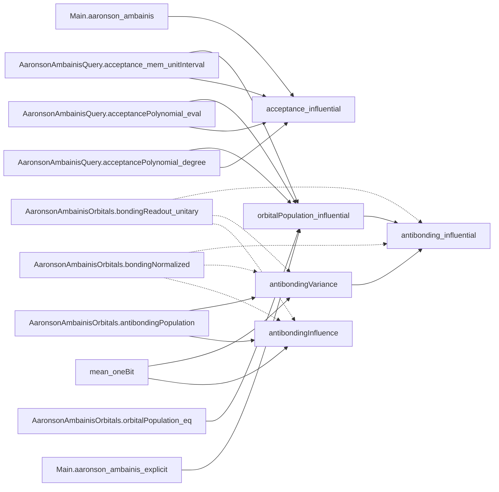

- [Main.aaronson_ambainis](https://github.com/physical-superintelligence/aaronson-ambainis/blob/2a6ceaef872ae993708950f951989134084b851a/AaronsonAmbainis/Main.lean#L33)
- [Main.aaronson_ambainis_explicit](https://github.com/physical-superintelligence/aaronson-ambainis/blob/2a6ceaef872ae993708950f951989134084b851a/AaronsonAmbainis/Main.lean#L38)
- [acceptance_influential](../../FQChem/Complexity/AaronsonAmbainis.lean#L36)
- [antibondingInfluence](../../FQChem/Complexity/AaronsonAmbainis.lean#L78)
- [antibondingVariance](../../FQChem/Complexity/AaronsonAmbainis.lean#L74)
- [antibonding_influential](../../FQChem/Complexity/AaronsonAmbainis.lean#L84)
- [mean_oneBit](../../FQChem/Complexity/AaronsonAmbainis.lean#L67) (private)
- [orbitalPopulation_influential](../../FQChem/Complexity/AaronsonAmbainis.lean#L51)
- [AaronsonAmbainisOrbitals.antibondingPopulation](../../FQChem/Complexity/AaronsonAmbainisOrbitals.lean#L106)
- [AaronsonAmbainisOrbitals.bondingNormalized](../../FQChem/Complexity/AaronsonAmbainisOrbitals.lean#L86)
- [AaronsonAmbainisOrbitals.bondingReadout_unitary](../../FQChem/Complexity/AaronsonAmbainisOrbitals.lean#L93)
- [AaronsonAmbainisOrbitals.orbitalPopulation_eq](../../FQChem/Complexity/AaronsonAmbainisOrbitals.lean#L74)
- [AaronsonAmbainisQuery.acceptancePolynomial_degree](../../FQChem/Complexity/AaronsonAmbainisQuery.lean#L173)
- [AaronsonAmbainisQuery.acceptancePolynomial_eval](../../FQChem/Complexity/AaronsonAmbainisQuery.lean#L164)
- [AaronsonAmbainisQuery.acceptance_mem_unitInterval](../../FQChem/Complexity/AaronsonAmbainisQuery.lean#L181)

## FQChem.Complexity.AaronsonAmbainisOrbitals

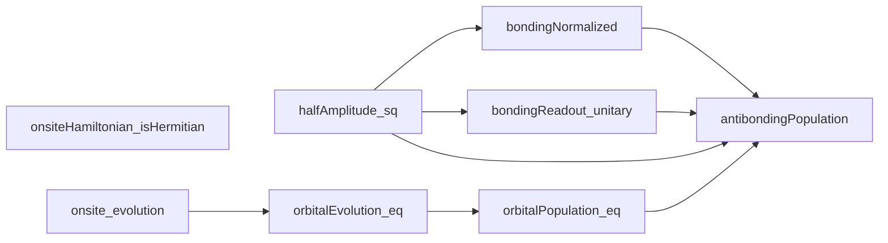

- [antibondingPopulation](../../FQChem/Complexity/AaronsonAmbainisOrbitals.lean#L106)
- [bondingNormalized](../../FQChem/Complexity/AaronsonAmbainisOrbitals.lean#L86)
- [bondingReadout_unitary](../../FQChem/Complexity/AaronsonAmbainisOrbitals.lean#L93)
- [halfAmplitude_sq](../../FQChem/Complexity/AaronsonAmbainisOrbitals.lean#L80) (private)
- [onsiteHamiltonian_isHermitian](../../FQChem/Complexity/AaronsonAmbainisOrbitals.lean#L37)
- [onsite_evolution](../../FQChem/Complexity/AaronsonAmbainisOrbitals.lean#L42)
- [orbitalEvolution_eq](../../FQChem/Complexity/AaronsonAmbainisOrbitals.lean#L61)
- [orbitalPopulation_eq](../../FQChem/Complexity/AaronsonAmbainisOrbitals.lean#L74)

## FQChem.Complexity.AaronsonAmbainisQuery

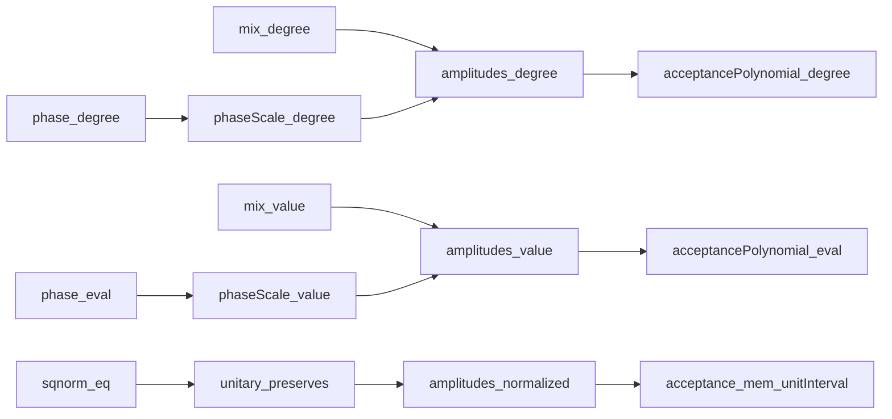

- [acceptancePolynomial_degree](../../FQChem/Complexity/AaronsonAmbainisQuery.lean#L173)
- [acceptancePolynomial_eval](../../FQChem/Complexity/AaronsonAmbainisQuery.lean#L164)
- [acceptance_mem_unitInterval](../../FQChem/Complexity/AaronsonAmbainisQuery.lean#L181)
- [amplitudes_degree](../../FQChem/Complexity/AaronsonAmbainisQuery.lean#L149) (private)
- [amplitudes_normalized](../../FQChem/Complexity/AaronsonAmbainisQuery.lean#L78)
- [amplitudes_value](../../FQChem/Complexity/AaronsonAmbainisQuery.lean#L142) (private)
- [mix_degree](../../FQChem/Complexity/AaronsonAmbainisQuery.lean#L128) (private)
- [mix_value](../../FQChem/Complexity/AaronsonAmbainisQuery.lean#L121) (private)
- [phaseScale_degree](../../FQChem/Complexity/AaronsonAmbainisQuery.lean#L109) (private)
- [phaseScale_value](../../FQChem/Complexity/AaronsonAmbainisQuery.lean#L104) (private)
- [phase_degree](../../FQChem/Complexity/AaronsonAmbainisQuery.lean#L46) (private)
- [phase_eval](../../FQChem/Complexity/AaronsonAmbainisQuery.lean#L40) (private)
- [sqnorm_eq](../../FQChem/Complexity/AaronsonAmbainisQuery.lean#L68) (private)
- [unitary_preserves](../../FQChem/Complexity/AaronsonAmbainisQuery.lean#L72) (private)

## FQChem.Complexity.ElectronicStructure

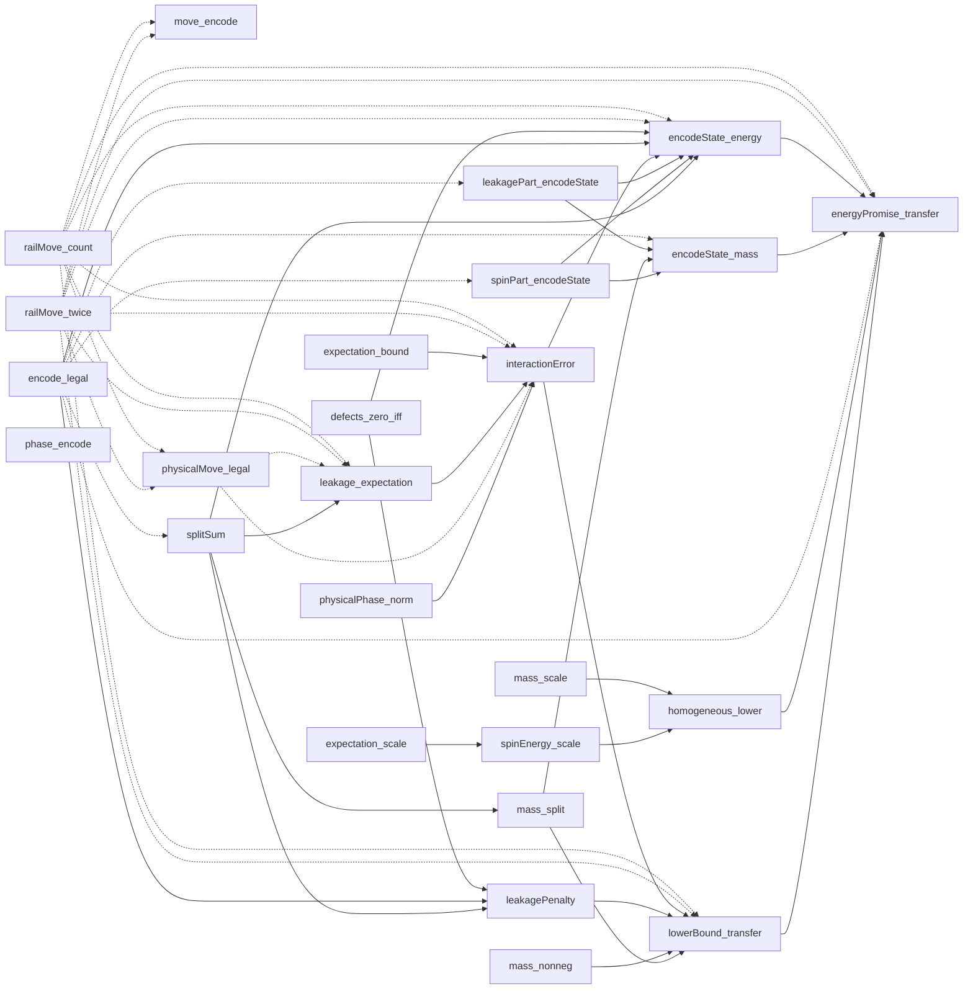

- [railMove_count](../../FQChem/Complexity/ElectronicStructure.lean#L110)
- [railMove_twice](../../FQChem/Complexity/ElectronicStructure.lean#L104)
- [defects_zero_iff](../../FQChem/Complexity/ElectronicStructure.lean#L81)
- [encodeState_energy](../../FQChem/Complexity/ElectronicStructure.lean#L252)
- [encodeState_mass](../../FQChem/Complexity/ElectronicStructure.lean#L248)
- [encode_legal](../../FQChem/Complexity/ElectronicStructure.lean#L58)
- [energyPromise_transfer](../../FQChem/Complexity/ElectronicStructure.lean#L319)
- [expectation_bound](../../FQChem/Complexity/ElectronicStructure.lean#L167) (private)
- [expectation_scale](../../FQChem/Complexity/ElectronicStructure.lean#L282) (private)
- [homogeneous_lower](../../FQChem/Complexity/ElectronicStructure.lean#L300) (private)
- [interactionError](../../FQChem/Complexity/ElectronicStructure.lean#L214)
- [leakagePart_encodeState](../../FQChem/Complexity/ElectronicStructure.lean#L243)
- [leakagePenalty](../../FQChem/Complexity/ElectronicStructure.lean#L225)
- [leakage_expectation](../../FQChem/Complexity/ElectronicStructure.lean#L209) (private)
- [lowerBound_transfer](../../FQChem/Complexity/ElectronicStructure.lean#L268)
- [mass_nonneg](../../FQChem/Complexity/ElectronicStructure.lean#L263) (private)
- [mass_scale](../../FQChem/Complexity/ElectronicStructure.lean#L278) (private)
- [mass_split](../../FQChem/Complexity/ElectronicStructure.lean#L193)
- [move_encode](../../FQChem/Complexity/ElectronicStructure.lean#L127)
- [phase_encode](../../FQChem/Complexity/ElectronicStructure.lean#L149)
- [physicalMove_legal](../../FQChem/Complexity/ElectronicStructure.lean#L130)
- [physicalPhase_norm](../../FQChem/Complexity/ElectronicStructure.lean#L152) (private)
- [spinEnergy_scale](../../FQChem/Complexity/ElectronicStructure.lean#L293) (private)
- [spinPart_encodeState](../../FQChem/Complexity/ElectronicStructure.lean#L238)
- [splitSum](../../FQChem/Complexity/ElectronicStructure.lean#L188) (private)

## FQChem.Complexity.ElectronicStructureOperators

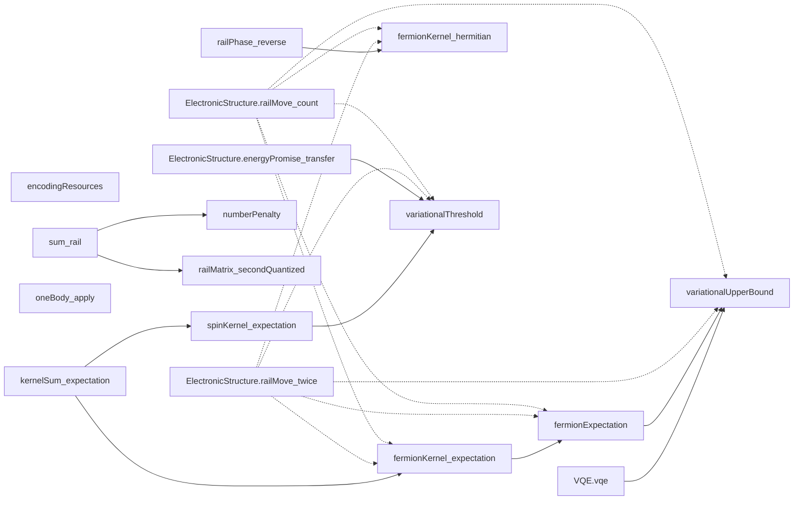

- [ElectronicStructure.railMove_count](../../FQChem/Complexity/ElectronicStructure.lean#L110)
- [ElectronicStructure.railMove_twice](../../FQChem/Complexity/ElectronicStructure.lean#L104)
- [ElectronicStructure.energyPromise_transfer](../../FQChem/Complexity/ElectronicStructure.lean#L319)
- [encodingResources](../../FQChem/Complexity/ElectronicStructureOperators.lean#L72)
- [fermionExpectation](../../FQChem/Complexity/ElectronicStructureOperators.lean#L167)
- [fermionKernel_expectation](../../FQChem/Complexity/ElectronicStructureOperators.lean#L150)
- [fermionKernel_hermitian](../../FQChem/Complexity/ElectronicStructureOperators.lean#L130)
- [kernelSum_expectation](../../FQChem/Complexity/ElectronicStructureOperators.lean#L90) (private)
- [numberPenalty](../../FQChem/Complexity/ElectronicStructureOperators.lean#L57)
- [oneBody_apply](../../FQChem/Complexity/ElectronicStructureOperators.lean#L31) (private)
- [railMatrix_secondQuantized](../../FQChem/Complexity/ElectronicStructureOperators.lean#L45)
- [railPhase_reverse](../../FQChem/Complexity/ElectronicStructureOperators.lean#L122) (private)
- [spinKernel_expectation](../../FQChem/Complexity/ElectronicStructureOperators.lean#L114)
- [sum_rail](../../FQChem/Complexity/ElectronicStructureOperators.lean#L37) (private)
- [variationalThreshold](../../FQChem/Complexity/ElectronicStructureOperators.lean#L190)
- [variationalUpperBound](../../FQChem/Complexity/ElectronicStructureOperators.lean#L180)
- [VQE.vqe](../../FQChem/StatePrep/VariationalOptimization/VQE.lean#L28)

## FQChem.Complexity.ElectronicStructurePauli

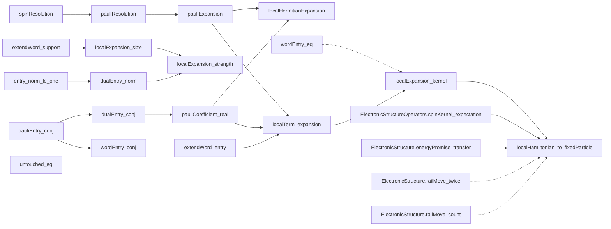

- [ElectronicStructure.railMove_count](../../FQChem/Complexity/ElectronicStructure.lean#L110)
- [ElectronicStructure.railMove_twice](../../FQChem/Complexity/ElectronicStructure.lean#L104)
- [ElectronicStructure.energyPromise_transfer](../../FQChem/Complexity/ElectronicStructure.lean#L319)
- [ElectronicStructureOperators.spinKernel_expectation](../../FQChem/Complexity/ElectronicStructureOperators.lean#L114)
- [dualEntry_conj](../../FQChem/Complexity/ElectronicStructurePauli.lean#L80) (private)
- [dualEntry_norm](../../FQChem/Complexity/ElectronicStructurePauli.lean#L222) (private)
- [entry_norm_le_one](../../FQChem/Complexity/ElectronicStructurePauli.lean#L219) (private)
- [extendWord_entry](../../FQChem/Complexity/ElectronicStructurePauli.lean#L126)
- [extendWord_support](../../FQChem/Complexity/ElectronicStructurePauli.lean#L139)
- [localExpansion_kernel](../../FQChem/Complexity/ElectronicStructurePauli.lean#L184)
- [localExpansion_size](../../FQChem/Complexity/ElectronicStructurePauli.lean#L198)
- [localExpansion_strength](../../FQChem/Complexity/ElectronicStructurePauli.lean#L232)
- [localHamiltonian_to_fixedParticle](../../FQChem/Complexity/ElectronicStructurePauli.lean#L209)
- [localHermitianExpansion](../../FQChem/Complexity/ElectronicStructurePauli.lean#L97)
- [localTerm_expansion](../../FQChem/Complexity/ElectronicStructurePauli.lean#L175) (private)
- [pauliCoefficient_real](../../FQChem/Complexity/ElectronicStructurePauli.lean#L84)
- [pauliEntry_conj](../../FQChem/Complexity/ElectronicStructurePauli.lean#L29) (private)
- [pauliExpansion](../../FQChem/Complexity/ElectronicStructurePauli.lean#L67)
- [pauliResolution](../../FQChem/Complexity/ElectronicStructurePauli.lean#L54)
- [spinResolution](../../FQChem/Complexity/ElectronicStructurePauli.lean#L33) (private)
- [untouched_eq](../../FQChem/Complexity/ElectronicStructurePauli.lean#L114)
- [wordEntry_conj](../../FQChem/Complexity/ElectronicStructurePauli.lean#L48) (private)
- [wordEntry_eq](../../FQChem/Complexity/ElectronicStructurePauli.lean#L42)

## FQChem.Complexity.FastForwarding

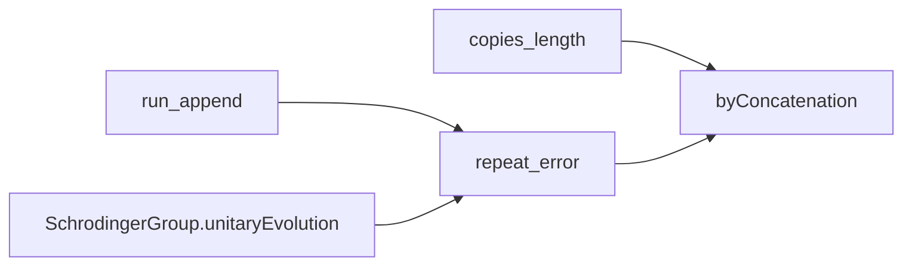

- [byConcatenation](../../FQChem/Complexity/FastForwarding.lean#L81)
- [copies_length](../../FQChem/Complexity/FastForwarding.lean#L37)
- [repeat_error](../../FQChem/Complexity/FastForwarding.lean#L58)
- [run_append](../../FQChem/Complexity/FastForwarding.lean#L42) (private)
- [SchrodingerGroup.unitaryEvolution](../../FQChem/Dynamics/RealTimePropagation/SchrodingerGroup.lean#L41)

## FQChem.Complexity.GroundStateSearch

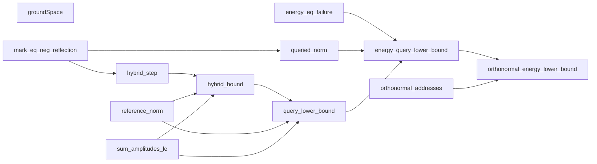

- [energy_eq_failure](../../FQChem/Complexity/GroundStateSearch.lean#L35)
- [energy_query_lower_bound](../../FQChem/Complexity/GroundStateSearch.lean#L141)
- [groundSpace](../../FQChem/Complexity/GroundStateSearch.lean#L30)
- [hybrid_bound](../../FQChem/Complexity/GroundStateSearch.lean#L103)
- [hybrid_step](../../FQChem/Complexity/GroundStateSearch.lean#L69) (private)
- [mark_eq_neg_reflection](../../FQChem/Complexity/GroundStateSearch.lean#L44) (private)
- [orthonormal_addresses](../../FQChem/Complexity/GroundStateSearch.lean#L86)
- [orthonormal_energy_lower_bound](../../FQChem/Complexity/GroundStateSearch.lean#L154)
- [queried_norm](../../FQChem/Complexity/GroundStateSearch.lean#L64)
- [query_lower_bound](../../FQChem/Complexity/GroundStateSearch.lean#L116)
- [reference_norm](../../FQChem/Complexity/GroundStateSearch.lean#L59)
- [sum_amplitudes_le](../../FQChem/Complexity/GroundStateSearch.lean#L92) (private)

## FQChem.Complexity.OrbitalSimulation

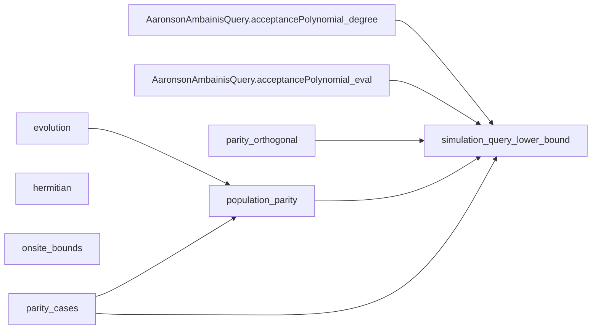

- [AaronsonAmbainisQuery.acceptancePolynomial_degree](../../FQChem/Complexity/AaronsonAmbainisQuery.lean#L173)
- [AaronsonAmbainisQuery.acceptancePolynomial_eval](../../FQChem/Complexity/AaronsonAmbainisQuery.lean#L164)
- [evolution](../../FQChem/Complexity/OrbitalSimulation.lean#L77)
- [hermitian](../../FQChem/Complexity/OrbitalSimulation.lean#L71)
- [onsite_bounds](../../FQChem/Complexity/OrbitalSimulation.lean#L57)
- [parity_cases](../../FQChem/Complexity/OrbitalSimulation.lean#L29) (private)
- [parity_orthogonal](../../FQChem/Complexity/OrbitalSimulation.lean#L35)
- [population_parity](../../FQChem/Complexity/OrbitalSimulation.lean#L101)
- [simulation_query_lower_bound](../../FQChem/Complexity/OrbitalSimulation.lean#L113)

## FQChem.Complexity.SparseParityPath

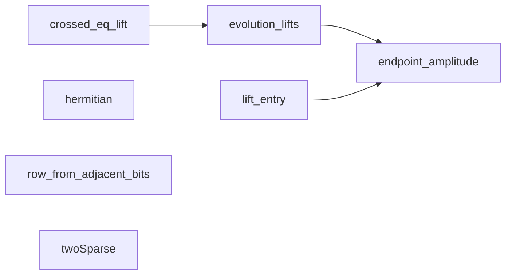

- [crossed_eq_lift](../../FQChem/Complexity/SparseParityPath.lean#L116)
- [endpoint_amplitude](../../FQChem/Complexity/SparseParityPath.lean#L151)
- [evolution_lifts](../../FQChem/Complexity/SparseParityPath.lean#L131)
- [hermitian](../../FQChem/Complexity/SparseParityPath.lean#L49)
- [lift_entry](../../FQChem/Complexity/SparseParityPath.lean#L109) (private)
- [row_from_adjacent_bits](../../FQChem/Complexity/SparseParityPath.lean#L61)
- [twoSparse](../../FQChem/Complexity/SparseParityPath.lean#L74)

## FQChem.Dynamics.DigitalAlgorithms.CommutingTerms


- [commutingProductFormula](../../FQChem/Dynamics/DigitalAlgorithms/CommutingTerms.lean#L18)

## FQChem.Dynamics.DigitalAlgorithms.LieTrotter

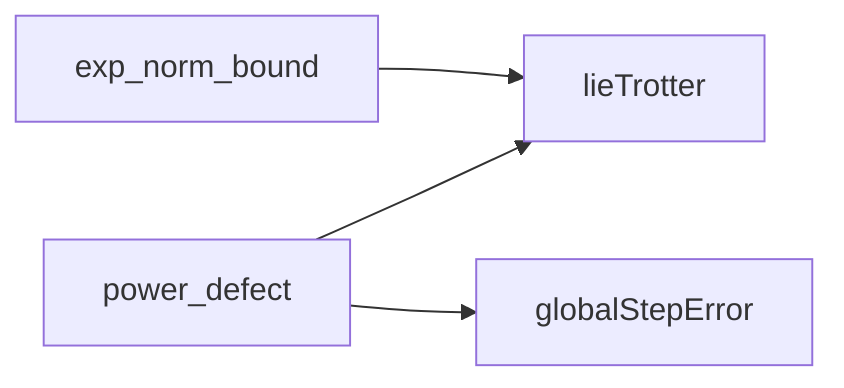

- [exp_norm_bound](../../FQChem/Dynamics/DigitalAlgorithms/LieTrotter.lean#L62) (private)
- [globalStepError](../../FQChem/Dynamics/DigitalAlgorithms/LieTrotter.lean#L55)
- [lieTrotter](../../FQChem/Dynamics/DigitalAlgorithms/LieTrotter.lean#L73)
- [power_defect](../../FQChem/Dynamics/DigitalAlgorithms/LieTrotter.lean#L36) (private)

## FQChem.Dynamics.DigitalAlgorithms.LinearCombinationOfUnitaries

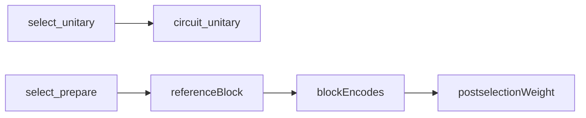

- [blockEncodes](../../FQChem/Dynamics/DigitalAlgorithms/LinearCombinationOfUnitaries.lean#L69)
- [circuit_unitary](../../FQChem/Dynamics/DigitalAlgorithms/LinearCombinationOfUnitaries.lean#L40)
- [postselectionWeight](../../FQChem/Dynamics/DigitalAlgorithms/LinearCombinationOfUnitaries.lean#L81)
- [referenceBlock](../../FQChem/Dynamics/DigitalAlgorithms/LinearCombinationOfUnitaries.lean#L55)
- [select_prepare](../../FQChem/Dynamics/DigitalAlgorithms/LinearCombinationOfUnitaries.lean#L47) (private)
- [select_unitary](../../FQChem/Dynamics/DigitalAlgorithms/LinearCombinationOfUnitaries.lean#L30)

## FQChem.Dynamics.DigitalAlgorithms.Qubitization

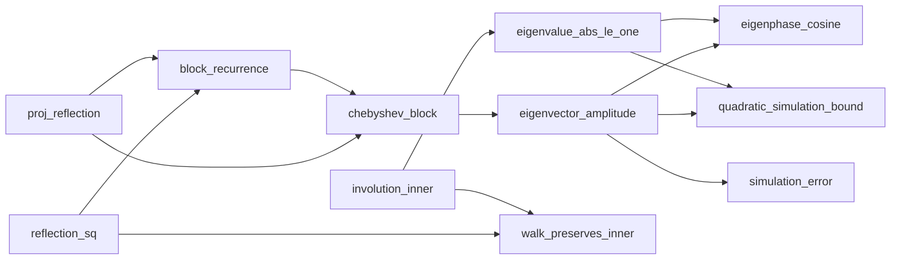

- [block_recurrence](../../FQChem/Dynamics/DigitalAlgorithms/Qubitization.lean#L74) (private)
- [chebyshev_block](../../FQChem/Dynamics/DigitalAlgorithms/Qubitization.lean#L100)
- [eigenphase_cosine](../../FQChem/Dynamics/DigitalAlgorithms/Qubitization.lean#L150)
- [eigenvalue_abs_le_one](../../FQChem/Dynamics/DigitalAlgorithms/Qubitization.lean#L135)
- [eigenvector_amplitude](../../FQChem/Dynamics/DigitalAlgorithms/Qubitization.lean#L115)
- [involution_inner](../../FQChem/Dynamics/DigitalAlgorithms/Qubitization.lean#L62) (private)
- [proj_reflection](../../FQChem/Dynamics/DigitalAlgorithms/Qubitization.lean#L59) (private)
- [quadratic_simulation_bound](../../FQChem/Dynamics/DigitalAlgorithms/Qubitization.lean#L169)
- [reflection_sq](../../FQChem/Dynamics/DigitalAlgorithms/Qubitization.lean#L55) (private)
- [simulation_error](../../FQChem/Dynamics/DigitalAlgorithms/Qubitization.lean#L125)
- [walk_preserves_inner](../../FQChem/Dynamics/DigitalAlgorithms/Qubitization.lean#L67)

## FQChem.Dynamics.DigitalAlgorithms.TruncatedTaylor

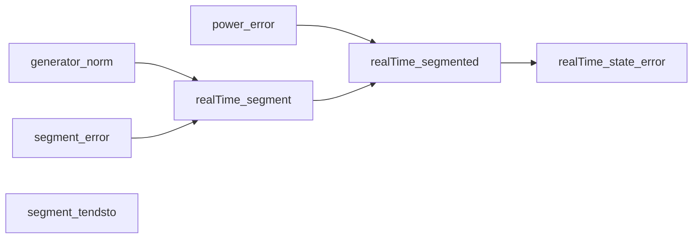

- [generator_norm](../../FQChem/Dynamics/DigitalAlgorithms/TruncatedTaylor.lean#L104) (private)
- [power_error](../../FQChem/Dynamics/DigitalAlgorithms/TruncatedTaylor.lean#L74) (private)
- [realTime_segment](../../FQChem/Dynamics/DigitalAlgorithms/TruncatedTaylor.lean#L109)
- [realTime_segmented](../../FQChem/Dynamics/DigitalAlgorithms/TruncatedTaylor.lean#L116)
- [realTime_state_error](../../FQChem/Dynamics/DigitalAlgorithms/TruncatedTaylor.lean#L140)
- [segment_error](../../FQChem/Dynamics/DigitalAlgorithms/TruncatedTaylor.lean#L41)
- [segment_tendsto](../../FQChem/Dynamics/DigitalAlgorithms/TruncatedTaylor.lean#L70)

## FQChem.Dynamics.LearnedSurrogates


- [invariantDirectionalForce](../../FQChem/Dynamics/LearnedSurrogates.lean#L28)

## FQChem.Dynamics.OpenSystems.Kraus

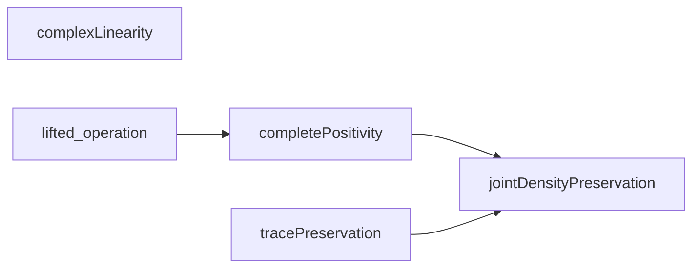

- [completePositivity](../../FQChem/Dynamics/OpenSystems/Kraus.lean#L74)
- [complexLinearity](../../FQChem/Dynamics/OpenSystems/Kraus.lean#L69)
- [jointDensityPreservation](../../FQChem/Dynamics/OpenSystems/Kraus.lean#L86)
- [lifted_operation](../../FQChem/Dynamics/OpenSystems/Kraus.lean#L59) (private)
- [tracePreservation](../../FQChem/Dynamics/OpenSystems/Kraus.lean#L79)

## FQChem.Dynamics.OpenSystems.TracePreservation

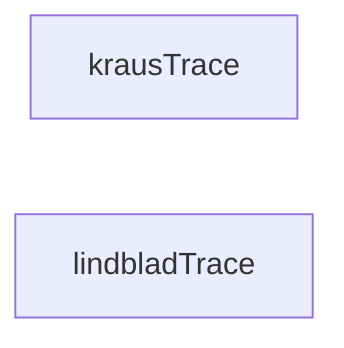

- [krausTrace](../../FQChem/Dynamics/OpenSystems/TracePreservation.lean#L37)
- [lindbladTrace](../../FQChem/Dynamics/OpenSystems/TracePreservation.lean#L30)

## FQChem.Dynamics.RealTimePropagation.BornOppenheimer


- [bornOppenheimerEnergy](../../FQChem/Dynamics/RealTimePropagation/BornOppenheimer.lean#L27)

## FQChem.Dynamics.RealTimePropagation.ClusterExpansions


- [linkedClusterInversion](../../FQChem/Dynamics/RealTimePropagation/ClusterExpansions.lean#L20)

## FQChem.Dynamics.RealTimePropagation.HeisenbergPicture

```mermaid
flowchart LR
  n156["pauliRotation"]
  n157["pictureDuality"]
```

- [pauliRotation](../../FQChem/Dynamics/RealTimePropagation/HeisenbergPicture.lean#L38)
- [pictureDuality](../../FQChem/Dynamics/RealTimePropagation/HeisenbergPicture.lean#L33)

## FQChem.Dynamics.RealTimePropagation.KrylovPropagation

```mermaid
flowchart LR
  n158["krylovExact"]
  n159["krylovMoment"]
```

- [krylovExact](../../FQChem/Dynamics/RealTimePropagation/KrylovPropagation.lean#L34)
- [krylovMoment](../../FQChem/Dynamics/RealTimePropagation/KrylovPropagation.lean#L42)

## FQChem.Dynamics.RealTimePropagation.OutOfTimeOrder

```mermaid
flowchart LR
  n79["ElectronicStructurePauli.pauliCoefficient_real"]
  n81["ElectronicStructurePauli.pauliExpansion"]
  n86["ElectronicStructurePauli.wordEntry_eq"]
  n160["butterflyMass"]
  n161["discardedWeightError"]
  n162["dualEntry_trace"]
  n163["expansion"]
  n164["firstOrder_eq_anticommutingMass"]
  n165["invariantTails"]
  n166["swapTrace"]
  n167["traceCoefficient"]
  n168["traceExpansion"]
  n169["twoCopyReadout"]
  n170["zConjugation"]
  n79 --> n160
  n163 --> n160
  n168 --> n160
  n164 --> n161
  n81 --> n163
  n79 --> n164
  n160 --> n164
  n163 --> n164
  n168 --> n164
  n170 --> n164
  n162 --> n167
  n167 --> n168
  n166 --> n169
  n86 --> n170
```

- [ElectronicStructurePauli.pauliCoefficient_real](../../FQChem/Complexity/ElectronicStructurePauli.lean#L84)
- [ElectronicStructurePauli.pauliExpansion](../../FQChem/Complexity/ElectronicStructurePauli.lean#L67)
- [ElectronicStructurePauli.wordEntry_eq](../../FQChem/Complexity/ElectronicStructurePauli.lean#L42)
- [butterflyMass](../../FQChem/Dynamics/RealTimePropagation/OutOfTimeOrder.lean#L81)
- [discardedWeightError](../../FQChem/Dynamics/RealTimePropagation/OutOfTimeOrder.lean#L119)
- [dualEntry_trace](../../FQChem/Dynamics/RealTimePropagation/OutOfTimeOrder.lean#L38) (private)
- [expansion](../../FQChem/Dynamics/RealTimePropagation/OutOfTimeOrder.lean#L51) (private)
- [firstOrder_eq_anticommutingMass](../../FQChem/Dynamics/RealTimePropagation/OutOfTimeOrder.lean#L93)
- [invariantTails](../../FQChem/Dynamics/RealTimePropagation/OutOfTimeOrder.lean#L156)
- [swapTrace](../../FQChem/Dynamics/RealTimePropagation/OutOfTimeOrder.lean#L142)
- [traceCoefficient](../../FQChem/Dynamics/RealTimePropagation/OutOfTimeOrder.lean#L45)
- [traceExpansion](../../FQChem/Dynamics/RealTimePropagation/OutOfTimeOrder.lean#L73) (private)
- [twoCopyReadout](../../FQChem/Dynamics/RealTimePropagation/OutOfTimeOrder.lean#L148)
- [zConjugation](../../FQChem/Dynamics/RealTimePropagation/OutOfTimeOrder.lean#L59)

## FQChem.Dynamics.RealTimePropagation.PathSampling

```mermaid
flowchart LR
  n171["realTimeReweighting"]
```

- [realTimeReweighting](../../FQChem/Dynamics/RealTimePropagation/PathSampling.lean#L22)

## FQChem.Dynamics.RealTimePropagation.RingPolymer

```mermaid
flowchart LR
  n172["ringPolymerSpringForce"]
```

- [ringPolymerSpringForce](../../FQChem/Dynamics/RealTimePropagation/RingPolymer.lean#L26)

## FQChem.Dynamics.RealTimePropagation.SchrodingerGroup

```mermaid
flowchart LR
  n173["unitaryEvolution"]
```

- [unitaryEvolution](../../FQChem/Dynamics/RealTimePropagation/SchrodingerGroup.lean#L41)

## FQChem.Dynamics.RealTimePropagation.SplitOperator

```mermaid
flowchart LR
  n174["splitOperator"]
```

- [splitOperator](../../FQChem/Dynamics/RealTimePropagation/SplitOperator.lean#L26)

## FQChem.Dynamics.RealTimePropagation.TimeDependentCI

```mermaid
flowchart LR
  n175["tdConfigurationInteraction"]
```

- [tdConfigurationInteraction](../../FQChem/Dynamics/RealTimePropagation/TimeDependentCI.lean#L28)

## FQChem.Dynamics.RealTimePropagation.VariationalEvolution

```mermaid
flowchart LR
  n176["mcLachlanProjection"]
  n177["sampledTangentMetric"]
```

- [mcLachlanProjection](../../FQChem/Dynamics/RealTimePropagation/VariationalEvolution.lean#L56)
- [sampledTangentMetric](../../FQChem/Dynamics/RealTimePropagation/VariationalEvolution.lean#L38)

## FQChem.Multiscale.ChoosingLayers.ClassicalEnvironments

```mermaid
flowchart LR
  n178["layeredForce"]
```

- [layeredForce](../../FQChem/Multiscale/ChoosingLayers/ClassicalEnvironments.lean#L26)

## FQChem.Multiscale.ChoosingLayers.Fragments

```mermaid
flowchart LR
  n179["pairReconstruction"]
```

- [pairReconstruction](../../FQChem/Multiscale/ChoosingLayers/Fragments.lean#L27)

## FQChem.Multiscale.ChoosingLayers.FrozenMolecularDensity

```mermaid
flowchart LR
  n180["frozenMolecularEnergy"]
  n184["QuantumEnvironments.frozenSearch"]
  n360["CoulombIntegrability.coulombConstrainedSearch"]
  n184 --> n180
  n360 --> n180
```

- [frozenMolecularEnergy](../../FQChem/Multiscale/ChoosingLayers/FrozenMolecularDensity.lean#L15)
- [QuantumEnvironments.frozenSearch](../../FQChem/Multiscale/ChoosingLayers/QuantumEnvironments.lean#L41)
- [CoulombIntegrability.coulombConstrainedSearch](../../FQChem/StatePrep/VariationalOptimization/DensityFunctionals/CoulombIntegrability.lean#L88)

## FQChem.Multiscale.ChoosingLayers.LearnedEnvironments

```mermaid
flowchart LR
  n181["deltaLearningGap"]
```

- [deltaLearningGap](../../FQChem/Multiscale/ChoosingLayers/LearnedEnvironments.lean#L23)

## FQChem.Multiscale.ChoosingLayers.Partitions

```mermaid
flowchart LR
  n182["overlapAccounting"]
```

- [overlapAccounting](../../FQChem/Multiscale/ChoosingLayers/Partitions.lean#L36)

## FQChem.Multiscale.ChoosingLayers.QuantumEnvironments

```mermaid
flowchart LR
  n183["frozenDensityDerivative"]
  n184["frozenSearch"]
```

- [frozenDensityDerivative](../../FQChem/Multiscale/ChoosingLayers/QuantumEnvironments.lean#L37)
- [frozenSearch](../../FQChem/Multiscale/ChoosingLayers/QuantumEnvironments.lean#L41)

## FQChem.Multiscale.StitchingSolutions.EmbeddedSolvers

```mermaid
flowchart LR
  n185["feshbachReduction"]
```

- [feshbachReduction](../../FQChem/Multiscale/StitchingSolutions/EmbeddedSolvers.lean#L30)

## FQChem.Multiscale.StitchingSolutions.ErrorPropagation

```mermaid
flowchart LR
  n186["barrierRateError"]
```

- [barrierRateError](../../FQChem/Multiscale/StitchingSolutions/ErrorPropagation.lean#L23)

## FQChem.Multiscale.StitchingSolutions.LayeredQM

```mermaid
flowchart LR
  n154["BornOppenheimer.bornOppenheimerEnergy"]
  n178["ClassicalEnvironments.layeredForce"]
  n187["layeredBornOppenheimerEnergy"]
  n188["layeredEigenForce"]
  n189["layeredProjectionError"]
  n190["layeredProjectionLimit"]
  n191["projectedLayeredEnergy_eq"]
  n207["HellmannFeynman.hellmannFeynman"]
  n293["GroundStateProjection.energyBound"]
  n294["GroundStateProjection.energyLimit"]
  n154 --> n187
  n188 --> n187
  n178 --> n188
  n207 --> n188
  n191 --> n189
  n293 --> n189
  n191 --> n190
  n294 --> n190
```

- [BornOppenheimer.bornOppenheimerEnergy](../../FQChem/Dynamics/RealTimePropagation/BornOppenheimer.lean#L27)
- [ClassicalEnvironments.layeredForce](../../FQChem/Multiscale/ChoosingLayers/ClassicalEnvironments.lean#L26)
- [layeredBornOppenheimerEnergy](../../FQChem/Multiscale/StitchingSolutions/LayeredQM.lean#L73)
- [layeredEigenForce](../../FQChem/Multiscale/StitchingSolutions/LayeredQM.lean#L61)
- [layeredProjectionError](../../FQChem/Multiscale/StitchingSolutions/LayeredQM.lean#L34)
- [layeredProjectionLimit](../../FQChem/Multiscale/StitchingSolutions/LayeredQM.lean#L44)
- [projectedLayeredEnergy_eq](../../FQChem/Multiscale/StitchingSolutions/LayeredQM.lean#L26)
- [HellmannFeynman.hellmannFeynman](../../FQChem/Properties/ResponseAndEstimation/HellmannFeynman.lean#L39)
- [GroundStateProjection.energyBound](../../FQChem/StatePrep/ImaginaryTimeProjection/GroundStateProjection.lean#L139)
- [GroundStateProjection.energyLimit](../../FQChem/StatePrep/ImaginaryTimeProjection/GroundStateProjection.lean#L150)

## FQChem.Multiscale.StitchingSolutions.Observables

```mermaid
flowchart LR
  n192["zwanzig"]
```

- [zwanzig](../../FQChem/Multiscale/StitchingSolutions/Observables.lean#L33)

## FQChem.Properties.LinearSystems.DirichletPoisson

```mermaid
flowchart LR
  n193["dirichletPoissonMode"]
```

- [dirichletPoissonMode](../../FQChem/Properties/LinearSystems/DirichletPoisson.lean#L20)

## FQChem.Properties.LinearSystems.HHL

```mermaid
flowchart LR
  n194["hhlSpectralInversion"]
```

- [hhlSpectralInversion](../../FQChem/Properties/LinearSystems/HHL.lean#L18)

## FQChem.Properties.MeasurementTheory

```mermaid
flowchart LR
  n195["bornCompleteness"]
  n196["projectiveRepeatability"]
  n197["unsharpQubit"]
```

- [bornCompleteness](../../FQChem/Properties/MeasurementTheory.lean#L69)
- [projectiveRepeatability](../../FQChem/Properties/MeasurementTheory.lean#L78)
- [unsharpQubit](../../FQChem/Properties/MeasurementTheory.lean#L96)

## FQChem.Properties.PhaseEstimation

```mermaid
flowchart LR
  n198["exactGridQPE"]
```

- [exactGridQPE](../../FQChem/Properties/PhaseEstimation.lean#L17)

## FQChem.Properties.ResponseAndEstimation.BellSampling

```mermaid
flowchart LR
  n85["ElectronicStructurePauli.wordEntry_conj"]
  n199["bellResolution"]
  n200["magnitudeSquaredPauliExpectation"]
  n201["squaredPauliExpectation"]
  n85 --> n200
  n201 --> n200
  n199 --> n201
```

- [ElectronicStructurePauli.wordEntry_conj](../../FQChem/Complexity/ElectronicStructurePauli.lean#L48) (private)
- [bellResolution](../../FQChem/Properties/ResponseAndEstimation/BellSampling.lean#L41)
- [magnitudeSquaredPauliExpectation](../../FQChem/Properties/ResponseAndEstimation/BellSampling.lean#L88)
- [squaredPauliExpectation](../../FQChem/Properties/ResponseAndEstimation/BellSampling.lean#L56)

## FQChem.Properties.ResponseAndEstimation.ClassicalShadows

```mermaid
flowchart LR
  n202["projector_sum"]
  n203["secondMoment"]
  n204["signed_projector_sum"]
  n205["unbiased"]
  n206["weighted_sum"]
  n202 --> n203
  n206 --> n203
  n204 --> n205
  n206 --> n205
```

- [projector_sum](../../FQChem/Properties/ResponseAndEstimation/ClassicalShadows.lean#L33) (private)
- [secondMoment](../../FQChem/Properties/ResponseAndEstimation/ClassicalShadows.lean#L91)
- [signed_projector_sum](../../FQChem/Properties/ResponseAndEstimation/ClassicalShadows.lean#L38) (private)
- [unbiased](../../FQChem/Properties/ResponseAndEstimation/ClassicalShadows.lean#L71)
- [weighted_sum](../../FQChem/Properties/ResponseAndEstimation/ClassicalShadows.lean#L56) (private)

## FQChem.Properties.ResponseAndEstimation.HellmannFeynman

```mermaid
flowchart LR
  n207["hellmannFeynman"]
```

- [hellmannFeynman](../../FQChem/Properties/ResponseAndEstimation/HellmannFeynman.lean#L39)

## FQChem.Properties.ResponseAndEstimation.ShadowPrediction

```mermaid
flowchart LR
  n203["ClassicalShadows.secondMoment"]
  n205["ClassicalShadows.unbiased"]
  n208["blockPrediction"]
  n209["estimate_real"]
  n210["median_failure"]
  n211["median_witness"]
  n212["predictionAtConfidence"]
  n213["simultaneousPrediction"]
  n203 --> n208
  n205 --> n208
  n209 --> n208
  n211 --> n210
  n213 --> n212
  n208 --> n213
  n210 --> n213
```

- [ClassicalShadows.secondMoment](../../FQChem/Properties/ResponseAndEstimation/ClassicalShadows.lean#L91)
- [ClassicalShadows.unbiased](../../FQChem/Properties/ResponseAndEstimation/ClassicalShadows.lean#L71)
- [blockPrediction](../../FQChem/Properties/ResponseAndEstimation/ShadowPrediction.lean#L70)
- [estimate_real](../../FQChem/Properties/ResponseAndEstimation/ShadowPrediction.lean#L62) (private)
- [median_failure](../../FQChem/Properties/ResponseAndEstimation/ShadowPrediction.lean#L158) (private)
- [median_witness](../../FQChem/Properties/ResponseAndEstimation/ShadowPrediction.lean#L127) (private)
- [predictionAtConfidence](../../FQChem/Properties/ResponseAndEstimation/ShadowPrediction.lean#L235)
- [simultaneousPrediction](../../FQChem/Properties/ResponseAndEstimation/ShadowPrediction.lean#L205)

## FQChem.Properties.ResponseAndEstimation.SpectralReconstruction

```mermaid
flowchart LR
  n214["spectralIdentification"]
```

- [spectralIdentification](../../FQChem/Properties/ResponseAndEstimation/SpectralReconstruction.lean#L21)

## FQChem.Properties.ResponseAndEstimation.VQEMeasurement

```mermaid
flowchart LR
  n215["energyReconstruction"]
  n216["finiteShotVQE"]
  n217["shotStatistics"]
  n215 --> n216
  n217 --> n216
```

- [energyReconstruction](../../FQChem/Properties/ResponseAndEstimation/VQEMeasurement.lean#L67)
- [finiteShotVQE](../../FQChem/Properties/ResponseAndEstimation/VQEMeasurement.lean#L118)
- [shotStatistics](../../FQChem/Properties/ResponseAndEstimation/VQEMeasurement.lean#L74)

## FQChem.StatePrep.AdiabaticPreparation.AdiabaticTheorem

```mermaid
flowchart LR
  n218["adiabaticIntertwining"]
  n219["gappedBandPreparation"]
  n220["gappedBandPreparation_limit"]
  n221["katoTransport"]
  n222["projectionDerivative"]
  n223["reducedResolventPreparation"]
  n224["sandwichBound"]
  n225["transportedDerivative"]
  n224 --> n218
  n225 --> n218
  n218 --> n219
  n222 --> n219
  n219 --> n220
  n222 --> n221
  n225 --> n221
  n218 --> n223
  n222 --> n223
```

- [adiabaticIntertwining](../../FQChem/StatePrep/AdiabaticPreparation/AdiabaticTheorem.lean#L135)
- [gappedBandPreparation](../../FQChem/StatePrep/AdiabaticPreparation/AdiabaticTheorem.lean#L216)
- [gappedBandPreparation_limit](../../FQChem/StatePrep/AdiabaticPreparation/AdiabaticTheorem.lean#L311)
- [katoTransport](../../FQChem/StatePrep/AdiabaticPreparation/AdiabaticTheorem.lean#L186)
- [projectionDerivative](../../FQChem/StatePrep/AdiabaticPreparation/AdiabaticTheorem.lean#L174) (private)
- [reducedResolventPreparation](../../FQChem/StatePrep/AdiabaticPreparation/AdiabaticTheorem.lean#L264)
- [sandwichBound](../../FQChem/StatePrep/AdiabaticPreparation/AdiabaticTheorem.lean#L129) (private)
- [transportedDerivative](../../FQChem/StatePrep/AdiabaticPreparation/AdiabaticTheorem.lean#L119) (private)

## FQChem.StatePrep.AdiabaticPreparation.RydbergBlockade

```mermaid
flowchart LR
  n226["rydbergBlockade"]
```

- [rydbergBlockade](../../FQChem/StatePrep/AdiabaticPreparation/RydbergBlockade.lean#L28)

## FQChem.StatePrep.CircuitPreparation.AmplitudeAmplification

```mermaid
flowchart LR
  n227["inner_states"]
  n228["inverse_sqrt_queries"]
  n229["iterate_state"]
  n230["mark_state"]
  n231["project_state"]
  n232["rounded_success"]
  n233["state_normalized"]
  n234["step_rotates"]
  n235["success_law"]
  n232 --> n228
  n235 --> n228
  n234 --> n229
  n231 --> n230
  n235 --> n232
  n227 --> n233
  n227 --> n234
  n230 --> n234
  n229 --> n235
  n231 --> n235
```

- [inner_states](../../FQChem/StatePrep/CircuitPreparation/AmplitudeAmplification.lean#L52) (private)
- [inverse_sqrt_queries](../../FQChem/StatePrep/CircuitPreparation/AmplitudeAmplification.lean#L138)
- [iterate_state](../../FQChem/StatePrep/CircuitPreparation/AmplitudeAmplification.lean#L98)
- [mark_state](../../FQChem/StatePrep/CircuitPreparation/AmplitudeAmplification.lean#L70) (private)
- [project_state](../../FQChem/StatePrep/CircuitPreparation/AmplitudeAmplification.lean#L46) (private)
- [rounded_success](../../FQChem/StatePrep/CircuitPreparation/AmplitudeAmplification.lean#L117)
- [state_normalized](../../FQChem/StatePrep/CircuitPreparation/AmplitudeAmplification.lean#L63)
- [step_rotates](../../FQChem/StatePrep/CircuitPreparation/AmplitudeAmplification.lean#L77)
- [success_law](../../FQChem/StatePrep/CircuitPreparation/AmplitudeAmplification.lean#L110)

## FQChem.StatePrep.CircuitPreparation.ControlledRotations

```mermaid
flowchart LR
  n236["blockCount"]
  n237["normalized"]
  n238["preservesNorm"]
  n239["exactPreparation"]
  n240["preparePair_correct"]
  n241["radius_sq"]
  n242["registerCard"]
  n242 --> n236
  n238 --> n237
  n240 --> n239
  n241 --> n239
  n241 --> n240
```

- [blockCount](../../FQChem/StatePrep/CircuitPreparation/ControlledRotations.lean#L113)
- [normalized](../../FQChem/StatePrep/CircuitPreparation/ControlledRotations.lean#L87)
- [preservesNorm](../../FQChem/StatePrep/CircuitPreparation/ControlledRotations.lean#L42)
- [exactPreparation](../../FQChem/StatePrep/CircuitPreparation/ControlledRotations.lean#L122)
- [preparePair_correct](../../FQChem/StatePrep/CircuitPreparation/ControlledRotations.lean#L64)
- [radius_sq](../../FQChem/StatePrep/CircuitPreparation/ControlledRotations.lean#L54) (private)
- [registerCard](../../FQChem/StatePrep/CircuitPreparation/ControlledRotations.lean#L107) (private)

## FQChem.StatePrep.CircuitPreparation.SlaterDeterminants

```mermaid
flowchart LR
  n243["coordinate_of_fixed"]
  n244["eliminateCoefficient"]
  n245["existsOrbitalUnitary"]
  n246["existsSlaterPreparation"]
  n247["existsTwoModeFactorization"]
  n248["existsTwoModeSlaterPreparation"]
  n249["exteriorGate_product"]
  n250["gateForPair"]
  n251["listProduct_fixed"]
  n252["occupationAmplitude"]
  n253["prepareVector"]
  n250 --> n244
  n245 --> n246
  n251 --> n247
  n253 --> n247
  n246 --> n248
  n247 --> n248
  n249 --> n248
  n243 --> n253
  n244 --> n253
  n250 --> n253
```

- [coordinate_of_fixed](../../FQChem/StatePrep/CircuitPreparation/SlaterDeterminants.lean#L89) (private)
- [eliminateCoefficient](../../FQChem/StatePrep/CircuitPreparation/SlaterDeterminants.lean#L130) (private)
- [existsOrbitalUnitary](../../FQChem/StatePrep/CircuitPreparation/SlaterDeterminants.lean#L39)
- [existsSlaterPreparation](../../FQChem/StatePrep/CircuitPreparation/SlaterDeterminants.lean#L60)
- [existsTwoModeFactorization](../../FQChem/StatePrep/CircuitPreparation/SlaterDeterminants.lean#L197)
- [existsTwoModeSlaterPreparation](../../FQChem/StatePrep/CircuitPreparation/SlaterDeterminants.lean#L247)
- [exteriorGate_product](../../FQChem/StatePrep/CircuitPreparation/SlaterDeterminants.lean#L235)
- [gateForPair](../../FQChem/StatePrep/CircuitPreparation/SlaterDeterminants.lean#L94) (private)
- [listProduct_fixed](../../FQChem/StatePrep/CircuitPreparation/SlaterDeterminants.lean#L187) (private)
- [occupationAmplitude](../../FQChem/StatePrep/CircuitPreparation/SlaterDeterminants.lean#L71)
- [prepareVector](../../FQChem/StatePrep/CircuitPreparation/SlaterDeterminants.lean#L151) (private)

## FQChem.StatePrep.ImaginaryTimeProjection.AFQMC

```mermaid
flowchart LR
  n254["exactTrialLocalEnergy"]
  n255["fieldHistoryExpansion"]
  n256["freeProjection"]
  n257["hirschLattice"]
  n258["hirschLocal"]
  n259["hubbardFreeProjection"]
  n260["mixedEstimator"]
  n261["phaselessWeightLoss"]
  n262["projectedOverlap"]
  n263["realHirschParameter"]
  n264["slaterHistory"]
  n265["spinOrbitalFactorization"]
  n255 --> n256
  n264 --> n256
  n258 --> n257
  n255 --> n259
  n257 --> n259
  n256 --> n262
```

- [exactTrialLocalEnergy](../../FQChem/StatePrep/ImaginaryTimeProjection/AFQMC.lean#L176)
- [fieldHistoryExpansion](../../FQChem/StatePrep/ImaginaryTimeProjection/AFQMC.lean#L83)
- [freeProjection](../../FQChem/StatePrep/ImaginaryTimeProjection/AFQMC.lean#L139)
- [hirschLattice](../../FQChem/StatePrep/ImaginaryTimeProjection/AFQMC.lean#L68)
- [hirschLocal](../../FQChem/StatePrep/ImaginaryTimeProjection/AFQMC.lean#L44)
- [hubbardFreeProjection](../../FQChem/StatePrep/ImaginaryTimeProjection/AFQMC.lean#L103)
- [mixedEstimator](../../FQChem/StatePrep/ImaginaryTimeProjection/AFQMC.lean#L163)
- [phaselessWeightLoss](../../FQChem/StatePrep/ImaginaryTimeProjection/AFQMC.lean#L187)
- [projectedOverlap](../../FQChem/StatePrep/ImaginaryTimeProjection/AFQMC.lean#L148)
- [realHirschParameter](../../FQChem/StatePrep/ImaginaryTimeProjection/AFQMC.lean#L39)
- [slaterHistory](../../FQChem/StatePrep/ImaginaryTimeProjection/AFQMC.lean#L124)
- [spinOrbitalFactorization](../../FQChem/StatePrep/ImaginaryTimeProjection/AFQMC.lean#L58)

## FQChem.StatePrep.ImaginaryTimeProjection.DiffusionMonteCarlo

```mermaid
flowchart LR
  n266["branchingLocalEnergy"]
  n267["constantBranchingIff"]
  n268["exactFixedNode"]
  n269["exactGuideGroundEnergy"]
  n270["exactGuideStationarity"]
  n271["fixedNodeEqualityIff"]
  n272["fixedNodeShift"]
  n273["fixedNodeUpperBound"]
  n274["guidedFeynmanKac"]
  n275["penalty_nonneg"]
  n276["transitionMarkov"]
  n271 --> n268
  n273 --> n268
  n268 --> n269
  n276 --> n270
  n272 --> n271
  n275 --> n271
  n272 --> n273
  n275 --> n273
```

- [branchingLocalEnergy](../../FQChem/StatePrep/ImaginaryTimeProjection/DiffusionMonteCarlo.lean#L95)
- [constantBranchingIff](../../FQChem/StatePrep/ImaginaryTimeProjection/DiffusionMonteCarlo.lean#L68)
- [exactFixedNode](../../FQChem/StatePrep/ImaginaryTimeProjection/DiffusionMonteCarlo.lean#L186)
- [exactGuideGroundEnergy](../../FQChem/StatePrep/ImaginaryTimeProjection/DiffusionMonteCarlo.lean#L197)
- [exactGuideStationarity](../../FQChem/StatePrep/ImaginaryTimeProjection/DiffusionMonteCarlo.lean#L75)
- [fixedNodeEqualityIff](../../FQChem/StatePrep/ImaginaryTimeProjection/DiffusionMonteCarlo.lean#L153)
- [fixedNodeShift](../../FQChem/StatePrep/ImaginaryTimeProjection/DiffusionMonteCarlo.lean#L132)
- [fixedNodeUpperBound](../../FQChem/StatePrep/ImaginaryTimeProjection/DiffusionMonteCarlo.lean#L176)
- [guidedFeynmanKac](../../FQChem/StatePrep/ImaginaryTimeProjection/DiffusionMonteCarlo.lean#L50)
- [penalty_nonneg](../../FQChem/StatePrep/ImaginaryTimeProjection/DiffusionMonteCarlo.lean#L145) (private)
- [transitionMarkov](../../FQChem/StatePrep/ImaginaryTimeProjection/DiffusionMonteCarlo.lean#L32)

## FQChem.StatePrep.ImaginaryTimeProjection.FCIQMC

```mermaid
flowchart LR
  n277["annihilationPreserves"]
  n278["outcomeMass_nonneg"]
  n279["outcomeMass_sum"]
  n280["populationFirstMoment"]
  n281["populationMass_probability"]
  n282["productMarginal"]
  n283["roundedCounts"]
  n284["roundingFirstMoment"]
  n285["roundingMass_nonneg"]
  n286["roundingMass_sum"]
  n287["survivorsSignedCount"]
  n288["walkerFirstMoment"]
  n285 --> n278
  n286 --> n279
  n279 --> n280
  n282 --> n280
  n288 --> n280
  n278 --> n281
  n279 --> n281
  n277 --> n287
  n283 --> n288
```

- [annihilationPreserves](../../FQChem/StatePrep/ImaginaryTimeProjection/FCIQMC.lean#L142)
- [outcomeMass_nonneg](../../FQChem/StatePrep/ImaginaryTimeProjection/FCIQMC.lean#L81)
- [outcomeMass_sum](../../FQChem/StatePrep/ImaginaryTimeProjection/FCIQMC.lean#L85)
- [populationFirstMoment](../../FQChem/StatePrep/ImaginaryTimeProjection/FCIQMC.lean#L184)
- [populationMass_probability](../../FQChem/StatePrep/ImaginaryTimeProjection/FCIQMC.lean#L174)
- [productMarginal](../../FQChem/StatePrep/ImaginaryTimeProjection/FCIQMC.lean#L150) (private)
- [roundedCounts](../../FQChem/StatePrep/ImaginaryTimeProjection/FCIQMC.lean#L94) (private)
- [roundingFirstMoment](../../FQChem/StatePrep/ImaginaryTimeProjection/FCIQMC.lean#L39)
- [roundingMass_nonneg](../../FQChem/StatePrep/ImaginaryTimeProjection/FCIQMC.lean#L30)
- [roundingMass_sum](../../FQChem/StatePrep/ImaginaryTimeProjection/FCIQMC.lean#L35)
- [survivorsSignedCount](../../FQChem/StatePrep/ImaginaryTimeProjection/FCIQMC.lean#L215)
- [walkerFirstMoment](../../FQChem/StatePrep/ImaginaryTimeProjection/FCIQMC.lean#L102)

## FQChem.StatePrep.ImaginaryTimeProjection.GaussianAuxiliaryField

```mermaid
flowchart LR
  n289["gaussianHubbardStratonovich"]
  n290["gaussianPhaseAverage"]
  n290 --> n289
```

- [gaussianHubbardStratonovich](../../FQChem/StatePrep/ImaginaryTimeProjection/GaussianAuxiliaryField.lean#L46)
- [gaussianPhaseAverage](../../FQChem/StatePrep/ImaginaryTimeProjection/GaussianAuxiliaryField.lean#L34)

## FQChem.StatePrep.ImaginaryTimeProjection.GroundStateProjection

```mermaid
flowchart LR
  n291["bornWeight"]
  n292["boundTendstoZero"]
  n293["energyBound"]
  n294["energyLimit"]
  n295["excitedBound"]
  n296["excited_nonneg"]
  n297["infidelity"]
  n298["normalization"]
  n299["projectionBound"]
  n300["projectionLimit"]
  n301["total_pos"]
  n301 --> n291
  n291 --> n293
  n297 --> n293
  n299 --> n293
  n292 --> n294
  n293 --> n294
  n291 --> n297
  n301 --> n297
  n291 --> n298
  n301 --> n298
  n295 --> n299
  n296 --> n299
  n297 --> n299
  n301 --> n299
  n292 --> n300
  n299 --> n300
  n296 --> n301
```

- [bornWeight](../../FQChem/StatePrep/ImaginaryTimeProjection/GroundStateProjection.lean#L78) (private)
- [boundTendstoZero](../../FQChem/StatePrep/ImaginaryTimeProjection/GroundStateProjection.lean#L121) (private)
- [energyBound](../../FQChem/StatePrep/ImaginaryTimeProjection/GroundStateProjection.lean#L139)
- [energyLimit](../../FQChem/StatePrep/ImaginaryTimeProjection/GroundStateProjection.lean#L150)
- [excitedBound](../../FQChem/StatePrep/ImaginaryTimeProjection/GroundStateProjection.lean#L95) (private)
- [excited_nonneg](../../FQChem/StatePrep/ImaginaryTimeProjection/GroundStateProjection.lean#L72) (private)
- [infidelity](../../FQChem/StatePrep/ImaginaryTimeProjection/GroundStateProjection.lean#L89) (private)
- [normalization](../../FQChem/StatePrep/ImaginaryTimeProjection/GroundStateProjection.lean#L83)
- [projectionBound](../../FQChem/StatePrep/ImaginaryTimeProjection/GroundStateProjection.lean#L106)
- [projectionLimit](../../FQChem/StatePrep/ImaginaryTimeProjection/GroundStateProjection.lean#L132)
- [total_pos](../../FQChem/StatePrep/ImaginaryTimeProjection/GroundStateProjection.lean#L75) (private)

## FQChem.StatePrep.ImaginaryTimeProjection.HubbardProjection

```mermaid
flowchart LR
  n120["LieTrotter.lieTrotter"]
  n259["AFQMC.hubbardFreeProjection"]
  n302["hirschHistoryMean_eq_split"]
  n303["hirschHistoryMean_mulVec_tendsto"]
  n304["hirschHistoryMean_tendsto"]
  n305["interactionStep_eq_exp"]
  n259 --> n302
  n305 --> n302
  n304 --> n303
  n120 --> n304
  n302 --> n304
```

- [LieTrotter.lieTrotter](../../FQChem/Dynamics/DigitalAlgorithms/LieTrotter.lean#L73)
- [AFQMC.hubbardFreeProjection](../../FQChem/StatePrep/ImaginaryTimeProjection/AFQMC.lean#L103)
- [hirschHistoryMean_eq_split](../../FQChem/StatePrep/ImaginaryTimeProjection/HubbardProjection.lean#L69)
- [hirschHistoryMean_mulVec_tendsto](../../FQChem/StatePrep/ImaginaryTimeProjection/HubbardProjection.lean#L93)
- [hirschHistoryMean_tendsto](../../FQChem/StatePrep/ImaginaryTimeProjection/HubbardProjection.lean#L78)
- [interactionStep_eq_exp](../../FQChem/StatePrep/ImaginaryTimeProjection/HubbardProjection.lean#L42)

## FQChem.StatePrep.ImaginaryTimeProjection.PhaseEstimationFilter

```mermaid
flowchart LR
  n306["branchWeight"]
  n307["branch_normalized"]
  n308["conditional_amplitudes"]
  n309["exact_grid_preparation"]
  n310["fidelity_eq"]
  n311["heralding_pos"]
  n312["heralding_probability"]
  n313["kernel_at_distinct_grid_phase"]
  n314["kernel_at_target"]
  n315["kernel_norm_le_one"]
  n316["kernel_suppression"]
  n317["leakage_nonneg"]
  n318["separated_preparation"]
  n311 --> n306
  n306 --> n307
  n311 --> n307
  n314 --> n308
  n310 --> n309
  n313 --> n309
  n306 --> n310
  n317 --> n311
  n311 --> n312
  n315 --> n312
  n310 --> n318
  n311 --> n318
  n316 --> n318
  n317 --> n318
```

- [branchWeight](../../FQChem/StatePrep/ImaginaryTimeProjection/PhaseEstimationFilter.lean#L88) (private)
- [branch_normalized](../../FQChem/StatePrep/ImaginaryTimeProjection/PhaseEstimationFilter.lean#L93)
- [conditional_amplitudes](../../FQChem/StatePrep/ImaginaryTimeProjection/PhaseEstimationFilter.lean#L71)
- [exact_grid_preparation](../../FQChem/StatePrep/ImaginaryTimeProjection/PhaseEstimationFilter.lean#L122)
- [fidelity_eq](../../FQChem/StatePrep/ImaginaryTimeProjection/PhaseEstimationFilter.lean#L99)
- [heralding_pos](../../FQChem/StatePrep/ImaginaryTimeProjection/PhaseEstimationFilter.lean#L85) (private)
- [heralding_probability](../../FQChem/StatePrep/ImaginaryTimeProjection/PhaseEstimationFilter.lean#L104)
- [kernel_at_distinct_grid_phase](../../FQChem/StatePrep/ImaginaryTimeProjection/PhaseEstimationFilter.lean#L28)
- [kernel_at_target](../../FQChem/StatePrep/ImaginaryTimeProjection/PhaseEstimationFilter.lean#L25)
- [kernel_norm_le_one](../../FQChem/StatePrep/ImaginaryTimeProjection/PhaseEstimationFilter.lean#L34)
- [kernel_suppression](../../FQChem/StatePrep/ImaginaryTimeProjection/PhaseEstimationFilter.lean#L41)
- [leakage_nonneg](../../FQChem/StatePrep/ImaginaryTimeProjection/PhaseEstimationFilter.lean#L82) (private)
- [separated_preparation](../../FQChem/StatePrep/ImaginaryTimeProjection/PhaseEstimationFilter.lean#L137)

## FQChem.StatePrep.ImaginaryTimeProjection.SignProblem

```mermaid
flowchart LR
  n217["VQEMeasurement.shotStatistics"]
  n319["absMean_sign"]
  n320["abs_mul_sign"]
  n321["factorizedSign"]
  n322["productMeanSign"]
  n323["productSampleCost"]
  n324["reweighting"]
  n325["signStatistics"]
  n320 --> n319
  n321 --> n322
  n322 --> n323
  n325 --> n323
  n320 --> n324
  n217 --> n325
  n319 --> n325
```

- [VQEMeasurement.shotStatistics](../../FQChem/Properties/ResponseAndEstimation/VQEMeasurement.lean#L74)
- [absMean_sign](../../FQChem/StatePrep/ImaginaryTimeProjection/SignProblem.lean#L33)
- [abs_mul_sign](../../FQChem/StatePrep/ImaginaryTimeProjection/SignProblem.lean#L28) (private)
- [factorizedSign](../../FQChem/StatePrep/ImaginaryTimeProjection/SignProblem.lean#L48)
- [productMeanSign](../../FQChem/StatePrep/ImaginaryTimeProjection/SignProblem.lean#L56)
- [productSampleCost](../../FQChem/StatePrep/ImaginaryTimeProjection/SignProblem.lean#L96)
- [reweighting](../../FQChem/StatePrep/ImaginaryTimeProjection/SignProblem.lean#L38)
- [signStatistics](../../FQChem/StatePrep/ImaginaryTimeProjection/SignProblem.lean#L78)

## FQChem.StatePrep.ImaginaryTimeProjection.SpectralFiltering

```mermaid
flowchart LR
  n326["geometricFiltering"]
```

- [geometricFiltering](../../FQChem/StatePrep/ImaginaryTimeProjection/SpectralFiltering.lean#L45)

## FQChem.StatePrep.PerturbationTheory.CoupledCluster

```mermaid
flowchart LR
  n327["coupledCluster"]
```

- [coupledCluster](../../FQChem/StatePrep/PerturbationTheory/CoupledCluster.lean#L18)

## FQChem.StatePrep.PerturbationTheory.Multireference

```mermaid
flowchart LR
  n328["mrpt2Shift"]
```

- [mrpt2Shift](../../FQChem/StatePrep/PerturbationTheory/Multireference.lean#L17)

## FQChem.StatePrep.PerturbationTheory.RayleighSchrodinger

```mermaid
flowchart LR
  n329["gap_ne_zero"]
  n330["nondegenerateExpansion"]
  n331["residualIdentity_of_coefficients"]
  n332["secondOrderQuasimode"]
  n333["shift_sum"]
  n329 --> n330
  n333 --> n330
  n330 --> n332
  n331 --> n332
```

- [gap_ne_zero](../../FQChem/StatePrep/PerturbationTheory/RayleighSchrodinger.lean#L81) (private)
- [nondegenerateExpansion](../../FQChem/StatePrep/PerturbationTheory/RayleighSchrodinger.lean#L95)
- [residualIdentity_of_coefficients](../../FQChem/StatePrep/PerturbationTheory/RayleighSchrodinger.lean#L144)
- [secondOrderQuasimode](../../FQChem/StatePrep/PerturbationTheory/RayleighSchrodinger.lean#L165)
- [shift_sum](../../FQChem/StatePrep/PerturbationTheory/RayleighSchrodinger.lean#L85) (private)

## FQChem.StatePrep.SubspaceDiagonalization.ConfigurationInteraction

```mermaid
flowchart LR
  n334["sampledDiagonalization"]
  n335["selectedCI"]
  n378["RayleighRitz.basisEnlargement"]
  n382["RayleighRitz.ritzEnergy_le"]
  n378 --> n334
  n382 --> n334
  n378 --> n335
```

- [sampledDiagonalization](../../FQChem/StatePrep/SubspaceDiagonalization/ConfigurationInteraction.lean#L33)
- [selectedCI](../../FQChem/StatePrep/SubspaceDiagonalization/ConfigurationInteraction.lean#L27)
- [RayleighRitz.basisEnlargement](../../FQChem/StatePrep/VariationalOptimization/RayleighRitz.lean#L65)
- [RayleighRitz.ritzEnergy_le](../../FQChem/StatePrep/VariationalOptimization/RayleighRitz.lean#L54)

## FQChem.StatePrep.SubspaceDiagonalization.Interlacing

```mermaid
flowchart LR
  n336["ritzInterlacing"]
  n337["spectral_lower"]
  n338["spectral_upper"]
  n339["spectral_witness"]
  n377["GapCertificate.spectralExpectation"]
  n337 --> n336
  n338 --> n336
  n339 --> n336
  n377 --> n337
  n377 --> n338
```

- [ritzInterlacing](../../FQChem/StatePrep/SubspaceDiagonalization/Interlacing.lean#L97)
- [spectral_lower](../../FQChem/StatePrep/SubspaceDiagonalization/Interlacing.lean#L73) (private)
- [spectral_upper](../../FQChem/StatePrep/SubspaceDiagonalization/Interlacing.lean#L85) (private)
- [spectral_witness](../../FQChem/StatePrep/SubspaceDiagonalization/Interlacing.lean#L48) (private)
- [GapCertificate.spectralExpectation](../../FQChem/StatePrep/VariationalOptimization/GapCertificate.lean#L38)

## FQChem.StatePrep.SubspaceDiagonalization.Krylov

```mermaid
flowchart LR
  n340["classicalKrylov"]
  n341["orbit_step"]
  n342["quantumKrylov"]
  n378["RayleighRitz.basisEnlargement"]
  n341 --> n340
  n378 --> n341
  n341 --> n342
```

- [classicalKrylov](../../FQChem/StatePrep/SubspaceDiagonalization/Krylov.lean#L32)
- [orbit_step](../../FQChem/StatePrep/SubspaceDiagonalization/Krylov.lean#L26) (private)
- [quantumKrylov](../../FQChem/StatePrep/SubspaceDiagonalization/Krylov.lean#L35)
- [RayleighRitz.basisEnlargement](../../FQChem/StatePrep/VariationalOptimization/RayleighRitz.lean#L65)

## FQChem.StatePrep.SubspaceDiagonalization.RitzGalerkin

```mermaid
flowchart LR
  n343["residualCriterion"]
```

- [residualCriterion](../../FQChem/StatePrep/SubspaceDiagonalization/RitzGalerkin.lean#L32)

## FQChem.StatePrep.VariationalOptimization.DensityFunctionals.Continuum

```mermaid
flowchart LR
  n344["commonStateConstantLift"]
  n345["energy_le_functional_add"]
  n346["energy_le_trial"]
  n347["euler_lagrange"]
  n348["functional_le_internal"]
  n349["groundDensityExactness"]
  n350["h0_expand"]
  n351["hohenbergKohn"]
  n352["integral_expand"]
  n353["ip_expand"]
  n354["liebVariationalPrinciple"]
  n355["lin_coeff_zero"]
  n356["pf_expand"]
  n357["strong_hk_of_ucp"]
  n358["universalFunctionalExists"]
  n359["weak_hk"]
  n347 --> n344
  n350 --> n347
  n353 --> n347
  n355 --> n347
  n356 --> n347
  n346 --> n348
  n346 --> n349
  n348 --> n349
  n357 --> n351
  n359 --> n351
  n352 --> n353
  n345 --> n354
  n348 --> n354
  n352 --> n356
  n344 --> n357
  n354 --> n358
```

- [commonStateConstantLift](../../FQChem/StatePrep/VariationalOptimization/DensityFunctionals/Continuum.lean#L214)
- [energy_le_functional_add](../../FQChem/StatePrep/VariationalOptimization/DensityFunctionals/Continuum.lean#L261) (private)
- [energy_le_trial](../../FQChem/StatePrep/VariationalOptimization/DensityFunctionals/Continuum.lean#L258) (private)
- [euler_lagrange](../../FQChem/StatePrep/VariationalOptimization/DensityFunctionals/Continuum.lean#L173)
- [functional_le_internal](../../FQChem/StatePrep/VariationalOptimization/DensityFunctionals/Continuum.lean#L266) (private)
- [groundDensityExactness](../../FQChem/StatePrep/VariationalOptimization/DensityFunctionals/Continuum.lean#L288)
- [h0_expand](../../FQChem/StatePrep/VariationalOptimization/DensityFunctionals/Continuum.lean#L162)
- [hohenbergKohn](../../FQChem/StatePrep/VariationalOptimization/DensityFunctionals/Continuum.lean#L254)
- [integral_expand](../../FQChem/StatePrep/VariationalOptimization/DensityFunctionals/Continuum.lean#L130)
- [ip_expand](../../FQChem/StatePrep/VariationalOptimization/DensityFunctionals/Continuum.lean#L149)
- [liebVariationalPrinciple](../../FQChem/StatePrep/VariationalOptimization/DensityFunctionals/Continuum.lean#L273)
- [lin_coeff_zero](../../FQChem/StatePrep/VariationalOptimization/DensityFunctionals/Continuum.lean#L119) (private)
- [pf_expand](../../FQChem/StatePrep/VariationalOptimization/DensityFunctionals/Continuum.lean#L157)
- [strong_hk_of_ucp](../../FQChem/StatePrep/VariationalOptimization/DensityFunctionals/Continuum.lean#L246)
- [universalFunctionalExists](../../FQChem/StatePrep/VariationalOptimization/DensityFunctionals/Continuum.lean#L285)
- [weak_hk](../../FQChem/StatePrep/VariationalOptimization/DensityFunctionals/Continuum.lean#L194)

## FQChem.StatePrep.VariationalOptimization.DensityFunctionals.CoulombIntegrability

```mermaid
flowchart LR
  n360["coulombConstrainedSearch"]
  n361["coulombLocallyIntegrable"]
  n362["locallyIntegrable_coordinate"]
  n363["nuclearAttractionIntegrable"]
  n365["MolecularConstrainedSearch.constrainedSearch"]
  n363 --> n360
  n365 --> n360
  n361 --> n363
  n362 --> n363
```

- [coulombConstrainedSearch](../../FQChem/StatePrep/VariationalOptimization/DensityFunctionals/CoulombIntegrability.lean#L88)
- [coulombLocallyIntegrable](../../FQChem/StatePrep/VariationalOptimization/DensityFunctionals/CoulombIntegrability.lean#L38)
- [locallyIntegrable_coordinate](../../FQChem/StatePrep/VariationalOptimization/DensityFunctionals/CoulombIntegrability.lean#L54) (private)
- [nuclearAttractionIntegrable](../../FQChem/StatePrep/VariationalOptimization/DensityFunctionals/CoulombIntegrability.lean#L70)
- [MolecularConstrainedSearch.constrainedSearch](../../FQChem/StatePrep/VariationalOptimization/DensityFunctionals/MolecularConstrainedSearch.lean#L104)

## FQChem.StatePrep.VariationalOptimization.DensityFunctionals.MolecularConstrainedSearch

```mermaid
flowchart LR
  n364["born_mass"]
  n365["constrainedSearch"]
  n366["density_mass"]
  n367["density_pairing"]
  n368["molecularConstrainedSearch"]
  n367 --> n365
  n364 --> n366
  n365 --> n368
```

- [born_mass](../../FQChem/StatePrep/VariationalOptimization/DensityFunctionals/MolecularConstrainedSearch.lean#L81)
- [constrainedSearch](../../FQChem/StatePrep/VariationalOptimization/DensityFunctionals/MolecularConstrainedSearch.lean#L104)
- [density_mass](../../FQChem/StatePrep/VariationalOptimization/DensityFunctionals/MolecularConstrainedSearch.lean#L89)
- [density_pairing](../../FQChem/StatePrep/VariationalOptimization/DensityFunctionals/MolecularConstrainedSearch.lean#L94)
- [molecularConstrainedSearch](../../FQChem/StatePrep/VariationalOptimization/DensityFunctionals/MolecularConstrainedSearch.lean#L127)

## FQChem.StatePrep.VariationalOptimization.DensityFunctionals.MolecularHohenbergKohn

```mermaid
flowchart LR
  n344["Continuum.commonStateConstantLift"]
  n359["Continuum.weak_hk"]
  n369["molecularHohenbergKohn"]
  n370["oneBodyRigidity"]
  n344 --> n369
  n359 --> n369
  n370 --> n369
```

- [Continuum.commonStateConstantLift](../../FQChem/StatePrep/VariationalOptimization/DensityFunctionals/Continuum.lean#L214)
- [Continuum.weak_hk](../../FQChem/StatePrep/VariationalOptimization/DensityFunctionals/Continuum.lean#L194)
- [molecularHohenbergKohn](../../FQChem/StatePrep/VariationalOptimization/DensityFunctionals/MolecularHohenbergKohn.lean#L84)
- [oneBodyRigidity](../../FQChem/StatePrep/VariationalOptimization/DensityFunctionals/MolecularHohenbergKohn.lean#L66)

## FQChem.StatePrep.VariationalOptimization.ExcitedStates

```mermaid
flowchart LR
  n371["excitedStateBound"]
  n372["quantumDeflation"]
  n373["weighted_bound"]
  n373 --> n371
  n373 --> n372
```

- [excitedStateBound](../../FQChem/StatePrep/VariationalOptimization/ExcitedStates.lean#L31)
- [quantumDeflation](../../FQChem/StatePrep/VariationalOptimization/ExcitedStates.lean#L39)
- [weighted_bound](../../FQChem/StatePrep/VariationalOptimization/ExcitedStates.lean#L26) (private)

## FQChem.StatePrep.VariationalOptimization.FermionicAnsatz

```mermaid
flowchart LR
  n374["neuralAntisymmetry"]
  n375["slaterTrialBound"]
  n382["RayleighRitz.ritzEnergy_le"]
  n382 --> n375
```

- [neuralAntisymmetry](../../FQChem/StatePrep/VariationalOptimization/FermionicAnsatz.lean#L54)
- [slaterTrialBound](../../FQChem/StatePrep/VariationalOptimization/FermionicAnsatz.lean#L47)
- [RayleighRitz.ritzEnergy_le](../../FQChem/StatePrep/VariationalOptimization/RayleighRitz.lean#L54)

## FQChem.StatePrep.VariationalOptimization.GapCertificate

```mermaid
flowchart LR
  n376["gapCertificate"]
  n377["spectralExpectation"]
  n377 --> n376
```

- [gapCertificate](../../FQChem/StatePrep/VariationalOptimization/GapCertificate.lean#L48)
- [spectralExpectation](../../FQChem/StatePrep/VariationalOptimization/GapCertificate.lean#L38)

## FQChem.StatePrep.VariationalOptimization.RayleighRitz

```mermaid
flowchart LR
  n378["basisEnlargement"]
  n379["groundEnergyPrinciple"]
  n380["groundEnergy_le"]
  n381["rayleigh_bddBelow"]
  n382["ritzEnergy_le"]
  n380 --> n378
  n381 --> n378
  n380 --> n379
  n381 --> n380
  n381 --> n382
```

- [basisEnlargement](../../FQChem/StatePrep/VariationalOptimization/RayleighRitz.lean#L65)
- [groundEnergyPrinciple](../../FQChem/StatePrep/VariationalOptimization/RayleighRitz.lean#L59)
- [groundEnergy_le](../../FQChem/StatePrep/VariationalOptimization/RayleighRitz.lean#L49)
- [rayleigh_bddBelow](../../FQChem/StatePrep/VariationalOptimization/RayleighRitz.lean#L42) (private)
- [ritzEnergy_le](../../FQChem/StatePrep/VariationalOptimization/RayleighRitz.lean#L54)

## FQChem.StatePrep.VariationalOptimization.TensorNetworks.DMRG

```mermaid
flowchart LR
  n379["RayleighRitz.groundEnergyPrinciple"]
  n383["canonicalUpdate"]
  n384["effective_symmetric"]
  n385["energy_identity"]
  n386["environmentMap_apply"]
  n387["oneSiteUpdate"]
  n379 --> n383
  n384 --> n383
  n385 --> n383
  n385 --> n387
```

- [RayleighRitz.groundEnergyPrinciple](../../FQChem/StatePrep/VariationalOptimization/RayleighRitz.lean#L59)
- [canonicalUpdate](../../FQChem/StatePrep/VariationalOptimization/TensorNetworks/DMRG.lean#L100)
- [effective_symmetric](../../FQChem/StatePrep/VariationalOptimization/TensorNetworks/DMRG.lean#L93) (private)
- [energy_identity](../../FQChem/StatePrep/VariationalOptimization/TensorNetworks/DMRG.lean#L80)
- [environmentMap_apply](../../FQChem/StatePrep/VariationalOptimization/TensorNetworks/DMRG.lean#L68)
- [oneSiteUpdate](../../FQChem/StatePrep/VariationalOptimization/TensorNetworks/DMRG.lean#L86)

## FQChem.StatePrep.VariationalOptimization.TensorNetworks.MatrixProductStates

```mermaid
flowchart LR
  n388["exactCutFactorization"]
  n389["mpsCutBound"]
```

- [exactCutFactorization](../../FQChem/StatePrep/VariationalOptimization/TensorNetworks/MatrixProductStates.lean#L41)
- [mpsCutBound](../../FQChem/StatePrep/VariationalOptimization/TensorNetworks/MatrixProductStates.lean#L30)

## FQChem.StatePrep.VariationalOptimization.VQE

```mermaid
flowchart LR
  n380["RayleighRitz.groundEnergy_le"]
  n390["reachableVQEMinimum"]
  n391["vqe"]
  n391 --> n390
  n380 --> n391
```

- [RayleighRitz.groundEnergy_le](../../FQChem/StatePrep/VariationalOptimization/RayleighRitz.lean#L49)
- [reachableVQEMinimum](../../FQChem/StatePrep/VariationalOptimization/VQE.lean#L38)
- [vqe](../../FQChem/StatePrep/VariationalOptimization/VQE.lean#L28)

## FQChem.StatePrep.VariationalOptimization.VariationalMonteCarlo

```mermaid
flowchart LR
  n379["RayleighRitz.groundEnergyPrinciple"]
  n392["variationalMonteCarlo"]
  n393["acceptedFlow"]
  n394["bornMean"]
  n395["bornStationary"]
  n396["detailedBalance"]
  n397["eigenstateZeroVariance"]
  n398["energyGradient"]
  n399["residualDecomposition"]
  n400["rowSum"]
  n401["stationary"]
  n402["sum_weight"]
  n403["transitionNonnegative"]
  n404["variationalBound"]
  n405["zeroVarianceIff"]
  n400 --> n395
  n401 --> n395
  n402 --> n395
  n403 --> n395
  n393 --> n396
  n405 --> n397
  n396 --> n401
  n400 --> n401
  n379 --> n404
  n394 --> n404
  n399 --> n405
```

- [RayleighRitz.groundEnergyPrinciple](../../FQChem/StatePrep/VariationalOptimization/RayleighRitz.lean#L59)
- [variationalMonteCarlo](../../FQChem/StatePrep/VariationalOptimization/VariationalMonteCarlo.lean#L38)
- [acceptedFlow](../../FQChem/StatePrep/VariationalOptimization/VariationalMonteCarlo.lean#L141) (private)
- [bornMean](../../FQChem/StatePrep/VariationalOptimization/VariationalMonteCarlo.lean#L66)
- [bornStationary](../../FQChem/StatePrep/VariationalOptimization/VariationalMonteCarlo.lean#L186)
- [detailedBalance](../../FQChem/StatePrep/VariationalOptimization/VariationalMonteCarlo.lean#L147)
- [eigenstateZeroVariance](../../FQChem/StatePrep/VariationalOptimization/VariationalMonteCarlo.lean#L123)
- [energyGradient](../../FQChem/StatePrep/VariationalOptimization/VariationalMonteCarlo.lean#L209)
- [residualDecomposition](../../FQChem/StatePrep/VariationalOptimization/VariationalMonteCarlo.lean#L95)
- [rowSum](../../FQChem/StatePrep/VariationalOptimization/VariationalMonteCarlo.lean#L155)
- [stationary](../../FQChem/StatePrep/VariationalOptimization/VariationalMonteCarlo.lean#L180)
- [sum_weight](../../FQChem/StatePrep/VariationalOptimization/VariationalMonteCarlo.lean#L60)
- [transitionNonnegative](../../FQChem/StatePrep/VariationalOptimization/VariationalMonteCarlo.lean#L160)
- [variationalBound](../../FQChem/StatePrep/VariationalOptimization/VariationalMonteCarlo.lean#L77)
- [zeroVarianceIff](../../FQChem/StatePrep/VariationalOptimization/VariationalMonteCarlo.lean#L110)
