# fqchem theorem graph

1242 source theorems and lemmas · 0 shared library prerequisites · 30 upstream theorem nodes · 1770 dependency edges.

Arrows point from prerequisite to result. Dashed arrows pass through local definitions or compiler-generated helpers. Each diagram includes the prerequisites used by its module. The links below each diagram open the Lean declarations.

[Graph guide and interactive explorer](README.md)

## FQChem.Complexity.AaronsonAmbainis

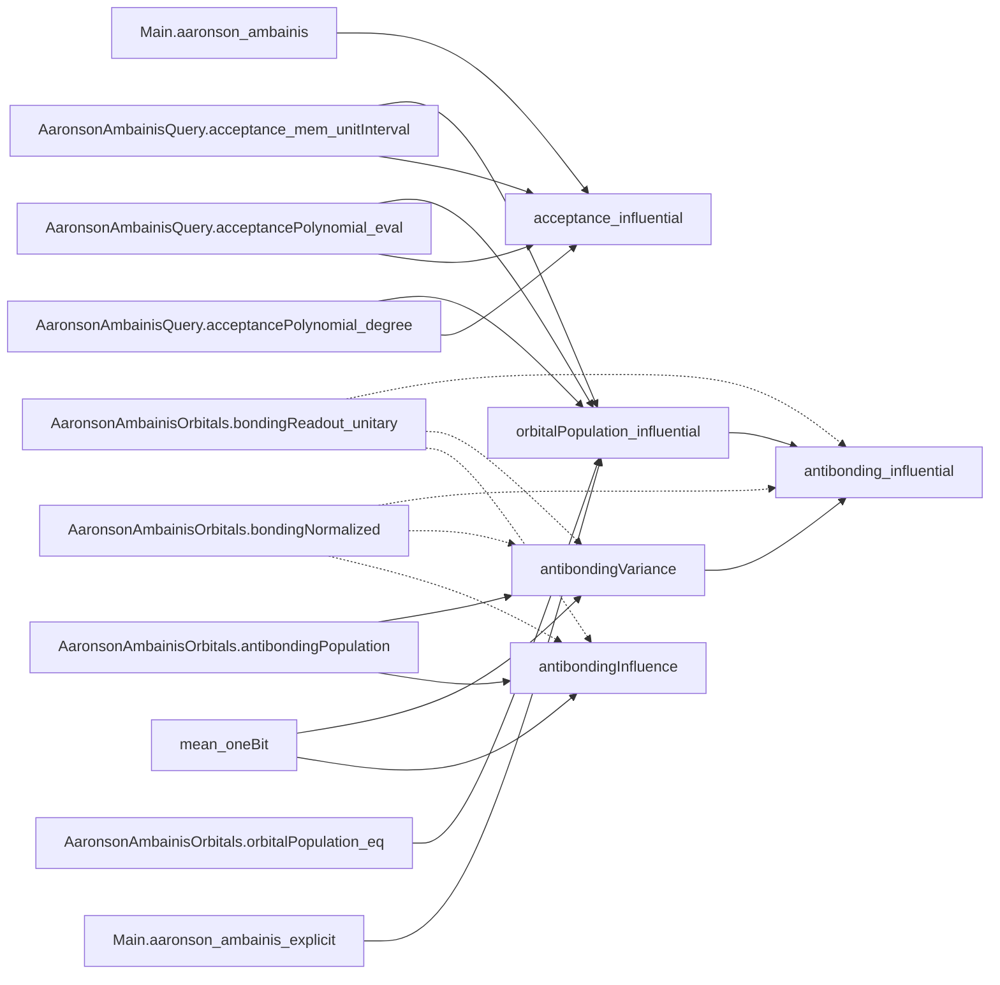

- [Main.aaronson_ambainis](https://github.com/physical-superintelligence/aaronson-ambainis/blob/2a6ceaef872ae993708950f951989134084b851a/AaronsonAmbainis/Main.lean#L33)
- [Main.aaronson_ambainis_explicit](https://github.com/physical-superintelligence/aaronson-ambainis/blob/2a6ceaef872ae993708950f951989134084b851a/AaronsonAmbainis/Main.lean#L38)
- [acceptance_influential](../../FQChem/Complexity/AaronsonAmbainis.lean#L36)
- [antibondingInfluence](../../FQChem/Complexity/AaronsonAmbainis.lean#L78)
- [antibondingVariance](../../FQChem/Complexity/AaronsonAmbainis.lean#L74)
- [antibonding_influential](../../FQChem/Complexity/AaronsonAmbainis.lean#L84)
- [mean_oneBit](../../FQChem/Complexity/AaronsonAmbainis.lean#L67) (private)
- [orbitalPopulation_influential](../../FQChem/Complexity/AaronsonAmbainis.lean#L51)
- [AaronsonAmbainisOrbitals.antibondingPopulation](../../FQChem/Complexity/AaronsonAmbainisOrbitals.lean#L106)
- [AaronsonAmbainisOrbitals.bondingNormalized](../../FQChem/Complexity/AaronsonAmbainisOrbitals.lean#L86)
- [AaronsonAmbainisOrbitals.bondingReadout_unitary](../../FQChem/Complexity/AaronsonAmbainisOrbitals.lean#L93)
- [AaronsonAmbainisOrbitals.orbitalPopulation_eq](../../FQChem/Complexity/AaronsonAmbainisOrbitals.lean#L74)
- [AaronsonAmbainisQuery.acceptancePolynomial_degree](../../FQChem/Complexity/AaronsonAmbainisQuery.lean#L180)
- [AaronsonAmbainisQuery.acceptancePolynomial_eval](../../FQChem/Complexity/AaronsonAmbainisQuery.lean#L171)
- [AaronsonAmbainisQuery.acceptance_mem_unitInterval](../../FQChem/Complexity/AaronsonAmbainisQuery.lean#L188)

## FQChem.Complexity.AaronsonAmbainisOrbitals

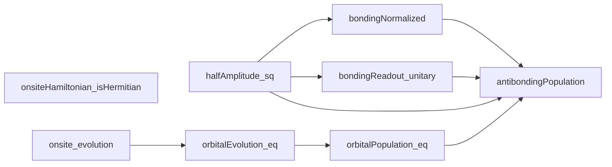

- [antibondingPopulation](../../FQChem/Complexity/AaronsonAmbainisOrbitals.lean#L106)
- [bondingNormalized](../../FQChem/Complexity/AaronsonAmbainisOrbitals.lean#L86)
- [bondingReadout_unitary](../../FQChem/Complexity/AaronsonAmbainisOrbitals.lean#L93)
- [halfAmplitude_sq](../../FQChem/Complexity/AaronsonAmbainisOrbitals.lean#L80) (private)
- [onsiteHamiltonian_isHermitian](../../FQChem/Complexity/AaronsonAmbainisOrbitals.lean#L37)
- [onsite_evolution](../../FQChem/Complexity/AaronsonAmbainisOrbitals.lean#L42)
- [orbitalEvolution_eq](../../FQChem/Complexity/AaronsonAmbainisOrbitals.lean#L61)
- [orbitalPopulation_eq](../../FQChem/Complexity/AaronsonAmbainisOrbitals.lean#L74)

## FQChem.Complexity.AaronsonAmbainisQuery

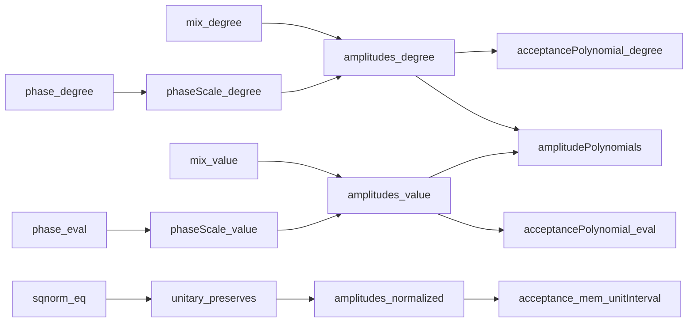

- [acceptancePolynomial_degree](../../FQChem/Complexity/AaronsonAmbainisQuery.lean#L180)
- [acceptancePolynomial_eval](../../FQChem/Complexity/AaronsonAmbainisQuery.lean#L171)
- [acceptance_mem_unitInterval](../../FQChem/Complexity/AaronsonAmbainisQuery.lean#L188)
- [amplitudePolynomials](../../FQChem/Complexity/AaronsonAmbainisQuery.lean#L158)
- [amplitudes_degree](../../FQChem/Complexity/AaronsonAmbainisQuery.lean#L149) (private)
- [amplitudes_normalized](../../FQChem/Complexity/AaronsonAmbainisQuery.lean#L78)
- [amplitudes_value](../../FQChem/Complexity/AaronsonAmbainisQuery.lean#L142) (private)
- [mix_degree](../../FQChem/Complexity/AaronsonAmbainisQuery.lean#L128) (private)
- [mix_value](../../FQChem/Complexity/AaronsonAmbainisQuery.lean#L121) (private)
- [phaseScale_degree](../../FQChem/Complexity/AaronsonAmbainisQuery.lean#L109) (private)
- [phaseScale_value](../../FQChem/Complexity/AaronsonAmbainisQuery.lean#L104) (private)
- [phase_degree](../../FQChem/Complexity/AaronsonAmbainisQuery.lean#L46) (private)
- [phase_eval](../../FQChem/Complexity/AaronsonAmbainisQuery.lean#L40) (private)
- [sqnorm_eq](../../FQChem/Complexity/AaronsonAmbainisQuery.lean#L68) (private)
- [unitary_preserves](../../FQChem/Complexity/AaronsonAmbainisQuery.lean#L72) (private)

## FQChem.Complexity.BlockSimulationPrecision

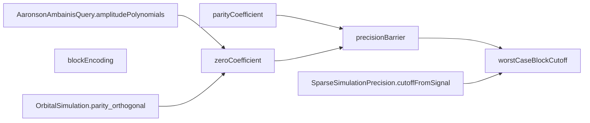

- [AaronsonAmbainisQuery.amplitudePolynomials](../../FQChem/Complexity/AaronsonAmbainisQuery.lean#L158)
- [blockEncoding](../../FQChem/Complexity/BlockSimulationPrecision.lean#L34)
- [parityCoefficient](../../FQChem/Complexity/BlockSimulationPrecision.lean#L59)
- [precisionBarrier](../../FQChem/Complexity/BlockSimulationPrecision.lean#L95)
- [worstCaseBlockCutoff](../../FQChem/Complexity/BlockSimulationPrecision.lean#L112)
- [zeroCoefficient](../../FQChem/Complexity/BlockSimulationPrecision.lean#L79) (private)
- [OrbitalSimulation.parity_orthogonal](../../FQChem/Complexity/OrbitalSimulation.lean#L35)
- [SparseSimulationPrecision.cutoffFromSignal](../../FQChem/Complexity/SparseSimulationPrecision.lean#L61)

## FQChem.Complexity.ElectronicStructure

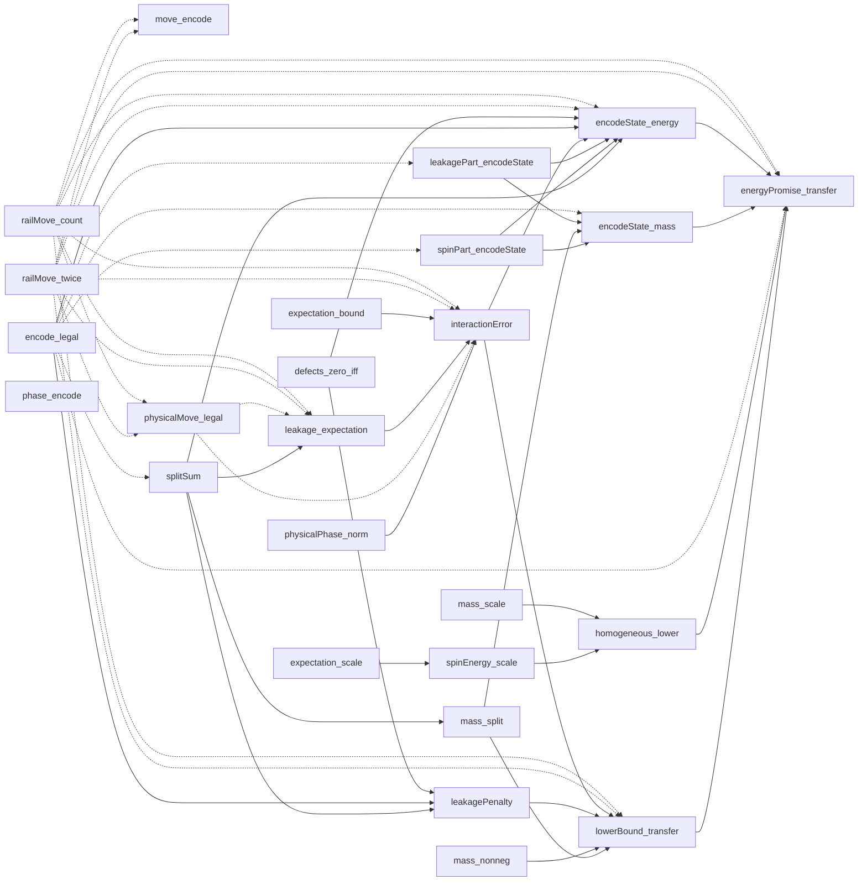

- [railMove_count](../../FQChem/Complexity/ElectronicStructure.lean#L110)
- [railMove_twice](../../FQChem/Complexity/ElectronicStructure.lean#L104)
- [defects_zero_iff](../../FQChem/Complexity/ElectronicStructure.lean#L81)
- [encodeState_energy](../../FQChem/Complexity/ElectronicStructure.lean#L252)
- [encodeState_mass](../../FQChem/Complexity/ElectronicStructure.lean#L248)
- [encode_legal](../../FQChem/Complexity/ElectronicStructure.lean#L58)
- [energyPromise_transfer](../../FQChem/Complexity/ElectronicStructure.lean#L319)
- [expectation_bound](../../FQChem/Complexity/ElectronicStructure.lean#L167) (private)
- [expectation_scale](../../FQChem/Complexity/ElectronicStructure.lean#L282) (private)
- [homogeneous_lower](../../FQChem/Complexity/ElectronicStructure.lean#L300) (private)
- [interactionError](../../FQChem/Complexity/ElectronicStructure.lean#L214)
- [leakagePart_encodeState](../../FQChem/Complexity/ElectronicStructure.lean#L243)
- [leakagePenalty](../../FQChem/Complexity/ElectronicStructure.lean#L225)
- [leakage_expectation](../../FQChem/Complexity/ElectronicStructure.lean#L209) (private)
- [lowerBound_transfer](../../FQChem/Complexity/ElectronicStructure.lean#L268)
- [mass_nonneg](../../FQChem/Complexity/ElectronicStructure.lean#L263) (private)
- [mass_scale](../../FQChem/Complexity/ElectronicStructure.lean#L278) (private)
- [mass_split](../../FQChem/Complexity/ElectronicStructure.lean#L193)
- [move_encode](../../FQChem/Complexity/ElectronicStructure.lean#L127)
- [phase_encode](../../FQChem/Complexity/ElectronicStructure.lean#L149)
- [physicalMove_legal](../../FQChem/Complexity/ElectronicStructure.lean#L130)
- [physicalPhase_norm](../../FQChem/Complexity/ElectronicStructure.lean#L152) (private)
- [spinEnergy_scale](../../FQChem/Complexity/ElectronicStructure.lean#L293) (private)
- [spinPart_encodeState](../../FQChem/Complexity/ElectronicStructure.lean#L238)
- [splitSum](../../FQChem/Complexity/ElectronicStructure.lean#L188) (private)

## FQChem.Complexity.ElectronicStructureOperators

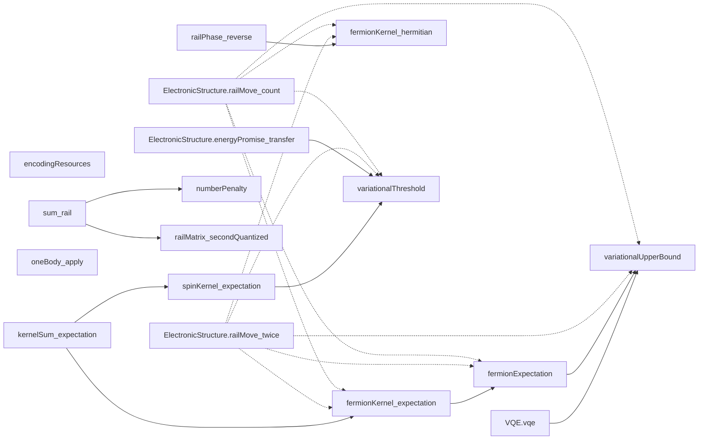

- [ElectronicStructure.railMove_count](../../FQChem/Complexity/ElectronicStructure.lean#L110)
- [ElectronicStructure.railMove_twice](../../FQChem/Complexity/ElectronicStructure.lean#L104)
- [ElectronicStructure.energyPromise_transfer](../../FQChem/Complexity/ElectronicStructure.lean#L319)
- [encodingResources](../../FQChem/Complexity/ElectronicStructureOperators.lean#L72)
- [fermionExpectation](../../FQChem/Complexity/ElectronicStructureOperators.lean#L167)
- [fermionKernel_expectation](../../FQChem/Complexity/ElectronicStructureOperators.lean#L150)
- [fermionKernel_hermitian](../../FQChem/Complexity/ElectronicStructureOperators.lean#L130)
- [kernelSum_expectation](../../FQChem/Complexity/ElectronicStructureOperators.lean#L90) (private)
- [numberPenalty](../../FQChem/Complexity/ElectronicStructureOperators.lean#L57)
- [oneBody_apply](../../FQChem/Complexity/ElectronicStructureOperators.lean#L31) (private)
- [railMatrix_secondQuantized](../../FQChem/Complexity/ElectronicStructureOperators.lean#L45)
- [railPhase_reverse](../../FQChem/Complexity/ElectronicStructureOperators.lean#L122) (private)
- [spinKernel_expectation](../../FQChem/Complexity/ElectronicStructureOperators.lean#L114)
- [sum_rail](../../FQChem/Complexity/ElectronicStructureOperators.lean#L37) (private)
- [variationalThreshold](../../FQChem/Complexity/ElectronicStructureOperators.lean#L190)
- [variationalUpperBound](../../FQChem/Complexity/ElectronicStructureOperators.lean#L180)
- [VQE.vqe](../../FQChem/StatePrep/VariationalOptimization/VQE.lean#L28)

## FQChem.Complexity.ElectronicStructurePauli

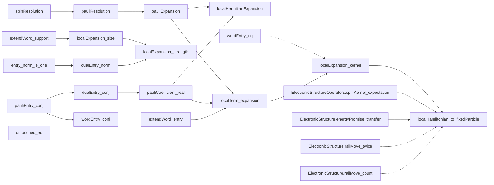

- [ElectronicStructure.railMove_count](../../FQChem/Complexity/ElectronicStructure.lean#L110)
- [ElectronicStructure.railMove_twice](../../FQChem/Complexity/ElectronicStructure.lean#L104)
- [ElectronicStructure.energyPromise_transfer](../../FQChem/Complexity/ElectronicStructure.lean#L319)
- [ElectronicStructureOperators.spinKernel_expectation](../../FQChem/Complexity/ElectronicStructureOperators.lean#L114)
- [dualEntry_conj](../../FQChem/Complexity/ElectronicStructurePauli.lean#L80) (private)
- [dualEntry_norm](../../FQChem/Complexity/ElectronicStructurePauli.lean#L222) (private)
- [entry_norm_le_one](../../FQChem/Complexity/ElectronicStructurePauli.lean#L219) (private)
- [extendWord_entry](../../FQChem/Complexity/ElectronicStructurePauli.lean#L126)
- [extendWord_support](../../FQChem/Complexity/ElectronicStructurePauli.lean#L139)
- [localExpansion_kernel](../../FQChem/Complexity/ElectronicStructurePauli.lean#L184)
- [localExpansion_size](../../FQChem/Complexity/ElectronicStructurePauli.lean#L198)
- [localExpansion_strength](../../FQChem/Complexity/ElectronicStructurePauli.lean#L232)
- [localHamiltonian_to_fixedParticle](../../FQChem/Complexity/ElectronicStructurePauli.lean#L209)
- [localHermitianExpansion](../../FQChem/Complexity/ElectronicStructurePauli.lean#L97)
- [localTerm_expansion](../../FQChem/Complexity/ElectronicStructurePauli.lean#L175) (private)
- [pauliCoefficient_real](../../FQChem/Complexity/ElectronicStructurePauli.lean#L84)
- [pauliEntry_conj](../../FQChem/Complexity/ElectronicStructurePauli.lean#L29) (private)
- [pauliExpansion](../../FQChem/Complexity/ElectronicStructurePauli.lean#L67)
- [pauliResolution](../../FQChem/Complexity/ElectronicStructurePauli.lean#L54)
- [spinResolution](../../FQChem/Complexity/ElectronicStructurePauli.lean#L33) (private)
- [untouched_eq](../../FQChem/Complexity/ElectronicStructurePauli.lean#L114)
- [wordEntry_conj](../../FQChem/Complexity/ElectronicStructurePauli.lean#L48) (private)
- [wordEntry_eq](../../FQChem/Complexity/ElectronicStructurePauli.lean#L42)

## FQChem.Complexity.FactoringBitCost

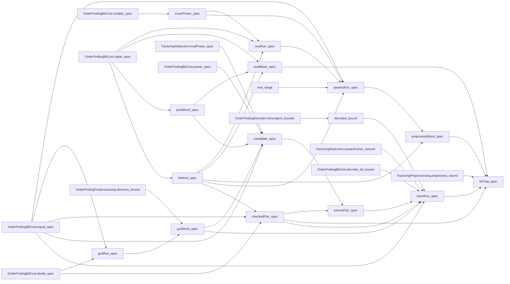

- [baseRun_spec](../../FQChem/Complexity/FactoringBitCost.lean#L381)
- [bitTrial_spec](../../FQChem/Complexity/FactoringBitCost.lean#L434)
- [candidate_spec](../../FQChem/Complexity/FactoringBitCost.lean#L286)
- [checkedPair_spec](../../FQChem/Complexity/FactoringBitCost.lean#L250)
- [decoded_bound](../../FQChem/Complexity/FactoringBitCost.lean#L357)
- [exactPower_spec](../../FQChem/Complexity/FactoringBitCost.lean#L97)
- [extractPair_spec](../../FQChem/Complexity/FactoringBitCost.lean#L315)
- [gcdRun_spec](../../FQChem/Complexity/FactoringBitCost.lean#L56) (private)
- [gcdWord_spec](../../FQChem/Complexity/FactoringBitCost.lean#L80)
- [leWord_spec](../../FQChem/Complexity/FactoringBitCost.lean#L25)
- [powersRun_spec](../../FQChem/Complexity/FactoringBitCost.lean#L174)
- [predWord_spec](../../FQChem/Complexity/FactoringBitCost.lean#L38)
- [preprocessWord_spec](../../FQChem/Complexity/FactoringBitCost.lean#L213)
- [readBase_spec](../../FQChem/Complexity/FactoringBitCost.lean#L341)
- [rootRun_spec](../../FQChem/Complexity/FactoringBitCost.lean#L132)
- [root_range](../../FQChem/Complexity/FactoringBitCost.lean#L112) (private)
- [FactoringPreprocessing.preprocess_sound](../../FQChem/Complexity/FactoringPreprocessing.lean#L103)
- [FactoringReduction.extractFactor_nonunit](../../FQChem/Complexity/FactoringReduction.lean#L349)
- [FactoringReduction.modPower_spec](../../FQChem/Complexity/FactoringReduction.lean#L52)
- [OrderFindingBitCost.decoder_bit_bound](../../FQChem/Complexity/OrderFindingBitCost.lean#L441)
- [OrderFindingBitCost.divide_spec](../../FQChem/Complexity/OrderFindingBitCost.lean#L161)
- [OrderFindingBitCost.equal_spec](../../FQChem/Complexity/OrderFindingBitCost.lean#L208)
- [OrderFindingBitCost.multiply_spec](../../FQChem/Complexity/OrderFindingBitCost.lean#L115)
- [OrderFindingBitCost.power_spec](../../FQChem/Complexity/OrderFindingBitCost.lean#L317)
- [OrderFindingBitCost.ripple_spec](../../FQChem/Complexity/OrderFindingBitCost.lean#L51)
- [OrderFindingDecoder.convergent_bounds](../../FQChem/Complexity/OrderFindingDecoder.lean#L62)
- [OrderFindingPostprocessing.divisions_bound](../../FQChem/Complexity/OrderFindingPostprocessing.lean#L32)

## FQChem.Complexity.FactoringPreprocessing

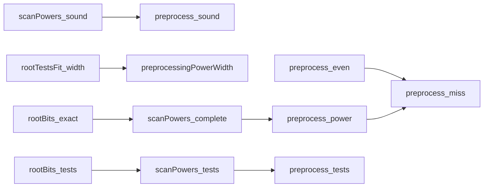

- [preprocess_even](../../FQChem/Complexity/FactoringPreprocessing.lean#L112)
- [preprocess_miss](../../FQChem/Complexity/FactoringPreprocessing.lean#L139)
- [preprocess_power](../../FQChem/Complexity/FactoringPreprocessing.lean#L115)
- [preprocess_sound](../../FQChem/Complexity/FactoringPreprocessing.lean#L103)
- [preprocess_tests](../../FQChem/Complexity/FactoringPreprocessing.lean#L130)
- [preprocessingPowerWidth](../../FQChem/Complexity/FactoringPreprocessing.lean#L183)
- [rootBits_exact](../../FQChem/Complexity/FactoringPreprocessing.lean#L34) (private)
- [rootBits_tests](../../FQChem/Complexity/FactoringPreprocessing.lean#L29)
- [rootTestsFit_width](../../FQChem/Complexity/FactoringPreprocessing.lean#L168) (private)
- [scanPowers_complete](../../FQChem/Complexity/FactoringPreprocessing.lean#L70) (private)
- [scanPowers_sound](../../FQChem/Complexity/FactoringPreprocessing.lean#L56) (private)
- [scanPowers_tests](../../FQChem/Complexity/FactoringPreprocessing.lean#L88) (private)

## FQChem.Complexity.FactoringRecursion

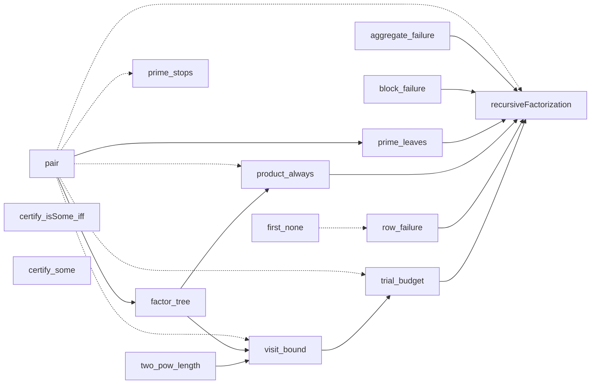

- [pair](../../FQChem/Complexity/FactoringRecursion.lean#L41)
- [aggregate_failure](../../FQChem/Complexity/FactoringRecursion.lean#L231) (private)
- [block_failure](../../FQChem/Complexity/FactoringRecursion.lean#L216)
- [certify_isSome_iff](../../FQChem/Complexity/FactoringRecursion.lean#L187)
- [certify_some](../../FQChem/Complexity/FactoringRecursion.lean#L36)
- [factor_tree](../../FQChem/Complexity/FactoringRecursion.lean#L104)
- [first_none](../../FQChem/Complexity/FactoringRecursion.lean#L58)
- [prime_leaves](../../FQChem/Complexity/FactoringRecursion.lean#L148)
- [prime_stops](../../FQChem/Complexity/FactoringRecursion.lean#L89)
- [product_always](../../FQChem/Complexity/FactoringRecursion.lean#L123)
- [recursiveFactorization](../../FQChem/Complexity/FactoringRecursion.lean#L246)
- [row_failure](../../FQChem/Complexity/FactoringRecursion.lean#L204)
- [trial_budget](../../FQChem/Complexity/FactoringRecursion.lean#L182)
- [two_pow_length](../../FQChem/Complexity/FactoringRecursion.lean#L129) (private)
- [visit_bound](../../FQChem/Complexity/FactoringRecursion.lean#L136)

## FQChem.Complexity.FactoringReduction

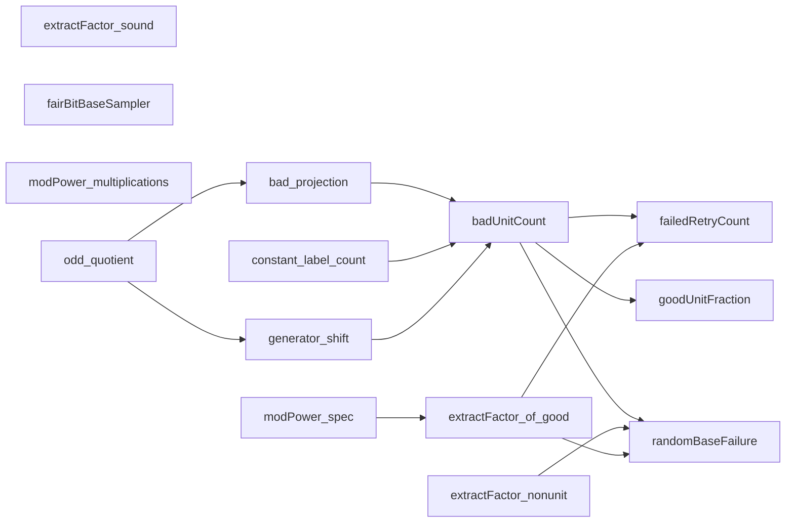

- [badUnitCount](../../FQChem/Complexity/FactoringReduction.lean#L197)
- [bad_projection](../../FQChem/Complexity/FactoringReduction.lean#L162) (private)
- [constant_label_count](../../FQChem/Complexity/FactoringReduction.lean#L125) (private)
- [extractFactor_nonunit](../../FQChem/Complexity/FactoringReduction.lean#L349)
- [extractFactor_of_good](../../FQChem/Complexity/FactoringReduction.lean#L273)
- [extractFactor_sound](../../FQChem/Complexity/FactoringReduction.lean#L74)
- [failedRetryCount](../../FQChem/Complexity/FactoringReduction.lean#L327)
- [fairBitBaseSampler](../../FQChem/Complexity/FactoringReduction.lean#L401)
- [generator_shift](../../FQChem/Complexity/FactoringReduction.lean#L99) (private)
- [goodUnitFraction](../../FQChem/Complexity/FactoringReduction.lean#L244)
- [modPower_multiplications](../../FQChem/Complexity/FactoringReduction.lean#L37)
- [modPower_spec](../../FQChem/Complexity/FactoringReduction.lean#L52)
- [odd_quotient](../../FQChem/Complexity/FactoringReduction.lean#L88) (private)
- [randomBaseFailure](../../FQChem/Complexity/FactoringReduction.lean#L359)

## FQChem.Complexity.FastForwarding

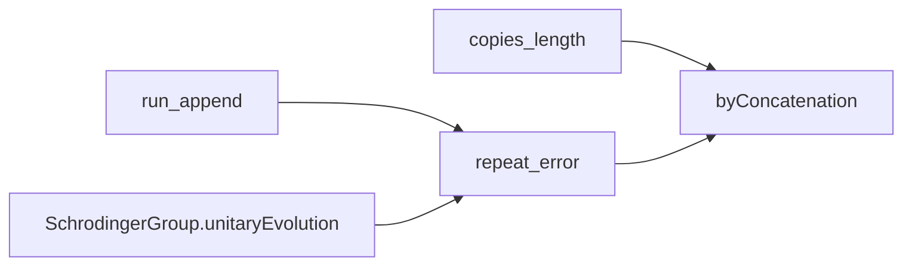

- [byConcatenation](../../FQChem/Complexity/FastForwarding.lean#L81)
- [copies_length](../../FQChem/Complexity/FastForwarding.lean#L37)
- [repeat_error](../../FQChem/Complexity/FastForwarding.lean#L58)
- [run_append](../../FQChem/Complexity/FastForwarding.lean#L42) (private)
- [SchrodingerGroup.unitaryEvolution](../../FQChem/Dynamics/RealTimePropagation/SchrodingerGroup.lean#L41)

## FQChem.Complexity.FermionicMarginals

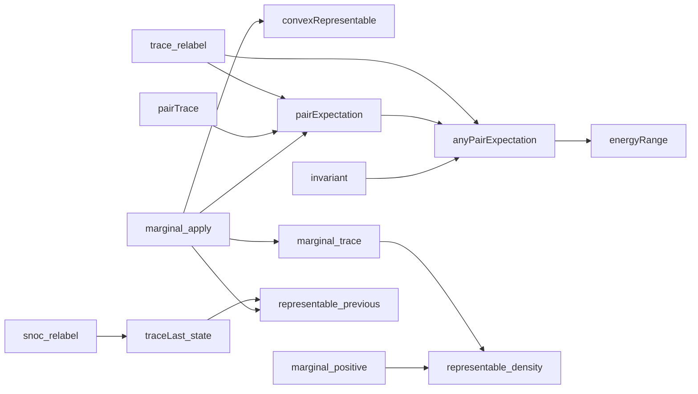

- [anyPairExpectation](../../FQChem/Complexity/FermionicMarginals.lean#L185)
- [convexRepresentable](../../FQChem/Complexity/FermionicMarginals.lean#L68)
- [energyRange](../../FQChem/Complexity/FermionicMarginals.lean#L203)
- [invariant](../../FQChem/Complexity/FermionicMarginals.lean#L172) (private)
- [marginal_apply](../../FQChem/Complexity/FermionicMarginals.lean#L42)
- [marginal_positive](../../FQChem/Complexity/FermionicMarginals.lean#L46)
- [marginal_trace](../../FQChem/Complexity/FermionicMarginals.lean#L51)
- [pairExpectation](../../FQChem/Complexity/FermionicMarginals.lean#L157)
- [pairTrace](../../FQChem/Complexity/FermionicMarginals.lean#L146) (private)
- [representable_density](../../FQChem/Complexity/FermionicMarginals.lean#L61)
- [representable_previous](../../FQChem/Complexity/FermionicMarginals.lean#L121)
- [snoc_relabel](../../FQChem/Complexity/FermionicMarginals.lean#L91) (private)
- [traceLast_state](../../FQChem/Complexity/FermionicMarginals.lean#L101)
- [trace_relabel](../../FQChem/Complexity/FermionicMarginals.lean#L135) (private)

## FQChem.Complexity.FixedBasisArithmetic

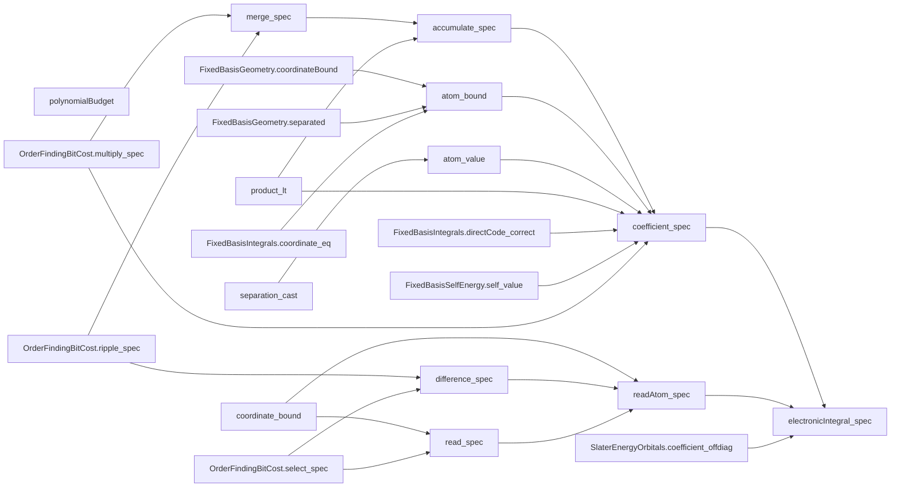

- [accumulate_spec](../../FQChem/Complexity/FixedBasisArithmetic.lean#L65)
- [atom_bound](../../FQChem/Complexity/FixedBasisArithmetic.lean#L140) (private)
- [atom_value](../../FQChem/Complexity/FixedBasisArithmetic.lean#L128) (private)
- [coefficient_spec](../../FQChem/Complexity/FixedBasisArithmetic.lean#L173)
- [coordinate_bound](../../FQChem/Complexity/FixedBasisArithmetic.lean#L215) (private)
- [difference_spec](../../FQChem/Complexity/FixedBasisArithmetic.lean#L244) (private)
- [electronicIntegral_spec](../../FQChem/Complexity/FixedBasisArithmetic.lean#L296)
- [merge_spec](../../FQChem/Complexity/FixedBasisArithmetic.lean#L33) (private)
- [polynomialBudget](../../FQChem/Complexity/FixedBasisArithmetic.lean#L318)
- [product_lt](../../FQChem/Complexity/FixedBasisArithmetic.lean#L57) (private)
- [readAtom_spec](../../FQChem/Complexity/FixedBasisArithmetic.lean#L273) (private)
- [read_spec](../../FQChem/Complexity/FixedBasisArithmetic.lean#L229) (private)
- [separation_cast](../../FQChem/Complexity/FixedBasisArithmetic.lean#L117) (private)
- [FixedBasisGeometry.coordinateBound](../../FQChem/Complexity/FixedBasisGeometry.lean#L109)
- [FixedBasisGeometry.separated](../../FQChem/Complexity/FixedBasisGeometry.lean#L80)
- [FixedBasisIntegrals.coordinate_eq](../../FQChem/Complexity/FixedBasisIntegrals.lean#L30)
- [FixedBasisIntegrals.directCode_correct](../../FQChem/Complexity/FixedBasisIntegrals.lean#L50)
- [FixedBasisSelfEnergy.self_value](../../FQChem/Complexity/FixedBasisSelfEnergy.lean#L97)
- [OrderFindingBitCost.multiply_spec](../../FQChem/Complexity/OrderFindingBitCost.lean#L115)
- [OrderFindingBitCost.ripple_spec](../../FQChem/Complexity/OrderFindingBitCost.lean#L51)
- [OrderFindingBitCost.select_spec](../../FQChem/Complexity/OrderFindingBitCost.lean#L93) (private)
- [SlaterEnergyOrbitals.coefficient_offdiag](../../FQChem/Complexity/SlaterEnergyOrbitals.lean#L70)

## FQChem.Complexity.FixedBasisCoulomb

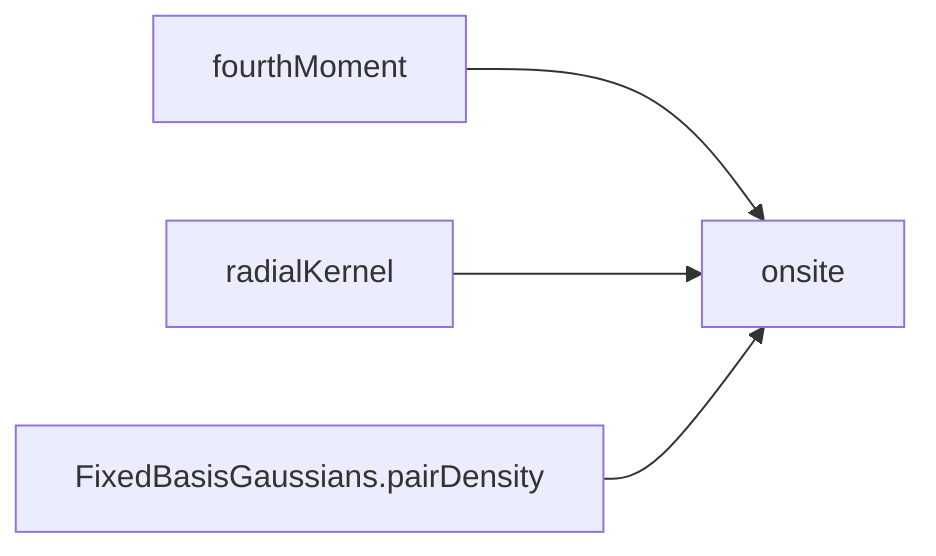

- [fourthMoment](../../FQChem/Complexity/FixedBasisCoulomb.lean#L40) (private)
- [onsite](../../FQChem/Complexity/FixedBasisCoulomb.lean#L56)
- [radialKernel](../../FQChem/Complexity/FixedBasisCoulomb.lean#L22)
- [FixedBasisGaussians.pairDensity](../../FQChem/Complexity/FixedBasisGaussians.lean#L75)

## FQChem.Complexity.FixedBasisGaussians

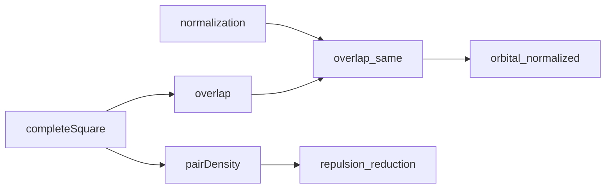

- [completeSquare](../../FQChem/Complexity/FixedBasisGaussians.lean#L26) (private)
- [normalization](../../FQChem/Complexity/FixedBasisGaussians.lean#L56) (private)
- [orbital_normalized](../../FQChem/Complexity/FixedBasisGaussians.lean#L69)
- [overlap](../../FQChem/Complexity/FixedBasisGaussians.lean#L35)
- [overlap_same](../../FQChem/Complexity/FixedBasisGaussians.lean#L64)
- [pairDensity](../../FQChem/Complexity/FixedBasisGaussians.lean#L75)
- [repulsion_reduction](../../FQChem/Complexity/FixedBasisGaussians.lean#L100)

## FQChem.Complexity.FixedBasisGeometry

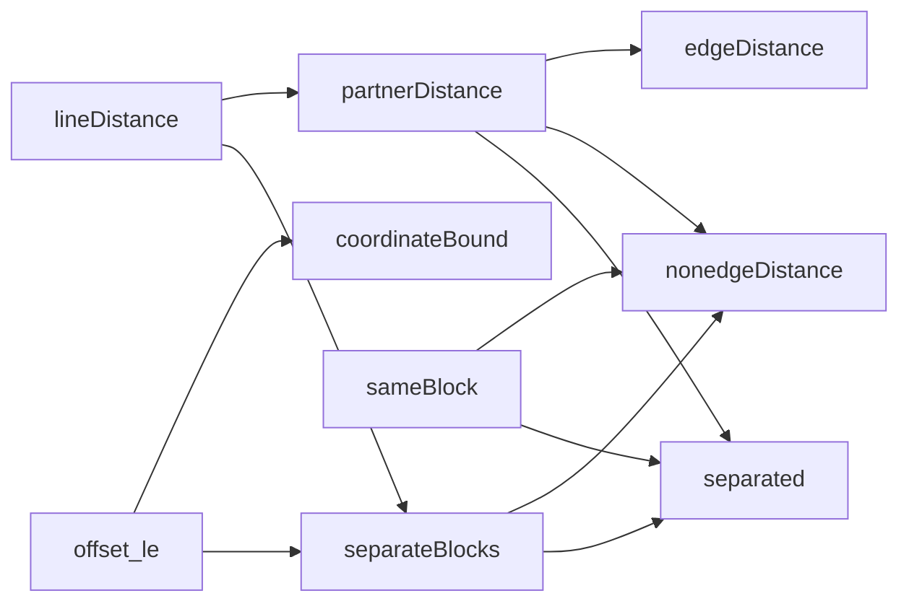

- [coordinateBound](../../FQChem/Complexity/FixedBasisGeometry.lean#L109)
- [edgeDistance](../../FQChem/Complexity/FixedBasisGeometry.lean#L71)
- [lineDistance](../../FQChem/Complexity/FixedBasisGeometry.lean#L40) (private)
- [nonedgeDistance](../../FQChem/Complexity/FixedBasisGeometry.lean#L95)
- [offset_le](../../FQChem/Complexity/FixedBasisGeometry.lean#L46) (private)
- [partnerDistance](../../FQChem/Complexity/FixedBasisGeometry.lean#L62) (private)
- [sameBlock](../../FQChem/Complexity/FixedBasisGeometry.lean#L23) (private)
- [separateBlocks](../../FQChem/Complexity/FixedBasisGeometry.lean#L49) (private)
- [separated](../../FQChem/Complexity/FixedBasisGeometry.lean#L80)

## FQChem.Complexity.FixedBasisHopping

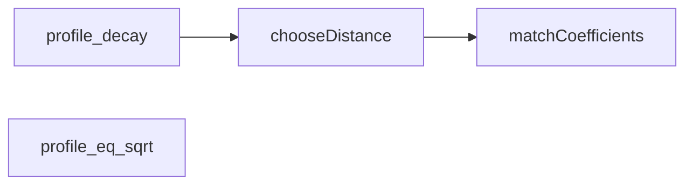

- [chooseDistance](../../FQChem/Complexity/FixedBasisHopping.lean#L45)
- [matchCoefficients](../../FQChem/Complexity/FixedBasisHopping.lean#L70)
- [profile_decay](../../FQChem/Complexity/FixedBasisHopping.lean#L33) (private)
- [profile_eq_sqrt](../../FQChem/Complexity/FixedBasisHopping.lean#L24)

## FQChem.Complexity.FixedBasisIntegrals

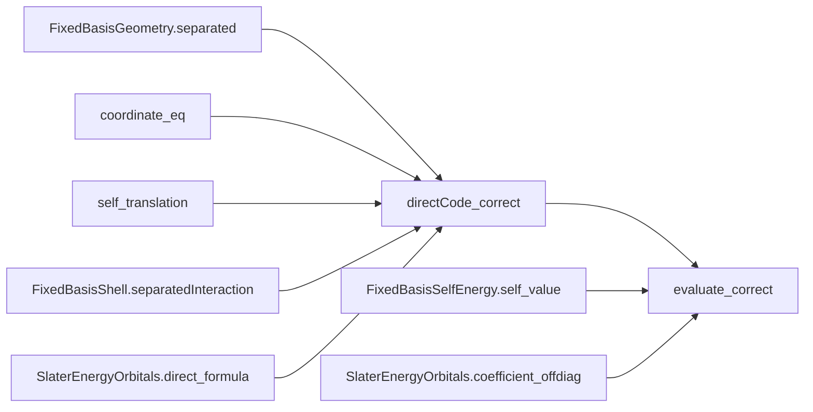

- [FixedBasisGeometry.separated](../../FQChem/Complexity/FixedBasisGeometry.lean#L80)
- [coordinate_eq](../../FQChem/Complexity/FixedBasisIntegrals.lean#L30)
- [directCode_correct](../../FQChem/Complexity/FixedBasisIntegrals.lean#L50)
- [evaluate_correct](../../FQChem/Complexity/FixedBasisIntegrals.lean#L75)
- [self_translation](../../FQChem/Complexity/FixedBasisIntegrals.lean#L37) (private)
- [FixedBasisSelfEnergy.self_value](../../FQChem/Complexity/FixedBasisSelfEnergy.lean#L97)
- [FixedBasisShell.separatedInteraction](../../FQChem/Complexity/FixedBasisShell.lean#L284)
- [SlaterEnergyOrbitals.coefficient_offdiag](../../FQChem/Complexity/SlaterEnergyOrbitals.lean#L70)
- [SlaterEnergyOrbitals.direct_formula](../../FQChem/Complexity/SlaterEnergyOrbitals.lean#L74)

## FQChem.Complexity.FixedBasisOrthonormalization

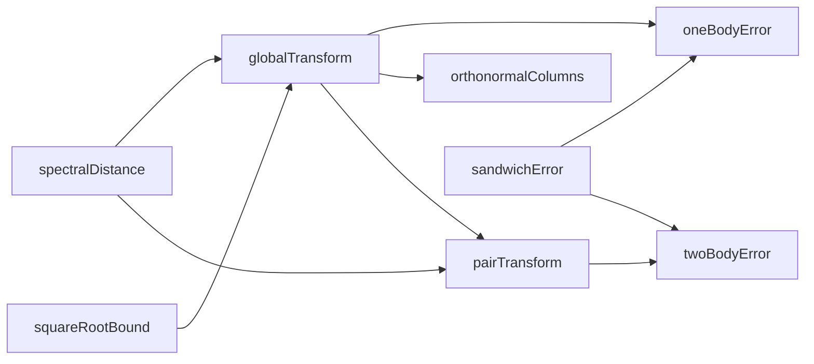

- [globalTransform](../../FQChem/Complexity/FixedBasisOrthonormalization.lean#L58)
- [oneBodyError](../../FQChem/Complexity/FixedBasisOrthonormalization.lean#L127)
- [orthonormalColumns](../../FQChem/Complexity/FixedBasisOrthonormalization.lean#L97)
- [pairTransform](../../FQChem/Complexity/FixedBasisOrthonormalization.lean#L136)
- [sandwichError](../../FQChem/Complexity/FixedBasisOrthonormalization.lean#L108) (private)
- [spectralDistance](../../FQChem/Complexity/FixedBasisOrthonormalization.lean#L26) (private)
- [squareRootBound](../../FQChem/Complexity/FixedBasisOrthonormalization.lean#L39) (private)
- [twoBodyError](../../FQChem/Complexity/FixedBasisOrthonormalization.lean#L175)

## FQChem.Complexity.FixedBasisRadial

```mermaid
flowchart LR
  n216["bounds"]
  n217["cumulative"]
  n218["first"]
  n219["kineticNumerator"]
  n220["radialBall"]
  n221["radialBallOfRadius"]
  n222["second"]
  n223["shape_laplacian"]
  n224["smooth"]
  n225["squared"]
  n226["volumeMass"]
  n227["zero"]
  n227 --> n216
  n220 --> n219
  n223 --> n219
  n221 --> n220
  n218 --> n222
  n222 --> n223
  n227 --> n223
  n227 --> n225
  n217 --> n226
  n220 --> n226
  n225 --> n226
```

- [bounds](../../FQChem/Complexity/FixedBasisRadial.lean#L37)
- [cumulative](../../FQChem/Complexity/FixedBasisRadial.lean#L120)
- [first](../../FQChem/Complexity/FixedBasisRadial.lean#L51) (private)
- [kineticNumerator](../../FQChem/Complexity/FixedBasisRadial.lean#L134)
- [radialBall](../../FQChem/Complexity/FixedBasisRadial.lean#L108)
- [radialBallOfRadius](../../FQChem/Complexity/FixedBasisRadial.lean#L95)
- [second](../../FQChem/Complexity/FixedBasisRadial.lean#L61) (private)
- [shape_laplacian](../../FQChem/Complexity/FixedBasisRadial.lean#L76)
- [smooth](../../FQChem/Complexity/FixedBasisRadial.lean#L26)
- [squared](../../FQChem/Complexity/FixedBasisRadial.lean#L43)
- [volumeMass](../../FQChem/Complexity/FixedBasisRadial.lean#L129)
- [zero](../../FQChem/Complexity/FixedBasisRadial.lean#L30)

## FQChem.Complexity.FixedBasisSelfEnergy

```mermaid
flowchart LR
  n217["FixedBasisRadial.cumulative"]
  n220["FixedBasisRadial.radialBall"]
  n221["FixedBasisRadial.radialBallOfRadius"]
  n225["FixedBasisRadial.squared"]
  n226["FixedBasisRadial.volumeMass"]
  n228["density_sq"]
  n229["halfValue"]
  n230["half_integrable"]
  n231["self_value"]
  n232["swapHalves"]
  n233["truncated"]
  n237["FixedBasisShell.exteriorReal"]
  n340["SlaterEnergyCoulomb.kernel_integrable"]
  n346["SlaterEnergyCoulomb.weight_pos"]
  n225 --> n228
  n346 --> n228
  n228 --> n229
  n233 --> n229
  n340 --> n230
  n220 --> n231
  n226 --> n231
  n228 --> n231
  n229 --> n231
  n230 --> n231
  n232 --> n231
  n230 --> n232
  n217 --> n233
  n221 --> n233
  n228 --> n233
  n237 --> n233
  n346 --> n233
```

- [FixedBasisRadial.cumulative](../../FQChem/Complexity/FixedBasisRadial.lean#L120)
- [FixedBasisRadial.radialBall](../../FQChem/Complexity/FixedBasisRadial.lean#L108)
- [FixedBasisRadial.radialBallOfRadius](../../FQChem/Complexity/FixedBasisRadial.lean#L95)
- [FixedBasisRadial.squared](../../FQChem/Complexity/FixedBasisRadial.lean#L43)
- [FixedBasisRadial.volumeMass](../../FQChem/Complexity/FixedBasisRadial.lean#L129)
- [density_sq](../../FQChem/Complexity/FixedBasisSelfEnergy.lean#L20) (private)
- [halfValue](../../FQChem/Complexity/FixedBasisSelfEnergy.lean#L78) (private)
- [half_integrable](../../FQChem/Complexity/FixedBasisSelfEnergy.lean#L53) (private)
- [self_value](../../FQChem/Complexity/FixedBasisSelfEnergy.lean#L97)
- [swapHalves](../../FQChem/Complexity/FixedBasisSelfEnergy.lean#L57) (private)
- [truncated](../../FQChem/Complexity/FixedBasisSelfEnergy.lean#L24) (private)
- [FixedBasisShell.exteriorReal](../../FQChem/Complexity/FixedBasisShell.lean#L227)
- [SlaterEnergyCoulomb.kernel_integrable](../../FQChem/Complexity/SlaterEnergyCoulomb.lean#L77)
- [SlaterEnergyCoulomb.weight_pos](../../FQChem/Complexity/SlaterEnergyCoulomb.lean#L42)

## FQChem.Complexity.FixedBasisShell

```mermaid
flowchart LR
  n234["axisDist"]
  n235["exteriorAxis"]
  n236["exteriorPoint"]
  n237["exteriorReal"]
  n238["mass_one"]
  n239["potential"]
  n240["profile_density"]
  n241["radialHeight"]
  n242["separatedInteraction"]
  n243["shellHeight"]
  n244["shellHeight_lintegral"]
  n245["sliceArea"]
  n246["split_sq"]
  n247["split_volume"]
  n248["transverseArea"]
  n336["SlaterEnergyCoulomb.density_normalized"]
  n340["SlaterEnergyCoulomb.kernel_integrable"]
  n342["SlaterEnergyCoulomb.nonnegative"]
  n344["SlaterEnergyCoulomb.wave_smooth"]
  n345["SlaterEnergyCoulomb.wave_zero"]
  n234 --> n235
  n241 --> n235
  n244 --> n235
  n235 --> n236
  n236 --> n237
  n336 --> n238
  n236 --> n239
  n238 --> n239
  n240 --> n239
  n344 --> n239
  n345 --> n239
  n245 --> n241
  n246 --> n241
  n247 --> n241
  n239 --> n242
  n340 --> n242
  n342 --> n242
  n344 --> n242
  n345 --> n242
  n243 --> n244
  n248 --> n245
```

- [axisDist](../../FQChem/Complexity/FixedBasisShell.lean#L162) (private)
- [exteriorAxis](../../FQChem/Complexity/FixedBasisShell.lean#L183)
- [exteriorPoint](../../FQChem/Complexity/FixedBasisShell.lean#L213)
- [exteriorReal](../../FQChem/Complexity/FixedBasisShell.lean#L227)
- [mass_one](../../FQChem/Complexity/FixedBasisShell.lean#L250) (private)
- [potential](../../FQChem/Complexity/FixedBasisShell.lean#L258)
- [profile_density](../../FQChem/Complexity/FixedBasisShell.lean#L246) (private)
- [radialHeight](../../FQChem/Complexity/FixedBasisShell.lean#L118)
- [separatedInteraction](../../FQChem/Complexity/FixedBasisShell.lean#L284)
- [shellHeight](../../FQChem/Complexity/FixedBasisShell.lean#L24)
- [shellHeight_lintegral](../../FQChem/Complexity/FixedBasisShell.lean#L169) (private)
- [sliceArea](../../FQChem/Complexity/FixedBasisShell.lean#L88) (private)
- [split_sq](../../FQChem/Complexity/FixedBasisShell.lean#L111) (private)
- [split_volume](../../FQChem/Complexity/FixedBasisShell.lean#L106) (private)
- [transverseArea](../../FQChem/Complexity/FixedBasisShell.lean#L55)
- [SlaterEnergyCoulomb.density_normalized](../../FQChem/Complexity/SlaterEnergyCoulomb.lean#L55)
- [SlaterEnergyCoulomb.kernel_integrable](../../FQChem/Complexity/SlaterEnergyCoulomb.lean#L77)
- [SlaterEnergyCoulomb.nonnegative](../../FQChem/Complexity/SlaterEnergyCoulomb.lean#L162)
- [SlaterEnergyCoulomb.wave_smooth](../../FQChem/Complexity/SlaterEnergyCoulomb.lean#L64)
- [SlaterEnergyCoulomb.wave_zero](../../FQChem/Complexity/SlaterEnergyCoulomb.lean#L60)

## FQChem.Complexity.GroundStateSearch

```mermaid
flowchart LR
  n249["energy_eq_failure"]
  n250["energy_query_lower_bound"]
  n251["groundSpace"]
  n252["hybrid_bound"]
  n253["hybrid_step"]
  n254["mark_eq_neg_reflection"]
  n255["orthonormal_addresses"]
  n256["orthonormal_energy_lower_bound"]
  n257["queried_norm"]
  n258["query_lower_bound"]
  n259["reference_norm"]
  n260["sum_amplitudes_le"]
  n249 --> n250
  n257 --> n250
  n258 --> n250
  n253 --> n252
  n259 --> n252
  n260 --> n252
  n254 --> n253
  n250 --> n256
  n255 --> n256
  n254 --> n257
  n252 --> n258
  n259 --> n258
  n260 --> n258
```

- [energy_eq_failure](../../FQChem/Complexity/GroundStateSearch.lean#L35)
- [energy_query_lower_bound](../../FQChem/Complexity/GroundStateSearch.lean#L141)
- [groundSpace](../../FQChem/Complexity/GroundStateSearch.lean#L30)
- [hybrid_bound](../../FQChem/Complexity/GroundStateSearch.lean#L103)
- [hybrid_step](../../FQChem/Complexity/GroundStateSearch.lean#L69) (private)
- [mark_eq_neg_reflection](../../FQChem/Complexity/GroundStateSearch.lean#L44) (private)
- [orthonormal_addresses](../../FQChem/Complexity/GroundStateSearch.lean#L86)
- [orthonormal_energy_lower_bound](../../FQChem/Complexity/GroundStateSearch.lean#L154)
- [queried_norm](../../FQChem/Complexity/GroundStateSearch.lean#L64)
- [query_lower_bound](../../FQChem/Complexity/GroundStateSearch.lean#L116)
- [reference_norm](../../FQChem/Complexity/GroundStateSearch.lean#L59)
- [sum_amplitudes_le](../../FQChem/Complexity/GroundStateSearch.lean#L92) (private)

## FQChem.Complexity.LocalHamiltonianVerification

```mermaid
flowchart LR
  n261["acceptance_eq"]
  n262["maximumAcceptance"]
  n263["termEffects"]
  n1036["RayleighRitz.groundEnergyPrinciple"]
  n263 --> n261
  n261 --> n262
  n1036 --> n262
```

- [acceptance_eq](../../FQChem/Complexity/LocalHamiltonianVerification.lean#L43)
- [maximumAcceptance](../../FQChem/Complexity/LocalHamiltonianVerification.lean#L66)
- [termEffects](../../FQChem/Complexity/LocalHamiltonianVerification.lean#L31)
- [RayleighRitz.groundEnergyPrinciple](../../FQChem/StatePrep/VariationalOptimization/RayleighRitz.lean#L59)

## FQChem.Complexity.MarginalVerification

```mermaid
flowchart LR
  n155["FermionicMarginals.convexRepresentable"]
  n163["FermionicMarginals.representable_density"]
  n264["measurableDiscrepancy"]
  n265["observableReadout"]
  n266["rejectionProbability"]
  n267["traceNormBound"]
  n155 --> n264
  n163 --> n264
  n265 --> n264
  n267 --> n264
```

- [FermionicMarginals.convexRepresentable](../../FQChem/Complexity/FermionicMarginals.lean#L68)
- [FermionicMarginals.representable_density](../../FQChem/Complexity/FermionicMarginals.lean#L61)
- [measurableDiscrepancy](../../FQChem/Complexity/MarginalVerification.lean#L68)
- [observableReadout](../../FQChem/Complexity/MarginalVerification.lean#L56)
- [rejectionProbability](../../FQChem/Complexity/MarginalVerification.lean#L97)
- [traceNormBound](../../FQChem/Complexity/MarginalVerification.lean#L30)

## FQChem.Complexity.ModularInverse

```mermaid
flowchart LR
  n268["inverse_spec"]
  n269["remainderCoefficient"]
  n270["run_spec"]
  n271["subtractMod_spec"]
  n283["OrderFindingBitCost.divide_spec"]
  n284["OrderFindingBitCost.equal_spec"]
  n289["OrderFindingBitCost.productMod_spec"]
  n290["OrderFindingBitCost.ripple_spec"]
  n304["OrderFindingPostprocessing.divisions_bound"]
  n270 --> n268
  n304 --> n268
  n269 --> n270
  n271 --> n270
  n283 --> n270
  n284 --> n270
  n289 --> n270
  n283 --> n271
  n290 --> n271
```

- [inverse_spec](../../FQChem/Complexity/ModularInverse.lean#L102)
- [remainderCoefficient](../../FQChem/Complexity/ModularInverse.lean#L55) (private)
- [run_spec](../../FQChem/Complexity/ModularInverse.lean#L65) (private)
- [subtractMod_spec](../../FQChem/Complexity/ModularInverse.lean#L25)
- [OrderFindingBitCost.divide_spec](../../FQChem/Complexity/OrderFindingBitCost.lean#L161)
- [OrderFindingBitCost.equal_spec](../../FQChem/Complexity/OrderFindingBitCost.lean#L208)
- [OrderFindingBitCost.productMod_spec](../../FQChem/Complexity/OrderFindingBitCost.lean#L294)
- [OrderFindingBitCost.ripple_spec](../../FQChem/Complexity/OrderFindingBitCost.lean#L51)
- [OrderFindingPostprocessing.divisions_bound](../../FQChem/Complexity/OrderFindingPostprocessing.lean#L32)

## FQChem.Complexity.OrbitalSimulation

```mermaid
flowchart LR
  n16["AaronsonAmbainisQuery.acceptancePolynomial_degree"]
  n17["AaronsonAmbainisQuery.acceptancePolynomial_eval"]
  n272["evolution"]
  n273["hermitian"]
  n274["onsite_bounds"]
  n275["parity_cases"]
  n276["parity_orthogonal"]
  n277["population_parity"]
  n278["simulation_query_lower_bound"]
  n272 --> n277
  n275 --> n277
  n16 --> n278
  n17 --> n278
  n275 --> n278
  n276 --> n278
  n277 --> n278
```

- [AaronsonAmbainisQuery.acceptancePolynomial_degree](../../FQChem/Complexity/AaronsonAmbainisQuery.lean#L180)
- [AaronsonAmbainisQuery.acceptancePolynomial_eval](../../FQChem/Complexity/AaronsonAmbainisQuery.lean#L171)
- [evolution](../../FQChem/Complexity/OrbitalSimulation.lean#L77)
- [hermitian](../../FQChem/Complexity/OrbitalSimulation.lean#L71)
- [onsite_bounds](../../FQChem/Complexity/OrbitalSimulation.lean#L57)
- [parity_cases](../../FQChem/Complexity/OrbitalSimulation.lean#L29) (private)
- [parity_orthogonal](../../FQChem/Complexity/OrbitalSimulation.lean#L35)
- [population_parity](../../FQChem/Complexity/OrbitalSimulation.lean#L101)
- [simulation_query_lower_bound](../../FQChem/Complexity/OrbitalSimulation.lean#L113)

## FQChem.Complexity.OrderFindingBitCost

```mermaid
flowchart LR
  n147["FactoringReduction.modPower_spec"]
  n279["add_word"]
  n280["cell"]
  n281["decode_input_bound"]
  n282["decoder_bit_bound"]
  n283["divide_spec"]
  n284["equal_spec"]
  n285["fraction_spec"]
  n286["low_split"]
  n287["multiply_spec"]
  n288["power_spec"]
  n289["productMod_spec"]
  n290["ripple_spec"]
  n291["scan_spec"]
  n292["select_spec"]
  n293["update_spec"]
  n294["OrderFindingDecoder.convergent_bounds"]
  n290 --> n279
  n282 --> n281
  n291 --> n282
  n286 --> n283
  n290 --> n283
  n292 --> n283
  n286 --> n284
  n279 --> n285
  n283 --> n285
  n284 --> n285
  n287 --> n285
  n294 --> n285
  n286 --> n287
  n290 --> n287
  n292 --> n287
  n286 --> n288
  n289 --> n288
  n292 --> n288
  n283 --> n289
  n287 --> n289
  n280 --> n290
  n286 --> n290
  n147 --> n291
  n285 --> n291
  n288 --> n291
  n293 --> n291
  n294 --> n291
  n286 --> n292
  n284 --> n293
  n290 --> n293
  n292 --> n293
```

- [FactoringReduction.modPower_spec](../../FQChem/Complexity/FactoringReduction.lean#L52)
- [add_word](../../FQChem/Complexity/OrderFindingBitCost.lean#L249) (private)
- [cell](../../FQChem/Complexity/OrderFindingBitCost.lean#L44) (private)
- [decode_input_bound](../../FQChem/Complexity/OrderFindingBitCost.lean#L459)
- [decoder_bit_bound](../../FQChem/Complexity/OrderFindingBitCost.lean#L441)
- [divide_spec](../../FQChem/Complexity/OrderFindingBitCost.lean#L161)
- [equal_spec](../../FQChem/Complexity/OrderFindingBitCost.lean#L208)
- [fraction_spec](../../FQChem/Complexity/OrderFindingBitCost.lean#L255)
- [low_split](../../FQChem/Complexity/OrderFindingBitCost.lean#L20) (private)
- [multiply_spec](../../FQChem/Complexity/OrderFindingBitCost.lean#L115)
- [power_spec](../../FQChem/Complexity/OrderFindingBitCost.lean#L317)
- [productMod_spec](../../FQChem/Complexity/OrderFindingBitCost.lean#L294)
- [ripple_spec](../../FQChem/Complexity/OrderFindingBitCost.lean#L51)
- [scan_spec](../../FQChem/Complexity/OrderFindingBitCost.lean#L400) (private)
- [select_spec](../../FQChem/Complexity/OrderFindingBitCost.lean#L93) (private)
- [update_spec](../../FQChem/Complexity/OrderFindingBitCost.lean#L355)
- [OrderFindingDecoder.convergent_bounds](../../FQChem/Complexity/OrderFindingDecoder.lean#L62)

## FQChem.Complexity.OrderFindingDecoder

```mermaid
flowchart LR
  n146["FactoringReduction.modPower_multiplications"]
  n147["FactoringReduction.modPower_spec"]
  n294["convergent_bounds"]
  n295["convergent_eq_real"]
  n296["convergent_invariants"]
  n297["decode_work"]
  n298["denominator_eq_real"]
  n299["euclidean_width"]
  n300["least_insert"]
  n301["modular_product_width"]
  n302["scan_eq_reference"]
  n303["scan_work"]
  n296 --> n294
  n296 --> n295
  n303 --> n297
  n295 --> n298
  n296 --> n298
  n294 --> n299
  n147 --> n301
  n147 --> n302
  n294 --> n302
  n298 --> n302
  n300 --> n302
  n146 --> n303
  n294 --> n303
```

- [FactoringReduction.modPower_multiplications](../../FQChem/Complexity/FactoringReduction.lean#L37)
- [FactoringReduction.modPower_spec](../../FQChem/Complexity/FactoringReduction.lean#L52)
- [convergent_bounds](../../FQChem/Complexity/OrderFindingDecoder.lean#L62)
- [convergent_eq_real](../../FQChem/Complexity/OrderFindingDecoder.lean#L70)
- [convergent_invariants](../../FQChem/Complexity/OrderFindingDecoder.lean#L36) (private)
- [decode_work](../../FQChem/Complexity/OrderFindingDecoder.lean#L180)
- [denominator_eq_real](../../FQChem/Complexity/OrderFindingDecoder.lean#L90)
- [euclidean_width](../../FQChem/Complexity/OrderFindingDecoder.lean#L199)
- [least_insert](../../FQChem/Complexity/OrderFindingDecoder.lean#L128)
- [modular_product_width](../../FQChem/Complexity/OrderFindingDecoder.lean#L216)
- [scan_eq_reference](../../FQChem/Complexity/OrderFindingDecoder.lean#L140)
- [scan_work](../../FQChem/Complexity/OrderFindingDecoder.lean#L163)

## FQChem.Complexity.OrderFindingPostprocessing

```mermaid
flowchart LR
  n304["divisions_bound"]
  n305["logarithmic_scan"]
  n306["stream_terminates"]
  n307["two_steps_halve"]
  n307 --> n304
  n304 --> n305
  n306 --> n305
```

- [divisions_bound](../../FQChem/Complexity/OrderFindingPostprocessing.lean#L32)
- [logarithmic_scan](../../FQChem/Complexity/OrderFindingPostprocessing.lean#L73)
- [stream_terminates](../../FQChem/Complexity/OrderFindingPostprocessing.lean#L56) (private)
- [two_steps_halve](../../FQChem/Complexity/OrderFindingPostprocessing.lean#L23) (private)

## FQChem.Complexity.SearchOptimality

```mermaid
flowchart LR
  n308["angle_formula"]
  n309["angle_map"]
  n310["coordinateProjection"]
  n311["grover_attains"]
  n312["grover_is_optimal"]
  n313["grover_run"]
  n314["near_certain_queries"]
  n315["optimal_average_success"]
  n316["query_angle_bound"]
  n317["reference_angle"]
  n318["reflection_angle"]
  n319["run_norm"]
  n320["success_mem"]
  n321["uniform_norm"]
  n652["AmplitudeAmplification.success_law"]
  n308 --> n309
  n310 --> n311
  n313 --> n311
  n321 --> n311
  n652 --> n311
  n310 --> n312
  n311 --> n312
  n315 --> n312
  n319 --> n312
  n320 --> n312
  n316 --> n314
  n316 --> n315
  n319 --> n315
  n320 --> n315
  n309 --> n316
  n317 --> n316
  n318 --> n316
  n319 --> n316
  n318 --> n317
  n308 --> n318
  n320 --> n318
```

- [angle_formula](../../FQChem/Complexity/SearchOptimality.lean#L52) (private)
- [angle_map](../../FQChem/Complexity/SearchOptimality.lean#L65) (private)
- [coordinateProjection](../../FQChem/Complexity/SearchOptimality.lean#L200) (private)
- [grover_attains](../../FQChem/Complexity/SearchOptimality.lean#L242)
- [grover_is_optimal](../../FQChem/Complexity/SearchOptimality.lean#L295)
- [grover_run](../../FQChem/Complexity/SearchOptimality.lean#L225) (private)
- [near_certain_queries](../../FQChem/Complexity/SearchOptimality.lean#L319)
- [optimal_average_success](../../FQChem/Complexity/SearchOptimality.lean#L181)
- [query_angle_bound](../../FQChem/Complexity/SearchOptimality.lean#L132)
- [reference_angle](../../FQChem/Complexity/SearchOptimality.lean#L109) (private)
- [reflection_angle](../../FQChem/Complexity/SearchOptimality.lean#L80) (private)
- [run_norm](../../FQChem/Complexity/SearchOptimality.lean#L125) (private)
- [success_mem](../../FQChem/Complexity/SearchOptimality.lean#L71) (private)
- [uniform_norm](../../FQChem/Complexity/SearchOptimality.lean#L216) (private)
- [AmplitudeAmplification.success_law](../../FQChem/StatePrep/CircuitPreparation/AmplitudeAmplification.lean#L110)

## FQChem.Complexity.SlaterEnergy

```mermaid
flowchart LR
  n322["diagonal_energy"]
  n323["expectationPerturbation"]
  n324["independent_sites"]
  n325["injective_sites"]
  n326["noInstance"]
  n327["occupation_slater"]
  n328["polarized_zero"]
  n329["robustSlaterReduction"]
  n330["slaterDecisionGap"]
  n324 --> n326
  n325 --> n326
  n323 --> n329
  n330 --> n329
  n322 --> n330
  n326 --> n330
  n327 --> n330
  n328 --> n330
```

- [diagonal_energy](../../FQChem/Complexity/SlaterEnergy.lean#L144)
- [expectationPerturbation](../../FQChem/Complexity/SlaterEnergy.lean#L189)
- [independent_sites](../../FQChem/Complexity/SlaterEnergy.lean#L86) (private)
- [injective_sites](../../FQChem/Complexity/SlaterEnergy.lean#L71) (private)
- [noInstance](../../FQChem/Complexity/SlaterEnergy.lean#L102)
- [occupation_slater](../../FQChem/Complexity/SlaterEnergy.lean#L130)
- [polarized_zero](../../FQChem/Complexity/SlaterEnergy.lean#L51)
- [robustSlaterReduction](../../FQChem/Complexity/SlaterEnergy.lean#L209)
- [slaterDecisionGap](../../FQChem/Complexity/SlaterEnergy.lean#L157)

## FQChem.Complexity.SlaterEnergyCoulomb

```mermaid
flowchart LR
  n216["FixedBasisRadial.bounds"]
  n224["FixedBasisRadial.smooth"]
  n227["FixedBasisRadial.zero"]
  n331["bump_bounds"]
  n332["bump_compact"]
  n333["bump_smooth"]
  n334["bump_zero"]
  n335["density_le"]
  n336["density_normalized"]
  n337["density_value"]
  n338["joint_integrable"]
  n339["joint_normalized"]
  n340["kernel_integrable"]
  n341["lower"]
  n342["nonnegative"]
  n343["upper"]
  n344["wave_smooth"]
  n345["wave_zero"]
  n346["weight_pos"]
  n1018["CoulombIntegrability.coulombLocallyIntegrable"]
  n216 --> n331
  n334 --> n332
  n224 --> n333
  n227 --> n334
  n331 --> n335
  n337 --> n335
  n346 --> n335
  n337 --> n336
  n346 --> n336
  n346 --> n337
  n339 --> n338
  n336 --> n339
  n335 --> n340
  n344 --> n340
  n345 --> n340
  n346 --> n340
  n1018 --> n340
  n338 --> n341
  n339 --> n341
  n340 --> n341
  n345 --> n341
  n341 --> n342
  n338 --> n343
  n339 --> n343
  n340 --> n343
  n345 --> n343
  n333 --> n344
  n334 --> n345
  n332 --> n346
  n333 --> n346
```

- [FixedBasisRadial.bounds](../../FQChem/Complexity/FixedBasisRadial.lean#L37)
- [FixedBasisRadial.smooth](../../FQChem/Complexity/FixedBasisRadial.lean#L26)
- [FixedBasisRadial.zero](../../FQChem/Complexity/FixedBasisRadial.lean#L30)
- [bump_bounds](../../FQChem/Complexity/SlaterEnergyCoulomb.lean#L29) (private)
- [bump_compact](../../FQChem/Complexity/SlaterEnergyCoulomb.lean#L33) (private)
- [bump_smooth](../../FQChem/Complexity/SlaterEnergyCoulomb.lean#L27) (private)
- [bump_zero](../../FQChem/Complexity/SlaterEnergyCoulomb.lean#L31) (private)
- [density_le](../../FQChem/Complexity/SlaterEnergyCoulomb.lean#L68) (private)
- [density_normalized](../../FQChem/Complexity/SlaterEnergyCoulomb.lean#L55)
- [density_value](../../FQChem/Complexity/SlaterEnergyCoulomb.lean#L52) (private)
- [joint_integrable](../../FQChem/Complexity/SlaterEnergyCoulomb.lean#L123) (private)
- [joint_normalized](../../FQChem/Complexity/SlaterEnergyCoulomb.lean#L119) (private)
- [kernel_integrable](../../FQChem/Complexity/SlaterEnergyCoulomb.lean#L77)
- [lower](../../FQChem/Complexity/SlaterEnergyCoulomb.lean#L129)
- [nonnegative](../../FQChem/Complexity/SlaterEnergyCoulomb.lean#L162)
- [upper](../../FQChem/Complexity/SlaterEnergyCoulomb.lean#L146)
- [wave_smooth](../../FQChem/Complexity/SlaterEnergyCoulomb.lean#L64)
- [wave_zero](../../FQChem/Complexity/SlaterEnergyCoulomb.lean#L60)
- [weight_pos](../../FQChem/Complexity/SlaterEnergyCoulomb.lean#L42)
- [CoulombIntegrability.coulombLocallyIntegrable](../../FQChem/StatePrep/VariationalOptimization/DensityFunctionals/CoulombIntegrability.lean#L38)

## FQChem.Complexity.SlaterEnergyHamiltonian

```mermaid
flowchart LR
  n347["coulomb_delta"]
  n348["electronic_eq"]
  n349["kinetic_delta"]
  n350["mode_ext"]
  n351["occupied_iff"]
  n352["occupied_spec"]
  n353["pairSum"]
  n354["pair_delta"]
  n355["physicalReduction"]
  n356["rationalThresholds"]
  n357["sameResidual"]
  n358["sign_sq"]
  n359["singleSum"]
  n360["sum_direct"]
  n363["SlaterEnergyKinetic.kinetic_matrix"]
  n370["SlaterEnergyKinetic.primitive_value"]
  n372["SlaterEnergyOrbitals.coefficient_offdiag"]
  n383["SlaterEnergyReduction.coulombDecisionGap"]
  n350 --> n347
  n372 --> n347
  n353 --> n348
  n359 --> n348
  n350 --> n349
  n363 --> n349
  n352 --> n351
  n352 --> n353
  n354 --> n353
  n357 --> n353
  n358 --> n353
  n360 --> n353
  n347 --> n354
  n348 --> n355
  n383 --> n355
  n355 --> n356
  n370 --> n356
  n349 --> n359
  n357 --> n359
  n358 --> n359
```

- [coulomb_delta](../../FQChem/Complexity/SlaterEnergyHamiltonian.lean#L96) (private)
- [electronic_eq](../../FQChem/Complexity/SlaterEnergyHamiltonian.lean#L187)
- [kinetic_delta](../../FQChem/Complexity/SlaterEnergyHamiltonian.lean#L87) (private)
- [mode_ext](../../FQChem/Complexity/SlaterEnergyHamiltonian.lean#L50) (private)
- [occupied_iff](../../FQChem/Complexity/SlaterEnergyHamiltonian.lean#L37)
- [occupied_spec](../../FQChem/Complexity/SlaterEnergyHamiltonian.lean#L26)
- [pairSum](../../FQChem/Complexity/SlaterEnergyHamiltonian.lean#L155) (private)
- [pair_delta](../../FQChem/Complexity/SlaterEnergyHamiltonian.lean#L113)
- [physicalReduction](../../FQChem/Complexity/SlaterEnergyHamiltonian.lean#L198)
- [rationalThresholds](../../FQChem/Complexity/SlaterEnergyHamiltonian.lean#L211)
- [sameResidual](../../FQChem/Complexity/SlaterEnergyHamiltonian.lean#L65) (private)
- [sign_sq](../../FQChem/Complexity/SlaterEnergyHamiltonian.lean#L57) (private)
- [singleSum](../../FQChem/Complexity/SlaterEnergyHamiltonian.lean#L128) (private)
- [sum_direct](../../FQChem/Complexity/SlaterEnergyHamiltonian.lean#L144) (private)
- [SlaterEnergyKinetic.kinetic_matrix](../../FQChem/Complexity/SlaterEnergyKinetic.lean#L110)
- [SlaterEnergyKinetic.primitive_value](../../FQChem/Complexity/SlaterEnergyKinetic.lean#L27)
- [SlaterEnergyOrbitals.coefficient_offdiag](../../FQChem/Complexity/SlaterEnergyOrbitals.lean#L70)
- [SlaterEnergyReduction.coulombDecisionGap](../../FQChem/Complexity/SlaterEnergyReduction.lean#L119)

## FQChem.Complexity.SlaterEnergyKinetic

```mermaid
flowchart LR
  n199["FixedBasisGeometry.separated"]
  n219["FixedBasisRadial.kineticNumerator"]
  n224["FixedBasisRadial.smooth"]
  n226["FixedBasisRadial.volumeMass"]
  n344["SlaterEnergyCoulomb.wave_smooth"]
  n345["SlaterEnergyCoulomb.wave_zero"]
  n346["SlaterEnergyCoulomb.weight_pos"]
  n361["compact_wave"]
  n362["disjoint_kinetic"]
  n363["kinetic_matrix"]
  n364["lap_continuous"]
  n365["lap_spatial"]
  n366["lap_sum"]
  n367["lap_zero"]
  n368["physicalSlaterGap"]
  n369["primitive_integral"]
  n370["primitive_value"]
  n371["translated"]
  n372["SlaterEnergyOrbitals.coefficient_offdiag"]
  n383["SlaterEnergyReduction.coulombDecisionGap"]
  n345 --> n361
  n199 --> n362
  n345 --> n362
  n367 --> n362
  n344 --> n363
  n361 --> n363
  n362 --> n363
  n364 --> n363
  n365 --> n363
  n369 --> n363
  n344 --> n364
  n344 --> n365
  n366 --> n365
  n345 --> n367
  n363 --> n368
  n372 --> n368
  n383 --> n368
  n371 --> n369
  n219 --> n370
  n224 --> n370
  n226 --> n370
  n346 --> n370
```

- [FixedBasisGeometry.separated](../../FQChem/Complexity/FixedBasisGeometry.lean#L80)
- [FixedBasisRadial.kineticNumerator](../../FQChem/Complexity/FixedBasisRadial.lean#L134)
- [FixedBasisRadial.smooth](../../FQChem/Complexity/FixedBasisRadial.lean#L26)
- [FixedBasisRadial.volumeMass](../../FQChem/Complexity/FixedBasisRadial.lean#L129)
- [SlaterEnergyCoulomb.wave_smooth](../../FQChem/Complexity/SlaterEnergyCoulomb.lean#L64)
- [SlaterEnergyCoulomb.wave_zero](../../FQChem/Complexity/SlaterEnergyCoulomb.lean#L60)
- [SlaterEnergyCoulomb.weight_pos](../../FQChem/Complexity/SlaterEnergyCoulomb.lean#L42)
- [compact_wave](../../FQChem/Complexity/SlaterEnergyKinetic.lean#L44) (private)
- [disjoint_kinetic](../../FQChem/Complexity/SlaterEnergyKinetic.lean#L70) (private)
- [kinetic_matrix](../../FQChem/Complexity/SlaterEnergyKinetic.lean#L110)
- [lap_continuous](../../FQChem/Complexity/SlaterEnergyKinetic.lean#L51) (private)
- [lap_spatial](../../FQChem/Complexity/SlaterEnergyKinetic.lean#L92) (private)
- [lap_sum](../../FQChem/Complexity/SlaterEnergyKinetic.lean#L80) (private)
- [lap_zero](../../FQChem/Complexity/SlaterEnergyKinetic.lean#L63) (private)
- [physicalSlaterGap](../../FQChem/Complexity/SlaterEnergyKinetic.lean#L140)
- [primitive_integral](../../FQChem/Complexity/SlaterEnergyKinetic.lean#L104) (private)
- [primitive_value](../../FQChem/Complexity/SlaterEnergyKinetic.lean#L27)
- [translated](../../FQChem/Complexity/SlaterEnergyKinetic.lean#L56) (private)
- [SlaterEnergyOrbitals.coefficient_offdiag](../../FQChem/Complexity/SlaterEnergyOrbitals.lean#L70)
- [SlaterEnergyReduction.coulombDecisionGap](../../FQChem/Complexity/SlaterEnergyReduction.lean#L119)

## FQChem.Complexity.SlaterEnergyOrbitals

```mermaid
flowchart LR
  n192["FixedBasisGeometry.edgeDistance"]
  n194["FixedBasisGeometry.nonedgeDistance"]
  n199["FixedBasisGeometry.separated"]
  n336["SlaterEnergyCoulomb.density_normalized"]
  n340["SlaterEnergyCoulomb.kernel_integrable"]
  n341["SlaterEnergyCoulomb.lower"]
  n342["SlaterEnergyCoulomb.nonnegative"]
  n343["SlaterEnergyCoulomb.upper"]
  n345["SlaterEnergyCoulomb.wave_zero"]
  n372["coefficient_offdiag"]
  n373["component_le_sum"]
  n374["direct_edge"]
  n375["direct_formula"]
  n376["direct_nonedge"]
  n377["direct_nonneg"]
  n378["direct_onsite"]
  n379["disjoint_components"]
  n380["disjoint_sites"]
  n381["spatial_density"]
  n382["spatial_orthonormal"]
  n380 --> n372
  n342 --> n373
  n192 --> n374
  n341 --> n374
  n373 --> n374
  n375 --> n374
  n340 --> n375
  n381 --> n375
  n194 --> n376
  n343 --> n376
  n375 --> n376
  n342 --> n377
  n375 --> n377
  n341 --> n378
  n373 --> n378
  n375 --> n378
  n199 --> n379
  n345 --> n379
  n379 --> n380
  n379 --> n381
  n336 --> n382
  n380 --> n382
  n381 --> n382
```

- [FixedBasisGeometry.edgeDistance](../../FQChem/Complexity/FixedBasisGeometry.lean#L71)
- [FixedBasisGeometry.nonedgeDistance](../../FQChem/Complexity/FixedBasisGeometry.lean#L95)
- [FixedBasisGeometry.separated](../../FQChem/Complexity/FixedBasisGeometry.lean#L80)
- [SlaterEnergyCoulomb.density_normalized](../../FQChem/Complexity/SlaterEnergyCoulomb.lean#L55)
- [SlaterEnergyCoulomb.kernel_integrable](../../FQChem/Complexity/SlaterEnergyCoulomb.lean#L77)
- [SlaterEnergyCoulomb.lower](../../FQChem/Complexity/SlaterEnergyCoulomb.lean#L129)
- [SlaterEnergyCoulomb.nonnegative](../../FQChem/Complexity/SlaterEnergyCoulomb.lean#L162)
- [SlaterEnergyCoulomb.upper](../../FQChem/Complexity/SlaterEnergyCoulomb.lean#L146)
- [SlaterEnergyCoulomb.wave_zero](../../FQChem/Complexity/SlaterEnergyCoulomb.lean#L60)
- [coefficient_offdiag](../../FQChem/Complexity/SlaterEnergyOrbitals.lean#L70)
- [component_le_sum](../../FQChem/Complexity/SlaterEnergyOrbitals.lean#L95) (private)
- [direct_edge](../../FQChem/Complexity/SlaterEnergyOrbitals.lean#L118)
- [direct_formula](../../FQChem/Complexity/SlaterEnergyOrbitals.lean#L74)
- [direct_nonedge](../../FQChem/Complexity/SlaterEnergyOrbitals.lean#L129)
- [direct_nonneg](../../FQChem/Complexity/SlaterEnergyOrbitals.lean#L90)
- [direct_onsite](../../FQChem/Complexity/SlaterEnergyOrbitals.lean#L109)
- [disjoint_components](../../FQChem/Complexity/SlaterEnergyOrbitals.lean#L23)
- [disjoint_sites](../../FQChem/Complexity/SlaterEnergyOrbitals.lean#L33)
- [spatial_density](../../FQChem/Complexity/SlaterEnergyOrbitals.lean#L38)
- [spatial_orthonormal](../../FQChem/Complexity/SlaterEnergyOrbitals.lean#L51)

## FQChem.Complexity.SlaterEnergyReduction

```mermaid
flowchart LR
  n326["SlaterEnergy.noInstance"]
  n327["SlaterEnergy.occupation_slater"]
  n328["SlaterEnergy.polarized_zero"]
  n374["SlaterEnergyOrbitals.direct_edge"]
  n376["SlaterEnergyOrbitals.direct_nonedge"]
  n377["SlaterEnergyOrbitals.direct_nonneg"]
  n378["SlaterEnergyOrbitals.direct_onsite"]
  n383["coulombDecisionGap"]
  n384["dependent_lower"]
  n385["expectation"]
  n386["four_le_spacing"]
  n387["independent_upper"]
  n327 --> n383
  n384 --> n383
  n385 --> n383
  n387 --> n383
  n326 --> n384
  n374 --> n384
  n377 --> n384
  n378 --> n384
  n386 --> n384
  n328 --> n387
  n376 --> n387
  n386 --> n387
```

- [SlaterEnergy.noInstance](../../FQChem/Complexity/SlaterEnergy.lean#L102)
- [SlaterEnergy.occupation_slater](../../FQChem/Complexity/SlaterEnergy.lean#L130)
- [SlaterEnergy.polarized_zero](../../FQChem/Complexity/SlaterEnergy.lean#L51)
- [SlaterEnergyOrbitals.direct_edge](../../FQChem/Complexity/SlaterEnergyOrbitals.lean#L118)
- [SlaterEnergyOrbitals.direct_nonedge](../../FQChem/Complexity/SlaterEnergyOrbitals.lean#L129)
- [SlaterEnergyOrbitals.direct_nonneg](../../FQChem/Complexity/SlaterEnergyOrbitals.lean#L90)
- [SlaterEnergyOrbitals.direct_onsite](../../FQChem/Complexity/SlaterEnergyOrbitals.lean#L109)
- [coulombDecisionGap](../../FQChem/Complexity/SlaterEnergyReduction.lean#L119)
- [dependent_lower](../../FQChem/Complexity/SlaterEnergyReduction.lean#L70)
- [expectation](../../FQChem/Complexity/SlaterEnergyReduction.lean#L107)
- [four_le_spacing](../../FQChem/Complexity/SlaterEnergyReduction.lean#L24) (private)
- [independent_upper](../../FQChem/Complexity/SlaterEnergyReduction.lean#L37)

## FQChem.Complexity.SlaterEnergyThreeSAT

```mermaid
flowchart LR
  n355["SlaterEnergyHamiltonian.physicalReduction"]
  n388["clauseTrue"]
  n389["formulaEnergyGap"]
  n390["independentIff"]
  n355 --> n389
  n390 -.-> n389
  n388 --> n390
```

- [SlaterEnergyHamiltonian.physicalReduction](../../FQChem/Complexity/SlaterEnergyHamiltonian.lean#L198)
- [clauseTrue](../../FQChem/Complexity/SlaterEnergyThreeSAT.lean#L38) (private)
- [formulaEnergyGap](../../FQChem/Complexity/SlaterEnergyThreeSAT.lean#L108)
- [independentIff](../../FQChem/Complexity/SlaterEnergyThreeSAT.lean#L52)

## FQChem.Complexity.SparseNoFastForwarding

```mermaid
flowchart LR
  n21["AaronsonAmbainisQuery.amplitudes_normalized"]
  n391["diagonal_bound"]
  n392["difference_hermitian"]
  n393["evolved_density"]
  n394["evolved_state"]
  n395["no_fast_forwarding"]
  n396["readout"]
  n397["reduced_hermitian"]
  n398["trace_reduced"]
  n403["SparseParityNorm.spectral_norm"]
  n407["SparseParityPath.evolution_lifts"]
  n411["SparseParityPath.twoSparse"]
  n415["SparseParityQueries.compile"]
  n418["SparseParityQueries.parity_query_lower_bound"]
  n437["SpinPathEvolution.evolution_column"]
  n397 --> n392
  n394 --> n393
  n407 --> n394
  n437 --> n394
  n21 --> n395
  n391 --> n395
  n392 --> n395
  n396 --> n395
  n398 --> n395
  n403 --> n395
  n411 --> n395
  n415 --> n395
  n418 --> n395
```

- [AaronsonAmbainisQuery.amplitudes_normalized](../../FQChem/Complexity/AaronsonAmbainisQuery.lean#L78)
- [diagonal_bound](../../FQChem/Complexity/SparseNoFastForwarding.lean#L30) (private)
- [difference_hermitian](../../FQChem/Complexity/SparseNoFastForwarding.lean#L106)
- [evolved_density](../../FQChem/Complexity/SparseNoFastForwarding.lean#L96)
- [evolved_state](../../FQChem/Complexity/SparseNoFastForwarding.lean#L73)
- [no_fast_forwarding](../../FQChem/Complexity/SparseNoFastForwarding.lean#L119)
- [readout](../../FQChem/Complexity/SparseNoFastForwarding.lean#L111) (private)
- [reduced_hermitian](../../FQChem/Complexity/SparseNoFastForwarding.lean#L64) (private)
- [trace_reduced](../../FQChem/Complexity/SparseNoFastForwarding.lean#L68) (private)
- [SparseParityNorm.spectral_norm](../../FQChem/Complexity/SparseParityNorm.lean#L81)
- [SparseParityPath.evolution_lifts](../../FQChem/Complexity/SparseParityPath.lean#L131)
- [SparseParityPath.twoSparse](../../FQChem/Complexity/SparseParityPath.lean#L74)
- [SparseParityQueries.compile](../../FQChem/Complexity/SparseParityQueries.lean#L130)
- [SparseParityQueries.parity_query_lower_bound](../../FQChem/Complexity/SparseParityQueries.lean#L229)
- [SpinPathEvolution.evolution_column](../../FQChem/Complexity/SpinPathEvolution.lean#L177)

## FQChem.Complexity.SparseParityNorm

```mermaid
flowchart LR
  n399["eigen"]
  n400["eigenvalue_bound"]
  n401["positive_entries"]
  n402["row_mass"]
  n403["spectral_norm"]
  n404["w_pos"]
  n405["SparseParityPath.crossed_eq_lift"]
  n408["SparseParityPath.hermitian"]
  n435["SpinPathEvolution.binomial_eigenvector"]
  n405 --> n399
  n435 --> n399
  n402 --> n400
  n404 --> n400
  n399 --> n402
  n401 --> n402
  n399 --> n403
  n400 --> n403
  n404 --> n403
  n408 --> n403
```

- [eigen](../../FQChem/Complexity/SparseParityNorm.lean#L28) (private)
- [eigenvalue_bound](../../FQChem/Complexity/SparseParityNorm.lean#L55) (private)
- [positive_entries](../../FQChem/Complexity/SparseParityNorm.lean#L43) (private)
- [row_mass](../../FQChem/Complexity/SparseParityNorm.lean#L48) (private)
- [spectral_norm](../../FQChem/Complexity/SparseParityNorm.lean#L81)
- [w_pos](../../FQChem/Complexity/SparseParityNorm.lean#L25) (private)
- [SparseParityPath.crossed_eq_lift](../../FQChem/Complexity/SparseParityPath.lean#L116)
- [SparseParityPath.hermitian](../../FQChem/Complexity/SparseParityPath.lean#L49)
- [SpinPathEvolution.binomial_eigenvector](../../FQChem/Complexity/SpinPathEvolution.lean#L108)

## FQChem.Complexity.SparseParityPath

```mermaid
flowchart LR
  n405["crossed_eq_lift"]
  n406["endpoint_amplitude"]
  n407["evolution_lifts"]
  n408["hermitian"]
  n409["lift_entry"]
  n410["row_from_adjacent_bits"]
  n411["twoSparse"]
  n407 --> n406
  n409 --> n406
  n405 --> n407
```

- [crossed_eq_lift](../../FQChem/Complexity/SparseParityPath.lean#L116)
- [endpoint_amplitude](../../FQChem/Complexity/SparseParityPath.lean#L151)
- [evolution_lifts](../../FQChem/Complexity/SparseParityPath.lean#L131)
- [hermitian](../../FQChem/Complexity/SparseParityPath.lean#L49)
- [lift_entry](../../FQChem/Complexity/SparseParityPath.lean#L109) (private)
- [row_from_adjacent_bits](../../FQChem/Complexity/SparseParityPath.lean#L61)
- [twoSparse](../../FQChem/Complexity/SparseParityPath.lean#L74)

## FQChem.Complexity.SparseParityQueries

```mermaid
flowchart LR
  n16["AaronsonAmbainisQuery.acceptancePolynomial_degree"]
  n17["AaronsonAmbainisQuery.acceptancePolynomial_eval"]
  n21["AaronsonAmbainisQuery.amplitudes_normalized"]
  n276["OrbitalSimulation.parity_orthogonal"]
  n277["OrbitalSimulation.population_parity"]
  n278["OrbitalSimulation.simulation_query_lower_bound"]
  n406["SparseParityPath.endpoint_amplitude"]
  n412["apply_gate"]
  n413["basis_unitary"]
  n414["coherent_lookup"]
  n415["compile"]
  n416["endpoint_query_lower_bound"]
  n417["parity_eq"]
  n418["parity_query_lower_bound"]
  n419["response_decodes"]
  n420["row_character"]
  n421["separatedParity"]
  n422["sign_prefixParity"]
  n423["unitary_product"]
  n424["walsh_adjoint"]
  n425["walsh_lookup"]
  n426["walsh_square"]
  n427["xor_character"]
  n428["xor_step"]
  n439["SpinPathEvolution.perfect_transfer"]
  n21 --> n412
  n423 --> n412
  n424 --> n413
  n426 --> n413
  n425 --> n414
  n420 --> n415
  n406 --> n416
  n418 --> n416
  n439 --> n416
  n422 --> n417
  n277 --> n418
  n278 --> n418
  n415 --> n418
  n417 --> n418
  n16 --> n421
  n17 --> n421
  n276 --> n421
  n415 --> n421
  n417 --> n421
  n412 --> n428
  n413 --> n428
  n414 --> n428
  n423 --> n428
```

- [AaronsonAmbainisQuery.acceptancePolynomial_degree](../../FQChem/Complexity/AaronsonAmbainisQuery.lean#L180)
- [AaronsonAmbainisQuery.acceptancePolynomial_eval](../../FQChem/Complexity/AaronsonAmbainisQuery.lean#L171)
- [AaronsonAmbainisQuery.amplitudes_normalized](../../FQChem/Complexity/AaronsonAmbainisQuery.lean#L78)
- [OrbitalSimulation.parity_orthogonal](../../FQChem/Complexity/OrbitalSimulation.lean#L35)
- [OrbitalSimulation.population_parity](../../FQChem/Complexity/OrbitalSimulation.lean#L101)
- [OrbitalSimulation.simulation_query_lower_bound](../../FQChem/Complexity/OrbitalSimulation.lean#L113)
- [SparseParityPath.endpoint_amplitude](../../FQChem/Complexity/SparseParityPath.lean#L151)
- [apply_gate](../../FQChem/Complexity/SparseParityQueries.lean#L149) (private)
- [basis_unitary](../../FQChem/Complexity/SparseParityQueries.lean#L174) (private)
- [coherent_lookup](../../FQChem/Complexity/SparseParityQueries.lean#L179) (private)
- [compile](../../FQChem/Complexity/SparseParityQueries.lean#L130)
- [endpoint_query_lower_bound](../../FQChem/Complexity/SparseParityQueries.lean#L267)
- [parity_eq](../../FQChem/Complexity/SparseParityQueries.lean#L222) (private)
- [parity_query_lower_bound](../../FQChem/Complexity/SparseParityQueries.lean#L229)
- [response_decodes](../../FQChem/Complexity/SparseParityQueries.lean#L63)
- [row_character](../../FQChem/Complexity/SparseParityQueries.lean#L104)
- [separatedParity](../../FQChem/Complexity/SparseParityQueries.lean#L246)
- [sign_prefixParity](../../FQChem/Complexity/SparseParityQueries.lean#L213) (private)
- [unitary_product](../../FQChem/Complexity/SparseParityQueries.lean#L144) (private)
- [walsh_adjoint](../../FQChem/Complexity/SparseParityQueries.lean#L83) (private)
- [walsh_lookup](../../FQChem/Complexity/SparseParityQueries.lean#L96)
- [walsh_square](../../FQChem/Complexity/SparseParityQueries.lean#L88) (private)
- [xor_character](../../FQChem/Complexity/SparseParityQueries.lean#L46)
- [xor_step](../../FQChem/Complexity/SparseParityQueries.lean#L189)
- [SpinPathEvolution.perfect_transfer](../../FQChem/Complexity/SpinPathEvolution.lean#L197)

## FQChem.Complexity.SparseSimulationPrecision

```mermaid
flowchart LR
  n406["SparseParityPath.endpoint_amplitude"]
  n421["SparseParityQueries.separatedParity"]
  n429["cutoffFromSignal"]
  n430["endpointProbability"]
  n431["factorialBound"]
  n432["factorialObstruction"]
  n433["shortTimeLowerBound"]
  n434["worstCaseCutoff"]
  n443["SpinPathEvolution.transfer_amplitude"]
  n431 --> n429
  n406 --> n430
  n443 --> n430
  n429 --> n432
  n433 --> n432
  n421 --> n433
  n430 --> n433
  n432 --> n434
  n433 --> n434
```

- [SparseParityPath.endpoint_amplitude](../../FQChem/Complexity/SparseParityPath.lean#L151)
- [SparseParityQueries.separatedParity](../../FQChem/Complexity/SparseParityQueries.lean#L246)
- [cutoffFromSignal](../../FQChem/Complexity/SparseSimulationPrecision.lean#L61)
- [endpointProbability](../../FQChem/Complexity/SparseSimulationPrecision.lean#L30)
- [factorialBound](../../FQChem/Complexity/SparseSimulationPrecision.lean#L47) (private)
- [factorialObstruction](../../FQChem/Complexity/SparseSimulationPrecision.lean#L97)
- [shortTimeLowerBound](../../FQChem/Complexity/SparseSimulationPrecision.lean#L37)
- [worstCaseCutoff](../../FQChem/Complexity/SparseSimulationPrecision.lean#L110)
- [SpinPathEvolution.transfer_amplitude](../../FQChem/Complexity/SpinPathEvolution.lean#L190)

## FQChem.Complexity.SpinPathEvolution

```mermaid
flowchart LR
  n435["binomial_eigenvector"]
  n436["couplings"]
  n437["evolution_column"]
  n438["exp_column"]
  n439["perfect_transfer"]
  n440["row_action"]
  n441["state_deriv"]
  n442["state_zero"]
  n443["transfer_amplitude"]
  n440 --> n435
  n438 --> n437
  n441 --> n437
  n442 --> n437
  n443 --> n439
  n436 --> n440
  n440 --> n441
  n437 --> n443
```

- [binomial_eigenvector](../../FQChem/Complexity/SpinPathEvolution.lean#L108)
- [couplings](../../FQChem/Complexity/SpinPathEvolution.lean#L28) (private)
- [evolution_column](../../FQChem/Complexity/SpinPathEvolution.lean#L177)
- [exp_column](../../FQChem/Complexity/SpinPathEvolution.lean#L144) (private)
- [perfect_transfer](../../FQChem/Complexity/SpinPathEvolution.lean#L197)
- [row_action](../../FQChem/Complexity/SpinPathEvolution.lean#L55) (private)
- [state_deriv](../../FQChem/Complexity/SpinPathEvolution.lean#L120) (private)
- [state_zero](../../FQChem/Complexity/SpinPathEvolution.lean#L168) (private)
- [transfer_amplitude](../../FQChem/Complexity/SpinPathEvolution.lean#L190)

## FQChem.Complexity.WitnessMajority

```mermaid
flowchart LR
  n444["boundOfWitnesses"]
  n445["entangledAcceptance"]
  n446["monotone"]
  n447["scalarMajority"]
  n448["soundness"]
  n449["threeWitnessSoundness"]
  n448 --> n445
  n446 --> n448
  n447 --> n448
  n444 --> n449
  n445 --> n449
```

- [boundOfWitnesses](../../FQChem/Complexity/WitnessMajority.lean#L82)
- [entangledAcceptance](../../FQChem/Complexity/WitnessMajority.lean#L73)
- [monotone](../../FQChem/Complexity/WitnessMajority.lean#L30)
- [scalarMajority](../../FQChem/Complexity/WitnessMajority.lean#L52) (private)
- [soundness](../../FQChem/Complexity/WitnessMajority.lean#L62)
- [threeWitnessSoundness](../../FQChem/Complexity/WitnessMajority.lean#L107)

## FQChem.Dynamics.DigitalAlgorithms.CommutingTerms

```mermaid
flowchart LR
  n450["commutingProductFormula"]
```

- [commutingProductFormula](../../FQChem/Dynamics/DigitalAlgorithms/CommutingTerms.lean#L18)

## FQChem.Dynamics.DigitalAlgorithms.LieTrotter

```mermaid
flowchart LR
  n451["exp_norm_bound"]
  n452["globalStepError"]
  n453["lieTrotter"]
  n454["power_defect"]
  n454 --> n452
  n451 --> n453
  n454 --> n453
```

- [exp_norm_bound](../../FQChem/Dynamics/DigitalAlgorithms/LieTrotter.lean#L62) (private)
- [globalStepError](../../FQChem/Dynamics/DigitalAlgorithms/LieTrotter.lean#L55)
- [lieTrotter](../../FQChem/Dynamics/DigitalAlgorithms/LieTrotter.lean#L73)
- [power_defect](../../FQChem/Dynamics/DigitalAlgorithms/LieTrotter.lean#L36) (private)

## FQChem.Dynamics.DigitalAlgorithms.LinearCombinationOfUnitaries

```mermaid
flowchart LR
  n455["blockEncodes"]
  n456["circuit_unitary"]
  n457["postselectionWeight"]
  n458["referenceBlock"]
  n459["select_prepare"]
  n460["select_unitary"]
  n458 --> n455
  n460 --> n456
  n455 --> n457
  n459 --> n458
```

- [blockEncodes](../../FQChem/Dynamics/DigitalAlgorithms/LinearCombinationOfUnitaries.lean#L69)
- [circuit_unitary](../../FQChem/Dynamics/DigitalAlgorithms/LinearCombinationOfUnitaries.lean#L40)
- [postselectionWeight](../../FQChem/Dynamics/DigitalAlgorithms/LinearCombinationOfUnitaries.lean#L81)
- [referenceBlock](../../FQChem/Dynamics/DigitalAlgorithms/LinearCombinationOfUnitaries.lean#L55)
- [select_prepare](../../FQChem/Dynamics/DigitalAlgorithms/LinearCombinationOfUnitaries.lean#L47) (private)
- [select_unitary](../../FQChem/Dynamics/DigitalAlgorithms/LinearCombinationOfUnitaries.lean#L30)

## FQChem.Dynamics.DigitalAlgorithms.Qubitization

```mermaid
flowchart LR
  n461["block_recurrence"]
  n462["chebyshev_block"]
  n463["eigenphase_cosine"]
  n464["eigenvalue_abs_le_one"]
  n465["eigenvector_amplitude"]
  n466["involution_inner"]
  n467["proj_reflection"]
  n468["quadratic_simulation_bound"]
  n469["reflection_sq"]
  n470["simulation_error"]
  n471["walk_preserves_inner"]
  n467 --> n461
  n469 --> n461
  n461 --> n462
  n467 --> n462
  n464 --> n463
  n465 --> n463
  n466 --> n464
  n462 --> n465
  n464 --> n468
  n465 --> n468
  n465 --> n470
  n466 --> n471
  n469 --> n471
```

- [block_recurrence](../../FQChem/Dynamics/DigitalAlgorithms/Qubitization.lean#L74) (private)
- [chebyshev_block](../../FQChem/Dynamics/DigitalAlgorithms/Qubitization.lean#L100)
- [eigenphase_cosine](../../FQChem/Dynamics/DigitalAlgorithms/Qubitization.lean#L150)
- [eigenvalue_abs_le_one](../../FQChem/Dynamics/DigitalAlgorithms/Qubitization.lean#L135)
- [eigenvector_amplitude](../../FQChem/Dynamics/DigitalAlgorithms/Qubitization.lean#L115)
- [involution_inner](../../FQChem/Dynamics/DigitalAlgorithms/Qubitization.lean#L62) (private)
- [proj_reflection](../../FQChem/Dynamics/DigitalAlgorithms/Qubitization.lean#L59) (private)
- [quadratic_simulation_bound](../../FQChem/Dynamics/DigitalAlgorithms/Qubitization.lean#L169)
- [reflection_sq](../../FQChem/Dynamics/DigitalAlgorithms/Qubitization.lean#L55) (private)
- [simulation_error](../../FQChem/Dynamics/DigitalAlgorithms/Qubitization.lean#L125)
- [walk_preserves_inner](../../FQChem/Dynamics/DigitalAlgorithms/Qubitization.lean#L67)

## FQChem.Dynamics.DigitalAlgorithms.TruncatedTaylor

```mermaid
flowchart LR
  n472["generator_norm"]
  n473["power_error"]
  n474["realTime_segment"]
  n475["realTime_segmented"]
  n476["realTime_state_error"]
  n477["segment_error"]
  n478["segment_tendsto"]
  n472 --> n474
  n477 --> n474
  n473 --> n475
  n474 --> n475
  n475 --> n476
```

- [generator_norm](../../FQChem/Dynamics/DigitalAlgorithms/TruncatedTaylor.lean#L104) (private)
- [power_error](../../FQChem/Dynamics/DigitalAlgorithms/TruncatedTaylor.lean#L74) (private)
- [realTime_segment](../../FQChem/Dynamics/DigitalAlgorithms/TruncatedTaylor.lean#L109)
- [realTime_segmented](../../FQChem/Dynamics/DigitalAlgorithms/TruncatedTaylor.lean#L116)
- [realTime_state_error](../../FQChem/Dynamics/DigitalAlgorithms/TruncatedTaylor.lean#L140)
- [segment_error](../../FQChem/Dynamics/DigitalAlgorithms/TruncatedTaylor.lean#L41)
- [segment_tendsto](../../FQChem/Dynamics/DigitalAlgorithms/TruncatedTaylor.lean#L70)

## FQChem.Dynamics.LearnedSurrogates

```mermaid
flowchart LR
  n479["invariantDirectionalForce"]
```

- [invariantDirectionalForce](../../FQChem/Dynamics/LearnedSurrogates.lean#L28)

## FQChem.Dynamics.OpenSystems.Kraus

```mermaid
flowchart LR
  n480["completePositivity"]
  n481["complexLinearity"]
  n482["jointDensityPreservation"]
  n483["lifted_operation"]
  n484["tracePreservation"]
  n483 --> n480
  n480 --> n482
  n484 --> n482
```

- [completePositivity](../../FQChem/Dynamics/OpenSystems/Kraus.lean#L74)
- [complexLinearity](../../FQChem/Dynamics/OpenSystems/Kraus.lean#L69)
- [jointDensityPreservation](../../FQChem/Dynamics/OpenSystems/Kraus.lean#L86)
- [lifted_operation](../../FQChem/Dynamics/OpenSystems/Kraus.lean#L59) (private)
- [tracePreservation](../../FQChem/Dynamics/OpenSystems/Kraus.lean#L79)

## FQChem.Dynamics.OpenSystems.TracePreservation

```mermaid
flowchart LR
  n485["krausTrace"]
  n486["lindbladTrace"]
```

- [krausTrace](../../FQChem/Dynamics/OpenSystems/TracePreservation.lean#L37)
- [lindbladTrace](../../FQChem/Dynamics/OpenSystems/TracePreservation.lean#L30)

## FQChem.Dynamics.RealTimePropagation.BornOppenheimer

```mermaid
flowchart LR
  n487["bornOppenheimerEnergy"]
```

- [bornOppenheimerEnergy](../../FQChem/Dynamics/RealTimePropagation/BornOppenheimer.lean#L27)

## FQChem.Dynamics.RealTimePropagation.ClusterExpansions

```mermaid
flowchart LR
  n488["linkedClusterInversion"]
```

- [linkedClusterInversion](../../FQChem/Dynamics/RealTimePropagation/ClusterExpansions.lean#L20)

## FQChem.Dynamics.RealTimePropagation.HeisenbergPicture

```mermaid
flowchart LR
  n489["pauliRotation"]
  n490["pictureDuality"]
```

- [pauliRotation](../../FQChem/Dynamics/RealTimePropagation/HeisenbergPicture.lean#L38)
- [pictureDuality](../../FQChem/Dynamics/RealTimePropagation/HeisenbergPicture.lean#L33)

## FQChem.Dynamics.RealTimePropagation.KrylovPropagation

```mermaid
flowchart LR
  n491["krylovExact"]
  n492["krylovMoment"]
```

- [krylovExact](../../FQChem/Dynamics/RealTimePropagation/KrylovPropagation.lean#L34)
- [krylovMoment](../../FQChem/Dynamics/RealTimePropagation/KrylovPropagation.lean#L42)

## FQChem.Dynamics.RealTimePropagation.OutOfTimeOrder

```mermaid
flowchart LR
  n85["ElectronicStructurePauli.pauliCoefficient_real"]
  n87["ElectronicStructurePauli.pauliExpansion"]
  n92["ElectronicStructurePauli.wordEntry_eq"]
  n493["butterflyMass"]
  n494["discardedWeightError"]
  n495["dualEntry_trace"]
  n496["expansion"]
  n497["firstOrder_eq_anticommutingMass"]
  n498["invariantTails"]
  n499["swapTrace"]
  n500["traceCoefficient"]
  n501["traceExpansion"]
  n502["twoCopyReadout"]
  n503["zConjugation"]
  n85 --> n493
  n496 --> n493
  n501 --> n493
  n497 --> n494
  n87 --> n496
  n85 --> n497
  n493 --> n497
  n496 --> n497
  n501 --> n497
  n503 --> n497
  n495 --> n500
  n500 --> n501
  n499 --> n502
  n92 --> n503
```

- [ElectronicStructurePauli.pauliCoefficient_real](../../FQChem/Complexity/ElectronicStructurePauli.lean#L84)
- [ElectronicStructurePauli.pauliExpansion](../../FQChem/Complexity/ElectronicStructurePauli.lean#L67)
- [ElectronicStructurePauli.wordEntry_eq](../../FQChem/Complexity/ElectronicStructurePauli.lean#L42)
- [butterflyMass](../../FQChem/Dynamics/RealTimePropagation/OutOfTimeOrder.lean#L81)
- [discardedWeightError](../../FQChem/Dynamics/RealTimePropagation/OutOfTimeOrder.lean#L119)
- [dualEntry_trace](../../FQChem/Dynamics/RealTimePropagation/OutOfTimeOrder.lean#L38) (private)
- [expansion](../../FQChem/Dynamics/RealTimePropagation/OutOfTimeOrder.lean#L51) (private)
- [firstOrder_eq_anticommutingMass](../../FQChem/Dynamics/RealTimePropagation/OutOfTimeOrder.lean#L93)
- [invariantTails](../../FQChem/Dynamics/RealTimePropagation/OutOfTimeOrder.lean#L156)
- [swapTrace](../../FQChem/Dynamics/RealTimePropagation/OutOfTimeOrder.lean#L142)
- [traceCoefficient](../../FQChem/Dynamics/RealTimePropagation/OutOfTimeOrder.lean#L45)
- [traceExpansion](../../FQChem/Dynamics/RealTimePropagation/OutOfTimeOrder.lean#L73) (private)
- [twoCopyReadout](../../FQChem/Dynamics/RealTimePropagation/OutOfTimeOrder.lean#L148)
- [zConjugation](../../FQChem/Dynamics/RealTimePropagation/OutOfTimeOrder.lean#L59)

## FQChem.Dynamics.RealTimePropagation.PathSampling

```mermaid
flowchart LR
  n504["realTimeReweighting"]
```

- [realTimeReweighting](../../FQChem/Dynamics/RealTimePropagation/PathSampling.lean#L22)

## FQChem.Dynamics.RealTimePropagation.RingPolymer

```mermaid
flowchart LR
  n505["ringPolymerSpringForce"]
```

- [ringPolymerSpringForce](../../FQChem/Dynamics/RealTimePropagation/RingPolymer.lean#L26)

## FQChem.Dynamics.RealTimePropagation.SchrodingerGroup

```mermaid
flowchart LR
  n506["unitaryEvolution"]
```

- [unitaryEvolution](../../FQChem/Dynamics/RealTimePropagation/SchrodingerGroup.lean#L41)

## FQChem.Dynamics.RealTimePropagation.SplitOperator

```mermaid
flowchart LR
  n507["splitOperator"]
```

- [splitOperator](../../FQChem/Dynamics/RealTimePropagation/SplitOperator.lean#L26)

## FQChem.Dynamics.RealTimePropagation.TimeDependentCI

```mermaid
flowchart LR
  n508["tdConfigurationInteraction"]
```

- [tdConfigurationInteraction](../../FQChem/Dynamics/RealTimePropagation/TimeDependentCI.lean#L28)

## FQChem.Dynamics.RealTimePropagation.VariationalEvolution

```mermaid
flowchart LR
  n509["mcLachlanProjection"]
  n510["sampledTangentMetric"]
```

- [mcLachlanProjection](../../FQChem/Dynamics/RealTimePropagation/VariationalEvolution.lean#L56)
- [sampledTangentMetric](../../FQChem/Dynamics/RealTimePropagation/VariationalEvolution.lean#L38)

## FQChem.Multiscale.ChoosingLayers.ClassicalEnvironments

```mermaid
flowchart LR
  n511["layeredForce"]
```

- [layeredForce](../../FQChem/Multiscale/ChoosingLayers/ClassicalEnvironments.lean#L26)

## FQChem.Multiscale.ChoosingLayers.Fragments

```mermaid
flowchart LR
  n512["pairReconstruction"]
```

- [pairReconstruction](../../FQChem/Multiscale/ChoosingLayers/Fragments.lean#L27)

## FQChem.Multiscale.ChoosingLayers.FrozenMolecularDensity

```mermaid
flowchart LR
  n513["frozenMolecularEnergy"]
  n517["QuantumEnvironments.frozenSearch"]
  n1017["CoulombIntegrability.coulombConstrainedSearch"]
  n517 --> n513
  n1017 --> n513
```

- [frozenMolecularEnergy](../../FQChem/Multiscale/ChoosingLayers/FrozenMolecularDensity.lean#L15)
- [QuantumEnvironments.frozenSearch](../../FQChem/Multiscale/ChoosingLayers/QuantumEnvironments.lean#L41)
- [CoulombIntegrability.coulombConstrainedSearch](../../FQChem/StatePrep/VariationalOptimization/DensityFunctionals/CoulombIntegrability.lean#L88)

## FQChem.Multiscale.ChoosingLayers.LearnedEnvironments

```mermaid
flowchart LR
  n514["deltaLearningGap"]
```

- [deltaLearningGap](../../FQChem/Multiscale/ChoosingLayers/LearnedEnvironments.lean#L23)

## FQChem.Multiscale.ChoosingLayers.Partitions

```mermaid
flowchart LR
  n515["overlapAccounting"]
```

- [overlapAccounting](../../FQChem/Multiscale/ChoosingLayers/Partitions.lean#L36)

## FQChem.Multiscale.ChoosingLayers.QuantumEnvironments

```mermaid
flowchart LR
  n516["frozenDensityDerivative"]
  n517["frozenSearch"]
```

- [frozenDensityDerivative](../../FQChem/Multiscale/ChoosingLayers/QuantumEnvironments.lean#L37)
- [frozenSearch](../../FQChem/Multiscale/ChoosingLayers/QuantumEnvironments.lean#L41)

## FQChem.Multiscale.StitchingSolutions.EmbeddedSolvers

```mermaid
flowchart LR
  n518["feshbachReduction"]
```

- [feshbachReduction](../../FQChem/Multiscale/StitchingSolutions/EmbeddedSolvers.lean#L30)

## FQChem.Multiscale.StitchingSolutions.ErrorPropagation

```mermaid
flowchart LR
  n519["barrierRateError"]
```

- [barrierRateError](../../FQChem/Multiscale/StitchingSolutions/ErrorPropagation.lean#L23)

## FQChem.Multiscale.StitchingSolutions.LayeredQM

```mermaid
flowchart LR
  n487["BornOppenheimer.bornOppenheimerEnergy"]
  n511["ClassicalEnvironments.layeredForce"]
  n520["layeredBornOppenheimerEnergy"]
  n521["layeredEigenForce"]
  n522["layeredProjectionError"]
  n523["layeredProjectionLimit"]
  n524["projectedLayeredEnergy_eq"]
  n571["HellmannFeynman.hellmannFeynman"]
  n839["GroundStateProjection.energyBound"]
  n840["GroundStateProjection.energyLimit"]
  n487 --> n520
  n521 --> n520
  n511 --> n521
  n571 --> n521
  n524 --> n522
  n839 --> n522
  n524 --> n523
  n840 --> n523
```

- [BornOppenheimer.bornOppenheimerEnergy](../../FQChem/Dynamics/RealTimePropagation/BornOppenheimer.lean#L27)
- [ClassicalEnvironments.layeredForce](../../FQChem/Multiscale/ChoosingLayers/ClassicalEnvironments.lean#L26)
- [layeredBornOppenheimerEnergy](../../FQChem/Multiscale/StitchingSolutions/LayeredQM.lean#L73)
- [layeredEigenForce](../../FQChem/Multiscale/StitchingSolutions/LayeredQM.lean#L61)
- [layeredProjectionError](../../FQChem/Multiscale/StitchingSolutions/LayeredQM.lean#L34)
- [layeredProjectionLimit](../../FQChem/Multiscale/StitchingSolutions/LayeredQM.lean#L44)
- [projectedLayeredEnergy_eq](../../FQChem/Multiscale/StitchingSolutions/LayeredQM.lean#L26)
- [HellmannFeynman.hellmannFeynman](../../FQChem/Properties/ResponseAndEstimation/HellmannFeynman.lean#L39)
- [GroundStateProjection.energyBound](../../FQChem/StatePrep/ImaginaryTimeProjection/GroundStateProjection.lean#L139)
- [GroundStateProjection.energyLimit](../../FQChem/StatePrep/ImaginaryTimeProjection/GroundStateProjection.lean#L150)

## FQChem.Multiscale.StitchingSolutions.Observables

```mermaid
flowchart LR
  n525["zwanzig"]
```

- [zwanzig](../../FQChem/Multiscale/StitchingSolutions/Observables.lean#L33)

## FQChem.Properties.LinearSystems.DirichletPoisson

```mermaid
flowchart LR
  n526["dirichletPoissonMode"]
```

- [dirichletPoissonMode](../../FQChem/Properties/LinearSystems/DirichletPoisson.lean#L20)

## FQChem.Properties.LinearSystems.HHL

```mermaid
flowchart LR
  n527["hhlSpectralInversion"]
```

- [hhlSpectralInversion](../../FQChem/Properties/LinearSystems/HHL.lean#L18)

## FQChem.Properties.LinearSystems.MolecularResponse

```mermaid
flowchart LR
  n527["HHL.hhlSpectralInversion"]
  n528["dampingIdentity"]
  n529["hermitianResponseSystem"]
  n530["polarizability"]
  n531["residualError"]
  n532["spectralResponse"]
  n533["uniqueResponse"]
  n528 --> n531
  n527 --> n532
  n531 --> n533
```

- [HHL.hhlSpectralInversion](../../FQChem/Properties/LinearSystems/HHL.lean#L18)
- [dampingIdentity](../../FQChem/Properties/LinearSystems/MolecularResponse.lean#L28)
- [hermitianResponseSystem](../../FQChem/Properties/LinearSystems/MolecularResponse.lean#L57)
- [polarizability](../../FQChem/Properties/LinearSystems/MolecularResponse.lean#L90)
- [residualError](../../FQChem/Properties/LinearSystems/MolecularResponse.lean#L36)
- [spectralResponse](../../FQChem/Properties/LinearSystems/MolecularResponse.lean#L78)
- [uniqueResponse](../../FQChem/Properties/LinearSystems/MolecularResponse.lean#L45)

## FQChem.Properties.MeasurementTheory

```mermaid
flowchart LR
  n534["bornCompleteness"]
  n535["projectiveRepeatability"]
  n536["unsharpQubit"]
```

- [bornCompleteness](../../FQChem/Properties/MeasurementTheory.lean#L69)
- [projectiveRepeatability](../../FQChem/Properties/MeasurementTheory.lean#L78)
- [unsharpQubit](../../FQChem/Properties/MeasurementTheory.lean#L96)

## FQChem.Properties.PhaseEstimation

```mermaid
flowchart LR
  n537["exactGridQPE"]
```

- [exactGridQPE](../../FQChem/Properties/PhaseEstimation.lean#L17)

## FQChem.Properties.ResponseAndEstimation.AdaptivePauliPrediction

```mermaid
flowchart LR
  n538["alternativeNonneg"]
  n539["bornHard"]
  n540["bornSum"]
  n541["copyLowerBound"]
  n542["leafError"]
  n543["leafNormalization"]
  n544["massRatio"]
  n545["mixtureLower"]
  n546["nullIndependent"]
  n547["nullNonnegative"]
  n548["pathPositive"]
  n549["productLoss"]
  n550["randomizedCopyLowerBound"]
  n551["signMixture"]
  n576["PauliPrediction.nonidentityCount"]
  n577["PauliPrediction.nonidentitySecondMoment"]
  n583["PauliPrediction.responseAbs"]
  n544 --> n538
  n547 --> n538
  n548 --> n538
  n583 --> n538
  n542 --> n541
  n543 --> n541
  n547 --> n541
  n548 --> n541
  n576 --> n541
  n577 --> n541
  n538 --> n542
  n545 --> n542
  n546 --> n542
  n547 --> n542
  n540 --> n543
  n539 --> n544
  n548 --> n544
  n544 --> n545
  n547 --> n545
  n548 --> n545
  n551 --> n545
  n583 --> n545
  n539 --> n547
  n548 --> n547
  n541 --> n550
  n549 --> n551
```

- [alternativeNonneg](../../FQChem/Properties/ResponseAndEstimation/AdaptivePauliPrediction.lean#L171) (private)
- [bornHard](../../FQChem/Properties/ResponseAndEstimation/AdaptivePauliPrediction.lean#L73) (private)
- [bornSum](../../FQChem/Properties/ResponseAndEstimation/AdaptivePauliPrediction.lean#L54) (private)
- [copyLowerBound](../../FQChem/Properties/ResponseAndEstimation/AdaptivePauliPrediction.lean#L201)
- [leafError](../../FQChem/Properties/ResponseAndEstimation/AdaptivePauliPrediction.lean#L181) (private)
- [leafNormalization](../../FQChem/Properties/ResponseAndEstimation/AdaptivePauliPrediction.lean#L59)
- [massRatio](../../FQChem/Properties/ResponseAndEstimation/AdaptivePauliPrediction.lean#L90) (private)
- [mixtureLower](../../FQChem/Properties/ResponseAndEstimation/AdaptivePauliPrediction.lean#L148) (private)
- [nullIndependent](../../FQChem/Properties/ResponseAndEstimation/AdaptivePauliPrediction.lean#L104) (private)
- [nullNonnegative](../../FQChem/Properties/ResponseAndEstimation/AdaptivePauliPrediction.lean#L96) (private)
- [pathPositive](../../FQChem/Properties/ResponseAndEstimation/AdaptivePauliPrediction.lean#L42) (private)
- [productLoss](../../FQChem/Properties/ResponseAndEstimation/AdaptivePauliPrediction.lean#L108) (private)
- [randomizedCopyLowerBound](../../FQChem/Properties/ResponseAndEstimation/AdaptivePauliPrediction.lean#L240)
- [signMixture](../../FQChem/Properties/ResponseAndEstimation/AdaptivePauliPrediction.lean#L122) (private)
- [PauliPrediction.nonidentityCount](../../FQChem/Properties/ResponseAndEstimation/PauliPrediction.lean#L103)
- [PauliPrediction.nonidentitySecondMoment](../../FQChem/Properties/ResponseAndEstimation/PauliPrediction.lean#L115)
- [PauliPrediction.responseAbs](../../FQChem/Properties/ResponseAndEstimation/PauliPrediction.lean#L132)

## FQChem.Properties.ResponseAndEstimation.BellConfidence

```mermaid
flowchart LR
  n92["ElectronicStructurePauli.wordEntry_eq"]
  n552["clipped_error"]
  n553["hiddenMagnitude"]
  n554["meanFailure"]
  n555["predictMagnitude"]
  n556["projector_gram"]
  n557["score_mean"]
  n558["score_sign"]
  n559["selectHiddenWord"]
  n560["traceDifferent"]
  n561["weight_nonneg"]
  n562["weight_sum"]
  n564["BellSampling.magnitudeSquaredPauliExpectation"]
  n565["BellSampling.squaredPauliExpectation"]
  n572["PauliPrediction.hardStatePositive"]
  n573["PauliPrediction.hardStateTrace"]
  n574["PauliPrediction.hardStateTracePairing"]
  n581["PauliPrediction.pauliTrace"]
  n560 --> n553
  n572 -.-> n553
  n573 -.-> n553
  n574 --> n553
  n581 --> n553
  n557 --> n554
  n558 --> n554
  n561 -.-> n554
  n562 -.-> n554
  n552 --> n555
  n554 --> n555
  n561 -.-> n555
  n562 -.-> n555
  n558 --> n557
  n561 --> n557
  n562 -.-> n557
  n564 --> n557
  n553 --> n559
  n554 --> n559
  n561 -.-> n559
  n562 -.-> n559
  n572 -.-> n559
  n573 -.-> n559
  n556 --> n561
  n92 --> n562
  n565 --> n562
```

- [ElectronicStructurePauli.wordEntry_eq](../../FQChem/Complexity/ElectronicStructurePauli.lean#L42)
- [clipped_error](../../FQChem/Properties/ResponseAndEstimation/BellConfidence.lean#L162) (private)
- [hiddenMagnitude](../../FQChem/Properties/ResponseAndEstimation/BellConfidence.lean#L223)
- [meanFailure](../../FQChem/Properties/ResponseAndEstimation/BellConfidence.lean#L110)
- [predictMagnitude](../../FQChem/Properties/ResponseAndEstimation/BellConfidence.lean#L178)
- [projector_gram](../../FQChem/Properties/ResponseAndEstimation/BellConfidence.lean#L36) (private)
- [score_mean](../../FQChem/Properties/ResponseAndEstimation/BellConfidence.lean#L89)
- [score_sign](../../FQChem/Properties/ResponseAndEstimation/BellConfidence.lean#L78) (private)
- [selectHiddenWord](../../FQChem/Properties/ResponseAndEstimation/BellConfidence.lean#L241)
- [traceDifferent](../../FQChem/Properties/ResponseAndEstimation/BellConfidence.lean#L200) (private)
- [weight_nonneg](../../FQChem/Properties/ResponseAndEstimation/BellConfidence.lean#L43)
- [weight_sum](../../FQChem/Properties/ResponseAndEstimation/BellConfidence.lean#L62)
- [BellSampling.magnitudeSquaredPauliExpectation](../../FQChem/Properties/ResponseAndEstimation/BellSampling.lean#L88)
- [BellSampling.squaredPauliExpectation](../../FQChem/Properties/ResponseAndEstimation/BellSampling.lean#L56)
- [PauliPrediction.hardStatePositive](../../FQChem/Properties/ResponseAndEstimation/PauliPrediction.lean#L171)
- [PauliPrediction.hardStateTrace](../../FQChem/Properties/ResponseAndEstimation/PauliPrediction.lean#L158)
- [PauliPrediction.hardStateTracePairing](../../FQChem/Properties/ResponseAndEstimation/PauliPrediction.lean#L164)
- [PauliPrediction.pauliTrace](../../FQChem/Properties/ResponseAndEstimation/PauliPrediction.lean#L57)

## FQChem.Properties.ResponseAndEstimation.BellSampling

```mermaid
flowchart LR
  n91["ElectronicStructurePauli.wordEntry_conj"]
  n563["bellResolution"]
  n564["magnitudeSquaredPauliExpectation"]
  n565["squaredPauliExpectation"]
  n91 --> n564
  n565 --> n564
  n563 --> n565
```

- [ElectronicStructurePauli.wordEntry_conj](../../FQChem/Complexity/ElectronicStructurePauli.lean#L48) (private)
- [bellResolution](../../FQChem/Properties/ResponseAndEstimation/BellSampling.lean#L41)
- [magnitudeSquaredPauliExpectation](../../FQChem/Properties/ResponseAndEstimation/BellSampling.lean#L88)
- [squaredPauliExpectation](../../FQChem/Properties/ResponseAndEstimation/BellSampling.lean#L56)

## FQChem.Properties.ResponseAndEstimation.ClassicalShadows

```mermaid
flowchart LR
  n566["projector_sum"]
  n567["secondMoment"]
  n568["signed_projector_sum"]
  n569["unbiased"]
  n570["weighted_sum"]
  n566 --> n567
  n570 --> n567
  n568 --> n569
  n570 --> n569
```

- [projector_sum](../../FQChem/Properties/ResponseAndEstimation/ClassicalShadows.lean#L33) (private)
- [secondMoment](../../FQChem/Properties/ResponseAndEstimation/ClassicalShadows.lean#L91)
- [signed_projector_sum](../../FQChem/Properties/ResponseAndEstimation/ClassicalShadows.lean#L38) (private)
- [unbiased](../../FQChem/Properties/ResponseAndEstimation/ClassicalShadows.lean#L71)
- [weighted_sum](../../FQChem/Properties/ResponseAndEstimation/ClassicalShadows.lean#L56) (private)

## FQChem.Properties.ResponseAndEstimation.HellmannFeynman

```mermaid
flowchart LR
  n571["hellmannFeynman"]
```

- [hellmannFeynman](../../FQChem/Properties/ResponseAndEstimation/HellmannFeynman.lean#L39)

## FQChem.Properties.ResponseAndEstimation.PauliPrediction

```mermaid
flowchart LR
  n85["ElectronicStructurePauli.pauliCoefficient_real"]
  n87["ElectronicStructurePauli.pauliExpansion"]
  n92["ElectronicStructurePauli.wordEntry_eq"]
  n500["OutOfTimeOrder.traceCoefficient"]
  n572["hardStatePositive"]
  n573["hardStateTrace"]
  n574["hardStateTracePairing"]
  n575["identityMatrix"]
  n576["nonidentityCount"]
  n577["nonidentitySecondMoment"]
  n578["parseval"]
  n579["pauliHermitian"]
  n580["pauliSquare"]
  n581["pauliTrace"]
  n582["purityBound"]
  n583["responseAbs"]
  n579 --> n572
  n580 --> n572
  n581 --> n573
  n580 --> n574
  n581 --> n574
  n92 --> n575
  n575 --> n577
  n578 --> n577
  n582 --> n577
  n85 --> n578
  n87 --> n578
  n500 --> n578
  n579 --> n583
  n580 --> n583
```

- [ElectronicStructurePauli.pauliCoefficient_real](../../FQChem/Complexity/ElectronicStructurePauli.lean#L84)
- [ElectronicStructurePauli.pauliExpansion](../../FQChem/Complexity/ElectronicStructurePauli.lean#L67)
- [ElectronicStructurePauli.wordEntry_eq](../../FQChem/Complexity/ElectronicStructurePauli.lean#L42)
- [OutOfTimeOrder.traceCoefficient](../../FQChem/Dynamics/RealTimePropagation/OutOfTimeOrder.lean#L45)
- [hardStatePositive](../../FQChem/Properties/ResponseAndEstimation/PauliPrediction.lean#L171)
- [hardStateTrace](../../FQChem/Properties/ResponseAndEstimation/PauliPrediction.lean#L158)
- [hardStateTracePairing](../../FQChem/Properties/ResponseAndEstimation/PauliPrediction.lean#L164)
- [identityMatrix](../../FQChem/Properties/ResponseAndEstimation/PauliPrediction.lean#L32)
- [nonidentityCount](../../FQChem/Properties/ResponseAndEstimation/PauliPrediction.lean#L103)
- [nonidentitySecondMoment](../../FQChem/Properties/ResponseAndEstimation/PauliPrediction.lean#L115)
- [parseval](../../FQChem/Properties/ResponseAndEstimation/PauliPrediction.lean#L79) (private)
- [pauliHermitian](../../FQChem/Properties/ResponseAndEstimation/PauliPrediction.lean#L38)
- [pauliSquare](../../FQChem/Properties/ResponseAndEstimation/PauliPrediction.lean#L45)
- [pauliTrace](../../FQChem/Properties/ResponseAndEstimation/PauliPrediction.lean#L57)
- [purityBound](../../FQChem/Properties/ResponseAndEstimation/PauliPrediction.lean#L66) (private)
- [responseAbs](../../FQChem/Properties/ResponseAndEstimation/PauliPrediction.lean#L132)

## FQChem.Properties.ResponseAndEstimation.QuantumMemorySeparation

```mermaid
flowchart LR
  n550["AdaptivePauliPrediction.randomizedCopyLowerBound"]
  n553["BellConfidence.hiddenMagnitude"]
  n555["BellConfidence.predictMagnitude"]
  n561["BellConfidence.weight_nonneg"]
  n562["BellConfidence.weight_sum"]
  n572["PauliPrediction.hardStatePositive"]
  n573["PauliPrediction.hardStateTrace"]
  n584["separation"]
  n550 --> n584
  n553 --> n584
  n555 --> n584
  n561 -.-> n584
  n562 -.-> n584
  n572 -.-> n584
  n573 -.-> n584
```

- [AdaptivePauliPrediction.randomizedCopyLowerBound](../../FQChem/Properties/ResponseAndEstimation/AdaptivePauliPrediction.lean#L240)
- [BellConfidence.hiddenMagnitude](../../FQChem/Properties/ResponseAndEstimation/BellConfidence.lean#L223)
- [BellConfidence.predictMagnitude](../../FQChem/Properties/ResponseAndEstimation/BellConfidence.lean#L178)
- [BellConfidence.weight_nonneg](../../FQChem/Properties/ResponseAndEstimation/BellConfidence.lean#L43)
- [BellConfidence.weight_sum](../../FQChem/Properties/ResponseAndEstimation/BellConfidence.lean#L62)
- [PauliPrediction.hardStatePositive](../../FQChem/Properties/ResponseAndEstimation/PauliPrediction.lean#L171)
- [PauliPrediction.hardStateTrace](../../FQChem/Properties/ResponseAndEstimation/PauliPrediction.lean#L158)
- [separation](../../FQChem/Properties/ResponseAndEstimation/QuantumMemorySeparation.lean#L30)

## FQChem.Properties.ResponseAndEstimation.ShadowConfidence

```mermaid
flowchart LR
  n585["blockFailure"]
  n586["blocks_pos"]
  n587["confidence"]
  n588["medianFailure"]
  n589["medianWitness"]
  n590["productDraw"]
  n591["simultaneousConfidence"]
  n589 --> n588
  n585 --> n591
  n586 --> n591
  n587 --> n591
  n588 --> n591
```

- [blockFailure](../../FQChem/Properties/ResponseAndEstimation/ShadowConfidence.lean#L68) (private)
- [blocks_pos](../../FQChem/Properties/ResponseAndEstimation/ShadowConfidence.lean#L174)
- [confidence](../../FQChem/Properties/ResponseAndEstimation/ShadowConfidence.lean#L181) (private)
- [medianFailure](../../FQChem/Properties/ResponseAndEstimation/ShadowConfidence.lean#L133) (private)
- [medianWitness](../../FQChem/Properties/ResponseAndEstimation/ShadowConfidence.lean#L106) (private)
- [productDraw](../../FQChem/Properties/ResponseAndEstimation/ShadowConfidence.lean#L39)
- [simultaneousConfidence](../../FQChem/Properties/ResponseAndEstimation/ShadowConfidence.lean#L197)

## FQChem.Properties.ResponseAndEstimation.ShadowMeasurement

```mermaid
flowchart LR
  n586["ShadowConfidence.blocks_pos"]
  n590["ShadowConfidence.productDraw"]
  n591["ShadowConfidence.simultaneousConfidence"]
  n592["basisEntry"]
  n593["bornSecondMoment"]
  n594["centeredVariance"]
  n595["channelOne"]
  n596["channelSymmetric"]
  n597["hermitianScore"]
  n598["iidSampleComplexity"]
  n599["inverseHermitian"]
  n600["inverseSnapshotScore"]
  n601["moment_le"]
  n602["pairingAdjoint"]
  n603["pairingBound"]
  n604["pairingMeasurable"]
  n605["projectorHermitian"]
  n606["projectorMeasurable"]
  n607["sampleComplexity"]
  n608["scoreCentered"]
  n609["scoreLp"]
  n610["scoreMean"]
  n611["scoreMeasurable"]
  n612["sumProjector"]
  n613["traceProjector"]
  n613 --> n592
  n597 --> n593
  n603 --> n593
  n611 --> n593
  n601 --> n594
  n608 --> n594
  n609 --> n594
  n611 --> n594
  n612 --> n595
  n613 --> n595
  n599 --> n597
  n602 --> n597
  n605 --> n597
  n586 --> n598
  n590 --> n598
  n607 --> n598
  n602 --> n599
  n605 --> n599
  n596 --> n600
  n603 --> n601
  n609 --> n601
  n592 --> n603
  n606 --> n604
  n586 --> n607
  n591 --> n607
  n594 --> n607
  n609 --> n607
  n610 --> n607
  n611 --> n607
  n595 --> n608
  n613 --> n608
  n603 --> n609
  n611 --> n609
  n603 --> n610
  n604 --> n610
  n604 --> n611
```

- [ShadowConfidence.blocks_pos](../../FQChem/Properties/ResponseAndEstimation/ShadowConfidence.lean#L174)
- [ShadowConfidence.productDraw](../../FQChem/Properties/ResponseAndEstimation/ShadowConfidence.lean#L39)
- [ShadowConfidence.simultaneousConfidence](../../FQChem/Properties/ResponseAndEstimation/ShadowConfidence.lean#L197)
- [basisEntry](../../FQChem/Properties/ResponseAndEstimation/ShadowMeasurement.lean#L69) (private)
- [bornSecondMoment](../../FQChem/Properties/ResponseAndEstimation/ShadowMeasurement.lean#L193)
- [centeredVariance](../../FQChem/Properties/ResponseAndEstimation/ShadowMeasurement.lean#L226)
- [channelOne](../../FQChem/Properties/ResponseAndEstimation/ShadowMeasurement.lean#L136) (private)
- [channelSymmetric](../../FQChem/Properties/ResponseAndEstimation/ShadowMeasurement.lean#L106) (private)
- [hermitianScore](../../FQChem/Properties/ResponseAndEstimation/ShadowMeasurement.lean#L185)
- [iidSampleComplexity](../../FQChem/Properties/ResponseAndEstimation/ShadowMeasurement.lean#L262)
- [inverseHermitian](../../FQChem/Properties/ResponseAndEstimation/ShadowMeasurement.lean#L120) (private)
- [inverseSnapshotScore](../../FQChem/Properties/ResponseAndEstimation/ShadowMeasurement.lean#L150)
- [moment_le](../../FQChem/Properties/ResponseAndEstimation/ShadowMeasurement.lean#L211) (private)
- [pairingAdjoint](../../FQChem/Properties/ResponseAndEstimation/ShadowMeasurement.lean#L112) (private)
- [pairingBound](../../FQChem/Properties/ResponseAndEstimation/ShadowMeasurement.lean#L94) (private)
- [pairingMeasurable](../../FQChem/Properties/ResponseAndEstimation/ShadowMeasurement.lean#L88) (private)
- [projectorHermitian](../../FQChem/Properties/ResponseAndEstimation/ShadowMeasurement.lean#L116) (private)
- [projectorMeasurable](../../FQChem/Properties/ResponseAndEstimation/ShadowMeasurement.lean#L80) (private)
- [sampleComplexity](../../FQChem/Properties/ResponseAndEstimation/ShadowMeasurement.lean#L242)
- [scoreCentered](../../FQChem/Properties/ResponseAndEstimation/ShadowMeasurement.lean#L179) (private)
- [scoreLp](../../FQChem/Properties/ResponseAndEstimation/ShadowMeasurement.lean#L158) (private)
- [scoreMean](../../FQChem/Properties/ResponseAndEstimation/ShadowMeasurement.lean#L163)
- [scoreMeasurable](../../FQChem/Properties/ResponseAndEstimation/ShadowMeasurement.lean#L155) (private)
- [sumProjector](../../FQChem/Properties/ResponseAndEstimation/ShadowMeasurement.lean#L63) (private)
- [traceProjector](../../FQChem/Properties/ResponseAndEstimation/ShadowMeasurement.lean#L58) (private)

## FQChem.Properties.ResponseAndEstimation.ShadowPrediction

```mermaid
flowchart LR
  n567["ClassicalShadows.secondMoment"]
  n569["ClassicalShadows.unbiased"]
  n614["blockPrediction"]
  n615["estimate_real"]
  n616["median_failure"]
  n617["median_witness"]
  n618["predictionAtConfidence"]
  n619["simultaneousPrediction"]
  n567 --> n614
  n569 --> n614
  n615 --> n614
  n617 --> n616
  n619 --> n618
  n614 --> n619
  n616 --> n619
```

- [ClassicalShadows.secondMoment](../../FQChem/Properties/ResponseAndEstimation/ClassicalShadows.lean#L91)
- [ClassicalShadows.unbiased](../../FQChem/Properties/ResponseAndEstimation/ClassicalShadows.lean#L71)
- [blockPrediction](../../FQChem/Properties/ResponseAndEstimation/ShadowPrediction.lean#L70)
- [estimate_real](../../FQChem/Properties/ResponseAndEstimation/ShadowPrediction.lean#L62) (private)
- [median_failure](../../FQChem/Properties/ResponseAndEstimation/ShadowPrediction.lean#L158) (private)
- [median_witness](../../FQChem/Properties/ResponseAndEstimation/ShadowPrediction.lean#L127) (private)
- [predictionAtConfidence](../../FQChem/Properties/ResponseAndEstimation/ShadowPrediction.lean#L235)
- [simultaneousPrediction](../../FQChem/Properties/ResponseAndEstimation/ShadowPrediction.lean#L205)

## FQChem.Properties.ResponseAndEstimation.SpectralReconstruction

```mermaid
flowchart LR
  n620["spectralIdentification"]
```

- [spectralIdentification](../../FQChem/Properties/ResponseAndEstimation/SpectralReconstruction.lean#L21)

## FQChem.Properties.ResponseAndEstimation.VQEMeasurement

```mermaid
flowchart LR
  n621["energyReconstruction"]
  n622["finiteShotVQE"]
  n623["shotStatistics"]
  n621 --> n622
  n623 --> n622
```

- [energyReconstruction](../../FQChem/Properties/ResponseAndEstimation/VQEMeasurement.lean#L67)
- [finiteShotVQE](../../FQChem/Properties/ResponseAndEstimation/VQEMeasurement.lean#L118)
- [shotStatistics](../../FQChem/Properties/ResponseAndEstimation/VQEMeasurement.lean#L74)

## FQChem.StatePrep.AdiabaticPreparation.AdiabaticTheorem

```mermaid
flowchart LR
  n624["adiabaticIntertwining"]
  n625["gappedBandPreparation"]
  n626["gappedBandPreparation_limit"]
  n627["katoTransport"]
  n628["projectionDerivative"]
  n629["reducedResolventPreparation"]
  n630["sandwichBound"]
  n631["transportedDerivative"]
  n630 --> n624
  n631 --> n624
  n624 --> n625
  n628 --> n625
  n625 --> n626
  n628 --> n627
  n631 --> n627
  n624 --> n629
  n628 --> n629
```

- [adiabaticIntertwining](../../FQChem/StatePrep/AdiabaticPreparation/AdiabaticTheorem.lean#L135)
- [gappedBandPreparation](../../FQChem/StatePrep/AdiabaticPreparation/AdiabaticTheorem.lean#L216)
- [gappedBandPreparation_limit](../../FQChem/StatePrep/AdiabaticPreparation/AdiabaticTheorem.lean#L311)
- [katoTransport](../../FQChem/StatePrep/AdiabaticPreparation/AdiabaticTheorem.lean#L186)
- [projectionDerivative](../../FQChem/StatePrep/AdiabaticPreparation/AdiabaticTheorem.lean#L174) (private)
- [reducedResolventPreparation](../../FQChem/StatePrep/AdiabaticPreparation/AdiabaticTheorem.lean#L264)
- [sandwichBound](../../FQChem/StatePrep/AdiabaticPreparation/AdiabaticTheorem.lean#L129)
- [transportedDerivative](../../FQChem/StatePrep/AdiabaticPreparation/AdiabaticTheorem.lean#L119)

## FQChem.StatePrep.AdiabaticPreparation.ApproximateCommutator

```mermaid
flowchart LR
  n630["AdiabaticTheorem.sandwichBound"]
  n631["AdiabaticTheorem.transportedDerivative"]
  n632["approximateCommutatorTransport"]
  n633["interval_defect"]
  n633 --> n632
  n630 --> n633
  n631 --> n633
```

- [AdiabaticTheorem.sandwichBound](../../FQChem/StatePrep/AdiabaticPreparation/AdiabaticTheorem.lean#L129)
- [AdiabaticTheorem.transportedDerivative](../../FQChem/StatePrep/AdiabaticPreparation/AdiabaticTheorem.lean#L119)
- [approximateCommutatorTransport](../../FQChem/StatePrep/AdiabaticPreparation/ApproximateCommutator.lean#L63)
- [interval_defect](../../FQChem/StatePrep/AdiabaticPreparation/ApproximateCommutator.lean#L22) (private)

## FQChem.StatePrep.AdiabaticPreparation.GaplessAdiabatic

```mermaid
flowchart LR
  n632["ApproximateCommutator.approximateCommutatorTransport"]
  n634["approximateSpectralCommutator"]
  n635["band_commutes"]
  n636["band_idempotent"]
  n637["band_selfAdjoint"]
  n638["comm_rankOne"]
  n639["gaplessAdiabatic"]
  n640["gaplessAdiabaticDistance"]
  n641["rankOne_comm_closure"]
  n642["star_comm_closure"]
  n636 --> n634
  n637 --> n634
  n641 --> n634
  n642 --> n634
  n638 --> n635
  n632 --> n639
  n634 --> n639
  n635 --> n639
  n636 --> n639
  n637 --> n639
  n639 --> n640
  n638 --> n641
```

- [ApproximateCommutator.approximateCommutatorTransport](../../FQChem/StatePrep/AdiabaticPreparation/ApproximateCommutator.lean#L63)
- [approximateSpectralCommutator](../../FQChem/StatePrep/AdiabaticPreparation/GaplessAdiabatic.lean#L107)
- [band_commutes](../../FQChem/StatePrep/AdiabaticPreparation/GaplessAdiabatic.lean#L65) (private)
- [band_idempotent](../../FQChem/StatePrep/AdiabaticPreparation/GaplessAdiabatic.lean#L47) (private)
- [band_selfAdjoint](../../FQChem/StatePrep/AdiabaticPreparation/GaplessAdiabatic.lean#L40) (private)
- [comm_rankOne](../../FQChem/StatePrep/AdiabaticPreparation/GaplessAdiabatic.lean#L56) (private)
- [gaplessAdiabatic](../../FQChem/StatePrep/AdiabaticPreparation/GaplessAdiabatic.lean#L143)
- [gaplessAdiabaticDistance](../../FQChem/StatePrep/AdiabaticPreparation/GaplessAdiabatic.lean#L203)
- [rankOne_comm_closure](../../FQChem/StatePrep/AdiabaticPreparation/GaplessAdiabatic.lean#L87) (private)
- [star_comm_closure](../../FQChem/StatePrep/AdiabaticPreparation/GaplessAdiabatic.lean#L78) (private)

## FQChem.StatePrep.AdiabaticPreparation.RydbergBlockade

```mermaid
flowchart LR
  n643["rydbergBlockade"]
```

- [rydbergBlockade](../../FQChem/StatePrep/AdiabaticPreparation/RydbergBlockade.lean#L28)

## FQChem.StatePrep.CircuitPreparation.AmplitudeAmplification

```mermaid
flowchart LR
  n644["inner_states"]
  n645["inverse_sqrt_queries"]
  n646["iterate_state"]
  n647["mark_state"]
  n648["project_state"]
  n649["rounded_success"]
  n650["state_normalized"]
  n651["step_rotates"]
  n652["success_law"]
  n649 --> n645
  n652 --> n645
  n651 --> n646
  n648 --> n647
  n652 --> n649
  n644 --> n650
  n644 --> n651
  n647 --> n651
  n646 --> n652
  n648 --> n652
```

- [inner_states](../../FQChem/StatePrep/CircuitPreparation/AmplitudeAmplification.lean#L52) (private)
- [inverse_sqrt_queries](../../FQChem/StatePrep/CircuitPreparation/AmplitudeAmplification.lean#L138)
- [iterate_state](../../FQChem/StatePrep/CircuitPreparation/AmplitudeAmplification.lean#L98)
- [mark_state](../../FQChem/StatePrep/CircuitPreparation/AmplitudeAmplification.lean#L70) (private)
- [project_state](../../FQChem/StatePrep/CircuitPreparation/AmplitudeAmplification.lean#L46) (private)
- [rounded_success](../../FQChem/StatePrep/CircuitPreparation/AmplitudeAmplification.lean#L117)
- [state_normalized](../../FQChem/StatePrep/CircuitPreparation/AmplitudeAmplification.lean#L63)
- [step_rotates](../../FQChem/StatePrep/CircuitPreparation/AmplitudeAmplification.lean#L77)
- [success_law](../../FQChem/StatePrep/CircuitPreparation/AmplitudeAmplification.lean#L110)

## FQChem.StatePrep.CircuitPreparation.ControlledRotations

```mermaid
flowchart LR
  n653["blockCount"]
  n654["normalized"]
  n655["preservesNorm"]
  n656["exactPreparation"]
  n657["preparePair_correct"]
  n658["radius_sq"]
  n659["registerCard"]
  n659 --> n653
  n655 --> n654
  n657 --> n656
  n658 --> n656
  n658 --> n657
```

- [blockCount](../../FQChem/StatePrep/CircuitPreparation/ControlledRotations.lean#L113)
- [normalized](../../FQChem/StatePrep/CircuitPreparation/ControlledRotations.lean#L87)
- [preservesNorm](../../FQChem/StatePrep/CircuitPreparation/ControlledRotations.lean#L42)
- [exactPreparation](../../FQChem/StatePrep/CircuitPreparation/ControlledRotations.lean#L122)
- [preparePair_correct](../../FQChem/StatePrep/CircuitPreparation/ControlledRotations.lean#L64)
- [radius_sq](../../FQChem/StatePrep/CircuitPreparation/ControlledRotations.lean#L54) (private)
- [registerCard](../../FQChem/StatePrep/CircuitPreparation/ControlledRotations.lean#L107) (private)

## FQChem.StatePrep.CircuitPreparation.SlaterDeterminants

```mermaid
flowchart LR
  n660["coordinate_of_fixed"]
  n661["eliminateCoefficient"]
  n662["existsOrbitalUnitary"]
  n663["existsSlaterPreparation"]
  n664["existsTwoModeFactorization"]
  n665["existsTwoModeSlaterPreparation"]
  n666["exteriorGate_product"]
  n667["gateForPair"]
  n668["listProduct_fixed"]
  n669["occupationAmplitude"]
  n670["prepareVector"]
  n667 --> n661
  n662 --> n663
  n668 --> n664
  n670 --> n664
  n663 --> n665
  n664 --> n665
  n666 --> n665
  n660 --> n670
  n661 --> n670
  n667 --> n670
```

- [coordinate_of_fixed](../../FQChem/StatePrep/CircuitPreparation/SlaterDeterminants.lean#L89) (private)
- [eliminateCoefficient](../../FQChem/StatePrep/CircuitPreparation/SlaterDeterminants.lean#L130) (private)
- [existsOrbitalUnitary](../../FQChem/StatePrep/CircuitPreparation/SlaterDeterminants.lean#L39)
- [existsSlaterPreparation](../../FQChem/StatePrep/CircuitPreparation/SlaterDeterminants.lean#L60)
- [existsTwoModeFactorization](../../FQChem/StatePrep/CircuitPreparation/SlaterDeterminants.lean#L197)
- [existsTwoModeSlaterPreparation](../../FQChem/StatePrep/CircuitPreparation/SlaterDeterminants.lean#L247)
- [exteriorGate_product](../../FQChem/StatePrep/CircuitPreparation/SlaterDeterminants.lean#L235)
- [gateForPair](../../FQChem/StatePrep/CircuitPreparation/SlaterDeterminants.lean#L94) (private)
- [listProduct_fixed](../../FQChem/StatePrep/CircuitPreparation/SlaterDeterminants.lean#L187) (private)
- [occupationAmplitude](../../FQChem/StatePrep/CircuitPreparation/SlaterDeterminants.lean#L71)
- [prepareVector](../../FQChem/StatePrep/CircuitPreparation/SlaterDeterminants.lean#L151) (private)

## FQChem.StatePrep.ImaginaryTimeProjection.AFQMC

```mermaid
flowchart LR
  n671["exactTrialLocalEnergy"]
  n672["fieldHistoryExpansion"]
  n673["freeProjection"]
  n674["hirschLattice"]
  n675["hirschLocal"]
  n676["hubbardFreeProjection"]
  n677["mixedEstimator"]
  n678["phaselessWeightLoss"]
  n679["projectedOverlap"]
  n680["realHirschParameter"]
  n681["slaterHistory"]
  n682["spinOrbitalFactorization"]
  n672 --> n673
  n681 --> n673
  n675 --> n674
  n672 --> n676
  n674 --> n676
  n673 --> n679
```

- [exactTrialLocalEnergy](../../FQChem/StatePrep/ImaginaryTimeProjection/AFQMC.lean#L176)
- [fieldHistoryExpansion](../../FQChem/StatePrep/ImaginaryTimeProjection/AFQMC.lean#L83)
- [freeProjection](../../FQChem/StatePrep/ImaginaryTimeProjection/AFQMC.lean#L139)
- [hirschLattice](../../FQChem/StatePrep/ImaginaryTimeProjection/AFQMC.lean#L68)
- [hirschLocal](../../FQChem/StatePrep/ImaginaryTimeProjection/AFQMC.lean#L44)
- [hubbardFreeProjection](../../FQChem/StatePrep/ImaginaryTimeProjection/AFQMC.lean#L103)
- [mixedEstimator](../../FQChem/StatePrep/ImaginaryTimeProjection/AFQMC.lean#L163)
- [phaselessWeightLoss](../../FQChem/StatePrep/ImaginaryTimeProjection/AFQMC.lean#L187)
- [projectedOverlap](../../FQChem/StatePrep/ImaginaryTimeProjection/AFQMC.lean#L148)
- [realHirschParameter](../../FQChem/StatePrep/ImaginaryTimeProjection/AFQMC.lean#L39)
- [slaterHistory](../../FQChem/StatePrep/ImaginaryTimeProjection/AFQMC.lean#L124)
- [spinOrbitalFactorization](../../FQChem/StatePrep/ImaginaryTimeProjection/AFQMC.lean#L58)

## FQChem.StatePrep.ImaginaryTimeProjection.CubicSpinGlass

```mermaid
flowchart LR
  n683["cubicBondCount"]
  n684["cubicDecision"]
  n715["FerromagneticComparison.bosonicDecisionEstimate"]
  n879["SignDecisionEstimator.statisticalDecision"]
  n683 --> n684
  n715 --> n684
  n879 --> n684
```

- [cubicBondCount](../../FQChem/StatePrep/ImaginaryTimeProjection/CubicSpinGlass.lean#L47)
- [cubicDecision](../../FQChem/StatePrep/ImaginaryTimeProjection/CubicSpinGlass.lean#L55)
- [FerromagneticComparison.bosonicDecisionEstimate](../../FQChem/StatePrep/ImaginaryTimeProjection/FerromagneticComparison.lean#L50)
- [SignDecisionEstimator.statisticalDecision](../../FQChem/StatePrep/ImaginaryTimeProjection/SignDecisionEstimator.lean#L38)

## FQChem.StatePrep.ImaginaryTimeProjection.DiffusionMonteCarlo

```mermaid
flowchart LR
  n685["branchingLocalEnergy"]
  n686["constantBranchingIff"]
  n687["exactFixedNode"]
  n688["exactGuideGroundEnergy"]
  n689["exactGuideStationarity"]
  n690["fixedNodeEqualityIff"]
  n691["fixedNodeShift"]
  n692["fixedNodeUpperBound"]
  n693["guidedFeynmanKac"]
  n694["penalty_nonneg"]
  n695["transitionMarkov"]
  n690 --> n687
  n692 --> n687
  n687 --> n688
  n695 --> n689
  n691 --> n690
  n694 --> n690
  n691 --> n692
  n694 --> n692
```

- [branchingLocalEnergy](../../FQChem/StatePrep/ImaginaryTimeProjection/DiffusionMonteCarlo.lean#L95)
- [constantBranchingIff](../../FQChem/StatePrep/ImaginaryTimeProjection/DiffusionMonteCarlo.lean#L68)
- [exactFixedNode](../../FQChem/StatePrep/ImaginaryTimeProjection/DiffusionMonteCarlo.lean#L186)
- [exactGuideGroundEnergy](../../FQChem/StatePrep/ImaginaryTimeProjection/DiffusionMonteCarlo.lean#L197)
- [exactGuideStationarity](../../FQChem/StatePrep/ImaginaryTimeProjection/DiffusionMonteCarlo.lean#L75)
- [fixedNodeEqualityIff](../../FQChem/StatePrep/ImaginaryTimeProjection/DiffusionMonteCarlo.lean#L153)
- [fixedNodeShift](../../FQChem/StatePrep/ImaginaryTimeProjection/DiffusionMonteCarlo.lean#L132)
- [fixedNodeUpperBound](../../FQChem/StatePrep/ImaginaryTimeProjection/DiffusionMonteCarlo.lean#L176)
- [guidedFeynmanKac](../../FQChem/StatePrep/ImaginaryTimeProjection/DiffusionMonteCarlo.lean#L50)
- [penalty_nonneg](../../FQChem/StatePrep/ImaginaryTimeProjection/DiffusionMonteCarlo.lean#L145) (private)
- [transitionMarkov](../../FQChem/StatePrep/ImaginaryTimeProjection/DiffusionMonteCarlo.lean#L32)

## FQChem.StatePrep.ImaginaryTimeProjection.FCIQMC

```mermaid
flowchart LR
  n696["annihilationPreserves"]
  n697["outcomeMass_nonneg"]
  n698["outcomeMass_sum"]
  n699["populationFirstMoment"]
  n700["populationMass_probability"]
  n701["productMarginal"]
  n702["roundedCounts"]
  n703["roundingFirstMoment"]
  n704["roundingMass_nonneg"]
  n705["roundingMass_sum"]
  n706["survivorsSignedCount"]
  n707["walkerFirstMoment"]
  n704 --> n697
  n705 --> n698
  n698 --> n699
  n701 --> n699
  n707 --> n699
  n697 --> n700
  n698 --> n700
  n696 --> n706
  n702 --> n707
```

- [annihilationPreserves](../../FQChem/StatePrep/ImaginaryTimeProjection/FCIQMC.lean#L142)
- [outcomeMass_nonneg](../../FQChem/StatePrep/ImaginaryTimeProjection/FCIQMC.lean#L81)
- [outcomeMass_sum](../../FQChem/StatePrep/ImaginaryTimeProjection/FCIQMC.lean#L85)
- [populationFirstMoment](../../FQChem/StatePrep/ImaginaryTimeProjection/FCIQMC.lean#L184)
- [populationMass_probability](../../FQChem/StatePrep/ImaginaryTimeProjection/FCIQMC.lean#L174)
- [productMarginal](../../FQChem/StatePrep/ImaginaryTimeProjection/FCIQMC.lean#L150) (private)
- [roundedCounts](../../FQChem/StatePrep/ImaginaryTimeProjection/FCIQMC.lean#L94) (private)
- [roundingFirstMoment](../../FQChem/StatePrep/ImaginaryTimeProjection/FCIQMC.lean#L39)
- [roundingMass_nonneg](../../FQChem/StatePrep/ImaginaryTimeProjection/FCIQMC.lean#L30)
- [roundingMass_sum](../../FQChem/StatePrep/ImaginaryTimeProjection/FCIQMC.lean#L35)
- [survivorsSignedCount](../../FQChem/StatePrep/ImaginaryTimeProjection/FCIQMC.lean#L215)
- [walkerFirstMoment](../../FQChem/StatePrep/ImaginaryTimeProjection/FCIQMC.lean#L102)

## FQChem.StatePrep.ImaginaryTimeProjection.FerromagneticApproximation

```mermaid
flowchart LR
  n708["allTemperatureEnergy"]
  n709["burnInAccuracy"]
  n710["emptyEnergy"]
  n711["halving"]
  n712["infiniteTemperature"]
  n713["rateBudget"]
  n732["FerromagneticEnergySampling.energySamplingRMS"]
  n758["FerromagneticMixing.mixingDistance"]
  n785["FerromagneticReadout.tanhPositive"]
  n806["FerromagneticSubgraphs.boundary_empty"]
  n810["FerromagneticSubgraphs.energySectors"]
  n880["SignDecisionEstimator.thermalBound"]
  n709 --> n708
  n732 --> n708
  n711 --> n709
  n713 --> n709
  n758 --> n709
  n785 --> n709
  n880 --> n710
  n806 --> n712
  n810 --> n712
```

- [allTemperatureEnergy](../../FQChem/StatePrep/ImaginaryTimeProjection/FerromagneticApproximation.lean#L89)
- [burnInAccuracy](../../FQChem/StatePrep/ImaginaryTimeProjection/FerromagneticApproximation.lean#L54)
- [emptyEnergy](../../FQChem/StatePrep/ImaginaryTimeProjection/FerromagneticApproximation.lean#L114)
- [halving](../../FQChem/StatePrep/ImaginaryTimeProjection/FerromagneticApproximation.lean#L26) (private)
- [infiniteTemperature](../../FQChem/StatePrep/ImaginaryTimeProjection/FerromagneticApproximation.lean#L121)
- [rateBudget](../../FQChem/StatePrep/ImaginaryTimeProjection/FerromagneticApproximation.lean#L33)
- [FerromagneticEnergySampling.energySamplingRMS](../../FQChem/StatePrep/ImaginaryTimeProjection/FerromagneticEnergySampling.lean#L86)
- [FerromagneticMixing.mixingDistance](../../FQChem/StatePrep/ImaginaryTimeProjection/FerromagneticMixing.lean#L154)
- [FerromagneticReadout.tanhPositive](../../FQChem/StatePrep/ImaginaryTimeProjection/FerromagneticReadout.lean#L97)
- [FerromagneticSubgraphs.boundary_empty](../../FQChem/StatePrep/ImaginaryTimeProjection/FerromagneticSubgraphs.lean#L25)
- [FerromagneticSubgraphs.energySectors](../../FQChem/StatePrep/ImaginaryTimeProjection/FerromagneticSubgraphs.lean#L137)
- [SignDecisionEstimator.thermalBound](../../FQChem/StatePrep/ImaginaryTimeProjection/SignDecisionEstimator.lean#L21)

## FQChem.StatePrep.ImaginaryTimeProjection.FerromagneticComparison

```mermaid
flowchart LR
  n714["aligned_energy"]
  n715["bosonicDecisionEstimate"]
  n716["exponentBudget"]
  n717["ferromagneticGround"]
  n857["IsingSign.energy_bound"]
  n880["SignDecisionEstimator.thermalBound"]
  n890["SpinGlassDecision.energyRange"]
  n891["SpinGlassDecision.excitationEstimate"]
  n714 --> n715
  n716 --> n715
  n717 --> n715
  n880 --> n715
  n890 --> n715
  n891 --> n715
  n714 --> n717
  n857 --> n717
```

- [aligned_energy](../../FQChem/StatePrep/ImaginaryTimeProjection/FerromagneticComparison.lean#L22)
- [bosonicDecisionEstimate](../../FQChem/StatePrep/ImaginaryTimeProjection/FerromagneticComparison.lean#L50)
- [exponentBudget](../../FQChem/StatePrep/ImaginaryTimeProjection/FerromagneticComparison.lean#L31) (private)
- [ferromagneticGround](../../FQChem/StatePrep/ImaginaryTimeProjection/FerromagneticComparison.lean#L26)
- [IsingSign.energy_bound](../../FQChem/StatePrep/ImaginaryTimeProjection/IsingSign.lean#L65)
- [SignDecisionEstimator.thermalBound](../../FQChem/StatePrep/ImaginaryTimeProjection/SignDecisionEstimator.lean#L21)
- [SpinGlassDecision.energyRange](../../FQChem/StatePrep/ImaginaryTimeProjection/SpinGlassDecision.lean#L95)
- [SpinGlassDecision.excitationEstimate](../../FQChem/StatePrep/ImaginaryTimeProjection/SpinGlassDecision.lean#L61)

## FQChem.StatePrep.ImaginaryTimeProjection.FerromagneticCongestion

```mermaid
flowchart LR
  n718["beforeSubset"]
  n719["cancelBoth"]
  n720["cancelRight"]
  n721["congestion"]
  n722["differenceSubset"]
  n723["encodedDifference"]
  n724["encodingInjective"]
  n725["routeSpec"]
  n779["FerromagneticPathWeights.weightComparison"]
  n792["FerromagneticRejection.boostedWeightPositive"]
  n818["FerromagneticTrails.canonicalOrdering"]
  n725 --> n718
  n818 -.-> n718
  n718 --> n721
  n722 --> n721
  n724 --> n721
  n725 --> n721
  n779 --> n721
  n792 --> n721
  n818 -.-> n721
  n718 -.-> n723
  n719 --> n723
  n722 -.-> n723
  n818 -.-> n723
  n718 -.-> n724
  n720 --> n724
  n722 -.-> n724
  n723 --> n724
  n818 -.-> n724
  n818 --> n725
```

- [beforeSubset](../../FQChem/StatePrep/ImaginaryTimeProjection/FerromagneticCongestion.lean#L33)
- [cancelBoth](../../FQChem/StatePrep/ImaginaryTimeProjection/FerromagneticCongestion.lean#L53) (private)
- [cancelRight](../../FQChem/StatePrep/ImaginaryTimeProjection/FerromagneticCongestion.lean#L60) (private)
- [congestion](../../FQChem/StatePrep/ImaginaryTimeProjection/FerromagneticCongestion.lean#L86)
- [differenceSubset](../../FQChem/StatePrep/ImaginaryTimeProjection/FerromagneticCongestion.lean#L30)
- [encodedDifference](../../FQChem/StatePrep/ImaginaryTimeProjection/FerromagneticCongestion.lean#L56) (private)
- [encodingInjective](../../FQChem/StatePrep/ImaginaryTimeProjection/FerromagneticCongestion.lean#L63)
- [routeSpec](../../FQChem/StatePrep/ImaginaryTimeProjection/FerromagneticCongestion.lean#L23)
- [FerromagneticPathWeights.weightComparison](../../FQChem/StatePrep/ImaginaryTimeProjection/FerromagneticPathWeights.lean#L72)
- [FerromagneticRejection.boostedWeightPositive](../../FQChem/StatePrep/ImaginaryTimeProjection/FerromagneticRejection.lean#L36)
- [FerromagneticTrails.canonicalOrdering](../../FQChem/StatePrep/ImaginaryTimeProjection/FerromagneticTrails.lean#L115)

## FQChem.StatePrep.ImaginaryTimeProjection.FerromagneticDirichlet

```mermaid
flowchart LR
  n726["edgeGradient"]
  n727["edgePower"]
  n728["moveFloor"]
  n729["oddTransition"]
  n730["poincare"]
  n731["toggleComparison"]
  n769["FerromagneticPathComparison.flipSet"]
  n771["FerromagneticPathComparison.pathComparison"]
  n773["FerromagneticPathWeights.boundaryDifference"]
  n792["FerromagneticRejection.boostedWeightPositive"]
  n727 --> n728
  n729 --> n728
  n792 --> n728
  n769 --> n729
  n773 --> n729
  n731 --> n730
  n771 --> n730
  n792 --> n730
  n726 --> n731
  n728 --> n731
```

- [edgeGradient](../../FQChem/StatePrep/ImaginaryTimeProjection/FerromagneticDirichlet.lean#L60) (private)
- [edgePower](../../FQChem/StatePrep/ImaginaryTimeProjection/FerromagneticDirichlet.lean#L21) (private)
- [moveFloor](../../FQChem/StatePrep/ImaginaryTimeProjection/FerromagneticDirichlet.lean#L47)
- [oddTransition](../../FQChem/StatePrep/ImaginaryTimeProjection/FerromagneticDirichlet.lean#L29) (private)
- [poincare](../../FQChem/StatePrep/ImaginaryTimeProjection/FerromagneticDirichlet.lean#L88)
- [toggleComparison](../../FQChem/StatePrep/ImaginaryTimeProjection/FerromagneticDirichlet.lean#L65) (private)
- [FerromagneticPathComparison.flipSet](../../FQChem/StatePrep/ImaginaryTimeProjection/FerromagneticPathComparison.lean#L23)
- [FerromagneticPathComparison.pathComparison](../../FQChem/StatePrep/ImaginaryTimeProjection/FerromagneticPathComparison.lean#L94)
- [FerromagneticPathWeights.boundaryDifference](../../FQChem/StatePrep/ImaginaryTimeProjection/FerromagneticPathWeights.lean#L41)
- [FerromagneticRejection.boostedWeightPositive](../../FQChem/StatePrep/ImaginaryTimeProjection/FerromagneticRejection.lean#L36)

## FQChem.StatePrep.ImaginaryTimeProjection.FerromagneticEnergySampling

```mermaid
flowchart LR
  n732["energySamplingRMS"]
  n733["fromEmptyProbability"]
  n734["lawMean"]
  n735["ratioError"]
  n740["FerromagneticImportance.observationBounds"]
  n741["FerromagneticImportance.proposalMeans"]
  n751["FerromagneticMetropolis.kernelProbability"]
  n785["FerromagneticReadout.tanhPositive"]
  n792["FerromagneticRejection.boostedWeightPositive"]
  n797["FerromagneticSamples.batchError"]
  n801["FerromagneticSamples.expectationLinear"]
  n733 --> n732
  n734 --> n732
  n735 --> n732
  n740 --> n732
  n741 --> n732
  n785 --> n732
  n792 --> n732
  n797 --> n732
  n801 --> n732
  n751 --> n733
```

- [energySamplingRMS](../../FQChem/StatePrep/ImaginaryTimeProjection/FerromagneticEnergySampling.lean#L86)
- [fromEmptyProbability](../../FQChem/StatePrep/ImaginaryTimeProjection/FerromagneticEnergySampling.lean#L30)
- [lawMean](../../FQChem/StatePrep/ImaginaryTimeProjection/FerromagneticEnergySampling.lean#L21)
- [ratioError](../../FQChem/StatePrep/ImaginaryTimeProjection/FerromagneticEnergySampling.lean#L53)
- [FerromagneticImportance.observationBounds](../../FQChem/StatePrep/ImaginaryTimeProjection/FerromagneticImportance.lean#L86)
- [FerromagneticImportance.proposalMeans](../../FQChem/StatePrep/ImaginaryTimeProjection/FerromagneticImportance.lean#L127)
- [FerromagneticMetropolis.kernelProbability](../../FQChem/StatePrep/ImaginaryTimeProjection/FerromagneticMetropolis.lean#L71)
- [FerromagneticReadout.tanhPositive](../../FQChem/StatePrep/ImaginaryTimeProjection/FerromagneticReadout.lean#L97)
- [FerromagneticRejection.boostedWeightPositive](../../FQChem/StatePrep/ImaginaryTimeProjection/FerromagneticRejection.lean#L36)
- [FerromagneticSamples.batchError](../../FQChem/StatePrep/ImaginaryTimeProjection/FerromagneticSamples.lean#L106)
- [FerromagneticSamples.expectationLinear](../../FQChem/StatePrep/ImaginaryTimeProjection/FerromagneticSamples.lean#L36)

## FQChem.StatePrep.ImaginaryTimeProjection.FerromagneticImportance

```mermaid
flowchart LR
  n736["allSubsets"]
  n737["boostCorrection"]
  n738["emptyLower"]
  n739["evenAtLeastTwo"]
  n740["observationBounds"]
  n741["proposalMeans"]
  n742["proposalRange"]
  n743["temperatureBoost"]
  n782["FerromagneticReadout.readoutBounds"]
  n785["FerromagneticReadout.tanhPositive"]
  n786["FerromagneticReadout.thermalReadout"]
  n792["FerromagneticRejection.boostedWeightPositive"]
  n793["FerromagneticRejection.evenAcceptance"]
  n806["FerromagneticSubgraphs.boundary_empty"]
  n811["FerromagneticSubgraphs.evenPositive"]
  n806 --> n738
  n739 --> n740
  n742 --> n740
  n782 --> n740
  n806 --> n740
  n737 --> n741
  n742 --> n741
  n743 --> n741
  n785 --> n741
  n786 --> n741
  n792 --> n741
  n793 --> n741
  n811 --> n741
  n736 --> n743
  n738 --> n743
```

- [allSubsets](../../FQChem/StatePrep/ImaginaryTimeProjection/FerromagneticImportance.lean#L44) (private)
- [boostCorrection](../../FQChem/StatePrep/ImaginaryTimeProjection/FerromagneticImportance.lean#L68) (private)
- [emptyLower](../../FQChem/StatePrep/ImaginaryTimeProjection/FerromagneticImportance.lean#L38) (private)
- [evenAtLeastTwo](../../FQChem/StatePrep/ImaginaryTimeProjection/FerromagneticImportance.lean#L74) (private)
- [observationBounds](../../FQChem/StatePrep/ImaginaryTimeProjection/FerromagneticImportance.lean#L86)
- [proposalMeans](../../FQChem/StatePrep/ImaginaryTimeProjection/FerromagneticImportance.lean#L127)
- [proposalRange](../../FQChem/StatePrep/ImaginaryTimeProjection/FerromagneticImportance.lean#L33) (private)
- [temperatureBoost](../../FQChem/StatePrep/ImaginaryTimeProjection/FerromagneticImportance.lean#L50) (private)
- [FerromagneticReadout.readoutBounds](../../FQChem/StatePrep/ImaginaryTimeProjection/FerromagneticReadout.lean#L111)
- [FerromagneticReadout.tanhPositive](../../FQChem/StatePrep/ImaginaryTimeProjection/FerromagneticReadout.lean#L97)
- [FerromagneticReadout.thermalReadout](../../FQChem/StatePrep/ImaginaryTimeProjection/FerromagneticReadout.lean#L103)
- [FerromagneticRejection.boostedWeightPositive](../../FQChem/StatePrep/ImaginaryTimeProjection/FerromagneticRejection.lean#L36)
- [FerromagneticRejection.evenAcceptance](../../FQChem/StatePrep/ImaginaryTimeProjection/FerromagneticRejection.lean#L49)
- [FerromagneticSubgraphs.boundary_empty](../../FQChem/StatePrep/ImaginaryTimeProjection/FerromagneticSubgraphs.lean#L25)
- [FerromagneticSubgraphs.evenPositive](../../FQChem/StatePrep/ImaginaryTimeProjection/FerromagneticSubgraphs.lean#L128)

## FQChem.StatePrep.ImaginaryTimeProjection.FerromagneticMetropolis

```mermaid
flowchart LR
  n744["acceptanceBounds"]
  n745["detailedBalance"]
  n746["edgeBalance"]
  n747["edgeProbability"]
  n748["flipDifferent"]
  n749["flipTwice"]
  n750["kernelLazy"]
  n751["kernelProbability"]
  n752["stationary"]
  n792["FerromagneticRejection.boostedWeightPositive"]
  n746 --> n745
  n792 --> n745
  n748 --> n746
  n749 --> n746
  n744 --> n747
  n744 --> n750
  n748 --> n750
  n792 --> n750
  n747 --> n751
  n792 --> n751
  n745 --> n752
  n751 --> n752
```

- [acceptanceBounds](../../FQChem/StatePrep/ImaginaryTimeProjection/FerromagneticMetropolis.lean#L41) (private)
- [detailedBalance](../../FQChem/StatePrep/ImaginaryTimeProjection/FerromagneticMetropolis.lean#L104)
- [edgeBalance](../../FQChem/StatePrep/ImaginaryTimeProjection/FerromagneticMetropolis.lean#L56) (private)
- [edgeProbability](../../FQChem/StatePrep/ImaginaryTimeProjection/FerromagneticMetropolis.lean#L47) (private)
- [flipDifferent](../../FQChem/StatePrep/ImaginaryTimeProjection/FerromagneticMetropolis.lean#L30) (private)
- [flipTwice](../../FQChem/StatePrep/ImaginaryTimeProjection/FerromagneticMetropolis.lean#L26) (private)
- [kernelLazy](../../FQChem/StatePrep/ImaginaryTimeProjection/FerromagneticMetropolis.lean#L90)
- [kernelProbability](../../FQChem/StatePrep/ImaginaryTimeProjection/FerromagneticMetropolis.lean#L71)
- [stationary](../../FQChem/StatePrep/ImaginaryTimeProjection/FerromagneticMetropolis.lean#L116)
- [FerromagneticRejection.boostedWeightPositive](../../FQChem/StatePrep/ImaginaryTimeProjection/FerromagneticRejection.lean#L36)

## FQChem.StatePrep.ImaginaryTimeProjection.FerromagneticMixing

```mermaid
flowchart LR
  n730["FerromagneticDirichlet.poincare"]
  n733["FerromagneticEnergySampling.fromEmptyProbability"]
  n745["FerromagneticMetropolis.detailedBalance"]
  n750["FerromagneticMetropolis.kernelLazy"]
  n751["FerromagneticMetropolis.kernelProbability"]
  n752["FerromagneticMetropolis.stationary"]
  n753["centered"]
  n754["contraction"]
  n755["densityStep"]
  n756["initialSquare"]
  n757["lawProbability"]
  n758["mixingDistance"]
  n759["pairMoment"]
  n760["totalPositive"]
  n761["weightSum"]
  n792["FerromagneticRejection.boostedWeightPositive"]
  n806["FerromagneticSubgraphs.boundary_empty"]
  n733 --> n753
  n757 --> n753
  n730 --> n754
  n750 --> n754
  n751 --> n754
  n752 --> n754
  n757 --> n754
  n759 --> n754
  n745 --> n755
  n751 --> n755
  n757 --> n755
  n757 --> n756
  n760 --> n756
  n806 --> n756
  n760 --> n757
  n761 --> n757
  n792 --> n757
  n753 --> n758
  n754 --> n758
  n755 --> n758
  n756 --> n758
  n757 --> n758
  n759 --> n758
  n792 --> n760
```

- [FerromagneticDirichlet.poincare](../../FQChem/StatePrep/ImaginaryTimeProjection/FerromagneticDirichlet.lean#L88)
- [FerromagneticEnergySampling.fromEmptyProbability](../../FQChem/StatePrep/ImaginaryTimeProjection/FerromagneticEnergySampling.lean#L30)
- [FerromagneticMetropolis.detailedBalance](../../FQChem/StatePrep/ImaginaryTimeProjection/FerromagneticMetropolis.lean#L104)
- [FerromagneticMetropolis.kernelLazy](../../FQChem/StatePrep/ImaginaryTimeProjection/FerromagneticMetropolis.lean#L90)
- [FerromagneticMetropolis.kernelProbability](../../FQChem/StatePrep/ImaginaryTimeProjection/FerromagneticMetropolis.lean#L71)
- [FerromagneticMetropolis.stationary](../../FQChem/StatePrep/ImaginaryTimeProjection/FerromagneticMetropolis.lean#L116)
- [centered](../../FQChem/StatePrep/ImaginaryTimeProjection/FerromagneticMixing.lean#L101) (private)
- [contraction](../../FQChem/StatePrep/ImaginaryTimeProjection/FerromagneticMixing.lean#L45)
- [densityStep](../../FQChem/StatePrep/ImaginaryTimeProjection/FerromagneticMixing.lean#L108) (private)
- [initialSquare](../../FQChem/StatePrep/ImaginaryTimeProjection/FerromagneticMixing.lean#L126) (private)
- [lawProbability](../../FQChem/StatePrep/ImaginaryTimeProjection/FerromagneticMixing.lean#L27)
- [mixingDistance](../../FQChem/StatePrep/ImaginaryTimeProjection/FerromagneticMixing.lean#L154)
- [pairMoment](../../FQChem/StatePrep/ImaginaryTimeProjection/FerromagneticMixing.lean#L34) (private)
- [totalPositive](../../FQChem/StatePrep/ImaginaryTimeProjection/FerromagneticMixing.lean#L24) (private)
- [weightSum](../../FQChem/StatePrep/ImaginaryTimeProjection/FerromagneticMixing.lean#L20) (private)
- [FerromagneticRejection.boostedWeightPositive](../../FQChem/StatePrep/ImaginaryTimeProjection/FerromagneticRejection.lean#L36)
- [FerromagneticSubgraphs.boundary_empty](../../FQChem/StatePrep/ImaginaryTimeProjection/FerromagneticSubgraphs.lean#L25)

## FQChem.StatePrep.ImaginaryTimeProjection.FerromagneticMonteCarlo

```mermaid
flowchart LR
  n683["CubicSpinGlass.cubicBondCount"]
  n709["FerromagneticApproximation.burnInAccuracy"]
  n713["FerromagneticApproximation.rateBudget"]
  n733["FerromagneticEnergySampling.fromEmptyProbability"]
  n734["FerromagneticEnergySampling.lawMean"]
  n735["FerromagneticEnergySampling.ratioError"]
  n740["FerromagneticImportance.observationBounds"]
  n741["FerromagneticImportance.proposalMeans"]
  n751["FerromagneticMetropolis.kernelProbability"]
  n762["cubicPolynomialComparison"]
  n763["latticeBudget"]
  n764["polynomialComparison"]
  n765["singleChainEnergy"]
  n766["singleChainWork"]
  n767["trajectoryEnergyRMS"]
  n785["FerromagneticReadout.tanhPositive"]
  n792["FerromagneticRejection.boostedWeightPositive"]
  n801["FerromagneticSamples.expectationLinear"]
  n828["FerromagneticTrajectory.trajectoryProbability"]
  n834["FerromagneticTrajectoryVariance.trajectoryError"]
  n683 --> n762
  n763 --> n762
  n764 --> n762
  n765 --> n764
  n766 --> n764
  n709 --> n765
  n713 --> n765
  n767 --> n765
  n785 --> n765
  n713 --> n767
  n733 --> n767
  n734 --> n767
  n735 --> n767
  n740 --> n767
  n741 --> n767
  n751 --> n767
  n785 --> n767
  n792 --> n767
  n801 --> n767
  n828 --> n767
  n834 --> n767
```

- [CubicSpinGlass.cubicBondCount](../../FQChem/StatePrep/ImaginaryTimeProjection/CubicSpinGlass.lean#L47)
- [FerromagneticApproximation.burnInAccuracy](../../FQChem/StatePrep/ImaginaryTimeProjection/FerromagneticApproximation.lean#L54)
- [FerromagneticApproximation.rateBudget](../../FQChem/StatePrep/ImaginaryTimeProjection/FerromagneticApproximation.lean#L33)
- [FerromagneticEnergySampling.fromEmptyProbability](../../FQChem/StatePrep/ImaginaryTimeProjection/FerromagneticEnergySampling.lean#L30)
- [FerromagneticEnergySampling.lawMean](../../FQChem/StatePrep/ImaginaryTimeProjection/FerromagneticEnergySampling.lean#L21)
- [FerromagneticEnergySampling.ratioError](../../FQChem/StatePrep/ImaginaryTimeProjection/FerromagneticEnergySampling.lean#L53)
- [FerromagneticImportance.observationBounds](../../FQChem/StatePrep/ImaginaryTimeProjection/FerromagneticImportance.lean#L86)
- [FerromagneticImportance.proposalMeans](../../FQChem/StatePrep/ImaginaryTimeProjection/FerromagneticImportance.lean#L127)
- [FerromagneticMetropolis.kernelProbability](../../FQChem/StatePrep/ImaginaryTimeProjection/FerromagneticMetropolis.lean#L71)
- [cubicPolynomialComparison](../../FQChem/StatePrep/ImaginaryTimeProjection/FerromagneticMonteCarlo.lean#L215)
- [latticeBudget](../../FQChem/StatePrep/ImaginaryTimeProjection/FerromagneticMonteCarlo.lean#L196) (private)
- [polynomialComparison](../../FQChem/StatePrep/ImaginaryTimeProjection/FerromagneticMonteCarlo.lean#L161)
- [singleChainEnergy](../../FQChem/StatePrep/ImaginaryTimeProjection/FerromagneticMonteCarlo.lean#L102)
- [singleChainWork](../../FQChem/StatePrep/ImaginaryTimeProjection/FerromagneticMonteCarlo.lean#L141)
- [trajectoryEnergyRMS](../../FQChem/StatePrep/ImaginaryTimeProjection/FerromagneticMonteCarlo.lean#L21)
- [FerromagneticReadout.tanhPositive](../../FQChem/StatePrep/ImaginaryTimeProjection/FerromagneticReadout.lean#L97)
- [FerromagneticRejection.boostedWeightPositive](../../FQChem/StatePrep/ImaginaryTimeProjection/FerromagneticRejection.lean#L36)
- [FerromagneticSamples.expectationLinear](../../FQChem/StatePrep/ImaginaryTimeProjection/FerromagneticSamples.lean#L36)
- [FerromagneticTrajectory.trajectoryProbability](../../FQChem/StatePrep/ImaginaryTimeProjection/FerromagneticTrajectory.lean#L29)
- [FerromagneticTrajectoryVariance.trajectoryError](../../FQChem/StatePrep/ImaginaryTimeProjection/FerromagneticTrajectoryVariance.lean#L113)

## FQChem.StatePrep.ImaginaryTimeProjection.FerromagneticPathComparison

```mermaid
flowchart LR
  n718["FerromagneticCongestion.beforeSubset"]
  n721["FerromagneticCongestion.congestion"]
  n722["FerromagneticCongestion.differenceSubset"]
  n725["FerromagneticCongestion.routeSpec"]
  n768["endSet"]
  n769["flipSet"]
  n770["pathBound"]
  n771["pathComparison"]
  n772["telescope"]
  n777["FerromagneticPathWeights.toggleAbsent"]
  n792["FerromagneticRejection.boostedWeightPositive"]
  n818["FerromagneticTrails.canonicalOrdering"]
  n718 -.-> n770
  n722 --> n770
  n725 --> n770
  n768 --> n770
  n769 --> n770
  n772 --> n770
  n777 --> n770
  n818 -.-> n770
  n718 -.-> n771
  n721 --> n771
  n722 -.-> n771
  n770 --> n771
  n792 --> n771
  n818 -.-> n771
```

- [FerromagneticCongestion.beforeSubset](../../FQChem/StatePrep/ImaginaryTimeProjection/FerromagneticCongestion.lean#L33)
- [FerromagneticCongestion.congestion](../../FQChem/StatePrep/ImaginaryTimeProjection/FerromagneticCongestion.lean#L86)
- [FerromagneticCongestion.differenceSubset](../../FQChem/StatePrep/ImaginaryTimeProjection/FerromagneticCongestion.lean#L30)
- [FerromagneticCongestion.routeSpec](../../FQChem/StatePrep/ImaginaryTimeProjection/FerromagneticCongestion.lean#L23)
- [endSet](../../FQChem/StatePrep/ImaginaryTimeProjection/FerromagneticPathComparison.lean#L34) (private)
- [flipSet](../../FQChem/StatePrep/ImaginaryTimeProjection/FerromagneticPathComparison.lean#L23)
- [pathBound](../../FQChem/StatePrep/ImaginaryTimeProjection/FerromagneticPathComparison.lean#L37) (private)
- [pathComparison](../../FQChem/StatePrep/ImaginaryTimeProjection/FerromagneticPathComparison.lean#L94)
- [telescope](../../FQChem/StatePrep/ImaginaryTimeProjection/FerromagneticPathComparison.lean#L27) (private)
- [FerromagneticPathWeights.toggleAbsent](../../FQChem/StatePrep/ImaginaryTimeProjection/FerromagneticPathWeights.lean#L23)
- [FerromagneticRejection.boostedWeightPositive](../../FQChem/StatePrep/ImaginaryTimeProjection/FerromagneticRejection.lean#L36)
- [FerromagneticTrails.canonicalOrdering](../../FQChem/StatePrep/ImaginaryTimeProjection/FerromagneticTrails.lean#L115)

## FQChem.StatePrep.ImaginaryTimeProjection.FerromagneticPathWeights

```mermaid
flowchart LR
  n773["boundaryDifference"]
  n774["boundaryToggle"]
  n775["partitionCard"]
  n776["siteFactor"]
  n777["toggleAbsent"]
  n778["togglePresent"]
  n779["weightComparison"]
  n806["FerromagneticSubgraphs.boundary_empty"]
  n807["FerromagneticSubgraphs.boundary_insert"]
  n774 --> n773
  n777 --> n773
  n806 --> n773
  n777 --> n774
  n778 --> n774
  n807 --> n774
  n773 --> n779
  n775 --> n779
  n776 --> n779
```

- [boundaryDifference](../../FQChem/StatePrep/ImaginaryTimeProjection/FerromagneticPathWeights.lean#L41)
- [boundaryToggle](../../FQChem/StatePrep/ImaginaryTimeProjection/FerromagneticPathWeights.lean#L29) (private)
- [partitionCard](../../FQChem/StatePrep/ImaginaryTimeProjection/FerromagneticPathWeights.lean#L50) (private)
- [siteFactor](../../FQChem/StatePrep/ImaginaryTimeProjection/FerromagneticPathWeights.lean#L62) (private)
- [toggleAbsent](../../FQChem/StatePrep/ImaginaryTimeProjection/FerromagneticPathWeights.lean#L23)
- [togglePresent](../../FQChem/StatePrep/ImaginaryTimeProjection/FerromagneticPathWeights.lean#L26) (private)
- [weightComparison](../../FQChem/StatePrep/ImaginaryTimeProjection/FerromagneticPathWeights.lean#L72)
- [FerromagneticSubgraphs.boundary_empty](../../FQChem/StatePrep/ImaginaryTimeProjection/FerromagneticSubgraphs.lean#L25)
- [FerromagneticSubgraphs.boundary_insert](../../FQChem/StatePrep/ImaginaryTimeProjection/FerromagneticSubgraphs.lean#L27)

## FQChem.StatePrep.ImaginaryTimeProjection.FerromagneticReadout

```mermaid
flowchart LR
  n780["edgeReadout"]
  n781["occupancyInsert"]
  n782["readoutBounds"]
  n783["sectorInsert"]
  n784["sumReadout"]
  n785["tanhPositive"]
  n786["thermalReadout"]
  n787["toggleBoundary"]
  n788["totalOccupancy"]
  n807["FerromagneticSubgraphs.boundary_insert"]
  n810["FerromagneticSubgraphs.energySectors"]
  n781 --> n780
  n783 --> n780
  n787 -.-> n781
  n807 --> n781
  n787 -.-> n783
  n807 --> n783
  n780 --> n784
  n788 --> n784
  n784 --> n786
  n785 --> n786
  n810 --> n786
```

- [edgeReadout](../../FQChem/StatePrep/ImaginaryTimeProjection/FerromagneticReadout.lean#L59)
- [occupancyInsert](../../FQChem/StatePrep/ImaginaryTimeProjection/FerromagneticReadout.lean#L44) (private)
- [readoutBounds](../../FQChem/StatePrep/ImaginaryTimeProjection/FerromagneticReadout.lean#L111)
- [sectorInsert](../../FQChem/StatePrep/ImaginaryTimeProjection/FerromagneticReadout.lean#L27) (private)
- [sumReadout](../../FQChem/StatePrep/ImaginaryTimeProjection/FerromagneticReadout.lean#L84) (private)
- [tanhPositive](../../FQChem/StatePrep/ImaginaryTimeProjection/FerromagneticReadout.lean#L97)
- [thermalReadout](../../FQChem/StatePrep/ImaginaryTimeProjection/FerromagneticReadout.lean#L103)
- [toggleBoundary](../../FQChem/StatePrep/ImaginaryTimeProjection/FerromagneticReadout.lean#L21) (private)
- [totalOccupancy](../../FQChem/StatePrep/ImaginaryTimeProjection/FerromagneticReadout.lean#L73) (private)
- [FerromagneticSubgraphs.boundary_insert](../../FQChem/StatePrep/ImaginaryTimeProjection/FerromagneticSubgraphs.lean#L27)
- [FerromagneticSubgraphs.energySectors](../../FQChem/StatePrep/ImaginaryTimeProjection/FerromagneticSubgraphs.lean#L137)

## FQChem.StatePrep.ImaginaryTimeProjection.FerromagneticRejection

```mermaid
flowchart LR
  n785["FerromagneticReadout.tanhPositive"]
  n789["acceptanceMass"]
  n790["boostPositive"]
  n791["boostedExpansion"]
  n792["boostedWeightPositive"]
  n793["evenAcceptance"]
  n794["factorPositive"]
  n795["rejectionLaw"]
  n796["sumOddFactor"]
  n811["FerromagneticSubgraphs.evenPositive"]
  n814["FerromagneticSubgraphs.sectorDomination"]
  n792 --> n790
  n794 --> n792
  n785 --> n793
  n790 --> n793
  n791 --> n793
  n794 --> n793
  n796 --> n793
  n811 --> n793
  n814 --> n793
  n790 --> n795
```

- [FerromagneticReadout.tanhPositive](../../FQChem/StatePrep/ImaginaryTimeProjection/FerromagneticReadout.lean#L97)
- [acceptanceMass](../../FQChem/StatePrep/ImaginaryTimeProjection/FerromagneticRejection.lean#L79)
- [boostPositive](../../FQChem/StatePrep/ImaginaryTimeProjection/FerromagneticRejection.lean#L45) (private)
- [boostedExpansion](../../FQChem/StatePrep/ImaginaryTimeProjection/FerromagneticRejection.lean#L39) (private)
- [boostedWeightPositive](../../FQChem/StatePrep/ImaginaryTimeProjection/FerromagneticRejection.lean#L36)
- [evenAcceptance](../../FQChem/StatePrep/ImaginaryTimeProjection/FerromagneticRejection.lean#L49)
- [factorPositive](../../FQChem/StatePrep/ImaginaryTimeProjection/FerromagneticRejection.lean#L31) (private)
- [rejectionLaw](../../FQChem/StatePrep/ImaginaryTimeProjection/FerromagneticRejection.lean#L70)
- [sumOddFactor](../../FQChem/StatePrep/ImaginaryTimeProjection/FerromagneticRejection.lean#L26) (private)
- [FerromagneticSubgraphs.evenPositive](../../FQChem/StatePrep/ImaginaryTimeProjection/FerromagneticSubgraphs.lean#L128)
- [FerromagneticSubgraphs.sectorDomination](../../FQChem/StatePrep/ImaginaryTimeProjection/FerromagneticSubgraphs.lean#L118)

## FQChem.StatePrep.ImaginaryTimeProjection.FerromagneticSamples

```mermaid
flowchart LR
  n797["batchError"]
  n798["batchNormalized"]
  n799["batchSucc"]
  n800["empiricalVariance"]
  n801["expectationLinear"]
  n802["expectedBounds"]
  n803["expectedDrift"]
  n804["secondMoment"]
  n798 --> n797
  n800 --> n797
  n801 --> n797
  n803 --> n797
  n802 --> n800
  n804 --> n800
  n799 --> n804
```

- [batchError](../../FQChem/StatePrep/ImaginaryTimeProjection/FerromagneticSamples.lean#L106)
- [batchNormalized](../../FQChem/StatePrep/ImaginaryTimeProjection/FerromagneticSamples.lean#L30) (private)
- [batchSucc](../../FQChem/StatePrep/ImaginaryTimeProjection/FerromagneticSamples.lean#L24) (private)
- [empiricalVariance](../../FQChem/StatePrep/ImaginaryTimeProjection/FerromagneticSamples.lean#L74) (private)
- [expectationLinear](../../FQChem/StatePrep/ImaginaryTimeProjection/FerromagneticSamples.lean#L36)
- [expectedBounds](../../FQChem/StatePrep/ImaginaryTimeProjection/FerromagneticSamples.lean#L59)
- [expectedDrift](../../FQChem/StatePrep/ImaginaryTimeProjection/FerromagneticSamples.lean#L66)
- [secondMoment](../../FQChem/StatePrep/ImaginaryTimeProjection/FerromagneticSamples.lean#L40) (private)

## FQChem.StatePrep.ImaginaryTimeProjection.FerromagneticSubgraphs

```mermaid
flowchart LR
  n805["boltzmannExpansion"]
  n806["boundary_empty"]
  n807["boundary_insert"]
  n808["characterProduct"]
  n809["edgeFactor"]
  n810["energySectors"]
  n811["evenPositive"]
  n812["orthogonal"]
  n813["partitionExpansion"]
  n814["sectorDomination"]
  n815["transform"]
  n852["IsingSign.abs_character"]
  n863["IsingSign.thermal_identity"]
  n865["IsingSign.walsh_square"]
  n808 --> n805
  n809 --> n805
  n806 --> n808
  n807 --> n808
  n852 --> n809
  n813 --> n810
  n815 --> n810
  n863 --> n810
  n813 --> n811
  n865 --> n812
  n815 --> n813
  n813 --> n814
  n815 --> n814
  n852 --> n814
  n805 --> n815
  n812 --> n815
```

- [boltzmannExpansion](../../FQChem/StatePrep/ImaginaryTimeProjection/FerromagneticSubgraphs.lean#L73) (private)
- [boundary_empty](../../FQChem/StatePrep/ImaginaryTimeProjection/FerromagneticSubgraphs.lean#L25)
- [boundary_insert](../../FQChem/StatePrep/ImaginaryTimeProjection/FerromagneticSubgraphs.lean#L27)
- [characterProduct](../../FQChem/StatePrep/ImaginaryTimeProjection/FerromagneticSubgraphs.lean#L34) (private)
- [edgeFactor](../../FQChem/StatePrep/ImaginaryTimeProjection/FerromagneticSubgraphs.lean#L61) (private)
- [energySectors](../../FQChem/StatePrep/ImaginaryTimeProjection/FerromagneticSubgraphs.lean#L137)
- [evenPositive](../../FQChem/StatePrep/ImaginaryTimeProjection/FerromagneticSubgraphs.lean#L128)
- [orthogonal](../../FQChem/StatePrep/ImaginaryTimeProjection/FerromagneticSubgraphs.lean#L44) (private)
- [partitionExpansion](../../FQChem/StatePrep/ImaginaryTimeProjection/FerromagneticSubgraphs.lean#L112)
- [sectorDomination](../../FQChem/StatePrep/ImaginaryTimeProjection/FerromagneticSubgraphs.lean#L118)
- [transform](../../FQChem/StatePrep/ImaginaryTimeProjection/FerromagneticSubgraphs.lean#L86) (private)
- [IsingSign.abs_character](../../FQChem/StatePrep/ImaginaryTimeProjection/IsingSign.lean#L45)
- [IsingSign.thermal_identity](../../FQChem/StatePrep/ImaginaryTimeProjection/IsingSign.lean#L209)
- [IsingSign.walsh_square](../../FQChem/StatePrep/ImaginaryTimeProjection/IsingSign.lean#L148)

## FQChem.StatePrep.ImaginaryTimeProjection.FerromagneticTrails

```mermaid
flowchart LR
  n806["FerromagneticSubgraphs.boundary_empty"]
  n807["FerromagneticSubgraphs.boundary_insert"]
  n816["boundaryQuiet"]
  n817["boundaryUnion"]
  n818["canonicalOrdering"]
  n819["joinEnds"]
  n820["maximalTrail"]
  n821["otherEnd"]
  n822["sameEnds"]
  n823["startingVertex"]
  n806 --> n816
  n807 --> n816
  n806 --> n817
  n807 --> n817
  n806 -.-> n818
  n816 -.-> n818
  n817 -.-> n818
  n820 -.-> n818
  n822 -.-> n818
  n823 -.-> n818
  n806 -.-> n820
  n807 -.-> n820
  n819 -.-> n820
  n821 -.-> n820
  n822 -.-> n820
  n816 --> n823
```

- [FerromagneticSubgraphs.boundary_empty](../../FQChem/StatePrep/ImaginaryTimeProjection/FerromagneticSubgraphs.lean#L25)
- [FerromagneticSubgraphs.boundary_insert](../../FQChem/StatePrep/ImaginaryTimeProjection/FerromagneticSubgraphs.lean#L27)
- [boundaryQuiet](../../FQChem/StatePrep/ImaginaryTimeProjection/FerromagneticTrails.lean#L47) (private)
- [boundaryUnion](../../FQChem/StatePrep/ImaginaryTimeProjection/FerromagneticTrails.lean#L38)
- [canonicalOrdering](../../FQChem/StatePrep/ImaginaryTimeProjection/FerromagneticTrails.lean#L115)
- [joinEnds](../../FQChem/StatePrep/ImaginaryTimeProjection/FerromagneticTrails.lean#L23) (private)
- [maximalTrail](../../FQChem/StatePrep/ImaginaryTimeProjection/FerromagneticTrails.lean#L67) (private)
- [otherEnd](../../FQChem/StatePrep/ImaginaryTimeProjection/FerromagneticTrails.lean#L27) (private)
- [sameEnds](../../FQChem/StatePrep/ImaginaryTimeProjection/FerromagneticTrails.lean#L22) (private)
- [startingVertex](../../FQChem/StatePrep/ImaginaryTimeProjection/FerromagneticTrails.lean#L101) (private)

## FQChem.StatePrep.ImaginaryTimeProjection.FerromagneticTrajectory

```mermaid
flowchart LR
  n752["FerromagneticMetropolis.stationary"]
  n802["FerromagneticSamples.expectedBounds"]
  n803["FerromagneticSamples.expectedDrift"]
  n824["initialDrift"]
  n825["stationaryMean"]
  n826["trajectoryCons"]
  n827["trajectoryMoment"]
  n828["trajectoryProbability"]
  n802 --> n824
  n803 --> n824
  n826 --> n824
  n828 --> n824
  n752 --> n825
  n826 --> n827
  n826 --> n828
```

- [FerromagneticMetropolis.stationary](../../FQChem/StatePrep/ImaginaryTimeProjection/FerromagneticMetropolis.lean#L116)
- [FerromagneticSamples.expectedBounds](../../FQChem/StatePrep/ImaginaryTimeProjection/FerromagneticSamples.lean#L59)
- [FerromagneticSamples.expectedDrift](../../FQChem/StatePrep/ImaginaryTimeProjection/FerromagneticSamples.lean#L66)
- [initialDrift](../../FQChem/StatePrep/ImaginaryTimeProjection/FerromagneticTrajectory.lean#L68)
- [stationaryMean](../../FQChem/StatePrep/ImaginaryTimeProjection/FerromagneticTrajectory.lean#L82)
- [trajectoryCons](../../FQChem/StatePrep/ImaginaryTimeProjection/FerromagneticTrajectory.lean#L22)
- [trajectoryMoment](../../FQChem/StatePrep/ImaginaryTimeProjection/FerromagneticTrajectory.lean#L50)
- [trajectoryProbability](../../FQChem/StatePrep/ImaginaryTimeProjection/FerromagneticTrajectory.lean#L29)

## FQChem.StatePrep.ImaginaryTimeProjection.FerromagneticTrajectoryVariance

```mermaid
flowchart LR
  n751["FerromagneticMetropolis.kernelProbability"]
  n754["FerromagneticMixing.contraction"]
  n757["FerromagneticMixing.lawProbability"]
  n801["FerromagneticSamples.expectationLinear"]
  n802["FerromagneticSamples.expectedBounds"]
  n824["FerromagneticTrajectory.initialDrift"]
  n825["FerromagneticTrajectory.stationaryMean"]
  n827["FerromagneticTrajectory.trajectoryMoment"]
  n829["expectedMono"]
  n830["expectedScale"]
  n831["futureCentered"]
  n832["futureSumBound"]
  n833["futureVariance"]
  n834["trajectoryError"]
  n825 --> n831
  n754 --> n832
  n757 --> n832
  n801 --> n832
  n829 --> n832
  n830 --> n832
  n831 --> n832
  n754 --> n833
  n757 --> n833
  n801 --> n833
  n825 --> n833
  n829 --> n833
  n830 --> n833
  n831 --> n833
  n832 --> n833
  n751 --> n834
  n757 --> n834
  n802 --> n834
  n824 --> n834
  n827 --> n834
  n833 --> n834
```

- [FerromagneticMetropolis.kernelProbability](../../FQChem/StatePrep/ImaginaryTimeProjection/FerromagneticMetropolis.lean#L71)
- [FerromagneticMixing.contraction](../../FQChem/StatePrep/ImaginaryTimeProjection/FerromagneticMixing.lean#L45)
- [FerromagneticMixing.lawProbability](../../FQChem/StatePrep/ImaginaryTimeProjection/FerromagneticMixing.lean#L27)
- [FerromagneticSamples.expectationLinear](../../FQChem/StatePrep/ImaginaryTimeProjection/FerromagneticSamples.lean#L36)
- [FerromagneticSamples.expectedBounds](../../FQChem/StatePrep/ImaginaryTimeProjection/FerromagneticSamples.lean#L59)
- [FerromagneticTrajectory.initialDrift](../../FQChem/StatePrep/ImaginaryTimeProjection/FerromagneticTrajectory.lean#L68)
- [FerromagneticTrajectory.stationaryMean](../../FQChem/StatePrep/ImaginaryTimeProjection/FerromagneticTrajectory.lean#L82)
- [FerromagneticTrajectory.trajectoryMoment](../../FQChem/StatePrep/ImaginaryTimeProjection/FerromagneticTrajectory.lean#L50)
- [expectedMono](../../FQChem/StatePrep/ImaginaryTimeProjection/FerromagneticTrajectoryVariance.lean#L24) (private)
- [expectedScale](../../FQChem/StatePrep/ImaginaryTimeProjection/FerromagneticTrajectoryVariance.lean#L18) (private)
- [futureCentered](../../FQChem/StatePrep/ImaginaryTimeProjection/FerromagneticTrajectoryVariance.lean#L27) (private)
- [futureSumBound](../../FQChem/StatePrep/ImaginaryTimeProjection/FerromagneticTrajectoryVariance.lean#L40)
- [futureVariance](../../FQChem/StatePrep/ImaginaryTimeProjection/FerromagneticTrajectoryVariance.lean#L76)
- [trajectoryError](../../FQChem/StatePrep/ImaginaryTimeProjection/FerromagneticTrajectoryVariance.lean#L113)

## FQChem.StatePrep.ImaginaryTimeProjection.GaussianAuxiliaryField

```mermaid
flowchart LR
  n835["gaussianHubbardStratonovich"]
  n836["gaussianPhaseAverage"]
  n836 --> n835
```

- [gaussianHubbardStratonovich](../../FQChem/StatePrep/ImaginaryTimeProjection/GaussianAuxiliaryField.lean#L46)
- [gaussianPhaseAverage](../../FQChem/StatePrep/ImaginaryTimeProjection/GaussianAuxiliaryField.lean#L34)

## FQChem.StatePrep.ImaginaryTimeProjection.GroundStateProjection

```mermaid
flowchart LR
  n837["bornWeight"]
  n838["boundTendstoZero"]
  n839["energyBound"]
  n840["energyLimit"]
  n841["excitedBound"]
  n842["excited_nonneg"]
  n843["infidelity"]
  n844["normalization"]
  n845["projectionBound"]
  n846["projectionLimit"]
  n847["total_pos"]
  n847 --> n837
  n837 --> n839
  n843 --> n839
  n845 --> n839
  n838 --> n840
  n839 --> n840
  n837 --> n843
  n847 --> n843
  n837 --> n844
  n847 --> n844
  n841 --> n845
  n842 --> n845
  n843 --> n845
  n847 --> n845
  n838 --> n846
  n845 --> n846
  n842 --> n847
```

- [bornWeight](../../FQChem/StatePrep/ImaginaryTimeProjection/GroundStateProjection.lean#L78) (private)
- [boundTendstoZero](../../FQChem/StatePrep/ImaginaryTimeProjection/GroundStateProjection.lean#L121) (private)
- [energyBound](../../FQChem/StatePrep/ImaginaryTimeProjection/GroundStateProjection.lean#L139)
- [energyLimit](../../FQChem/StatePrep/ImaginaryTimeProjection/GroundStateProjection.lean#L150)
- [excitedBound](../../FQChem/StatePrep/ImaginaryTimeProjection/GroundStateProjection.lean#L95) (private)
- [excited_nonneg](../../FQChem/StatePrep/ImaginaryTimeProjection/GroundStateProjection.lean#L72) (private)
- [infidelity](../../FQChem/StatePrep/ImaginaryTimeProjection/GroundStateProjection.lean#L89) (private)
- [normalization](../../FQChem/StatePrep/ImaginaryTimeProjection/GroundStateProjection.lean#L83)
- [projectionBound](../../FQChem/StatePrep/ImaginaryTimeProjection/GroundStateProjection.lean#L106)
- [projectionLimit](../../FQChem/StatePrep/ImaginaryTimeProjection/GroundStateProjection.lean#L132)
- [total_pos](../../FQChem/StatePrep/ImaginaryTimeProjection/GroundStateProjection.lean#L75) (private)

## FQChem.StatePrep.ImaginaryTimeProjection.HubbardProjection

```mermaid
flowchart LR
  n453["LieTrotter.lieTrotter"]
  n676["AFQMC.hubbardFreeProjection"]
  n848["hirschHistoryMean_eq_split"]
  n849["hirschHistoryMean_mulVec_tendsto"]
  n850["hirschHistoryMean_tendsto"]
  n851["interactionStep_eq_exp"]
  n676 --> n848
  n851 --> n848
  n850 --> n849
  n453 --> n850
  n848 --> n850
```

- [LieTrotter.lieTrotter](../../FQChem/Dynamics/DigitalAlgorithms/LieTrotter.lean#L73)
- [AFQMC.hubbardFreeProjection](../../FQChem/StatePrep/ImaginaryTimeProjection/AFQMC.lean#L103)
- [hirschHistoryMean_eq_split](../../FQChem/StatePrep/ImaginaryTimeProjection/HubbardProjection.lean#L69)
- [hirschHistoryMean_mulVec_tendsto](../../FQChem/StatePrep/ImaginaryTimeProjection/HubbardProjection.lean#L93)
- [hirschHistoryMean_tendsto](../../FQChem/StatePrep/ImaginaryTimeProjection/HubbardProjection.lean#L78)
- [interactionStep_eq_exp](../../FQChem/StatePrep/ImaginaryTimeProjection/HubbardProjection.lean#L42)

## FQChem.StatePrep.ImaginaryTimeProjection.IsingSign

```mermaid
flowchart LR
  n852["abs_character"]
  n853["abs_kernel"]
  n854["absolute_path"]
  n855["character_exchange"]
  n856["character_pair"]
  n857["energy_bound"]
  n858["ferro_coupling"]
  n859["frustratedSquare"]
  n860["hamiltonian_conjugate"]
  n861["path_cast"]
  n862["pauliExpansion"]
  n863["thermal_identity"]
  n864["walsh_eigen"]
  n865["walsh_square"]
  n858 --> n853
  n853 --> n854
  n852 --> n857
  n854 --> n859
  n861 --> n859
  n864 --> n860
  n865 -.-> n860
  n860 --> n863
  n865 -.-> n863
  n855 --> n864
```

- [abs_character](../../FQChem/StatePrep/ImaginaryTimeProjection/IsingSign.lean#L45)
- [abs_kernel](../../FQChem/StatePrep/ImaginaryTimeProjection/IsingSign.lean#L90)
- [absolute_path](../../FQChem/StatePrep/ImaginaryTimeProjection/IsingSign.lean#L100)
- [character_exchange](../../FQChem/StatePrep/ImaginaryTimeProjection/IsingSign.lean#L139) (private)
- [character_pair](../../FQChem/StatePrep/ImaginaryTimeProjection/IsingSign.lean#L50)
- [energy_bound](../../FQChem/StatePrep/ImaginaryTimeProjection/IsingSign.lean#L65)
- [ferro_coupling](../../FQChem/StatePrep/ImaginaryTimeProjection/IsingSign.lean#L36)
- [frustratedSquare](../../FQChem/StatePrep/ImaginaryTimeProjection/IsingSign.lean#L130)
- [hamiltonian_conjugate](../../FQChem/StatePrep/ImaginaryTimeProjection/IsingSign.lean#L193)
- [path_cast](../../FQChem/StatePrep/ImaginaryTimeProjection/IsingSign.lean#L110) (private)
- [pauliExpansion](../../FQChem/StatePrep/ImaginaryTimeProjection/IsingSign.lean#L80)
- [thermal_identity](../../FQChem/StatePrep/ImaginaryTimeProjection/IsingSign.lean#L209)
- [walsh_eigen](../../FQChem/StatePrep/ImaginaryTimeProjection/IsingSign.lean#L167)
- [walsh_square](../../FQChem/StatePrep/ImaginaryTimeProjection/IsingSign.lean#L148)

## FQChem.StatePrep.ImaginaryTimeProjection.PhaseEstimationFilter

```mermaid
flowchart LR
  n866["branchWeight"]
  n867["branch_normalized"]
  n868["conditional_amplitudes"]
  n869["exact_grid_preparation"]
  n870["fidelity_eq"]
  n871["heralding_pos"]
  n872["heralding_probability"]
  n873["kernel_at_distinct_grid_phase"]
  n874["kernel_at_target"]
  n875["kernel_norm_le_one"]
  n876["kernel_suppression"]
  n877["leakage_nonneg"]
  n878["separated_preparation"]
  n871 --> n866
  n866 --> n867
  n871 --> n867
  n874 --> n868
  n870 --> n869
  n873 --> n869
  n866 --> n870
  n877 --> n871
  n871 --> n872
  n875 --> n872
  n870 --> n878
  n871 --> n878
  n876 --> n878
  n877 --> n878
```

- [branchWeight](../../FQChem/StatePrep/ImaginaryTimeProjection/PhaseEstimationFilter.lean#L88) (private)
- [branch_normalized](../../FQChem/StatePrep/ImaginaryTimeProjection/PhaseEstimationFilter.lean#L93)
- [conditional_amplitudes](../../FQChem/StatePrep/ImaginaryTimeProjection/PhaseEstimationFilter.lean#L71)
- [exact_grid_preparation](../../FQChem/StatePrep/ImaginaryTimeProjection/PhaseEstimationFilter.lean#L122)
- [fidelity_eq](../../FQChem/StatePrep/ImaginaryTimeProjection/PhaseEstimationFilter.lean#L99)
- [heralding_pos](../../FQChem/StatePrep/ImaginaryTimeProjection/PhaseEstimationFilter.lean#L85) (private)
- [heralding_probability](../../FQChem/StatePrep/ImaginaryTimeProjection/PhaseEstimationFilter.lean#L104)
- [kernel_at_distinct_grid_phase](../../FQChem/StatePrep/ImaginaryTimeProjection/PhaseEstimationFilter.lean#L28)
- [kernel_at_target](../../FQChem/StatePrep/ImaginaryTimeProjection/PhaseEstimationFilter.lean#L25)
- [kernel_norm_le_one](../../FQChem/StatePrep/ImaginaryTimeProjection/PhaseEstimationFilter.lean#L34)
- [kernel_suppression](../../FQChem/StatePrep/ImaginaryTimeProjection/PhaseEstimationFilter.lean#L41)
- [leakage_nonneg](../../FQChem/StatePrep/ImaginaryTimeProjection/PhaseEstimationFilter.lean#L82) (private)
- [separated_preparation](../../FQChem/StatePrep/ImaginaryTimeProjection/PhaseEstimationFilter.lean#L137)

## FQChem.StatePrep.ImaginaryTimeProjection.SignDecisionEstimator

```mermaid
flowchart LR
  n857["IsingSign.energy_bound"]
  n863["IsingSign.thermal_identity"]
  n879["statisticalDecision"]
  n880["thermalBound"]
  n895["SpinGlassDecision.polynomialTemperature"]
  n897["SpinGlassDecision.thermalSeparation"]
  n880 --> n879
  n895 --> n879
  n897 --> n879
  n857 --> n880
  n863 --> n880
```

- [IsingSign.energy_bound](../../FQChem/StatePrep/ImaginaryTimeProjection/IsingSign.lean#L65)
- [IsingSign.thermal_identity](../../FQChem/StatePrep/ImaginaryTimeProjection/IsingSign.lean#L209)
- [statisticalDecision](../../FQChem/StatePrep/ImaginaryTimeProjection/SignDecisionEstimator.lean#L38)
- [thermalBound](../../FQChem/StatePrep/ImaginaryTimeProjection/SignDecisionEstimator.lean#L21)
- [SpinGlassDecision.polynomialTemperature](../../FQChem/StatePrep/ImaginaryTimeProjection/SpinGlassDecision.lean#L165)
- [SpinGlassDecision.thermalSeparation](../../FQChem/StatePrep/ImaginaryTimeProjection/SpinGlassDecision.lean#L127)

## FQChem.StatePrep.ImaginaryTimeProjection.SignProblem

```mermaid
flowchart LR
  n623["VQEMeasurement.shotStatistics"]
  n881["absMean_sign"]
  n882["abs_mul_sign"]
  n883["factorizedSign"]
  n884["productMeanSign"]
  n885["productSampleCost"]
  n886["reweighting"]
  n887["signStatistics"]
  n882 --> n881
  n883 --> n884
  n884 --> n885
  n887 --> n885
  n882 --> n886
  n623 --> n887
  n881 --> n887
```

- [VQEMeasurement.shotStatistics](../../FQChem/Properties/ResponseAndEstimation/VQEMeasurement.lean#L74)
- [absMean_sign](../../FQChem/StatePrep/ImaginaryTimeProjection/SignProblem.lean#L33)
- [abs_mul_sign](../../FQChem/StatePrep/ImaginaryTimeProjection/SignProblem.lean#L28) (private)
- [factorizedSign](../../FQChem/StatePrep/ImaginaryTimeProjection/SignProblem.lean#L48)
- [productMeanSign](../../FQChem/StatePrep/ImaginaryTimeProjection/SignProblem.lean#L56)
- [productSampleCost](../../FQChem/StatePrep/ImaginaryTimeProjection/SignProblem.lean#L96)
- [reweighting](../../FQChem/StatePrep/ImaginaryTimeProjection/SignProblem.lean#L38)
- [signStatistics](../../FQChem/StatePrep/ImaginaryTimeProjection/SignProblem.lean#L78)

## FQChem.StatePrep.ImaginaryTimeProjection.SpectralFiltering

```mermaid
flowchart LR
  n888["geometricFiltering"]
```

- [geometricFiltering](../../FQChem/StatePrep/ImaginaryTimeProjection/SpectralFiltering.lean#L45)

## FQChem.StatePrep.ImaginaryTimeProjection.SpinGlassDecision

```mermaid
flowchart LR
  n857["IsingSign.energy_bound"]
  n863["IsingSign.thermal_identity"]
  n889["coldEnergy"]
  n890["energyRange"]
  n891["excitationEstimate"]
  n892["minimum"]
  n893["physicalScaling"]
  n894["physicalSeparation"]
  n895["polynomialTemperature"]
  n896["shiftedThermal"]
  n897["thermalSeparation"]
  n898["weightSum"]
  n890 --> n889
  n891 --> n889
  n857 --> n890
  n863 --> n891
  n896 --> n891
  n898 --> n891
  n893 --> n894
  n897 --> n894
  n898 --> n896
  n889 --> n897
  n892 --> n897
```

- [IsingSign.energy_bound](../../FQChem/StatePrep/ImaginaryTimeProjection/IsingSign.lean#L65)
- [IsingSign.thermal_identity](../../FQChem/StatePrep/ImaginaryTimeProjection/IsingSign.lean#L209)
- [coldEnergy](../../FQChem/StatePrep/ImaginaryTimeProjection/SpinGlassDecision.lean#L102)
- [energyRange](../../FQChem/StatePrep/ImaginaryTimeProjection/SpinGlassDecision.lean#L95)
- [excitationEstimate](../../FQChem/StatePrep/ImaginaryTimeProjection/SpinGlassDecision.lean#L61)
- [minimum](../../FQChem/StatePrep/ImaginaryTimeProjection/SpinGlassDecision.lean#L20) (private)
- [physicalScaling](../../FQChem/StatePrep/ImaginaryTimeProjection/SpinGlassDecision.lean#L146)
- [physicalSeparation](../../FQChem/StatePrep/ImaginaryTimeProjection/SpinGlassDecision.lean#L152)
- [polynomialTemperature](../../FQChem/StatePrep/ImaginaryTimeProjection/SpinGlassDecision.lean#L165)
- [shiftedThermal](../../FQChem/StatePrep/ImaginaryTimeProjection/SpinGlassDecision.lean#L34)
- [thermalSeparation](../../FQChem/StatePrep/ImaginaryTimeProjection/SpinGlassDecision.lean#L127)
- [weightSum](../../FQChem/StatePrep/ImaginaryTimeProjection/SpinGlassDecision.lean#L27) (private)

## FQChem.StatePrep.ImaginaryTimeProjection.SpinGlassFrustration

```mermaid
flowchart LR
  n854["IsingSign.absolute_path"]
  n899["frustratedInstance"]
  n900["pairParity"]
  n901["rimCloses"]
  n902["sixParity"]
  n903["walkEnd"]
  n904["walkWeight"]
  n921["SpinGlassLatticeEncoding.bounds"]
  n936["SpinGlassLatticeEncoding.signedCoupling"]
  n854 --> n899
  n901 --> n899
  n903 --> n899
  n904 --> n899
  n921 -.-> n899
  n936 --> n899
  n900 --> n901
  n902 --> n901
  n921 --> n901
```

- [IsingSign.absolute_path](../../FQChem/StatePrep/ImaginaryTimeProjection/IsingSign.lean#L100)
- [frustratedInstance](../../FQChem/StatePrep/ImaginaryTimeProjection/SpinGlassFrustration.lean#L59)
- [pairParity](../../FQChem/StatePrep/ImaginaryTimeProjection/SpinGlassFrustration.lean#L35) (private)
- [rimCloses](../../FQChem/StatePrep/ImaginaryTimeProjection/SpinGlassFrustration.lean#L43) (private)
- [sixParity](../../FQChem/StatePrep/ImaginaryTimeProjection/SpinGlassFrustration.lean#L39) (private)
- [walkEnd](../../FQChem/StatePrep/ImaginaryTimeProjection/SpinGlassFrustration.lean#L21) (private)
- [walkWeight](../../FQChem/StatePrep/ImaginaryTimeProjection/SpinGlassFrustration.lean#L27) (private)
- [SpinGlassLatticeEncoding.bounds](../../FQChem/StatePrep/ImaginaryTimeProjection/SpinGlassLatticeEncoding.lean#L64)
- [SpinGlassLatticeEncoding.signedCoupling](../../FQChem/StatePrep/ImaginaryTimeProjection/SpinGlassLatticeEncoding.lean#L157)

## FQChem.StatePrep.ImaginaryTimeProjection.SpinGlassLatticeDecision

```mermaid
flowchart LR
  n683["CubicSpinGlass.cubicBondCount"]
  n715["FerromagneticComparison.bosonicDecisionEstimate"]
  n879["SignDecisionEstimator.statisticalDecision"]
  n899["SpinGlassFrustration.frustratedInstance"]
  n905["compactEq"]
  n906["compiledComparison"]
  n907["compiledThreshold"]
  n908["compilerLength"]
  n909["compilerSpecification"]
  n910["decisionInstanceFrustrated"]
  n911["firstOccurrenceSpec"]
  n912["listComplete"]
  n913["namePresent"]
  n914["oracleWork"]
  n915["pairMem"]
  n916["renameEquivalence"]
  n917["renamingComparisons"]
  n918["signedEnergyDecidesThreeSAT"]
  n919["siteCount"]
  n921["SpinGlassLatticeEncoding.bounds"]
  n923["SpinGlassLatticeEncoding.compiledBondCount"]
  n924["SpinGlassLatticeEncoding.cubicThreshold"]
  n936["SpinGlassLatticeEncoding.signedCoupling"]
  n937["SpinGlassLatticeEncoding.sparseBonds"]
  n967["SpinGlassThreeSAT.splitEquivalence"]
  n911 -.-> n905
  n913 -.-> n905
  n683 --> n906
  n715 --> n906
  n908 --> n906
  n921 -.-> n906
  n908 --> n907
  n921 -.-> n907
  n923 --> n907
  n921 -.-> n908
  n923 --> n908
  n912 --> n909
  n921 -.-> n909
  n936 --> n909
  n937 --> n909
  n899 --> n910
  n911 -.-> n910
  n913 -.-> n910
  n921 -.-> n910
  n915 --> n912
  n919 --> n914
  n911 --> n916
  n913 -.-> n916
  n911 --> n917
  n683 --> n918
  n879 --> n918
  n905 --> n918
  n906 --> n918
  n907 --> n918
  n911 -.-> n918
  n913 -.-> n918
  n916 --> n918
  n921 -.-> n918
  n924 --> n918
  n967 --> n918
```

- [CubicSpinGlass.cubicBondCount](../../FQChem/StatePrep/ImaginaryTimeProjection/CubicSpinGlass.lean#L47)
- [FerromagneticComparison.bosonicDecisionEstimate](../../FQChem/StatePrep/ImaginaryTimeProjection/FerromagneticComparison.lean#L50)
- [SignDecisionEstimator.statisticalDecision](../../FQChem/StatePrep/ImaginaryTimeProjection/SignDecisionEstimator.lean#L38)
- [SpinGlassFrustration.frustratedInstance](../../FQChem/StatePrep/ImaginaryTimeProjection/SpinGlassFrustration.lean#L59)
- [compactEq](../../FQChem/StatePrep/ImaginaryTimeProjection/SpinGlassLatticeDecision.lean#L77)
- [compiledComparison](../../FQChem/StatePrep/ImaginaryTimeProjection/SpinGlassLatticeDecision.lean#L143)
- [compiledThreshold](../../FQChem/StatePrep/ImaginaryTimeProjection/SpinGlassLatticeDecision.lean#L157)
- [compilerLength](../../FQChem/StatePrep/ImaginaryTimeProjection/SpinGlassLatticeDecision.lean#L132)
- [compilerSpecification](../../FQChem/StatePrep/ImaginaryTimeProjection/SpinGlassLatticeDecision.lean#L120)
- [decisionInstanceFrustrated](../../FQChem/StatePrep/ImaginaryTimeProjection/SpinGlassLatticeDecision.lean#L210)
- [firstOccurrenceSpec](../../FQChem/StatePrep/ImaginaryTimeProjection/SpinGlassLatticeDecision.lean#L35)
- [listComplete](../../FQChem/StatePrep/ImaginaryTimeProjection/SpinGlassLatticeDecision.lean#L107)
- [namePresent](../../FQChem/StatePrep/ImaginaryTimeProjection/SpinGlassLatticeDecision.lean#L24) (private)
- [oracleWork](../../FQChem/StatePrep/ImaginaryTimeProjection/SpinGlassLatticeDecision.lean#L166)
- [pairMem](../../FQChem/StatePrep/ImaginaryTimeProjection/SpinGlassLatticeDecision.lean#L94) (private)
- [renameEquivalence](../../FQChem/StatePrep/ImaginaryTimeProjection/SpinGlassLatticeDecision.lean#L53)
- [renamingComparisons](../../FQChem/StatePrep/ImaginaryTimeProjection/SpinGlassLatticeDecision.lean#L86)
- [signedEnergyDecidesThreeSAT](../../FQChem/StatePrep/ImaginaryTimeProjection/SpinGlassLatticeDecision.lean#L183)
- [siteCount](../../FQChem/StatePrep/ImaginaryTimeProjection/SpinGlassLatticeDecision.lean#L152)
- [SpinGlassLatticeEncoding.bounds](../../FQChem/StatePrep/ImaginaryTimeProjection/SpinGlassLatticeEncoding.lean#L64)
- [SpinGlassLatticeEncoding.compiledBondCount](../../FQChem/StatePrep/ImaginaryTimeProjection/SpinGlassLatticeEncoding.lean#L153)
- [SpinGlassLatticeEncoding.cubicThreshold](../../FQChem/StatePrep/ImaginaryTimeProjection/SpinGlassLatticeEncoding.lean#L192)
- [SpinGlassLatticeEncoding.signedCoupling](../../FQChem/StatePrep/ImaginaryTimeProjection/SpinGlassLatticeEncoding.lean#L157)
- [SpinGlassLatticeEncoding.sparseBonds](../../FQChem/StatePrep/ImaginaryTimeProjection/SpinGlassLatticeEncoding.lean#L132)
- [SpinGlassThreeSAT.splitEquivalence](../../FQChem/StatePrep/ImaginaryTimeProjection/SpinGlassThreeSAT.lean#L44)

## FQChem.StatePrep.ImaginaryTimeProjection.SpinGlassLatticeEncoding

```mermaid
flowchart LR
  n856["IsingSign.character_pair"]
  n920["asSite_asGrid"]
  n921["bounds"]
  n922["colInjective"]
  n923["compiledBondCount"]
  n924["cubicThreshold"]
  n925["finiteEnergy"]
  n926["forwardStep"]
  n927["indexedNe"]
  n928["maskUnique"]
  n929["neverReverse"]
  n930["orderedEdge"]
  n931["permitted"]
  n932["positionInjective"]
  n933["restrictExtend"]
  n934["rimBounds"]
  n935["rimInjective"]
  n936["signedCoupling"]
  n937["sparseBonds"]
  n938["stepNe"]
  n939["wireBounds"]
  n940["wireInjective"]
  n944["SpinGlassLatticeGadgets.latticeThreshold"]
  n957["SpinGlassSatisfiability.bondCharacter"]
  n965["SpinGlassSatisfiability.maskUnordered"]
  n934 --> n921
  n939 --> n921
  n921 -.-> n923
  n928 --> n923
  n937 --> n923
  n921 -.-> n924
  n925 --> n924
  n933 --> n924
  n944 --> n924
  n856 --> n925
  n921 --> n925
  n927 --> n925
  n928 --> n925
  n936 --> n925
  n937 --> n925
  n957 --> n925
  n921 --> n927
  n938 --> n927
  n921 --> n928
  n927 --> n928
  n929 --> n928
  n930 --> n928
  n932 --> n928
  n965 --> n928
  n921 --> n931
  n926 --> n931
  n938 --> n931
  n935 --> n932
  n940 --> n932
  n921 -.-> n936
  n928 --> n936
  n937 --> n936
  n921 --> n937
  n926 --> n937
  n931 --> n937
  n922 --> n940
```

- [IsingSign.character_pair](../../FQChem/StatePrep/ImaginaryTimeProjection/IsingSign.lean#L50)
- [asSite_asGrid](../../FQChem/StatePrep/ImaginaryTimeProjection/SpinGlassLatticeEncoding.lean#L75) (private)
- [bounds](../../FQChem/StatePrep/ImaginaryTimeProjection/SpinGlassLatticeEncoding.lean#L64)
- [colInjective](../../FQChem/StatePrep/ImaginaryTimeProjection/SpinGlassLatticeEncoding.lean#L18) (private)
- [compiledBondCount](../../FQChem/StatePrep/ImaginaryTimeProjection/SpinGlassLatticeEncoding.lean#L153)
- [cubicThreshold](../../FQChem/StatePrep/ImaginaryTimeProjection/SpinGlassLatticeEncoding.lean#L192)
- [finiteEnergy](../../FQChem/StatePrep/ImaginaryTimeProjection/SpinGlassLatticeEncoding.lean#L166)
- [forwardStep](../../FQChem/StatePrep/ImaginaryTimeProjection/SpinGlassLatticeEncoding.lean#L82) (private)
- [indexedNe](../../FQChem/StatePrep/ImaginaryTimeProjection/SpinGlassLatticeEncoding.lean#L105) (private)
- [maskUnique](../../FQChem/StatePrep/ImaginaryTimeProjection/SpinGlassLatticeEncoding.lean#L109) (private)
- [neverReverse](../../FQChem/StatePrep/ImaginaryTimeProjection/SpinGlassLatticeEncoding.lean#L97) (private)
- [orderedEdge](../../FQChem/StatePrep/ImaginaryTimeProjection/SpinGlassLatticeEncoding.lean#L92) (private)
- [permitted](../../FQChem/StatePrep/ImaginaryTimeProjection/SpinGlassLatticeEncoding.lean#L127) (private)
- [positionInjective](../../FQChem/StatePrep/ImaginaryTimeProjection/SpinGlassLatticeEncoding.lean#L39) (private)
- [restrictExtend](../../FQChem/StatePrep/ImaginaryTimeProjection/SpinGlassLatticeEncoding.lean#L182) (private)
- [rimBounds](../../FQChem/StatePrep/ImaginaryTimeProjection/SpinGlassLatticeEncoding.lean#L60) (private)
- [rimInjective](../../FQChem/StatePrep/ImaginaryTimeProjection/SpinGlassLatticeEncoding.lean#L34) (private)
- [signedCoupling](../../FQChem/StatePrep/ImaginaryTimeProjection/SpinGlassLatticeEncoding.lean#L157)
- [sparseBonds](../../FQChem/StatePrep/ImaginaryTimeProjection/SpinGlassLatticeEncoding.lean#L132)
- [stepNe](../../FQChem/StatePrep/ImaginaryTimeProjection/SpinGlassLatticeEncoding.lean#L88) (private)
- [wireBounds](../../FQChem/StatePrep/ImaginaryTimeProjection/SpinGlassLatticeEncoding.lean#L55) (private)
- [wireInjective](../../FQChem/StatePrep/ImaginaryTimeProjection/SpinGlassLatticeEncoding.lean#L25) (private)
- [SpinGlassLatticeGadgets.latticeThreshold](../../FQChem/StatePrep/ImaginaryTimeProjection/SpinGlassLatticeGadgets.lean#L181)
- [SpinGlassSatisfiability.bondCharacter](../../FQChem/StatePrep/ImaginaryTimeProjection/SpinGlassSatisfiability.lean#L93)
- [SpinGlassSatisfiability.maskUnordered](../../FQChem/StatePrep/ImaginaryTimeProjection/SpinGlassSatisfiability.lean#L56)

## FQChem.StatePrep.ImaginaryTimeProjection.SpinGlassLatticeGadgets

```mermaid
flowchart LR
  n941["columnAgreement"]
  n942["cycleMinimum"]
  n943["decodedLiteral"]
  n944["latticeThreshold"]
  n945["liftedBase"]
  n946["liftedOccurrence"]
  n947["liftedReturn"]
  n948["optimal"]
  n949["rimFormula"]
  n950["rowAgreement"]
  n951["wireMinimum"]
  n951 --> n941
  n941 --> n943
  n950 --> n943
  n951 --> n943
  n942 --> n944
  n943 --> n944
  n945 --> n944
  n946 --> n944
  n947 --> n944
  n948 --> n944
  n949 --> n944
  n942 --> n948
  n949 --> n948
  n951 --> n948
  n951 --> n950
```

- [columnAgreement](../../FQChem/StatePrep/ImaginaryTimeProjection/SpinGlassLatticeGadgets.lean#L135) (private)
- [cycleMinimum](../../FQChem/StatePrep/ImaginaryTimeProjection/SpinGlassLatticeGadgets.lean#L85) (private)
- [decodedLiteral](../../FQChem/StatePrep/ImaginaryTimeProjection/SpinGlassLatticeGadgets.lean#L148) (private)
- [latticeThreshold](../../FQChem/StatePrep/ImaginaryTimeProjection/SpinGlassLatticeGadgets.lean#L181)
- [liftedBase](../../FQChem/StatePrep/ImaginaryTimeProjection/SpinGlassLatticeGadgets.lean#L165) (private)
- [liftedOccurrence](../../FQChem/StatePrep/ImaginaryTimeProjection/SpinGlassLatticeGadgets.lean#L168) (private)
- [liftedReturn](../../FQChem/StatePrep/ImaginaryTimeProjection/SpinGlassLatticeGadgets.lean#L174) (private)
- [optimal](../../FQChem/StatePrep/ImaginaryTimeProjection/SpinGlassLatticeGadgets.lean#L93) (private)
- [rimFormula](../../FQChem/StatePrep/ImaginaryTimeProjection/SpinGlassLatticeGadgets.lean#L79) (private)
- [rowAgreement](../../FQChem/StatePrep/ImaginaryTimeProjection/SpinGlassLatticeGadgets.lean#L122) (private)
- [wireMinimum](../../FQChem/StatePrep/ImaginaryTimeProjection/SpinGlassLatticeGadgets.lean#L90) (private)

## FQChem.StatePrep.ImaginaryTimeProjection.SpinGlassPaths

```mermaid
flowchart LR
  n854["IsingSign.absolute_path"]
  n881["SignProblem.absMean_sign"]
  n886["SignProblem.reweighting"]
  n952["kernelPaths"]
  n953["taylorAbsolute"]
  n954["taylorPartition"]
  n955["taylorReweighting"]
  n956["taylorTrace"]
  n854 --> n953
  n956 --> n954
  n881 --> n955
  n886 --> n955
  n953 --> n955
  n952 --> n956
```

- [IsingSign.absolute_path](../../FQChem/StatePrep/ImaginaryTimeProjection/IsingSign.lean#L100)
- [SignProblem.absMean_sign](../../FQChem/StatePrep/ImaginaryTimeProjection/SignProblem.lean#L33)
- [SignProblem.reweighting](../../FQChem/StatePrep/ImaginaryTimeProjection/SignProblem.lean#L38)
- [kernelPaths](../../FQChem/StatePrep/ImaginaryTimeProjection/SpinGlassPaths.lean#L22)
- [taylorAbsolute](../../FQChem/StatePrep/ImaginaryTimeProjection/SpinGlassPaths.lean#L72)
- [taylorPartition](../../FQChem/StatePrep/ImaginaryTimeProjection/SpinGlassPaths.lean#L51)
- [taylorReweighting](../../FQChem/StatePrep/ImaginaryTimeProjection/SpinGlassPaths.lean#L82)
- [taylorTrace](../../FQChem/StatePrep/ImaginaryTimeProjection/SpinGlassPaths.lean#L43)

## FQChem.StatePrep.ImaginaryTimeProjection.SpinGlassSatisfiability

```mermaid
flowchart LR
  n856["IsingSign.character_pair"]
  n957["bondCharacter"]
  n958["clauseMinimum"]
  n959["coupling"]
  n960["distinctEnds"]
  n961["edgeCount"]
  n962["energyDecomposition"]
  n963["literalBond"]
  n964["maskInjective"]
  n965["maskUnordered"]
  n966["thresholdEquivalence"]
  n960 -.-> n959
  n964 --> n959
  n960 -.-> n961
  n964 --> n961
  n856 --> n962
  n957 --> n962
  n959 --> n962
  n960 --> n962
  n963 --> n962
  n964 --> n962
  n960 --> n964
  n965 --> n964
  n958 --> n966
  n960 -.-> n966
  n962 --> n966
```

- [IsingSign.character_pair](../../FQChem/StatePrep/ImaginaryTimeProjection/IsingSign.lean#L50)
- [bondCharacter](../../FQChem/StatePrep/ImaginaryTimeProjection/SpinGlassSatisfiability.lean#L93)
- [clauseMinimum](../../FQChem/StatePrep/ImaginaryTimeProjection/SpinGlassSatisfiability.lean#L101)
- [coupling](../../FQChem/StatePrep/ImaginaryTimeProjection/SpinGlassSatisfiability.lean#L82) (private)
- [distinctEnds](../../FQChem/StatePrep/ImaginaryTimeProjection/SpinGlassSatisfiability.lean#L52) (private)
- [edgeCount](../../FQChem/StatePrep/ImaginaryTimeProjection/SpinGlassSatisfiability.lean#L77)
- [energyDecomposition](../../FQChem/StatePrep/ImaginaryTimeProjection/SpinGlassSatisfiability.lean#L111)
- [literalBond](../../FQChem/StatePrep/ImaginaryTimeProjection/SpinGlassSatisfiability.lean#L97) (private)
- [maskInjective](../../FQChem/StatePrep/ImaginaryTimeProjection/SpinGlassSatisfiability.lean#L63) (private)
- [maskUnordered](../../FQChem/StatePrep/ImaginaryTimeProjection/SpinGlassSatisfiability.lean#L56)
- [thresholdEquivalence](../../FQChem/StatePrep/ImaginaryTimeProjection/SpinGlassSatisfiability.lean#L127)

## FQChem.StatePrep.ImaginaryTimeProjection.SpinGlassThreeSAT

```mermaid
flowchart LR
  n715["FerromagneticComparison.bosonicDecisionEstimate"]
  n879["SignDecisionEstimator.statisticalDecision"]
  n960["SpinGlassSatisfiability.distinctEnds"]
  n961["SpinGlassSatisfiability.edgeCount"]
  n966["SpinGlassSatisfiability.thresholdEquivalence"]
  n967["splitEquivalence"]
  n968["splitTest"]
  n969["splitWitness"]
  n970["switchLiteral"]
  n971["threeSATEnergyDecision"]
  n972["threeSATThreshold"]
  n968 --> n967
  n969 --> n967
  n970 --> n967
  n715 --> n971
  n879 --> n971
  n960 -.-> n971
  n972 --> n971
  n960 -.-> n972
  n961 --> n972
  n966 --> n972
  n967 --> n972
```

- [FerromagneticComparison.bosonicDecisionEstimate](../../FQChem/StatePrep/ImaginaryTimeProjection/FerromagneticComparison.lean#L50)
- [SignDecisionEstimator.statisticalDecision](../../FQChem/StatePrep/ImaginaryTimeProjection/SignDecisionEstimator.lean#L38)
- [SpinGlassSatisfiability.distinctEnds](../../FQChem/StatePrep/ImaginaryTimeProjection/SpinGlassSatisfiability.lean#L52) (private)
- [SpinGlassSatisfiability.edgeCount](../../FQChem/StatePrep/ImaginaryTimeProjection/SpinGlassSatisfiability.lean#L77)
- [SpinGlassSatisfiability.thresholdEquivalence](../../FQChem/StatePrep/ImaginaryTimeProjection/SpinGlassSatisfiability.lean#L127)
- [splitEquivalence](../../FQChem/StatePrep/ImaginaryTimeProjection/SpinGlassThreeSAT.lean#L44)
- [splitTest](../../FQChem/StatePrep/ImaginaryTimeProjection/SpinGlassThreeSAT.lean#L34) (private)
- [splitWitness](../../FQChem/StatePrep/ImaginaryTimeProjection/SpinGlassThreeSAT.lean#L39) (private)
- [switchLiteral](../../FQChem/StatePrep/ImaginaryTimeProjection/SpinGlassThreeSAT.lean#L42) (private)
- [threeSATEnergyDecision](../../FQChem/StatePrep/ImaginaryTimeProjection/SpinGlassThreeSAT.lean#L85)
- [threeSATThreshold](../../FQChem/StatePrep/ImaginaryTimeProjection/SpinGlassThreeSAT.lean#L74)

## FQChem.StatePrep.PerturbationTheory.CoupledCluster

```mermaid
flowchart LR
  n973["coupledCluster"]
  n974["expClusterInverse"]
  n974 --> n973
```

- [coupledCluster](../../FQChem/StatePrep/PerturbationTheory/CoupledCluster.lean#L27)
- [expClusterInverse](../../FQChem/StatePrep/PerturbationTheory/CoupledCluster.lean#L17)

## FQChem.StatePrep.PerturbationTheory.CoupledClusterReplicas

```mermaid
flowchart LR
  n974["CoupledCluster.expClusterInverse"]
  n975["expRight"]
  n976["expSeparated"]
  n977["groundCopies"]
  n978["groundSeparated"]
  n979["projectedCopies"]
  n980["projectedSeparated"]
  n981["replicaScaling"]
  n982["tensorAction"]
  n983["transformedSeparated"]
  n975 --> n976
  n978 --> n977
  n982 --> n978
  n980 --> n979
  n983 --> n980
  n977 --> n981
  n979 --> n981
  n974 --> n983
  n976 --> n983
```

- [CoupledCluster.expClusterInverse](../../FQChem/StatePrep/PerturbationTheory/CoupledCluster.lean#L17)
- [expRight](../../FQChem/StatePrep/PerturbationTheory/CoupledClusterReplicas.lean#L29) (private)
- [expSeparated](../../FQChem/StatePrep/PerturbationTheory/CoupledClusterReplicas.lean#L46)
- [groundCopies](../../FQChem/StatePrep/PerturbationTheory/CoupledClusterReplicas.lean#L154)
- [groundSeparated](../../FQChem/StatePrep/PerturbationTheory/CoupledClusterReplicas.lean#L100)
- [projectedCopies](../../FQChem/StatePrep/PerturbationTheory/CoupledClusterReplicas.lean#L147)
- [projectedSeparated](../../FQChem/StatePrep/PerturbationTheory/CoupledClusterReplicas.lean#L75)
- [replicaScaling](../../FQChem/StatePrep/PerturbationTheory/CoupledClusterReplicas.lean#L173)
- [tensorAction](../../FQChem/StatePrep/PerturbationTheory/CoupledClusterReplicas.lean#L87) (private)
- [transformedSeparated](../../FQChem/StatePrep/PerturbationTheory/CoupledClusterReplicas.lean#L61)

## FQChem.StatePrep.PerturbationTheory.Multireference

```mermaid
flowchart LR
  n984["mrpt2Shift"]
```

- [mrpt2Shift](../../FQChem/StatePrep/PerturbationTheory/Multireference.lean#L17)

## FQChem.StatePrep.PerturbationTheory.RayleighSchrodinger

```mermaid
flowchart LR
  n985["gap_ne_zero"]
  n986["nondegenerateExpansion"]
  n987["residualIdentity_of_coefficients"]
  n988["secondOrderQuasimode"]
  n989["shift_sum"]
  n985 --> n986
  n989 --> n986
  n986 --> n988
  n987 --> n988
```

- [gap_ne_zero](../../FQChem/StatePrep/PerturbationTheory/RayleighSchrodinger.lean#L81) (private)
- [nondegenerateExpansion](../../FQChem/StatePrep/PerturbationTheory/RayleighSchrodinger.lean#L95)
- [residualIdentity_of_coefficients](../../FQChem/StatePrep/PerturbationTheory/RayleighSchrodinger.lean#L144)
- [secondOrderQuasimode](../../FQChem/StatePrep/PerturbationTheory/RayleighSchrodinger.lean#L165)
- [shift_sum](../../FQChem/StatePrep/PerturbationTheory/RayleighSchrodinger.lean#L85) (private)

## FQChem.StatePrep.PerturbationTheory.TruncationScaling

```mermaid
flowchart LR
  n990["fixedRankBoundsDoNotGiveJointPolynomial"]
```

- [fixedRankBoundsDoNotGiveJointPolynomial](../../FQChem/StatePrep/PerturbationTheory/TruncationScaling.lean#L21)

## FQChem.StatePrep.SubspaceDiagonalization.ConfigurationInteraction

```mermaid
flowchart LR
  n991["sampledDiagonalization"]
  n992["selectedCI"]
  n1035["RayleighRitz.basisEnlargement"]
  n1039["RayleighRitz.ritzEnergy_le"]
  n1035 --> n991
  n1039 --> n991
  n1035 --> n992
```

- [sampledDiagonalization](../../FQChem/StatePrep/SubspaceDiagonalization/ConfigurationInteraction.lean#L33)
- [selectedCI](../../FQChem/StatePrep/SubspaceDiagonalization/ConfigurationInteraction.lean#L27)
- [RayleighRitz.basisEnlargement](../../FQChem/StatePrep/VariationalOptimization/RayleighRitz.lean#L65)
- [RayleighRitz.ritzEnergy_le](../../FQChem/StatePrep/VariationalOptimization/RayleighRitz.lean#L54)

## FQChem.StatePrep.SubspaceDiagonalization.Interlacing

```mermaid
flowchart LR
  n993["ritzInterlacing"]
  n994["spectral_lower"]
  n995["spectral_upper"]
  n996["spectral_witness"]
  n1034["GapCertificate.spectralExpectation"]
  n994 --> n993
  n995 --> n993
  n996 --> n993
  n1034 --> n994
  n1034 --> n995
```

- [ritzInterlacing](../../FQChem/StatePrep/SubspaceDiagonalization/Interlacing.lean#L97)
- [spectral_lower](../../FQChem/StatePrep/SubspaceDiagonalization/Interlacing.lean#L73) (private)
- [spectral_upper](../../FQChem/StatePrep/SubspaceDiagonalization/Interlacing.lean#L85) (private)
- [spectral_witness](../../FQChem/StatePrep/SubspaceDiagonalization/Interlacing.lean#L48) (private)
- [GapCertificate.spectralExpectation](../../FQChem/StatePrep/VariationalOptimization/GapCertificate.lean#L38)

## FQChem.StatePrep.SubspaceDiagonalization.Krylov

```mermaid
flowchart LR
  n997["classicalKrylov"]
  n998["orbit_step"]
  n999["quantumKrylov"]
  n1035["RayleighRitz.basisEnlargement"]
  n998 --> n997
  n1035 --> n998
  n998 --> n999
```

- [classicalKrylov](../../FQChem/StatePrep/SubspaceDiagonalization/Krylov.lean#L32)
- [orbit_step](../../FQChem/StatePrep/SubspaceDiagonalization/Krylov.lean#L26) (private)
- [quantumKrylov](../../FQChem/StatePrep/SubspaceDiagonalization/Krylov.lean#L35)
- [RayleighRitz.basisEnlargement](../../FQChem/StatePrep/VariationalOptimization/RayleighRitz.lean#L65)

## FQChem.StatePrep.SubspaceDiagonalization.RitzGalerkin

```mermaid
flowchart LR
  n1000["residualCriterion"]
```

- [residualCriterion](../../FQChem/StatePrep/SubspaceDiagonalization/RitzGalerkin.lean#L32)

## FQChem.StatePrep.VariationalOptimization.DensityFunctionals.Continuum

```mermaid
flowchart LR
  n1001["commonStateConstantLift"]
  n1002["energy_le_functional_add"]
  n1003["energy_le_trial"]
  n1004["euler_lagrange"]
  n1005["functional_le_internal"]
  n1006["groundDensityExactness"]
  n1007["h0_expand"]
  n1008["hohenbergKohn"]
  n1009["integral_expand"]
  n1010["ip_expand"]
  n1011["liebVariationalPrinciple"]
  n1012["lin_coeff_zero"]
  n1013["pf_expand"]
  n1014["strong_hk_of_ucp"]
  n1015["universalFunctionalExists"]
  n1016["weak_hk"]
  n1004 --> n1001
  n1007 --> n1004
  n1010 --> n1004
  n1012 --> n1004
  n1013 --> n1004
  n1003 --> n1005
  n1003 --> n1006
  n1005 --> n1006
  n1014 --> n1008
  n1016 --> n1008
  n1009 --> n1010
  n1002 --> n1011
  n1005 --> n1011
  n1009 --> n1013
  n1001 --> n1014
  n1011 --> n1015
```

- [commonStateConstantLift](../../FQChem/StatePrep/VariationalOptimization/DensityFunctionals/Continuum.lean#L214)
- [energy_le_functional_add](../../FQChem/StatePrep/VariationalOptimization/DensityFunctionals/Continuum.lean#L261) (private)
- [energy_le_trial](../../FQChem/StatePrep/VariationalOptimization/DensityFunctionals/Continuum.lean#L258) (private)
- [euler_lagrange](../../FQChem/StatePrep/VariationalOptimization/DensityFunctionals/Continuum.lean#L173)
- [functional_le_internal](../../FQChem/StatePrep/VariationalOptimization/DensityFunctionals/Continuum.lean#L266) (private)
- [groundDensityExactness](../../FQChem/StatePrep/VariationalOptimization/DensityFunctionals/Continuum.lean#L288)
- [h0_expand](../../FQChem/StatePrep/VariationalOptimization/DensityFunctionals/Continuum.lean#L162)
- [hohenbergKohn](../../FQChem/StatePrep/VariationalOptimization/DensityFunctionals/Continuum.lean#L254)
- [integral_expand](../../FQChem/StatePrep/VariationalOptimization/DensityFunctionals/Continuum.lean#L130)
- [ip_expand](../../FQChem/StatePrep/VariationalOptimization/DensityFunctionals/Continuum.lean#L149)
- [liebVariationalPrinciple](../../FQChem/StatePrep/VariationalOptimization/DensityFunctionals/Continuum.lean#L273)
- [lin_coeff_zero](../../FQChem/StatePrep/VariationalOptimization/DensityFunctionals/Continuum.lean#L119) (private)
- [pf_expand](../../FQChem/StatePrep/VariationalOptimization/DensityFunctionals/Continuum.lean#L157)
- [strong_hk_of_ucp](../../FQChem/StatePrep/VariationalOptimization/DensityFunctionals/Continuum.lean#L246)
- [universalFunctionalExists](../../FQChem/StatePrep/VariationalOptimization/DensityFunctionals/Continuum.lean#L285)
- [weak_hk](../../FQChem/StatePrep/VariationalOptimization/DensityFunctionals/Continuum.lean#L194)

## FQChem.StatePrep.VariationalOptimization.DensityFunctionals.CoulombIntegrability

```mermaid
flowchart LR
  n1017["coulombConstrainedSearch"]
  n1018["coulombLocallyIntegrable"]
  n1019["locallyIntegrable_coordinate"]
  n1020["nuclearAttractionIntegrable"]
  n1022["MolecularConstrainedSearch.constrainedSearch"]
  n1020 --> n1017
  n1022 --> n1017
  n1018 --> n1020
  n1019 --> n1020
```

- [coulombConstrainedSearch](../../FQChem/StatePrep/VariationalOptimization/DensityFunctionals/CoulombIntegrability.lean#L88)
- [coulombLocallyIntegrable](../../FQChem/StatePrep/VariationalOptimization/DensityFunctionals/CoulombIntegrability.lean#L38)
- [locallyIntegrable_coordinate](../../FQChem/StatePrep/VariationalOptimization/DensityFunctionals/CoulombIntegrability.lean#L54) (private)
- [nuclearAttractionIntegrable](../../FQChem/StatePrep/VariationalOptimization/DensityFunctionals/CoulombIntegrability.lean#L70)
- [MolecularConstrainedSearch.constrainedSearch](../../FQChem/StatePrep/VariationalOptimization/DensityFunctionals/MolecularConstrainedSearch.lean#L104)

## FQChem.StatePrep.VariationalOptimization.DensityFunctionals.MolecularConstrainedSearch

```mermaid
flowchart LR
  n1021["born_mass"]
  n1022["constrainedSearch"]
  n1023["density_mass"]
  n1024["density_pairing"]
  n1025["molecularConstrainedSearch"]
  n1024 --> n1022
  n1021 --> n1023
  n1022 --> n1025
```

- [born_mass](../../FQChem/StatePrep/VariationalOptimization/DensityFunctionals/MolecularConstrainedSearch.lean#L81)
- [constrainedSearch](../../FQChem/StatePrep/VariationalOptimization/DensityFunctionals/MolecularConstrainedSearch.lean#L104)
- [density_mass](../../FQChem/StatePrep/VariationalOptimization/DensityFunctionals/MolecularConstrainedSearch.lean#L89)
- [density_pairing](../../FQChem/StatePrep/VariationalOptimization/DensityFunctionals/MolecularConstrainedSearch.lean#L94)
- [molecularConstrainedSearch](../../FQChem/StatePrep/VariationalOptimization/DensityFunctionals/MolecularConstrainedSearch.lean#L127)

## FQChem.StatePrep.VariationalOptimization.DensityFunctionals.MolecularHohenbergKohn

```mermaid
flowchart LR
  n1001["Continuum.commonStateConstantLift"]
  n1016["Continuum.weak_hk"]
  n1026["molecularHohenbergKohn"]
  n1027["oneBodyRigidity"]
  n1001 --> n1026
  n1016 --> n1026
  n1027 --> n1026
```

- [Continuum.commonStateConstantLift](../../FQChem/StatePrep/VariationalOptimization/DensityFunctionals/Continuum.lean#L214)
- [Continuum.weak_hk](../../FQChem/StatePrep/VariationalOptimization/DensityFunctionals/Continuum.lean#L194)
- [molecularHohenbergKohn](../../FQChem/StatePrep/VariationalOptimization/DensityFunctionals/MolecularHohenbergKohn.lean#L84)
- [oneBodyRigidity](../../FQChem/StatePrep/VariationalOptimization/DensityFunctionals/MolecularHohenbergKohn.lean#L66)

## FQChem.StatePrep.VariationalOptimization.ExcitedStates

```mermaid
flowchart LR
  n1028["excitedStateBound"]
  n1029["quantumDeflation"]
  n1030["weighted_bound"]
  n1030 --> n1028
  n1030 --> n1029
```

- [excitedStateBound](../../FQChem/StatePrep/VariationalOptimization/ExcitedStates.lean#L31)
- [quantumDeflation](../../FQChem/StatePrep/VariationalOptimization/ExcitedStates.lean#L39)
- [weighted_bound](../../FQChem/StatePrep/VariationalOptimization/ExcitedStates.lean#L26) (private)

## FQChem.StatePrep.VariationalOptimization.FermionicAnsatz

```mermaid
flowchart LR
  n1031["neuralAntisymmetry"]
  n1032["slaterTrialBound"]
  n1039["RayleighRitz.ritzEnergy_le"]
  n1039 --> n1032
```

- [neuralAntisymmetry](../../FQChem/StatePrep/VariationalOptimization/FermionicAnsatz.lean#L54)
- [slaterTrialBound](../../FQChem/StatePrep/VariationalOptimization/FermionicAnsatz.lean#L47)
- [RayleighRitz.ritzEnergy_le](../../FQChem/StatePrep/VariationalOptimization/RayleighRitz.lean#L54)

## FQChem.StatePrep.VariationalOptimization.GapCertificate

```mermaid
flowchart LR
  n1033["gapCertificate"]
  n1034["spectralExpectation"]
  n1034 --> n1033
```

- [gapCertificate](../../FQChem/StatePrep/VariationalOptimization/GapCertificate.lean#L48)
- [spectralExpectation](../../FQChem/StatePrep/VariationalOptimization/GapCertificate.lean#L38)

## FQChem.StatePrep.VariationalOptimization.RayleighRitz

```mermaid
flowchart LR
  n1035["basisEnlargement"]
  n1036["groundEnergyPrinciple"]
  n1037["groundEnergy_le"]
  n1038["rayleigh_bddBelow"]
  n1039["ritzEnergy_le"]
  n1037 --> n1035
  n1038 --> n1035
  n1037 --> n1036
  n1038 --> n1037
  n1038 --> n1039
```

- [basisEnlargement](../../FQChem/StatePrep/VariationalOptimization/RayleighRitz.lean#L65)
- [groundEnergyPrinciple](../../FQChem/StatePrep/VariationalOptimization/RayleighRitz.lean#L59)
- [groundEnergy_le](../../FQChem/StatePrep/VariationalOptimization/RayleighRitz.lean#L49)
- [rayleigh_bddBelow](../../FQChem/StatePrep/VariationalOptimization/RayleighRitz.lean#L42) (private)
- [ritzEnergy_le](../../FQChem/StatePrep/VariationalOptimization/RayleighRitz.lean#L54)

## FQChem.StatePrep.VariationalOptimization.TensorNetworks.CircuitMeasurement

```mermaid
flowchart LR
  n1040["final_measurement"]
  n1041["final_width"]
  n1042["measurement_work"]
  n1043["readout_scratch"]
  n1044["total_space"]
  n1048["CircuitReadout.readout_exact"]
  n1049["CircuitReadout.readout_work"]
  n1052["CircuitSimulation.left_le_width"]
  n1053["CircuitSimulation.simulate_exact"]
  n1054["CircuitSimulation.simulate_work"]
  n1055["CircuitSimulation.stored_le"]
  n1140["Storage.simulate_space"]
  n1048 --> n1040
  n1053 --> n1040
  n1041 --> n1042
  n1049 --> n1042
  n1054 --> n1042
  n1052 --> n1043
  n1041 --> n1044
  n1043 --> n1044
  n1055 --> n1044
  n1140 --> n1044
```

- [final_measurement](../../FQChem/StatePrep/VariationalOptimization/TensorNetworks/CircuitMeasurement.lean#L19)
- [final_width](../../FQChem/StatePrep/VariationalOptimization/TensorNetworks/CircuitMeasurement.lean#L30)
- [measurement_work](../../FQChem/StatePrep/VariationalOptimization/TensorNetworks/CircuitMeasurement.lean#L38)
- [readout_scratch](../../FQChem/StatePrep/VariationalOptimization/TensorNetworks/CircuitMeasurement.lean#L52)
- [total_space](../../FQChem/StatePrep/VariationalOptimization/TensorNetworks/CircuitMeasurement.lean#L73)
- [CircuitReadout.readout_exact](../../FQChem/StatePrep/VariationalOptimization/TensorNetworks/CircuitReadout.lean#L87)
- [CircuitReadout.readout_work](../../FQChem/StatePrep/VariationalOptimization/TensorNetworks/CircuitReadout.lean#L112)
- [CircuitSimulation.left_le_width](../../FQChem/StatePrep/VariationalOptimization/TensorNetworks/CircuitSimulation.lean#L41)
- [CircuitSimulation.simulate_exact](../../FQChem/StatePrep/VariationalOptimization/TensorNetworks/CircuitSimulation.lean#L142)
- [CircuitSimulation.simulate_work](../../FQChem/StatePrep/VariationalOptimization/TensorNetworks/CircuitSimulation.lean#L157)
- [CircuitSimulation.stored_le](../../FQChem/StatePrep/VariationalOptimization/TensorNetworks/CircuitSimulation.lean#L48)
- [Storage.simulate_space](../../FQChem/StatePrep/VariationalOptimization/TensorNetworks/Storage.lean#L73)

## FQChem.StatePrep.VariationalOptimization.TensorNetworks.CircuitReadout

```mermaid
flowchart LR
  n1045["localTransfer_eq"]
  n1046["mulTable_eq"]
  n1047["pattern_bits"]
  n1048["readout_exact"]
  n1049["readout_work"]
  n1052["CircuitSimulation.left_le_width"]
  n1105["RankRevealing.table_apply"]
  n1046 --> n1045
  n1105 --> n1045
  n1105 --> n1046
  n1045 --> n1048
  n1052 --> n1049
```

- [localTransfer_eq](../../FQChem/StatePrep/VariationalOptimization/TensorNetworks/CircuitReadout.lean#L73)
- [mulTable_eq](../../FQChem/StatePrep/VariationalOptimization/TensorNetworks/CircuitReadout.lean#L60)
- [pattern_bits](../../FQChem/StatePrep/VariationalOptimization/TensorNetworks/CircuitReadout.lean#L45)
- [readout_exact](../../FQChem/StatePrep/VariationalOptimization/TensorNetworks/CircuitReadout.lean#L87)
- [readout_work](../../FQChem/StatePrep/VariationalOptimization/TensorNetworks/CircuitReadout.lean#L112)
- [CircuitSimulation.left_le_width](../../FQChem/StatePrep/VariationalOptimization/TensorNetworks/CircuitSimulation.lean#L41)
- [RankRevealing.table_apply](../../FQChem/StatePrep/VariationalOptimization/TensorNetworks/RankRevealing.lean#L52)

## FQChem.StatePrep.VariationalOptimization.TensorNetworks.CircuitSimulation

```mermaid
flowchart LR
  n1050["advance_exact"]
  n1051["advance_work"]
  n1052["left_le_width"]
  n1053["simulate_exact"]
  n1054["simulate_work"]
  n1055["stored_le"]
  n1058["CircuitUpdate.pair_entry"]
  n1059["CircuitUpdate.pair_work"]
  n1058 --> n1050
  n1052 --> n1051
  n1059 --> n1051
  n1050 --> n1053
  n1051 --> n1054
  n1052 --> n1055
```

- [advance_exact](../../FQChem/StatePrep/VariationalOptimization/TensorNetworks/CircuitSimulation.lean#L81)
- [advance_work](../../FQChem/StatePrep/VariationalOptimization/TensorNetworks/CircuitSimulation.lean#L118)
- [left_le_width](../../FQChem/StatePrep/VariationalOptimization/TensorNetworks/CircuitSimulation.lean#L41)
- [simulate_exact](../../FQChem/StatePrep/VariationalOptimization/TensorNetworks/CircuitSimulation.lean#L142)
- [simulate_work](../../FQChem/StatePrep/VariationalOptimization/TensorNetworks/CircuitSimulation.lean#L157)
- [stored_le](../../FQChem/StatePrep/VariationalOptimization/TensorNetworks/CircuitSimulation.lean#L48)
- [CircuitUpdate.pair_entry](../../FQChem/StatePrep/VariationalOptimization/TensorNetworks/CircuitUpdate.lean#L91)
- [CircuitUpdate.pair_work](../../FQChem/StatePrep/VariationalOptimization/TensorNetworks/CircuitUpdate.lean#L110)

## FQChem.StatePrep.VariationalOptimization.TensorNetworks.CircuitUpdate

```mermaid
flowchart LR
  n1056["newBond"]
  n1057["oneSite_amplitude"]
  n1058["pair_entry"]
  n1059["pair_work"]
  n1060["physicalBond"]
  n1061["theta_entry"]
  n1098["RankRevealing.factor_matrix"]
  n1099["RankRevealing.factor_minimal"]
  n1101["RankRevealing.factor_work"]
  n1105["RankRevealing.table_apply"]
  n1099 --> n1056
  n1105 --> n1057
  n1061 --> n1058
  n1098 --> n1058
  n1105 --> n1058
  n1101 --> n1059
  n1056 --> n1060
  n1105 --> n1061
```

- [newBond](../../FQChem/StatePrep/VariationalOptimization/TensorNetworks/CircuitUpdate.lean#L87)
- [oneSite_amplitude](../../FQChem/StatePrep/VariationalOptimization/TensorNetworks/CircuitUpdate.lean#L29)
- [pair_entry](../../FQChem/StatePrep/VariationalOptimization/TensorNetworks/CircuitUpdate.lean#L91)
- [pair_work](../../FQChem/StatePrep/VariationalOptimization/TensorNetworks/CircuitUpdate.lean#L110)
- [physicalBond](../../FQChem/StatePrep/VariationalOptimization/TensorNetworks/CircuitUpdate.lean#L122)
- [theta_entry](../../FQChem/StatePrep/VariationalOptimization/TensorNetworks/CircuitUpdate.lean#L61)
- [RankRevealing.factor_matrix](../../FQChem/StatePrep/VariationalOptimization/TensorNetworks/RankRevealing.lean#L154)
- [RankRevealing.factor_minimal](../../FQChem/StatePrep/VariationalOptimization/TensorNetworks/RankRevealing.lean#L168)
- [RankRevealing.factor_work](../../FQChem/StatePrep/VariationalOptimization/TensorNetworks/RankRevealing.lean#L179)
- [RankRevealing.table_apply](../../FQChem/StatePrep/VariationalOptimization/TensorNetworks/RankRevealing.lean#L52)

## FQChem.StatePrep.VariationalOptimization.TensorNetworks.DMRG

```mermaid
flowchart LR
  n1036["RayleighRitz.groundEnergyPrinciple"]
  n1062["canonicalUpdate"]
  n1063["effective_symmetric"]
  n1064["energy_identity"]
  n1065["environmentMap_apply"]
  n1066["oneSiteUpdate"]
  n1036 --> n1062
  n1063 --> n1062
  n1064 --> n1062
  n1064 --> n1066
```

- [RayleighRitz.groundEnergyPrinciple](../../FQChem/StatePrep/VariationalOptimization/RayleighRitz.lean#L59)
- [canonicalUpdate](../../FQChem/StatePrep/VariationalOptimization/TensorNetworks/DMRG.lean#L100)
- [effective_symmetric](../../FQChem/StatePrep/VariationalOptimization/TensorNetworks/DMRG.lean#L93) (private)
- [energy_identity](../../FQChem/StatePrep/VariationalOptimization/TensorNetworks/DMRG.lean#L80)
- [environmentMap_apply](../../FQChem/StatePrep/VariationalOptimization/TensorNetworks/DMRG.lean#L68)
- [oneSiteUpdate](../../FQChem/StatePrep/VariationalOptimization/TensorNetworks/DMRG.lean#L86)

## FQChem.StatePrep.VariationalOptimization.TensorNetworks.GateRouting

```mermaid
flowchart LR
  n1067["coverage"]
  n1068["exact"]
  n1069["exact_window"]
  n1070["gate_count"]
  n1071["exchange_twice"]
  n1072["input_eq"]
  n1073["invertible"]
  n1074["swap_act"]
  n1075["at_gap"]
  n1076["exact_window"]
  n1077["hops_le"]
  n1078["exact"]
  n1079["gate_count"]
  n1080["invertible"]
  n1081["lift_hops"]
  n1082["lift_window"]
  n1083["dense_append"]
  n1084["swap_inverse"]
  n1075 --> n1067
  n1069 --> n1068
  n1078 --> n1068
  n1076 --> n1069
  n1082 --> n1069
  n1077 --> n1070
  n1079 --> n1070
  n1081 --> n1070
  n1082 --> n1076
  n1081 --> n1077
  n1072 --> n1078
  n1074 --> n1078
  n1083 --> n1078
  n1073 --> n1080
  n1084 --> n1080
```

- [coverage](../../FQChem/StatePrep/VariationalOptimization/TensorNetworks/GateRouting.lean#L213)
- [exact](../../FQChem/StatePrep/VariationalOptimization/TensorNetworks/GateRouting.lean#L236)
- [exact_window](../../FQChem/StatePrep/VariationalOptimization/TensorNetworks/GateRouting.lean#L183)
- [gate_count](../../FQChem/StatePrep/VariationalOptimization/TensorNetworks/GateRouting.lean#L189)
- [exchange_twice](../../FQChem/StatePrep/VariationalOptimization/TensorNetworks/GateRouting.lean#L62)
- [input_eq](../../FQChem/StatePrep/VariationalOptimization/TensorNetworks/GateRouting.lean#L56)
- [invertible](../../FQChem/StatePrep/VariationalOptimization/TensorNetworks/GateRouting.lean#L49)
- [swap_act](../../FQChem/StatePrep/VariationalOptimization/TensorNetworks/GateRouting.lean#L67)
- [at_gap](../../FQChem/StatePrep/VariationalOptimization/TensorNetworks/GateRouting.lean#L204)
- [exact_window](../../FQChem/StatePrep/VariationalOptimization/TensorNetworks/GateRouting.lean#L154)
- [hops_le](../../FQChem/StatePrep/VariationalOptimization/TensorNetworks/GateRouting.lean#L165)
- [exact](../../FQChem/StatePrep/VariationalOptimization/TensorNetworks/GateRouting.lean#L133)
- [gate_count](../../FQChem/StatePrep/VariationalOptimization/TensorNetworks/GateRouting.lean#L109)
- [invertible](../../FQChem/StatePrep/VariationalOptimization/TensorNetworks/GateRouting.lean#L115)
- [lift_hops](../../FQChem/StatePrep/VariationalOptimization/TensorNetworks/GateRouting.lean#L104)
- [lift_window](../../FQChem/StatePrep/VariationalOptimization/TensorNetworks/GateRouting.lean#L90)
- [dense_append](../../FQChem/StatePrep/VariationalOptimization/TensorNetworks/GateRouting.lean#L127)
- [swap_inverse](../../FQChem/StatePrep/VariationalOptimization/TensorNetworks/GateRouting.lean#L41)

## FQChem.StatePrep.VariationalOptimization.TensorNetworks.MatrixProductStates

```mermaid
flowchart LR
  n1085["exactCutFactorization"]
  n1086["mpsCutBound"]
```

- [exactCutFactorization](../../FQChem/StatePrep/VariationalOptimization/TensorNetworks/MatrixProductStates.lean#L41)
- [mpsCutBound](../../FQChem/StatePrep/VariationalOptimization/TensorNetworks/MatrixProductStates.lean#L30)

## FQChem.StatePrep.VariationalOptimization.TensorNetworks.MinimalBonds

```mermaid
flowchart LR
  n1056["CircuitUpdate.newBond"]
  n1058["CircuitUpdate.pair_entry"]
  n1061["CircuitUpdate.theta_entry"]
  n1087["advance_full"]
  n1088["fullPair"]
  n1089["injective_of_rank"]
  n1090["innerFull"]
  n1091["left_of_rank"]
  n1092["recover_slices"]
  n1093["right_of_rank"]
  n1094["slice_update"]
  n1088 --> n1087
  n1090 --> n1088
  n1092 --> n1088
  n1056 --> n1090
  n1058 --> n1090
  n1061 --> n1090
  n1091 --> n1090
  n1093 --> n1090
  n1089 --> n1091
  n1094 --> n1092
  n1089 --> n1093
  n1058 --> n1094
```

- [CircuitUpdate.newBond](../../FQChem/StatePrep/VariationalOptimization/TensorNetworks/CircuitUpdate.lean#L87)
- [CircuitUpdate.pair_entry](../../FQChem/StatePrep/VariationalOptimization/TensorNetworks/CircuitUpdate.lean#L91)
- [CircuitUpdate.theta_entry](../../FQChem/StatePrep/VariationalOptimization/TensorNetworks/CircuitUpdate.lean#L61)
- [advance_full](../../FQChem/StatePrep/VariationalOptimization/TensorNetworks/MinimalBonds.lean#L126)
- [fullPair](../../FQChem/StatePrep/VariationalOptimization/TensorNetworks/MinimalBonds.lean#L93)
- [injective_of_rank](../../FQChem/StatePrep/VariationalOptimization/TensorNetworks/MinimalBonds.lean#L32) (private)
- [innerFull](../../FQChem/StatePrep/VariationalOptimization/TensorNetworks/MinimalBonds.lean#L69)
- [left_of_rank](../../FQChem/StatePrep/VariationalOptimization/TensorNetworks/MinimalBonds.lean#L41) (private)
- [recover_slices](../../FQChem/StatePrep/VariationalOptimization/TensorNetworks/MinimalBonds.lean#L84) (private)
- [right_of_rank](../../FQChem/StatePrep/VariationalOptimization/TensorNetworks/MinimalBonds.lean#L51) (private)
- [slice_update](../../FQChem/StatePrep/VariationalOptimization/TensorNetworks/MinimalBonds.lean#L61)

## FQChem.StatePrep.VariationalOptimization.TensorNetworks.RankRevealing

```mermaid
flowchart LR
  n1095["expand_succ"]
  n1096["expand_zero"]
  n1097["factor_exact"]
  n1098["factor_matrix"]
  n1099["factor_minimal"]
  n1100["factor_rank"]
  n1101["factor_work"]
  n1102["pivot_none"]
  n1103["pivot_nonzero"]
  n1104["residual_rank"]
  n1105["table_apply"]
  n1095 --> n1097
  n1096 --> n1097
  n1102 --> n1097
  n1105 --> n1097
  n1097 --> n1098
  n1098 --> n1099
  n1100 --> n1099
  n1103 --> n1100
  n1104 --> n1100
  n1105 --> n1104
```

- [expand_succ](../../FQChem/StatePrep/VariationalOptimization/TensorNetworks/RankRevealing.lean#L40) (private)
- [expand_zero](../../FQChem/StatePrep/VariationalOptimization/TensorNetworks/RankRevealing.lean#L35) (private)
- [factor_exact](../../FQChem/StatePrep/VariationalOptimization/TensorNetworks/RankRevealing.lean#L98)
- [factor_matrix](../../FQChem/StatePrep/VariationalOptimization/TensorNetworks/RankRevealing.lean#L154)
- [factor_minimal](../../FQChem/StatePrep/VariationalOptimization/TensorNetworks/RankRevealing.lean#L168)
- [factor_rank](../../FQChem/StatePrep/VariationalOptimization/TensorNetworks/RankRevealing.lean#L140)
- [factor_work](../../FQChem/StatePrep/VariationalOptimization/TensorNetworks/RankRevealing.lean#L179)
- [pivot_none](../../FQChem/StatePrep/VariationalOptimization/TensorNetworks/RankRevealing.lean#L89) (private)
- [pivot_nonzero](../../FQChem/StatePrep/VariationalOptimization/TensorNetworks/RankRevealing.lean#L84) (private)
- [residual_rank](../../FQChem/StatePrep/VariationalOptimization/TensorNetworks/RankRevealing.lean#L118) (private)
- [table_apply](../../FQChem/StatePrep/VariationalOptimization/TensorNetworks/RankRevealing.lean#L52)

## FQChem.StatePrep.VariationalOptimization.TensorNetworks.RoutedSimulation

```mermaid
flowchart LR
  n1068["GateRouting.exact"]
  n1070["GateRouting.gate_count"]
  n1071["GateRouting.exchange_twice"]
  n1074["GateRouting.swap_act"]
  n1080["GateRouting.invertible"]
  n1083["GateRouting.dense_append"]
  n1106["physical"]
  n1107["swap"]
  n1108["exchange_digit"]
  n1109["index_involutive"]
  n1110["trajectory"]
  n1111["compile_exact"]
  n1112["compile_invertible"]
  n1113["compile_length"]
  n1114["compile_trajectory"]
  n1115["digit_tabulate"]
  n1116["promised_first"]
  n1117["tabulate_digit"]
  n1118["trajectory_append"]
  n1117 --> n1106
  n1074 --> n1107
  n1108 --> n1107
  n1109 -.-> n1107
  n1115 --> n1107
  n1117 --> n1107
  n1071 --> n1110
  n1074 --> n1110
  n1083 --> n1110
  n1106 --> n1110
  n1107 --> n1110
  n1118 --> n1110
  n1068 --> n1111
  n1083 --> n1111
  n1080 --> n1112
  n1070 --> n1113
  n1068 --> n1114
  n1106 --> n1114
  n1110 --> n1114
  n1116 --> n1114
  n1118 --> n1114
```

- [GateRouting.exact](../../FQChem/StatePrep/VariationalOptimization/TensorNetworks/GateRouting.lean#L236)
- [GateRouting.gate_count](../../FQChem/StatePrep/VariationalOptimization/TensorNetworks/GateRouting.lean#L189)
- [GateRouting.exchange_twice](../../FQChem/StatePrep/VariationalOptimization/TensorNetworks/GateRouting.lean#L62)
- [GateRouting.swap_act](../../FQChem/StatePrep/VariationalOptimization/TensorNetworks/GateRouting.lean#L67)
- [GateRouting.invertible](../../FQChem/StatePrep/VariationalOptimization/TensorNetworks/GateRouting.lean#L115)
- [GateRouting.dense_append](../../FQChem/StatePrep/VariationalOptimization/TensorNetworks/GateRouting.lean#L127)
- [physical](../../FQChem/StatePrep/VariationalOptimization/TensorNetworks/RoutedSimulation.lean#L67)
- [swap](../../FQChem/StatePrep/VariationalOptimization/TensorNetworks/RoutedSimulation.lean#L70)
- [exchange_digit](../../FQChem/StatePrep/VariationalOptimization/TensorNetworks/RoutedSimulation.lean#L49)
- [index_involutive](../../FQChem/StatePrep/VariationalOptimization/TensorNetworks/RoutedSimulation.lean#L41)
- [trajectory](../../FQChem/StatePrep/VariationalOptimization/TensorNetworks/RoutedSimulation.lean#L90)
- [compile_exact](../../FQChem/StatePrep/VariationalOptimization/TensorNetworks/RoutedSimulation.lean#L129)
- [compile_invertible](../../FQChem/StatePrep/VariationalOptimization/TensorNetworks/RoutedSimulation.lean#L146)
- [compile_length](../../FQChem/StatePrep/VariationalOptimization/TensorNetworks/RoutedSimulation.lean#L137)
- [compile_trajectory](../../FQChem/StatePrep/VariationalOptimization/TensorNetworks/RoutedSimulation.lean#L153)
- [digit_tabulate](../../FQChem/StatePrep/VariationalOptimization/TensorNetworks/RoutedSimulation.lean#L25)
- [promised_first](../../FQChem/StatePrep/VariationalOptimization/TensorNetworks/RoutedSimulation.lean#L123)
- [tabulate_digit](../../FQChem/StatePrep/VariationalOptimization/TensorNetworks/RoutedSimulation.lean#L31)
- [trajectory_append](../../FQChem/StatePrep/VariationalOptimization/TensorNetworks/RoutedSimulation.lean#L81)

## FQChem.StatePrep.VariationalOptimization.TensorNetworks.SchmidtSimulation

```mermaid
flowchart LR
  n1050["CircuitSimulation.advance_exact"]
  n1053["CircuitSimulation.simulate_exact"]
  n1054["CircuitSimulation.simulate_work"]
  n1087["MinimalBonds.advance_full"]
  n1119["current_cut"]
  n1120["frame_injective"]
  n1121["front_dim"]
  n1122["initialWidth"]
  n1123["product_amplitude"]
  n1124["product_full"]
  n1125["rank_of_kernel"]
  n1126["schmidtCircuit"]
  n1127["suffix_injective"]
  n1128["suffix_rank"]
  n1129["trajectory_width"]
  n1130["width_of_cuts"]
  n1119 --> n1121
  n1125 --> n1121
  n1128 --> n1121
  n1130 --> n1122
  n1053 --> n1126
  n1054 --> n1126
  n1124 --> n1126
  n1129 --> n1126
  n1125 --> n1128
  n1127 --> n1128
  n1050 --> n1129
  n1087 --> n1129
  n1122 --> n1129
  n1120 --> n1130
  n1121 --> n1130
```

- [CircuitSimulation.advance_exact](../../FQChem/StatePrep/VariationalOptimization/TensorNetworks/CircuitSimulation.lean#L81)
- [CircuitSimulation.simulate_exact](../../FQChem/StatePrep/VariationalOptimization/TensorNetworks/CircuitSimulation.lean#L142)
- [CircuitSimulation.simulate_work](../../FQChem/StatePrep/VariationalOptimization/TensorNetworks/CircuitSimulation.lean#L157)
- [MinimalBonds.advance_full](../../FQChem/StatePrep/VariationalOptimization/TensorNetworks/MinimalBonds.lean#L126)
- [current_cut](../../FQChem/StatePrep/VariationalOptimization/TensorNetworks/SchmidtSimulation.lean#L72) (private)
- [frame_injective](../../FQChem/StatePrep/VariationalOptimization/TensorNetworks/SchmidtSimulation.lean#L61) (private)
- [front_dim](../../FQChem/StatePrep/VariationalOptimization/TensorNetworks/SchmidtSimulation.lean#L79) (private)
- [initialWidth](../../FQChem/StatePrep/VariationalOptimization/TensorNetworks/SchmidtSimulation.lean#L115) (private)
- [product_amplitude](../../FQChem/StatePrep/VariationalOptimization/TensorNetworks/SchmidtSimulation.lean#L151)
- [product_full](../../FQChem/StatePrep/VariationalOptimization/TensorNetworks/SchmidtSimulation.lean#L161)
- [rank_of_kernel](../../FQChem/StatePrep/VariationalOptimization/TensorNetworks/SchmidtSimulation.lean#L21) (private)
- [schmidtCircuit](../../FQChem/StatePrep/VariationalOptimization/TensorNetworks/SchmidtSimulation.lean#L183)
- [suffix_injective](../../FQChem/StatePrep/VariationalOptimization/TensorNetworks/SchmidtSimulation.lean#L33) (private)
- [suffix_rank](../../FQChem/StatePrep/VariationalOptimization/TensorNetworks/SchmidtSimulation.lean#L46) (private)
- [trajectory_width](../../FQChem/StatePrep/VariationalOptimization/TensorNetworks/SchmidtSimulation.lean#L127)
- [width_of_cuts](../../FQChem/StatePrep/VariationalOptimization/TensorNetworks/SchmidtSimulation.lean#L93)

## FQChem.StatePrep.VariationalOptimization.TensorNetworks.SingleSiteGates

```mermaid
flowchart LR
  n1105["RankRevealing.table_apply"]
  n1131["encoded_exact"]
  n1132["encoded_inverse"]
  n1133["embedLeft_act"]
  n1134["embedRight_act"]
  n1135["oneWire"]
  n1136["oneWireCircuit"]
  n1133 --> n1131
  n1134 --> n1131
  n1105 --> n1136
```

- [RankRevealing.table_apply](../../FQChem/StatePrep/VariationalOptimization/TensorNetworks/RankRevealing.lean#L52)
- [encoded_exact](../../FQChem/StatePrep/VariationalOptimization/TensorNetworks/SingleSiteGates.lean#L74)
- [encoded_inverse](../../FQChem/StatePrep/VariationalOptimization/TensorNetworks/SingleSiteGates.lean#L93)
- [embedLeft_act](../../FQChem/StatePrep/VariationalOptimization/TensorNetworks/SingleSiteGates.lean#L61) (private)
- [embedRight_act](../../FQChem/StatePrep/VariationalOptimization/TensorNetworks/SingleSiteGates.lean#L67) (private)
- [oneWire](../../FQChem/StatePrep/VariationalOptimization/TensorNetworks/SingleSiteGates.lean#L31)
- [oneWireCircuit](../../FQChem/StatePrep/VariationalOptimization/TensorNetworks/SingleSiteGates.lean#L43)

## FQChem.StatePrep.VariationalOptimization.TensorNetworks.Storage

```mermaid
flowchart LR
  n1052["CircuitSimulation.left_le_width"]
  n1055["CircuitSimulation.stored_le"]
  n1056["CircuitUpdate.newBond"]
  n1137["elimination_space"]
  n1138["gate_space"]
  n1139["pair_space"]
  n1140["simulate_space"]
  n1052 --> n1138
  n1139 --> n1138
  n1056 --> n1139
  n1137 --> n1139
  n1055 --> n1140
  n1138 --> n1140
```

- [CircuitSimulation.left_le_width](../../FQChem/StatePrep/VariationalOptimization/TensorNetworks/CircuitSimulation.lean#L41)
- [CircuitSimulation.stored_le](../../FQChem/StatePrep/VariationalOptimization/TensorNetworks/CircuitSimulation.lean#L48)
- [CircuitUpdate.newBond](../../FQChem/StatePrep/VariationalOptimization/TensorNetworks/CircuitUpdate.lean#L87)
- [elimination_space](../../FQChem/StatePrep/VariationalOptimization/TensorNetworks/Storage.lean#L23)
- [gate_space](../../FQChem/StatePrep/VariationalOptimization/TensorNetworks/Storage.lean#L57) (private)
- [pair_space](../../FQChem/StatePrep/VariationalOptimization/TensorNetworks/Storage.lean#L37)
- [simulate_space](../../FQChem/StatePrep/VariationalOptimization/TensorNetworks/Storage.lean#L73)

## FQChem.StatePrep.VariationalOptimization.TensorNetworks.VidalSimulation

```mermaid
flowchart LR
  n1040["CircuitMeasurement.final_measurement"]
  n1042["CircuitMeasurement.measurement_work"]
  n1044["CircuitMeasurement.total_space"]
  n1111["RoutedSimulation.compile_exact"]
  n1112["RoutedSimulation.compile_invertible"]
  n1113["RoutedSimulation.compile_length"]
  n1114["RoutedSimulation.compile_trajectory"]
  n1126["SchmidtSimulation.schmidtCircuit"]
  n1131["SingleSiteGates.encoded_exact"]
  n1132["SingleSiteGates.encoded_inverse"]
  n1136["SingleSiteGates.oneWireCircuit"]
  n1141["encode_exact"]
  n1142["encode_invertible"]
  n1143["chainMeasurement_spec"]
  n1144["encode_promise"]
  n1145["encode_reference"]
  n1146["oneMatrix_act"]
  n1147["oneState_spec"]
  n1148["vidal_simulation"]
  n1131 --> n1141
  n1132 --> n1142
  n1040 --> n1143
  n1042 --> n1143
  n1044 --> n1143
  n1111 --> n1143
  n1112 --> n1143
  n1113 --> n1143
  n1114 --> n1143
  n1126 --> n1143
  n1142 --> n1143
  n1144 --> n1143
  n1145 --> n1143
  n1141 --> n1144
  n1141 --> n1145
  n1136 --> n1147
  n1146 --> n1147
  n1143 --> n1148
  n1147 --> n1148
```

- [CircuitMeasurement.final_measurement](../../FQChem/StatePrep/VariationalOptimization/TensorNetworks/CircuitMeasurement.lean#L19)
- [CircuitMeasurement.measurement_work](../../FQChem/StatePrep/VariationalOptimization/TensorNetworks/CircuitMeasurement.lean#L38)
- [CircuitMeasurement.total_space](../../FQChem/StatePrep/VariationalOptimization/TensorNetworks/CircuitMeasurement.lean#L73)
- [RoutedSimulation.compile_exact](../../FQChem/StatePrep/VariationalOptimization/TensorNetworks/RoutedSimulation.lean#L129)
- [RoutedSimulation.compile_invertible](../../FQChem/StatePrep/VariationalOptimization/TensorNetworks/RoutedSimulation.lean#L146)
- [RoutedSimulation.compile_length](../../FQChem/StatePrep/VariationalOptimization/TensorNetworks/RoutedSimulation.lean#L137)
- [RoutedSimulation.compile_trajectory](../../FQChem/StatePrep/VariationalOptimization/TensorNetworks/RoutedSimulation.lean#L153)
- [SchmidtSimulation.schmidtCircuit](../../FQChem/StatePrep/VariationalOptimization/TensorNetworks/SchmidtSimulation.lean#L183)
- [SingleSiteGates.encoded_exact](../../FQChem/StatePrep/VariationalOptimization/TensorNetworks/SingleSiteGates.lean#L74)
- [SingleSiteGates.encoded_inverse](../../FQChem/StatePrep/VariationalOptimization/TensorNetworks/SingleSiteGates.lean#L93)
- [SingleSiteGates.oneWireCircuit](../../FQChem/StatePrep/VariationalOptimization/TensorNetworks/SingleSiteGates.lean#L43)
- [encode_exact](../../FQChem/StatePrep/VariationalOptimization/TensorNetworks/VidalSimulation.lean#L37)
- [encode_invertible](../../FQChem/StatePrep/VariationalOptimization/TensorNetworks/VidalSimulation.lean#L43)
- [chainMeasurement_spec](../../FQChem/StatePrep/VariationalOptimization/TensorNetworks/VidalSimulation.lean#L93)
- [encode_promise](../../FQChem/StatePrep/VariationalOptimization/TensorNetworks/VidalSimulation.lean#L66)
- [encode_reference](../../FQChem/StatePrep/VariationalOptimization/TensorNetworks/VidalSimulation.lean#L57)
- [oneMatrix_act](../../FQChem/StatePrep/VariationalOptimization/TensorNetworks/VidalSimulation.lean#L121) (private)
- [oneState_spec](../../FQChem/StatePrep/VariationalOptimization/TensorNetworks/VidalSimulation.lean#L131) (private)
- [vidal_simulation](../../FQChem/StatePrep/VariationalOptimization/TensorNetworks/VidalSimulation.lean#L160)

## FQChem.StatePrep.VariationalOptimization.VQE

```mermaid
flowchart LR
  n1037["RayleighRitz.groundEnergy_le"]
  n1149["reachableVQEMinimum"]
  n1150["vqe"]
  n1150 --> n1149
  n1037 --> n1150
```

- [RayleighRitz.groundEnergy_le](../../FQChem/StatePrep/VariationalOptimization/RayleighRitz.lean#L49)
- [reachableVQEMinimum](../../FQChem/StatePrep/VariationalOptimization/VQE.lean#L38)
- [vqe](../../FQChem/StatePrep/VariationalOptimization/VQE.lean#L28)

## FQChem.StatePrep.VariationalOptimization.VariationalMonteCarlo

```mermaid
flowchart LR
  n1036["RayleighRitz.groundEnergyPrinciple"]
  n1151["variationalMonteCarlo"]
  n1152["acceptedFlow"]
  n1153["bornMean"]
  n1154["bornStationary"]
  n1155["detailedBalance"]
  n1156["eigenstateZeroVariance"]
  n1157["energyGradient"]
  n1158["residualDecomposition"]
  n1159["rowSum"]
  n1160["stationary"]
  n1161["sum_weight"]
  n1162["transitionNonnegative"]
  n1163["variationalBound"]
  n1164["zeroVarianceIff"]
  n1159 --> n1154
  n1160 --> n1154
  n1161 --> n1154
  n1162 --> n1154
  n1152 --> n1155
  n1164 --> n1156
  n1155 --> n1160
  n1159 --> n1160
  n1036 --> n1163
  n1153 --> n1163
  n1158 --> n1164
```

- [RayleighRitz.groundEnergyPrinciple](../../FQChem/StatePrep/VariationalOptimization/RayleighRitz.lean#L59)
- [variationalMonteCarlo](../../FQChem/StatePrep/VariationalOptimization/VariationalMonteCarlo.lean#L38)
- [acceptedFlow](../../FQChem/StatePrep/VariationalOptimization/VariationalMonteCarlo.lean#L141) (private)
- [bornMean](../../FQChem/StatePrep/VariationalOptimization/VariationalMonteCarlo.lean#L66)
- [bornStationary](../../FQChem/StatePrep/VariationalOptimization/VariationalMonteCarlo.lean#L186)
- [detailedBalance](../../FQChem/StatePrep/VariationalOptimization/VariationalMonteCarlo.lean#L147)
- [eigenstateZeroVariance](../../FQChem/StatePrep/VariationalOptimization/VariationalMonteCarlo.lean#L123)
- [energyGradient](../../FQChem/StatePrep/VariationalOptimization/VariationalMonteCarlo.lean#L209)
- [residualDecomposition](../../FQChem/StatePrep/VariationalOptimization/VariationalMonteCarlo.lean#L95)
- [rowSum](../../FQChem/StatePrep/VariationalOptimization/VariationalMonteCarlo.lean#L155)
- [stationary](../../FQChem/StatePrep/VariationalOptimization/VariationalMonteCarlo.lean#L180)
- [sum_weight](../../FQChem/StatePrep/VariationalOptimization/VariationalMonteCarlo.lean#L60)
- [transitionNonnegative](../../FQChem/StatePrep/VariationalOptimization/VariationalMonteCarlo.lean#L160)
- [variationalBound](../../FQChem/StatePrep/VariationalOptimization/VariationalMonteCarlo.lean#L77)
- [zeroVarianceIff](../../FQChem/StatePrep/VariationalOptimization/VariationalMonteCarlo.lean#L110)

## FQChemForShor.CompiledSampling

```mermaid
flowchart LR
  n1165["mass_pos"]
  n1166["normalized"]
  n1267["Workspace.workspace"]
  n1268["Denote.denote_unitary"]
  n1270["Measure.proj_mul_apply"]
  n1271["Basis.mToNat_lt"]
  n1267 -.-> n1165
  n1267 -.-> n1166
  n1268 --> n1166
  n1270 --> n1166
  n1271 --> n1166
```

- [mass_pos](../../integrations/forshor/FQChemForShor/CompiledSampling.lean#L39)
- [normalized](../../integrations/forshor/FQChemForShor/CompiledSampling.lean#L12)
- [Workspace.workspace](https://github.com/VerifiedQC/ForShor/blob/a4628e560f4082df75491b9490b0585013bf99ac/ForShor/ShorVerification/Implementation/Shor/Proofs/Workspace.lean#L793)
- [Denote.denote_unitary](https://github.com/VerifiedQC/ForShor/blob/a4628e560f4082df75491b9490b0585013bf99ac/ForShor/ShorVerification/Model/QuantumLib/Denote.lean#L491)
- [Measure.proj_mul_apply](https://github.com/VerifiedQC/ForShor/blob/a4628e560f4082df75491b9490b0585013bf99ac/ForShor/ShorVerification/Model/QuantumLib/Measure.lean#L37)
- [Basis.mToNat_lt](https://github.com/VerifiedQC/ForShor/blob/a4628e560f4082df75491b9490b0585013bf99ac/ForShor/ShorVerification/Model/Standard/Basis.lean#L177)

## FQChemForShor.FactoringLaw

```mermaid
flowchart LR
  n110["FactoringPreprocessing.preprocess_miss"]
  n112["FactoringPreprocessing.preprocess_sound"]
  n121["FactoringRecursion.pair"]
  n125["FactoringRecursion.certify_some"]
  n131["FactoringRecursion.recursiveFactorization"]
  n139["FactoringReduction.extractFactor_nonunit"]
  n141["FactoringReduction.extractFactor_sound"]
  n1165["CompiledSampling.mass_pos"]
  n1166["CompiledSampling.normalized"]
  n1167["baseLaw_certified"]
  n1168["compositeShot"]
  n1169["drawLaw_certified"]
  n1170["input_ext"]
  n1171["primeFactorization"]
  n1172["unitLaw_certified"]
  n1173["unitLaw_success"]
  n1174["wordBounds"]
  n1228["QuantumFactoring.positiveBaseFactorProbability"]
  n1255["Correctness.κ_pos"]
  n1267["Workspace.workspace"]
  n125 --> n1167
  n139 --> n1167
  n141 --> n1167
  n1165 -.-> n1167
  n1166 -.-> n1167
  n1170 --> n1167
  n1172 --> n1167
  n1267 -.-> n1167
  n110 --> n1168
  n112 --> n1168
  n125 --> n1168
  n1165 -.-> n1168
  n1166 -.-> n1168
  n1169 --> n1168
  n1255 --> n1168
  n1267 -.-> n1168
  n1165 -.-> n1169
  n1166 -.-> n1169
  n1167 --> n1169
  n1174 --> n1169
  n1228 --> n1169
  n1255 --> n1169
  n1267 -.-> n1169
  n121 -.-> n1171
  n131 --> n1171
  n1165 -.-> n1171
  n1166 -.-> n1171
  n1168 --> n1171
  n1174 -.-> n1171
  n1267 -.-> n1171
  n141 --> n1172
  n1165 -.-> n1172
  n1166 -.-> n1172
  n1173 --> n1172
  n1267 -.-> n1172
  n1165 -.-> n1173
  n1166 -.-> n1173
  n1267 -.-> n1173
```

- [FactoringPreprocessing.preprocess_miss](../../FQChem/Complexity/FactoringPreprocessing.lean#L139)
- [FactoringPreprocessing.preprocess_sound](../../FQChem/Complexity/FactoringPreprocessing.lean#L103)
- [FactoringRecursion.pair](../../FQChem/Complexity/FactoringRecursion.lean#L41)
- [FactoringRecursion.certify_some](../../FQChem/Complexity/FactoringRecursion.lean#L36)
- [FactoringRecursion.recursiveFactorization](../../FQChem/Complexity/FactoringRecursion.lean#L246)
- [FactoringReduction.extractFactor_nonunit](../../FQChem/Complexity/FactoringReduction.lean#L349)
- [FactoringReduction.extractFactor_sound](../../FQChem/Complexity/FactoringReduction.lean#L74)
- [CompiledSampling.mass_pos](../../integrations/forshor/FQChemForShor/CompiledSampling.lean#L39)
- [CompiledSampling.normalized](../../integrations/forshor/FQChemForShor/CompiledSampling.lean#L12)
- [baseLaw_certified](../../integrations/forshor/FQChemForShor/FactoringLaw.lean#L93) (private)
- [compositeShot](../../integrations/forshor/FQChemForShor/FactoringLaw.lean#L155)
- [drawLaw_certified](../../integrations/forshor/FQChemForShor/FactoringLaw.lean#L111)
- [input_ext](../../integrations/forshor/FQChemForShor/FactoringLaw.lean#L90) (private)
- [primeFactorization](../../integrations/forshor/FQChemForShor/FactoringLaw.lean#L205)
- [unitLaw_certified](../../integrations/forshor/FQChemForShor/FactoringLaw.lean#L76) (private)
- [unitLaw_success](../../integrations/forshor/FQChemForShor/FactoringLaw.lean#L26)
- [wordBounds](../../integrations/forshor/FQChemForShor/FactoringLaw.lean#L52) (private)
- [QuantumFactoring.positiveBaseFactorProbability](../../integrations/forshor/FQChemForShor/QuantumFactoring.lean#L131)
- [Correctness.κ_pos](https://github.com/VerifiedQC/ForShor/blob/a4628e560f4082df75491b9490b0585013bf99ac/ForShor/ShorVerification/Implementation/Shor/Proofs/Correctness.lean#L1089)
- [Workspace.workspace](https://github.com/VerifiedQC/ForShor/blob/a4628e560f4082df75491b9490b0585013bf99ac/ForShor/ShorVerification/Implementation/Shor/Proofs/Workspace.lean#L793)

## FQChemForShor.FactoringResources

```mermaid
flowchart LR
  n94["FactoringBitCost.bitTrial_spec"]
  n112["FactoringPreprocessing.preprocess_sound"]
  n121["FactoringRecursion.pair"]
  n126["FactoringRecursion.factor_tree"]
  n135["FactoringRecursion.visit_bound"]
  n139["FactoringReduction.extractFactor_nonunit"]
  n1165["CompiledSampling.mass_pos"]
  n1166["CompiledSampling.normalized"]
  n1171["FactoringLaw.primeFactorization"]
  n1175["allWidths"]
  n1176["classicalCap_le"]
  n1177["clockFits"]
  n1178["factoringPolynomialResources"]
  n1179["gateCap_covers"]
  n1180["leavesFit"]
  n1181["log_mono"]
  n1182["measuredRecord"]
  n1183["nonunitRecord"]
  n1184["preprocessedRecord"]
  n1185["recordCost"]
  n1186["rejectedRecord"]
  n1187["totalClassicalBits"]
  n1188["totalFairBits"]
  n1189["totalOutputBits"]
  n1190["totalQuantumGates"]
  n1191["treeCharge_le"]
  n1192["wordFits"]
  n1219["OrderFinding.programGateCount"]
  n1237["VerifiedOrderFinding.physicalClock"]
  n1267["Workspace.workspace"]
  n1219 --> n1175
  n1267 -.-> n1175
  n94 --> n1176
  n1177 --> n1176
  n1192 --> n1176
  n121 -.-> n1178
  n1165 -.-> n1178
  n1166 -.-> n1178
  n1171 --> n1178
  n1187 --> n1178
  n1188 --> n1178
  n1189 --> n1178
  n1190 --> n1178
  n1267 -.-> n1178
  n1267 -.-> n1179
  n121 -.-> n1180
  n126 --> n1180
  n135 --> n1180
  n94 --> n1182
  n1177 --> n1182
  n1237 --> n1182
  n1267 -.-> n1182
  n94 --> n1183
  n139 --> n1183
  n1177 --> n1183
  n94 --> n1184
  n112 --> n1184
  n1177 --> n1184
  n1192 --> n1184
  n94 --> n1186
  n1177 --> n1186
  n1192 --> n1186
  n121 -.-> n1187
  n135 --> n1187
  n1176 --> n1187
  n1181 --> n1187
  n1191 --> n1187
  n121 -.-> n1188
  n135 --> n1188
  n1181 --> n1188
  n1191 --> n1188
  n121 -.-> n1189
  n135 --> n1189
  n1180 --> n1189
  n1181 --> n1189
  n1191 --> n1189
  n121 -.-> n1190
  n135 --> n1190
  n1175 --> n1190
  n1191 --> n1190
  n1267 -.-> n1190
  n121 --> n1191
```

- [FactoringBitCost.bitTrial_spec](../../FQChem/Complexity/FactoringBitCost.lean#L434)
- [FactoringPreprocessing.preprocess_sound](../../FQChem/Complexity/FactoringPreprocessing.lean#L103)
- [FactoringRecursion.pair](../../FQChem/Complexity/FactoringRecursion.lean#L41)
- [FactoringRecursion.factor_tree](../../FQChem/Complexity/FactoringRecursion.lean#L104)
- [FactoringRecursion.visit_bound](../../FQChem/Complexity/FactoringRecursion.lean#L136)
- [FactoringReduction.extractFactor_nonunit](../../FQChem/Complexity/FactoringReduction.lean#L349)
- [CompiledSampling.mass_pos](../../integrations/forshor/FQChemForShor/CompiledSampling.lean#L39)
- [CompiledSampling.normalized](../../integrations/forshor/FQChemForShor/CompiledSampling.lean#L12)
- [FactoringLaw.primeFactorization](../../integrations/forshor/FQChemForShor/FactoringLaw.lean#L205)
- [allWidths](../../integrations/forshor/FQChemForShor/FactoringResources.lean#L32)
- [classicalCap_le](../../integrations/forshor/FQChemForShor/FactoringResources.lean#L145)
- [clockFits](../../integrations/forshor/FQChemForShor/FactoringResources.lean#L123) (private)
- [factoringPolynomialResources](../../integrations/forshor/FQChemForShor/FactoringResources.lean#L271)
- [gateCap_covers](../../integrations/forshor/FQChemForShor/FactoringResources.lean#L24)
- [leavesFit](../../integrations/forshor/FQChemForShor/FactoringResources.lean#L234)
- [log_mono](../../integrations/forshor/FQChemForShor/FactoringResources.lean#L202) (private)
- [measuredRecord](../../integrations/forshor/FQChemForShor/FactoringResources.lean#L154)
- [nonunitRecord](../../integrations/forshor/FQChemForShor/FactoringResources.lean#L170)
- [preprocessedRecord](../../integrations/forshor/FQChemForShor/FactoringResources.lean#L186)
- [recordCost](../../integrations/forshor/FQChemForShor/FactoringResources.lean#L138)
- [rejectedRecord](../../integrations/forshor/FQChemForShor/FactoringResources.lean#L180)
- [totalClassicalBits](../../integrations/forshor/FQChemForShor/FactoringResources.lean#L207)
- [totalFairBits](../../integrations/forshor/FQChemForShor/FactoringResources.lean#L218)
- [totalOutputBits](../../integrations/forshor/FQChemForShor/FactoringResources.lean#L249)
- [totalQuantumGates](../../integrations/forshor/FQChemForShor/FactoringResources.lean#L95)
- [treeCharge_le](../../integrations/forshor/FQChemForShor/FactoringResources.lean#L70)
- [wordFits](../../integrations/forshor/FQChemForShor/FactoringResources.lean#L116) (private)
- [OrderFinding.programGateCount](../../integrations/forshor/FQChemForShor/OrderFinding.lean#L203)
- [VerifiedOrderFinding.physicalClock](../../integrations/forshor/FQChemForShor/VerifiedOrderFinding.lean#L49)
- [Workspace.workspace](https://github.com/VerifiedQC/ForShor/blob/a4628e560f4082df75491b9490b0585013bf99ac/ForShor/ShorVerification/Implementation/Shor/Proofs/Workspace.lean#L793)

## FQChemForShor.FourierOrbit

```mermaid
flowchart LR
  n302["OrderFindingDecoder.scan_eq_reference"]
  n305["OrderFindingPostprocessing.logarithmic_scan"]
  n1193["amplitude_expand"]
  n1194["amplitude_label"]
  n1195["born_eq_period_formula"]
  n1196["born_normalized"]
  n1197["good_decodes"]
  n1198["idealRecovery"]
  n1199["inverseFourier_unitary"]
  n1200["label_injective"]
  n1201["omega_norm"]
  n1202["paperClock_bounds"]
  n1203["phase_cross"]
  n1204["powerRegister_normalized"]
  n1205["power_residue"]
  n1206["publishedClockRecovery"]
  n1207["scale_sq"]
  n1208["total_trace"]
  n1246["QftPhase.norm_qftPhase_one_shor"]
  n1259["OrderFindingAnalysis.goodOutcome_card_ge_totient"]
  n1260["OrderFindingAnalysis.goodOutcome_mass_lower_bound_from_card_and_pointwise"]
  n1262["OrderFindingAnalysis.shor_paper_goodOutcome_lower_bound"]
  n1265["Preliminaries.goodOutcome_r_found_one"]
  n1207 --> n1193
  n1193 --> n1194
  n1200 --> n1194
  n1205 --> n1194
  n1193 --> n1195
  n1194 --> n1195
  n1200 --> n1195
  n1205 --> n1195
  n1199 --> n1196
  n1204 --> n1196
  n1208 --> n1196
  n302 --> n1197
  n305 --> n1197
  n1265 --> n1197
  n1195 --> n1198
  n1197 --> n1198
  n1259 --> n1198
  n1260 --> n1198
  n1262 --> n1198
  n1203 --> n1199
  n1207 --> n1199
  n1246 --> n1201
  n1201 --> n1203
  n1207 --> n1204
  n1198 --> n1206
  n1202 --> n1206
```

- [OrderFindingDecoder.scan_eq_reference](../../FQChem/Complexity/OrderFindingDecoder.lean#L140)
- [OrderFindingPostprocessing.logarithmic_scan](../../FQChem/Complexity/OrderFindingPostprocessing.lean#L73)
- [amplitude_expand](../../integrations/forshor/FQChemForShor/FourierOrbit.lean#L68) (private)
- [amplitude_label](../../integrations/forshor/FQChemForShor/FourierOrbit.lean#L80) (private)
- [born_eq_period_formula](../../integrations/forshor/FQChemForShor/FourierOrbit.lean#L95)
- [born_normalized](../../integrations/forshor/FQChemForShor/FourierOrbit.lean#L169)
- [good_decodes](../../integrations/forshor/FQChemForShor/FourierOrbit.lean#L177) (private)
- [idealRecovery](../../integrations/forshor/FQChemForShor/FourierOrbit.lean#L191)
- [inverseFourier_unitary](../../integrations/forshor/FQChemForShor/FourierOrbit.lean#L144)
- [label_injective](../../integrations/forshor/FQChemForShor/FourierOrbit.lean#L56) (private)
- [omega_norm](../../integrations/forshor/FQChemForShor/FourierOrbit.lean#L114) (private)
- [paperClock_bounds](../../integrations/forshor/FQChemForShor/FourierOrbit.lean#L223)
- [phase_cross](../../integrations/forshor/FQChemForShor/FourierOrbit.lean#L117) (private)
- [powerRegister_normalized](../../integrations/forshor/FQChemForShor/FourierOrbit.lean#L37)
- [power_residue](../../integrations/forshor/FQChemForShor/FourierOrbit.lean#L64) (private)
- [publishedClockRecovery](../../integrations/forshor/FQChemForShor/FourierOrbit.lean#L237)
- [scale_sq](../../integrations/forshor/FQChemForShor/FourierOrbit.lean#L33) (private)
- [total_trace](../../integrations/forshor/FQChemForShor/FourierOrbit.lean#L157) (private)
- [QftPhase.norm_qftPhase_one_shor](https://github.com/VerifiedQC/ForShor/blob/a4628e560f4082df75491b9490b0585013bf99ac/ForShor/ShorVerification/Implementation/QFT/Proofs/QftPhase.lean#L54)
- [OrderFindingAnalysis.goodOutcome_card_ge_totient](https://github.com/VerifiedQC/ForShor/blob/a4628e560f4082df75491b9490b0585013bf99ac/ForShor/ShorVerification/Implementation/Shor/Proofs/NaiveShor/OrderFindingAnalysis.lean#L1041)
- [OrderFindingAnalysis.goodOutcome_mass_lower_bound_from_card_and_pointwise](https://github.com/VerifiedQC/ForShor/blob/a4628e560f4082df75491b9490b0585013bf99ac/ForShor/ShorVerification/Implementation/Shor/Proofs/NaiveShor/OrderFindingAnalysis.lean#L1115)
- [OrderFindingAnalysis.shor_paper_goodOutcome_lower_bound](https://github.com/VerifiedQC/ForShor/blob/a4628e560f4082df75491b9490b0585013bf99ac/ForShor/ShorVerification/Implementation/Shor/Proofs/NaiveShor/OrderFindingAnalysis.lean#L735)
- [Preliminaries.goodOutcome_r_found_one](https://github.com/VerifiedQC/ForShor/blob/a4628e560f4082df75491b9490b0585013bf99ac/ForShor/ShorVerification/Implementation/Shor/Proofs/NaiveShor/Preliminaries.lean#L52)

## FQChemForShor.ModularConstants

```mermaid
flowchart LR
  n268["ModularInverse.inverse_spec"]
  n271["ModularInverse.subtractMod_spec"]
  n289["OrderFindingBitCost.productMod_spec"]
  n1209["cleanup_constant"]
  n1210["compile_constants"]
  n1211["steps_spec"]
  n268 --> n1210
  n1211 --> n1210
  n271 --> n1211
  n289 --> n1211
  n1209 --> n1211
```

- [ModularInverse.inverse_spec](../../FQChem/Complexity/ModularInverse.lean#L102)
- [ModularInverse.subtractMod_spec](../../FQChem/Complexity/ModularInverse.lean#L25)
- [OrderFindingBitCost.productMod_spec](../../FQChem/Complexity/OrderFindingBitCost.lean#L294)
- [cleanup_constant](../../integrations/forshor/FQChemForShor/ModularConstants.lean#L14) (private)
- [compile_constants](../../integrations/forshor/FQChemForShor/ModularConstants.lean#L97)
- [steps_spec](../../integrations/forshor/FQChemForShor/ModularConstants.lean#L53) (private)

## FQChemForShor.OrderFinding

```mermaid
flowchart LR
  n302["OrderFindingDecoder.scan_eq_reference"]
  n305["OrderFindingPostprocessing.logarithmic_scan"]
  n1212["compiledRecovery"]
  n1213["complete"]
  n1214["executableDecoder"]
  n1215["extraBits_linear"]
  n1216["fourierRecovery"]
  n1217["independentTrialBound"]
  n1218["oneRun"]
  n1219["programGateCount"]
  n1220["programRecovery"]
  n1221["referencePrecision_le"]
  n1244["Policy.constPolicy_admissible"]
  n1245["Policy.table_admissible"]
  n1247["Main.referenceSubmittedProgram_correct"]
  n1248["Layout.algorithm1ExtraBits_referencePrecision"]
  n1249["Layout.allocateReferenceLayout_data_width"]
  n1250["Layout.allocateReferenceLayout_x_width"]
  n1252["Success.referenceSuccessProbability_pos"]
  n1253["Main.Shor_correct_approx_lowered"]
  n1254["Main.shorGateCountBound_of_setup"]
  n1255["Correctness.κ_pos"]
  n1256["GateCount.shorPrecision_inv_le"]
  n1257["TotientBoundsLarge.shor_totient_ratio"]
  n1258["GoodOutcomeMassLowerBound.eval_orderFindingIdeal_prefix"]
  n1259["OrderFindingAnalysis.goodOutcome_card_ge_totient"]
  n1260["OrderFindingAnalysis.goodOutcome_mass_lower_bound_from_card_and_pointwise"]
  n1262["OrderFindingAnalysis.shor_paper_goodOutcome_lower_bound"]
  n1263["PhaseEstimation.measProbAfter_orderFindingIdeal_eq_paper_formula"]
  n1264["Preliminaries.goodOutcome_mass_le_probability_of_success"]
  n1266["Preliminaries.shor_order_parameter_bounds"]
  n1267["Workspace.workspace"]
  n1269["Measure.probability_of_success_eq"]
  n1213 --> n1212
  n1244 --> n1212
  n1245 --> n1212
  n1247 --> n1212
  n1252 --> n1212
  n1269 --> n1212
  n305 --> n1213
  n302 --> n1214
  n1248 --> n1215
  n1213 --> n1216
  n1258 --> n1216
  n1259 --> n1216
  n1260 --> n1216
  n1262 --> n1216
  n1263 --> n1216
  n1264 --> n1216
  n1266 --> n1216
  n1257 --> n1217
  n1216 --> n1218
  n1215 --> n1219
  n1249 --> n1219
  n1250 --> n1219
  n1254 --> n1219
  n1267 --> n1219
  n1213 --> n1220
  n1221 --> n1220
  n1244 --> n1220
  n1245 --> n1220
  n1249 --> n1220
  n1250 --> n1220
  n1253 --> n1220
  n1267 --> n1220
  n1269 --> n1220
  n1255 --> n1221
  n1256 --> n1221
```

- [OrderFindingDecoder.scan_eq_reference](../../FQChem/Complexity/OrderFindingDecoder.lean#L140)
- [OrderFindingPostprocessing.logarithmic_scan](../../FQChem/Complexity/OrderFindingPostprocessing.lean#L73)
- [compiledRecovery](../../integrations/forshor/FQChemForShor/OrderFinding.lean#L113)
- [complete](../../integrations/forshor/FQChemForShor/OrderFinding.lean#L22)
- [executableDecoder](../../integrations/forshor/FQChemForShor/OrderFinding.lean#L27)
- [extraBits_linear](../../integrations/forshor/FQChemForShor/OrderFinding.lean#L156) (private)
- [fourierRecovery](../../integrations/forshor/FQChemForShor/OrderFinding.lean#L35)
- [independentTrialBound](../../integrations/forshor/FQChemForShor/OrderFinding.lean#L80)
- [oneRun](../../integrations/forshor/FQChemForShor/OrderFinding.lean#L58)
- [programGateCount](../../integrations/forshor/FQChemForShor/OrderFinding.lean#L203)
- [programRecovery](../../integrations/forshor/FQChemForShor/OrderFinding.lean#L185)
- [referencePrecision_le](../../integrations/forshor/FQChemForShor/OrderFinding.lean#L129) (private)
- [Policy.constPolicy_admissible](https://github.com/VerifiedQC/ForShor/blob/a4628e560f4082df75491b9490b0585013bf99ac/ForShor/ShorVerification/Framework/Policy.lean#L254)
- [Policy.table_admissible](https://github.com/VerifiedQC/ForShor/blob/a4628e560f4082df75491b9490b0585013bf99ac/ForShor/ShorVerification/Framework/Policy.lean#L105)
- [Main.referenceSubmittedProgram_correct](https://github.com/VerifiedQC/ForShor/blob/a4628e560f4082df75491b9490b0585013bf99ac/ForShor/ShorVerification/Implementation/Reference/Standard/Main.lean#L144)
- [Layout.algorithm1ExtraBits_referencePrecision](https://github.com/VerifiedQC/ForShor/blob/a4628e560f4082df75491b9490b0585013bf99ac/ForShor/ShorVerification/Implementation/Reference/Standard/Proofs/Layout.lean#L29)
- [Layout.allocateReferenceLayout_data_width](https://github.com/VerifiedQC/ForShor/blob/a4628e560f4082df75491b9490b0585013bf99ac/ForShor/ShorVerification/Implementation/Reference/Standard/Proofs/Layout.lean#L76)
- [Layout.allocateReferenceLayout_x_width](https://github.com/VerifiedQC/ForShor/blob/a4628e560f4082df75491b9490b0585013bf99ac/ForShor/ShorVerification/Implementation/Reference/Standard/Proofs/Layout.lean#L72)
- [Success.referenceSuccessProbability_pos](https://github.com/VerifiedQC/ForShor/blob/a4628e560f4082df75491b9490b0585013bf99ac/ForShor/ShorVerification/Implementation/Reference/Standard/Proofs/Success.lean#L187)
- [Main.Shor_correct_approx_lowered](https://github.com/VerifiedQC/ForShor/blob/a4628e560f4082df75491b9490b0585013bf99ac/ForShor/ShorVerification/Implementation/Shor/Main.lean#L38)
- [Main.shorGateCountBound_of_setup](https://github.com/VerifiedQC/ForShor/blob/a4628e560f4082df75491b9490b0585013bf99ac/ForShor/ShorVerification/Implementation/Shor/Main.lean#L59)
- [Correctness.κ_pos](https://github.com/VerifiedQC/ForShor/blob/a4628e560f4082df75491b9490b0585013bf99ac/ForShor/ShorVerification/Implementation/Shor/Proofs/Correctness.lean#L1089)
- [GateCount.shorPrecision_inv_le](https://github.com/VerifiedQC/ForShor/blob/a4628e560f4082df75491b9490b0585013bf99ac/ForShor/ShorVerification/Implementation/Shor/Proofs/GateCount.lean#L2276)
- [TotientBoundsLarge.shor_totient_ratio](https://github.com/VerifiedQC/ForShor/blob/a4628e560f4082df75491b9490b0585013bf99ac/ForShor/ShorVerification/Implementation/Shor/Proofs/Math/TotientBoundsLarge.lean#L273)
- [GoodOutcomeMassLowerBound.eval_orderFindingIdeal_prefix](https://github.com/VerifiedQC/ForShor/blob/a4628e560f4082df75491b9490b0585013bf99ac/ForShor/ShorVerification/Implementation/Shor/Proofs/NaiveShor/GoodOutcomeMassLowerBound.lean#L578)
- [OrderFindingAnalysis.goodOutcome_card_ge_totient](https://github.com/VerifiedQC/ForShor/blob/a4628e560f4082df75491b9490b0585013bf99ac/ForShor/ShorVerification/Implementation/Shor/Proofs/NaiveShor/OrderFindingAnalysis.lean#L1041)
- [OrderFindingAnalysis.goodOutcome_mass_lower_bound_from_card_and_pointwise](https://github.com/VerifiedQC/ForShor/blob/a4628e560f4082df75491b9490b0585013bf99ac/ForShor/ShorVerification/Implementation/Shor/Proofs/NaiveShor/OrderFindingAnalysis.lean#L1115)
- [OrderFindingAnalysis.shor_paper_goodOutcome_lower_bound](https://github.com/VerifiedQC/ForShor/blob/a4628e560f4082df75491b9490b0585013bf99ac/ForShor/ShorVerification/Implementation/Shor/Proofs/NaiveShor/OrderFindingAnalysis.lean#L735)
- [PhaseEstimation.measProbAfter_orderFindingIdeal_eq_paper_formula](https://github.com/VerifiedQC/ForShor/blob/a4628e560f4082df75491b9490b0585013bf99ac/ForShor/ShorVerification/Implementation/Shor/Proofs/NaiveShor/PhaseEstimation.lean#L1164)
- [Preliminaries.goodOutcome_mass_le_probability_of_success](https://github.com/VerifiedQC/ForShor/blob/a4628e560f4082df75491b9490b0585013bf99ac/ForShor/ShorVerification/Implementation/Shor/Proofs/NaiveShor/Preliminaries.lean#L449)
- [Preliminaries.shor_order_parameter_bounds](https://github.com/VerifiedQC/ForShor/blob/a4628e560f4082df75491b9490b0585013bf99ac/ForShor/ShorVerification/Implementation/Shor/Proofs/NaiveShor/Preliminaries.lean#L518)
- [Workspace.workspace](https://github.com/VerifiedQC/ForShor/blob/a4628e560f4082df75491b9490b0585013bf99ac/ForShor/ShorVerification/Implementation/Shor/Proofs/Workspace.lean#L793)
- [Measure.probability_of_success_eq](https://github.com/VerifiedQC/ForShor/blob/a4628e560f4082df75491b9490b0585013bf99ac/ForShor/ShorVerification/Model/QuantumLib/Measure.lean#L94)

## FQChemForShor.OrderFindingTrials

```mermaid
flowchart LR
  n1196["FourierOrbit.born_normalized"]
  n1202["FourierOrbit.paperClock_bounds"]
  n1206["FourierOrbit.publishedClockRecovery"]
  n1214["OrderFinding.executableDecoder"]
  n1217["OrderFinding.independentTrialBound"]
  n1222["boundedErrorOrderFinding"]
  n1223["selected_if_hit"]
  n1261["OrderFindingAnalysis.ord_le_of_pow_mod_eq_one"]
  n1196 --> n1222
  n1202 --> n1222
  n1206 --> n1222
  n1217 --> n1222
  n1223 --> n1222
  n1214 --> n1223
  n1261 --> n1223
```

- [FourierOrbit.born_normalized](../../integrations/forshor/FQChemForShor/FourierOrbit.lean#L169)
- [FourierOrbit.paperClock_bounds](../../integrations/forshor/FQChemForShor/FourierOrbit.lean#L223)
- [FourierOrbit.publishedClockRecovery](../../integrations/forshor/FQChemForShor/FourierOrbit.lean#L237)
- [OrderFinding.executableDecoder](../../integrations/forshor/FQChemForShor/OrderFinding.lean#L27)
- [OrderFinding.independentTrialBound](../../integrations/forshor/FQChemForShor/OrderFinding.lean#L80)
- [boundedErrorOrderFinding](../../integrations/forshor/FQChemForShor/OrderFindingTrials.lean#L54)
- [selected_if_hit](../../integrations/forshor/FQChemForShor/OrderFindingTrials.lean#L19)
- [OrderFindingAnalysis.ord_le_of_pow_mod_eq_one](https://github.com/VerifiedQC/ForShor/blob/a4628e560f4082df75491b9490b0585013bf99ac/ForShor/ShorVerification/Implementation/Shor/Proofs/NaiveShor/OrderFindingAnalysis.lean#L46)

## FQChemForShor.QuantumFactoring

```mermaid
flowchart LR
  n140["FactoringReduction.extractFactor_of_good"]
  n145["FactoringReduction.goodUnitFraction"]
  n149["FactoringReduction.randomBaseFailure"]
  n1214["OrderFinding.executableDecoder"]
  n1220["OrderFinding.programRecovery"]
  n1224["acceptedOrder"]
  n1225["factorProbability_nonneg"]
  n1226["goodBaseRecovery"]
  n1227["mass_nonneg"]
  n1228["positiveBaseFactorProbability"]
  n1229["representative"]
  n1230["uniformFactorProbability"]
  n1231["unitOrder"]
  n1255["Correctness.κ_pos"]
  n1267["Workspace.workspace"]
  n1214 --> n1224
  n1220 --> n1224
  n1227 -.-> n1224
  n1231 --> n1224
  n1267 -.-> n1224
  n1227 -.-> n1225
  n1267 -.-> n1225
  n140 --> n1226
  n1224 --> n1226
  n1267 -.-> n1226
  n1267 -.-> n1227
  n149 --> n1228
  n1224 --> n1228
  n1225 -.-> n1228
  n1229 --> n1228
  n1255 --> n1228
  n1267 -.-> n1228
  n145 --> n1230
  n1225 --> n1230
  n1226 --> n1230
  n1255 --> n1230
  n1267 -.-> n1230
```

- [FactoringReduction.extractFactor_of_good](../../FQChem/Complexity/FactoringReduction.lean#L273)
- [FactoringReduction.goodUnitFraction](../../FQChem/Complexity/FactoringReduction.lean#L244)
- [FactoringReduction.randomBaseFailure](../../FQChem/Complexity/FactoringReduction.lean#L359)
- [OrderFinding.executableDecoder](../../integrations/forshor/FQChemForShor/OrderFinding.lean#L27)
- [OrderFinding.programRecovery](../../integrations/forshor/FQChemForShor/OrderFinding.lean#L185)
- [acceptedOrder](../../integrations/forshor/FQChemForShor/QuantumFactoring.lean#L50) (private)
- [factorProbability_nonneg](../../integrations/forshor/FQChemForShor/QuantumFactoring.lean#L32) (private)
- [goodBaseRecovery](../../integrations/forshor/FQChemForShor/QuantumFactoring.lean#L77)
- [mass_nonneg](../../integrations/forshor/FQChemForShor/QuantumFactoring.lean#L28) (private)
- [positiveBaseFactorProbability](../../integrations/forshor/FQChemForShor/QuantumFactoring.lean#L131)
- [representative](../../integrations/forshor/FQChemForShor/QuantumFactoring.lean#L116) (private)
- [uniformFactorProbability](../../integrations/forshor/FQChemForShor/QuantumFactoring.lean#L84)
- [unitOrder](../../integrations/forshor/FQChemForShor/QuantumFactoring.lean#L43) (private)
- [Correctness.κ_pos](https://github.com/VerifiedQC/ForShor/blob/a4628e560f4082df75491b9490b0585013bf99ac/ForShor/ShorVerification/Implementation/Shor/Proofs/Correctness.lean#L1089)
- [Workspace.workspace](https://github.com/VerifiedQC/ForShor/blob/a4628e560f4082df75491b9490b0585013bf99ac/ForShor/ShorVerification/Implementation/Shor/Proofs/Workspace.lean#L793)

## FQChemForShor.VerifiedOrderFinding

```mermaid
flowchart LR
  n281["OrderFindingBitCost.decode_input_bound"]
  n284["OrderFindingBitCost.equal_spec"]
  n293["OrderFindingBitCost.update_spec"]
  n294["OrderFindingDecoder.convergent_bounds"]
  n300["OrderFindingDecoder.least_insert"]
  n1165["CompiledSampling.mass_pos"]
  n1166["CompiledSampling.normalized"]
  n1206["FourierOrbit.publishedClockRecovery"]
  n1214["OrderFinding.executableDecoder"]
  n1219["OrderFinding.programGateCount"]
  n1220["OrderFinding.programRecovery"]
  n1222["OrderFindingTrials.boundedErrorOrderFinding"]
  n1223["OrderFindingTrials.selected_if_hit"]
  n1232["compiledError"]
  n1233["decoded_le_clock"]
  n1234["expNegTwo_lt_third"]
  n1235["joint_born_mass"]
  n1236["oneShot"]
  n1237["physicalClock"]
  n1238["physical_bounded_error"]
  n1239["polynomialWork"]
  n1240["records_spec"]
  n1241["select_cons"]
  n1242["shorOrderFinding"]
  n1243["trial_inverse"]
  n1251["Layout.regSize_interval"]
  n1267["Workspace.workspace"]
  n1165 -.-> n1232
  n1166 --> n1232
  n1223 --> n1232
  n1236 --> n1232
  n1267 -.-> n1232
  n294 --> n1233
  n1166 --> n1235
  n1267 -.-> n1235
  n1214 --> n1236
  n1220 --> n1236
  n1243 --> n1236
  n1267 -.-> n1236
  n1251 --> n1237
  n1267 -.-> n1237
  n1232 --> n1238
  n1234 --> n1238
  n1240 --> n1238
  n1267 -.-> n1238
  n1219 --> n1239
  n1237 --> n1239
  n1240 --> n1239
  n1267 -.-> n1239
  n281 --> n1240
  n284 --> n1240
  n293 --> n1240
  n1233 --> n1240
  n1241 --> n1240
  n300 --> n1241
  n1206 --> n1242
  n1222 --> n1242
  n1235 --> n1242
  n1238 --> n1242
  n1239 --> n1242
  n1267 -.-> n1242
```

- [OrderFindingBitCost.decode_input_bound](../../FQChem/Complexity/OrderFindingBitCost.lean#L459)
- [OrderFindingBitCost.equal_spec](../../FQChem/Complexity/OrderFindingBitCost.lean#L208)
- [OrderFindingBitCost.update_spec](../../FQChem/Complexity/OrderFindingBitCost.lean#L355)
- [OrderFindingDecoder.convergent_bounds](../../FQChem/Complexity/OrderFindingDecoder.lean#L62)
- [OrderFindingDecoder.least_insert](../../FQChem/Complexity/OrderFindingDecoder.lean#L128)
- [CompiledSampling.mass_pos](../../integrations/forshor/FQChemForShor/CompiledSampling.lean#L39)
- [CompiledSampling.normalized](../../integrations/forshor/FQChemForShor/CompiledSampling.lean#L12)
- [FourierOrbit.publishedClockRecovery](../../integrations/forshor/FQChemForShor/FourierOrbit.lean#L237)
- [OrderFinding.executableDecoder](../../integrations/forshor/FQChemForShor/OrderFinding.lean#L27)
- [OrderFinding.programGateCount](../../integrations/forshor/FQChemForShor/OrderFinding.lean#L203)
- [OrderFinding.programRecovery](../../integrations/forshor/FQChemForShor/OrderFinding.lean#L185)
- [OrderFindingTrials.boundedErrorOrderFinding](../../integrations/forshor/FQChemForShor/OrderFindingTrials.lean#L54)
- [OrderFindingTrials.selected_if_hit](../../integrations/forshor/FQChemForShor/OrderFindingTrials.lean#L19)
- [compiledError](../../integrations/forshor/FQChemForShor/VerifiedOrderFinding.lean#L75)
- [decoded_le_clock](../../integrations/forshor/FQChemForShor/VerifiedOrderFinding.lean#L118) (private)
- [expNegTwo_lt_third](../../integrations/forshor/FQChemForShor/VerifiedOrderFinding.lean#L112) (private)
- [joint_born_mass](../../integrations/forshor/FQChemForShor/VerifiedOrderFinding.lean#L236)
- [oneShot](../../integrations/forshor/FQChemForShor/VerifiedOrderFinding.lean#L56) (private)
- [physicalClock](../../integrations/forshor/FQChemForShor/VerifiedOrderFinding.lean#L49)
- [physical_bounded_error](../../integrations/forshor/FQChemForShor/VerifiedOrderFinding.lean#L226)
- [polynomialWork](../../integrations/forshor/FQChemForShor/VerifiedOrderFinding.lean#L244)
- [records_spec](../../integrations/forshor/FQChemForShor/VerifiedOrderFinding.lean#L162) (private)
- [select_cons](../../integrations/forshor/FQChemForShor/VerifiedOrderFinding.lean#L141) (private)
- [shorOrderFinding](../../integrations/forshor/FQChemForShor/VerifiedOrderFinding.lean#L325)
- [trial_inverse](../../integrations/forshor/FQChemForShor/VerifiedOrderFinding.lean#L22) (private)
- [Layout.regSize_interval](https://github.com/VerifiedQC/ForShor/blob/a4628e560f4082df75491b9490b0585013bf99ac/ForShor/ShorVerification/Implementation/Reference/Standard/Proofs/Layout.lean#L55)
- [Workspace.workspace](https://github.com/VerifiedQC/ForShor/blob/a4628e560f4082df75491b9490b0585013bf99ac/ForShor/ShorVerification/Implementation/Shor/Proofs/Workspace.lean#L793)
