# fqchem theorem graph

1390 source theorems and lemmas · 0 shared library prerequisites · 30 upstream theorem nodes · 1973 dependency edges.

Arrows point from prerequisite to result. Dashed arrows pass through local definitions or compiler-generated helpers. Each diagram includes the prerequisites used by its module. The links below each diagram open the Lean declarations.

[Graph guide and interactive explorer](README.md)

## FQChem.Complexity.AaronsonAmbainis

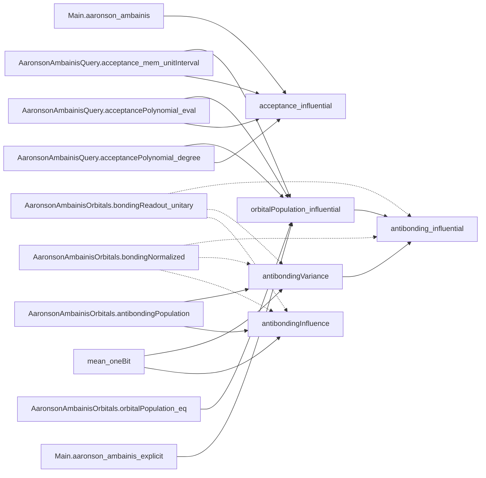

- [Main.aaronson_ambainis](https://github.com/physical-superintelligence/aaronson-ambainis/blob/2a6ceaef872ae993708950f951989134084b851a/AaronsonAmbainis/Main.lean#L33)
- [Main.aaronson_ambainis_explicit](https://github.com/physical-superintelligence/aaronson-ambainis/blob/2a6ceaef872ae993708950f951989134084b851a/AaronsonAmbainis/Main.lean#L38)
- [acceptance_influential](../../FQChem/Complexity/AaronsonAmbainis.lean#L36)
- [antibondingInfluence](../../FQChem/Complexity/AaronsonAmbainis.lean#L78)
- [antibondingVariance](../../FQChem/Complexity/AaronsonAmbainis.lean#L74)
- [antibonding_influential](../../FQChem/Complexity/AaronsonAmbainis.lean#L84)
- [mean_oneBit](../../FQChem/Complexity/AaronsonAmbainis.lean#L67) (private)
- [orbitalPopulation_influential](../../FQChem/Complexity/AaronsonAmbainis.lean#L51)
- [AaronsonAmbainisOrbitals.antibondingPopulation](../../FQChem/Complexity/AaronsonAmbainisOrbitals.lean#L106)
- [AaronsonAmbainisOrbitals.bondingNormalized](../../FQChem/Complexity/AaronsonAmbainisOrbitals.lean#L86)
- [AaronsonAmbainisOrbitals.bondingReadout_unitary](../../FQChem/Complexity/AaronsonAmbainisOrbitals.lean#L93)
- [AaronsonAmbainisOrbitals.orbitalPopulation_eq](../../FQChem/Complexity/AaronsonAmbainisOrbitals.lean#L74)
- [AaronsonAmbainisQuery.acceptancePolynomial_degree](../../FQChem/Complexity/AaronsonAmbainisQuery.lean#L180)
- [AaronsonAmbainisQuery.acceptancePolynomial_eval](../../FQChem/Complexity/AaronsonAmbainisQuery.lean#L171)
- [AaronsonAmbainisQuery.acceptance_mem_unitInterval](../../FQChem/Complexity/AaronsonAmbainisQuery.lean#L188)

## FQChem.Complexity.AaronsonAmbainisOrbitals

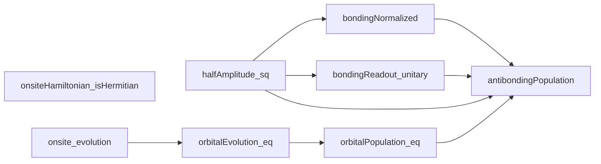

- [antibondingPopulation](../../FQChem/Complexity/AaronsonAmbainisOrbitals.lean#L106)
- [bondingNormalized](../../FQChem/Complexity/AaronsonAmbainisOrbitals.lean#L86)
- [bondingReadout_unitary](../../FQChem/Complexity/AaronsonAmbainisOrbitals.lean#L93)
- [halfAmplitude_sq](../../FQChem/Complexity/AaronsonAmbainisOrbitals.lean#L80) (private)
- [onsiteHamiltonian_isHermitian](../../FQChem/Complexity/AaronsonAmbainisOrbitals.lean#L37)
- [onsite_evolution](../../FQChem/Complexity/AaronsonAmbainisOrbitals.lean#L42)
- [orbitalEvolution_eq](../../FQChem/Complexity/AaronsonAmbainisOrbitals.lean#L61)
- [orbitalPopulation_eq](../../FQChem/Complexity/AaronsonAmbainisOrbitals.lean#L74)

## FQChem.Complexity.AaronsonAmbainisQuery

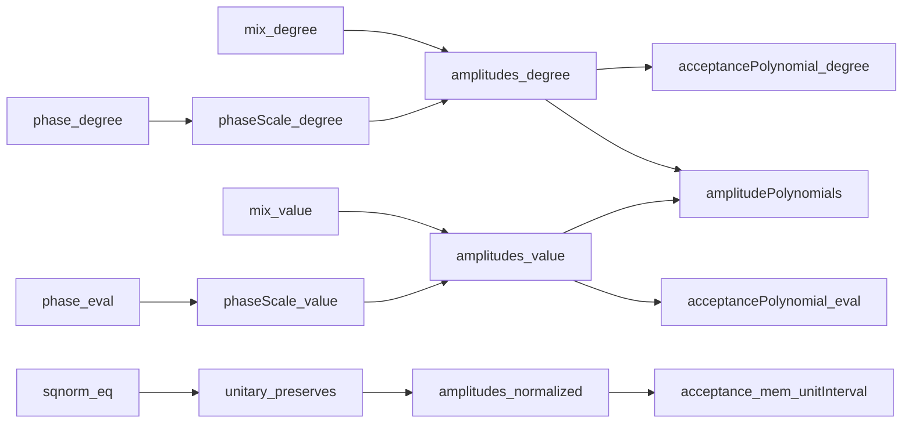

- [acceptancePolynomial_degree](../../FQChem/Complexity/AaronsonAmbainisQuery.lean#L180)
- [acceptancePolynomial_eval](../../FQChem/Complexity/AaronsonAmbainisQuery.lean#L171)
- [acceptance_mem_unitInterval](../../FQChem/Complexity/AaronsonAmbainisQuery.lean#L188)
- [amplitudePolynomials](../../FQChem/Complexity/AaronsonAmbainisQuery.lean#L158)
- [amplitudes_degree](../../FQChem/Complexity/AaronsonAmbainisQuery.lean#L149) (private)
- [amplitudes_normalized](../../FQChem/Complexity/AaronsonAmbainisQuery.lean#L78)
- [amplitudes_value](../../FQChem/Complexity/AaronsonAmbainisQuery.lean#L142) (private)
- [mix_degree](../../FQChem/Complexity/AaronsonAmbainisQuery.lean#L128) (private)
- [mix_value](../../FQChem/Complexity/AaronsonAmbainisQuery.lean#L121) (private)
- [phaseScale_degree](../../FQChem/Complexity/AaronsonAmbainisQuery.lean#L109) (private)
- [phaseScale_value](../../FQChem/Complexity/AaronsonAmbainisQuery.lean#L104) (private)
- [phase_degree](../../FQChem/Complexity/AaronsonAmbainisQuery.lean#L46) (private)
- [phase_eval](../../FQChem/Complexity/AaronsonAmbainisQuery.lean#L40) (private)
- [sqnorm_eq](../../FQChem/Complexity/AaronsonAmbainisQuery.lean#L68) (private)
- [unitary_preserves](../../FQChem/Complexity/AaronsonAmbainisQuery.lean#L72) (private)

## FQChem.Complexity.BlockSimulationPrecision

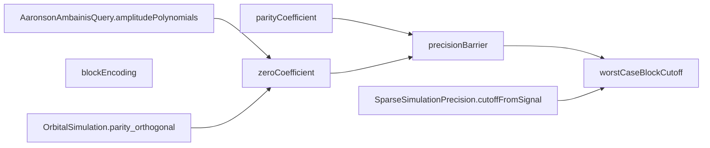

- [AaronsonAmbainisQuery.amplitudePolynomials](../../FQChem/Complexity/AaronsonAmbainisQuery.lean#L158)
- [blockEncoding](../../FQChem/Complexity/BlockSimulationPrecision.lean#L34)
- [parityCoefficient](../../FQChem/Complexity/BlockSimulationPrecision.lean#L59)
- [precisionBarrier](../../FQChem/Complexity/BlockSimulationPrecision.lean#L95)
- [worstCaseBlockCutoff](../../FQChem/Complexity/BlockSimulationPrecision.lean#L111)
- [zeroCoefficient](../../FQChem/Complexity/BlockSimulationPrecision.lean#L79) (private)
- [OrbitalSimulation.parity_orthogonal](../../FQChem/Complexity/OrbitalSimulation.lean#L35)
- [SparseSimulationPrecision.cutoffFromSignal](../../FQChem/Complexity/SparseSimulationPrecision.lean#L61)

## FQChem.Complexity.ElectronicStructure

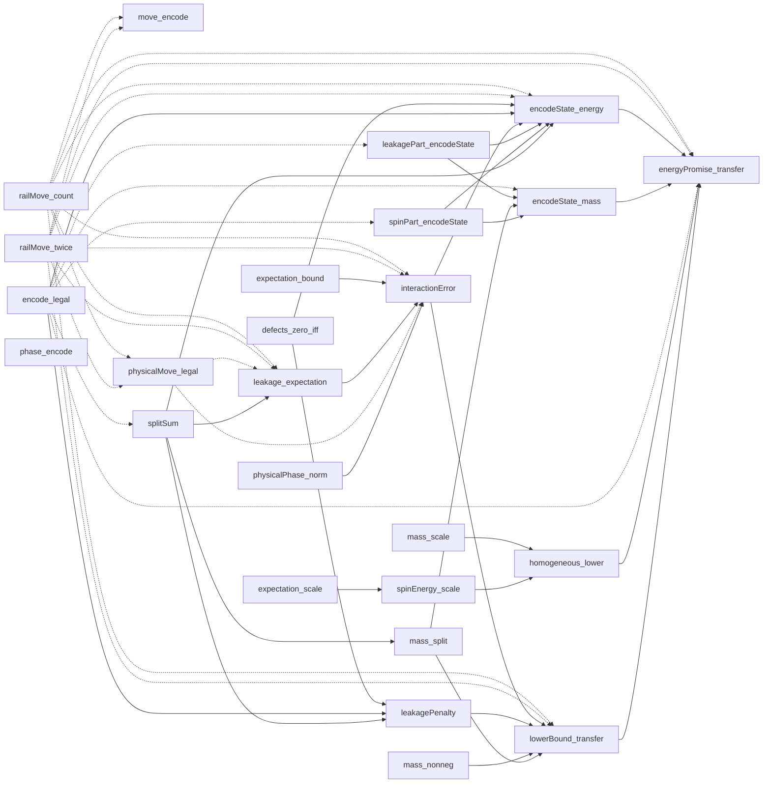

- [railMove_count](../../FQChem/Complexity/ElectronicStructure.lean#L110)
- [railMove_twice](../../FQChem/Complexity/ElectronicStructure.lean#L104)
- [defects_zero_iff](../../FQChem/Complexity/ElectronicStructure.lean#L81)
- [encodeState_energy](../../FQChem/Complexity/ElectronicStructure.lean#L251)
- [encodeState_mass](../../FQChem/Complexity/ElectronicStructure.lean#L247)
- [encode_legal](../../FQChem/Complexity/ElectronicStructure.lean#L58)
- [energyPromise_transfer](../../FQChem/Complexity/ElectronicStructure.lean#L318)
- [expectation_bound](../../FQChem/Complexity/ElectronicStructure.lean#L166) (private)
- [expectation_scale](../../FQChem/Complexity/ElectronicStructure.lean#L281) (private)
- [homogeneous_lower](../../FQChem/Complexity/ElectronicStructure.lean#L299) (private)
- [interactionError](../../FQChem/Complexity/ElectronicStructure.lean#L213)
- [leakagePart_encodeState](../../FQChem/Complexity/ElectronicStructure.lean#L242)
- [leakagePenalty](../../FQChem/Complexity/ElectronicStructure.lean#L224)
- [leakage_expectation](../../FQChem/Complexity/ElectronicStructure.lean#L208) (private)
- [lowerBound_transfer](../../FQChem/Complexity/ElectronicStructure.lean#L267)
- [mass_nonneg](../../FQChem/Complexity/ElectronicStructure.lean#L262) (private)
- [mass_scale](../../FQChem/Complexity/ElectronicStructure.lean#L277) (private)
- [mass_split](../../FQChem/Complexity/ElectronicStructure.lean#L192)
- [move_encode](../../FQChem/Complexity/ElectronicStructure.lean#L127)
- [phase_encode](../../FQChem/Complexity/ElectronicStructure.lean#L149)
- [physicalMove_legal](../../FQChem/Complexity/ElectronicStructure.lean#L130)
- [physicalPhase_norm](../../FQChem/Complexity/ElectronicStructure.lean#L152) (private)
- [spinEnergy_scale](../../FQChem/Complexity/ElectronicStructure.lean#L292) (private)
- [spinPart_encodeState](../../FQChem/Complexity/ElectronicStructure.lean#L237)
- [splitSum](../../FQChem/Complexity/ElectronicStructure.lean#L187) (private)

## FQChem.Complexity.ElectronicStructureOperators

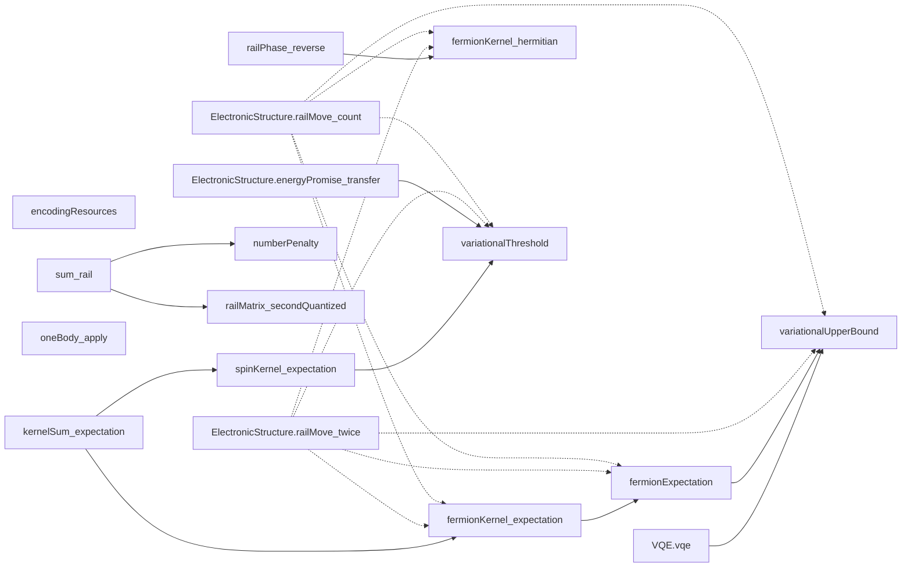

- [ElectronicStructure.railMove_count](../../FQChem/Complexity/ElectronicStructure.lean#L110)
- [ElectronicStructure.railMove_twice](../../FQChem/Complexity/ElectronicStructure.lean#L104)
- [ElectronicStructure.energyPromise_transfer](../../FQChem/Complexity/ElectronicStructure.lean#L318)
- [encodingResources](../../FQChem/Complexity/ElectronicStructureOperators.lean#L80)
- [fermionExpectation](../../FQChem/Complexity/ElectronicStructureOperators.lean#L175)
- [fermionKernel_expectation](../../FQChem/Complexity/ElectronicStructureOperators.lean#L158)
- [fermionKernel_hermitian](../../FQChem/Complexity/ElectronicStructureOperators.lean#L138)
- [kernelSum_expectation](../../FQChem/Complexity/ElectronicStructureOperators.lean#L98) (private)
- [numberPenalty](../../FQChem/Complexity/ElectronicStructureOperators.lean#L57)
- [oneBody_apply](../../FQChem/Complexity/ElectronicStructureOperators.lean#L31) (private)
- [railMatrix_secondQuantized](../../FQChem/Complexity/ElectronicStructureOperators.lean#L45)
- [railPhase_reverse](../../FQChem/Complexity/ElectronicStructureOperators.lean#L130) (private)
- [spinKernel_expectation](../../FQChem/Complexity/ElectronicStructureOperators.lean#L122)
- [sum_rail](../../FQChem/Complexity/ElectronicStructureOperators.lean#L37) (private)
- [variationalThreshold](../../FQChem/Complexity/ElectronicStructureOperators.lean#L198)
- [variationalUpperBound](../../FQChem/Complexity/ElectronicStructureOperators.lean#L188)
- [VQE.vqe](../../FQChem/StatePrep/VariationalOptimization/VQE.lean#L28)

## FQChem.Complexity.ElectronicStructurePauli

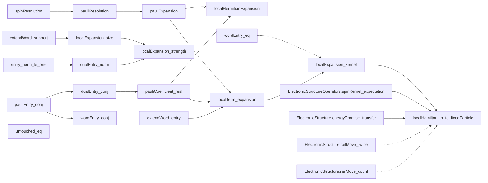

- [ElectronicStructure.railMove_count](../../FQChem/Complexity/ElectronicStructure.lean#L110)
- [ElectronicStructure.railMove_twice](../../FQChem/Complexity/ElectronicStructure.lean#L104)
- [ElectronicStructure.energyPromise_transfer](../../FQChem/Complexity/ElectronicStructure.lean#L318)
- [ElectronicStructureOperators.spinKernel_expectation](../../FQChem/Complexity/ElectronicStructureOperators.lean#L122)
- [dualEntry_conj](../../FQChem/Complexity/ElectronicStructurePauli.lean#L80) (private)
- [dualEntry_norm](../../FQChem/Complexity/ElectronicStructurePauli.lean#L222) (private)
- [entry_norm_le_one](../../FQChem/Complexity/ElectronicStructurePauli.lean#L219) (private)
- [extendWord_entry](../../FQChem/Complexity/ElectronicStructurePauli.lean#L126)
- [extendWord_support](../../FQChem/Complexity/ElectronicStructurePauli.lean#L139)
- [localExpansion_kernel](../../FQChem/Complexity/ElectronicStructurePauli.lean#L184)
- [localExpansion_size](../../FQChem/Complexity/ElectronicStructurePauli.lean#L198)
- [localExpansion_strength](../../FQChem/Complexity/ElectronicStructurePauli.lean#L230)
- [localHamiltonian_to_fixedParticle](../../FQChem/Complexity/ElectronicStructurePauli.lean#L209)
- [localHermitianExpansion](../../FQChem/Complexity/ElectronicStructurePauli.lean#L97)
- [localTerm_expansion](../../FQChem/Complexity/ElectronicStructurePauli.lean#L175) (private)
- [pauliCoefficient_real](../../FQChem/Complexity/ElectronicStructurePauli.lean#L84)
- [pauliEntry_conj](../../FQChem/Complexity/ElectronicStructurePauli.lean#L29)
- [pauliExpansion](../../FQChem/Complexity/ElectronicStructurePauli.lean#L67)
- [pauliResolution](../../FQChem/Complexity/ElectronicStructurePauli.lean#L54)
- [spinResolution](../../FQChem/Complexity/ElectronicStructurePauli.lean#L33) (private)
- [untouched_eq](../../FQChem/Complexity/ElectronicStructurePauli.lean#L114)
- [wordEntry_conj](../../FQChem/Complexity/ElectronicStructurePauli.lean#L48)
- [wordEntry_eq](../../FQChem/Complexity/ElectronicStructurePauli.lean#L42)

## FQChem.Complexity.FactoringBitCost

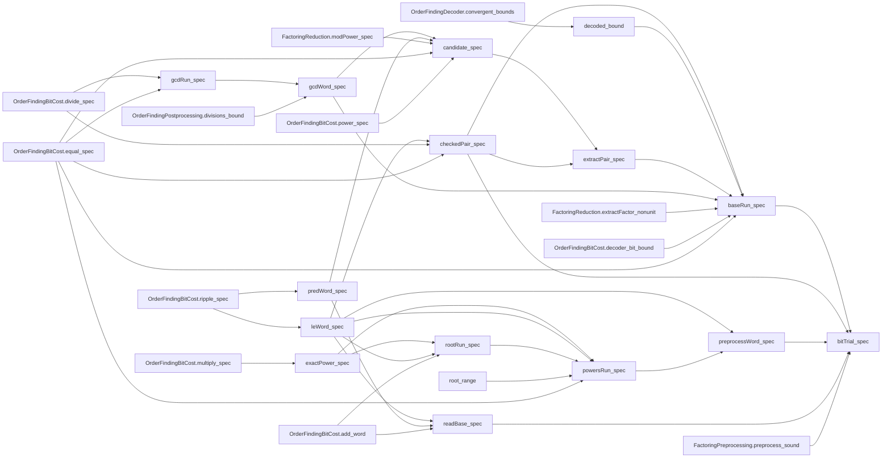

- [baseRun_spec](../../FQChem/Complexity/FactoringBitCost.lean#L374)
- [bitTrial_spec](../../FQChem/Complexity/FactoringBitCost.lean#L427)
- [candidate_spec](../../FQChem/Complexity/FactoringBitCost.lean#L282)
- [checkedPair_spec](../../FQChem/Complexity/FactoringBitCost.lean#L246)
- [decoded_bound](../../FQChem/Complexity/FactoringBitCost.lean#L350)
- [exactPower_spec](../../FQChem/Complexity/FactoringBitCost.lean#L97)
- [extractPair_spec](../../FQChem/Complexity/FactoringBitCost.lean#L311)
- [gcdRun_spec](../../FQChem/Complexity/FactoringBitCost.lean#L56) (private)
- [gcdWord_spec](../../FQChem/Complexity/FactoringBitCost.lean#L80)
- [leWord_spec](../../FQChem/Complexity/FactoringBitCost.lean#L25)
- [powersRun_spec](../../FQChem/Complexity/FactoringBitCost.lean#L170)
- [predWord_spec](../../FQChem/Complexity/FactoringBitCost.lean#L38)
- [preprocessWord_spec](../../FQChem/Complexity/FactoringBitCost.lean#L209)
- [readBase_spec](../../FQChem/Complexity/FactoringBitCost.lean#L337)
- [rootRun_spec](../../FQChem/Complexity/FactoringBitCost.lean#L132)
- [root_range](../../FQChem/Complexity/FactoringBitCost.lean#L112) (private)
- [FactoringPreprocessing.preprocess_sound](../../FQChem/Complexity/FactoringPreprocessing.lean#L103)
- [FactoringReduction.extractFactor_nonunit](../../FQChem/Complexity/FactoringReduction.lean#L349)
- [FactoringReduction.modPower_spec](../../FQChem/Complexity/FactoringReduction.lean#L52)
- [OrderFindingBitCost.add_word](../../FQChem/Complexity/OrderFindingBitCost.lean#L251)
- [OrderFindingBitCost.decoder_bit_bound](../../FQChem/Complexity/OrderFindingBitCost.lean#L443)
- [OrderFindingBitCost.divide_spec](../../FQChem/Complexity/OrderFindingBitCost.lean#L161)
- [OrderFindingBitCost.equal_spec](../../FQChem/Complexity/OrderFindingBitCost.lean#L209)
- [OrderFindingBitCost.multiply_spec](../../FQChem/Complexity/OrderFindingBitCost.lean#L115)
- [OrderFindingBitCost.power_spec](../../FQChem/Complexity/OrderFindingBitCost.lean#L319)
- [OrderFindingBitCost.ripple_spec](../../FQChem/Complexity/OrderFindingBitCost.lean#L51)
- [OrderFindingDecoder.convergent_bounds](../../FQChem/Complexity/OrderFindingDecoder.lean#L62)
- [OrderFindingPostprocessing.divisions_bound](../../FQChem/Complexity/OrderFindingPostprocessing.lean#L32)

## FQChem.Complexity.FactoringPreprocessing

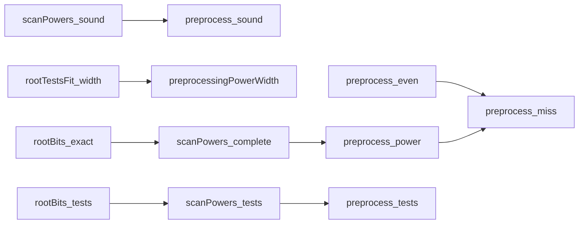

- [preprocess_even](../../FQChem/Complexity/FactoringPreprocessing.lean#L112)
- [preprocess_miss](../../FQChem/Complexity/FactoringPreprocessing.lean#L139)
- [preprocess_power](../../FQChem/Complexity/FactoringPreprocessing.lean#L115)
- [preprocess_sound](../../FQChem/Complexity/FactoringPreprocessing.lean#L103)
- [preprocess_tests](../../FQChem/Complexity/FactoringPreprocessing.lean#L130)
- [preprocessingPowerWidth](../../FQChem/Complexity/FactoringPreprocessing.lean#L183)
- [rootBits_exact](../../FQChem/Complexity/FactoringPreprocessing.lean#L34) (private)
- [rootBits_tests](../../FQChem/Complexity/FactoringPreprocessing.lean#L29)
- [rootTestsFit_width](../../FQChem/Complexity/FactoringPreprocessing.lean#L168) (private)
- [scanPowers_complete](../../FQChem/Complexity/FactoringPreprocessing.lean#L70) (private)
- [scanPowers_sound](../../FQChem/Complexity/FactoringPreprocessing.lean#L56) (private)
- [scanPowers_tests](../../FQChem/Complexity/FactoringPreprocessing.lean#L88) (private)

## FQChem.Complexity.FactoringRecursion

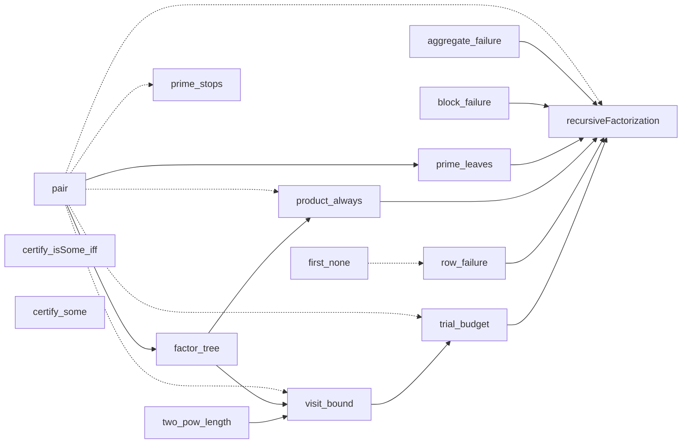

- [pair](../../FQChem/Complexity/FactoringRecursion.lean#L41)
- [aggregate_failure](../../FQChem/Complexity/FactoringRecursion.lean#L231) (private)
- [block_failure](../../FQChem/Complexity/FactoringRecursion.lean#L216)
- [certify_isSome_iff](../../FQChem/Complexity/FactoringRecursion.lean#L187)
- [certify_some](../../FQChem/Complexity/FactoringRecursion.lean#L36)
- [factor_tree](../../FQChem/Complexity/FactoringRecursion.lean#L104)
- [first_none](../../FQChem/Complexity/FactoringRecursion.lean#L58)
- [prime_leaves](../../FQChem/Complexity/FactoringRecursion.lean#L148)
- [prime_stops](../../FQChem/Complexity/FactoringRecursion.lean#L89)
- [product_always](../../FQChem/Complexity/FactoringRecursion.lean#L123)
- [recursiveFactorization](../../FQChem/Complexity/FactoringRecursion.lean#L246)
- [row_failure](../../FQChem/Complexity/FactoringRecursion.lean#L204)
- [trial_budget](../../FQChem/Complexity/FactoringRecursion.lean#L182)
- [two_pow_length](../../FQChem/Complexity/FactoringRecursion.lean#L129) (private)
- [visit_bound](../../FQChem/Complexity/FactoringRecursion.lean#L136)

## FQChem.Complexity.FactoringReduction

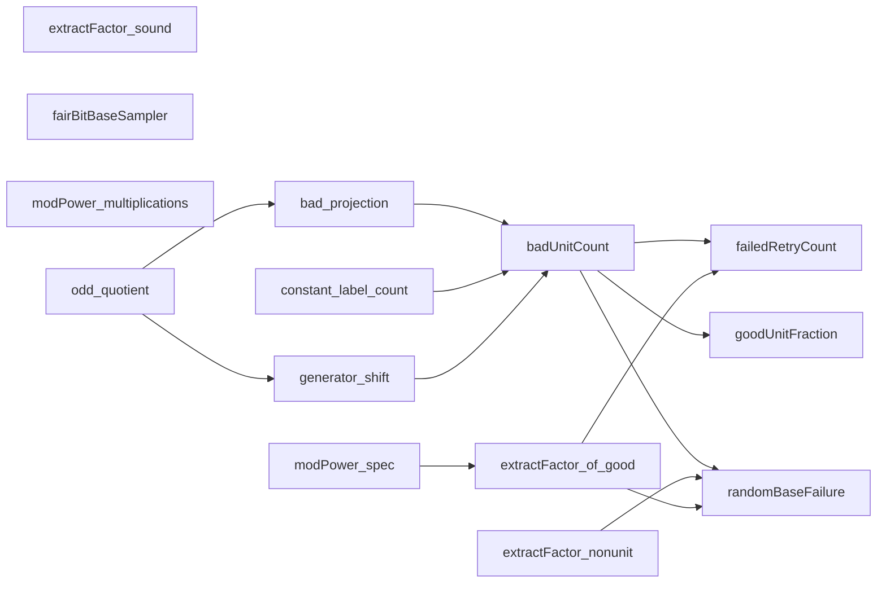

- [badUnitCount](../../FQChem/Complexity/FactoringReduction.lean#L197)
- [bad_projection](../../FQChem/Complexity/FactoringReduction.lean#L162) (private)
- [constant_label_count](../../FQChem/Complexity/FactoringReduction.lean#L125) (private)
- [extractFactor_nonunit](../../FQChem/Complexity/FactoringReduction.lean#L349)
- [extractFactor_of_good](../../FQChem/Complexity/FactoringReduction.lean#L273)
- [extractFactor_sound](../../FQChem/Complexity/FactoringReduction.lean#L74)
- [failedRetryCount](../../FQChem/Complexity/FactoringReduction.lean#L327)
- [fairBitBaseSampler](../../FQChem/Complexity/FactoringReduction.lean#L401)
- [generator_shift](../../FQChem/Complexity/FactoringReduction.lean#L99) (private)
- [goodUnitFraction](../../FQChem/Complexity/FactoringReduction.lean#L244)
- [modPower_multiplications](../../FQChem/Complexity/FactoringReduction.lean#L37)
- [modPower_spec](../../FQChem/Complexity/FactoringReduction.lean#L52)
- [odd_quotient](../../FQChem/Complexity/FactoringReduction.lean#L88) (private)
- [randomBaseFailure](../../FQChem/Complexity/FactoringReduction.lean#L359)

## FQChem.Complexity.FastForwarding

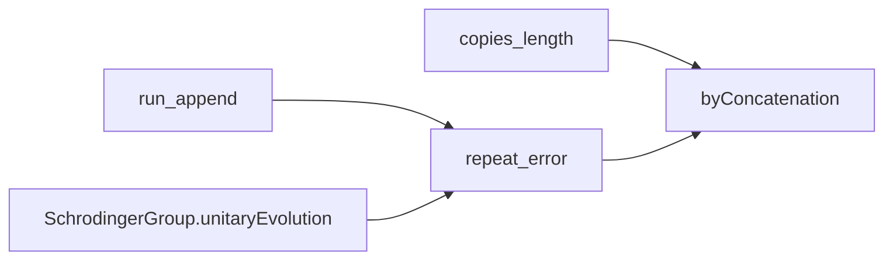

- [byConcatenation](../../FQChem/Complexity/FastForwarding.lean#L81)
- [copies_length](../../FQChem/Complexity/FastForwarding.lean#L37)
- [repeat_error](../../FQChem/Complexity/FastForwarding.lean#L58)
- [run_append](../../FQChem/Complexity/FastForwarding.lean#L42) (private)
- [SchrodingerGroup.unitaryEvolution](../../FQChem/Dynamics/RealTimePropagation/SchrodingerGroup.lean#L41)

## FQChem.Complexity.FermionicMarginals

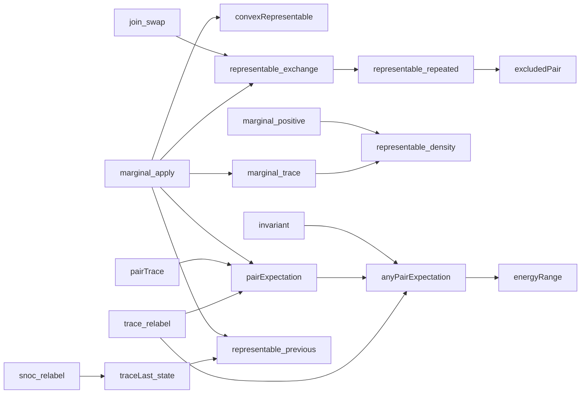

- [anyPairExpectation](../../FQChem/Complexity/FermionicMarginals.lean#L185)
- [convexRepresentable](../../FQChem/Complexity/FermionicMarginals.lean#L68)
- [energyRange](../../FQChem/Complexity/FermionicMarginals.lean#L203)
- [excludedPair](../../FQChem/Complexity/FermionicMarginals.lean#L253)
- [invariant](../../FQChem/Complexity/FermionicMarginals.lean#L172) (private)
- [join_swap](../../FQChem/Complexity/FermionicMarginals.lean#L218) (private)
- [marginal_apply](../../FQChem/Complexity/FermionicMarginals.lean#L42)
- [marginal_positive](../../FQChem/Complexity/FermionicMarginals.lean#L46)
- [marginal_trace](../../FQChem/Complexity/FermionicMarginals.lean#L51)
- [pairExpectation](../../FQChem/Complexity/FermionicMarginals.lean#L157)
- [pairTrace](../../FQChem/Complexity/FermionicMarginals.lean#L146) (private)
- [representable_density](../../FQChem/Complexity/FermionicMarginals.lean#L61)
- [representable_exchange](../../FQChem/Complexity/FermionicMarginals.lean#L233)
- [representable_previous](../../FQChem/Complexity/FermionicMarginals.lean#L121)
- [representable_repeated](../../FQChem/Complexity/FermionicMarginals.lean#L247)
- [snoc_relabel](../../FQChem/Complexity/FermionicMarginals.lean#L91) (private)
- [traceLast_state](../../FQChem/Complexity/FermionicMarginals.lean#L101)
- [trace_relabel](../../FQChem/Complexity/FermionicMarginals.lean#L135) (private)

## FQChem.Complexity.FixedBasisArithmetic

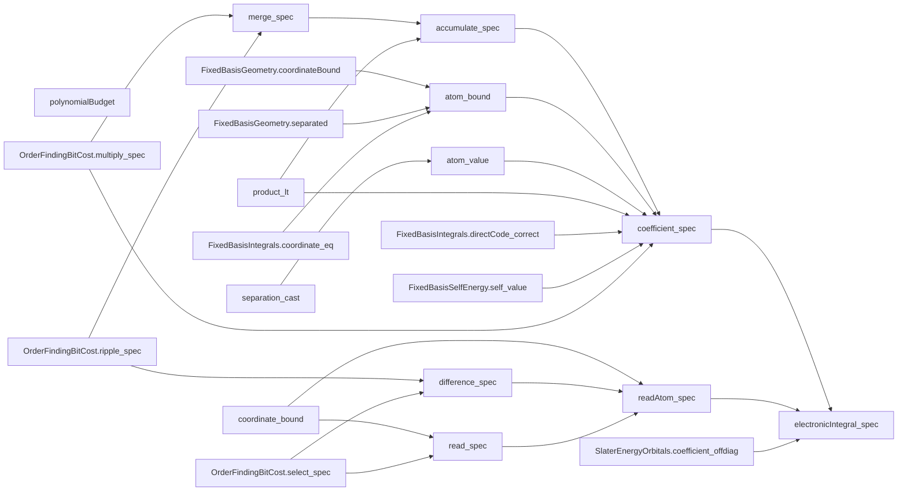

- [accumulate_spec](../../FQChem/Complexity/FixedBasisArithmetic.lean#L65)
- [atom_bound](../../FQChem/Complexity/FixedBasisArithmetic.lean#L140) (private)
- [atom_value](../../FQChem/Complexity/FixedBasisArithmetic.lean#L128) (private)
- [coefficient_spec](../../FQChem/Complexity/FixedBasisArithmetic.lean#L173)
- [coordinate_bound](../../FQChem/Complexity/FixedBasisArithmetic.lean#L215) (private)
- [difference_spec](../../FQChem/Complexity/FixedBasisArithmetic.lean#L244) (private)
- [electronicIntegral_spec](../../FQChem/Complexity/FixedBasisArithmetic.lean#L296)
- [merge_spec](../../FQChem/Complexity/FixedBasisArithmetic.lean#L33) (private)
- [polynomialBudget](../../FQChem/Complexity/FixedBasisArithmetic.lean#L318)
- [product_lt](../../FQChem/Complexity/FixedBasisArithmetic.lean#L57) (private)
- [readAtom_spec](../../FQChem/Complexity/FixedBasisArithmetic.lean#L273) (private)
- [read_spec](../../FQChem/Complexity/FixedBasisArithmetic.lean#L229) (private)
- [separation_cast](../../FQChem/Complexity/FixedBasisArithmetic.lean#L117) (private)
- [FixedBasisGeometry.coordinateBound](../../FQChem/Complexity/FixedBasisGeometry.lean#L109)
- [FixedBasisGeometry.separated](../../FQChem/Complexity/FixedBasisGeometry.lean#L80)
- [FixedBasisIntegrals.coordinate_eq](../../FQChem/Complexity/FixedBasisIntegrals.lean#L30)
- [FixedBasisIntegrals.directCode_correct](../../FQChem/Complexity/FixedBasisIntegrals.lean#L50)
- [FixedBasisSelfEnergy.self_value](../../FQChem/Complexity/FixedBasisSelfEnergy.lean#L97)
- [OrderFindingBitCost.multiply_spec](../../FQChem/Complexity/OrderFindingBitCost.lean#L115)
- [OrderFindingBitCost.ripple_spec](../../FQChem/Complexity/OrderFindingBitCost.lean#L51)
- [OrderFindingBitCost.select_spec](../../FQChem/Complexity/OrderFindingBitCost.lean#L93) (private)
- [SlaterEnergyOrbitals.coefficient_offdiag](../../FQChem/Complexity/SlaterEnergyOrbitals.lean#L70)

## FQChem.Complexity.FixedBasisCoulomb

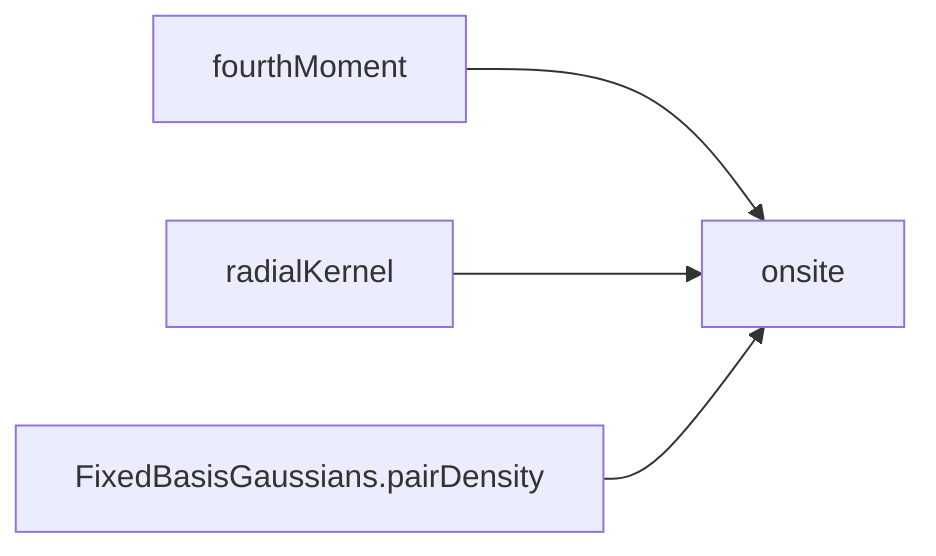

- [fourthMoment](../../FQChem/Complexity/FixedBasisCoulomb.lean#L40) (private)
- [onsite](../../FQChem/Complexity/FixedBasisCoulomb.lean#L56)
- [radialKernel](../../FQChem/Complexity/FixedBasisCoulomb.lean#L22)
- [FixedBasisGaussians.pairDensity](../../FQChem/Complexity/FixedBasisGaussians.lean#L75)

## FQChem.Complexity.FixedBasisGaussians

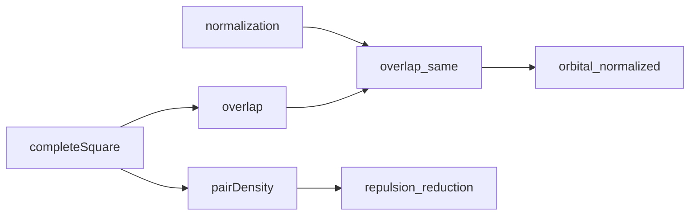

- [completeSquare](../../FQChem/Complexity/FixedBasisGaussians.lean#L26) (private)
- [normalization](../../FQChem/Complexity/FixedBasisGaussians.lean#L56) (private)
- [orbital_normalized](../../FQChem/Complexity/FixedBasisGaussians.lean#L69)
- [overlap](../../FQChem/Complexity/FixedBasisGaussians.lean#L35)
- [overlap_same](../../FQChem/Complexity/FixedBasisGaussians.lean#L64)
- [pairDensity](../../FQChem/Complexity/FixedBasisGaussians.lean#L75)
- [repulsion_reduction](../../FQChem/Complexity/FixedBasisGaussians.lean#L100)

## FQChem.Complexity.FixedBasisGeometry

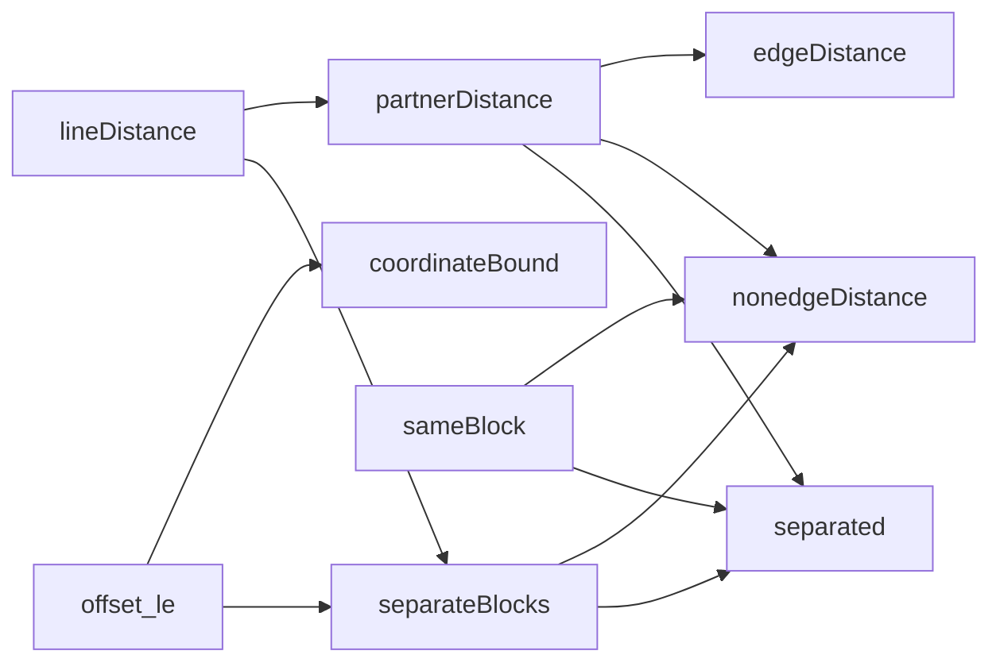

- [coordinateBound](../../FQChem/Complexity/FixedBasisGeometry.lean#L109)
- [edgeDistance](../../FQChem/Complexity/FixedBasisGeometry.lean#L71)
- [lineDistance](../../FQChem/Complexity/FixedBasisGeometry.lean#L40) (private)
- [nonedgeDistance](../../FQChem/Complexity/FixedBasisGeometry.lean#L95)
- [offset_le](../../FQChem/Complexity/FixedBasisGeometry.lean#L46) (private)
- [partnerDistance](../../FQChem/Complexity/FixedBasisGeometry.lean#L62) (private)
- [sameBlock](../../FQChem/Complexity/FixedBasisGeometry.lean#L23) (private)
- [separateBlocks](../../FQChem/Complexity/FixedBasisGeometry.lean#L49) (private)
- [separated](../../FQChem/Complexity/FixedBasisGeometry.lean#L80)

## FQChem.Complexity.FixedBasisHopping

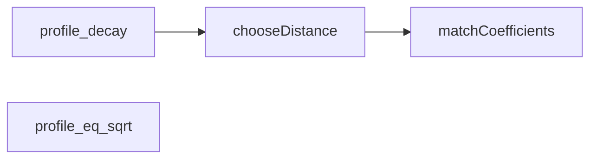

- [chooseDistance](../../FQChem/Complexity/FixedBasisHopping.lean#L45)
- [matchCoefficients](../../FQChem/Complexity/FixedBasisHopping.lean#L70)
- [profile_decay](../../FQChem/Complexity/FixedBasisHopping.lean#L33) (private)
- [profile_eq_sqrt](../../FQChem/Complexity/FixedBasisHopping.lean#L24)

## FQChem.Complexity.FixedBasisIntegrals

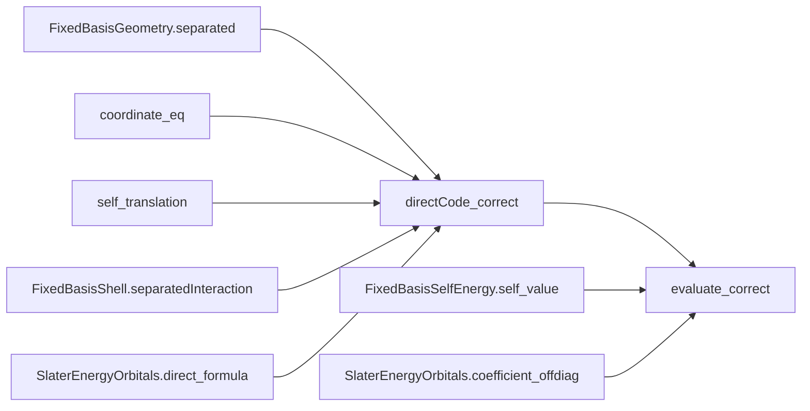

- [FixedBasisGeometry.separated](../../FQChem/Complexity/FixedBasisGeometry.lean#L80)
- [coordinate_eq](../../FQChem/Complexity/FixedBasisIntegrals.lean#L30)
- [directCode_correct](../../FQChem/Complexity/FixedBasisIntegrals.lean#L50)
- [evaluate_correct](../../FQChem/Complexity/FixedBasisIntegrals.lean#L75)
- [self_translation](../../FQChem/Complexity/FixedBasisIntegrals.lean#L37) (private)
- [FixedBasisSelfEnergy.self_value](../../FQChem/Complexity/FixedBasisSelfEnergy.lean#L97)
- [FixedBasisShell.separatedInteraction](../../FQChem/Complexity/FixedBasisShell.lean#L284)
- [SlaterEnergyOrbitals.coefficient_offdiag](../../FQChem/Complexity/SlaterEnergyOrbitals.lean#L70)
- [SlaterEnergyOrbitals.direct_formula](../../FQChem/Complexity/SlaterEnergyOrbitals.lean#L74)

## FQChem.Complexity.FixedBasisOrthonormalization

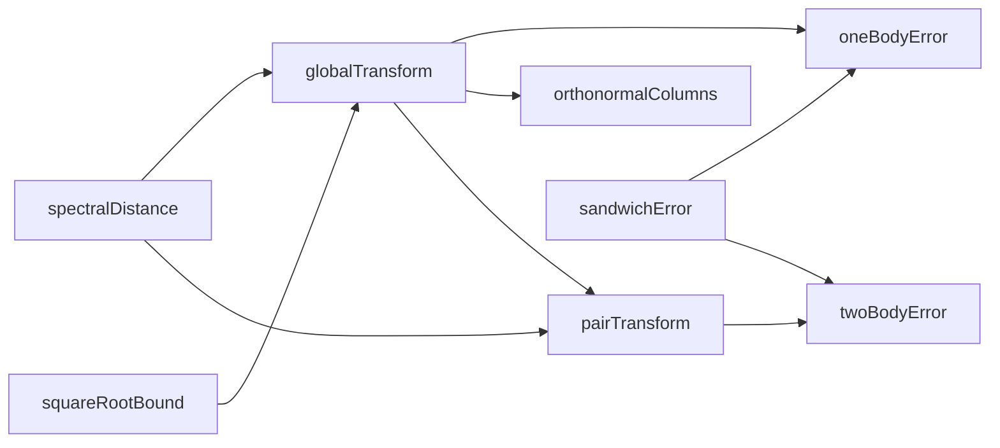

- [globalTransform](../../FQChem/Complexity/FixedBasisOrthonormalization.lean#L58)
- [oneBodyError](../../FQChem/Complexity/FixedBasisOrthonormalization.lean#L127)
- [orthonormalColumns](../../FQChem/Complexity/FixedBasisOrthonormalization.lean#L97)
- [pairTransform](../../FQChem/Complexity/FixedBasisOrthonormalization.lean#L136)
- [sandwichError](../../FQChem/Complexity/FixedBasisOrthonormalization.lean#L108) (private)
- [spectralDistance](../../FQChem/Complexity/FixedBasisOrthonormalization.lean#L26) (private)
- [squareRootBound](../../FQChem/Complexity/FixedBasisOrthonormalization.lean#L39) (private)
- [twoBodyError](../../FQChem/Complexity/FixedBasisOrthonormalization.lean#L175)

## FQChem.Complexity.FixedBasisRadial

```mermaid
flowchart LR
  n220["bounds"]
  n221["cumulative"]
  n222["first"]
  n223["kineticNumerator"]
  n224["radialBall"]
  n225["radialBallOfRadius"]
  n226["second"]
  n227["shape_laplacian"]
  n228["smooth"]
  n229["squared"]
  n230["volumeMass"]
  n231["zero"]
  n231 --> n220
  n224 --> n223
  n227 --> n223
  n225 --> n224
  n222 --> n226
  n226 --> n227
  n231 --> n227
  n231 --> n229
  n221 --> n230
  n224 --> n230
  n229 --> n230
```

- [bounds](../../FQChem/Complexity/FixedBasisRadial.lean#L37)
- [cumulative](../../FQChem/Complexity/FixedBasisRadial.lean#L120)
- [first](../../FQChem/Complexity/FixedBasisRadial.lean#L51) (private)
- [kineticNumerator](../../FQChem/Complexity/FixedBasisRadial.lean#L134)
- [radialBall](../../FQChem/Complexity/FixedBasisRadial.lean#L108)
- [radialBallOfRadius](../../FQChem/Complexity/FixedBasisRadial.lean#L95)
- [second](../../FQChem/Complexity/FixedBasisRadial.lean#L61) (private)
- [shape_laplacian](../../FQChem/Complexity/FixedBasisRadial.lean#L76)
- [smooth](../../FQChem/Complexity/FixedBasisRadial.lean#L26)
- [squared](../../FQChem/Complexity/FixedBasisRadial.lean#L43)
- [volumeMass](../../FQChem/Complexity/FixedBasisRadial.lean#L129)
- [zero](../../FQChem/Complexity/FixedBasisRadial.lean#L30)

## FQChem.Complexity.FixedBasisSelfEnergy

```mermaid
flowchart LR
  n221["FixedBasisRadial.cumulative"]
  n224["FixedBasisRadial.radialBall"]
  n225["FixedBasisRadial.radialBallOfRadius"]
  n229["FixedBasisRadial.squared"]
  n230["FixedBasisRadial.volumeMass"]
  n232["density_sq"]
  n233["halfValue"]
  n234["half_integrable"]
  n235["self_value"]
  n236["swapHalves"]
  n237["truncated"]
  n241["FixedBasisShell.exteriorReal"]
  n377["SlaterEnergyCoulomb.kernel_integrable"]
  n383["SlaterEnergyCoulomb.weight_pos"]
  n229 --> n232
  n383 --> n232
  n232 --> n233
  n237 --> n233
  n377 --> n234
  n224 --> n235
  n230 --> n235
  n232 --> n235
  n233 --> n235
  n234 --> n235
  n236 --> n235
  n234 --> n236
  n221 --> n237
  n225 --> n237
  n232 --> n237
  n241 --> n237
  n383 --> n237
```

- [FixedBasisRadial.cumulative](../../FQChem/Complexity/FixedBasisRadial.lean#L120)
- [FixedBasisRadial.radialBall](../../FQChem/Complexity/FixedBasisRadial.lean#L108)
- [FixedBasisRadial.radialBallOfRadius](../../FQChem/Complexity/FixedBasisRadial.lean#L95)
- [FixedBasisRadial.squared](../../FQChem/Complexity/FixedBasisRadial.lean#L43)
- [FixedBasisRadial.volumeMass](../../FQChem/Complexity/FixedBasisRadial.lean#L129)
- [density_sq](../../FQChem/Complexity/FixedBasisSelfEnergy.lean#L20) (private)
- [halfValue](../../FQChem/Complexity/FixedBasisSelfEnergy.lean#L78) (private)
- [half_integrable](../../FQChem/Complexity/FixedBasisSelfEnergy.lean#L53) (private)
- [self_value](../../FQChem/Complexity/FixedBasisSelfEnergy.lean#L97)
- [swapHalves](../../FQChem/Complexity/FixedBasisSelfEnergy.lean#L57) (private)
- [truncated](../../FQChem/Complexity/FixedBasisSelfEnergy.lean#L24) (private)
- [FixedBasisShell.exteriorReal](../../FQChem/Complexity/FixedBasisShell.lean#L227)
- [SlaterEnergyCoulomb.kernel_integrable](../../FQChem/Complexity/SlaterEnergyCoulomb.lean#L76)
- [SlaterEnergyCoulomb.weight_pos](../../FQChem/Complexity/SlaterEnergyCoulomb.lean#L42)

## FQChem.Complexity.FixedBasisShell

```mermaid
flowchart LR
  n238["axisDist"]
  n239["exteriorAxis"]
  n240["exteriorPoint"]
  n241["exteriorReal"]
  n242["mass_one"]
  n243["potential"]
  n244["profile_density"]
  n245["radialHeight"]
  n246["separatedInteraction"]
  n247["shellHeight"]
  n248["shellHeight_lintegral"]
  n249["sliceArea"]
  n250["split_sq"]
  n251["split_volume"]
  n252["transverseArea"]
  n373["SlaterEnergyCoulomb.density_normalized"]
  n377["SlaterEnergyCoulomb.kernel_integrable"]
  n379["SlaterEnergyCoulomb.nonnegative"]
  n381["SlaterEnergyCoulomb.wave_smooth"]
  n382["SlaterEnergyCoulomb.wave_zero"]
  n238 --> n239
  n245 --> n239
  n248 --> n239
  n239 --> n240
  n240 --> n241
  n373 --> n242
  n240 --> n243
  n242 --> n243
  n244 --> n243
  n381 --> n243
  n382 --> n243
  n249 --> n245
  n250 --> n245
  n251 --> n245
  n243 --> n246
  n377 --> n246
  n379 --> n246
  n381 --> n246
  n382 --> n246
  n247 --> n248
  n252 --> n249
```

- [axisDist](../../FQChem/Complexity/FixedBasisShell.lean#L162) (private)
- [exteriorAxis](../../FQChem/Complexity/FixedBasisShell.lean#L183)
- [exteriorPoint](../../FQChem/Complexity/FixedBasisShell.lean#L213)
- [exteriorReal](../../FQChem/Complexity/FixedBasisShell.lean#L227)
- [mass_one](../../FQChem/Complexity/FixedBasisShell.lean#L250) (private)
- [potential](../../FQChem/Complexity/FixedBasisShell.lean#L258)
- [profile_density](../../FQChem/Complexity/FixedBasisShell.lean#L246) (private)
- [radialHeight](../../FQChem/Complexity/FixedBasisShell.lean#L118)
- [separatedInteraction](../../FQChem/Complexity/FixedBasisShell.lean#L284)
- [shellHeight](../../FQChem/Complexity/FixedBasisShell.lean#L24)
- [shellHeight_lintegral](../../FQChem/Complexity/FixedBasisShell.lean#L169) (private)
- [sliceArea](../../FQChem/Complexity/FixedBasisShell.lean#L88) (private)
- [split_sq](../../FQChem/Complexity/FixedBasisShell.lean#L111) (private)
- [split_volume](../../FQChem/Complexity/FixedBasisShell.lean#L106) (private)
- [transverseArea](../../FQChem/Complexity/FixedBasisShell.lean#L55)
- [SlaterEnergyCoulomb.density_normalized](../../FQChem/Complexity/SlaterEnergyCoulomb.lean#L55)
- [SlaterEnergyCoulomb.kernel_integrable](../../FQChem/Complexity/SlaterEnergyCoulomb.lean#L76)
- [SlaterEnergyCoulomb.nonnegative](../../FQChem/Complexity/SlaterEnergyCoulomb.lean#L161)
- [SlaterEnergyCoulomb.wave_smooth](../../FQChem/Complexity/SlaterEnergyCoulomb.lean#L64)
- [SlaterEnergyCoulomb.wave_zero](../../FQChem/Complexity/SlaterEnergyCoulomb.lean#L60)

## FQChem.Complexity.GroundStateSearch

```mermaid
flowchart LR
  n253["energy_eq_failure"]
  n254["energy_query_lower_bound"]
  n255["groundSpace"]
  n256["hybrid_bound"]
  n257["hybrid_step"]
  n258["mark_eq_neg_reflection"]
  n259["orthonormal_addresses"]
  n260["orthonormal_energy_lower_bound"]
  n261["queried_norm"]
  n262["query_lower_bound"]
  n263["reference_norm"]
  n264["sum_amplitudes_le"]
  n253 --> n254
  n261 --> n254
  n262 --> n254
  n257 --> n256
  n263 --> n256
  n264 --> n256
  n258 --> n257
  n254 --> n260
  n259 --> n260
  n258 --> n261
  n256 --> n262
  n263 --> n262
  n264 --> n262
```

- [energy_eq_failure](../../FQChem/Complexity/GroundStateSearch.lean#L35)
- [energy_query_lower_bound](../../FQChem/Complexity/GroundStateSearch.lean#L141)
- [groundSpace](../../FQChem/Complexity/GroundStateSearch.lean#L30)
- [hybrid_bound](../../FQChem/Complexity/GroundStateSearch.lean#L103)
- [hybrid_step](../../FQChem/Complexity/GroundStateSearch.lean#L69) (private)
- [mark_eq_neg_reflection](../../FQChem/Complexity/GroundStateSearch.lean#L44) (private)
- [orthonormal_addresses](../../FQChem/Complexity/GroundStateSearch.lean#L86)
- [orthonormal_energy_lower_bound](../../FQChem/Complexity/GroundStateSearch.lean#L154)
- [queried_norm](../../FQChem/Complexity/GroundStateSearch.lean#L64)
- [query_lower_bound](../../FQChem/Complexity/GroundStateSearch.lean#L116)
- [reference_norm](../../FQChem/Complexity/GroundStateSearch.lean#L59)
- [sum_amplitudes_le](../../FQChem/Complexity/GroundStateSearch.lean#L92) (private)

## FQChem.Complexity.LocalHamiltonianVerification

```mermaid
flowchart LR
  n265["acceptance_eq"]
  n266["maximumAcceptance"]
  n267["termEffects"]
  n1184["RayleighRitz.groundEnergyPrinciple"]
  n267 --> n265
  n265 --> n266
  n1184 --> n266
```

- [acceptance_eq](../../FQChem/Complexity/LocalHamiltonianVerification.lean#L43)
- [maximumAcceptance](../../FQChem/Complexity/LocalHamiltonianVerification.lean#L66)
- [termEffects](../../FQChem/Complexity/LocalHamiltonianVerification.lean#L31)
- [RayleighRitz.groundEnergyPrinciple](../../FQChem/StatePrep/VariationalOptimization/RayleighRitz.lean#L59)

## FQChem.Complexity.MarginalVerification

```mermaid
flowchart LR
  n155["FermionicMarginals.convexRepresentable"]
  n165["FermionicMarginals.representable_density"]
  n268["measurableDiscrepancy"]
  n269["observableReadout"]
  n270["rejectionProbability"]
  n271["traceNormBound"]
  n155 --> n268
  n165 --> n268
  n269 --> n268
  n271 --> n268
```

- [FermionicMarginals.convexRepresentable](../../FQChem/Complexity/FermionicMarginals.lean#L68)
- [FermionicMarginals.representable_density](../../FQChem/Complexity/FermionicMarginals.lean#L61)
- [measurableDiscrepancy](../../FQChem/Complexity/MarginalVerification.lean#L68)
- [observableReadout](../../FQChem/Complexity/MarginalVerification.lean#L56)
- [rejectionProbability](../../FQChem/Complexity/MarginalVerification.lean#L97)
- [traceNormBound](../../FQChem/Complexity/MarginalVerification.lean#L30)

## FQChem.Complexity.ModularInverse

```mermaid
flowchart LR
  n272["inverse_spec"]
  n273["remainderCoefficient"]
  n274["run_spec"]
  n275["subtractMod_spec"]
  n283["OrderFindingBitCost.add_word"]
  n287["OrderFindingBitCost.divide_spec"]
  n288["OrderFindingBitCost.equal_spec"]
  n293["OrderFindingBitCost.productMod_spec"]
  n294["OrderFindingBitCost.ripple_spec"]
  n308["OrderFindingPostprocessing.divisions_bound"]
  n274 --> n272
  n308 --> n272
  n273 --> n274
  n275 --> n274
  n287 --> n274
  n288 --> n274
  n293 --> n274
  n283 --> n275
  n287 --> n275
  n294 --> n275
```

- [inverse_spec](../../FQChem/Complexity/ModularInverse.lean#L99)
- [remainderCoefficient](../../FQChem/Complexity/ModularInverse.lean#L52) (private)
- [run_spec](../../FQChem/Complexity/ModularInverse.lean#L62) (private)
- [subtractMod_spec](../../FQChem/Complexity/ModularInverse.lean#L25)
- [OrderFindingBitCost.add_word](../../FQChem/Complexity/OrderFindingBitCost.lean#L251)
- [OrderFindingBitCost.divide_spec](../../FQChem/Complexity/OrderFindingBitCost.lean#L161)
- [OrderFindingBitCost.equal_spec](../../FQChem/Complexity/OrderFindingBitCost.lean#L209)
- [OrderFindingBitCost.productMod_spec](../../FQChem/Complexity/OrderFindingBitCost.lean#L296)
- [OrderFindingBitCost.ripple_spec](../../FQChem/Complexity/OrderFindingBitCost.lean#L51)
- [OrderFindingPostprocessing.divisions_bound](../../FQChem/Complexity/OrderFindingPostprocessing.lean#L32)

## FQChem.Complexity.OrbitalSimulation

```mermaid
flowchart LR
  n16["AaronsonAmbainisQuery.acceptancePolynomial_degree"]
  n17["AaronsonAmbainisQuery.acceptancePolynomial_eval"]
  n276["evolution"]
  n277["hermitian"]
  n278["onsite_bounds"]
  n279["parity_cases"]
  n280["parity_orthogonal"]
  n281["population_parity"]
  n282["simulation_query_lower_bound"]
  n276 --> n281
  n279 --> n281
  n16 --> n282
  n17 --> n282
  n279 --> n282
  n280 --> n282
  n281 --> n282
```

- [AaronsonAmbainisQuery.acceptancePolynomial_degree](../../FQChem/Complexity/AaronsonAmbainisQuery.lean#L180)
- [AaronsonAmbainisQuery.acceptancePolynomial_eval](../../FQChem/Complexity/AaronsonAmbainisQuery.lean#L171)
- [evolution](../../FQChem/Complexity/OrbitalSimulation.lean#L77)
- [hermitian](../../FQChem/Complexity/OrbitalSimulation.lean#L71)
- [onsite_bounds](../../FQChem/Complexity/OrbitalSimulation.lean#L57)
- [parity_cases](../../FQChem/Complexity/OrbitalSimulation.lean#L29) (private)
- [parity_orthogonal](../../FQChem/Complexity/OrbitalSimulation.lean#L35)
- [population_parity](../../FQChem/Complexity/OrbitalSimulation.lean#L101)
- [simulation_query_lower_bound](../../FQChem/Complexity/OrbitalSimulation.lean#L113)

## FQChem.Complexity.OrderFindingBitCost

```mermaid
flowchart LR
  n147["FactoringReduction.modPower_spec"]
  n283["add_word"]
  n284["cell"]
  n285["decode_input_bound"]
  n286["decoder_bit_bound"]
  n287["divide_spec"]
  n288["equal_spec"]
  n289["fraction_spec"]
  n290["low_split"]
  n291["multiply_spec"]
  n292["power_spec"]
  n293["productMod_spec"]
  n294["ripple_spec"]
  n295["scan_spec"]
  n296["select_spec"]
  n297["update_spec"]
  n298["OrderFindingDecoder.convergent_bounds"]
  n294 --> n283
  n286 --> n285
  n295 --> n286
  n290 --> n287
  n294 --> n287
  n296 --> n287
  n290 --> n288
  n283 --> n289
  n287 --> n289
  n288 --> n289
  n291 --> n289
  n298 --> n289
  n290 --> n291
  n294 --> n291
  n296 --> n291
  n290 --> n292
  n293 --> n292
  n296 --> n292
  n287 --> n293
  n291 --> n293
  n284 --> n294
  n290 --> n294
  n147 --> n295
  n289 --> n295
  n292 --> n295
  n297 --> n295
  n298 --> n295
  n290 --> n296
  n288 --> n297
  n294 --> n297
  n296 --> n297
```

- [FactoringReduction.modPower_spec](../../FQChem/Complexity/FactoringReduction.lean#L52)
- [add_word](../../FQChem/Complexity/OrderFindingBitCost.lean#L251)
- [cell](../../FQChem/Complexity/OrderFindingBitCost.lean#L44) (private)
- [decode_input_bound](../../FQChem/Complexity/OrderFindingBitCost.lean#L461)
- [decoder_bit_bound](../../FQChem/Complexity/OrderFindingBitCost.lean#L443)
- [divide_spec](../../FQChem/Complexity/OrderFindingBitCost.lean#L161)
- [equal_spec](../../FQChem/Complexity/OrderFindingBitCost.lean#L209)
- [fraction_spec](../../FQChem/Complexity/OrderFindingBitCost.lean#L257)
- [low_split](../../FQChem/Complexity/OrderFindingBitCost.lean#L20) (private)
- [multiply_spec](../../FQChem/Complexity/OrderFindingBitCost.lean#L115)
- [power_spec](../../FQChem/Complexity/OrderFindingBitCost.lean#L319)
- [productMod_spec](../../FQChem/Complexity/OrderFindingBitCost.lean#L296)
- [ripple_spec](../../FQChem/Complexity/OrderFindingBitCost.lean#L51)
- [scan_spec](../../FQChem/Complexity/OrderFindingBitCost.lean#L402) (private)
- [select_spec](../../FQChem/Complexity/OrderFindingBitCost.lean#L93) (private)
- [update_spec](../../FQChem/Complexity/OrderFindingBitCost.lean#L357)
- [OrderFindingDecoder.convergent_bounds](../../FQChem/Complexity/OrderFindingDecoder.lean#L62)

## FQChem.Complexity.OrderFindingDecoder

```mermaid
flowchart LR
  n146["FactoringReduction.modPower_multiplications"]
  n147["FactoringReduction.modPower_spec"]
  n298["convergent_bounds"]
  n299["convergent_eq_real"]
  n300["convergent_invariants"]
  n301["decode_work"]
  n302["denominator_eq_real"]
  n303["euclidean_width"]
  n304["least_insert"]
  n305["modular_product_width"]
  n306["scan_eq_reference"]
  n307["scan_work"]
  n300 --> n298
  n300 --> n299
  n307 --> n301
  n299 --> n302
  n300 --> n302
  n298 --> n303
  n147 --> n305
  n147 --> n306
  n298 --> n306
  n302 --> n306
  n304 --> n306
  n146 --> n307
  n298 --> n307
```

- [FactoringReduction.modPower_multiplications](../../FQChem/Complexity/FactoringReduction.lean#L37)
- [FactoringReduction.modPower_spec](../../FQChem/Complexity/FactoringReduction.lean#L52)
- [convergent_bounds](../../FQChem/Complexity/OrderFindingDecoder.lean#L62)
- [convergent_eq_real](../../FQChem/Complexity/OrderFindingDecoder.lean#L70)
- [convergent_invariants](../../FQChem/Complexity/OrderFindingDecoder.lean#L36) (private)
- [decode_work](../../FQChem/Complexity/OrderFindingDecoder.lean#L180)
- [denominator_eq_real](../../FQChem/Complexity/OrderFindingDecoder.lean#L90)
- [euclidean_width](../../FQChem/Complexity/OrderFindingDecoder.lean#L199)
- [least_insert](../../FQChem/Complexity/OrderFindingDecoder.lean#L128)
- [modular_product_width](../../FQChem/Complexity/OrderFindingDecoder.lean#L216)
- [scan_eq_reference](../../FQChem/Complexity/OrderFindingDecoder.lean#L140)
- [scan_work](../../FQChem/Complexity/OrderFindingDecoder.lean#L163)

## FQChem.Complexity.OrderFindingPostprocessing

```mermaid
flowchart LR
  n308["divisions_bound"]
  n309["logarithmic_scan"]
  n310["stream_terminates"]
  n311["two_steps_halve"]
  n311 --> n308
  n308 --> n309
  n310 --> n309
```

- [divisions_bound](../../FQChem/Complexity/OrderFindingPostprocessing.lean#L32)
- [logarithmic_scan](../../FQChem/Complexity/OrderFindingPostprocessing.lean#L73)
- [stream_terminates](../../FQChem/Complexity/OrderFindingPostprocessing.lean#L56) (private)
- [two_steps_halve](../../FQChem/Complexity/OrderFindingPostprocessing.lean#L23) (private)

## FQChem.Complexity.SearchOptimality

```mermaid
flowchart LR
  n312["angle_formula"]
  n313["angle_map"]
  n314["coordinateProjection"]
  n315["grover_attains"]
  n316["grover_is_optimal"]
  n317["grover_run"]
  n318["near_certain_queries"]
  n319["optimal_average_success"]
  n320["query_angle_bound"]
  n321["reference_angle"]
  n322["reflection_angle"]
  n323["run_norm"]
  n324["success_mem"]
  n325["uniform_norm"]
  n761["AmplitudeAmplification.success_law"]
  n312 --> n313
  n314 --> n315
  n317 --> n315
  n325 --> n315
  n761 --> n315
  n314 --> n316
  n315 --> n316
  n319 --> n316
  n323 --> n316
  n324 --> n316
  n320 --> n318
  n320 --> n319
  n323 --> n319
  n324 --> n319
  n313 --> n320
  n321 --> n320
  n322 --> n320
  n323 --> n320
  n322 --> n321
  n312 --> n322
  n324 --> n322
```

- [angle_formula](../../FQChem/Complexity/SearchOptimality.lean#L52) (private)
- [angle_map](../../FQChem/Complexity/SearchOptimality.lean#L65) (private)
- [coordinateProjection](../../FQChem/Complexity/SearchOptimality.lean#L200) (private)
- [grover_attains](../../FQChem/Complexity/SearchOptimality.lean#L242)
- [grover_is_optimal](../../FQChem/Complexity/SearchOptimality.lean#L295)
- [grover_run](../../FQChem/Complexity/SearchOptimality.lean#L225) (private)
- [near_certain_queries](../../FQChem/Complexity/SearchOptimality.lean#L319)
- [optimal_average_success](../../FQChem/Complexity/SearchOptimality.lean#L181)
- [query_angle_bound](../../FQChem/Complexity/SearchOptimality.lean#L132)
- [reference_angle](../../FQChem/Complexity/SearchOptimality.lean#L109) (private)
- [reflection_angle](../../FQChem/Complexity/SearchOptimality.lean#L80) (private)
- [run_norm](../../FQChem/Complexity/SearchOptimality.lean#L125) (private)
- [success_mem](../../FQChem/Complexity/SearchOptimality.lean#L71) (private)
- [uniform_norm](../../FQChem/Complexity/SearchOptimality.lean#L216) (private)
- [AmplitudeAmplification.success_law](../../FQChem/StatePrep/CircuitPreparation/AmplitudeAmplification.lean#L110)

## FQChem.Complexity.SlaterCertificate

```mermaid
flowchart LR
  n212["FixedBasisOrthonormalization.globalTransform"]
  n214["FixedBasisOrthonormalization.orthonormalColumns"]
  n326["completeness"]
  n327["constant_cast"]
  n328["corrected"]
  n329["digits_norm"]
  n330["entryNorm"]
  n331["entry_of_unit"]
  n332["finiteWitness"]
  n333["floor_bound"]
  n334["floor_error"]
  n335["gram_error"]
  n336["gram_iff"]
  n337["matrixNorm"]
  n338["productError"]
  n339["score_error"]
  n340["soundness"]
  n341["sumBound"]
  n342["vectorBound"]
  n345["SlaterContraction.energy"]
  n347["SlaterContraction.normalized"]
  n329 --> n326
  n331 --> n326
  n332 --> n326
  n335 --> n326
  n339 --> n326
  n345 --> n326
  n212 --> n328
  n214 --> n328
  n330 --> n328
  n336 --> n328
  n337 --> n328
  n341 --> n328
  n331 --> n332
  n333 --> n332
  n334 --> n332
  n331 --> n335
  n336 --> n335
  n338 --> n335
  n341 --> n335
  n341 --> n337
  n342 --> n337
  n338 --> n339
  n341 --> n339
  n327 --> n340
  n328 --> n340
  n329 --> n340
  n331 --> n340
  n339 --> n340
  n345 --> n340
  n347 --> n340
```

- [FixedBasisOrthonormalization.globalTransform](../../FQChem/Complexity/FixedBasisOrthonormalization.lean#L58)
- [FixedBasisOrthonormalization.orthonormalColumns](../../FQChem/Complexity/FixedBasisOrthonormalization.lean#L97)
- [completeness](../../FQChem/Complexity/SlaterCertificate.lean#L229)
- [constant_cast](../../FQChem/Complexity/SlaterCertificate.lean#L220) (private)
- [corrected](../../FQChem/Complexity/SlaterCertificate.lean#L127)
- [digits_norm](../../FQChem/Complexity/SlaterCertificate.lean#L188)
- [entryNorm](../../FQChem/Complexity/SlaterCertificate.lean#L56)
- [entry_of_unit](../../FQChem/Complexity/SlaterCertificate.lean#L65) (private)
- [finiteWitness](../../FQChem/Complexity/SlaterCertificate.lean#L177)
- [floor_bound](../../FQChem/Complexity/SlaterCertificate.lean#L158) (private)
- [floor_error](../../FQChem/Complexity/SlaterCertificate.lean#L167) (private)
- [gram_error](../../FQChem/Complexity/SlaterCertificate.lean#L200)
- [gram_iff](../../FQChem/Complexity/SlaterCertificate.lean#L25)
- [matrixNorm](../../FQChem/Complexity/SlaterCertificate.lean#L44)
- [productError](../../FQChem/Complexity/SlaterCertificate.lean#L68) (private)
- [score_error](../../FQChem/Complexity/SlaterCertificate.lean#L80)
- [soundness](../../FQChem/Complexity/SlaterCertificate.lean#L245)
- [sumBound](../../FQChem/Complexity/SlaterCertificate.lean#L33) (private)
- [vectorBound](../../FQChem/Complexity/SlaterCertificate.lean#L37) (private)
- [SlaterContraction.energy](../../FQChem/Complexity/SlaterContraction.lean#L234)
- [SlaterContraction.normalized](../../FQChem/Complexity/SlaterContraction.lean#L40)

## FQChem.Complexity.SlaterContraction

```mermaid
flowchart LR
  n343["absent_move"]
  n344["braCoefficient"]
  n345["energy"]
  n346["ket_update_pair"]
  n347["normalized"]
  n348["oneAbsent"]
  n349["oneAction"]
  n350["oneBody"]
  n351["overlap"]
  n352["physicalBra"]
  n353["rankOneBasis"]
  n354["twoAbsent"]
  n355["twoAction"]
  n356["twoBody"]
  n357["twoRepeated"]
  n358["twoSymm"]
  n350 --> n345
  n356 --> n345
  n343 --> n348
  n353 --> n349
  n347 --> n350
  n351 --> n350
  n344 --> n352
  n343 --> n354
  n348 --> n354
  n358 --> n354
  n346 --> n355
  n349 --> n355
  n353 --> n355
  n347 --> n356
  n350 --> n356
  n351 --> n356
  n349 --> n357
  n353 --> n357
```

- [absent_move](../../FQChem/Complexity/SlaterContraction.lean#L172) (private)
- [braCoefficient](../../FQChem/Complexity/SlaterContraction.lean#L71)
- [energy](../../FQChem/Complexity/SlaterContraction.lean#L234)
- [ket_update_pair](../../FQChem/Complexity/SlaterContraction.lean#L136) (private)
- [normalized](../../FQChem/Complexity/SlaterContraction.lean#L40)
- [oneAbsent](../../FQChem/Complexity/SlaterContraction.lean#L177)
- [oneAction](../../FQChem/Complexity/SlaterContraction.lean#L122)
- [oneBody](../../FQChem/Complexity/SlaterContraction.lean#L99)
- [overlap](../../FQChem/Complexity/SlaterContraction.lean#L49)
- [physicalBra](../../FQChem/Complexity/SlaterContraction.lean#L84)
- [rankOneBasis](../../FQChem/Complexity/SlaterContraction.lean#L112) (private)
- [twoAbsent](../../FQChem/Complexity/SlaterContraction.lean#L192)
- [twoAction](../../FQChem/Complexity/SlaterContraction.lean#L151)
- [twoBody](../../FQChem/Complexity/SlaterContraction.lean#L104)
- [twoRepeated](../../FQChem/Complexity/SlaterContraction.lean#L210)
- [twoSymm](../../FQChem/Complexity/SlaterContraction.lean#L185) (private)

## FQChem.Complexity.SlaterEnergy

```mermaid
flowchart LR
  n359["diagonal_energy"]
  n360["expectationPerturbation"]
  n361["independent_sites"]
  n362["injective_sites"]
  n363["noInstance"]
  n364["occupation_slater"]
  n365["polarized_zero"]
  n366["robustSlaterReduction"]
  n367["slaterDecisionGap"]
  n361 --> n363
  n362 --> n363
  n360 --> n366
  n367 --> n366
  n359 --> n367
  n363 --> n367
  n364 --> n367
  n365 --> n367
```

- [diagonal_energy](../../FQChem/Complexity/SlaterEnergy.lean#L142)
- [expectationPerturbation](../../FQChem/Complexity/SlaterEnergy.lean#L187)
- [independent_sites](../../FQChem/Complexity/SlaterEnergy.lean#L86) (private)
- [injective_sites](../../FQChem/Complexity/SlaterEnergy.lean#L71) (private)
- [noInstance](../../FQChem/Complexity/SlaterEnergy.lean#L102)
- [occupation_slater](../../FQChem/Complexity/SlaterEnergy.lean#L128)
- [polarized_zero](../../FQChem/Complexity/SlaterEnergy.lean#L51)
- [robustSlaterReduction](../../FQChem/Complexity/SlaterEnergy.lean#L207)
- [slaterDecisionGap](../../FQChem/Complexity/SlaterEnergy.lean#L155)

## FQChem.Complexity.SlaterEnergyCoulomb

```mermaid
flowchart LR
  n220["FixedBasisRadial.bounds"]
  n228["FixedBasisRadial.smooth"]
  n231["FixedBasisRadial.zero"]
  n368["bump_bounds"]
  n369["bump_compact"]
  n370["bump_smooth"]
  n371["bump_zero"]
  n372["density_le"]
  n373["density_normalized"]
  n374["density_value"]
  n375["joint_integrable"]
  n376["joint_normalized"]
  n377["kernel_integrable"]
  n378["lower"]
  n379["nonnegative"]
  n380["upper"]
  n381["wave_smooth"]
  n382["wave_zero"]
  n383["weight_pos"]
  n1166["CoulombIntegrability.coulombLocallyIntegrable"]
  n220 --> n368
  n371 --> n369
  n228 --> n370
  n231 --> n371
  n368 --> n372
  n374 --> n372
  n383 --> n372
  n374 --> n373
  n383 --> n373
  n383 --> n374
  n376 --> n375
  n373 --> n376
  n372 --> n377
  n381 --> n377
  n382 --> n377
  n383 --> n377
  n1166 --> n377
  n375 --> n378
  n376 --> n378
  n377 --> n378
  n382 --> n378
  n378 --> n379
  n375 --> n380
  n376 --> n380
  n377 --> n380
  n382 --> n380
  n370 --> n381
  n371 --> n382
  n369 --> n383
  n370 --> n383
```

- [FixedBasisRadial.bounds](../../FQChem/Complexity/FixedBasisRadial.lean#L37)
- [FixedBasisRadial.smooth](../../FQChem/Complexity/FixedBasisRadial.lean#L26)
- [FixedBasisRadial.zero](../../FQChem/Complexity/FixedBasisRadial.lean#L30)
- [bump_bounds](../../FQChem/Complexity/SlaterEnergyCoulomb.lean#L29) (private)
- [bump_compact](../../FQChem/Complexity/SlaterEnergyCoulomb.lean#L33) (private)
- [bump_smooth](../../FQChem/Complexity/SlaterEnergyCoulomb.lean#L27) (private)
- [bump_zero](../../FQChem/Complexity/SlaterEnergyCoulomb.lean#L31) (private)
- [density_le](../../FQChem/Complexity/SlaterEnergyCoulomb.lean#L68) (private)
- [density_normalized](../../FQChem/Complexity/SlaterEnergyCoulomb.lean#L55)
- [density_value](../../FQChem/Complexity/SlaterEnergyCoulomb.lean#L52) (private)
- [joint_integrable](../../FQChem/Complexity/SlaterEnergyCoulomb.lean#L122) (private)
- [joint_normalized](../../FQChem/Complexity/SlaterEnergyCoulomb.lean#L118) (private)
- [kernel_integrable](../../FQChem/Complexity/SlaterEnergyCoulomb.lean#L76)
- [lower](../../FQChem/Complexity/SlaterEnergyCoulomb.lean#L128)
- [nonnegative](../../FQChem/Complexity/SlaterEnergyCoulomb.lean#L161)
- [upper](../../FQChem/Complexity/SlaterEnergyCoulomb.lean#L145)
- [wave_smooth](../../FQChem/Complexity/SlaterEnergyCoulomb.lean#L64)
- [wave_zero](../../FQChem/Complexity/SlaterEnergyCoulomb.lean#L60)
- [weight_pos](../../FQChem/Complexity/SlaterEnergyCoulomb.lean#L42)
- [CoulombIntegrability.coulombLocallyIntegrable](../../FQChem/StatePrep/VariationalOptimization/DensityFunctionals/CoulombIntegrability.lean#L38)

## FQChem.Complexity.SlaterEnergyHamiltonian

```mermaid
flowchart LR
  n384["coulomb_delta"]
  n385["electronic_eq"]
  n386["kinetic_delta"]
  n387["mode_ext"]
  n388["occupied_iff"]
  n389["occupied_spec"]
  n390["pairSum"]
  n391["pair_delta"]
  n392["physicalReduction"]
  n393["rationalThresholds"]
  n394["sameResidual"]
  n395["sign_sq"]
  n396["singleSum"]
  n397["sum_direct"]
  n400["SlaterEnergyKinetic.kinetic_matrix"]
  n407["SlaterEnergyKinetic.primitive_value"]
  n409["SlaterEnergyOrbitals.coefficient_offdiag"]
  n420["SlaterEnergyReduction.coulombDecisionGap"]
  n387 --> n384
  n409 --> n384
  n390 --> n385
  n396 --> n385
  n387 --> n386
  n400 --> n386
  n389 --> n388
  n389 --> n390
  n391 --> n390
  n394 --> n390
  n395 --> n390
  n397 --> n390
  n384 --> n391
  n385 --> n392
  n420 --> n392
  n392 --> n393
  n407 --> n393
  n386 --> n396
  n394 --> n396
  n395 --> n396
```

- [coulomb_delta](../../FQChem/Complexity/SlaterEnergyHamiltonian.lean#L96) (private)
- [electronic_eq](../../FQChem/Complexity/SlaterEnergyHamiltonian.lean#L187)
- [kinetic_delta](../../FQChem/Complexity/SlaterEnergyHamiltonian.lean#L87) (private)
- [mode_ext](../../FQChem/Complexity/SlaterEnergyHamiltonian.lean#L50) (private)
- [occupied_iff](../../FQChem/Complexity/SlaterEnergyHamiltonian.lean#L37)
- [occupied_spec](../../FQChem/Complexity/SlaterEnergyHamiltonian.lean#L26)
- [pairSum](../../FQChem/Complexity/SlaterEnergyHamiltonian.lean#L155) (private)
- [pair_delta](../../FQChem/Complexity/SlaterEnergyHamiltonian.lean#L113)
- [physicalReduction](../../FQChem/Complexity/SlaterEnergyHamiltonian.lean#L198)
- [rationalThresholds](../../FQChem/Complexity/SlaterEnergyHamiltonian.lean#L211)
- [sameResidual](../../FQChem/Complexity/SlaterEnergyHamiltonian.lean#L65) (private)
- [sign_sq](../../FQChem/Complexity/SlaterEnergyHamiltonian.lean#L57) (private)
- [singleSum](../../FQChem/Complexity/SlaterEnergyHamiltonian.lean#L128) (private)
- [sum_direct](../../FQChem/Complexity/SlaterEnergyHamiltonian.lean#L144) (private)
- [SlaterEnergyKinetic.kinetic_matrix](../../FQChem/Complexity/SlaterEnergyKinetic.lean#L110)
- [SlaterEnergyKinetic.primitive_value](../../FQChem/Complexity/SlaterEnergyKinetic.lean#L27)
- [SlaterEnergyOrbitals.coefficient_offdiag](../../FQChem/Complexity/SlaterEnergyOrbitals.lean#L70)
- [SlaterEnergyReduction.coulombDecisionGap](../../FQChem/Complexity/SlaterEnergyReduction.lean#L116)

## FQChem.Complexity.SlaterEnergyKinetic

```mermaid
flowchart LR
  n203["FixedBasisGeometry.separated"]
  n223["FixedBasisRadial.kineticNumerator"]
  n228["FixedBasisRadial.smooth"]
  n230["FixedBasisRadial.volumeMass"]
  n381["SlaterEnergyCoulomb.wave_smooth"]
  n382["SlaterEnergyCoulomb.wave_zero"]
  n383["SlaterEnergyCoulomb.weight_pos"]
  n398["compact_wave"]
  n399["disjoint_kinetic"]
  n400["kinetic_matrix"]
  n401["lap_continuous"]
  n402["lap_spatial"]
  n403["lap_sum"]
  n404["lap_zero"]
  n405["physicalSlaterGap"]
  n406["primitive_integral"]
  n407["primitive_value"]
  n408["translated"]
  n409["SlaterEnergyOrbitals.coefficient_offdiag"]
  n420["SlaterEnergyReduction.coulombDecisionGap"]
  n382 --> n398
  n203 --> n399
  n382 --> n399
  n404 --> n399
  n381 --> n400
  n398 --> n400
  n399 --> n400
  n401 --> n400
  n402 --> n400
  n406 --> n400
  n381 --> n401
  n381 --> n402
  n403 --> n402
  n382 --> n404
  n400 --> n405
  n409 --> n405
  n420 --> n405
  n408 --> n406
  n223 --> n407
  n228 --> n407
  n230 --> n407
  n383 --> n407
```

- [FixedBasisGeometry.separated](../../FQChem/Complexity/FixedBasisGeometry.lean#L80)
- [FixedBasisRadial.kineticNumerator](../../FQChem/Complexity/FixedBasisRadial.lean#L134)
- [FixedBasisRadial.smooth](../../FQChem/Complexity/FixedBasisRadial.lean#L26)
- [FixedBasisRadial.volumeMass](../../FQChem/Complexity/FixedBasisRadial.lean#L129)
- [SlaterEnergyCoulomb.wave_smooth](../../FQChem/Complexity/SlaterEnergyCoulomb.lean#L64)
- [SlaterEnergyCoulomb.wave_zero](../../FQChem/Complexity/SlaterEnergyCoulomb.lean#L60)
- [SlaterEnergyCoulomb.weight_pos](../../FQChem/Complexity/SlaterEnergyCoulomb.lean#L42)
- [compact_wave](../../FQChem/Complexity/SlaterEnergyKinetic.lean#L44) (private)
- [disjoint_kinetic](../../FQChem/Complexity/SlaterEnergyKinetic.lean#L70) (private)
- [kinetic_matrix](../../FQChem/Complexity/SlaterEnergyKinetic.lean#L110)
- [lap_continuous](../../FQChem/Complexity/SlaterEnergyKinetic.lean#L51) (private)
- [lap_spatial](../../FQChem/Complexity/SlaterEnergyKinetic.lean#L92) (private)
- [lap_sum](../../FQChem/Complexity/SlaterEnergyKinetic.lean#L80) (private)
- [lap_zero](../../FQChem/Complexity/SlaterEnergyKinetic.lean#L63) (private)
- [physicalSlaterGap](../../FQChem/Complexity/SlaterEnergyKinetic.lean#L140)
- [primitive_integral](../../FQChem/Complexity/SlaterEnergyKinetic.lean#L104) (private)
- [primitive_value](../../FQChem/Complexity/SlaterEnergyKinetic.lean#L27)
- [translated](../../FQChem/Complexity/SlaterEnergyKinetic.lean#L56) (private)
- [SlaterEnergyOrbitals.coefficient_offdiag](../../FQChem/Complexity/SlaterEnergyOrbitals.lean#L70)
- [SlaterEnergyReduction.coulombDecisionGap](../../FQChem/Complexity/SlaterEnergyReduction.lean#L116)

## FQChem.Complexity.SlaterEnergyOrbitals

```mermaid
flowchart LR
  n196["FixedBasisGeometry.edgeDistance"]
  n198["FixedBasisGeometry.nonedgeDistance"]
  n203["FixedBasisGeometry.separated"]
  n373["SlaterEnergyCoulomb.density_normalized"]
  n377["SlaterEnergyCoulomb.kernel_integrable"]
  n378["SlaterEnergyCoulomb.lower"]
  n379["SlaterEnergyCoulomb.nonnegative"]
  n380["SlaterEnergyCoulomb.upper"]
  n382["SlaterEnergyCoulomb.wave_zero"]
  n409["coefficient_offdiag"]
  n410["component_le_sum"]
  n411["direct_edge"]
  n412["direct_formula"]
  n413["direct_nonedge"]
  n414["direct_nonneg"]
  n415["direct_onsite"]
  n416["disjoint_components"]
  n417["disjoint_sites"]
  n418["spatial_density"]
  n419["spatial_orthonormal"]
  n417 --> n409
  n379 --> n410
  n196 --> n411
  n378 --> n411
  n410 --> n411
  n412 --> n411
  n377 --> n412
  n418 --> n412
  n198 --> n413
  n380 --> n413
  n412 --> n413
  n379 --> n414
  n412 --> n414
  n378 --> n415
  n410 --> n415
  n412 --> n415
  n203 --> n416
  n382 --> n416
  n416 --> n417
  n416 --> n418
  n373 --> n419
  n417 --> n419
  n418 --> n419
```

- [FixedBasisGeometry.edgeDistance](../../FQChem/Complexity/FixedBasisGeometry.lean#L71)
- [FixedBasisGeometry.nonedgeDistance](../../FQChem/Complexity/FixedBasisGeometry.lean#L95)
- [FixedBasisGeometry.separated](../../FQChem/Complexity/FixedBasisGeometry.lean#L80)
- [SlaterEnergyCoulomb.density_normalized](../../FQChem/Complexity/SlaterEnergyCoulomb.lean#L55)
- [SlaterEnergyCoulomb.kernel_integrable](../../FQChem/Complexity/SlaterEnergyCoulomb.lean#L76)
- [SlaterEnergyCoulomb.lower](../../FQChem/Complexity/SlaterEnergyCoulomb.lean#L128)
- [SlaterEnergyCoulomb.nonnegative](../../FQChem/Complexity/SlaterEnergyCoulomb.lean#L161)
- [SlaterEnergyCoulomb.upper](../../FQChem/Complexity/SlaterEnergyCoulomb.lean#L145)
- [SlaterEnergyCoulomb.wave_zero](../../FQChem/Complexity/SlaterEnergyCoulomb.lean#L60)
- [coefficient_offdiag](../../FQChem/Complexity/SlaterEnergyOrbitals.lean#L70)
- [component_le_sum](../../FQChem/Complexity/SlaterEnergyOrbitals.lean#L95) (private)
- [direct_edge](../../FQChem/Complexity/SlaterEnergyOrbitals.lean#L118)
- [direct_formula](../../FQChem/Complexity/SlaterEnergyOrbitals.lean#L74)
- [direct_nonedge](../../FQChem/Complexity/SlaterEnergyOrbitals.lean#L129)
- [direct_nonneg](../../FQChem/Complexity/SlaterEnergyOrbitals.lean#L90)
- [direct_onsite](../../FQChem/Complexity/SlaterEnergyOrbitals.lean#L109)
- [disjoint_components](../../FQChem/Complexity/SlaterEnergyOrbitals.lean#L23)
- [disjoint_sites](../../FQChem/Complexity/SlaterEnergyOrbitals.lean#L33)
- [spatial_density](../../FQChem/Complexity/SlaterEnergyOrbitals.lean#L38)
- [spatial_orthonormal](../../FQChem/Complexity/SlaterEnergyOrbitals.lean#L51)

## FQChem.Complexity.SlaterEnergyReduction

```mermaid
flowchart LR
  n363["SlaterEnergy.noInstance"]
  n364["SlaterEnergy.occupation_slater"]
  n365["SlaterEnergy.polarized_zero"]
  n411["SlaterEnergyOrbitals.direct_edge"]
  n413["SlaterEnergyOrbitals.direct_nonedge"]
  n414["SlaterEnergyOrbitals.direct_nonneg"]
  n415["SlaterEnergyOrbitals.direct_onsite"]
  n420["coulombDecisionGap"]
  n421["dependent_lower"]
  n422["expectation"]
  n423["four_le_spacing"]
  n424["independent_upper"]
  n364 --> n420
  n421 --> n420
  n422 --> n420
  n424 --> n420
  n363 --> n421
  n411 --> n421
  n414 --> n421
  n415 --> n421
  n423 --> n421
  n365 --> n424
  n413 --> n424
  n423 --> n424
```

- [SlaterEnergy.noInstance](../../FQChem/Complexity/SlaterEnergy.lean#L102)
- [SlaterEnergy.occupation_slater](../../FQChem/Complexity/SlaterEnergy.lean#L128)
- [SlaterEnergy.polarized_zero](../../FQChem/Complexity/SlaterEnergy.lean#L51)
- [SlaterEnergyOrbitals.direct_edge](../../FQChem/Complexity/SlaterEnergyOrbitals.lean#L118)
- [SlaterEnergyOrbitals.direct_nonedge](../../FQChem/Complexity/SlaterEnergyOrbitals.lean#L129)
- [SlaterEnergyOrbitals.direct_nonneg](../../FQChem/Complexity/SlaterEnergyOrbitals.lean#L90)
- [SlaterEnergyOrbitals.direct_onsite](../../FQChem/Complexity/SlaterEnergyOrbitals.lean#L109)
- [coulombDecisionGap](../../FQChem/Complexity/SlaterEnergyReduction.lean#L116)
- [dependent_lower](../../FQChem/Complexity/SlaterEnergyReduction.lean#L67)
- [expectation](../../FQChem/Complexity/SlaterEnergyReduction.lean#L104)
- [four_le_spacing](../../FQChem/Complexity/SlaterEnergyReduction.lean#L24) (private)
- [independent_upper](../../FQChem/Complexity/SlaterEnergyReduction.lean#L37)

## FQChem.Complexity.SlaterEnergyThreeSAT

```mermaid
flowchart LR
  n392["SlaterEnergyHamiltonian.physicalReduction"]
  n425["clauseTrue"]
  n426["formulaEnergyGap"]
  n427["independentIff"]
  n392 --> n426
  n427 -.-> n426
  n425 --> n427
```

- [SlaterEnergyHamiltonian.physicalReduction](../../FQChem/Complexity/SlaterEnergyHamiltonian.lean#L198)
- [clauseTrue](../../FQChem/Complexity/SlaterEnergyThreeSAT.lean#L38) (private)
- [formulaEnergyGap](../../FQChem/Complexity/SlaterEnergyThreeSAT.lean#L108)
- [independentIff](../../FQChem/Complexity/SlaterEnergyThreeSAT.lean#L52)

## FQChem.Complexity.SlaterIntegerVerifier

```mermaid
flowchart LR
  n326["SlaterCertificate.completeness"]
  n340["SlaterCertificate.soundness"]
  n428["accept_iff"]
  n429["decode_raw"]
  n430["energy_test"]
  n431["gram_test"]
  n432["pack"]
  n433["proj_spec"]
  n434["residual_spec"]
  n435["score_spec"]
  n436["verifies"]
  n437["witnessWidth"]
  n430 --> n428
  n431 --> n428
  n435 --> n430
  n434 --> n431
  n429 --> n433
  n429 --> n434
  n433 --> n435
  n326 --> n436
  n340 --> n436
  n428 --> n436
  n432 --> n436
```

- [SlaterCertificate.completeness](../../FQChem/Complexity/SlaterCertificate.lean#L229)
- [SlaterCertificate.soundness](../../FQChem/Complexity/SlaterCertificate.lean#L245)
- [accept_iff](../../FQChem/Complexity/SlaterIntegerVerifier.lean#L119)
- [decode_raw](../../FQChem/Complexity/SlaterIntegerVerifier.lean#L53) (private)
- [energy_test](../../FQChem/Complexity/SlaterIntegerVerifier.lean#L110)
- [gram_test](../../FQChem/Complexity/SlaterIntegerVerifier.lean#L76)
- [pack](../../FQChem/Complexity/SlaterIntegerVerifier.lean#L136) (private)
- [proj_spec](../../FQChem/Complexity/SlaterIntegerVerifier.lean#L58) (private)
- [residual_spec](../../FQChem/Complexity/SlaterIntegerVerifier.lean#L65) (private)
- [score_spec](../../FQChem/Complexity/SlaterIntegerVerifier.lean#L90) (private)
- [verifies](../../FQChem/Complexity/SlaterIntegerVerifier.lean#L157)
- [witnessWidth](../../FQChem/Complexity/SlaterIntegerVerifier.lean#L182)

## FQChem.Complexity.SlaterIntegralPrecision

```mermaid
flowchart LR
  n345["SlaterContraction.energy"]
  n436["SlaterIntegerVerifier.verifies"]
  n438["integralError"]
  n439["sumBound"]
  n440["verifiesApproximations"]
  n345 --> n438
  n439 --> n438
  n436 --> n440
  n438 --> n440
```

- [SlaterContraction.energy](../../FQChem/Complexity/SlaterContraction.lean#L234)
- [SlaterIntegerVerifier.verifies](../../FQChem/Complexity/SlaterIntegerVerifier.lean#L157)
- [integralError](../../FQChem/Complexity/SlaterIntegralPrecision.lean#L27)
- [sumBound](../../FQChem/Complexity/SlaterIntegralPrecision.lean#L19) (private)
- [verifiesApproximations](../../FQChem/Complexity/SlaterIntegralPrecision.lean#L62)

## FQChem.Complexity.SlaterVerifierWork

```mermaid
flowchart LR
  n441["allInputs"]
  n442["binaryCap"]
  n443["cmpSmall"]
  n444["density_eval"]
  n445["density_inputs"]
  n446["density_work"]
  n447["digit_check"]
  n448["energy_check"]
  n449["gram_check"]
  n450["gram_eval"]
  n451["gram_work"]
  n452["mag_add"]
  n453["mag_mul"]
  n454["mag_sub"]
  n455["operandWidth"]
  n456["run_eq"]
  n457["scalar_square"]
  n458["score_eval"]
  n459["score_work"]
  n460["smallMono"]
  n461["smallValue"]
  n462["sum_inputs"]
  n463["total_eval"]
  n464["total_work"]
  n465["verifierWidth"]
  n466["verifierWork"]
  n467["within"]
  n445 --> n441
  n462 --> n441
  n467 --> n441
  n455 --> n443
  n460 --> n443
  n463 --> n444
  n462 --> n445
  n464 --> n446
  n457 -.-> n447
  n458 --> n448
  n450 --> n449
  n463 --> n450
  n464 --> n451
  n442 --> n455
  n452 --> n455
  n453 --> n455
  n454 --> n455
  n460 --> n455
  n461 --> n455
  n447 -.-> n456
  n448 --> n456
  n449 -.-> n456
  n444 --> n458
  n463 --> n458
  n446 --> n459
  n464 --> n459
  n441 --> n465
  n443 --> n465
  n451 --> n465
  n459 --> n465
  n451 --> n466
  n459 --> n466
```

- [allInputs](../../FQChem/Complexity/SlaterVerifierWork.lean#L306) (private)
- [binaryCap](../../FQChem/Complexity/SlaterVerifierWork.lean#L88) (private)
- [cmpSmall](../../FQChem/Complexity/SlaterVerifierWork.lean#L333) (private)
- [density_eval](../../FQChem/Complexity/SlaterVerifierWork.lean#L152)
- [density_inputs](../../FQChem/Complexity/SlaterVerifierWork.lean#L299) (private)
- [density_work](../../FQChem/Complexity/SlaterVerifierWork.lean#L167)
- [digit_check](../../FQChem/Complexity/SlaterVerifierWork.lean#L217)
- [energy_check](../../FQChem/Complexity/SlaterVerifierWork.lean#L227)
- [gram_check](../../FQChem/Complexity/SlaterVerifierWork.lean#L221)
- [gram_eval](../../FQChem/Complexity/SlaterVerifierWork.lean#L155)
- [gram_work](../../FQChem/Complexity/SlaterVerifierWork.lean#L170)
- [mag_add](../../FQChem/Complexity/SlaterVerifierWork.lean#L49) (private)
- [mag_mul](../../FQChem/Complexity/SlaterVerifierWork.lean#L63) (private)
- [mag_sub](../../FQChem/Complexity/SlaterVerifierWork.lean#L55) (private)
- [operandWidth](../../FQChem/Complexity/SlaterVerifierWork.lean#L94)
- [run_eq](../../FQChem/Complexity/SlaterVerifierWork.lean#L249)
- [scalar_square](../../FQChem/Complexity/SlaterVerifierWork.lean#L214) (private)
- [score_eval](../../FQChem/Complexity/SlaterVerifierWork.lean#L158)
- [score_work](../../FQChem/Complexity/SlaterVerifierWork.lean#L177)
- [smallMono](../../FQChem/Complexity/SlaterVerifierWork.lean#L81) (private)
- [smallValue](../../FQChem/Complexity/SlaterVerifierWork.lean#L78) (private)
- [sum_inputs](../../FQChem/Complexity/SlaterVerifierWork.lean#L294) (private)
- [total_eval](../../FQChem/Complexity/SlaterVerifierWork.lean#L120)
- [total_work](../../FQChem/Complexity/SlaterVerifierWork.lean#L127)
- [verifierWidth](../../FQChem/Complexity/SlaterVerifierWork.lean#L342)
- [verifierWork](../../FQChem/Complexity/SlaterVerifierWork.lean#L262)
- [within](../../FQChem/Complexity/SlaterVerifierWork.lean#L303) (private)

## FQChem.Complexity.SparseNoFastForwarding

```mermaid
flowchart LR
  n21["AaronsonAmbainisQuery.amplitudes_normalized"]
  n468["diagonal_bound"]
  n469["difference_hermitian"]
  n470["evolved_density"]
  n471["evolved_state"]
  n472["no_fast_forwarding"]
  n473["readout"]
  n474["reduced_hermitian"]
  n475["trace_reduced"]
  n480["SparseParityNorm.spectral_norm"]
  n484["SparseParityPath.evolution_lifts"]
  n488["SparseParityPath.twoSparse"]
  n492["SparseParityQueries.compile"]
  n495["SparseParityQueries.parity_query_lower_bound"]
  n514["SpinPathEvolution.evolution_column"]
  n474 --> n469
  n471 --> n470
  n484 --> n471
  n514 --> n471
  n21 --> n472
  n468 --> n472
  n469 --> n472
  n473 --> n472
  n475 --> n472
  n480 --> n472
  n488 --> n472
  n492 --> n472
  n495 --> n472
```

- [AaronsonAmbainisQuery.amplitudes_normalized](../../FQChem/Complexity/AaronsonAmbainisQuery.lean#L78)
- [diagonal_bound](../../FQChem/Complexity/SparseNoFastForwarding.lean#L30) (private)
- [difference_hermitian](../../FQChem/Complexity/SparseNoFastForwarding.lean#L106)
- [evolved_density](../../FQChem/Complexity/SparseNoFastForwarding.lean#L96)
- [evolved_state](../../FQChem/Complexity/SparseNoFastForwarding.lean#L73)
- [no_fast_forwarding](../../FQChem/Complexity/SparseNoFastForwarding.lean#L119)
- [readout](../../FQChem/Complexity/SparseNoFastForwarding.lean#L111) (private)
- [reduced_hermitian](../../FQChem/Complexity/SparseNoFastForwarding.lean#L64) (private)
- [trace_reduced](../../FQChem/Complexity/SparseNoFastForwarding.lean#L68) (private)
- [SparseParityNorm.spectral_norm](../../FQChem/Complexity/SparseParityNorm.lean#L81)
- [SparseParityPath.evolution_lifts](../../FQChem/Complexity/SparseParityPath.lean#L131)
- [SparseParityPath.twoSparse](../../FQChem/Complexity/SparseParityPath.lean#L74)
- [SparseParityQueries.compile](../../FQChem/Complexity/SparseParityQueries.lean#L144)
- [SparseParityQueries.parity_query_lower_bound](../../FQChem/Complexity/SparseParityQueries.lean#L243)
- [SpinPathEvolution.evolution_column](../../FQChem/Complexity/SpinPathEvolution.lean#L177)

## FQChem.Complexity.SparseParityNorm

```mermaid
flowchart LR
  n476["eigen"]
  n477["eigenvalue_bound"]
  n478["positive_entries"]
  n479["row_mass"]
  n480["spectral_norm"]
  n481["w_pos"]
  n482["SparseParityPath.crossed_eq_lift"]
  n485["SparseParityPath.hermitian"]
  n512["SpinPathEvolution.binomial_eigenvector"]
  n482 --> n476
  n512 --> n476
  n479 --> n477
  n481 --> n477
  n476 --> n479
  n478 --> n479
  n476 --> n480
  n477 --> n480
  n481 --> n480
  n485 --> n480
```

- [eigen](../../FQChem/Complexity/SparseParityNorm.lean#L28) (private)
- [eigenvalue_bound](../../FQChem/Complexity/SparseParityNorm.lean#L55) (private)
- [positive_entries](../../FQChem/Complexity/SparseParityNorm.lean#L43) (private)
- [row_mass](../../FQChem/Complexity/SparseParityNorm.lean#L48) (private)
- [spectral_norm](../../FQChem/Complexity/SparseParityNorm.lean#L81)
- [w_pos](../../FQChem/Complexity/SparseParityNorm.lean#L25) (private)
- [SparseParityPath.crossed_eq_lift](../../FQChem/Complexity/SparseParityPath.lean#L116)
- [SparseParityPath.hermitian](../../FQChem/Complexity/SparseParityPath.lean#L49)
- [SpinPathEvolution.binomial_eigenvector](../../FQChem/Complexity/SpinPathEvolution.lean#L108)

## FQChem.Complexity.SparseParityPath

```mermaid
flowchart LR
  n482["crossed_eq_lift"]
  n483["endpoint_amplitude"]
  n484["evolution_lifts"]
  n485["hermitian"]
  n486["lift_entry"]
  n487["row_from_adjacent_bits"]
  n488["twoSparse"]
  n484 --> n483
  n486 --> n483
  n482 --> n484
```

- [crossed_eq_lift](../../FQChem/Complexity/SparseParityPath.lean#L116)
- [endpoint_amplitude](../../FQChem/Complexity/SparseParityPath.lean#L151)
- [evolution_lifts](../../FQChem/Complexity/SparseParityPath.lean#L131)
- [hermitian](../../FQChem/Complexity/SparseParityPath.lean#L49)
- [lift_entry](../../FQChem/Complexity/SparseParityPath.lean#L109) (private)
- [row_from_adjacent_bits](../../FQChem/Complexity/SparseParityPath.lean#L61)
- [twoSparse](../../FQChem/Complexity/SparseParityPath.lean#L74)

## FQChem.Complexity.SparseParityQueries

```mermaid
flowchart LR
  n16["AaronsonAmbainisQuery.acceptancePolynomial_degree"]
  n17["AaronsonAmbainisQuery.acceptancePolynomial_eval"]
  n21["AaronsonAmbainisQuery.amplitudes_normalized"]
  n280["OrbitalSimulation.parity_orthogonal"]
  n281["OrbitalSimulation.population_parity"]
  n282["OrbitalSimulation.simulation_query_lower_bound"]
  n483["SparseParityPath.endpoint_amplitude"]
  n489["apply_gate"]
  n490["basis_unitary"]
  n491["coherent_lookup"]
  n492["compile"]
  n493["endpoint_query_lower_bound"]
  n494["parity_eq"]
  n495["parity_query_lower_bound"]
  n496["response_decodes"]
  n497["row_character"]
  n498["separatedParity"]
  n499["sign_prefixParity"]
  n500["unitary_product"]
  n501["walsh_adjoint"]
  n502["walsh_lookup"]
  n503["walsh_square"]
  n504["xor_character"]
  n505["xor_step"]
  n516["SpinPathEvolution.perfect_transfer"]
  n21 --> n489
  n500 --> n489
  n501 --> n490
  n503 --> n490
  n502 --> n491
  n497 --> n492
  n483 --> n493
  n495 --> n493
  n516 --> n493
  n499 --> n494
  n281 --> n495
  n282 --> n495
  n492 --> n495
  n494 --> n495
  n16 --> n498
  n17 --> n498
  n280 --> n498
  n492 --> n498
  n494 --> n498
  n503 --> n502
  n504 --> n502
  n504 -.-> n503
  n489 --> n505
  n490 --> n505
  n491 --> n505
  n500 --> n505
```

- [AaronsonAmbainisQuery.acceptancePolynomial_degree](../../FQChem/Complexity/AaronsonAmbainisQuery.lean#L180)
- [AaronsonAmbainisQuery.acceptancePolynomial_eval](../../FQChem/Complexity/AaronsonAmbainisQuery.lean#L171)
- [AaronsonAmbainisQuery.amplitudes_normalized](../../FQChem/Complexity/AaronsonAmbainisQuery.lean#L78)
- [OrbitalSimulation.parity_orthogonal](../../FQChem/Complexity/OrbitalSimulation.lean#L35)
- [OrbitalSimulation.population_parity](../../FQChem/Complexity/OrbitalSimulation.lean#L101)
- [OrbitalSimulation.simulation_query_lower_bound](../../FQChem/Complexity/OrbitalSimulation.lean#L113)
- [SparseParityPath.endpoint_amplitude](../../FQChem/Complexity/SparseParityPath.lean#L151)
- [apply_gate](../../FQChem/Complexity/SparseParityQueries.lean#L163) (private)
- [basis_unitary](../../FQChem/Complexity/SparseParityQueries.lean#L188) (private)
- [coherent_lookup](../../FQChem/Complexity/SparseParityQueries.lean#L193) (private)
- [compile](../../FQChem/Complexity/SparseParityQueries.lean#L144)
- [endpoint_query_lower_bound](../../FQChem/Complexity/SparseParityQueries.lean#L281)
- [parity_eq](../../FQChem/Complexity/SparseParityQueries.lean#L236) (private)
- [parity_query_lower_bound](../../FQChem/Complexity/SparseParityQueries.lean#L243)
- [response_decodes](../../FQChem/Complexity/SparseParityQueries.lean#L63)
- [row_character](../../FQChem/Complexity/SparseParityQueries.lean#L118)
- [separatedParity](../../FQChem/Complexity/SparseParityQueries.lean#L260)
- [sign_prefixParity](../../FQChem/Complexity/SparseParityQueries.lean#L227) (private)
- [unitary_product](../../FQChem/Complexity/SparseParityQueries.lean#L158) (private)
- [walsh_adjoint](../../FQChem/Complexity/SparseParityQueries.lean#L83) (private)
- [walsh_lookup](../../FQChem/Complexity/SparseParityQueries.lean#L107)
- [walsh_square](../../FQChem/Complexity/SparseParityQueries.lean#L88) (private)
- [xor_character](../../FQChem/Complexity/SparseParityQueries.lean#L46)
- [xor_step](../../FQChem/Complexity/SparseParityQueries.lean#L203)
- [SpinPathEvolution.perfect_transfer](../../FQChem/Complexity/SpinPathEvolution.lean#L197)

## FQChem.Complexity.SparseSimulationPrecision

```mermaid
flowchart LR
  n483["SparseParityPath.endpoint_amplitude"]
  n498["SparseParityQueries.separatedParity"]
  n506["cutoffFromSignal"]
  n507["endpointProbability"]
  n508["factorialBound"]
  n509["factorialObstruction"]
  n510["shortTimeLowerBound"]
  n511["worstCaseCutoff"]
  n520["SpinPathEvolution.transfer_amplitude"]
  n508 --> n506
  n483 --> n507
  n520 --> n507
  n506 --> n509
  n510 --> n509
  n498 --> n510
  n507 --> n510
  n509 --> n511
  n510 --> n511
```

- [SparseParityPath.endpoint_amplitude](../../FQChem/Complexity/SparseParityPath.lean#L151)
- [SparseParityQueries.separatedParity](../../FQChem/Complexity/SparseParityQueries.lean#L260)
- [cutoffFromSignal](../../FQChem/Complexity/SparseSimulationPrecision.lean#L61)
- [endpointProbability](../../FQChem/Complexity/SparseSimulationPrecision.lean#L30)
- [factorialBound](../../FQChem/Complexity/SparseSimulationPrecision.lean#L47) (private)
- [factorialObstruction](../../FQChem/Complexity/SparseSimulationPrecision.lean#L97)
- [shortTimeLowerBound](../../FQChem/Complexity/SparseSimulationPrecision.lean#L37)
- [worstCaseCutoff](../../FQChem/Complexity/SparseSimulationPrecision.lean#L110)
- [SpinPathEvolution.transfer_amplitude](../../FQChem/Complexity/SpinPathEvolution.lean#L190)

## FQChem.Complexity.SpinPathEvolution

```mermaid
flowchart LR
  n512["binomial_eigenvector"]
  n513["couplings"]
  n514["evolution_column"]
  n515["exp_column"]
  n516["perfect_transfer"]
  n517["row_action"]
  n518["state_deriv"]
  n519["state_zero"]
  n520["transfer_amplitude"]
  n517 --> n512
  n515 --> n514
  n518 --> n514
  n519 --> n514
  n520 --> n516
  n513 --> n517
  n517 --> n518
  n514 --> n520
```

- [binomial_eigenvector](../../FQChem/Complexity/SpinPathEvolution.lean#L108)
- [couplings](../../FQChem/Complexity/SpinPathEvolution.lean#L28) (private)
- [evolution_column](../../FQChem/Complexity/SpinPathEvolution.lean#L177)
- [exp_column](../../FQChem/Complexity/SpinPathEvolution.lean#L144) (private)
- [perfect_transfer](../../FQChem/Complexity/SpinPathEvolution.lean#L197)
- [row_action](../../FQChem/Complexity/SpinPathEvolution.lean#L55) (private)
- [state_deriv](../../FQChem/Complexity/SpinPathEvolution.lean#L120) (private)
- [state_zero](../../FQChem/Complexity/SpinPathEvolution.lean#L168) (private)
- [transfer_amplitude](../../FQChem/Complexity/SpinPathEvolution.lean#L190)

## FQChem.Complexity.WitnessMajority

```mermaid
flowchart LR
  n521["boundOfWitnesses"]
  n522["entangledAcceptance"]
  n523["monotone"]
  n524["scalarMajority"]
  n525["soundness"]
  n526["threeWitnessSoundness"]
  n525 --> n522
  n523 --> n525
  n524 --> n525
  n521 --> n526
  n522 --> n526
```

- [boundOfWitnesses](../../FQChem/Complexity/WitnessMajority.lean#L82)
- [entangledAcceptance](../../FQChem/Complexity/WitnessMajority.lean#L73)
- [monotone](../../FQChem/Complexity/WitnessMajority.lean#L30)
- [scalarMajority](../../FQChem/Complexity/WitnessMajority.lean#L52) (private)
- [soundness](../../FQChem/Complexity/WitnessMajority.lean#L62)
- [threeWitnessSoundness](../../FQChem/Complexity/WitnessMajority.lean#L107)

## FQChem.Dynamics.DigitalAlgorithms.CommutingTerms

```mermaid
flowchart LR
  n527["commutingProductFormula"]
```

- [commutingProductFormula](../../FQChem/Dynamics/DigitalAlgorithms/CommutingTerms.lean#L18)

## FQChem.Dynamics.DigitalAlgorithms.LieTrotter

```mermaid
flowchart LR
  n528["exp_norm_bound"]
  n529["globalStepError"]
  n530["lieTrotter"]
  n531["power_defect"]
  n531 --> n529
  n528 --> n530
  n531 --> n530
```

- [exp_norm_bound](../../FQChem/Dynamics/DigitalAlgorithms/LieTrotter.lean#L62) (private)
- [globalStepError](../../FQChem/Dynamics/DigitalAlgorithms/LieTrotter.lean#L55)
- [lieTrotter](../../FQChem/Dynamics/DigitalAlgorithms/LieTrotter.lean#L73)
- [power_defect](../../FQChem/Dynamics/DigitalAlgorithms/LieTrotter.lean#L36) (private)

## FQChem.Dynamics.DigitalAlgorithms.LinearCombinationOfUnitaries

```mermaid
flowchart LR
  n532["blockEncodes"]
  n533["circuit_unitary"]
  n534["postselectionWeight"]
  n535["referenceBlock"]
  n536["select_prepare"]
  n537["select_unitary"]
  n535 --> n532
  n537 --> n533
  n532 --> n534
  n536 --> n535
```

- [blockEncodes](../../FQChem/Dynamics/DigitalAlgorithms/LinearCombinationOfUnitaries.lean#L69)
- [circuit_unitary](../../FQChem/Dynamics/DigitalAlgorithms/LinearCombinationOfUnitaries.lean#L40)
- [postselectionWeight](../../FQChem/Dynamics/DigitalAlgorithms/LinearCombinationOfUnitaries.lean#L81)
- [referenceBlock](../../FQChem/Dynamics/DigitalAlgorithms/LinearCombinationOfUnitaries.lean#L55)
- [select_prepare](../../FQChem/Dynamics/DigitalAlgorithms/LinearCombinationOfUnitaries.lean#L47) (private)
- [select_unitary](../../FQChem/Dynamics/DigitalAlgorithms/LinearCombinationOfUnitaries.lean#L30)

## FQChem.Dynamics.DigitalAlgorithms.Qubitization

```mermaid
flowchart LR
  n538["block_recurrence"]
  n539["chebyshev_block"]
  n540["eigenphase_cosine"]
  n541["eigenvalue_abs_le_one"]
  n542["eigenvector_amplitude"]
  n543["involution_inner"]
  n544["proj_reflection"]
  n545["quadratic_simulation_bound"]
  n546["reflection_sq"]
  n547["simulation_error"]
  n548["walk_preserves_inner"]
  n544 --> n538
  n546 --> n538
  n538 --> n539
  n544 --> n539
  n541 --> n540
  n542 --> n540
  n543 --> n541
  n539 --> n542
  n541 --> n545
  n542 --> n545
  n542 --> n547
  n543 --> n548
  n546 --> n548
```

- [block_recurrence](../../FQChem/Dynamics/DigitalAlgorithms/Qubitization.lean#L74) (private)
- [chebyshev_block](../../FQChem/Dynamics/DigitalAlgorithms/Qubitization.lean#L100)
- [eigenphase_cosine](../../FQChem/Dynamics/DigitalAlgorithms/Qubitization.lean#L150)
- [eigenvalue_abs_le_one](../../FQChem/Dynamics/DigitalAlgorithms/Qubitization.lean#L135)
- [eigenvector_amplitude](../../FQChem/Dynamics/DigitalAlgorithms/Qubitization.lean#L115)
- [involution_inner](../../FQChem/Dynamics/DigitalAlgorithms/Qubitization.lean#L62) (private)
- [proj_reflection](../../FQChem/Dynamics/DigitalAlgorithms/Qubitization.lean#L59) (private)
- [quadratic_simulation_bound](../../FQChem/Dynamics/DigitalAlgorithms/Qubitization.lean#L169)
- [reflection_sq](../../FQChem/Dynamics/DigitalAlgorithms/Qubitization.lean#L55) (private)
- [simulation_error](../../FQChem/Dynamics/DigitalAlgorithms/Qubitization.lean#L125)
- [walk_preserves_inner](../../FQChem/Dynamics/DigitalAlgorithms/Qubitization.lean#L67)

## FQChem.Dynamics.DigitalAlgorithms.TruncatedTaylor

```mermaid
flowchart LR
  n549["generator_norm"]
  n550["power_error"]
  n551["realTime_segment"]
  n552["realTime_segmented"]
  n553["realTime_state_error"]
  n554["segment_error"]
  n555["segment_tendsto"]
  n549 --> n551
  n554 --> n551
  n550 --> n552
  n551 --> n552
  n552 --> n553
```

- [generator_norm](../../FQChem/Dynamics/DigitalAlgorithms/TruncatedTaylor.lean#L89) (private)
- [power_error](../../FQChem/Dynamics/DigitalAlgorithms/TruncatedTaylor.lean#L59) (private)
- [realTime_segment](../../FQChem/Dynamics/DigitalAlgorithms/TruncatedTaylor.lean#L94)
- [realTime_segmented](../../FQChem/Dynamics/DigitalAlgorithms/TruncatedTaylor.lean#L101)
- [realTime_state_error](../../FQChem/Dynamics/DigitalAlgorithms/TruncatedTaylor.lean#L125)
- [segment_error](../../FQChem/Dynamics/DigitalAlgorithms/TruncatedTaylor.lean#L41)
- [segment_tendsto](../../FQChem/Dynamics/DigitalAlgorithms/TruncatedTaylor.lean#L55)

## FQChem.Dynamics.LearnedSurrogates

```mermaid
flowchart LR
  n556["invariantDirectionalForce"]
```

- [invariantDirectionalForce](../../FQChem/Dynamics/LearnedSurrogates.lean#L28)

## FQChem.Dynamics.OpenSystems.Kraus

```mermaid
flowchart LR
  n557["completePositivity"]
  n558["complexLinearity"]
  n559["jointDensityPreservation"]
  n560["lifted_operation"]
  n561["tracePreservation"]
  n560 --> n557
  n557 --> n559
  n561 --> n559
```

- [completePositivity](../../FQChem/Dynamics/OpenSystems/Kraus.lean#L74)
- [complexLinearity](../../FQChem/Dynamics/OpenSystems/Kraus.lean#L69)
- [jointDensityPreservation](../../FQChem/Dynamics/OpenSystems/Kraus.lean#L86)
- [lifted_operation](../../FQChem/Dynamics/OpenSystems/Kraus.lean#L59) (private)
- [tracePreservation](../../FQChem/Dynamics/OpenSystems/Kraus.lean#L79)

## FQChem.Dynamics.OpenSystems.TracePreservation

```mermaid
flowchart LR
  n562["krausTrace"]
  n563["lindbladTrace"]
```

- [krausTrace](../../FQChem/Dynamics/OpenSystems/TracePreservation.lean#L37)
- [lindbladTrace](../../FQChem/Dynamics/OpenSystems/TracePreservation.lean#L30)

## FQChem.Dynamics.RealTimePropagation.BornOppenheimer

```mermaid
flowchart LR
  n564["bornOppenheimerEnergy"]
```

- [bornOppenheimerEnergy](../../FQChem/Dynamics/RealTimePropagation/BornOppenheimer.lean#L27)

## FQChem.Dynamics.RealTimePropagation.ClusterExpansions

```mermaid
flowchart LR
  n565["linkedClusterInversion"]
```

- [linkedClusterInversion](../../FQChem/Dynamics/RealTimePropagation/ClusterExpansions.lean#L20)

## FQChem.Dynamics.RealTimePropagation.HeisenbergPicture

```mermaid
flowchart LR
  n566["pauliRotation"]
  n567["pictureDuality"]
```

- [pauliRotation](../../FQChem/Dynamics/RealTimePropagation/HeisenbergPicture.lean#L38)
- [pictureDuality](../../FQChem/Dynamics/RealTimePropagation/HeisenbergPicture.lean#L33)

## FQChem.Dynamics.RealTimePropagation.KrylovPropagation

```mermaid
flowchart LR
  n568["krylovExact"]
  n569["krylovMoment"]
```

- [krylovExact](../../FQChem/Dynamics/RealTimePropagation/KrylovPropagation.lean#L34)
- [krylovMoment](../../FQChem/Dynamics/RealTimePropagation/KrylovPropagation.lean#L42)

## FQChem.Dynamics.RealTimePropagation.OutOfTimeOrder

```mermaid
flowchart LR
  n85["ElectronicStructurePauli.pauliCoefficient_real"]
  n86["ElectronicStructurePauli.pauliEntry_conj"]
  n87["ElectronicStructurePauli.pauliExpansion"]
  n92["ElectronicStructurePauli.wordEntry_eq"]
  n570["butterflyMass"]
  n571["discardedWeightError"]
  n572["dualEntry_trace"]
  n573["expansion"]
  n574["firstOrder_eq_anticommutingMass"]
  n575["invariantTails"]
  n576["swapTrace"]
  n577["traceCoefficient"]
  n578["traceExpansion"]
  n579["twoCopyReadout"]
  n580["zConjugation"]
  n85 --> n570
  n573 --> n570
  n578 --> n570
  n574 --> n571
  n86 --> n572
  n87 --> n573
  n85 --> n574
  n570 --> n574
  n573 --> n574
  n578 --> n574
  n580 --> n574
  n572 --> n577
  n577 --> n578
  n576 --> n579
  n92 --> n580
```

- [ElectronicStructurePauli.pauliCoefficient_real](../../FQChem/Complexity/ElectronicStructurePauli.lean#L84)
- [ElectronicStructurePauli.pauliEntry_conj](../../FQChem/Complexity/ElectronicStructurePauli.lean#L29)
- [ElectronicStructurePauli.pauliExpansion](../../FQChem/Complexity/ElectronicStructurePauli.lean#L67)
- [ElectronicStructurePauli.wordEntry_eq](../../FQChem/Complexity/ElectronicStructurePauli.lean#L42)
- [butterflyMass](../../FQChem/Dynamics/RealTimePropagation/OutOfTimeOrder.lean#L79)
- [discardedWeightError](../../FQChem/Dynamics/RealTimePropagation/OutOfTimeOrder.lean#L117)
- [dualEntry_trace](../../FQChem/Dynamics/RealTimePropagation/OutOfTimeOrder.lean#L38) (private)
- [expansion](../../FQChem/Dynamics/RealTimePropagation/OutOfTimeOrder.lean#L49) (private)
- [firstOrder_eq_anticommutingMass](../../FQChem/Dynamics/RealTimePropagation/OutOfTimeOrder.lean#L91)
- [invariantTails](../../FQChem/Dynamics/RealTimePropagation/OutOfTimeOrder.lean#L154)
- [swapTrace](../../FQChem/Dynamics/RealTimePropagation/OutOfTimeOrder.lean#L140)
- [traceCoefficient](../../FQChem/Dynamics/RealTimePropagation/OutOfTimeOrder.lean#L43)
- [traceExpansion](../../FQChem/Dynamics/RealTimePropagation/OutOfTimeOrder.lean#L71) (private)
- [twoCopyReadout](../../FQChem/Dynamics/RealTimePropagation/OutOfTimeOrder.lean#L146)
- [zConjugation](../../FQChem/Dynamics/RealTimePropagation/OutOfTimeOrder.lean#L57)

## FQChem.Dynamics.RealTimePropagation.PathSampling

```mermaid
flowchart LR
  n581["realTimeReweighting"]
```

- [realTimeReweighting](../../FQChem/Dynamics/RealTimePropagation/PathSampling.lean#L22)

## FQChem.Dynamics.RealTimePropagation.RingPolymer

```mermaid
flowchart LR
  n582["ringPolymerSpringForce"]
```

- [ringPolymerSpringForce](../../FQChem/Dynamics/RealTimePropagation/RingPolymer.lean#L26)

## FQChem.Dynamics.RealTimePropagation.SchrodingerGroup

```mermaid
flowchart LR
  n583["unitaryEvolution"]
```

- [unitaryEvolution](../../FQChem/Dynamics/RealTimePropagation/SchrodingerGroup.lean#L41)

## FQChem.Dynamics.RealTimePropagation.SplitOperator

```mermaid
flowchart LR
  n584["splitOperator"]
```

- [splitOperator](../../FQChem/Dynamics/RealTimePropagation/SplitOperator.lean#L26)

## FQChem.Dynamics.RealTimePropagation.TimeDependentCI

```mermaid
flowchart LR
  n585["tdConfigurationInteraction"]
```

- [tdConfigurationInteraction](../../FQChem/Dynamics/RealTimePropagation/TimeDependentCI.lean#L28)

## FQChem.Dynamics.RealTimePropagation.VariationalEvolution

```mermaid
flowchart LR
  n586["mcLachlanProjection"]
  n587["sampledTangentMetric"]
```

- [mcLachlanProjection](../../FQChem/Dynamics/RealTimePropagation/VariationalEvolution.lean#L56)
- [sampledTangentMetric](../../FQChem/Dynamics/RealTimePropagation/VariationalEvolution.lean#L38)

## FQChem.Multiscale.ChoosingLayers.ClassicalEnvironments

```mermaid
flowchart LR
  n588["layeredForce"]
```

- [layeredForce](../../FQChem/Multiscale/ChoosingLayers/ClassicalEnvironments.lean#L26)

## FQChem.Multiscale.ChoosingLayers.Fragments

```mermaid
flowchart LR
  n589["pairReconstruction"]
```

- [pairReconstruction](../../FQChem/Multiscale/ChoosingLayers/Fragments.lean#L27)

## FQChem.Multiscale.ChoosingLayers.FrozenMolecularDensity

```mermaid
flowchart LR
  n590["frozenMolecularEnergy"]
  n594["QuantumEnvironments.frozenSearch"]
  n1165["CoulombIntegrability.coulombConstrainedSearch"]
  n594 --> n590
  n1165 --> n590
```

- [frozenMolecularEnergy](../../FQChem/Multiscale/ChoosingLayers/FrozenMolecularDensity.lean#L15)
- [QuantumEnvironments.frozenSearch](../../FQChem/Multiscale/ChoosingLayers/QuantumEnvironments.lean#L41)
- [CoulombIntegrability.coulombConstrainedSearch](../../FQChem/StatePrep/VariationalOptimization/DensityFunctionals/CoulombIntegrability.lean#L88)

## FQChem.Multiscale.ChoosingLayers.LearnedEnvironments

```mermaid
flowchart LR
  n591["deltaLearningGap"]
```

- [deltaLearningGap](../../FQChem/Multiscale/ChoosingLayers/LearnedEnvironments.lean#L23)

## FQChem.Multiscale.ChoosingLayers.Partitions

```mermaid
flowchart LR
  n592["overlapAccounting"]
```

- [overlapAccounting](../../FQChem/Multiscale/ChoosingLayers/Partitions.lean#L36)

## FQChem.Multiscale.ChoosingLayers.QuantumEnvironments

```mermaid
flowchart LR
  n593["frozenDensityDerivative"]
  n594["frozenSearch"]
```

- [frozenDensityDerivative](../../FQChem/Multiscale/ChoosingLayers/QuantumEnvironments.lean#L37)
- [frozenSearch](../../FQChem/Multiscale/ChoosingLayers/QuantumEnvironments.lean#L41)

## FQChem.Multiscale.StitchingSolutions.EmbeddedSolvers

```mermaid
flowchart LR
  n595["feshbachReduction"]
```

- [feshbachReduction](../../FQChem/Multiscale/StitchingSolutions/EmbeddedSolvers.lean#L30)

## FQChem.Multiscale.StitchingSolutions.ErrorPropagation

```mermaid
flowchart LR
  n596["barrierRateError"]
```

- [barrierRateError](../../FQChem/Multiscale/StitchingSolutions/ErrorPropagation.lean#L23)

## FQChem.Multiscale.StitchingSolutions.LayeredQM

```mermaid
flowchart LR
  n564["BornOppenheimer.bornOppenheimerEnergy"]
  n588["ClassicalEnvironments.layeredForce"]
  n597["layeredBornOppenheimerEnergy"]
  n598["layeredEigenForce"]
  n599["layeredProjectionError"]
  n600["layeredProjectionLimit"]
  n601["projectedLayeredEnergy_eq"]
  n678["HellmannFeynman.hellmannFeynman"]
  n978["GroundStateProjection.energyBound"]
  n979["GroundStateProjection.energyLimit"]
  n564 --> n597
  n598 --> n597
  n588 --> n598
  n678 --> n598
  n601 --> n599
  n978 --> n599
  n601 --> n600
  n979 --> n600
```

- [BornOppenheimer.bornOppenheimerEnergy](../../FQChem/Dynamics/RealTimePropagation/BornOppenheimer.lean#L27)
- [ClassicalEnvironments.layeredForce](../../FQChem/Multiscale/ChoosingLayers/ClassicalEnvironments.lean#L26)
- [layeredBornOppenheimerEnergy](../../FQChem/Multiscale/StitchingSolutions/LayeredQM.lean#L73)
- [layeredEigenForce](../../FQChem/Multiscale/StitchingSolutions/LayeredQM.lean#L61)
- [layeredProjectionError](../../FQChem/Multiscale/StitchingSolutions/LayeredQM.lean#L34)
- [layeredProjectionLimit](../../FQChem/Multiscale/StitchingSolutions/LayeredQM.lean#L44)
- [projectedLayeredEnergy_eq](../../FQChem/Multiscale/StitchingSolutions/LayeredQM.lean#L26)
- [HellmannFeynman.hellmannFeynman](../../FQChem/Properties/ResponseAndEstimation/HellmannFeynman.lean#L39)
- [GroundStateProjection.energyBound](../../FQChem/StatePrep/ImaginaryTimeProjection/GroundStateProjection.lean#L139)
- [GroundStateProjection.energyLimit](../../FQChem/StatePrep/ImaginaryTimeProjection/GroundStateProjection.lean#L150)

## FQChem.Multiscale.StitchingSolutions.Observables

```mermaid
flowchart LR
  n602["zwanzig"]
```

- [zwanzig](../../FQChem/Multiscale/StitchingSolutions/Observables.lean#L33)

## FQChem.Properties.AtomicBinding

```mermaid
flowchart LR
  n603["consecutiveBinding_of_convexity"]
  n604["convexity_implies_consecutiveBinding"]
  n611["AtomicTrialStates.trialSpinor_nonempty"]
  n603 --> n604
  n611 --> n604
```

- [consecutiveBinding_of_convexity](../../FQChem/Properties/AtomicBinding.lean#L14)
- [convexity_implies_consecutiveBinding](../../FQChem/Properties/AtomicBinding.lean#L29)
- [AtomicTrialStates.trialSpinor_nonempty](../../FQChem/Properties/AtomicTrialStates.lean#L197)

## FQChem.Properties.AtomicTrialStates

```mermaid
flowchart LR
  n605["finiteEnergy_of_regularSupport"]
  n606["firstElectronBinds"]
  n607["integrableKinetic"]
  n608["kinetic_dilate"]
  n609["normalizedPacket"]
  n610["permutationPacket"]
  n611["trialSpinor_nonempty"]
  n607 --> n605
  n607 --> n606
  n608 --> n606
  n609 --> n606
  n610 --> n606
  n605 --> n609
  n609 --> n611
  n610 --> n611
```

- [finiteEnergy_of_regularSupport](../../FQChem/Properties/AtomicTrialStates.lean#L123) (private)
- [firstElectronBinds](../../FQChem/Properties/AtomicTrialStates.lean#L216)
- [integrableKinetic](../../FQChem/Properties/AtomicTrialStates.lean#L110) (private)
- [kinetic_dilate](../../FQChem/Properties/AtomicTrialStates.lean#L202) (private)
- [normalizedPacket](../../FQChem/Properties/AtomicTrialStates.lean#L144) (private)
- [permutationPacket](../../FQChem/Properties/AtomicTrialStates.lean#L29) (private)
- [trialSpinor_nonempty](../../FQChem/Properties/AtomicTrialStates.lean#L197)

## FQChem.Properties.LinearSystems.DirichletPoisson

```mermaid
flowchart LR
  n612["dirichletPoissonMode"]
```

- [dirichletPoissonMode](../../FQChem/Properties/LinearSystems/DirichletPoisson.lean#L20)

## FQChem.Properties.LinearSystems.HHL

```mermaid
flowchart LR
  n613["hhlSpectralInversion"]
```

- [hhlSpectralInversion](../../FQChem/Properties/LinearSystems/HHL.lean#L18)

## FQChem.Properties.LinearSystems.MolecularResponse

```mermaid
flowchart LR
  n613["HHL.hhlSpectralInversion"]
  n614["dampingIdentity"]
  n615["hermitianResponseSystem"]
  n616["polarizability"]
  n617["residualError"]
  n618["spectralResponse"]
  n619["uniqueResponse"]
  n614 --> n617
  n613 --> n618
  n617 --> n619
```

- [HHL.hhlSpectralInversion](../../FQChem/Properties/LinearSystems/HHL.lean#L18)
- [dampingIdentity](../../FQChem/Properties/LinearSystems/MolecularResponse.lean#L28)
- [hermitianResponseSystem](../../FQChem/Properties/LinearSystems/MolecularResponse.lean#L57)
- [polarizability](../../FQChem/Properties/LinearSystems/MolecularResponse.lean#L90)
- [residualError](../../FQChem/Properties/LinearSystems/MolecularResponse.lean#L36)
- [spectralResponse](../../FQChem/Properties/LinearSystems/MolecularResponse.lean#L78)
- [uniqueResponse](../../FQChem/Properties/LinearSystems/MolecularResponse.lean#L45)

## FQChem.Properties.MeasurementTheory

```mermaid
flowchart LR
  n620["bornCompleteness"]
  n621["projectiveRepeatability"]
  n622["unsharpQubit"]
```

- [bornCompleteness](../../FQChem/Properties/MeasurementTheory.lean#L69)
- [projectiveRepeatability](../../FQChem/Properties/MeasurementTheory.lean#L78)
- [unsharpQubit](../../FQChem/Properties/MeasurementTheory.lean#L96)

## FQChem.Properties.NRepresentability.Coleman

```mermaid
flowchart LR
  n623["coleman"]
  n624["coleman_operator"]
  n625["ensemble_weights"]
  n626["hole_positive_iff"]
  n627["occupiedFrame_orthonormal"]
  n628["occupied_sum"]
  n629["slaterEnsemble_readout"]
  n630["spectralReadout"]
  n632["Occupations.exists_occupation_weights"]
  n633["Occupations.occupation_bounds"]
  n635["SlaterOccupations.born_sum_basis_independent"]
  n642["SlaterOccupations.slaterBorn_total"]
  n643["SlaterOccupations.slaterOccupation"]
  n625 --> n623
  n627 -.-> n623
  n629 --> n623
  n630 --> n623
  n632 --> n623
  n633 --> n623
  n642 -.-> n623
  n623 --> n624
  n626 --> n624
  n635 --> n625
  n627 --> n629
  n628 --> n629
  n642 -.-> n629
  n643 --> n629
```

- [coleman](../../FQChem/Properties/NRepresentability/Coleman.lean#L128)
- [coleman_operator](../../FQChem/Properties/NRepresentability/Coleman.lean#L162)
- [ensemble_weights](../../FQChem/Properties/NRepresentability/Coleman.lean#L43) (private)
- [hole_positive_iff](../../FQChem/Properties/NRepresentability/Coleman.lean#L147) (private)
- [occupiedFrame_orthonormal](../../FQChem/Properties/NRepresentability/Coleman.lean#L77)
- [occupied_sum](../../FQChem/Properties/NRepresentability/Coleman.lean#L91) (private)
- [slaterEnsemble_readout](../../FQChem/Properties/NRepresentability/Coleman.lean#L106)
- [spectralReadout](../../FQChem/Properties/NRepresentability/Coleman.lean#L57) (private)
- [Occupations.exists_occupation_weights](../../FQChem/Properties/NRepresentability/Occupations.lean#L35)
- [Occupations.occupation_bounds](../../FQChem/Properties/NRepresentability/Occupations.lean#L96)
- [SlaterOccupations.born_sum_basis_independent](../../FQChem/Properties/NRepresentability/SlaterOccupations.lean#L82)
- [SlaterOccupations.slaterBorn_total](../../FQChem/Properties/NRepresentability/SlaterOccupations.lean#L111)
- [SlaterOccupations.slaterOccupation](../../FQChem/Properties/NRepresentability/SlaterOccupations.lean#L118)

## FQChem.Properties.NRepresentability.Occupations

```mermaid
flowchart LR
  n631["columnMass"]
  n632["exists_occupation_weights"]
  n633["occupation_bounds"]
  n631 --> n632
```

- [columnMass](../../FQChem/Properties/NRepresentability/Occupations.lean#L24) (private)
- [exists_occupation_weights](../../FQChem/Properties/NRepresentability/Occupations.lean#L35)
- [occupation_bounds](../../FQChem/Properties/NRepresentability/Occupations.lean#L96)

## FQChem.Properties.NRepresentability.SlaterOccupations

```mermaid
flowchart LR
  n347["SlaterContraction.normalized"]
  n348["SlaterContraction.oneAbsent"]
  n349["SlaterContraction.oneAction"]
  n350["SlaterContraction.oneBody"]
  n352["SlaterContraction.physicalBra"]
  n634["basisKet"]
  n635["born_sum_basis_independent"]
  n636["coefficient_change"]
  n637["inSlots"]
  n638["mixedOverlap"]
  n639["norm_from_bra"]
  n640["numberCoeff"]
  n641["number_basis"]
  n642["slaterBorn_total"]
  n643["slaterOccupation"]
  n638 --> n635
  n352 --> n638
  n636 --> n638
  n347 --> n639
  n352 --> n639
  n641 --> n640
  n348 --> n641
  n349 --> n641
  n634 --> n641
  n637 --> n641
  n636 --> n642
  n639 --> n642
  n350 --> n643
  n352 --> n643
  n636 --> n643
  n640 --> n643
```

- [SlaterContraction.normalized](../../FQChem/Complexity/SlaterContraction.lean#L40)
- [SlaterContraction.oneAbsent](../../FQChem/Complexity/SlaterContraction.lean#L177)
- [SlaterContraction.oneAction](../../FQChem/Complexity/SlaterContraction.lean#L122)
- [SlaterContraction.oneBody](../../FQChem/Complexity/SlaterContraction.lean#L99)
- [SlaterContraction.physicalBra](../../FQChem/Complexity/SlaterContraction.lean#L84)
- [basisKet](../../FQChem/Properties/NRepresentability/SlaterOccupations.lean#L35) (private)
- [born_sum_basis_independent](../../FQChem/Properties/NRepresentability/SlaterOccupations.lean#L82)
- [coefficient_change](../../FQChem/Properties/NRepresentability/SlaterOccupations.lean#L64) (private)
- [inSlots](../../FQChem/Properties/NRepresentability/SlaterOccupations.lean#L31) (private)
- [mixedOverlap](../../FQChem/Properties/NRepresentability/SlaterOccupations.lean#L70) (private)
- [norm_from_bra](../../FQChem/Properties/NRepresentability/SlaterOccupations.lean#L105) (private)
- [numberCoeff](../../FQChem/Properties/NRepresentability/SlaterOccupations.lean#L51) (private)
- [number_basis](../../FQChem/Properties/NRepresentability/SlaterOccupations.lean#L41) (private)
- [slaterBorn_total](../../FQChem/Properties/NRepresentability/SlaterOccupations.lean#L111)
- [slaterOccupation](../../FQChem/Properties/NRepresentability/SlaterOccupations.lean#L118)

## FQChem.Properties.PhaseEstimation

```mermaid
flowchart LR
  n644["exactGridQPE"]
```

- [exactGridQPE](../../FQChem/Properties/PhaseEstimation.lean#L17)

## FQChem.Properties.ResponseAndEstimation.AdaptivePauliPrediction

```mermaid
flowchart LR
  n645["alternativeNonneg"]
  n646["bornHard"]
  n647["bornSum"]
  n648["copyLowerBound"]
  n649["leafError"]
  n650["leafNormalization"]
  n651["massRatio"]
  n652["mixtureLower"]
  n653["nullIndependent"]
  n654["nullNonnegative"]
  n655["pathPositive"]
  n656["productLoss"]
  n657["randomizedCopyLowerBound"]
  n658["signMixture"]
  n683["PauliPrediction.nonidentityCount"]
  n684["PauliPrediction.nonidentitySecondMoment"]
  n690["PauliPrediction.responseAbs"]
  n651 --> n645
  n654 --> n645
  n655 --> n645
  n690 --> n645
  n649 --> n648
  n650 --> n648
  n654 --> n648
  n655 --> n648
  n683 --> n648
  n684 --> n648
  n645 --> n649
  n652 --> n649
  n653 --> n649
  n654 --> n649
  n647 --> n650
  n646 --> n651
  n655 --> n651
  n651 --> n652
  n654 --> n652
  n655 --> n652
  n658 --> n652
  n690 --> n652
  n646 --> n654
  n655 --> n654
  n648 --> n657
  n656 --> n658
```

- [alternativeNonneg](../../FQChem/Properties/ResponseAndEstimation/AdaptivePauliPrediction.lean#L171) (private)
- [bornHard](../../FQChem/Properties/ResponseAndEstimation/AdaptivePauliPrediction.lean#L73) (private)
- [bornSum](../../FQChem/Properties/ResponseAndEstimation/AdaptivePauliPrediction.lean#L54) (private)
- [copyLowerBound](../../FQChem/Properties/ResponseAndEstimation/AdaptivePauliPrediction.lean#L201)
- [leafError](../../FQChem/Properties/ResponseAndEstimation/AdaptivePauliPrediction.lean#L181) (private)
- [leafNormalization](../../FQChem/Properties/ResponseAndEstimation/AdaptivePauliPrediction.lean#L59)
- [massRatio](../../FQChem/Properties/ResponseAndEstimation/AdaptivePauliPrediction.lean#L90) (private)
- [mixtureLower](../../FQChem/Properties/ResponseAndEstimation/AdaptivePauliPrediction.lean#L148) (private)
- [nullIndependent](../../FQChem/Properties/ResponseAndEstimation/AdaptivePauliPrediction.lean#L104) (private)
- [nullNonnegative](../../FQChem/Properties/ResponseAndEstimation/AdaptivePauliPrediction.lean#L96) (private)
- [pathPositive](../../FQChem/Properties/ResponseAndEstimation/AdaptivePauliPrediction.lean#L42) (private)
- [productLoss](../../FQChem/Properties/ResponseAndEstimation/AdaptivePauliPrediction.lean#L108) (private)
- [randomizedCopyLowerBound](../../FQChem/Properties/ResponseAndEstimation/AdaptivePauliPrediction.lean#L240)
- [signMixture](../../FQChem/Properties/ResponseAndEstimation/AdaptivePauliPrediction.lean#L122) (private)
- [PauliPrediction.nonidentityCount](../../FQChem/Properties/ResponseAndEstimation/PauliPrediction.lean#L99)
- [PauliPrediction.nonidentitySecondMoment](../../FQChem/Properties/ResponseAndEstimation/PauliPrediction.lean#L111)
- [PauliPrediction.responseAbs](../../FQChem/Properties/ResponseAndEstimation/PauliPrediction.lean#L128)

## FQChem.Properties.ResponseAndEstimation.BellConfidence

```mermaid
flowchart LR
  n92["ElectronicStructurePauli.wordEntry_eq"]
  n659["clipped_error"]
  n660["hiddenMagnitude"]
  n661["meanFailure"]
  n662["predictMagnitude"]
  n663["projector_gram"]
  n664["score_mean"]
  n665["score_sign"]
  n666["selectHiddenWord"]
  n667["traceDifferent"]
  n668["weight_nonneg"]
  n669["weight_sum"]
  n671["BellSampling.magnitudeSquaredPauliExpectation"]
  n672["BellSampling.squaredPauliExpectation"]
  n679["PauliPrediction.hardStatePositive"]
  n680["PauliPrediction.hardStateTrace"]
  n681["PauliPrediction.hardStateTracePairing"]
  n688["PauliPrediction.pauliTrace"]
  n667 --> n660
  n679 -.-> n660
  n680 -.-> n660
  n681 --> n660
  n688 --> n660
  n664 --> n661
  n665 --> n661
  n668 -.-> n661
  n669 -.-> n661
  n659 --> n662
  n661 --> n662
  n668 -.-> n662
  n669 -.-> n662
  n665 --> n664
  n668 --> n664
  n669 -.-> n664
  n671 --> n664
  n660 --> n666
  n661 --> n666
  n668 -.-> n666
  n669 -.-> n666
  n679 -.-> n666
  n680 -.-> n666
  n663 --> n668
  n92 --> n669
  n672 --> n669
```

- [ElectronicStructurePauli.wordEntry_eq](../../FQChem/Complexity/ElectronicStructurePauli.lean#L42)
- [clipped_error](../../FQChem/Properties/ResponseAndEstimation/BellConfidence.lean#L162) (private)
- [hiddenMagnitude](../../FQChem/Properties/ResponseAndEstimation/BellConfidence.lean#L226)
- [meanFailure](../../FQChem/Properties/ResponseAndEstimation/BellConfidence.lean#L110)
- [predictMagnitude](../../FQChem/Properties/ResponseAndEstimation/BellConfidence.lean#L178)
- [projector_gram](../../FQChem/Properties/ResponseAndEstimation/BellConfidence.lean#L36) (private)
- [score_mean](../../FQChem/Properties/ResponseAndEstimation/BellConfidence.lean#L89)
- [score_sign](../../FQChem/Properties/ResponseAndEstimation/BellConfidence.lean#L78) (private)
- [selectHiddenWord](../../FQChem/Properties/ResponseAndEstimation/BellConfidence.lean#L244)
- [traceDifferent](../../FQChem/Properties/ResponseAndEstimation/BellConfidence.lean#L200) (private)
- [weight_nonneg](../../FQChem/Properties/ResponseAndEstimation/BellConfidence.lean#L43)
- [weight_sum](../../FQChem/Properties/ResponseAndEstimation/BellConfidence.lean#L62)
- [BellSampling.magnitudeSquaredPauliExpectation](../../FQChem/Properties/ResponseAndEstimation/BellSampling.lean#L88)
- [BellSampling.squaredPauliExpectation](../../FQChem/Properties/ResponseAndEstimation/BellSampling.lean#L56)
- [PauliPrediction.hardStatePositive](../../FQChem/Properties/ResponseAndEstimation/PauliPrediction.lean#L167)
- [PauliPrediction.hardStateTrace](../../FQChem/Properties/ResponseAndEstimation/PauliPrediction.lean#L154)
- [PauliPrediction.hardStateTracePairing](../../FQChem/Properties/ResponseAndEstimation/PauliPrediction.lean#L160)
- [PauliPrediction.pauliTrace](../../FQChem/Properties/ResponseAndEstimation/PauliPrediction.lean#L53)

## FQChem.Properties.ResponseAndEstimation.BellSampling

```mermaid
flowchart LR
  n91["ElectronicStructurePauli.wordEntry_conj"]
  n670["bellResolution"]
  n671["magnitudeSquaredPauliExpectation"]
  n672["squaredPauliExpectation"]
  n91 --> n671
  n672 --> n671
  n670 --> n672
```

- [ElectronicStructurePauli.wordEntry_conj](../../FQChem/Complexity/ElectronicStructurePauli.lean#L48)
- [bellResolution](../../FQChem/Properties/ResponseAndEstimation/BellSampling.lean#L40)
- [magnitudeSquaredPauliExpectation](../../FQChem/Properties/ResponseAndEstimation/BellSampling.lean#L88)
- [squaredPauliExpectation](../../FQChem/Properties/ResponseAndEstimation/BellSampling.lean#L56)

## FQChem.Properties.ResponseAndEstimation.ClassicalShadows

```mermaid
flowchart LR
  n673["projector_sum"]
  n674["secondMoment"]
  n675["signed_projector_sum"]
  n676["unbiased"]
  n677["weighted_sum"]
  n673 --> n674
  n677 --> n674
  n675 --> n676
  n677 --> n676
```

- [projector_sum](../../FQChem/Properties/ResponseAndEstimation/ClassicalShadows.lean#L33) (private)
- [secondMoment](../../FQChem/Properties/ResponseAndEstimation/ClassicalShadows.lean#L91)
- [signed_projector_sum](../../FQChem/Properties/ResponseAndEstimation/ClassicalShadows.lean#L38) (private)
- [unbiased](../../FQChem/Properties/ResponseAndEstimation/ClassicalShadows.lean#L71)
- [weighted_sum](../../FQChem/Properties/ResponseAndEstimation/ClassicalShadows.lean#L56) (private)

## FQChem.Properties.ResponseAndEstimation.HellmannFeynman

```mermaid
flowchart LR
  n678["hellmannFeynman"]
```

- [hellmannFeynman](../../FQChem/Properties/ResponseAndEstimation/HellmannFeynman.lean#L39)

## FQChem.Properties.ResponseAndEstimation.PauliPrediction

```mermaid
flowchart LR
  n85["ElectronicStructurePauli.pauliCoefficient_real"]
  n87["ElectronicStructurePauli.pauliExpansion"]
  n91["ElectronicStructurePauli.wordEntry_conj"]
  n92["ElectronicStructurePauli.wordEntry_eq"]
  n577["OutOfTimeOrder.traceCoefficient"]
  n679["hardStatePositive"]
  n680["hardStateTrace"]
  n681["hardStateTracePairing"]
  n682["identityMatrix"]
  n683["nonidentityCount"]
  n684["nonidentitySecondMoment"]
  n685["parseval"]
  n686["pauliHermitian"]
  n687["pauliSquare"]
  n688["pauliTrace"]
  n689["purityBound"]
  n690["responseAbs"]
  n686 --> n679
  n687 --> n679
  n688 --> n680
  n687 --> n681
  n688 --> n681
  n92 --> n682
  n682 --> n684
  n685 --> n684
  n689 --> n684
  n85 --> n685
  n87 --> n685
  n577 --> n685
  n91 --> n686
  n686 --> n690
  n687 --> n690
```

- [ElectronicStructurePauli.pauliCoefficient_real](../../FQChem/Complexity/ElectronicStructurePauli.lean#L84)
- [ElectronicStructurePauli.pauliExpansion](../../FQChem/Complexity/ElectronicStructurePauli.lean#L67)
- [ElectronicStructurePauli.wordEntry_conj](../../FQChem/Complexity/ElectronicStructurePauli.lean#L48)
- [ElectronicStructurePauli.wordEntry_eq](../../FQChem/Complexity/ElectronicStructurePauli.lean#L42)
- [OutOfTimeOrder.traceCoefficient](../../FQChem/Dynamics/RealTimePropagation/OutOfTimeOrder.lean#L43)
- [hardStatePositive](../../FQChem/Properties/ResponseAndEstimation/PauliPrediction.lean#L167)
- [hardStateTrace](../../FQChem/Properties/ResponseAndEstimation/PauliPrediction.lean#L154)
- [hardStateTracePairing](../../FQChem/Properties/ResponseAndEstimation/PauliPrediction.lean#L160)
- [identityMatrix](../../FQChem/Properties/ResponseAndEstimation/PauliPrediction.lean#L32)
- [nonidentityCount](../../FQChem/Properties/ResponseAndEstimation/PauliPrediction.lean#L99)
- [nonidentitySecondMoment](../../FQChem/Properties/ResponseAndEstimation/PauliPrediction.lean#L111)
- [parseval](../../FQChem/Properties/ResponseAndEstimation/PauliPrediction.lean#L75) (private)
- [pauliHermitian](../../FQChem/Properties/ResponseAndEstimation/PauliPrediction.lean#L38)
- [pauliSquare](../../FQChem/Properties/ResponseAndEstimation/PauliPrediction.lean#L41)
- [pauliTrace](../../FQChem/Properties/ResponseAndEstimation/PauliPrediction.lean#L53)
- [purityBound](../../FQChem/Properties/ResponseAndEstimation/PauliPrediction.lean#L62) (private)
- [responseAbs](../../FQChem/Properties/ResponseAndEstimation/PauliPrediction.lean#L128)

## FQChem.Properties.ResponseAndEstimation.QuantumMemorySeparation

```mermaid
flowchart LR
  n657["AdaptivePauliPrediction.randomizedCopyLowerBound"]
  n660["BellConfidence.hiddenMagnitude"]
  n662["BellConfidence.predictMagnitude"]
  n668["BellConfidence.weight_nonneg"]
  n669["BellConfidence.weight_sum"]
  n679["PauliPrediction.hardStatePositive"]
  n680["PauliPrediction.hardStateTrace"]
  n691["separation"]
  n657 --> n691
  n660 --> n691
  n662 --> n691
  n668 -.-> n691
  n669 -.-> n691
  n679 -.-> n691
  n680 -.-> n691
```

- [AdaptivePauliPrediction.randomizedCopyLowerBound](../../FQChem/Properties/ResponseAndEstimation/AdaptivePauliPrediction.lean#L240)
- [BellConfidence.hiddenMagnitude](../../FQChem/Properties/ResponseAndEstimation/BellConfidence.lean#L226)
- [BellConfidence.predictMagnitude](../../FQChem/Properties/ResponseAndEstimation/BellConfidence.lean#L178)
- [BellConfidence.weight_nonneg](../../FQChem/Properties/ResponseAndEstimation/BellConfidence.lean#L43)
- [BellConfidence.weight_sum](../../FQChem/Properties/ResponseAndEstimation/BellConfidence.lean#L62)
- [PauliPrediction.hardStatePositive](../../FQChem/Properties/ResponseAndEstimation/PauliPrediction.lean#L167)
- [PauliPrediction.hardStateTrace](../../FQChem/Properties/ResponseAndEstimation/PauliPrediction.lean#L154)
- [separation](../../FQChem/Properties/ResponseAndEstimation/QuantumMemorySeparation.lean#L30)

## FQChem.Properties.ResponseAndEstimation.ShadowConfidence

```mermaid
flowchart LR
  n692["blockChebyshev"]
  n693["blockFailure"]
  n694["blocks_pos"]
  n695["confidence"]
  n696["medianFailure"]
  n697["medianWitness"]
  n698["productDraw"]
  n699["simultaneousConfidence"]
  n692 --> n693
  n697 --> n696
  n693 --> n699
  n694 --> n699
  n695 --> n699
  n696 --> n699
```

- [blockChebyshev](../../FQChem/Properties/ResponseAndEstimation/ShadowConfidence.lean#L69)
- [blockFailure](../../FQChem/Properties/ResponseAndEstimation/ShadowConfidence.lean#L101) (private)
- [blocks_pos](../../FQChem/Properties/ResponseAndEstimation/ShadowConfidence.lean#L181)
- [confidence](../../FQChem/Properties/ResponseAndEstimation/ShadowConfidence.lean#L188) (private)
- [medianFailure](../../FQChem/Properties/ResponseAndEstimation/ShadowConfidence.lean#L140) (private)
- [medianWitness](../../FQChem/Properties/ResponseAndEstimation/ShadowConfidence.lean#L113) (private)
- [productDraw](../../FQChem/Properties/ResponseAndEstimation/ShadowConfidence.lean#L39)
- [simultaneousConfidence](../../FQChem/Properties/ResponseAndEstimation/ShadowConfidence.lean#L204)

## FQChem.Properties.ResponseAndEstimation.ShadowMeasurement

```mermaid
flowchart LR
  n694["ShadowConfidence.blocks_pos"]
  n698["ShadowConfidence.productDraw"]
  n699["ShadowConfidence.simultaneousConfidence"]
  n700["basisEntry"]
  n701["bornSecondMoment"]
  n702["centeredVariance"]
  n703["channelOne"]
  n704["channelSymmetric"]
  n705["hermitianScore"]
  n706["iidSampleComplexity"]
  n707["inverseHermitian"]
  n708["inverseSnapshotScore"]
  n709["moment_le"]
  n710["pairingAdjoint"]
  n711["pairingBound"]
  n712["pairingMeasurable"]
  n713["projectorHermitian"]
  n714["projectorMeasurable"]
  n715["sampleComplexity"]
  n716["scoreCentered"]
  n717["scoreLp"]
  n718["scoreMean"]
  n719["scoreMeasurable"]
  n720["sumProjector"]
  n721["traceProjector"]
  n721 --> n700
  n705 --> n701
  n711 --> n701
  n719 --> n701
  n709 --> n702
  n716 --> n702
  n717 --> n702
  n719 --> n702
  n720 --> n703
  n721 --> n703
  n707 --> n705
  n710 --> n705
  n713 --> n705
  n694 --> n706
  n698 --> n706
  n715 --> n706
  n710 --> n707
  n713 --> n707
  n704 --> n708
  n711 --> n709
  n717 --> n709
  n700 --> n711
  n714 --> n712
  n694 --> n715
  n699 --> n715
  n702 --> n715
  n717 --> n715
  n718 --> n715
  n719 --> n715
  n703 --> n716
  n721 --> n716
  n711 --> n717
  n719 --> n717
  n711 --> n718
  n712 --> n718
  n712 --> n719
```

- [ShadowConfidence.blocks_pos](../../FQChem/Properties/ResponseAndEstimation/ShadowConfidence.lean#L181)
- [ShadowConfidence.productDraw](../../FQChem/Properties/ResponseAndEstimation/ShadowConfidence.lean#L39)
- [ShadowConfidence.simultaneousConfidence](../../FQChem/Properties/ResponseAndEstimation/ShadowConfidence.lean#L204)
- [basisEntry](../../FQChem/Properties/ResponseAndEstimation/ShadowMeasurement.lean#L69) (private)
- [bornSecondMoment](../../FQChem/Properties/ResponseAndEstimation/ShadowMeasurement.lean#L193)
- [centeredVariance](../../FQChem/Properties/ResponseAndEstimation/ShadowMeasurement.lean#L226)
- [channelOne](../../FQChem/Properties/ResponseAndEstimation/ShadowMeasurement.lean#L136) (private)
- [channelSymmetric](../../FQChem/Properties/ResponseAndEstimation/ShadowMeasurement.lean#L106) (private)
- [hermitianScore](../../FQChem/Properties/ResponseAndEstimation/ShadowMeasurement.lean#L185)
- [iidSampleComplexity](../../FQChem/Properties/ResponseAndEstimation/ShadowMeasurement.lean#L262)
- [inverseHermitian](../../FQChem/Properties/ResponseAndEstimation/ShadowMeasurement.lean#L120) (private)
- [inverseSnapshotScore](../../FQChem/Properties/ResponseAndEstimation/ShadowMeasurement.lean#L150)
- [moment_le](../../FQChem/Properties/ResponseAndEstimation/ShadowMeasurement.lean#L211) (private)
- [pairingAdjoint](../../FQChem/Properties/ResponseAndEstimation/ShadowMeasurement.lean#L112) (private)
- [pairingBound](../../FQChem/Properties/ResponseAndEstimation/ShadowMeasurement.lean#L94) (private)
- [pairingMeasurable](../../FQChem/Properties/ResponseAndEstimation/ShadowMeasurement.lean#L88) (private)
- [projectorHermitian](../../FQChem/Properties/ResponseAndEstimation/ShadowMeasurement.lean#L116) (private)
- [projectorMeasurable](../../FQChem/Properties/ResponseAndEstimation/ShadowMeasurement.lean#L80) (private)
- [sampleComplexity](../../FQChem/Properties/ResponseAndEstimation/ShadowMeasurement.lean#L242)
- [scoreCentered](../../FQChem/Properties/ResponseAndEstimation/ShadowMeasurement.lean#L179) (private)
- [scoreLp](../../FQChem/Properties/ResponseAndEstimation/ShadowMeasurement.lean#L158) (private)
- [scoreMean](../../FQChem/Properties/ResponseAndEstimation/ShadowMeasurement.lean#L163)
- [scoreMeasurable](../../FQChem/Properties/ResponseAndEstimation/ShadowMeasurement.lean#L155) (private)
- [sumProjector](../../FQChem/Properties/ResponseAndEstimation/ShadowMeasurement.lean#L63) (private)
- [traceProjector](../../FQChem/Properties/ResponseAndEstimation/ShadowMeasurement.lean#L58) (private)

## FQChem.Properties.ResponseAndEstimation.ShadowPrediction

```mermaid
flowchart LR
  n674["ClassicalShadows.secondMoment"]
  n676["ClassicalShadows.unbiased"]
  n692["ShadowConfidence.blockChebyshev"]
  n722["blockPrediction"]
  n723["estimate_real"]
  n724["median_failure"]
  n725["median_witness"]
  n726["predictionAtConfidence"]
  n727["simultaneousPrediction"]
  n674 --> n722
  n676 --> n722
  n692 --> n722
  n723 --> n722
  n725 --> n724
  n727 --> n726
  n722 --> n727
  n724 --> n727
```

- [ClassicalShadows.secondMoment](../../FQChem/Properties/ResponseAndEstimation/ClassicalShadows.lean#L91)
- [ClassicalShadows.unbiased](../../FQChem/Properties/ResponseAndEstimation/ClassicalShadows.lean#L71)
- [ShadowConfidence.blockChebyshev](../../FQChem/Properties/ResponseAndEstimation/ShadowConfidence.lean#L69)
- [blockPrediction](../../FQChem/Properties/ResponseAndEstimation/ShadowPrediction.lean#L71)
- [estimate_real](../../FQChem/Properties/ResponseAndEstimation/ShadowPrediction.lean#L63) (private)
- [median_failure](../../FQChem/Properties/ResponseAndEstimation/ShadowPrediction.lean#L128) (private)
- [median_witness](../../FQChem/Properties/ResponseAndEstimation/ShadowPrediction.lean#L97) (private)
- [predictionAtConfidence](../../FQChem/Properties/ResponseAndEstimation/ShadowPrediction.lean#L205)
- [simultaneousPrediction](../../FQChem/Properties/ResponseAndEstimation/ShadowPrediction.lean#L175)

## FQChem.Properties.ResponseAndEstimation.SpectralReconstruction

```mermaid
flowchart LR
  n728["spectralIdentification"]
```

- [spectralIdentification](../../FQChem/Properties/ResponseAndEstimation/SpectralReconstruction.lean#L21)

## FQChem.Properties.ResponseAndEstimation.VQEMeasurement

```mermaid
flowchart LR
  n729["energyReconstruction"]
  n730["finiteShotVQE"]
  n731["shotStatistics"]
  n729 --> n730
  n731 --> n730
```

- [energyReconstruction](../../FQChem/Properties/ResponseAndEstimation/VQEMeasurement.lean#L67)
- [finiteShotVQE](../../FQChem/Properties/ResponseAndEstimation/VQEMeasurement.lean#L115)
- [shotStatistics](../../FQChem/Properties/ResponseAndEstimation/VQEMeasurement.lean#L74)

## FQChem.StatePrep.AdiabaticPreparation.AdiabaticTheorem

```mermaid
flowchart LR
  n732["adiabaticIntertwining"]
  n733["gappedBandPreparation"]
  n734["gappedBandPreparation_limit"]
  n735["katoTransport"]
  n736["leakage_le_intertwining"]
  n737["projectionDerivative"]
  n738["reducedResolventPreparation"]
  n739["sandwichBound"]
  n740["transportedDerivative"]
  n739 --> n732
  n740 --> n732
  n732 --> n733
  n736 --> n733
  n737 --> n733
  n733 --> n734
  n737 --> n735
  n740 --> n735
  n732 --> n738
  n736 --> n738
  n737 --> n738
```

- [adiabaticIntertwining](../../FQChem/StatePrep/AdiabaticPreparation/AdiabaticTheorem.lean#L135)
- [gappedBandPreparation](../../FQChem/StatePrep/AdiabaticPreparation/AdiabaticTheorem.lean#L227)
- [gappedBandPreparation_limit](../../FQChem/StatePrep/AdiabaticPreparation/AdiabaticTheorem.lean#L309)
- [katoTransport](../../FQChem/StatePrep/AdiabaticPreparation/AdiabaticTheorem.lean#L186)
- [leakage_le_intertwining](../../FQChem/StatePrep/AdiabaticPreparation/AdiabaticTheorem.lean#L213) (private)
- [projectionDerivative](../../FQChem/StatePrep/AdiabaticPreparation/AdiabaticTheorem.lean#L174) (private)
- [reducedResolventPreparation](../../FQChem/StatePrep/AdiabaticPreparation/AdiabaticTheorem.lean#L267)
- [sandwichBound](../../FQChem/StatePrep/AdiabaticPreparation/AdiabaticTheorem.lean#L129)
- [transportedDerivative](../../FQChem/StatePrep/AdiabaticPreparation/AdiabaticTheorem.lean#L119)

## FQChem.StatePrep.AdiabaticPreparation.ApproximateCommutator

```mermaid
flowchart LR
  n739["AdiabaticTheorem.sandwichBound"]
  n740["AdiabaticTheorem.transportedDerivative"]
  n741["approximateCommutatorTransport"]
  n742["interval_defect"]
  n742 --> n741
  n739 --> n742
  n740 --> n742
```

- [AdiabaticTheorem.sandwichBound](../../FQChem/StatePrep/AdiabaticPreparation/AdiabaticTheorem.lean#L129)
- [AdiabaticTheorem.transportedDerivative](../../FQChem/StatePrep/AdiabaticPreparation/AdiabaticTheorem.lean#L119)
- [approximateCommutatorTransport](../../FQChem/StatePrep/AdiabaticPreparation/ApproximateCommutator.lean#L63)
- [interval_defect](../../FQChem/StatePrep/AdiabaticPreparation/ApproximateCommutator.lean#L22) (private)

## FQChem.StatePrep.AdiabaticPreparation.GaplessAdiabatic

```mermaid
flowchart LR
  n741["ApproximateCommutator.approximateCommutatorTransport"]
  n743["approximateSpectralCommutator"]
  n744["band_commutes"]
  n745["band_idempotent"]
  n746["band_selfAdjoint"]
  n747["comm_rankOne"]
  n748["gaplessAdiabatic"]
  n749["gaplessAdiabaticDistance"]
  n750["rankOne_comm_closure"]
  n751["star_comm_closure"]
  n745 --> n743
  n746 --> n743
  n750 --> n743
  n751 --> n743
  n747 --> n744
  n741 --> n748
  n743 --> n748
  n744 --> n748
  n745 --> n748
  n746 --> n748
  n748 --> n749
  n747 --> n750
```

- [ApproximateCommutator.approximateCommutatorTransport](../../FQChem/StatePrep/AdiabaticPreparation/ApproximateCommutator.lean#L63)
- [approximateSpectralCommutator](../../FQChem/StatePrep/AdiabaticPreparation/GaplessAdiabatic.lean#L107)
- [band_commutes](../../FQChem/StatePrep/AdiabaticPreparation/GaplessAdiabatic.lean#L65) (private)
- [band_idempotent](../../FQChem/StatePrep/AdiabaticPreparation/GaplessAdiabatic.lean#L47) (private)
- [band_selfAdjoint](../../FQChem/StatePrep/AdiabaticPreparation/GaplessAdiabatic.lean#L40) (private)
- [comm_rankOne](../../FQChem/StatePrep/AdiabaticPreparation/GaplessAdiabatic.lean#L56) (private)
- [gaplessAdiabatic](../../FQChem/StatePrep/AdiabaticPreparation/GaplessAdiabatic.lean#L143)
- [gaplessAdiabaticDistance](../../FQChem/StatePrep/AdiabaticPreparation/GaplessAdiabatic.lean#L203)
- [rankOne_comm_closure](../../FQChem/StatePrep/AdiabaticPreparation/GaplessAdiabatic.lean#L87) (private)
- [star_comm_closure](../../FQChem/StatePrep/AdiabaticPreparation/GaplessAdiabatic.lean#L78) (private)

## FQChem.StatePrep.AdiabaticPreparation.RydbergBlockade

```mermaid
flowchart LR
  n752["rydbergBlockade"]
```

- [rydbergBlockade](../../FQChem/StatePrep/AdiabaticPreparation/RydbergBlockade.lean#L28)

## FQChem.StatePrep.CircuitPreparation.AmplitudeAmplification

```mermaid
flowchart LR
  n753["inner_states"]
  n754["inverse_sqrt_queries"]
  n755["iterate_state"]
  n756["mark_state"]
  n757["project_state"]
  n758["rounded_success"]
  n759["state_normalized"]
  n760["step_rotates"]
  n761["success_law"]
  n758 --> n754
  n761 --> n754
  n760 --> n755
  n757 --> n756
  n761 --> n758
  n753 --> n759
  n753 --> n760
  n756 --> n760
  n755 --> n761
  n757 --> n761
```

- [inner_states](../../FQChem/StatePrep/CircuitPreparation/AmplitudeAmplification.lean#L52) (private)
- [inverse_sqrt_queries](../../FQChem/StatePrep/CircuitPreparation/AmplitudeAmplification.lean#L138)
- [iterate_state](../../FQChem/StatePrep/CircuitPreparation/AmplitudeAmplification.lean#L98)
- [mark_state](../../FQChem/StatePrep/CircuitPreparation/AmplitudeAmplification.lean#L70) (private)
- [project_state](../../FQChem/StatePrep/CircuitPreparation/AmplitudeAmplification.lean#L46) (private)
- [rounded_success](../../FQChem/StatePrep/CircuitPreparation/AmplitudeAmplification.lean#L117)
- [state_normalized](../../FQChem/StatePrep/CircuitPreparation/AmplitudeAmplification.lean#L63)
- [step_rotates](../../FQChem/StatePrep/CircuitPreparation/AmplitudeAmplification.lean#L77)
- [success_law](../../FQChem/StatePrep/CircuitPreparation/AmplitudeAmplification.lean#L110)

## FQChem.StatePrep.CircuitPreparation.ControlledRotations

```mermaid
flowchart LR
  n762["blockCount"]
  n763["normalized"]
  n764["preservesNorm"]
  n765["exactPreparation"]
  n766["preparePair_correct"]
  n767["radius_sq"]
  n768["registerCard"]
  n768 --> n762
  n764 --> n763
  n766 --> n765
  n767 --> n765
  n767 --> n766
```

- [blockCount](../../FQChem/StatePrep/CircuitPreparation/ControlledRotations.lean#L113)
- [normalized](../../FQChem/StatePrep/CircuitPreparation/ControlledRotations.lean#L87)
- [preservesNorm](../../FQChem/StatePrep/CircuitPreparation/ControlledRotations.lean#L42)
- [exactPreparation](../../FQChem/StatePrep/CircuitPreparation/ControlledRotations.lean#L122)
- [preparePair_correct](../../FQChem/StatePrep/CircuitPreparation/ControlledRotations.lean#L64)
- [radius_sq](../../FQChem/StatePrep/CircuitPreparation/ControlledRotations.lean#L54) (private)
- [registerCard](../../FQChem/StatePrep/CircuitPreparation/ControlledRotations.lean#L107) (private)

## FQChem.StatePrep.CircuitPreparation.SlaterDeterminants

```mermaid
flowchart LR
  n769["coordinate_of_fixed"]
  n770["eliminateCoefficient"]
  n771["existsOrbitalUnitary"]
  n772["existsSlaterPreparation"]
  n773["existsTwoModeFactorization"]
  n774["existsTwoModeSlaterPreparation"]
  n775["exteriorGate_product"]
  n776["gateForPair"]
  n777["listProduct_fixed"]
  n778["occupationAmplitude"]
  n779["prepareVector"]
  n776 --> n770
  n771 --> n772
  n777 --> n773
  n779 --> n773
  n772 --> n774
  n773 --> n774
  n775 --> n774
  n769 --> n779
  n770 --> n779
  n776 --> n779
```

- [coordinate_of_fixed](../../FQChem/StatePrep/CircuitPreparation/SlaterDeterminants.lean#L89) (private)
- [eliminateCoefficient](../../FQChem/StatePrep/CircuitPreparation/SlaterDeterminants.lean#L131) (private)
- [existsOrbitalUnitary](../../FQChem/StatePrep/CircuitPreparation/SlaterDeterminants.lean#L39)
- [existsSlaterPreparation](../../FQChem/StatePrep/CircuitPreparation/SlaterDeterminants.lean#L60)
- [existsTwoModeFactorization](../../FQChem/StatePrep/CircuitPreparation/SlaterDeterminants.lean#L198)
- [existsTwoModeSlaterPreparation](../../FQChem/StatePrep/CircuitPreparation/SlaterDeterminants.lean#L248)
- [exteriorGate_product](../../FQChem/StatePrep/CircuitPreparation/SlaterDeterminants.lean#L236)
- [gateForPair](../../FQChem/StatePrep/CircuitPreparation/SlaterDeterminants.lean#L94) (private)
- [listProduct_fixed](../../FQChem/StatePrep/CircuitPreparation/SlaterDeterminants.lean#L188) (private)
- [occupationAmplitude](../../FQChem/StatePrep/CircuitPreparation/SlaterDeterminants.lean#L71)
- [prepareVector](../../FQChem/StatePrep/CircuitPreparation/SlaterDeterminants.lean#L152) (private)

## FQChem.StatePrep.ImaginaryTimeProjection.AFQMC

```mermaid
flowchart LR
  n780["exactTrialLocalEnergy"]
  n781["fieldHistoryExpansion"]
  n782["freeProjection"]
  n783["hirschLattice"]
  n784["hirschLocal"]
  n785["hubbardFreeProjection"]
  n786["mixedEstimator"]
  n787["phaselessWeightLoss"]
  n788["projectedOverlap"]
  n789["realHirschParameter"]
  n790["slaterHistory"]
  n791["spinOrbitalFactorization"]
  n781 --> n782
  n790 --> n782
  n784 --> n783
  n781 --> n785
  n783 --> n785
  n782 --> n788
```

- [exactTrialLocalEnergy](../../FQChem/StatePrep/ImaginaryTimeProjection/AFQMC.lean#L176)
- [fieldHistoryExpansion](../../FQChem/StatePrep/ImaginaryTimeProjection/AFQMC.lean#L83)
- [freeProjection](../../FQChem/StatePrep/ImaginaryTimeProjection/AFQMC.lean#L139)
- [hirschLattice](../../FQChem/StatePrep/ImaginaryTimeProjection/AFQMC.lean#L68)
- [hirschLocal](../../FQChem/StatePrep/ImaginaryTimeProjection/AFQMC.lean#L44)
- [hubbardFreeProjection](../../FQChem/StatePrep/ImaginaryTimeProjection/AFQMC.lean#L103)
- [mixedEstimator](../../FQChem/StatePrep/ImaginaryTimeProjection/AFQMC.lean#L163)
- [phaselessWeightLoss](../../FQChem/StatePrep/ImaginaryTimeProjection/AFQMC.lean#L187)
- [projectedOverlap](../../FQChem/StatePrep/ImaginaryTimeProjection/AFQMC.lean#L148)
- [realHirschParameter](../../FQChem/StatePrep/ImaginaryTimeProjection/AFQMC.lean#L39)
- [slaterHistory](../../FQChem/StatePrep/ImaginaryTimeProjection/AFQMC.lean#L124)
- [spinOrbitalFactorization](../../FQChem/StatePrep/ImaginaryTimeProjection/AFQMC.lean#L58)

## FQChem.StatePrep.ImaginaryTimeProjection.CubicSpinGlass

```mermaid
flowchart LR
  n792["cubicBondCount"]
  n793["cubicDecision"]
  n824["FerromagneticComparison.bosonicDecisionEstimate"]
  n1018["SignDecisionEstimator.statisticalDecision"]
  n792 --> n793
  n824 --> n793
  n1018 --> n793
```

- [cubicBondCount](../../FQChem/StatePrep/ImaginaryTimeProjection/CubicSpinGlass.lean#L47)
- [cubicDecision](../../FQChem/StatePrep/ImaginaryTimeProjection/CubicSpinGlass.lean#L55)
- [FerromagneticComparison.bosonicDecisionEstimate](../../FQChem/StatePrep/ImaginaryTimeProjection/FerromagneticComparison.lean#L50)
- [SignDecisionEstimator.statisticalDecision](../../FQChem/StatePrep/ImaginaryTimeProjection/SignDecisionEstimator.lean#L38)

## FQChem.StatePrep.ImaginaryTimeProjection.DiffusionMonteCarlo

```mermaid
flowchart LR
  n794["branchingLocalEnergy"]
  n795["constantBranchingIff"]
  n796["exactFixedNode"]
  n797["exactGuideGroundEnergy"]
  n798["exactGuideStationarity"]
  n799["fixedNodeEqualityIff"]
  n800["fixedNodeShift"]
  n801["fixedNodeUpperBound"]
  n802["guidedFeynmanKac"]
  n803["penalty_nonneg"]
  n804["transitionMarkov"]
  n799 --> n796
  n801 --> n796
  n796 --> n797
  n804 --> n798
  n800 --> n799
  n803 --> n799
  n800 --> n801
  n803 --> n801
```

- [branchingLocalEnergy](../../FQChem/StatePrep/ImaginaryTimeProjection/DiffusionMonteCarlo.lean#L95)
- [constantBranchingIff](../../FQChem/StatePrep/ImaginaryTimeProjection/DiffusionMonteCarlo.lean#L68)
- [exactFixedNode](../../FQChem/StatePrep/ImaginaryTimeProjection/DiffusionMonteCarlo.lean#L186)
- [exactGuideGroundEnergy](../../FQChem/StatePrep/ImaginaryTimeProjection/DiffusionMonteCarlo.lean#L197)
- [exactGuideStationarity](../../FQChem/StatePrep/ImaginaryTimeProjection/DiffusionMonteCarlo.lean#L75)
- [fixedNodeEqualityIff](../../FQChem/StatePrep/ImaginaryTimeProjection/DiffusionMonteCarlo.lean#L153)
- [fixedNodeShift](../../FQChem/StatePrep/ImaginaryTimeProjection/DiffusionMonteCarlo.lean#L132)
- [fixedNodeUpperBound](../../FQChem/StatePrep/ImaginaryTimeProjection/DiffusionMonteCarlo.lean#L176)
- [guidedFeynmanKac](../../FQChem/StatePrep/ImaginaryTimeProjection/DiffusionMonteCarlo.lean#L50)
- [penalty_nonneg](../../FQChem/StatePrep/ImaginaryTimeProjection/DiffusionMonteCarlo.lean#L145) (private)
- [transitionMarkov](../../FQChem/StatePrep/ImaginaryTimeProjection/DiffusionMonteCarlo.lean#L32)

## FQChem.StatePrep.ImaginaryTimeProjection.FCIQMC

```mermaid
flowchart LR
  n805["annihilationPreserves"]
  n806["outcomeMass_nonneg"]
  n807["outcomeMass_sum"]
  n808["populationFirstMoment"]
  n809["populationMass_probability"]
  n810["productMarginal"]
  n811["roundedCounts"]
  n812["roundingFirstMoment"]
  n813["roundingMass_nonneg"]
  n814["roundingMass_sum"]
  n815["survivorsSignedCount"]
  n816["walkerFirstMoment"]
  n813 --> n806
  n814 --> n807
  n807 --> n808
  n810 --> n808
  n816 --> n808
  n806 --> n809
  n807 --> n809
  n805 --> n815
  n811 --> n816
```

- [annihilationPreserves](../../FQChem/StatePrep/ImaginaryTimeProjection/FCIQMC.lean#L142)
- [outcomeMass_nonneg](../../FQChem/StatePrep/ImaginaryTimeProjection/FCIQMC.lean#L81)
- [outcomeMass_sum](../../FQChem/StatePrep/ImaginaryTimeProjection/FCIQMC.lean#L85)
- [populationFirstMoment](../../FQChem/StatePrep/ImaginaryTimeProjection/FCIQMC.lean#L184)
- [populationMass_probability](../../FQChem/StatePrep/ImaginaryTimeProjection/FCIQMC.lean#L174)
- [productMarginal](../../FQChem/StatePrep/ImaginaryTimeProjection/FCIQMC.lean#L150) (private)
- [roundedCounts](../../FQChem/StatePrep/ImaginaryTimeProjection/FCIQMC.lean#L94) (private)
- [roundingFirstMoment](../../FQChem/StatePrep/ImaginaryTimeProjection/FCIQMC.lean#L39)
- [roundingMass_nonneg](../../FQChem/StatePrep/ImaginaryTimeProjection/FCIQMC.lean#L30)
- [roundingMass_sum](../../FQChem/StatePrep/ImaginaryTimeProjection/FCIQMC.lean#L35)
- [survivorsSignedCount](../../FQChem/StatePrep/ImaginaryTimeProjection/FCIQMC.lean#L215)
- [walkerFirstMoment](../../FQChem/StatePrep/ImaginaryTimeProjection/FCIQMC.lean#L102)

## FQChem.StatePrep.ImaginaryTimeProjection.FerromagneticApproximation

```mermaid
flowchart LR
  n817["allTemperatureEnergy"]
  n818["burnInAccuracy"]
  n819["emptyEnergy"]
  n820["halving"]
  n821["infiniteTemperature"]
  n822["rateBudget"]
  n841["FerromagneticEnergySampling.energySamplingRMS"]
  n868["FerromagneticMixing.mixingDistance"]
  n911["FerromagneticReadout.tanhPositive"]
  n932["FerromagneticSubgraphs.boundary_empty"]
  n936["FerromagneticSubgraphs.energySectors"]
  n1019["SignDecisionEstimator.thermalBound"]
  n818 --> n817
  n841 --> n817
  n820 --> n818
  n822 --> n818
  n868 --> n818
  n911 --> n818
  n1019 --> n819
  n932 --> n821
  n936 --> n821
```

- [allTemperatureEnergy](../../FQChem/StatePrep/ImaginaryTimeProjection/FerromagneticApproximation.lean#L89)
- [burnInAccuracy](../../FQChem/StatePrep/ImaginaryTimeProjection/FerromagneticApproximation.lean#L54)
- [emptyEnergy](../../FQChem/StatePrep/ImaginaryTimeProjection/FerromagneticApproximation.lean#L114)
- [halving](../../FQChem/StatePrep/ImaginaryTimeProjection/FerromagneticApproximation.lean#L26) (private)
- [infiniteTemperature](../../FQChem/StatePrep/ImaginaryTimeProjection/FerromagneticApproximation.lean#L121)
- [rateBudget](../../FQChem/StatePrep/ImaginaryTimeProjection/FerromagneticApproximation.lean#L33)
- [FerromagneticEnergySampling.energySamplingRMS](../../FQChem/StatePrep/ImaginaryTimeProjection/FerromagneticEnergySampling.lean#L149)
- [FerromagneticMixing.mixingDistance](../../FQChem/StatePrep/ImaginaryTimeProjection/FerromagneticMixing.lean#L154)
- [FerromagneticReadout.tanhPositive](../../FQChem/StatePrep/ImaginaryTimeProjection/FerromagneticReadout.lean#L97)
- [FerromagneticSubgraphs.boundary_empty](../../FQChem/StatePrep/ImaginaryTimeProjection/FerromagneticSubgraphs.lean#L25)
- [FerromagneticSubgraphs.energySectors](../../FQChem/StatePrep/ImaginaryTimeProjection/FerromagneticSubgraphs.lean#L137)
- [SignDecisionEstimator.thermalBound](../../FQChem/StatePrep/ImaginaryTimeProjection/SignDecisionEstimator.lean#L21)

## FQChem.StatePrep.ImaginaryTimeProjection.FerromagneticComparison

```mermaid
flowchart LR
  n823["aligned_energy"]
  n824["bosonicDecisionEstimate"]
  n825["exponentBudget"]
  n826["ferromagneticGround"]
  n996["IsingSign.energy_bound"]
  n1019["SignDecisionEstimator.thermalBound"]
  n1029["SpinGlassDecision.energyRange"]
  n1030["SpinGlassDecision.excitationEstimate"]
  n823 --> n824
  n825 --> n824
  n826 --> n824
  n1019 --> n824
  n1029 --> n824
  n1030 --> n824
  n823 --> n826
  n996 --> n826
```

- [aligned_energy](../../FQChem/StatePrep/ImaginaryTimeProjection/FerromagneticComparison.lean#L22)
- [bosonicDecisionEstimate](../../FQChem/StatePrep/ImaginaryTimeProjection/FerromagneticComparison.lean#L50)
- [exponentBudget](../../FQChem/StatePrep/ImaginaryTimeProjection/FerromagneticComparison.lean#L31) (private)
- [ferromagneticGround](../../FQChem/StatePrep/ImaginaryTimeProjection/FerromagneticComparison.lean#L26)
- [IsingSign.energy_bound](../../FQChem/StatePrep/ImaginaryTimeProjection/IsingSign.lean#L65)
- [SignDecisionEstimator.thermalBound](../../FQChem/StatePrep/ImaginaryTimeProjection/SignDecisionEstimator.lean#L21)
- [SpinGlassDecision.energyRange](../../FQChem/StatePrep/ImaginaryTimeProjection/SpinGlassDecision.lean#L95)
- [SpinGlassDecision.excitationEstimate](../../FQChem/StatePrep/ImaginaryTimeProjection/SpinGlassDecision.lean#L61)

## FQChem.StatePrep.ImaginaryTimeProjection.FerromagneticCongestion

```mermaid
flowchart LR
  n827["beforeSubset"]
  n828["cancelBoth"]
  n829["cancelRight"]
  n830["congestion"]
  n831["differenceSubset"]
  n832["encodedDifference"]
  n833["encodingInjective"]
  n834["routeSpec"]
  n889["FerromagneticPathWeights.weightComparison"]
  n918["FerromagneticRejection.boostedWeightPositive"]
  n957["FerromagneticTrails.canonicalOrdering"]
  n834 --> n827
  n957 -.-> n827
  n827 --> n830
  n831 --> n830
  n833 --> n830
  n834 --> n830
  n889 --> n830
  n918 --> n830
  n957 -.-> n830
  n827 -.-> n832
  n828 --> n832
  n831 -.-> n832
  n957 -.-> n832
  n827 -.-> n833
  n829 --> n833
  n831 -.-> n833
  n832 --> n833
  n957 -.-> n833
  n957 --> n834
```

- [beforeSubset](../../FQChem/StatePrep/ImaginaryTimeProjection/FerromagneticCongestion.lean#L33)
- [cancelBoth](../../FQChem/StatePrep/ImaginaryTimeProjection/FerromagneticCongestion.lean#L53) (private)
- [cancelRight](../../FQChem/StatePrep/ImaginaryTimeProjection/FerromagneticCongestion.lean#L60) (private)
- [congestion](../../FQChem/StatePrep/ImaginaryTimeProjection/FerromagneticCongestion.lean#L86)
- [differenceSubset](../../FQChem/StatePrep/ImaginaryTimeProjection/FerromagneticCongestion.lean#L30)
- [encodedDifference](../../FQChem/StatePrep/ImaginaryTimeProjection/FerromagneticCongestion.lean#L56) (private)
- [encodingInjective](../../FQChem/StatePrep/ImaginaryTimeProjection/FerromagneticCongestion.lean#L63)
- [routeSpec](../../FQChem/StatePrep/ImaginaryTimeProjection/FerromagneticCongestion.lean#L23)
- [FerromagneticPathWeights.weightComparison](../../FQChem/StatePrep/ImaginaryTimeProjection/FerromagneticPathWeights.lean#L72)
- [FerromagneticRejection.boostedWeightPositive](../../FQChem/StatePrep/ImaginaryTimeProjection/FerromagneticRejection.lean#L36)
- [FerromagneticTrails.canonicalOrdering](../../FQChem/StatePrep/ImaginaryTimeProjection/FerromagneticTrails.lean#L115)

## FQChem.StatePrep.ImaginaryTimeProjection.FerromagneticDirichlet

```mermaid
flowchart LR
  n835["edgeGradient"]
  n836["edgePower"]
  n837["moveFloor"]
  n838["oddTransition"]
  n839["poincare"]
  n840["toggleComparison"]
  n879["FerromagneticPathComparison.flipSet"]
  n881["FerromagneticPathComparison.pathComparison"]
  n883["FerromagneticPathWeights.boundaryDifference"]
  n918["FerromagneticRejection.boostedWeightPositive"]
  n836 --> n837
  n838 --> n837
  n918 --> n837
  n879 --> n838
  n883 --> n838
  n840 --> n839
  n881 --> n839
  n918 --> n839
  n835 --> n840
  n837 --> n840
```

- [edgeGradient](../../FQChem/StatePrep/ImaginaryTimeProjection/FerromagneticDirichlet.lean#L60) (private)
- [edgePower](../../FQChem/StatePrep/ImaginaryTimeProjection/FerromagneticDirichlet.lean#L21) (private)
- [moveFloor](../../FQChem/StatePrep/ImaginaryTimeProjection/FerromagneticDirichlet.lean#L47)
- [oddTransition](../../FQChem/StatePrep/ImaginaryTimeProjection/FerromagneticDirichlet.lean#L29) (private)
- [poincare](../../FQChem/StatePrep/ImaginaryTimeProjection/FerromagneticDirichlet.lean#L88)
- [toggleComparison](../../FQChem/StatePrep/ImaginaryTimeProjection/FerromagneticDirichlet.lean#L65) (private)
- [FerromagneticPathComparison.flipSet](../../FQChem/StatePrep/ImaginaryTimeProjection/FerromagneticPathComparison.lean#L23)
- [FerromagneticPathComparison.pathComparison](../../FQChem/StatePrep/ImaginaryTimeProjection/FerromagneticPathComparison.lean#L94)
- [FerromagneticPathWeights.boundaryDifference](../../FQChem/StatePrep/ImaginaryTimeProjection/FerromagneticPathWeights.lean#L41)
- [FerromagneticRejection.boostedWeightPositive](../../FQChem/StatePrep/ImaginaryTimeProjection/FerromagneticRejection.lean#L36)

## FQChem.StatePrep.ImaginaryTimeProjection.FerromagneticEnergySampling

```mermaid
flowchart LR
  n841["energySamplingRMS"]
  n842["fromEmptyProbability"]
  n843["lawMean"]
  n844["ratioEnergyMSE"]
  n845["ratioError"]
  n850["FerromagneticImportance.observationBounds"]
  n851["FerromagneticImportance.proposalMeans"]
  n861["FerromagneticMetropolis.kernelProbability"]
  n911["FerromagneticReadout.tanhPositive"]
  n918["FerromagneticRejection.boostedWeightPositive"]
  n923["FerromagneticSamples.batchError"]
  n927["FerromagneticSamples.expectationLinear"]
  n842 --> n841
  n844 --> n841
  n911 --> n841
  n923 --> n841
  n861 --> n842
  n843 --> n844
  n845 --> n844
  n850 --> n844
  n851 --> n844
  n911 --> n844
  n918 --> n844
  n927 --> n844
```

- [energySamplingRMS](../../FQChem/StatePrep/ImaginaryTimeProjection/FerromagneticEnergySampling.lean#L149)
- [fromEmptyProbability](../../FQChem/StatePrep/ImaginaryTimeProjection/FerromagneticEnergySampling.lean#L30)
- [lawMean](../../FQChem/StatePrep/ImaginaryTimeProjection/FerromagneticEnergySampling.lean#L21)
- [ratioEnergyMSE](../../FQChem/StatePrep/ImaginaryTimeProjection/FerromagneticEnergySampling.lean#L85)
- [ratioError](../../FQChem/StatePrep/ImaginaryTimeProjection/FerromagneticEnergySampling.lean#L53)
- [FerromagneticImportance.observationBounds](../../FQChem/StatePrep/ImaginaryTimeProjection/FerromagneticImportance.lean#L86)
- [FerromagneticImportance.proposalMeans](../../FQChem/StatePrep/ImaginaryTimeProjection/FerromagneticImportance.lean#L127)
- [FerromagneticMetropolis.kernelProbability](../../FQChem/StatePrep/ImaginaryTimeProjection/FerromagneticMetropolis.lean#L71)
- [FerromagneticReadout.tanhPositive](../../FQChem/StatePrep/ImaginaryTimeProjection/FerromagneticReadout.lean#L97)
- [FerromagneticRejection.boostedWeightPositive](../../FQChem/StatePrep/ImaginaryTimeProjection/FerromagneticRejection.lean#L36)
- [FerromagneticSamples.batchError](../../FQChem/StatePrep/ImaginaryTimeProjection/FerromagneticSamples.lean#L106)
- [FerromagneticSamples.expectationLinear](../../FQChem/StatePrep/ImaginaryTimeProjection/FerromagneticSamples.lean#L36)

## FQChem.StatePrep.ImaginaryTimeProjection.FerromagneticImportance

```mermaid
flowchart LR
  n846["allSubsets"]
  n847["boostCorrection"]
  n848["emptyLower"]
  n849["evenAtLeastTwo"]
  n850["observationBounds"]
  n851["proposalMeans"]
  n852["proposalRange"]
  n853["temperatureBoost"]
  n908["FerromagneticReadout.readoutBounds"]
  n911["FerromagneticReadout.tanhPositive"]
  n912["FerromagneticReadout.thermalReadout"]
  n918["FerromagneticRejection.boostedWeightPositive"]
  n919["FerromagneticRejection.evenAcceptance"]
  n932["FerromagneticSubgraphs.boundary_empty"]
  n937["FerromagneticSubgraphs.evenPositive"]
  n932 --> n848
  n849 --> n850
  n852 --> n850
  n908 --> n850
  n932 --> n850
  n847 --> n851
  n852 --> n851
  n853 --> n851
  n911 --> n851
  n912 --> n851
  n918 --> n851
  n919 --> n851
  n937 --> n851
  n846 --> n853
  n848 --> n853
```

- [allSubsets](../../FQChem/StatePrep/ImaginaryTimeProjection/FerromagneticImportance.lean#L44) (private)
- [boostCorrection](../../FQChem/StatePrep/ImaginaryTimeProjection/FerromagneticImportance.lean#L68) (private)
- [emptyLower](../../FQChem/StatePrep/ImaginaryTimeProjection/FerromagneticImportance.lean#L38) (private)
- [evenAtLeastTwo](../../FQChem/StatePrep/ImaginaryTimeProjection/FerromagneticImportance.lean#L74) (private)
- [observationBounds](../../FQChem/StatePrep/ImaginaryTimeProjection/FerromagneticImportance.lean#L86)
- [proposalMeans](../../FQChem/StatePrep/ImaginaryTimeProjection/FerromagneticImportance.lean#L127)
- [proposalRange](../../FQChem/StatePrep/ImaginaryTimeProjection/FerromagneticImportance.lean#L33) (private)
- [temperatureBoost](../../FQChem/StatePrep/ImaginaryTimeProjection/FerromagneticImportance.lean#L50) (private)
- [FerromagneticReadout.readoutBounds](../../FQChem/StatePrep/ImaginaryTimeProjection/FerromagneticReadout.lean#L111)
- [FerromagneticReadout.tanhPositive](../../FQChem/StatePrep/ImaginaryTimeProjection/FerromagneticReadout.lean#L97)
- [FerromagneticReadout.thermalReadout](../../FQChem/StatePrep/ImaginaryTimeProjection/FerromagneticReadout.lean#L103)
- [FerromagneticRejection.boostedWeightPositive](../../FQChem/StatePrep/ImaginaryTimeProjection/FerromagneticRejection.lean#L36)
- [FerromagneticRejection.evenAcceptance](../../FQChem/StatePrep/ImaginaryTimeProjection/FerromagneticRejection.lean#L49)
- [FerromagneticSubgraphs.boundary_empty](../../FQChem/StatePrep/ImaginaryTimeProjection/FerromagneticSubgraphs.lean#L25)
- [FerromagneticSubgraphs.evenPositive](../../FQChem/StatePrep/ImaginaryTimeProjection/FerromagneticSubgraphs.lean#L128)

## FQChem.StatePrep.ImaginaryTimeProjection.FerromagneticMetropolis

```mermaid
flowchart LR
  n854["acceptanceBounds"]
  n855["detailedBalance"]
  n856["edgeBalance"]
  n857["edgeProbability"]
  n858["flipDifferent"]
  n859["flipTwice"]
  n860["kernelLazy"]
  n861["kernelProbability"]
  n862["stationary"]
  n918["FerromagneticRejection.boostedWeightPositive"]
  n856 --> n855
  n918 --> n855
  n858 --> n856
  n859 --> n856
  n854 --> n857
  n854 --> n860
  n858 --> n860
  n918 --> n860
  n857 --> n861
  n918 --> n861
  n855 --> n862
  n861 --> n862
```

- [acceptanceBounds](../../FQChem/StatePrep/ImaginaryTimeProjection/FerromagneticMetropolis.lean#L41) (private)
- [detailedBalance](../../FQChem/StatePrep/ImaginaryTimeProjection/FerromagneticMetropolis.lean#L104)
- [edgeBalance](../../FQChem/StatePrep/ImaginaryTimeProjection/FerromagneticMetropolis.lean#L56) (private)
- [edgeProbability](../../FQChem/StatePrep/ImaginaryTimeProjection/FerromagneticMetropolis.lean#L47) (private)
- [flipDifferent](../../FQChem/StatePrep/ImaginaryTimeProjection/FerromagneticMetropolis.lean#L30) (private)
- [flipTwice](../../FQChem/StatePrep/ImaginaryTimeProjection/FerromagneticMetropolis.lean#L26) (private)
- [kernelLazy](../../FQChem/StatePrep/ImaginaryTimeProjection/FerromagneticMetropolis.lean#L90)
- [kernelProbability](../../FQChem/StatePrep/ImaginaryTimeProjection/FerromagneticMetropolis.lean#L71)
- [stationary](../../FQChem/StatePrep/ImaginaryTimeProjection/FerromagneticMetropolis.lean#L116)
- [FerromagneticRejection.boostedWeightPositive](../../FQChem/StatePrep/ImaginaryTimeProjection/FerromagneticRejection.lean#L36)

## FQChem.StatePrep.ImaginaryTimeProjection.FerromagneticMixing

```mermaid
flowchart LR
  n839["FerromagneticDirichlet.poincare"]
  n842["FerromagneticEnergySampling.fromEmptyProbability"]
  n855["FerromagneticMetropolis.detailedBalance"]
  n860["FerromagneticMetropolis.kernelLazy"]
  n861["FerromagneticMetropolis.kernelProbability"]
  n862["FerromagneticMetropolis.stationary"]
  n863["centered"]
  n864["contraction"]
  n865["densityStep"]
  n866["initialSquare"]
  n867["lawProbability"]
  n868["mixingDistance"]
  n869["pairMoment"]
  n870["totalPositive"]
  n871["weightSum"]
  n918["FerromagneticRejection.boostedWeightPositive"]
  n932["FerromagneticSubgraphs.boundary_empty"]
  n842 --> n863
  n867 --> n863
  n839 --> n864
  n860 --> n864
  n861 --> n864
  n862 --> n864
  n867 --> n864
  n869 --> n864
  n855 --> n865
  n861 --> n865
  n867 --> n865
  n867 --> n866
  n870 --> n866
  n932 --> n866
  n870 --> n867
  n871 --> n867
  n918 --> n867
  n863 --> n868
  n864 --> n868
  n865 --> n868
  n866 --> n868
  n867 --> n868
  n869 --> n868
  n918 --> n870
```

- [FerromagneticDirichlet.poincare](../../FQChem/StatePrep/ImaginaryTimeProjection/FerromagneticDirichlet.lean#L88)
- [FerromagneticEnergySampling.fromEmptyProbability](../../FQChem/StatePrep/ImaginaryTimeProjection/FerromagneticEnergySampling.lean#L30)
- [FerromagneticMetropolis.detailedBalance](../../FQChem/StatePrep/ImaginaryTimeProjection/FerromagneticMetropolis.lean#L104)
- [FerromagneticMetropolis.kernelLazy](../../FQChem/StatePrep/ImaginaryTimeProjection/FerromagneticMetropolis.lean#L90)
- [FerromagneticMetropolis.kernelProbability](../../FQChem/StatePrep/ImaginaryTimeProjection/FerromagneticMetropolis.lean#L71)
- [FerromagneticMetropolis.stationary](../../FQChem/StatePrep/ImaginaryTimeProjection/FerromagneticMetropolis.lean#L116)
- [centered](../../FQChem/StatePrep/ImaginaryTimeProjection/FerromagneticMixing.lean#L101) (private)
- [contraction](../../FQChem/StatePrep/ImaginaryTimeProjection/FerromagneticMixing.lean#L45)
- [densityStep](../../FQChem/StatePrep/ImaginaryTimeProjection/FerromagneticMixing.lean#L108) (private)
- [initialSquare](../../FQChem/StatePrep/ImaginaryTimeProjection/FerromagneticMixing.lean#L126) (private)
- [lawProbability](../../FQChem/StatePrep/ImaginaryTimeProjection/FerromagneticMixing.lean#L27)
- [mixingDistance](../../FQChem/StatePrep/ImaginaryTimeProjection/FerromagneticMixing.lean#L154)
- [pairMoment](../../FQChem/StatePrep/ImaginaryTimeProjection/FerromagneticMixing.lean#L34) (private)
- [totalPositive](../../FQChem/StatePrep/ImaginaryTimeProjection/FerromagneticMixing.lean#L24) (private)
- [weightSum](../../FQChem/StatePrep/ImaginaryTimeProjection/FerromagneticMixing.lean#L20) (private)
- [FerromagneticRejection.boostedWeightPositive](../../FQChem/StatePrep/ImaginaryTimeProjection/FerromagneticRejection.lean#L36)
- [FerromagneticSubgraphs.boundary_empty](../../FQChem/StatePrep/ImaginaryTimeProjection/FerromagneticSubgraphs.lean#L25)

## FQChem.StatePrep.ImaginaryTimeProjection.FerromagneticMonteCarlo

```mermaid
flowchart LR
  n792["CubicSpinGlass.cubicBondCount"]
  n818["FerromagneticApproximation.burnInAccuracy"]
  n822["FerromagneticApproximation.rateBudget"]
  n842["FerromagneticEnergySampling.fromEmptyProbability"]
  n844["FerromagneticEnergySampling.ratioEnergyMSE"]
  n861["FerromagneticMetropolis.kernelProbability"]
  n872["cubicPolynomialComparison"]
  n873["latticeBudget"]
  n874["polynomialComparison"]
  n875["singleChainEnergy"]
  n876["singleChainWork"]
  n877["trajectoryEnergyRMS"]
  n911["FerromagneticReadout.tanhPositive"]
  n967["FerromagneticTrajectory.trajectoryProbability"]
  n973["FerromagneticTrajectoryVariance.trajectoryError"]
  n792 --> n872
  n873 --> n872
  n874 --> n872
  n875 --> n874
  n876 --> n874
  n818 --> n875
  n822 --> n875
  n877 --> n875
  n911 --> n875
  n822 --> n877
  n842 --> n877
  n844 --> n877
  n861 --> n877
  n911 --> n877
  n967 --> n877
  n973 --> n877
```

- [CubicSpinGlass.cubicBondCount](../../FQChem/StatePrep/ImaginaryTimeProjection/CubicSpinGlass.lean#L47)
- [FerromagneticApproximation.burnInAccuracy](../../FQChem/StatePrep/ImaginaryTimeProjection/FerromagneticApproximation.lean#L54)
- [FerromagneticApproximation.rateBudget](../../FQChem/StatePrep/ImaginaryTimeProjection/FerromagneticApproximation.lean#L33)
- [FerromagneticEnergySampling.fromEmptyProbability](../../FQChem/StatePrep/ImaginaryTimeProjection/FerromagneticEnergySampling.lean#L30)
- [FerromagneticEnergySampling.ratioEnergyMSE](../../FQChem/StatePrep/ImaginaryTimeProjection/FerromagneticEnergySampling.lean#L85)
- [FerromagneticMetropolis.kernelProbability](../../FQChem/StatePrep/ImaginaryTimeProjection/FerromagneticMetropolis.lean#L71)
- [cubicPolynomialComparison](../../FQChem/StatePrep/ImaginaryTimeProjection/FerromagneticMonteCarlo.lean#L170)
- [latticeBudget](../../FQChem/StatePrep/ImaginaryTimeProjection/FerromagneticMonteCarlo.lean#L151) (private)
- [polynomialComparison](../../FQChem/StatePrep/ImaginaryTimeProjection/FerromagneticMonteCarlo.lean#L116)
- [singleChainEnergy](../../FQChem/StatePrep/ImaginaryTimeProjection/FerromagneticMonteCarlo.lean#L57)
- [singleChainWork](../../FQChem/StatePrep/ImaginaryTimeProjection/FerromagneticMonteCarlo.lean#L96)
- [trajectoryEnergyRMS](../../FQChem/StatePrep/ImaginaryTimeProjection/FerromagneticMonteCarlo.lean#L21)
- [FerromagneticReadout.tanhPositive](../../FQChem/StatePrep/ImaginaryTimeProjection/FerromagneticReadout.lean#L97)
- [FerromagneticTrajectory.trajectoryProbability](../../FQChem/StatePrep/ImaginaryTimeProjection/FerromagneticTrajectory.lean#L29)
- [FerromagneticTrajectoryVariance.trajectoryError](../../FQChem/StatePrep/ImaginaryTimeProjection/FerromagneticTrajectoryVariance.lean#L113)

## FQChem.StatePrep.ImaginaryTimeProjection.FerromagneticPathComparison

```mermaid
flowchart LR
  n827["FerromagneticCongestion.beforeSubset"]
  n830["FerromagneticCongestion.congestion"]
  n831["FerromagneticCongestion.differenceSubset"]
  n834["FerromagneticCongestion.routeSpec"]
  n878["endSet"]
  n879["flipSet"]
  n880["pathBound"]
  n881["pathComparison"]
  n882["telescope"]
  n887["FerromagneticPathWeights.toggleAbsent"]
  n918["FerromagneticRejection.boostedWeightPositive"]
  n957["FerromagneticTrails.canonicalOrdering"]
  n827 -.-> n880
  n831 --> n880
  n834 --> n880
  n878 --> n880
  n879 --> n880
  n882 --> n880
  n887 --> n880
  n957 -.-> n880
  n827 -.-> n881
  n830 --> n881
  n831 -.-> n881
  n880 --> n881
  n918 --> n881
  n957 -.-> n881
```

- [FerromagneticCongestion.beforeSubset](../../FQChem/StatePrep/ImaginaryTimeProjection/FerromagneticCongestion.lean#L33)
- [FerromagneticCongestion.congestion](../../FQChem/StatePrep/ImaginaryTimeProjection/FerromagneticCongestion.lean#L86)
- [FerromagneticCongestion.differenceSubset](../../FQChem/StatePrep/ImaginaryTimeProjection/FerromagneticCongestion.lean#L30)
- [FerromagneticCongestion.routeSpec](../../FQChem/StatePrep/ImaginaryTimeProjection/FerromagneticCongestion.lean#L23)
- [endSet](../../FQChem/StatePrep/ImaginaryTimeProjection/FerromagneticPathComparison.lean#L34) (private)
- [flipSet](../../FQChem/StatePrep/ImaginaryTimeProjection/FerromagneticPathComparison.lean#L23)
- [pathBound](../../FQChem/StatePrep/ImaginaryTimeProjection/FerromagneticPathComparison.lean#L37) (private)
- [pathComparison](../../FQChem/StatePrep/ImaginaryTimeProjection/FerromagneticPathComparison.lean#L94)
- [telescope](../../FQChem/StatePrep/ImaginaryTimeProjection/FerromagneticPathComparison.lean#L27) (private)
- [FerromagneticPathWeights.toggleAbsent](../../FQChem/StatePrep/ImaginaryTimeProjection/FerromagneticPathWeights.lean#L23)
- [FerromagneticRejection.boostedWeightPositive](../../FQChem/StatePrep/ImaginaryTimeProjection/FerromagneticRejection.lean#L36)
- [FerromagneticTrails.canonicalOrdering](../../FQChem/StatePrep/ImaginaryTimeProjection/FerromagneticTrails.lean#L115)

## FQChem.StatePrep.ImaginaryTimeProjection.FerromagneticPathWeights

```mermaid
flowchart LR
  n883["boundaryDifference"]
  n884["boundaryToggle"]
  n885["partitionCard"]
  n886["siteFactor"]
  n887["toggleAbsent"]
  n888["togglePresent"]
  n889["weightComparison"]
  n932["FerromagneticSubgraphs.boundary_empty"]
  n933["FerromagneticSubgraphs.boundary_insert"]
  n884 --> n883
  n887 --> n883
  n932 --> n883
  n887 --> n884
  n888 --> n884
  n933 --> n884
  n883 --> n889
  n885 --> n889
  n886 --> n889
```

- [boundaryDifference](../../FQChem/StatePrep/ImaginaryTimeProjection/FerromagneticPathWeights.lean#L41)
- [boundaryToggle](../../FQChem/StatePrep/ImaginaryTimeProjection/FerromagneticPathWeights.lean#L29) (private)
- [partitionCard](../../FQChem/StatePrep/ImaginaryTimeProjection/FerromagneticPathWeights.lean#L50) (private)
- [siteFactor](../../FQChem/StatePrep/ImaginaryTimeProjection/FerromagneticPathWeights.lean#L62) (private)
- [toggleAbsent](../../FQChem/StatePrep/ImaginaryTimeProjection/FerromagneticPathWeights.lean#L23)
- [togglePresent](../../FQChem/StatePrep/ImaginaryTimeProjection/FerromagneticPathWeights.lean#L26) (private)
- [weightComparison](../../FQChem/StatePrep/ImaginaryTimeProjection/FerromagneticPathWeights.lean#L72)
- [FerromagneticSubgraphs.boundary_empty](../../FQChem/StatePrep/ImaginaryTimeProjection/FerromagneticSubgraphs.lean#L25)
- [FerromagneticSubgraphs.boundary_insert](../../FQChem/StatePrep/ImaginaryTimeProjection/FerromagneticSubgraphs.lean#L27)

## FQChem.StatePrep.ImaginaryTimeProjection.FerromagneticRandomBits

```mermaid
flowchart LR
  n861["FerromagneticMetropolis.kernelProbability"]
  n890["acceptanceError"]
  n891["acceptedStrings"]
  n892["choiceSum"]
  n893["cutoffLe"]
  n894["finiteAcceptance"]
  n895["finiteStepError"]
  n896["finiteTrajectory"]
  n897["graphReadout"]
  n898["integerRatio"]
  n899["integerWeightSpec"]
  n900["kernelReadout"]
  n901["pairProbability"]
  n902["pairReadout"]
  n903["rowL1"]
  n904["trajectoryError"]
  n905["wordAverage"]
  n918["FerromagneticRejection.boostedWeightPositive"]
  n963["FerromagneticTrajectory.initialDrift"]
  n965["FerromagneticTrajectory.trajectoryCons"]
  n893 --> n891
  n890 --> n894
  n891 --> n894
  n898 --> n894
  n890 --> n895
  n891 --> n895
  n892 --> n895
  n893 --> n895
  n905 --> n895
  n861 --> n896
  n897 --> n896
  n901 --> n896
  n903 --> n896
  n904 --> n896
  n895 --> n897
  n898 --> n897
  n900 --> n897
  n902 --> n897
  n899 --> n898
  n918 --> n898
  n902 --> n901
  n963 --> n904
  n965 --> n904
```

- [FerromagneticMetropolis.kernelProbability](../../FQChem/StatePrep/ImaginaryTimeProjection/FerromagneticMetropolis.lean#L71)
- [acceptanceError](../../FQChem/StatePrep/ImaginaryTimeProjection/FerromagneticRandomBits.lean#L50)
- [acceptedStrings](../../FQChem/StatePrep/ImaginaryTimeProjection/FerromagneticRandomBits.lean#L30)
- [choiceSum](../../FQChem/StatePrep/ImaginaryTimeProjection/FerromagneticRandomBits.lean#L90) (private)
- [cutoffLe](../../FQChem/StatePrep/ImaginaryTimeProjection/FerromagneticRandomBits.lean#L24) (private)
- [finiteAcceptance](../../FQChem/StatePrep/ImaginaryTimeProjection/FerromagneticRandomBits.lean#L230)
- [finiteStepError](../../FQChem/StatePrep/ImaginaryTimeProjection/FerromagneticRandomBits.lean#L99)
- [finiteTrajectory](../../FQChem/StatePrep/ImaginaryTimeProjection/FerromagneticRandomBits.lean#L348)
- [graphReadout](../../FQChem/StatePrep/ImaginaryTimeProjection/FerromagneticRandomBits.lean#L319)
- [integerRatio](../../FQChem/StatePrep/ImaginaryTimeProjection/FerromagneticRandomBits.lean#L211)
- [integerWeightSpec](../../FQChem/StatePrep/ImaginaryTimeProjection/FerromagneticRandomBits.lean#L188)
- [kernelReadout](../../FQChem/StatePrep/ImaginaryTimeProjection/FerromagneticRandomBits.lean#L305)
- [pairProbability](../../FQChem/StatePrep/ImaginaryTimeProjection/FerromagneticRandomBits.lean#L294)
- [pairReadout](../../FQChem/StatePrep/ImaginaryTimeProjection/FerromagneticRandomBits.lean#L283)
- [rowL1](../../FQChem/StatePrep/ImaginaryTimeProjection/FerromagneticRandomBits.lean#L332)
- [trajectoryError](../../FQChem/StatePrep/ImaginaryTimeProjection/FerromagneticRandomBits.lean#L246)
- [wordAverage](../../FQChem/StatePrep/ImaginaryTimeProjection/FerromagneticRandomBits.lean#L77)
- [FerromagneticRejection.boostedWeightPositive](../../FQChem/StatePrep/ImaginaryTimeProjection/FerromagneticRejection.lean#L36)
- [FerromagneticTrajectory.initialDrift](../../FQChem/StatePrep/ImaginaryTimeProjection/FerromagneticTrajectory.lean#L68)
- [FerromagneticTrajectory.trajectoryCons](../../FQChem/StatePrep/ImaginaryTimeProjection/FerromagneticTrajectory.lean#L22)

## FQChem.StatePrep.ImaginaryTimeProjection.FerromagneticReadout

```mermaid
flowchart LR
  n906["edgeReadout"]
  n907["occupancyInsert"]
  n908["readoutBounds"]
  n909["sectorInsert"]
  n910["sumReadout"]
  n911["tanhPositive"]
  n912["thermalReadout"]
  n913["toggleBoundary"]
  n914["totalOccupancy"]
  n933["FerromagneticSubgraphs.boundary_insert"]
  n936["FerromagneticSubgraphs.energySectors"]
  n907 --> n906
  n909 --> n906
  n913 -.-> n907
  n933 --> n907
  n913 -.-> n909
  n933 --> n909
  n906 --> n910
  n914 --> n910
  n910 --> n912
  n911 --> n912
  n936 --> n912
```

- [edgeReadout](../../FQChem/StatePrep/ImaginaryTimeProjection/FerromagneticReadout.lean#L59)
- [occupancyInsert](../../FQChem/StatePrep/ImaginaryTimeProjection/FerromagneticReadout.lean#L44) (private)
- [readoutBounds](../../FQChem/StatePrep/ImaginaryTimeProjection/FerromagneticReadout.lean#L111)
- [sectorInsert](../../FQChem/StatePrep/ImaginaryTimeProjection/FerromagneticReadout.lean#L27) (private)
- [sumReadout](../../FQChem/StatePrep/ImaginaryTimeProjection/FerromagneticReadout.lean#L84) (private)
- [tanhPositive](../../FQChem/StatePrep/ImaginaryTimeProjection/FerromagneticReadout.lean#L97)
- [thermalReadout](../../FQChem/StatePrep/ImaginaryTimeProjection/FerromagneticReadout.lean#L103)
- [toggleBoundary](../../FQChem/StatePrep/ImaginaryTimeProjection/FerromagneticReadout.lean#L21) (private)
- [totalOccupancy](../../FQChem/StatePrep/ImaginaryTimeProjection/FerromagneticReadout.lean#L73) (private)
- [FerromagneticSubgraphs.boundary_insert](../../FQChem/StatePrep/ImaginaryTimeProjection/FerromagneticSubgraphs.lean#L27)
- [FerromagneticSubgraphs.energySectors](../../FQChem/StatePrep/ImaginaryTimeProjection/FerromagneticSubgraphs.lean#L137)

## FQChem.StatePrep.ImaginaryTimeProjection.FerromagneticRejection

```mermaid
flowchart LR
  n911["FerromagneticReadout.tanhPositive"]
  n915["acceptanceMass"]
  n916["boostPositive"]
  n917["boostedExpansion"]
  n918["boostedWeightPositive"]
  n919["evenAcceptance"]
  n920["factorPositive"]
  n921["rejectionLaw"]
  n922["sumOddFactor"]
  n937["FerromagneticSubgraphs.evenPositive"]
  n940["FerromagneticSubgraphs.sectorDomination"]
  n918 --> n916
  n920 --> n918
  n911 --> n919
  n916 --> n919
  n917 --> n919
  n920 --> n919
  n922 --> n919
  n937 --> n919
  n940 --> n919
  n916 --> n921
```

- [FerromagneticReadout.tanhPositive](../../FQChem/StatePrep/ImaginaryTimeProjection/FerromagneticReadout.lean#L97)
- [acceptanceMass](../../FQChem/StatePrep/ImaginaryTimeProjection/FerromagneticRejection.lean#L79)
- [boostPositive](../../FQChem/StatePrep/ImaginaryTimeProjection/FerromagneticRejection.lean#L45) (private)
- [boostedExpansion](../../FQChem/StatePrep/ImaginaryTimeProjection/FerromagneticRejection.lean#L39) (private)
- [boostedWeightPositive](../../FQChem/StatePrep/ImaginaryTimeProjection/FerromagneticRejection.lean#L36)
- [evenAcceptance](../../FQChem/StatePrep/ImaginaryTimeProjection/FerromagneticRejection.lean#L49)
- [factorPositive](../../FQChem/StatePrep/ImaginaryTimeProjection/FerromagneticRejection.lean#L31) (private)
- [rejectionLaw](../../FQChem/StatePrep/ImaginaryTimeProjection/FerromagneticRejection.lean#L70)
- [sumOddFactor](../../FQChem/StatePrep/ImaginaryTimeProjection/FerromagneticRejection.lean#L26) (private)
- [FerromagneticSubgraphs.evenPositive](../../FQChem/StatePrep/ImaginaryTimeProjection/FerromagneticSubgraphs.lean#L128)
- [FerromagneticSubgraphs.sectorDomination](../../FQChem/StatePrep/ImaginaryTimeProjection/FerromagneticSubgraphs.lean#L118)

## FQChem.StatePrep.ImaginaryTimeProjection.FerromagneticSamples

```mermaid
flowchart LR
  n923["batchError"]
  n924["batchNormalized"]
  n925["batchSucc"]
  n926["empiricalVariance"]
  n927["expectationLinear"]
  n928["expectedBounds"]
  n929["expectedDrift"]
  n930["secondMoment"]
  n924 --> n923
  n926 --> n923
  n927 --> n923
  n929 --> n923
  n928 --> n926
  n930 --> n926
  n925 --> n930
```

- [batchError](../../FQChem/StatePrep/ImaginaryTimeProjection/FerromagneticSamples.lean#L106)
- [batchNormalized](../../FQChem/StatePrep/ImaginaryTimeProjection/FerromagneticSamples.lean#L30) (private)
- [batchSucc](../../FQChem/StatePrep/ImaginaryTimeProjection/FerromagneticSamples.lean#L24) (private)
- [empiricalVariance](../../FQChem/StatePrep/ImaginaryTimeProjection/FerromagneticSamples.lean#L74) (private)
- [expectationLinear](../../FQChem/StatePrep/ImaginaryTimeProjection/FerromagneticSamples.lean#L36)
- [expectedBounds](../../FQChem/StatePrep/ImaginaryTimeProjection/FerromagneticSamples.lean#L59)
- [expectedDrift](../../FQChem/StatePrep/ImaginaryTimeProjection/FerromagneticSamples.lean#L66)
- [secondMoment](../../FQChem/StatePrep/ImaginaryTimeProjection/FerromagneticSamples.lean#L40) (private)

## FQChem.StatePrep.ImaginaryTimeProjection.FerromagneticSubgraphs

```mermaid
flowchart LR
  n931["boltzmannExpansion"]
  n932["boundary_empty"]
  n933["boundary_insert"]
  n934["characterProduct"]
  n935["edgeFactor"]
  n936["energySectors"]
  n937["evenPositive"]
  n938["orthogonal"]
  n939["partitionExpansion"]
  n940["sectorDomination"]
  n941["transform"]
  n991["IsingSign.abs_character"]
  n1002["IsingSign.thermal_identity"]
  n1004["IsingSign.walsh_square"]
  n934 --> n931
  n935 --> n931
  n932 --> n934
  n933 --> n934
  n991 --> n935
  n939 --> n936
  n941 --> n936
  n1002 --> n936
  n939 --> n937
  n1004 --> n938
  n941 --> n939
  n939 --> n940
  n941 --> n940
  n991 --> n940
  n931 --> n941
  n938 --> n941
```

- [boltzmannExpansion](../../FQChem/StatePrep/ImaginaryTimeProjection/FerromagneticSubgraphs.lean#L73) (private)
- [boundary_empty](../../FQChem/StatePrep/ImaginaryTimeProjection/FerromagneticSubgraphs.lean#L25)
- [boundary_insert](../../FQChem/StatePrep/ImaginaryTimeProjection/FerromagneticSubgraphs.lean#L27)
- [characterProduct](../../FQChem/StatePrep/ImaginaryTimeProjection/FerromagneticSubgraphs.lean#L34) (private)
- [edgeFactor](../../FQChem/StatePrep/ImaginaryTimeProjection/FerromagneticSubgraphs.lean#L61) (private)
- [energySectors](../../FQChem/StatePrep/ImaginaryTimeProjection/FerromagneticSubgraphs.lean#L137)
- [evenPositive](../../FQChem/StatePrep/ImaginaryTimeProjection/FerromagneticSubgraphs.lean#L128)
- [orthogonal](../../FQChem/StatePrep/ImaginaryTimeProjection/FerromagneticSubgraphs.lean#L44) (private)
- [partitionExpansion](../../FQChem/StatePrep/ImaginaryTimeProjection/FerromagneticSubgraphs.lean#L112)
- [sectorDomination](../../FQChem/StatePrep/ImaginaryTimeProjection/FerromagneticSubgraphs.lean#L118)
- [transform](../../FQChem/StatePrep/ImaginaryTimeProjection/FerromagneticSubgraphs.lean#L86) (private)
- [IsingSign.abs_character](../../FQChem/StatePrep/ImaginaryTimeProjection/IsingSign.lean#L45)
- [IsingSign.thermal_identity](../../FQChem/StatePrep/ImaginaryTimeProjection/IsingSign.lean#L209)
- [IsingSign.walsh_square](../../FQChem/StatePrep/ImaginaryTimeProjection/IsingSign.lean#L148)

## FQChem.StatePrep.ImaginaryTimeProjection.FerromagneticThermalBits

```mermaid
flowchart LR
  n861["FerromagneticMetropolis.kernelProbability"]
  n897["FerromagneticRandomBits.graphReadout"]
  n900["FerromagneticRandomBits.kernelReadout"]
  n901["FerromagneticRandomBits.pairProbability"]
  n903["FerromagneticRandomBits.rowL1"]
  n904["FerromagneticRandomBits.trajectoryError"]
  n911["FerromagneticReadout.tanhPositive"]
  n918["FerromagneticRejection.boostedWeightPositive"]
  n942["boundedRatio"]
  n943["powerError"]
  n944["proposalAcceptance"]
  n945["scaleBudget"]
  n946["scaleSpec"]
  n947["thermalRow"]
  n948["thermalTrajectory"]
  n949["trajectoryWithProposal"]
  n950["weightRatio"]
  n918 --> n944
  n942 --> n944
  n943 --> n944
  n950 --> n944
  n900 --> n947
  n944 --> n947
  n946 --> n947
  n911 --> n948
  n949 --> n948
  n861 --> n949
  n897 --> n949
  n901 --> n949
  n903 --> n949
  n904 --> n949
  n911 --> n949
  n945 --> n949
  n947 --> n949
  n918 --> n950
```

- [FerromagneticMetropolis.kernelProbability](../../FQChem/StatePrep/ImaginaryTimeProjection/FerromagneticMetropolis.lean#L71)
- [FerromagneticRandomBits.graphReadout](../../FQChem/StatePrep/ImaginaryTimeProjection/FerromagneticRandomBits.lean#L319)
- [FerromagneticRandomBits.kernelReadout](../../FQChem/StatePrep/ImaginaryTimeProjection/FerromagneticRandomBits.lean#L305)
- [FerromagneticRandomBits.pairProbability](../../FQChem/StatePrep/ImaginaryTimeProjection/FerromagneticRandomBits.lean#L294)
- [FerromagneticRandomBits.rowL1](../../FQChem/StatePrep/ImaginaryTimeProjection/FerromagneticRandomBits.lean#L332)
- [FerromagneticRandomBits.trajectoryError](../../FQChem/StatePrep/ImaginaryTimeProjection/FerromagneticRandomBits.lean#L246)
- [FerromagneticReadout.tanhPositive](../../FQChem/StatePrep/ImaginaryTimeProjection/FerromagneticReadout.lean#L97)
- [FerromagneticRejection.boostedWeightPositive](../../FQChem/StatePrep/ImaginaryTimeProjection/FerromagneticRejection.lean#L36)
- [boundedRatio](../../FQChem/StatePrep/ImaginaryTimeProjection/FerromagneticThermalBits.lean#L35) (private)
- [powerError](../../FQChem/StatePrep/ImaginaryTimeProjection/FerromagneticThermalBits.lean#L63) (private)
- [proposalAcceptance](../../FQChem/StatePrep/ImaginaryTimeProjection/FerromagneticThermalBits.lean#L77)
- [scaleBudget](../../FQChem/StatePrep/ImaginaryTimeProjection/FerromagneticThermalBits.lean#L129) (private)
- [scaleSpec](../../FQChem/StatePrep/ImaginaryTimeProjection/FerromagneticThermalBits.lean#L103) (private)
- [thermalRow](../../FQChem/StatePrep/ImaginaryTimeProjection/FerromagneticThermalBits.lean#L106) (private)
- [thermalTrajectory](../../FQChem/StatePrep/ImaginaryTimeProjection/FerromagneticThermalBits.lean#L182)
- [trajectoryWithProposal](../../FQChem/StatePrep/ImaginaryTimeProjection/FerromagneticThermalBits.lean#L141)
- [weightRatio](../../FQChem/StatePrep/ImaginaryTimeProjection/FerromagneticThermalBits.lean#L20) (private)

## FQChem.StatePrep.ImaginaryTimeProjection.FerromagneticThermalParameter

```mermaid
flowchart LR
  n949["FerromagneticThermalBits.trajectoryWithProposal"]
  n951["computedThermalTrajectory"]
  n952["tailBound"]
  n953["tanhForm"]
  n954["thermalUpperSpec"]
  n949 --> n951
  n954 --> n951
  n952 --> n954
  n953 --> n954
```

- [FerromagneticThermalBits.trajectoryWithProposal](../../FQChem/StatePrep/ImaginaryTimeProjection/FerromagneticThermalBits.lean#L141)
- [computedThermalTrajectory](../../FQChem/StatePrep/ImaginaryTimeProjection/FerromagneticThermalParameter.lean#L111)
- [tailBound](../../FQChem/StatePrep/ImaginaryTimeProjection/FerromagneticThermalParameter.lean#L25) (private)
- [tanhForm](../../FQChem/StatePrep/ImaginaryTimeProjection/FerromagneticThermalParameter.lean#L56) (private)
- [thermalUpperSpec](../../FQChem/StatePrep/ImaginaryTimeProjection/FerromagneticThermalParameter.lean#L62)

## FQChem.StatePrep.ImaginaryTimeProjection.FerromagneticTrails

```mermaid
flowchart LR
  n932["FerromagneticSubgraphs.boundary_empty"]
  n933["FerromagneticSubgraphs.boundary_insert"]
  n955["boundaryQuiet"]
  n956["boundaryUnion"]
  n957["canonicalOrdering"]
  n958["joinEnds"]
  n959["maximalTrail"]
  n960["otherEnd"]
  n961["sameEnds"]
  n962["startingVertex"]
  n932 --> n955
  n933 --> n955
  n932 --> n956
  n933 --> n956
  n932 -.-> n957
  n955 -.-> n957
  n956 -.-> n957
  n959 -.-> n957
  n961 -.-> n957
  n962 -.-> n957
  n932 -.-> n959
  n933 -.-> n959
  n958 -.-> n959
  n960 -.-> n959
  n961 -.-> n959
  n955 --> n962
```

- [FerromagneticSubgraphs.boundary_empty](../../FQChem/StatePrep/ImaginaryTimeProjection/FerromagneticSubgraphs.lean#L25)
- [FerromagneticSubgraphs.boundary_insert](../../FQChem/StatePrep/ImaginaryTimeProjection/FerromagneticSubgraphs.lean#L27)
- [boundaryQuiet](../../FQChem/StatePrep/ImaginaryTimeProjection/FerromagneticTrails.lean#L47) (private)
- [boundaryUnion](../../FQChem/StatePrep/ImaginaryTimeProjection/FerromagneticTrails.lean#L38)
- [canonicalOrdering](../../FQChem/StatePrep/ImaginaryTimeProjection/FerromagneticTrails.lean#L115)
- [joinEnds](../../FQChem/StatePrep/ImaginaryTimeProjection/FerromagneticTrails.lean#L23) (private)
- [maximalTrail](../../FQChem/StatePrep/ImaginaryTimeProjection/FerromagneticTrails.lean#L67) (private)
- [otherEnd](../../FQChem/StatePrep/ImaginaryTimeProjection/FerromagneticTrails.lean#L27) (private)
- [sameEnds](../../FQChem/StatePrep/ImaginaryTimeProjection/FerromagneticTrails.lean#L22) (private)
- [startingVertex](../../FQChem/StatePrep/ImaginaryTimeProjection/FerromagneticTrails.lean#L101) (private)

## FQChem.StatePrep.ImaginaryTimeProjection.FerromagneticTrajectory

```mermaid
flowchart LR
  n862["FerromagneticMetropolis.stationary"]
  n928["FerromagneticSamples.expectedBounds"]
  n929["FerromagneticSamples.expectedDrift"]
  n963["initialDrift"]
  n964["stationaryMean"]
  n965["trajectoryCons"]
  n966["trajectoryMoment"]
  n967["trajectoryProbability"]
  n928 --> n963
  n929 --> n963
  n965 --> n963
  n967 --> n963
  n862 --> n964
  n965 --> n966
  n965 --> n967
```

- [FerromagneticMetropolis.stationary](../../FQChem/StatePrep/ImaginaryTimeProjection/FerromagneticMetropolis.lean#L116)
- [FerromagneticSamples.expectedBounds](../../FQChem/StatePrep/ImaginaryTimeProjection/FerromagneticSamples.lean#L59)
- [FerromagneticSamples.expectedDrift](../../FQChem/StatePrep/ImaginaryTimeProjection/FerromagneticSamples.lean#L66)
- [initialDrift](../../FQChem/StatePrep/ImaginaryTimeProjection/FerromagneticTrajectory.lean#L68)
- [stationaryMean](../../FQChem/StatePrep/ImaginaryTimeProjection/FerromagneticTrajectory.lean#L82)
- [trajectoryCons](../../FQChem/StatePrep/ImaginaryTimeProjection/FerromagneticTrajectory.lean#L22)
- [trajectoryMoment](../../FQChem/StatePrep/ImaginaryTimeProjection/FerromagneticTrajectory.lean#L50)
- [trajectoryProbability](../../FQChem/StatePrep/ImaginaryTimeProjection/FerromagneticTrajectory.lean#L29)

## FQChem.StatePrep.ImaginaryTimeProjection.FerromagneticTrajectoryVariance

```mermaid
flowchart LR
  n861["FerromagneticMetropolis.kernelProbability"]
  n864["FerromagneticMixing.contraction"]
  n867["FerromagneticMixing.lawProbability"]
  n927["FerromagneticSamples.expectationLinear"]
  n928["FerromagneticSamples.expectedBounds"]
  n963["FerromagneticTrajectory.initialDrift"]
  n964["FerromagneticTrajectory.stationaryMean"]
  n966["FerromagneticTrajectory.trajectoryMoment"]
  n968["expectedMono"]
  n969["expectedScale"]
  n970["futureCentered"]
  n971["futureSumBound"]
  n972["futureVariance"]
  n973["trajectoryError"]
  n964 --> n970
  n864 --> n971
  n867 --> n971
  n927 --> n971
  n968 --> n971
  n969 --> n971
  n970 --> n971
  n864 --> n972
  n867 --> n972
  n927 --> n972
  n964 --> n972
  n968 --> n972
  n969 --> n972
  n970 --> n972
  n971 --> n972
  n861 --> n973
  n867 --> n973
  n928 --> n973
  n963 --> n973
  n966 --> n973
  n972 --> n973
```

- [FerromagneticMetropolis.kernelProbability](../../FQChem/StatePrep/ImaginaryTimeProjection/FerromagneticMetropolis.lean#L71)
- [FerromagneticMixing.contraction](../../FQChem/StatePrep/ImaginaryTimeProjection/FerromagneticMixing.lean#L45)
- [FerromagneticMixing.lawProbability](../../FQChem/StatePrep/ImaginaryTimeProjection/FerromagneticMixing.lean#L27)
- [FerromagneticSamples.expectationLinear](../../FQChem/StatePrep/ImaginaryTimeProjection/FerromagneticSamples.lean#L36)
- [FerromagneticSamples.expectedBounds](../../FQChem/StatePrep/ImaginaryTimeProjection/FerromagneticSamples.lean#L59)
- [FerromagneticTrajectory.initialDrift](../../FQChem/StatePrep/ImaginaryTimeProjection/FerromagneticTrajectory.lean#L68)
- [FerromagneticTrajectory.stationaryMean](../../FQChem/StatePrep/ImaginaryTimeProjection/FerromagneticTrajectory.lean#L82)
- [FerromagneticTrajectory.trajectoryMoment](../../FQChem/StatePrep/ImaginaryTimeProjection/FerromagneticTrajectory.lean#L50)
- [expectedMono](../../FQChem/StatePrep/ImaginaryTimeProjection/FerromagneticTrajectoryVariance.lean#L24) (private)
- [expectedScale](../../FQChem/StatePrep/ImaginaryTimeProjection/FerromagneticTrajectoryVariance.lean#L18) (private)
- [futureCentered](../../FQChem/StatePrep/ImaginaryTimeProjection/FerromagneticTrajectoryVariance.lean#L27) (private)
- [futureSumBound](../../FQChem/StatePrep/ImaginaryTimeProjection/FerromagneticTrajectoryVariance.lean#L40)
- [futureVariance](../../FQChem/StatePrep/ImaginaryTimeProjection/FerromagneticTrajectoryVariance.lean#L76)
- [trajectoryError](../../FQChem/StatePrep/ImaginaryTimeProjection/FerromagneticTrajectoryVariance.lean#L113)

## FQChem.StatePrep.ImaginaryTimeProjection.GaussianAuxiliaryField

```mermaid
flowchart LR
  n974["gaussianHubbardStratonovich"]
  n975["gaussianPhaseAverage"]
  n975 --> n974
```

- [gaussianHubbardStratonovich](../../FQChem/StatePrep/ImaginaryTimeProjection/GaussianAuxiliaryField.lean#L46)
- [gaussianPhaseAverage](../../FQChem/StatePrep/ImaginaryTimeProjection/GaussianAuxiliaryField.lean#L34)

## FQChem.StatePrep.ImaginaryTimeProjection.GroundStateProjection

```mermaid
flowchart LR
  n976["bornWeight"]
  n977["boundTendstoZero"]
  n978["energyBound"]
  n979["energyLimit"]
  n980["excitedBound"]
  n981["excited_nonneg"]
  n982["infidelity"]
  n983["normalization"]
  n984["projectionBound"]
  n985["projectionLimit"]
  n986["total_pos"]
  n986 --> n976
  n976 --> n978
  n982 --> n978
  n984 --> n978
  n977 --> n979
  n978 --> n979
  n976 --> n982
  n986 --> n982
  n976 --> n983
  n986 --> n983
  n980 --> n984
  n981 --> n984
  n982 --> n984
  n986 --> n984
  n977 --> n985
  n984 --> n985
  n981 --> n986
```

- [bornWeight](../../FQChem/StatePrep/ImaginaryTimeProjection/GroundStateProjection.lean#L78) (private)
- [boundTendstoZero](../../FQChem/StatePrep/ImaginaryTimeProjection/GroundStateProjection.lean#L121) (private)
- [energyBound](../../FQChem/StatePrep/ImaginaryTimeProjection/GroundStateProjection.lean#L139)
- [energyLimit](../../FQChem/StatePrep/ImaginaryTimeProjection/GroundStateProjection.lean#L150)
- [excitedBound](../../FQChem/StatePrep/ImaginaryTimeProjection/GroundStateProjection.lean#L95) (private)
- [excited_nonneg](../../FQChem/StatePrep/ImaginaryTimeProjection/GroundStateProjection.lean#L72) (private)
- [infidelity](../../FQChem/StatePrep/ImaginaryTimeProjection/GroundStateProjection.lean#L89) (private)
- [normalization](../../FQChem/StatePrep/ImaginaryTimeProjection/GroundStateProjection.lean#L83)
- [projectionBound](../../FQChem/StatePrep/ImaginaryTimeProjection/GroundStateProjection.lean#L106)
- [projectionLimit](../../FQChem/StatePrep/ImaginaryTimeProjection/GroundStateProjection.lean#L132)
- [total_pos](../../FQChem/StatePrep/ImaginaryTimeProjection/GroundStateProjection.lean#L75) (private)

## FQChem.StatePrep.ImaginaryTimeProjection.HubbardProjection

```mermaid
flowchart LR
  n530["LieTrotter.lieTrotter"]
  n785["AFQMC.hubbardFreeProjection"]
  n987["hirschHistoryMean_eq_split"]
  n988["hirschHistoryMean_mulVec_tendsto"]
  n989["hirschHistoryMean_tendsto"]
  n990["interactionStep_eq_exp"]
  n785 --> n987
  n990 --> n987
  n989 --> n988
  n530 --> n989
  n987 --> n989
```

- [LieTrotter.lieTrotter](../../FQChem/Dynamics/DigitalAlgorithms/LieTrotter.lean#L73)
- [AFQMC.hubbardFreeProjection](../../FQChem/StatePrep/ImaginaryTimeProjection/AFQMC.lean#L103)
- [hirschHistoryMean_eq_split](../../FQChem/StatePrep/ImaginaryTimeProjection/HubbardProjection.lean#L69)
- [hirschHistoryMean_mulVec_tendsto](../../FQChem/StatePrep/ImaginaryTimeProjection/HubbardProjection.lean#L93)
- [hirschHistoryMean_tendsto](../../FQChem/StatePrep/ImaginaryTimeProjection/HubbardProjection.lean#L78)
- [interactionStep_eq_exp](../../FQChem/StatePrep/ImaginaryTimeProjection/HubbardProjection.lean#L42)

## FQChem.StatePrep.ImaginaryTimeProjection.IsingSign

```mermaid
flowchart LR
  n991["abs_character"]
  n992["abs_kernel"]
  n993["absolute_path"]
  n994["character_exchange"]
  n995["character_pair"]
  n996["energy_bound"]
  n997["ferro_coupling"]
  n998["frustratedSquare"]
  n999["hamiltonian_conjugate"]
  n1000["path_cast"]
  n1001["pauliExpansion"]
  n1002["thermal_identity"]
  n1003["walsh_eigen"]
  n1004["walsh_square"]
  n997 --> n992
  n992 --> n993
  n991 --> n996
  n993 --> n998
  n1000 --> n998
  n1003 --> n999
  n1004 -.-> n999
  n999 --> n1002
  n1004 -.-> n1002
  n994 --> n1003
```

- [abs_character](../../FQChem/StatePrep/ImaginaryTimeProjection/IsingSign.lean#L45)
- [abs_kernel](../../FQChem/StatePrep/ImaginaryTimeProjection/IsingSign.lean#L90)
- [absolute_path](../../FQChem/StatePrep/ImaginaryTimeProjection/IsingSign.lean#L100)
- [character_exchange](../../FQChem/StatePrep/ImaginaryTimeProjection/IsingSign.lean#L139) (private)
- [character_pair](../../FQChem/StatePrep/ImaginaryTimeProjection/IsingSign.lean#L50)
- [energy_bound](../../FQChem/StatePrep/ImaginaryTimeProjection/IsingSign.lean#L65)
- [ferro_coupling](../../FQChem/StatePrep/ImaginaryTimeProjection/IsingSign.lean#L36)
- [frustratedSquare](../../FQChem/StatePrep/ImaginaryTimeProjection/IsingSign.lean#L130)
- [hamiltonian_conjugate](../../FQChem/StatePrep/ImaginaryTimeProjection/IsingSign.lean#L193)
- [path_cast](../../FQChem/StatePrep/ImaginaryTimeProjection/IsingSign.lean#L110) (private)
- [pauliExpansion](../../FQChem/StatePrep/ImaginaryTimeProjection/IsingSign.lean#L80)
- [thermal_identity](../../FQChem/StatePrep/ImaginaryTimeProjection/IsingSign.lean#L209)
- [walsh_eigen](../../FQChem/StatePrep/ImaginaryTimeProjection/IsingSign.lean#L167)
- [walsh_square](../../FQChem/StatePrep/ImaginaryTimeProjection/IsingSign.lean#L148)

## FQChem.StatePrep.ImaginaryTimeProjection.PhaseEstimationFilter

```mermaid
flowchart LR
  n1005["branchWeight"]
  n1006["branch_normalized"]
  n1007["conditional_amplitudes"]
  n1008["exact_grid_preparation"]
  n1009["fidelity_eq"]
  n1010["heralding_pos"]
  n1011["heralding_probability"]
  n1012["kernel_at_distinct_grid_phase"]
  n1013["kernel_at_target"]
  n1014["kernel_norm_le_one"]
  n1015["kernel_suppression"]
  n1016["leakage_nonneg"]
  n1017["separated_preparation"]
  n1010 --> n1005
  n1005 --> n1006
  n1010 --> n1006
  n1013 --> n1007
  n1009 --> n1008
  n1012 --> n1008
  n1005 --> n1009
  n1016 --> n1010
  n1010 --> n1011
  n1014 --> n1011
  n1009 --> n1017
  n1010 --> n1017
  n1015 --> n1017
  n1016 --> n1017
```

- [branchWeight](../../FQChem/StatePrep/ImaginaryTimeProjection/PhaseEstimationFilter.lean#L88) (private)
- [branch_normalized](../../FQChem/StatePrep/ImaginaryTimeProjection/PhaseEstimationFilter.lean#L93)
- [conditional_amplitudes](../../FQChem/StatePrep/ImaginaryTimeProjection/PhaseEstimationFilter.lean#L71)
- [exact_grid_preparation](../../FQChem/StatePrep/ImaginaryTimeProjection/PhaseEstimationFilter.lean#L122)
- [fidelity_eq](../../FQChem/StatePrep/ImaginaryTimeProjection/PhaseEstimationFilter.lean#L99)
- [heralding_pos](../../FQChem/StatePrep/ImaginaryTimeProjection/PhaseEstimationFilter.lean#L85) (private)
- [heralding_probability](../../FQChem/StatePrep/ImaginaryTimeProjection/PhaseEstimationFilter.lean#L104)
- [kernel_at_distinct_grid_phase](../../FQChem/StatePrep/ImaginaryTimeProjection/PhaseEstimationFilter.lean#L28)
- [kernel_at_target](../../FQChem/StatePrep/ImaginaryTimeProjection/PhaseEstimationFilter.lean#L25)
- [kernel_norm_le_one](../../FQChem/StatePrep/ImaginaryTimeProjection/PhaseEstimationFilter.lean#L34)
- [kernel_suppression](../../FQChem/StatePrep/ImaginaryTimeProjection/PhaseEstimationFilter.lean#L41)
- [leakage_nonneg](../../FQChem/StatePrep/ImaginaryTimeProjection/PhaseEstimationFilter.lean#L82) (private)
- [separated_preparation](../../FQChem/StatePrep/ImaginaryTimeProjection/PhaseEstimationFilter.lean#L137)

## FQChem.StatePrep.ImaginaryTimeProjection.SignDecisionEstimator

```mermaid
flowchart LR
  n996["IsingSign.energy_bound"]
  n1002["IsingSign.thermal_identity"]
  n1018["statisticalDecision"]
  n1019["thermalBound"]
  n1034["SpinGlassDecision.polynomialTemperature"]
  n1036["SpinGlassDecision.thermalSeparation"]
  n1019 --> n1018
  n1034 --> n1018
  n1036 --> n1018
  n996 --> n1019
  n1002 --> n1019
```

- [IsingSign.energy_bound](../../FQChem/StatePrep/ImaginaryTimeProjection/IsingSign.lean#L65)
- [IsingSign.thermal_identity](../../FQChem/StatePrep/ImaginaryTimeProjection/IsingSign.lean#L209)
- [statisticalDecision](../../FQChem/StatePrep/ImaginaryTimeProjection/SignDecisionEstimator.lean#L38)
- [thermalBound](../../FQChem/StatePrep/ImaginaryTimeProjection/SignDecisionEstimator.lean#L21)
- [SpinGlassDecision.polynomialTemperature](../../FQChem/StatePrep/ImaginaryTimeProjection/SpinGlassDecision.lean#L165)
- [SpinGlassDecision.thermalSeparation](../../FQChem/StatePrep/ImaginaryTimeProjection/SpinGlassDecision.lean#L127)

## FQChem.StatePrep.ImaginaryTimeProjection.SignProblem

```mermaid
flowchart LR
  n731["VQEMeasurement.shotStatistics"]
  n1020["absMean_sign"]
  n1021["abs_mul_sign"]
  n1022["factorizedSign"]
  n1023["productMeanSign"]
  n1024["productSampleCost"]
  n1025["reweighting"]
  n1026["signStatistics"]
  n1021 --> n1020
  n1022 --> n1023
  n1023 --> n1024
  n1026 --> n1024
  n1021 --> n1025
  n731 --> n1026
  n1020 --> n1026
```

- [VQEMeasurement.shotStatistics](../../FQChem/Properties/ResponseAndEstimation/VQEMeasurement.lean#L74)
- [absMean_sign](../../FQChem/StatePrep/ImaginaryTimeProjection/SignProblem.lean#L33)
- [abs_mul_sign](../../FQChem/StatePrep/ImaginaryTimeProjection/SignProblem.lean#L28) (private)
- [factorizedSign](../../FQChem/StatePrep/ImaginaryTimeProjection/SignProblem.lean#L48)
- [productMeanSign](../../FQChem/StatePrep/ImaginaryTimeProjection/SignProblem.lean#L56)
- [productSampleCost](../../FQChem/StatePrep/ImaginaryTimeProjection/SignProblem.lean#L96)
- [reweighting](../../FQChem/StatePrep/ImaginaryTimeProjection/SignProblem.lean#L38)
- [signStatistics](../../FQChem/StatePrep/ImaginaryTimeProjection/SignProblem.lean#L78)

## FQChem.StatePrep.ImaginaryTimeProjection.SpectralFiltering

```mermaid
flowchart LR
  n1027["geometricFiltering"]
```

- [geometricFiltering](../../FQChem/StatePrep/ImaginaryTimeProjection/SpectralFiltering.lean#L45)

## FQChem.StatePrep.ImaginaryTimeProjection.SpinGlassDecision

```mermaid
flowchart LR
  n996["IsingSign.energy_bound"]
  n1002["IsingSign.thermal_identity"]
  n1028["coldEnergy"]
  n1029["energyRange"]
  n1030["excitationEstimate"]
  n1031["minimum"]
  n1032["physicalScaling"]
  n1033["physicalSeparation"]
  n1034["polynomialTemperature"]
  n1035["shiftedThermal"]
  n1036["thermalSeparation"]
  n1037["weightSum"]
  n1029 --> n1028
  n1030 --> n1028
  n996 --> n1029
  n1002 --> n1030
  n1035 --> n1030
  n1037 --> n1030
  n1032 --> n1033
  n1036 --> n1033
  n1037 --> n1035
  n1028 --> n1036
  n1031 --> n1036
```

- [IsingSign.energy_bound](../../FQChem/StatePrep/ImaginaryTimeProjection/IsingSign.lean#L65)
- [IsingSign.thermal_identity](../../FQChem/StatePrep/ImaginaryTimeProjection/IsingSign.lean#L209)
- [coldEnergy](../../FQChem/StatePrep/ImaginaryTimeProjection/SpinGlassDecision.lean#L102)
- [energyRange](../../FQChem/StatePrep/ImaginaryTimeProjection/SpinGlassDecision.lean#L95)
- [excitationEstimate](../../FQChem/StatePrep/ImaginaryTimeProjection/SpinGlassDecision.lean#L61)
- [minimum](../../FQChem/StatePrep/ImaginaryTimeProjection/SpinGlassDecision.lean#L20) (private)
- [physicalScaling](../../FQChem/StatePrep/ImaginaryTimeProjection/SpinGlassDecision.lean#L146)
- [physicalSeparation](../../FQChem/StatePrep/ImaginaryTimeProjection/SpinGlassDecision.lean#L152)
- [polynomialTemperature](../../FQChem/StatePrep/ImaginaryTimeProjection/SpinGlassDecision.lean#L165)
- [shiftedThermal](../../FQChem/StatePrep/ImaginaryTimeProjection/SpinGlassDecision.lean#L34)
- [thermalSeparation](../../FQChem/StatePrep/ImaginaryTimeProjection/SpinGlassDecision.lean#L127)
- [weightSum](../../FQChem/StatePrep/ImaginaryTimeProjection/SpinGlassDecision.lean#L27) (private)

## FQChem.StatePrep.ImaginaryTimeProjection.SpinGlassFrustration

```mermaid
flowchart LR
  n993["IsingSign.absolute_path"]
  n1038["frustratedInstance"]
  n1039["pairParity"]
  n1040["rimCloses"]
  n1041["sixParity"]
  n1042["walkEnd"]
  n1043["walkWeight"]
  n1060["SpinGlassLatticeEncoding.bounds"]
  n1075["SpinGlassLatticeEncoding.signedCoupling"]
  n993 --> n1038
  n1040 --> n1038
  n1042 --> n1038
  n1043 --> n1038
  n1060 -.-> n1038
  n1075 --> n1038
  n1039 --> n1040
  n1041 --> n1040
  n1060 --> n1040
```

- [IsingSign.absolute_path](../../FQChem/StatePrep/ImaginaryTimeProjection/IsingSign.lean#L100)
- [frustratedInstance](../../FQChem/StatePrep/ImaginaryTimeProjection/SpinGlassFrustration.lean#L59)
- [pairParity](../../FQChem/StatePrep/ImaginaryTimeProjection/SpinGlassFrustration.lean#L35) (private)
- [rimCloses](../../FQChem/StatePrep/ImaginaryTimeProjection/SpinGlassFrustration.lean#L43) (private)
- [sixParity](../../FQChem/StatePrep/ImaginaryTimeProjection/SpinGlassFrustration.lean#L39) (private)
- [walkEnd](../../FQChem/StatePrep/ImaginaryTimeProjection/SpinGlassFrustration.lean#L21) (private)
- [walkWeight](../../FQChem/StatePrep/ImaginaryTimeProjection/SpinGlassFrustration.lean#L27) (private)
- [SpinGlassLatticeEncoding.bounds](../../FQChem/StatePrep/ImaginaryTimeProjection/SpinGlassLatticeEncoding.lean#L64)
- [SpinGlassLatticeEncoding.signedCoupling](../../FQChem/StatePrep/ImaginaryTimeProjection/SpinGlassLatticeEncoding.lean#L152)

## FQChem.StatePrep.ImaginaryTimeProjection.SpinGlassLatticeDecision

```mermaid
flowchart LR
  n792["CubicSpinGlass.cubicBondCount"]
  n824["FerromagneticComparison.bosonicDecisionEstimate"]
  n1018["SignDecisionEstimator.statisticalDecision"]
  n1038["SpinGlassFrustration.frustratedInstance"]
  n1044["compactEq"]
  n1045["compiledComparison"]
  n1046["compiledThreshold"]
  n1047["compilerLength"]
  n1048["compilerSpecification"]
  n1049["decisionInstanceFrustrated"]
  n1050["firstOccurrenceSpec"]
  n1051["listComplete"]
  n1052["namePresent"]
  n1053["oracleWork"]
  n1054["pairMem"]
  n1055["renameEquivalence"]
  n1056["renamingComparisons"]
  n1057["signedEnergyDecidesThreeSAT"]
  n1058["siteCount"]
  n1060["SpinGlassLatticeEncoding.bounds"]
  n1062["SpinGlassLatticeEncoding.compiledBondCount"]
  n1063["SpinGlassLatticeEncoding.cubicThreshold"]
  n1075["SpinGlassLatticeEncoding.signedCoupling"]
  n1076["SpinGlassLatticeEncoding.sparseBonds"]
  n1106["SpinGlassThreeSAT.splitEquivalence"]
  n1050 -.-> n1044
  n1052 -.-> n1044
  n792 --> n1045
  n824 --> n1045
  n1047 --> n1045
  n1060 -.-> n1045
  n1047 --> n1046
  n1060 -.-> n1046
  n1062 --> n1046
  n1060 -.-> n1047
  n1062 --> n1047
  n1051 --> n1048
  n1060 -.-> n1048
  n1075 --> n1048
  n1076 --> n1048
  n1038 --> n1049
  n1050 -.-> n1049
  n1052 -.-> n1049
  n1060 -.-> n1049
  n1054 --> n1051
  n1058 --> n1053
  n1050 --> n1055
  n1052 -.-> n1055
  n1050 --> n1056
  n792 --> n1057
  n1018 --> n1057
  n1044 --> n1057
  n1045 --> n1057
  n1046 --> n1057
  n1050 -.-> n1057
  n1052 -.-> n1057
  n1055 --> n1057
  n1060 -.-> n1057
  n1063 --> n1057
  n1106 --> n1057
```

- [CubicSpinGlass.cubicBondCount](../../FQChem/StatePrep/ImaginaryTimeProjection/CubicSpinGlass.lean#L47)
- [FerromagneticComparison.bosonicDecisionEstimate](../../FQChem/StatePrep/ImaginaryTimeProjection/FerromagneticComparison.lean#L50)
- [SignDecisionEstimator.statisticalDecision](../../FQChem/StatePrep/ImaginaryTimeProjection/SignDecisionEstimator.lean#L38)
- [SpinGlassFrustration.frustratedInstance](../../FQChem/StatePrep/ImaginaryTimeProjection/SpinGlassFrustration.lean#L59)
- [compactEq](../../FQChem/StatePrep/ImaginaryTimeProjection/SpinGlassLatticeDecision.lean#L77)
- [compiledComparison](../../FQChem/StatePrep/ImaginaryTimeProjection/SpinGlassLatticeDecision.lean#L143)
- [compiledThreshold](../../FQChem/StatePrep/ImaginaryTimeProjection/SpinGlassLatticeDecision.lean#L157)
- [compilerLength](../../FQChem/StatePrep/ImaginaryTimeProjection/SpinGlassLatticeDecision.lean#L132)
- [compilerSpecification](../../FQChem/StatePrep/ImaginaryTimeProjection/SpinGlassLatticeDecision.lean#L120)
- [decisionInstanceFrustrated](../../FQChem/StatePrep/ImaginaryTimeProjection/SpinGlassLatticeDecision.lean#L210)
- [firstOccurrenceSpec](../../FQChem/StatePrep/ImaginaryTimeProjection/SpinGlassLatticeDecision.lean#L35)
- [listComplete](../../FQChem/StatePrep/ImaginaryTimeProjection/SpinGlassLatticeDecision.lean#L107)
- [namePresent](../../FQChem/StatePrep/ImaginaryTimeProjection/SpinGlassLatticeDecision.lean#L24) (private)
- [oracleWork](../../FQChem/StatePrep/ImaginaryTimeProjection/SpinGlassLatticeDecision.lean#L166)
- [pairMem](../../FQChem/StatePrep/ImaginaryTimeProjection/SpinGlassLatticeDecision.lean#L94) (private)
- [renameEquivalence](../../FQChem/StatePrep/ImaginaryTimeProjection/SpinGlassLatticeDecision.lean#L53)
- [renamingComparisons](../../FQChem/StatePrep/ImaginaryTimeProjection/SpinGlassLatticeDecision.lean#L86)
- [signedEnergyDecidesThreeSAT](../../FQChem/StatePrep/ImaginaryTimeProjection/SpinGlassLatticeDecision.lean#L183)
- [siteCount](../../FQChem/StatePrep/ImaginaryTimeProjection/SpinGlassLatticeDecision.lean#L152)
- [SpinGlassLatticeEncoding.bounds](../../FQChem/StatePrep/ImaginaryTimeProjection/SpinGlassLatticeEncoding.lean#L64)
- [SpinGlassLatticeEncoding.compiledBondCount](../../FQChem/StatePrep/ImaginaryTimeProjection/SpinGlassLatticeEncoding.lean#L148)
- [SpinGlassLatticeEncoding.cubicThreshold](../../FQChem/StatePrep/ImaginaryTimeProjection/SpinGlassLatticeEncoding.lean#L187)
- [SpinGlassLatticeEncoding.signedCoupling](../../FQChem/StatePrep/ImaginaryTimeProjection/SpinGlassLatticeEncoding.lean#L152)
- [SpinGlassLatticeEncoding.sparseBonds](../../FQChem/StatePrep/ImaginaryTimeProjection/SpinGlassLatticeEncoding.lean#L132)
- [SpinGlassThreeSAT.splitEquivalence](../../FQChem/StatePrep/ImaginaryTimeProjection/SpinGlassThreeSAT.lean#L44)

## FQChem.StatePrep.ImaginaryTimeProjection.SpinGlassLatticeEncoding

```mermaid
flowchart LR
  n995["IsingSign.character_pair"]
  n1059["asSite_asGrid"]
  n1060["bounds"]
  n1061["colInjective"]
  n1062["compiledBondCount"]
  n1063["cubicThreshold"]
  n1064["finiteEnergy"]
  n1065["forwardStep"]
  n1066["indexedNe"]
  n1067["maskUnique"]
  n1068["neverReverse"]
  n1069["orderedEdge"]
  n1070["permitted"]
  n1071["positionInjective"]
  n1072["restrictExtend"]
  n1073["rimBounds"]
  n1074["rimInjective"]
  n1075["signedCoupling"]
  n1076["sparseBonds"]
  n1077["stepNe"]
  n1078["wireBounds"]
  n1079["wireInjective"]
  n1083["SpinGlassLatticeGadgets.latticeThreshold"]
  n1096["SpinGlassSatisfiability.bondCharacter"]
  n1104["SpinGlassSatisfiability.maskUnordered"]
  n1073 --> n1060
  n1078 --> n1060
  n1060 -.-> n1062
  n1067 --> n1062
  n1076 --> n1062
  n1060 -.-> n1063
  n1064 --> n1063
  n1072 --> n1063
  n1083 --> n1063
  n995 --> n1064
  n1060 --> n1064
  n1066 --> n1064
  n1067 --> n1064
  n1075 --> n1064
  n1076 --> n1064
  n1096 --> n1064
  n1060 --> n1066
  n1077 --> n1066
  n1060 --> n1067
  n1066 --> n1067
  n1068 --> n1067
  n1069 --> n1067
  n1071 --> n1067
  n1104 --> n1067
  n1060 --> n1070
  n1065 --> n1070
  n1077 --> n1070
  n1074 --> n1071
  n1079 --> n1071
  n1060 -.-> n1075
  n1067 --> n1075
  n1076 --> n1075
  n1060 --> n1076
  n1065 --> n1076
  n1070 --> n1076
  n1061 --> n1079
```

- [IsingSign.character_pair](../../FQChem/StatePrep/ImaginaryTimeProjection/IsingSign.lean#L50)
- [asSite_asGrid](../../FQChem/StatePrep/ImaginaryTimeProjection/SpinGlassLatticeEncoding.lean#L75) (private)
- [bounds](../../FQChem/StatePrep/ImaginaryTimeProjection/SpinGlassLatticeEncoding.lean#L64)
- [colInjective](../../FQChem/StatePrep/ImaginaryTimeProjection/SpinGlassLatticeEncoding.lean#L18) (private)
- [compiledBondCount](../../FQChem/StatePrep/ImaginaryTimeProjection/SpinGlassLatticeEncoding.lean#L148)
- [cubicThreshold](../../FQChem/StatePrep/ImaginaryTimeProjection/SpinGlassLatticeEncoding.lean#L187)
- [finiteEnergy](../../FQChem/StatePrep/ImaginaryTimeProjection/SpinGlassLatticeEncoding.lean#L161)
- [forwardStep](../../FQChem/StatePrep/ImaginaryTimeProjection/SpinGlassLatticeEncoding.lean#L82) (private)
- [indexedNe](../../FQChem/StatePrep/ImaginaryTimeProjection/SpinGlassLatticeEncoding.lean#L105) (private)
- [maskUnique](../../FQChem/StatePrep/ImaginaryTimeProjection/SpinGlassLatticeEncoding.lean#L109) (private)
- [neverReverse](../../FQChem/StatePrep/ImaginaryTimeProjection/SpinGlassLatticeEncoding.lean#L97) (private)
- [orderedEdge](../../FQChem/StatePrep/ImaginaryTimeProjection/SpinGlassLatticeEncoding.lean#L92) (private)
- [permitted](../../FQChem/StatePrep/ImaginaryTimeProjection/SpinGlassLatticeEncoding.lean#L127) (private)
- [positionInjective](../../FQChem/StatePrep/ImaginaryTimeProjection/SpinGlassLatticeEncoding.lean#L39) (private)
- [restrictExtend](../../FQChem/StatePrep/ImaginaryTimeProjection/SpinGlassLatticeEncoding.lean#L177) (private)
- [rimBounds](../../FQChem/StatePrep/ImaginaryTimeProjection/SpinGlassLatticeEncoding.lean#L60) (private)
- [rimInjective](../../FQChem/StatePrep/ImaginaryTimeProjection/SpinGlassLatticeEncoding.lean#L34) (private)
- [signedCoupling](../../FQChem/StatePrep/ImaginaryTimeProjection/SpinGlassLatticeEncoding.lean#L152)
- [sparseBonds](../../FQChem/StatePrep/ImaginaryTimeProjection/SpinGlassLatticeEncoding.lean#L132)
- [stepNe](../../FQChem/StatePrep/ImaginaryTimeProjection/SpinGlassLatticeEncoding.lean#L88) (private)
- [wireBounds](../../FQChem/StatePrep/ImaginaryTimeProjection/SpinGlassLatticeEncoding.lean#L55) (private)
- [wireInjective](../../FQChem/StatePrep/ImaginaryTimeProjection/SpinGlassLatticeEncoding.lean#L25) (private)
- [SpinGlassLatticeGadgets.latticeThreshold](../../FQChem/StatePrep/ImaginaryTimeProjection/SpinGlassLatticeGadgets.lean#L178)
- [SpinGlassSatisfiability.bondCharacter](../../FQChem/StatePrep/ImaginaryTimeProjection/SpinGlassSatisfiability.lean#L93)
- [SpinGlassSatisfiability.maskUnordered](../../FQChem/StatePrep/ImaginaryTimeProjection/SpinGlassSatisfiability.lean#L56)

## FQChem.StatePrep.ImaginaryTimeProjection.SpinGlassLatticeGadgets

```mermaid
flowchart LR
  n1080["columnAgreement"]
  n1081["cycleMinimum"]
  n1082["decodedLiteral"]
  n1083["latticeThreshold"]
  n1084["liftedBase"]
  n1085["liftedOccurrence"]
  n1086["liftedReturn"]
  n1087["optimal"]
  n1088["rimFormula"]
  n1089["rowAgreement"]
  n1090["wireMinimum"]
  n1090 --> n1080
  n1080 --> n1082
  n1089 --> n1082
  n1090 --> n1082
  n1081 --> n1083
  n1082 --> n1083
  n1084 --> n1083
  n1085 --> n1083
  n1086 --> n1083
  n1087 --> n1083
  n1088 --> n1083
  n1081 --> n1087
  n1088 --> n1087
  n1090 --> n1087
  n1090 --> n1089
```

- [columnAgreement](../../FQChem/StatePrep/ImaginaryTimeProjection/SpinGlassLatticeGadgets.lean#L132) (private)
- [cycleMinimum](../../FQChem/StatePrep/ImaginaryTimeProjection/SpinGlassLatticeGadgets.lean#L85) (private)
- [decodedLiteral](../../FQChem/StatePrep/ImaginaryTimeProjection/SpinGlassLatticeGadgets.lean#L145) (private)
- [latticeThreshold](../../FQChem/StatePrep/ImaginaryTimeProjection/SpinGlassLatticeGadgets.lean#L178)
- [liftedBase](../../FQChem/StatePrep/ImaginaryTimeProjection/SpinGlassLatticeGadgets.lean#L162) (private)
- [liftedOccurrence](../../FQChem/StatePrep/ImaginaryTimeProjection/SpinGlassLatticeGadgets.lean#L165) (private)
- [liftedReturn](../../FQChem/StatePrep/ImaginaryTimeProjection/SpinGlassLatticeGadgets.lean#L171) (private)
- [optimal](../../FQChem/StatePrep/ImaginaryTimeProjection/SpinGlassLatticeGadgets.lean#L93) (private)
- [rimFormula](../../FQChem/StatePrep/ImaginaryTimeProjection/SpinGlassLatticeGadgets.lean#L79) (private)
- [rowAgreement](../../FQChem/StatePrep/ImaginaryTimeProjection/SpinGlassLatticeGadgets.lean#L119) (private)
- [wireMinimum](../../FQChem/StatePrep/ImaginaryTimeProjection/SpinGlassLatticeGadgets.lean#L90) (private)

## FQChem.StatePrep.ImaginaryTimeProjection.SpinGlassPaths

```mermaid
flowchart LR
  n993["IsingSign.absolute_path"]
  n1020["SignProblem.absMean_sign"]
  n1025["SignProblem.reweighting"]
  n1091["kernelPaths"]
  n1092["taylorAbsolute"]
  n1093["taylorPartition"]
  n1094["taylorReweighting"]
  n1095["taylorTrace"]
  n993 --> n1092
  n1095 --> n1093
  n1020 --> n1094
  n1025 --> n1094
  n1092 --> n1094
  n1091 --> n1095
```

- [IsingSign.absolute_path](../../FQChem/StatePrep/ImaginaryTimeProjection/IsingSign.lean#L100)
- [SignProblem.absMean_sign](../../FQChem/StatePrep/ImaginaryTimeProjection/SignProblem.lean#L33)
- [SignProblem.reweighting](../../FQChem/StatePrep/ImaginaryTimeProjection/SignProblem.lean#L38)
- [kernelPaths](../../FQChem/StatePrep/ImaginaryTimeProjection/SpinGlassPaths.lean#L22)
- [taylorAbsolute](../../FQChem/StatePrep/ImaginaryTimeProjection/SpinGlassPaths.lean#L72)
- [taylorPartition](../../FQChem/StatePrep/ImaginaryTimeProjection/SpinGlassPaths.lean#L51)
- [taylorReweighting](../../FQChem/StatePrep/ImaginaryTimeProjection/SpinGlassPaths.lean#L82)
- [taylorTrace](../../FQChem/StatePrep/ImaginaryTimeProjection/SpinGlassPaths.lean#L43)

## FQChem.StatePrep.ImaginaryTimeProjection.SpinGlassSatisfiability

```mermaid
flowchart LR
  n995["IsingSign.character_pair"]
  n1096["bondCharacter"]
  n1097["clauseMinimum"]
  n1098["coupling"]
  n1099["distinctEnds"]
  n1100["edgeCount"]
  n1101["energyDecomposition"]
  n1102["literalBond"]
  n1103["maskInjective"]
  n1104["maskUnordered"]
  n1105["thresholdEquivalence"]
  n1099 -.-> n1098
  n1103 --> n1098
  n1099 -.-> n1100
  n1103 --> n1100
  n995 --> n1101
  n1096 --> n1101
  n1098 --> n1101
  n1099 --> n1101
  n1102 --> n1101
  n1103 --> n1101
  n1099 --> n1103
  n1104 --> n1103
  n1097 --> n1105
  n1099 -.-> n1105
  n1101 --> n1105
```

- [IsingSign.character_pair](../../FQChem/StatePrep/ImaginaryTimeProjection/IsingSign.lean#L50)
- [bondCharacter](../../FQChem/StatePrep/ImaginaryTimeProjection/SpinGlassSatisfiability.lean#L93)
- [clauseMinimum](../../FQChem/StatePrep/ImaginaryTimeProjection/SpinGlassSatisfiability.lean#L101)
- [coupling](../../FQChem/StatePrep/ImaginaryTimeProjection/SpinGlassSatisfiability.lean#L82) (private)
- [distinctEnds](../../FQChem/StatePrep/ImaginaryTimeProjection/SpinGlassSatisfiability.lean#L52) (private)
- [edgeCount](../../FQChem/StatePrep/ImaginaryTimeProjection/SpinGlassSatisfiability.lean#L77)
- [energyDecomposition](../../FQChem/StatePrep/ImaginaryTimeProjection/SpinGlassSatisfiability.lean#L111)
- [literalBond](../../FQChem/StatePrep/ImaginaryTimeProjection/SpinGlassSatisfiability.lean#L97) (private)
- [maskInjective](../../FQChem/StatePrep/ImaginaryTimeProjection/SpinGlassSatisfiability.lean#L62) (private)
- [maskUnordered](../../FQChem/StatePrep/ImaginaryTimeProjection/SpinGlassSatisfiability.lean#L56)
- [thresholdEquivalence](../../FQChem/StatePrep/ImaginaryTimeProjection/SpinGlassSatisfiability.lean#L127)

## FQChem.StatePrep.ImaginaryTimeProjection.SpinGlassThreeSAT

```mermaid
flowchart LR
  n824["FerromagneticComparison.bosonicDecisionEstimate"]
  n1018["SignDecisionEstimator.statisticalDecision"]
  n1099["SpinGlassSatisfiability.distinctEnds"]
  n1100["SpinGlassSatisfiability.edgeCount"]
  n1105["SpinGlassSatisfiability.thresholdEquivalence"]
  n1106["splitEquivalence"]
  n1107["splitTest"]
  n1108["splitWitness"]
  n1109["switchLiteral"]
  n1110["threeSATEnergyDecision"]
  n1111["threeSATThreshold"]
  n1107 --> n1106
  n1108 --> n1106
  n1109 --> n1106
  n824 --> n1110
  n1018 --> n1110
  n1099 -.-> n1110
  n1111 --> n1110
  n1099 -.-> n1111
  n1100 --> n1111
  n1105 --> n1111
  n1106 --> n1111
```

- [FerromagneticComparison.bosonicDecisionEstimate](../../FQChem/StatePrep/ImaginaryTimeProjection/FerromagneticComparison.lean#L50)
- [SignDecisionEstimator.statisticalDecision](../../FQChem/StatePrep/ImaginaryTimeProjection/SignDecisionEstimator.lean#L38)
- [SpinGlassSatisfiability.distinctEnds](../../FQChem/StatePrep/ImaginaryTimeProjection/SpinGlassSatisfiability.lean#L52) (private)
- [SpinGlassSatisfiability.edgeCount](../../FQChem/StatePrep/ImaginaryTimeProjection/SpinGlassSatisfiability.lean#L77)
- [SpinGlassSatisfiability.thresholdEquivalence](../../FQChem/StatePrep/ImaginaryTimeProjection/SpinGlassSatisfiability.lean#L127)
- [splitEquivalence](../../FQChem/StatePrep/ImaginaryTimeProjection/SpinGlassThreeSAT.lean#L44)
- [splitTest](../../FQChem/StatePrep/ImaginaryTimeProjection/SpinGlassThreeSAT.lean#L34) (private)
- [splitWitness](../../FQChem/StatePrep/ImaginaryTimeProjection/SpinGlassThreeSAT.lean#L39) (private)
- [switchLiteral](../../FQChem/StatePrep/ImaginaryTimeProjection/SpinGlassThreeSAT.lean#L42) (private)
- [threeSATEnergyDecision](../../FQChem/StatePrep/ImaginaryTimeProjection/SpinGlassThreeSAT.lean#L85)
- [threeSATThreshold](../../FQChem/StatePrep/ImaginaryTimeProjection/SpinGlassThreeSAT.lean#L74)

## FQChem.StatePrep.PerturbationTheory.CoupledCluster

```mermaid
flowchart LR
  n1112["coupledCluster"]
  n1113["expClusterInverse"]
  n1113 --> n1112
```

- [coupledCluster](../../FQChem/StatePrep/PerturbationTheory/CoupledCluster.lean#L27)
- [expClusterInverse](../../FQChem/StatePrep/PerturbationTheory/CoupledCluster.lean#L17)

## FQChem.StatePrep.PerturbationTheory.CoupledClusterReplicas

```mermaid
flowchart LR
  n1113["CoupledCluster.expClusterInverse"]
  n1114["expRight"]
  n1115["expSeparated"]
  n1116["groundCopies"]
  n1117["groundSeparated"]
  n1118["projectedCopies"]
  n1119["projectedSeparated"]
  n1120["replicaScaling"]
  n1121["tensorAction"]
  n1122["transformedSeparated"]
  n1114 --> n1115
  n1117 --> n1116
  n1121 --> n1117
  n1119 --> n1118
  n1122 --> n1119
  n1116 --> n1120
  n1118 --> n1120
  n1113 --> n1122
  n1115 --> n1122
```

- [CoupledCluster.expClusterInverse](../../FQChem/StatePrep/PerturbationTheory/CoupledCluster.lean#L17)
- [expRight](../../FQChem/StatePrep/PerturbationTheory/CoupledClusterReplicas.lean#L29) (private)
- [expSeparated](../../FQChem/StatePrep/PerturbationTheory/CoupledClusterReplicas.lean#L46)
- [groundCopies](../../FQChem/StatePrep/PerturbationTheory/CoupledClusterReplicas.lean#L154)
- [groundSeparated](../../FQChem/StatePrep/PerturbationTheory/CoupledClusterReplicas.lean#L100)
- [projectedCopies](../../FQChem/StatePrep/PerturbationTheory/CoupledClusterReplicas.lean#L147)
- [projectedSeparated](../../FQChem/StatePrep/PerturbationTheory/CoupledClusterReplicas.lean#L75)
- [replicaScaling](../../FQChem/StatePrep/PerturbationTheory/CoupledClusterReplicas.lean#L173)
- [tensorAction](../../FQChem/StatePrep/PerturbationTheory/CoupledClusterReplicas.lean#L87) (private)
- [transformedSeparated](../../FQChem/StatePrep/PerturbationTheory/CoupledClusterReplicas.lean#L61)

## FQChem.StatePrep.PerturbationTheory.IndependentOrbitals

```mermaid
flowchart LR
  n1123["fill_spec"]
  n1124["filled_eq"]
  n1125["fillingConsecutiveBinding"]
  n1126["fillingConvex"]
  n1127["fillingGround"]
  n1128["filling_minimum"]
  n1129["polynomialWork"]
  n1130["repulsiveLowerBound"]
  n1131["twoElectronConvexity"]
  n1126 --> n1125
  n1124 --> n1127
  n1128 --> n1127
  n1123 --> n1129
  n1124 --> n1129
  n1127 --> n1129
  n1127 --> n1130
  n1126 --> n1131
  n1130 --> n1131
```

- [fill_spec](../../FQChem/StatePrep/PerturbationTheory/IndependentOrbitals.lean#L139)
- [filled_eq](../../FQChem/StatePrep/PerturbationTheory/IndependentOrbitals.lean#L33) (private)
- [fillingConsecutiveBinding](../../FQChem/StatePrep/PerturbationTheory/IndependentOrbitals.lean#L98)
- [fillingConvex](../../FQChem/StatePrep/PerturbationTheory/IndependentOrbitals.lean#L92)
- [fillingGround](../../FQChem/StatePrep/PerturbationTheory/IndependentOrbitals.lean#L69)
- [filling_minimum](../../FQChem/StatePrep/PerturbationTheory/IndependentOrbitals.lean#L38) (private)
- [polynomialWork](../../FQChem/StatePrep/PerturbationTheory/IndependentOrbitals.lean#L159)
- [repulsiveLowerBound](../../FQChem/StatePrep/PerturbationTheory/IndependentOrbitals.lean#L105)
- [twoElectronConvexity](../../FQChem/StatePrep/PerturbationTheory/IndependentOrbitals.lean#L125)

## FQChem.StatePrep.PerturbationTheory.Multireference

```mermaid
flowchart LR
  n1132["mrpt2Shift"]
```

- [mrpt2Shift](../../FQChem/StatePrep/PerturbationTheory/Multireference.lean#L17)

## FQChem.StatePrep.PerturbationTheory.RayleighSchrodinger

```mermaid
flowchart LR
  n1133["gap_ne_zero"]
  n1134["nondegenerateExpansion"]
  n1135["residualIdentity_of_coefficients"]
  n1136["secondOrderQuasimode"]
  n1137["shift_sum"]
  n1133 --> n1134
  n1137 --> n1134
  n1134 --> n1136
  n1135 --> n1136
```

- [gap_ne_zero](../../FQChem/StatePrep/PerturbationTheory/RayleighSchrodinger.lean#L81) (private)
- [nondegenerateExpansion](../../FQChem/StatePrep/PerturbationTheory/RayleighSchrodinger.lean#L95)
- [residualIdentity_of_coefficients](../../FQChem/StatePrep/PerturbationTheory/RayleighSchrodinger.lean#L144)
- [secondOrderQuasimode](../../FQChem/StatePrep/PerturbationTheory/RayleighSchrodinger.lean#L165)
- [shift_sum](../../FQChem/StatePrep/PerturbationTheory/RayleighSchrodinger.lean#L85) (private)

## FQChem.StatePrep.PerturbationTheory.TruncationScaling

```mermaid
flowchart LR
  n1138["fixedRankBoundsDoNotGiveJointPolynomial"]
```

- [fixedRankBoundsDoNotGiveJointPolynomial](../../FQChem/StatePrep/PerturbationTheory/TruncationScaling.lean#L21)

## FQChem.StatePrep.SubspaceDiagonalization.ConfigurationInteraction

```mermaid
flowchart LR
  n1139["sampledDiagonalization"]
  n1140["selectedCI"]
  n1183["RayleighRitz.basisEnlargement"]
  n1187["RayleighRitz.ritzEnergy_le"]
  n1183 --> n1139
  n1187 --> n1139
  n1183 --> n1140
```

- [sampledDiagonalization](../../FQChem/StatePrep/SubspaceDiagonalization/ConfigurationInteraction.lean#L33)
- [selectedCI](../../FQChem/StatePrep/SubspaceDiagonalization/ConfigurationInteraction.lean#L27)
- [RayleighRitz.basisEnlargement](../../FQChem/StatePrep/VariationalOptimization/RayleighRitz.lean#L65)
- [RayleighRitz.ritzEnergy_le](../../FQChem/StatePrep/VariationalOptimization/RayleighRitz.lean#L54)

## FQChem.StatePrep.SubspaceDiagonalization.Interlacing

```mermaid
flowchart LR
  n1141["ritzInterlacing"]
  n1142["spectral_lower"]
  n1143["spectral_upper"]
  n1144["spectral_witness"]
  n1182["GapCertificate.spectralExpectation"]
  n1142 --> n1141
  n1143 --> n1141
  n1144 --> n1141
  n1182 --> n1142
  n1182 --> n1143
```

- [ritzInterlacing](../../FQChem/StatePrep/SubspaceDiagonalization/Interlacing.lean#L97)
- [spectral_lower](../../FQChem/StatePrep/SubspaceDiagonalization/Interlacing.lean#L73) (private)
- [spectral_upper](../../FQChem/StatePrep/SubspaceDiagonalization/Interlacing.lean#L85) (private)
- [spectral_witness](../../FQChem/StatePrep/SubspaceDiagonalization/Interlacing.lean#L48) (private)
- [GapCertificate.spectralExpectation](../../FQChem/StatePrep/VariationalOptimization/GapCertificate.lean#L38)

## FQChem.StatePrep.SubspaceDiagonalization.Krylov

```mermaid
flowchart LR
  n1145["classicalKrylov"]
  n1146["orbit_step"]
  n1147["quantumKrylov"]
  n1183["RayleighRitz.basisEnlargement"]
  n1146 --> n1145
  n1183 --> n1146
  n1146 --> n1147
```

- [classicalKrylov](../../FQChem/StatePrep/SubspaceDiagonalization/Krylov.lean#L32)
- [orbit_step](../../FQChem/StatePrep/SubspaceDiagonalization/Krylov.lean#L26) (private)
- [quantumKrylov](../../FQChem/StatePrep/SubspaceDiagonalization/Krylov.lean#L35)
- [RayleighRitz.basisEnlargement](../../FQChem/StatePrep/VariationalOptimization/RayleighRitz.lean#L65)

## FQChem.StatePrep.SubspaceDiagonalization.RitzGalerkin

```mermaid
flowchart LR
  n1148["residualCriterion"]
```

- [residualCriterion](../../FQChem/StatePrep/SubspaceDiagonalization/RitzGalerkin.lean#L32)

## FQChem.StatePrep.VariationalOptimization.DensityFunctionals.Continuum

```mermaid
flowchart LR
  n1149["commonStateConstantLift"]
  n1150["energy_le_functional_add"]
  n1151["energy_le_trial"]
  n1152["euler_lagrange"]
  n1153["functional_le_internal"]
  n1154["groundDensityExactness"]
  n1155["h0_expand"]
  n1156["hohenbergKohn"]
  n1157["integral_expand"]
  n1158["ip_expand"]
  n1159["liebVariationalPrinciple"]
  n1160["lin_coeff_zero"]
  n1161["pf_expand"]
  n1162["strong_hk_of_ucp"]
  n1163["universalFunctionalExists"]
  n1164["weak_hk"]
  n1152 --> n1149
  n1155 --> n1152
  n1158 --> n1152
  n1160 --> n1152
  n1161 --> n1152
  n1151 --> n1153
  n1151 --> n1154
  n1153 --> n1154
  n1162 --> n1156
  n1164 --> n1156
  n1157 --> n1158
  n1150 --> n1159
  n1153 --> n1159
  n1157 --> n1161
  n1149 --> n1162
  n1159 --> n1163
```

- [commonStateConstantLift](../../FQChem/StatePrep/VariationalOptimization/DensityFunctionals/Continuum.lean#L214)
- [energy_le_functional_add](../../FQChem/StatePrep/VariationalOptimization/DensityFunctionals/Continuum.lean#L261) (private)
- [energy_le_trial](../../FQChem/StatePrep/VariationalOptimization/DensityFunctionals/Continuum.lean#L258) (private)
- [euler_lagrange](../../FQChem/StatePrep/VariationalOptimization/DensityFunctionals/Continuum.lean#L173)
- [functional_le_internal](../../FQChem/StatePrep/VariationalOptimization/DensityFunctionals/Continuum.lean#L266) (private)
- [groundDensityExactness](../../FQChem/StatePrep/VariationalOptimization/DensityFunctionals/Continuum.lean#L288)
- [h0_expand](../../FQChem/StatePrep/VariationalOptimization/DensityFunctionals/Continuum.lean#L162)
- [hohenbergKohn](../../FQChem/StatePrep/VariationalOptimization/DensityFunctionals/Continuum.lean#L254)
- [integral_expand](../../FQChem/StatePrep/VariationalOptimization/DensityFunctionals/Continuum.lean#L130)
- [ip_expand](../../FQChem/StatePrep/VariationalOptimization/DensityFunctionals/Continuum.lean#L149)
- [liebVariationalPrinciple](../../FQChem/StatePrep/VariationalOptimization/DensityFunctionals/Continuum.lean#L273)
- [lin_coeff_zero](../../FQChem/StatePrep/VariationalOptimization/DensityFunctionals/Continuum.lean#L119) (private)
- [pf_expand](../../FQChem/StatePrep/VariationalOptimization/DensityFunctionals/Continuum.lean#L157)
- [strong_hk_of_ucp](../../FQChem/StatePrep/VariationalOptimization/DensityFunctionals/Continuum.lean#L246)
- [universalFunctionalExists](../../FQChem/StatePrep/VariationalOptimization/DensityFunctionals/Continuum.lean#L285)
- [weak_hk](../../FQChem/StatePrep/VariationalOptimization/DensityFunctionals/Continuum.lean#L194)

## FQChem.StatePrep.VariationalOptimization.DensityFunctionals.CoulombIntegrability

```mermaid
flowchart LR
  n1165["coulombConstrainedSearch"]
  n1166["coulombLocallyIntegrable"]
  n1167["locallyIntegrable_coordinate"]
  n1168["nuclearAttractionIntegrable"]
  n1170["MolecularConstrainedSearch.constrainedSearch"]
  n1168 --> n1165
  n1170 --> n1165
  n1166 --> n1168
  n1167 --> n1168
```

- [coulombConstrainedSearch](../../FQChem/StatePrep/VariationalOptimization/DensityFunctionals/CoulombIntegrability.lean#L88)
- [coulombLocallyIntegrable](../../FQChem/StatePrep/VariationalOptimization/DensityFunctionals/CoulombIntegrability.lean#L38)
- [locallyIntegrable_coordinate](../../FQChem/StatePrep/VariationalOptimization/DensityFunctionals/CoulombIntegrability.lean#L54) (private)
- [nuclearAttractionIntegrable](../../FQChem/StatePrep/VariationalOptimization/DensityFunctionals/CoulombIntegrability.lean#L70)
- [MolecularConstrainedSearch.constrainedSearch](../../FQChem/StatePrep/VariationalOptimization/DensityFunctionals/MolecularConstrainedSearch.lean#L104)

## FQChem.StatePrep.VariationalOptimization.DensityFunctionals.MolecularConstrainedSearch

```mermaid
flowchart LR
  n1169["born_mass"]
  n1170["constrainedSearch"]
  n1171["density_mass"]
  n1172["density_pairing"]
  n1173["molecularConstrainedSearch"]
  n1172 --> n1170
  n1169 --> n1171
  n1170 --> n1173
```

- [born_mass](../../FQChem/StatePrep/VariationalOptimization/DensityFunctionals/MolecularConstrainedSearch.lean#L81)
- [constrainedSearch](../../FQChem/StatePrep/VariationalOptimization/DensityFunctionals/MolecularConstrainedSearch.lean#L104)
- [density_mass](../../FQChem/StatePrep/VariationalOptimization/DensityFunctionals/MolecularConstrainedSearch.lean#L89)
- [density_pairing](../../FQChem/StatePrep/VariationalOptimization/DensityFunctionals/MolecularConstrainedSearch.lean#L94)
- [molecularConstrainedSearch](../../FQChem/StatePrep/VariationalOptimization/DensityFunctionals/MolecularConstrainedSearch.lean#L127)

## FQChem.StatePrep.VariationalOptimization.DensityFunctionals.MolecularHohenbergKohn

```mermaid
flowchart LR
  n1149["Continuum.commonStateConstantLift"]
  n1164["Continuum.weak_hk"]
  n1174["molecularHohenbergKohn"]
  n1175["oneBodyRigidity"]
  n1149 --> n1174
  n1164 --> n1174
  n1175 --> n1174
```

- [Continuum.commonStateConstantLift](../../FQChem/StatePrep/VariationalOptimization/DensityFunctionals/Continuum.lean#L214)
- [Continuum.weak_hk](../../FQChem/StatePrep/VariationalOptimization/DensityFunctionals/Continuum.lean#L194)
- [molecularHohenbergKohn](../../FQChem/StatePrep/VariationalOptimization/DensityFunctionals/MolecularHohenbergKohn.lean#L84)
- [oneBodyRigidity](../../FQChem/StatePrep/VariationalOptimization/DensityFunctionals/MolecularHohenbergKohn.lean#L66)

## FQChem.StatePrep.VariationalOptimization.ExcitedStates

```mermaid
flowchart LR
  n1176["excitedStateBound"]
  n1177["quantumDeflation"]
  n1178["weighted_bound"]
  n1178 --> n1176
  n1178 --> n1177
```

- [excitedStateBound](../../FQChem/StatePrep/VariationalOptimization/ExcitedStates.lean#L31)
- [quantumDeflation](../../FQChem/StatePrep/VariationalOptimization/ExcitedStates.lean#L39)
- [weighted_bound](../../FQChem/StatePrep/VariationalOptimization/ExcitedStates.lean#L26) (private)

## FQChem.StatePrep.VariationalOptimization.FermionicAnsatz

```mermaid
flowchart LR
  n1179["neuralAntisymmetry"]
  n1180["slaterTrialBound"]
  n1187["RayleighRitz.ritzEnergy_le"]
  n1187 --> n1180
```

- [neuralAntisymmetry](../../FQChem/StatePrep/VariationalOptimization/FermionicAnsatz.lean#L54)
- [slaterTrialBound](../../FQChem/StatePrep/VariationalOptimization/FermionicAnsatz.lean#L47)
- [RayleighRitz.ritzEnergy_le](../../FQChem/StatePrep/VariationalOptimization/RayleighRitz.lean#L54)

## FQChem.StatePrep.VariationalOptimization.GapCertificate

```mermaid
flowchart LR
  n1181["gapCertificate"]
  n1182["spectralExpectation"]
  n1182 --> n1181
```

- [gapCertificate](../../FQChem/StatePrep/VariationalOptimization/GapCertificate.lean#L48)
- [spectralExpectation](../../FQChem/StatePrep/VariationalOptimization/GapCertificate.lean#L38)

## FQChem.StatePrep.VariationalOptimization.RayleighRitz

```mermaid
flowchart LR
  n1183["basisEnlargement"]
  n1184["groundEnergyPrinciple"]
  n1185["groundEnergy_le"]
  n1186["rayleigh_bddBelow"]
  n1187["ritzEnergy_le"]
  n1185 --> n1183
  n1186 --> n1183
  n1185 --> n1184
  n1186 --> n1185
  n1186 --> n1187
```

- [basisEnlargement](../../FQChem/StatePrep/VariationalOptimization/RayleighRitz.lean#L65)
- [groundEnergyPrinciple](../../FQChem/StatePrep/VariationalOptimization/RayleighRitz.lean#L59)
- [groundEnergy_le](../../FQChem/StatePrep/VariationalOptimization/RayleighRitz.lean#L49)
- [rayleigh_bddBelow](../../FQChem/StatePrep/VariationalOptimization/RayleighRitz.lean#L42) (private)
- [ritzEnergy_le](../../FQChem/StatePrep/VariationalOptimization/RayleighRitz.lean#L54)

## FQChem.StatePrep.VariationalOptimization.TensorNetworks.CircuitMeasurement

```mermaid
flowchart LR
  n1188["final_measurement"]
  n1189["final_width"]
  n1190["measurement_work"]
  n1191["readout_scratch"]
  n1192["total_space"]
  n1196["CircuitReadout.readout_exact"]
  n1197["CircuitReadout.readout_work"]
  n1200["CircuitSimulation.left_le_width"]
  n1201["CircuitSimulation.simulate_exact"]
  n1202["CircuitSimulation.simulate_work"]
  n1203["CircuitSimulation.stored_le"]
  n1288["Storage.simulate_space"]
  n1196 --> n1188
  n1201 --> n1188
  n1189 --> n1190
  n1197 --> n1190
  n1202 --> n1190
  n1200 --> n1191
  n1189 --> n1192
  n1191 --> n1192
  n1203 --> n1192
  n1288 --> n1192
```

- [final_measurement](../../FQChem/StatePrep/VariationalOptimization/TensorNetworks/CircuitMeasurement.lean#L19)
- [final_width](../../FQChem/StatePrep/VariationalOptimization/TensorNetworks/CircuitMeasurement.lean#L30)
- [measurement_work](../../FQChem/StatePrep/VariationalOptimization/TensorNetworks/CircuitMeasurement.lean#L38)
- [readout_scratch](../../FQChem/StatePrep/VariationalOptimization/TensorNetworks/CircuitMeasurement.lean#L52)
- [total_space](../../FQChem/StatePrep/VariationalOptimization/TensorNetworks/CircuitMeasurement.lean#L73)
- [CircuitReadout.readout_exact](../../FQChem/StatePrep/VariationalOptimization/TensorNetworks/CircuitReadout.lean#L87)
- [CircuitReadout.readout_work](../../FQChem/StatePrep/VariationalOptimization/TensorNetworks/CircuitReadout.lean#L112)
- [CircuitSimulation.left_le_width](../../FQChem/StatePrep/VariationalOptimization/TensorNetworks/CircuitSimulation.lean#L41)
- [CircuitSimulation.simulate_exact](../../FQChem/StatePrep/VariationalOptimization/TensorNetworks/CircuitSimulation.lean#L142)
- [CircuitSimulation.simulate_work](../../FQChem/StatePrep/VariationalOptimization/TensorNetworks/CircuitSimulation.lean#L157)
- [CircuitSimulation.stored_le](../../FQChem/StatePrep/VariationalOptimization/TensorNetworks/CircuitSimulation.lean#L48)
- [Storage.simulate_space](../../FQChem/StatePrep/VariationalOptimization/TensorNetworks/Storage.lean#L73)

## FQChem.StatePrep.VariationalOptimization.TensorNetworks.CircuitReadout

```mermaid
flowchart LR
  n1193["localTransfer_eq"]
  n1194["mulTable_eq"]
  n1195["pattern_bits"]
  n1196["readout_exact"]
  n1197["readout_work"]
  n1200["CircuitSimulation.left_le_width"]
  n1253["RankRevealing.table_apply"]
  n1194 --> n1193
  n1253 --> n1193
  n1253 --> n1194
  n1193 --> n1196
  n1200 --> n1197
```

- [localTransfer_eq](../../FQChem/StatePrep/VariationalOptimization/TensorNetworks/CircuitReadout.lean#L73)
- [mulTable_eq](../../FQChem/StatePrep/VariationalOptimization/TensorNetworks/CircuitReadout.lean#L60)
- [pattern_bits](../../FQChem/StatePrep/VariationalOptimization/TensorNetworks/CircuitReadout.lean#L45)
- [readout_exact](../../FQChem/StatePrep/VariationalOptimization/TensorNetworks/CircuitReadout.lean#L87)
- [readout_work](../../FQChem/StatePrep/VariationalOptimization/TensorNetworks/CircuitReadout.lean#L112)
- [CircuitSimulation.left_le_width](../../FQChem/StatePrep/VariationalOptimization/TensorNetworks/CircuitSimulation.lean#L41)
- [RankRevealing.table_apply](../../FQChem/StatePrep/VariationalOptimization/TensorNetworks/RankRevealing.lean#L52)

## FQChem.StatePrep.VariationalOptimization.TensorNetworks.CircuitSimulation

```mermaid
flowchart LR
  n1198["advance_exact"]
  n1199["advance_work"]
  n1200["left_le_width"]
  n1201["simulate_exact"]
  n1202["simulate_work"]
  n1203["stored_le"]
  n1206["CircuitUpdate.pair_entry"]
  n1207["CircuitUpdate.pair_work"]
  n1206 --> n1198
  n1200 --> n1199
  n1207 --> n1199
  n1198 --> n1201
  n1199 --> n1202
  n1200 --> n1203
```

- [advance_exact](../../FQChem/StatePrep/VariationalOptimization/TensorNetworks/CircuitSimulation.lean#L81)
- [advance_work](../../FQChem/StatePrep/VariationalOptimization/TensorNetworks/CircuitSimulation.lean#L118)
- [left_le_width](../../FQChem/StatePrep/VariationalOptimization/TensorNetworks/CircuitSimulation.lean#L41)
- [simulate_exact](../../FQChem/StatePrep/VariationalOptimization/TensorNetworks/CircuitSimulation.lean#L142)
- [simulate_work](../../FQChem/StatePrep/VariationalOptimization/TensorNetworks/CircuitSimulation.lean#L157)
- [stored_le](../../FQChem/StatePrep/VariationalOptimization/TensorNetworks/CircuitSimulation.lean#L48)
- [CircuitUpdate.pair_entry](../../FQChem/StatePrep/VariationalOptimization/TensorNetworks/CircuitUpdate.lean#L91)
- [CircuitUpdate.pair_work](../../FQChem/StatePrep/VariationalOptimization/TensorNetworks/CircuitUpdate.lean#L110)

## FQChem.StatePrep.VariationalOptimization.TensorNetworks.CircuitUpdate

```mermaid
flowchart LR
  n1204["newBond"]
  n1205["oneSite_amplitude"]
  n1206["pair_entry"]
  n1207["pair_work"]
  n1208["physicalBond"]
  n1209["theta_entry"]
  n1246["RankRevealing.factor_matrix"]
  n1247["RankRevealing.factor_minimal"]
  n1249["RankRevealing.factor_work"]
  n1253["RankRevealing.table_apply"]
  n1247 --> n1204
  n1253 --> n1205
  n1209 --> n1206
  n1246 --> n1206
  n1253 --> n1206
  n1249 --> n1207
  n1204 --> n1208
  n1253 --> n1209
```

- [newBond](../../FQChem/StatePrep/VariationalOptimization/TensorNetworks/CircuitUpdate.lean#L87)
- [oneSite_amplitude](../../FQChem/StatePrep/VariationalOptimization/TensorNetworks/CircuitUpdate.lean#L29)
- [pair_entry](../../FQChem/StatePrep/VariationalOptimization/TensorNetworks/CircuitUpdate.lean#L91)
- [pair_work](../../FQChem/StatePrep/VariationalOptimization/TensorNetworks/CircuitUpdate.lean#L110)
- [physicalBond](../../FQChem/StatePrep/VariationalOptimization/TensorNetworks/CircuitUpdate.lean#L122)
- [theta_entry](../../FQChem/StatePrep/VariationalOptimization/TensorNetworks/CircuitUpdate.lean#L61)
- [RankRevealing.factor_matrix](../../FQChem/StatePrep/VariationalOptimization/TensorNetworks/RankRevealing.lean#L154)
- [RankRevealing.factor_minimal](../../FQChem/StatePrep/VariationalOptimization/TensorNetworks/RankRevealing.lean#L168)
- [RankRevealing.factor_work](../../FQChem/StatePrep/VariationalOptimization/TensorNetworks/RankRevealing.lean#L179)
- [RankRevealing.table_apply](../../FQChem/StatePrep/VariationalOptimization/TensorNetworks/RankRevealing.lean#L52)

## FQChem.StatePrep.VariationalOptimization.TensorNetworks.DMRG

```mermaid
flowchart LR
  n1184["RayleighRitz.groundEnergyPrinciple"]
  n1210["canonicalUpdate"]
  n1211["effective_symmetric"]
  n1212["energy_identity"]
  n1213["environmentMap_apply"]
  n1214["oneSiteUpdate"]
  n1184 --> n1210
  n1211 --> n1210
  n1212 --> n1210
  n1212 --> n1214
```

- [RayleighRitz.groundEnergyPrinciple](../../FQChem/StatePrep/VariationalOptimization/RayleighRitz.lean#L59)
- [canonicalUpdate](../../FQChem/StatePrep/VariationalOptimization/TensorNetworks/DMRG.lean#L100)
- [effective_symmetric](../../FQChem/StatePrep/VariationalOptimization/TensorNetworks/DMRG.lean#L93) (private)
- [energy_identity](../../FQChem/StatePrep/VariationalOptimization/TensorNetworks/DMRG.lean#L80)
- [environmentMap_apply](../../FQChem/StatePrep/VariationalOptimization/TensorNetworks/DMRG.lean#L68)
- [oneSiteUpdate](../../FQChem/StatePrep/VariationalOptimization/TensorNetworks/DMRG.lean#L86)

## FQChem.StatePrep.VariationalOptimization.TensorNetworks.GateRouting

```mermaid
flowchart LR
  n1215["coverage"]
  n1216["exact"]
  n1217["exact_window"]
  n1218["gate_count"]
  n1219["exchange_twice"]
  n1220["input_eq"]
  n1221["invertible"]
  n1222["swap_act"]
  n1223["at_gap"]
  n1224["exact_window"]
  n1225["hops_le"]
  n1226["exact"]
  n1227["gate_count"]
  n1228["invertible"]
  n1229["lift_hops"]
  n1230["lift_window"]
  n1231["dense_append"]
  n1232["swap_inverse"]
  n1223 --> n1215
  n1217 --> n1216
  n1226 --> n1216
  n1224 --> n1217
  n1230 --> n1217
  n1225 --> n1218
  n1227 --> n1218
  n1229 --> n1218
  n1230 --> n1224
  n1229 --> n1225
  n1220 --> n1226
  n1222 --> n1226
  n1231 --> n1226
  n1221 --> n1228
  n1232 --> n1228
```

- [coverage](../../FQChem/StatePrep/VariationalOptimization/TensorNetworks/GateRouting.lean#L213)
- [exact](../../FQChem/StatePrep/VariationalOptimization/TensorNetworks/GateRouting.lean#L236)
- [exact_window](../../FQChem/StatePrep/VariationalOptimization/TensorNetworks/GateRouting.lean#L183)
- [gate_count](../../FQChem/StatePrep/VariationalOptimization/TensorNetworks/GateRouting.lean#L189)
- [exchange_twice](../../FQChem/StatePrep/VariationalOptimization/TensorNetworks/GateRouting.lean#L62)
- [input_eq](../../FQChem/StatePrep/VariationalOptimization/TensorNetworks/GateRouting.lean#L56)
- [invertible](../../FQChem/StatePrep/VariationalOptimization/TensorNetworks/GateRouting.lean#L49)
- [swap_act](../../FQChem/StatePrep/VariationalOptimization/TensorNetworks/GateRouting.lean#L67)
- [at_gap](../../FQChem/StatePrep/VariationalOptimization/TensorNetworks/GateRouting.lean#L204)
- [exact_window](../../FQChem/StatePrep/VariationalOptimization/TensorNetworks/GateRouting.lean#L154)
- [hops_le](../../FQChem/StatePrep/VariationalOptimization/TensorNetworks/GateRouting.lean#L165)
- [exact](../../FQChem/StatePrep/VariationalOptimization/TensorNetworks/GateRouting.lean#L133)
- [gate_count](../../FQChem/StatePrep/VariationalOptimization/TensorNetworks/GateRouting.lean#L109)
- [invertible](../../FQChem/StatePrep/VariationalOptimization/TensorNetworks/GateRouting.lean#L115)
- [lift_hops](../../FQChem/StatePrep/VariationalOptimization/TensorNetworks/GateRouting.lean#L104)
- [lift_window](../../FQChem/StatePrep/VariationalOptimization/TensorNetworks/GateRouting.lean#L90)
- [dense_append](../../FQChem/StatePrep/VariationalOptimization/TensorNetworks/GateRouting.lean#L127)
- [swap_inverse](../../FQChem/StatePrep/VariationalOptimization/TensorNetworks/GateRouting.lean#L41)

## FQChem.StatePrep.VariationalOptimization.TensorNetworks.MatrixProductStates

```mermaid
flowchart LR
  n1233["exactCutFactorization"]
  n1234["mpsCutBound"]
```

- [exactCutFactorization](../../FQChem/StatePrep/VariationalOptimization/TensorNetworks/MatrixProductStates.lean#L41)
- [mpsCutBound](../../FQChem/StatePrep/VariationalOptimization/TensorNetworks/MatrixProductStates.lean#L30)

## FQChem.StatePrep.VariationalOptimization.TensorNetworks.MinimalBonds

```mermaid
flowchart LR
  n1204["CircuitUpdate.newBond"]
  n1206["CircuitUpdate.pair_entry"]
  n1209["CircuitUpdate.theta_entry"]
  n1235["advance_full"]
  n1236["fullPair"]
  n1237["injective_of_rank"]
  n1238["innerFull"]
  n1239["left_of_rank"]
  n1240["recover_slices"]
  n1241["right_of_rank"]
  n1242["slice_update"]
  n1236 --> n1235
  n1238 --> n1236
  n1240 --> n1236
  n1204 --> n1238
  n1206 --> n1238
  n1209 --> n1238
  n1239 --> n1238
  n1241 --> n1238
  n1237 --> n1239
  n1242 --> n1240
  n1237 --> n1241
  n1206 --> n1242
```

- [CircuitUpdate.newBond](../../FQChem/StatePrep/VariationalOptimization/TensorNetworks/CircuitUpdate.lean#L87)
- [CircuitUpdate.pair_entry](../../FQChem/StatePrep/VariationalOptimization/TensorNetworks/CircuitUpdate.lean#L91)
- [CircuitUpdate.theta_entry](../../FQChem/StatePrep/VariationalOptimization/TensorNetworks/CircuitUpdate.lean#L61)
- [advance_full](../../FQChem/StatePrep/VariationalOptimization/TensorNetworks/MinimalBonds.lean#L126)
- [fullPair](../../FQChem/StatePrep/VariationalOptimization/TensorNetworks/MinimalBonds.lean#L93)
- [injective_of_rank](../../FQChem/StatePrep/VariationalOptimization/TensorNetworks/MinimalBonds.lean#L32) (private)
- [innerFull](../../FQChem/StatePrep/VariationalOptimization/TensorNetworks/MinimalBonds.lean#L69)
- [left_of_rank](../../FQChem/StatePrep/VariationalOptimization/TensorNetworks/MinimalBonds.lean#L41) (private)
- [recover_slices](../../FQChem/StatePrep/VariationalOptimization/TensorNetworks/MinimalBonds.lean#L84) (private)
- [right_of_rank](../../FQChem/StatePrep/VariationalOptimization/TensorNetworks/MinimalBonds.lean#L51) (private)
- [slice_update](../../FQChem/StatePrep/VariationalOptimization/TensorNetworks/MinimalBonds.lean#L61)

## FQChem.StatePrep.VariationalOptimization.TensorNetworks.RankRevealing

```mermaid
flowchart LR
  n1243["expand_succ"]
  n1244["expand_zero"]
  n1245["factor_exact"]
  n1246["factor_matrix"]
  n1247["factor_minimal"]
  n1248["factor_rank"]
  n1249["factor_work"]
  n1250["pivot_none"]
  n1251["pivot_nonzero"]
  n1252["residual_rank"]
  n1253["table_apply"]
  n1243 --> n1245
  n1244 --> n1245
  n1250 --> n1245
  n1253 --> n1245
  n1245 --> n1246
  n1246 --> n1247
  n1248 --> n1247
  n1251 --> n1248
  n1252 --> n1248
  n1253 --> n1252
```

- [expand_succ](../../FQChem/StatePrep/VariationalOptimization/TensorNetworks/RankRevealing.lean#L40) (private)
- [expand_zero](../../FQChem/StatePrep/VariationalOptimization/TensorNetworks/RankRevealing.lean#L35) (private)
- [factor_exact](../../FQChem/StatePrep/VariationalOptimization/TensorNetworks/RankRevealing.lean#L98)
- [factor_matrix](../../FQChem/StatePrep/VariationalOptimization/TensorNetworks/RankRevealing.lean#L154)
- [factor_minimal](../../FQChem/StatePrep/VariationalOptimization/TensorNetworks/RankRevealing.lean#L168)
- [factor_rank](../../FQChem/StatePrep/VariationalOptimization/TensorNetworks/RankRevealing.lean#L140)
- [factor_work](../../FQChem/StatePrep/VariationalOptimization/TensorNetworks/RankRevealing.lean#L179)
- [pivot_none](../../FQChem/StatePrep/VariationalOptimization/TensorNetworks/RankRevealing.lean#L89) (private)
- [pivot_nonzero](../../FQChem/StatePrep/VariationalOptimization/TensorNetworks/RankRevealing.lean#L84) (private)
- [residual_rank](../../FQChem/StatePrep/VariationalOptimization/TensorNetworks/RankRevealing.lean#L118) (private)
- [table_apply](../../FQChem/StatePrep/VariationalOptimization/TensorNetworks/RankRevealing.lean#L52)

## FQChem.StatePrep.VariationalOptimization.TensorNetworks.RoutedSimulation

```mermaid
flowchart LR
  n1216["GateRouting.exact"]
  n1218["GateRouting.gate_count"]
  n1219["GateRouting.exchange_twice"]
  n1222["GateRouting.swap_act"]
  n1228["GateRouting.invertible"]
  n1231["GateRouting.dense_append"]
  n1254["physical"]
  n1255["swap"]
  n1256["exchange_digit"]
  n1257["index_involutive"]
  n1258["trajectory"]
  n1259["compile_exact"]
  n1260["compile_invertible"]
  n1261["compile_length"]
  n1262["compile_trajectory"]
  n1263["digit_tabulate"]
  n1264["promised_first"]
  n1265["tabulate_digit"]
  n1266["trajectory_append"]
  n1265 --> n1254
  n1222 --> n1255
  n1256 --> n1255
  n1257 -.-> n1255
  n1263 --> n1255
  n1265 --> n1255
  n1219 --> n1258
  n1222 --> n1258
  n1231 --> n1258
  n1254 --> n1258
  n1255 --> n1258
  n1266 --> n1258
  n1216 --> n1259
  n1231 --> n1259
  n1228 --> n1260
  n1218 --> n1261
  n1216 --> n1262
  n1254 --> n1262
  n1258 --> n1262
  n1264 --> n1262
  n1266 --> n1262
```

- [GateRouting.exact](../../FQChem/StatePrep/VariationalOptimization/TensorNetworks/GateRouting.lean#L236)
- [GateRouting.gate_count](../../FQChem/StatePrep/VariationalOptimization/TensorNetworks/GateRouting.lean#L189)
- [GateRouting.exchange_twice](../../FQChem/StatePrep/VariationalOptimization/TensorNetworks/GateRouting.lean#L62)
- [GateRouting.swap_act](../../FQChem/StatePrep/VariationalOptimization/TensorNetworks/GateRouting.lean#L67)
- [GateRouting.invertible](../../FQChem/StatePrep/VariationalOptimization/TensorNetworks/GateRouting.lean#L115)
- [GateRouting.dense_append](../../FQChem/StatePrep/VariationalOptimization/TensorNetworks/GateRouting.lean#L127)
- [physical](../../FQChem/StatePrep/VariationalOptimization/TensorNetworks/RoutedSimulation.lean#L67)
- [swap](../../FQChem/StatePrep/VariationalOptimization/TensorNetworks/RoutedSimulation.lean#L70)
- [exchange_digit](../../FQChem/StatePrep/VariationalOptimization/TensorNetworks/RoutedSimulation.lean#L49)
- [index_involutive](../../FQChem/StatePrep/VariationalOptimization/TensorNetworks/RoutedSimulation.lean#L41)
- [trajectory](../../FQChem/StatePrep/VariationalOptimization/TensorNetworks/RoutedSimulation.lean#L90)
- [compile_exact](../../FQChem/StatePrep/VariationalOptimization/TensorNetworks/RoutedSimulation.lean#L129)
- [compile_invertible](../../FQChem/StatePrep/VariationalOptimization/TensorNetworks/RoutedSimulation.lean#L146)
- [compile_length](../../FQChem/StatePrep/VariationalOptimization/TensorNetworks/RoutedSimulation.lean#L137)
- [compile_trajectory](../../FQChem/StatePrep/VariationalOptimization/TensorNetworks/RoutedSimulation.lean#L153)
- [digit_tabulate](../../FQChem/StatePrep/VariationalOptimization/TensorNetworks/RoutedSimulation.lean#L25)
- [promised_first](../../FQChem/StatePrep/VariationalOptimization/TensorNetworks/RoutedSimulation.lean#L123)
- [tabulate_digit](../../FQChem/StatePrep/VariationalOptimization/TensorNetworks/RoutedSimulation.lean#L31)
- [trajectory_append](../../FQChem/StatePrep/VariationalOptimization/TensorNetworks/RoutedSimulation.lean#L81)

## FQChem.StatePrep.VariationalOptimization.TensorNetworks.SchmidtSimulation

```mermaid
flowchart LR
  n1198["CircuitSimulation.advance_exact"]
  n1201["CircuitSimulation.simulate_exact"]
  n1202["CircuitSimulation.simulate_work"]
  n1235["MinimalBonds.advance_full"]
  n1267["current_cut"]
  n1268["frame_injective"]
  n1269["front_dim"]
  n1270["initialWidth"]
  n1271["product_amplitude"]
  n1272["product_full"]
  n1273["rank_of_kernel"]
  n1274["schmidtCircuit"]
  n1275["suffix_injective"]
  n1276["suffix_rank"]
  n1277["trajectory_width"]
  n1278["width_of_cuts"]
  n1267 --> n1269
  n1273 --> n1269
  n1276 --> n1269
  n1278 --> n1270
  n1201 --> n1274
  n1202 --> n1274
  n1272 --> n1274
  n1277 --> n1274
  n1273 --> n1276
  n1275 --> n1276
  n1198 --> n1277
  n1235 --> n1277
  n1270 --> n1277
  n1268 --> n1278
  n1269 --> n1278
```

- [CircuitSimulation.advance_exact](../../FQChem/StatePrep/VariationalOptimization/TensorNetworks/CircuitSimulation.lean#L81)
- [CircuitSimulation.simulate_exact](../../FQChem/StatePrep/VariationalOptimization/TensorNetworks/CircuitSimulation.lean#L142)
- [CircuitSimulation.simulate_work](../../FQChem/StatePrep/VariationalOptimization/TensorNetworks/CircuitSimulation.lean#L157)
- [MinimalBonds.advance_full](../../FQChem/StatePrep/VariationalOptimization/TensorNetworks/MinimalBonds.lean#L126)
- [current_cut](../../FQChem/StatePrep/VariationalOptimization/TensorNetworks/SchmidtSimulation.lean#L72) (private)
- [frame_injective](../../FQChem/StatePrep/VariationalOptimization/TensorNetworks/SchmidtSimulation.lean#L61) (private)
- [front_dim](../../FQChem/StatePrep/VariationalOptimization/TensorNetworks/SchmidtSimulation.lean#L79) (private)
- [initialWidth](../../FQChem/StatePrep/VariationalOptimization/TensorNetworks/SchmidtSimulation.lean#L115) (private)
- [product_amplitude](../../FQChem/StatePrep/VariationalOptimization/TensorNetworks/SchmidtSimulation.lean#L151)
- [product_full](../../FQChem/StatePrep/VariationalOptimization/TensorNetworks/SchmidtSimulation.lean#L161)
- [rank_of_kernel](../../FQChem/StatePrep/VariationalOptimization/TensorNetworks/SchmidtSimulation.lean#L21) (private)
- [schmidtCircuit](../../FQChem/StatePrep/VariationalOptimization/TensorNetworks/SchmidtSimulation.lean#L183)
- [suffix_injective](../../FQChem/StatePrep/VariationalOptimization/TensorNetworks/SchmidtSimulation.lean#L33) (private)
- [suffix_rank](../../FQChem/StatePrep/VariationalOptimization/TensorNetworks/SchmidtSimulation.lean#L46) (private)
- [trajectory_width](../../FQChem/StatePrep/VariationalOptimization/TensorNetworks/SchmidtSimulation.lean#L127)
- [width_of_cuts](../../FQChem/StatePrep/VariationalOptimization/TensorNetworks/SchmidtSimulation.lean#L93)

## FQChem.StatePrep.VariationalOptimization.TensorNetworks.SingleSiteGates

```mermaid
flowchart LR
  n1253["RankRevealing.table_apply"]
  n1279["encoded_exact"]
  n1280["encoded_inverse"]
  n1281["embedLeft_act"]
  n1282["embedRight_act"]
  n1283["oneWire"]
  n1284["oneWireCircuit"]
  n1281 --> n1279
  n1282 --> n1279
  n1253 --> n1284
```

- [RankRevealing.table_apply](../../FQChem/StatePrep/VariationalOptimization/TensorNetworks/RankRevealing.lean#L52)
- [encoded_exact](../../FQChem/StatePrep/VariationalOptimization/TensorNetworks/SingleSiteGates.lean#L74)
- [encoded_inverse](../../FQChem/StatePrep/VariationalOptimization/TensorNetworks/SingleSiteGates.lean#L93)
- [embedLeft_act](../../FQChem/StatePrep/VariationalOptimization/TensorNetworks/SingleSiteGates.lean#L61) (private)
- [embedRight_act](../../FQChem/StatePrep/VariationalOptimization/TensorNetworks/SingleSiteGates.lean#L67) (private)
- [oneWire](../../FQChem/StatePrep/VariationalOptimization/TensorNetworks/SingleSiteGates.lean#L31)
- [oneWireCircuit](../../FQChem/StatePrep/VariationalOptimization/TensorNetworks/SingleSiteGates.lean#L43)

## FQChem.StatePrep.VariationalOptimization.TensorNetworks.Storage

```mermaid
flowchart LR
  n1200["CircuitSimulation.left_le_width"]
  n1203["CircuitSimulation.stored_le"]
  n1204["CircuitUpdate.newBond"]
  n1285["elimination_space"]
  n1286["gate_space"]
  n1287["pair_space"]
  n1288["simulate_space"]
  n1200 --> n1286
  n1287 --> n1286
  n1204 --> n1287
  n1285 --> n1287
  n1203 --> n1288
  n1286 --> n1288
```

- [CircuitSimulation.left_le_width](../../FQChem/StatePrep/VariationalOptimization/TensorNetworks/CircuitSimulation.lean#L41)
- [CircuitSimulation.stored_le](../../FQChem/StatePrep/VariationalOptimization/TensorNetworks/CircuitSimulation.lean#L48)
- [CircuitUpdate.newBond](../../FQChem/StatePrep/VariationalOptimization/TensorNetworks/CircuitUpdate.lean#L87)
- [elimination_space](../../FQChem/StatePrep/VariationalOptimization/TensorNetworks/Storage.lean#L23)
- [gate_space](../../FQChem/StatePrep/VariationalOptimization/TensorNetworks/Storage.lean#L57) (private)
- [pair_space](../../FQChem/StatePrep/VariationalOptimization/TensorNetworks/Storage.lean#L37)
- [simulate_space](../../FQChem/StatePrep/VariationalOptimization/TensorNetworks/Storage.lean#L73)

## FQChem.StatePrep.VariationalOptimization.TensorNetworks.VidalSimulation

```mermaid
flowchart LR
  n1188["CircuitMeasurement.final_measurement"]
  n1190["CircuitMeasurement.measurement_work"]
  n1192["CircuitMeasurement.total_space"]
  n1259["RoutedSimulation.compile_exact"]
  n1260["RoutedSimulation.compile_invertible"]
  n1261["RoutedSimulation.compile_length"]
  n1262["RoutedSimulation.compile_trajectory"]
  n1274["SchmidtSimulation.schmidtCircuit"]
  n1279["SingleSiteGates.encoded_exact"]
  n1280["SingleSiteGates.encoded_inverse"]
  n1284["SingleSiteGates.oneWireCircuit"]
  n1289["encode_exact"]
  n1290["encode_invertible"]
  n1291["chainMeasurement_spec"]
  n1292["encode_promise"]
  n1293["encode_reference"]
  n1294["oneMatrix_act"]
  n1295["oneState_spec"]
  n1296["vidal_simulation"]
  n1279 --> n1289
  n1280 --> n1290
  n1188 --> n1291
  n1190 --> n1291
  n1192 --> n1291
  n1259 --> n1291
  n1260 --> n1291
  n1261 --> n1291
  n1262 --> n1291
  n1274 --> n1291
  n1290 --> n1291
  n1292 --> n1291
  n1293 --> n1291
  n1289 --> n1292
  n1289 --> n1293
  n1284 --> n1295
  n1294 --> n1295
  n1291 --> n1296
  n1295 --> n1296
```

- [CircuitMeasurement.final_measurement](../../FQChem/StatePrep/VariationalOptimization/TensorNetworks/CircuitMeasurement.lean#L19)
- [CircuitMeasurement.measurement_work](../../FQChem/StatePrep/VariationalOptimization/TensorNetworks/CircuitMeasurement.lean#L38)
- [CircuitMeasurement.total_space](../../FQChem/StatePrep/VariationalOptimization/TensorNetworks/CircuitMeasurement.lean#L73)
- [RoutedSimulation.compile_exact](../../FQChem/StatePrep/VariationalOptimization/TensorNetworks/RoutedSimulation.lean#L129)
- [RoutedSimulation.compile_invertible](../../FQChem/StatePrep/VariationalOptimization/TensorNetworks/RoutedSimulation.lean#L146)
- [RoutedSimulation.compile_length](../../FQChem/StatePrep/VariationalOptimization/TensorNetworks/RoutedSimulation.lean#L137)
- [RoutedSimulation.compile_trajectory](../../FQChem/StatePrep/VariationalOptimization/TensorNetworks/RoutedSimulation.lean#L153)
- [SchmidtSimulation.schmidtCircuit](../../FQChem/StatePrep/VariationalOptimization/TensorNetworks/SchmidtSimulation.lean#L183)
- [SingleSiteGates.encoded_exact](../../FQChem/StatePrep/VariationalOptimization/TensorNetworks/SingleSiteGates.lean#L74)
- [SingleSiteGates.encoded_inverse](../../FQChem/StatePrep/VariationalOptimization/TensorNetworks/SingleSiteGates.lean#L93)
- [SingleSiteGates.oneWireCircuit](../../FQChem/StatePrep/VariationalOptimization/TensorNetworks/SingleSiteGates.lean#L43)
- [encode_exact](../../FQChem/StatePrep/VariationalOptimization/TensorNetworks/VidalSimulation.lean#L37)
- [encode_invertible](../../FQChem/StatePrep/VariationalOptimization/TensorNetworks/VidalSimulation.lean#L43)
- [chainMeasurement_spec](../../FQChem/StatePrep/VariationalOptimization/TensorNetworks/VidalSimulation.lean#L93)
- [encode_promise](../../FQChem/StatePrep/VariationalOptimization/TensorNetworks/VidalSimulation.lean#L66)
- [encode_reference](../../FQChem/StatePrep/VariationalOptimization/TensorNetworks/VidalSimulation.lean#L57)
- [oneMatrix_act](../../FQChem/StatePrep/VariationalOptimization/TensorNetworks/VidalSimulation.lean#L121) (private)
- [oneState_spec](../../FQChem/StatePrep/VariationalOptimization/TensorNetworks/VidalSimulation.lean#L131) (private)
- [vidal_simulation](../../FQChem/StatePrep/VariationalOptimization/TensorNetworks/VidalSimulation.lean#L160)

## FQChem.StatePrep.VariationalOptimization.VQE

```mermaid
flowchart LR
  n1185["RayleighRitz.groundEnergy_le"]
  n1297["reachableVQEMinimum"]
  n1298["vqe"]
  n1298 --> n1297
  n1185 --> n1298
```

- [RayleighRitz.groundEnergy_le](../../FQChem/StatePrep/VariationalOptimization/RayleighRitz.lean#L49)
- [reachableVQEMinimum](../../FQChem/StatePrep/VariationalOptimization/VQE.lean#L38)
- [vqe](../../FQChem/StatePrep/VariationalOptimization/VQE.lean#L28)

## FQChem.StatePrep.VariationalOptimization.VariationalMonteCarlo

```mermaid
flowchart LR
  n1184["RayleighRitz.groundEnergyPrinciple"]
  n1299["variationalMonteCarlo"]
  n1300["acceptedFlow"]
  n1301["bornMean"]
  n1302["bornStationary"]
  n1303["detailedBalance"]
  n1304["eigenstateZeroVariance"]
  n1305["energyGradient"]
  n1306["residualDecomposition"]
  n1307["rowSum"]
  n1308["stationary"]
  n1309["sum_weight"]
  n1310["transitionNonnegative"]
  n1311["variationalBound"]
  n1312["zeroVarianceIff"]
  n1307 --> n1302
  n1308 --> n1302
  n1309 --> n1302
  n1310 --> n1302
  n1300 --> n1303
  n1312 --> n1304
  n1303 --> n1308
  n1307 --> n1308
  n1184 --> n1311
  n1301 --> n1311
  n1306 --> n1312
```

- [RayleighRitz.groundEnergyPrinciple](../../FQChem/StatePrep/VariationalOptimization/RayleighRitz.lean#L59)
- [variationalMonteCarlo](../../FQChem/StatePrep/VariationalOptimization/VariationalMonteCarlo.lean#L38)
- [acceptedFlow](../../FQChem/StatePrep/VariationalOptimization/VariationalMonteCarlo.lean#L141) (private)
- [bornMean](../../FQChem/StatePrep/VariationalOptimization/VariationalMonteCarlo.lean#L66)
- [bornStationary](../../FQChem/StatePrep/VariationalOptimization/VariationalMonteCarlo.lean#L186)
- [detailedBalance](../../FQChem/StatePrep/VariationalOptimization/VariationalMonteCarlo.lean#L147)
- [eigenstateZeroVariance](../../FQChem/StatePrep/VariationalOptimization/VariationalMonteCarlo.lean#L123)
- [energyGradient](../../FQChem/StatePrep/VariationalOptimization/VariationalMonteCarlo.lean#L209)
- [residualDecomposition](../../FQChem/StatePrep/VariationalOptimization/VariationalMonteCarlo.lean#L95)
- [rowSum](../../FQChem/StatePrep/VariationalOptimization/VariationalMonteCarlo.lean#L155)
- [stationary](../../FQChem/StatePrep/VariationalOptimization/VariationalMonteCarlo.lean#L180)
- [sum_weight](../../FQChem/StatePrep/VariationalOptimization/VariationalMonteCarlo.lean#L60)
- [transitionNonnegative](../../FQChem/StatePrep/VariationalOptimization/VariationalMonteCarlo.lean#L160)
- [variationalBound](../../FQChem/StatePrep/VariationalOptimization/VariationalMonteCarlo.lean#L77)
- [zeroVarianceIff](../../FQChem/StatePrep/VariationalOptimization/VariationalMonteCarlo.lean#L110)

## FQChemForShor.CompiledSampling

```mermaid
flowchart LR
  n1313["mass_pos"]
  n1314["normalized"]
  n1415["Workspace.workspace"]
  n1416["Denote.denote_unitary"]
  n1418["Measure.proj_mul_apply"]
  n1419["Basis.mToNat_lt"]
  n1415 -.-> n1313
  n1415 -.-> n1314
  n1416 --> n1314
  n1418 --> n1314
  n1419 --> n1314
```

- [mass_pos](../../integrations/forshor/FQChemForShor/CompiledSampling.lean#L39)
- [normalized](../../integrations/forshor/FQChemForShor/CompiledSampling.lean#L12)
- [Workspace.workspace](https://github.com/VerifiedQC/ForShor/blob/a4628e560f4082df75491b9490b0585013bf99ac/ForShor/ShorVerification/Implementation/Shor/Proofs/Workspace.lean#L793)
- [Denote.denote_unitary](https://github.com/VerifiedQC/ForShor/blob/a4628e560f4082df75491b9490b0585013bf99ac/ForShor/ShorVerification/Model/QuantumLib/Denote.lean#L491)
- [Measure.proj_mul_apply](https://github.com/VerifiedQC/ForShor/blob/a4628e560f4082df75491b9490b0585013bf99ac/ForShor/ShorVerification/Model/QuantumLib/Measure.lean#L37)
- [Basis.mToNat_lt](https://github.com/VerifiedQC/ForShor/blob/a4628e560f4082df75491b9490b0585013bf99ac/ForShor/ShorVerification/Model/Standard/Basis.lean#L177)

## FQChemForShor.FactoringLaw

```mermaid
flowchart LR
  n110["FactoringPreprocessing.preprocess_miss"]
  n112["FactoringPreprocessing.preprocess_sound"]
  n121["FactoringRecursion.pair"]
  n125["FactoringRecursion.certify_some"]
  n131["FactoringRecursion.recursiveFactorization"]
  n139["FactoringReduction.extractFactor_nonunit"]
  n141["FactoringReduction.extractFactor_sound"]
  n1313["CompiledSampling.mass_pos"]
  n1314["CompiledSampling.normalized"]
  n1315["baseLaw_certified"]
  n1316["compositeShot"]
  n1317["drawLaw_certified"]
  n1318["input_ext"]
  n1319["primeFactorization"]
  n1320["unitLaw_certified"]
  n1321["unitLaw_success"]
  n1322["wordBounds"]
  n1376["QuantumFactoring.positiveBaseFactorProbability"]
  n1403["Correctness.κ_pos"]
  n1415["Workspace.workspace"]
  n125 --> n1315
  n139 --> n1315
  n141 --> n1315
  n1313 -.-> n1315
  n1314 -.-> n1315
  n1318 --> n1315
  n1320 --> n1315
  n1415 -.-> n1315
  n110 --> n1316
  n112 --> n1316
  n125 --> n1316
  n1313 -.-> n1316
  n1314 -.-> n1316
  n1317 --> n1316
  n1403 --> n1316
  n1415 -.-> n1316
  n1313 -.-> n1317
  n1314 -.-> n1317
  n1315 --> n1317
  n1322 --> n1317
  n1376 --> n1317
  n1403 --> n1317
  n1415 -.-> n1317
  n121 -.-> n1319
  n131 --> n1319
  n1313 -.-> n1319
  n1314 -.-> n1319
  n1316 --> n1319
  n1322 -.-> n1319
  n1415 -.-> n1319
  n141 --> n1320
  n1313 -.-> n1320
  n1314 -.-> n1320
  n1321 --> n1320
  n1415 -.-> n1320
  n1313 -.-> n1321
  n1314 -.-> n1321
  n1415 -.-> n1321
```

- [FactoringPreprocessing.preprocess_miss](../../FQChem/Complexity/FactoringPreprocessing.lean#L139)
- [FactoringPreprocessing.preprocess_sound](../../FQChem/Complexity/FactoringPreprocessing.lean#L103)
- [FactoringRecursion.pair](../../FQChem/Complexity/FactoringRecursion.lean#L41)
- [FactoringRecursion.certify_some](../../FQChem/Complexity/FactoringRecursion.lean#L36)
- [FactoringRecursion.recursiveFactorization](../../FQChem/Complexity/FactoringRecursion.lean#L246)
- [FactoringReduction.extractFactor_nonunit](../../FQChem/Complexity/FactoringReduction.lean#L349)
- [FactoringReduction.extractFactor_sound](../../FQChem/Complexity/FactoringReduction.lean#L74)
- [CompiledSampling.mass_pos](../../integrations/forshor/FQChemForShor/CompiledSampling.lean#L39)
- [CompiledSampling.normalized](../../integrations/forshor/FQChemForShor/CompiledSampling.lean#L12)
- [baseLaw_certified](../../integrations/forshor/FQChemForShor/FactoringLaw.lean#L93) (private)
- [compositeShot](../../integrations/forshor/FQChemForShor/FactoringLaw.lean#L155)
- [drawLaw_certified](../../integrations/forshor/FQChemForShor/FactoringLaw.lean#L111)
- [input_ext](../../integrations/forshor/FQChemForShor/FactoringLaw.lean#L90) (private)
- [primeFactorization](../../integrations/forshor/FQChemForShor/FactoringLaw.lean#L205)
- [unitLaw_certified](../../integrations/forshor/FQChemForShor/FactoringLaw.lean#L76) (private)
- [unitLaw_success](../../integrations/forshor/FQChemForShor/FactoringLaw.lean#L26)
- [wordBounds](../../integrations/forshor/FQChemForShor/FactoringLaw.lean#L52) (private)
- [QuantumFactoring.positiveBaseFactorProbability](../../integrations/forshor/FQChemForShor/QuantumFactoring.lean#L131)
- [Correctness.κ_pos](https://github.com/VerifiedQC/ForShor/blob/a4628e560f4082df75491b9490b0585013bf99ac/ForShor/ShorVerification/Implementation/Shor/Proofs/Correctness.lean#L1089)
- [Workspace.workspace](https://github.com/VerifiedQC/ForShor/blob/a4628e560f4082df75491b9490b0585013bf99ac/ForShor/ShorVerification/Implementation/Shor/Proofs/Workspace.lean#L793)

## FQChemForShor.FactoringResources

```mermaid
flowchart LR
  n94["FactoringBitCost.bitTrial_spec"]
  n112["FactoringPreprocessing.preprocess_sound"]
  n121["FactoringRecursion.pair"]
  n126["FactoringRecursion.factor_tree"]
  n135["FactoringRecursion.visit_bound"]
  n139["FactoringReduction.extractFactor_nonunit"]
  n1313["CompiledSampling.mass_pos"]
  n1314["CompiledSampling.normalized"]
  n1319["FactoringLaw.primeFactorization"]
  n1323["allWidths"]
  n1324["classicalCap_le"]
  n1325["clockFits"]
  n1326["factoringPolynomialResources"]
  n1327["gateCap_covers"]
  n1328["leavesFit"]
  n1329["log_mono"]
  n1330["measuredRecord"]
  n1331["nonunitRecord"]
  n1332["preprocessedRecord"]
  n1333["recordCost"]
  n1334["rejectedRecord"]
  n1335["totalClassicalBits"]
  n1336["totalFairBits"]
  n1337["totalOutputBits"]
  n1338["totalQuantumGates"]
  n1339["treeCharge_le"]
  n1340["wordFits"]
  n1367["OrderFinding.programGateCount"]
  n1385["VerifiedOrderFinding.physicalClock"]
  n1415["Workspace.workspace"]
  n1367 --> n1323
  n1415 -.-> n1323
  n94 --> n1324
  n1325 --> n1324
  n1340 --> n1324
  n121 -.-> n1326
  n1313 -.-> n1326
  n1314 -.-> n1326
  n1319 --> n1326
  n1335 --> n1326
  n1336 --> n1326
  n1337 --> n1326
  n1338 --> n1326
  n1415 -.-> n1326
  n1415 -.-> n1327
  n121 -.-> n1328
  n126 --> n1328
  n135 --> n1328
  n94 --> n1330
  n1325 --> n1330
  n1385 --> n1330
  n1415 -.-> n1330
  n94 --> n1331
  n139 --> n1331
  n1325 --> n1331
  n94 --> n1332
  n112 --> n1332
  n1325 --> n1332
  n1340 --> n1332
  n94 --> n1334
  n1325 --> n1334
  n1340 --> n1334
  n121 -.-> n1335
  n135 --> n1335
  n1324 --> n1335
  n1329 --> n1335
  n1339 --> n1335
  n121 -.-> n1336
  n135 --> n1336
  n1329 --> n1336
  n1339 --> n1336
  n121 -.-> n1337
  n135 --> n1337
  n1328 --> n1337
  n1329 --> n1337
  n1339 --> n1337
  n121 -.-> n1338
  n135 --> n1338
  n1323 --> n1338
  n1329 --> n1338
  n1339 --> n1338
  n1415 -.-> n1338
  n121 --> n1339
  n1329 --> n1340
```

- [FactoringBitCost.bitTrial_spec](../../FQChem/Complexity/FactoringBitCost.lean#L427)
- [FactoringPreprocessing.preprocess_sound](../../FQChem/Complexity/FactoringPreprocessing.lean#L103)
- [FactoringRecursion.pair](../../FQChem/Complexity/FactoringRecursion.lean#L41)
- [FactoringRecursion.factor_tree](../../FQChem/Complexity/FactoringRecursion.lean#L104)
- [FactoringRecursion.visit_bound](../../FQChem/Complexity/FactoringRecursion.lean#L136)
- [FactoringReduction.extractFactor_nonunit](../../FQChem/Complexity/FactoringReduction.lean#L349)
- [CompiledSampling.mass_pos](../../integrations/forshor/FQChemForShor/CompiledSampling.lean#L39)
- [CompiledSampling.normalized](../../integrations/forshor/FQChemForShor/CompiledSampling.lean#L12)
- [FactoringLaw.primeFactorization](../../integrations/forshor/FQChemForShor/FactoringLaw.lean#L205)
- [allWidths](../../integrations/forshor/FQChemForShor/FactoringResources.lean#L32)
- [classicalCap_le](../../integrations/forshor/FQChemForShor/FactoringResources.lean#L140)
- [clockFits](../../integrations/forshor/FQChemForShor/FactoringResources.lean#L118) (private)
- [factoringPolynomialResources](../../integrations/forshor/FQChemForShor/FactoringResources.lean#L261)
- [gateCap_covers](../../integrations/forshor/FQChemForShor/FactoringResources.lean#L24)
- [leavesFit](../../integrations/forshor/FQChemForShor/FactoringResources.lean#L224)
- [log_mono](../../integrations/forshor/FQChemForShor/FactoringResources.lean#L89) (private)
- [measuredRecord](../../integrations/forshor/FQChemForShor/FactoringResources.lean#L149)
- [nonunitRecord](../../integrations/forshor/FQChemForShor/FactoringResources.lean#L165)
- [preprocessedRecord](../../integrations/forshor/FQChemForShor/FactoringResources.lean#L181)
- [recordCost](../../integrations/forshor/FQChemForShor/FactoringResources.lean#L133)
- [rejectedRecord](../../integrations/forshor/FQChemForShor/FactoringResources.lean#L175)
- [totalClassicalBits](../../integrations/forshor/FQChemForShor/FactoringResources.lean#L197)
- [totalFairBits](../../integrations/forshor/FQChemForShor/FactoringResources.lean#L208)
- [totalOutputBits](../../integrations/forshor/FQChemForShor/FactoringResources.lean#L239)
- [totalQuantumGates](../../integrations/forshor/FQChemForShor/FactoringResources.lean#L98)
- [treeCharge_le](../../integrations/forshor/FQChemForShor/FactoringResources.lean#L70)
- [wordFits](../../integrations/forshor/FQChemForShor/FactoringResources.lean#L115) (private)
- [OrderFinding.programGateCount](../../integrations/forshor/FQChemForShor/OrderFinding.lean#L203)
- [VerifiedOrderFinding.physicalClock](../../integrations/forshor/FQChemForShor/VerifiedOrderFinding.lean#L49)
- [Workspace.workspace](https://github.com/VerifiedQC/ForShor/blob/a4628e560f4082df75491b9490b0585013bf99ac/ForShor/ShorVerification/Implementation/Shor/Proofs/Workspace.lean#L793)

## FQChemForShor.FourierOrbit

```mermaid
flowchart LR
  n306["OrderFindingDecoder.scan_eq_reference"]
  n309["OrderFindingPostprocessing.logarithmic_scan"]
  n1341["amplitude_expand"]
  n1342["amplitude_label"]
  n1343["born_eq_period_formula"]
  n1344["born_normalized"]
  n1345["good_decodes"]
  n1346["idealRecovery"]
  n1347["inverseFourier_unitary"]
  n1348["label_injective"]
  n1349["omega_norm"]
  n1350["paperClock_bounds"]
  n1351["phase_cross"]
  n1352["powerRegister_normalized"]
  n1353["power_residue"]
  n1354["publishedClockRecovery"]
  n1355["scale_sq"]
  n1356["total_trace"]
  n1394["QftPhase.norm_qftPhase_one_shor"]
  n1407["OrderFindingAnalysis.goodOutcome_card_ge_totient"]
  n1408["OrderFindingAnalysis.goodOutcome_mass_lower_bound_from_card_and_pointwise"]
  n1410["OrderFindingAnalysis.shor_paper_goodOutcome_lower_bound"]
  n1413["Preliminaries.goodOutcome_r_found_one"]
  n1355 --> n1341
  n1341 --> n1342
  n1348 --> n1342
  n1353 --> n1342
  n1341 --> n1343
  n1342 --> n1343
  n1348 --> n1343
  n1353 --> n1343
  n1347 --> n1344
  n1352 --> n1344
  n1356 --> n1344
  n306 --> n1345
  n309 --> n1345
  n1413 --> n1345
  n1343 --> n1346
  n1345 --> n1346
  n1407 --> n1346
  n1408 --> n1346
  n1410 --> n1346
  n1351 --> n1347
  n1355 --> n1347
  n1394 --> n1349
  n1349 --> n1351
  n1355 --> n1352
  n1346 --> n1354
  n1350 --> n1354
```

- [OrderFindingDecoder.scan_eq_reference](../../FQChem/Complexity/OrderFindingDecoder.lean#L140)
- [OrderFindingPostprocessing.logarithmic_scan](../../FQChem/Complexity/OrderFindingPostprocessing.lean#L73)
- [amplitude_expand](../../integrations/forshor/FQChemForShor/FourierOrbit.lean#L68) (private)
- [amplitude_label](../../integrations/forshor/FQChemForShor/FourierOrbit.lean#L80) (private)
- [born_eq_period_formula](../../integrations/forshor/FQChemForShor/FourierOrbit.lean#L95)
- [born_normalized](../../integrations/forshor/FQChemForShor/FourierOrbit.lean#L169)
- [good_decodes](../../integrations/forshor/FQChemForShor/FourierOrbit.lean#L177) (private)
- [idealRecovery](../../integrations/forshor/FQChemForShor/FourierOrbit.lean#L191)
- [inverseFourier_unitary](../../integrations/forshor/FQChemForShor/FourierOrbit.lean#L144)
- [label_injective](../../integrations/forshor/FQChemForShor/FourierOrbit.lean#L56) (private)
- [omega_norm](../../integrations/forshor/FQChemForShor/FourierOrbit.lean#L114) (private)
- [paperClock_bounds](../../integrations/forshor/FQChemForShor/FourierOrbit.lean#L223)
- [phase_cross](../../integrations/forshor/FQChemForShor/FourierOrbit.lean#L117) (private)
- [powerRegister_normalized](../../integrations/forshor/FQChemForShor/FourierOrbit.lean#L37)
- [power_residue](../../integrations/forshor/FQChemForShor/FourierOrbit.lean#L64) (private)
- [publishedClockRecovery](../../integrations/forshor/FQChemForShor/FourierOrbit.lean#L237)
- [scale_sq](../../integrations/forshor/FQChemForShor/FourierOrbit.lean#L33) (private)
- [total_trace](../../integrations/forshor/FQChemForShor/FourierOrbit.lean#L157) (private)
- [QftPhase.norm_qftPhase_one_shor](https://github.com/VerifiedQC/ForShor/blob/a4628e560f4082df75491b9490b0585013bf99ac/ForShor/ShorVerification/Implementation/QFT/Proofs/QftPhase.lean#L54)
- [OrderFindingAnalysis.goodOutcome_card_ge_totient](https://github.com/VerifiedQC/ForShor/blob/a4628e560f4082df75491b9490b0585013bf99ac/ForShor/ShorVerification/Implementation/Shor/Proofs/NaiveShor/OrderFindingAnalysis.lean#L1041)
- [OrderFindingAnalysis.goodOutcome_mass_lower_bound_from_card_and_pointwise](https://github.com/VerifiedQC/ForShor/blob/a4628e560f4082df75491b9490b0585013bf99ac/ForShor/ShorVerification/Implementation/Shor/Proofs/NaiveShor/OrderFindingAnalysis.lean#L1115)
- [OrderFindingAnalysis.shor_paper_goodOutcome_lower_bound](https://github.com/VerifiedQC/ForShor/blob/a4628e560f4082df75491b9490b0585013bf99ac/ForShor/ShorVerification/Implementation/Shor/Proofs/NaiveShor/OrderFindingAnalysis.lean#L735)
- [Preliminaries.goodOutcome_r_found_one](https://github.com/VerifiedQC/ForShor/blob/a4628e560f4082df75491b9490b0585013bf99ac/ForShor/ShorVerification/Implementation/Shor/Proofs/NaiveShor/Preliminaries.lean#L52)

## FQChemForShor.ModularConstants

```mermaid
flowchart LR
  n272["ModularInverse.inverse_spec"]
  n275["ModularInverse.subtractMod_spec"]
  n293["OrderFindingBitCost.productMod_spec"]
  n1357["cleanup_constant"]
  n1358["compile_constants"]
  n1359["steps_spec"]
  n272 --> n1358
  n1359 --> n1358
  n275 --> n1359
  n293 --> n1359
  n1357 --> n1359
```

- [ModularInverse.inverse_spec](../../FQChem/Complexity/ModularInverse.lean#L99)
- [ModularInverse.subtractMod_spec](../../FQChem/Complexity/ModularInverse.lean#L25)
- [OrderFindingBitCost.productMod_spec](../../FQChem/Complexity/OrderFindingBitCost.lean#L296)
- [cleanup_constant](../../integrations/forshor/FQChemForShor/ModularConstants.lean#L14) (private)
- [compile_constants](../../integrations/forshor/FQChemForShor/ModularConstants.lean#L97)
- [steps_spec](../../integrations/forshor/FQChemForShor/ModularConstants.lean#L53) (private)

## FQChemForShor.OrderFinding

```mermaid
flowchart LR
  n306["OrderFindingDecoder.scan_eq_reference"]
  n309["OrderFindingPostprocessing.logarithmic_scan"]
  n1360["compiledRecovery"]
  n1361["complete"]
  n1362["executableDecoder"]
  n1363["extraBits_linear"]
  n1364["fourierRecovery"]
  n1365["independentTrialBound"]
  n1366["oneRun"]
  n1367["programGateCount"]
  n1368["programRecovery"]
  n1369["referencePrecision_le"]
  n1392["Policy.constPolicy_admissible"]
  n1393["Policy.table_admissible"]
  n1395["Main.referenceSubmittedProgram_correct"]
  n1396["Layout.algorithm1ExtraBits_referencePrecision"]
  n1397["Layout.allocateReferenceLayout_data_width"]
  n1398["Layout.allocateReferenceLayout_x_width"]
  n1400["Success.referenceSuccessProbability_pos"]
  n1401["Main.Shor_correct_approx_lowered"]
  n1402["Main.shorGateCountBound_of_setup"]
  n1403["Correctness.κ_pos"]
  n1404["GateCount.shorPrecision_inv_le"]
  n1405["TotientBoundsLarge.shor_totient_ratio"]
  n1406["GoodOutcomeMassLowerBound.eval_orderFindingIdeal_prefix"]
  n1407["OrderFindingAnalysis.goodOutcome_card_ge_totient"]
  n1408["OrderFindingAnalysis.goodOutcome_mass_lower_bound_from_card_and_pointwise"]
  n1410["OrderFindingAnalysis.shor_paper_goodOutcome_lower_bound"]
  n1411["PhaseEstimation.measProbAfter_orderFindingIdeal_eq_paper_formula"]
  n1412["Preliminaries.goodOutcome_mass_le_probability_of_success"]
  n1414["Preliminaries.shor_order_parameter_bounds"]
  n1415["Workspace.workspace"]
  n1417["Measure.probability_of_success_eq"]
  n1361 --> n1360
  n1392 --> n1360
  n1393 --> n1360
  n1395 --> n1360
  n1400 --> n1360
  n1417 --> n1360
  n309 --> n1361
  n306 --> n1362
  n1396 --> n1363
  n1361 --> n1364
  n1406 --> n1364
  n1407 --> n1364
  n1408 --> n1364
  n1410 --> n1364
  n1411 --> n1364
  n1412 --> n1364
  n1414 --> n1364
  n1405 --> n1365
  n1364 --> n1366
  n1363 --> n1367
  n1397 --> n1367
  n1398 --> n1367
  n1402 --> n1367
  n1415 --> n1367
  n1361 --> n1368
  n1369 --> n1368
  n1392 --> n1368
  n1393 --> n1368
  n1397 --> n1368
  n1398 --> n1368
  n1401 --> n1368
  n1415 --> n1368
  n1417 --> n1368
  n1403 --> n1369
  n1404 --> n1369
```

- [OrderFindingDecoder.scan_eq_reference](../../FQChem/Complexity/OrderFindingDecoder.lean#L140)
- [OrderFindingPostprocessing.logarithmic_scan](../../FQChem/Complexity/OrderFindingPostprocessing.lean#L73)
- [compiledRecovery](../../integrations/forshor/FQChemForShor/OrderFinding.lean#L113)
- [complete](../../integrations/forshor/FQChemForShor/OrderFinding.lean#L22)
- [executableDecoder](../../integrations/forshor/FQChemForShor/OrderFinding.lean#L27)
- [extraBits_linear](../../integrations/forshor/FQChemForShor/OrderFinding.lean#L156) (private)
- [fourierRecovery](../../integrations/forshor/FQChemForShor/OrderFinding.lean#L35)
- [independentTrialBound](../../integrations/forshor/FQChemForShor/OrderFinding.lean#L80)
- [oneRun](../../integrations/forshor/FQChemForShor/OrderFinding.lean#L58)
- [programGateCount](../../integrations/forshor/FQChemForShor/OrderFinding.lean#L203)
- [programRecovery](../../integrations/forshor/FQChemForShor/OrderFinding.lean#L185)
- [referencePrecision_le](../../integrations/forshor/FQChemForShor/OrderFinding.lean#L129) (private)
- [Policy.constPolicy_admissible](https://github.com/VerifiedQC/ForShor/blob/a4628e560f4082df75491b9490b0585013bf99ac/ForShor/ShorVerification/Framework/Policy.lean#L254)
- [Policy.table_admissible](https://github.com/VerifiedQC/ForShor/blob/a4628e560f4082df75491b9490b0585013bf99ac/ForShor/ShorVerification/Framework/Policy.lean#L105)
- [Main.referenceSubmittedProgram_correct](https://github.com/VerifiedQC/ForShor/blob/a4628e560f4082df75491b9490b0585013bf99ac/ForShor/ShorVerification/Implementation/Reference/Standard/Main.lean#L144)
- [Layout.algorithm1ExtraBits_referencePrecision](https://github.com/VerifiedQC/ForShor/blob/a4628e560f4082df75491b9490b0585013bf99ac/ForShor/ShorVerification/Implementation/Reference/Standard/Proofs/Layout.lean#L29)
- [Layout.allocateReferenceLayout_data_width](https://github.com/VerifiedQC/ForShor/blob/a4628e560f4082df75491b9490b0585013bf99ac/ForShor/ShorVerification/Implementation/Reference/Standard/Proofs/Layout.lean#L76)
- [Layout.allocateReferenceLayout_x_width](https://github.com/VerifiedQC/ForShor/blob/a4628e560f4082df75491b9490b0585013bf99ac/ForShor/ShorVerification/Implementation/Reference/Standard/Proofs/Layout.lean#L72)
- [Success.referenceSuccessProbability_pos](https://github.com/VerifiedQC/ForShor/blob/a4628e560f4082df75491b9490b0585013bf99ac/ForShor/ShorVerification/Implementation/Reference/Standard/Proofs/Success.lean#L187)
- [Main.Shor_correct_approx_lowered](https://github.com/VerifiedQC/ForShor/blob/a4628e560f4082df75491b9490b0585013bf99ac/ForShor/ShorVerification/Implementation/Shor/Main.lean#L38)
- [Main.shorGateCountBound_of_setup](https://github.com/VerifiedQC/ForShor/blob/a4628e560f4082df75491b9490b0585013bf99ac/ForShor/ShorVerification/Implementation/Shor/Main.lean#L59)
- [Correctness.κ_pos](https://github.com/VerifiedQC/ForShor/blob/a4628e560f4082df75491b9490b0585013bf99ac/ForShor/ShorVerification/Implementation/Shor/Proofs/Correctness.lean#L1089)
- [GateCount.shorPrecision_inv_le](https://github.com/VerifiedQC/ForShor/blob/a4628e560f4082df75491b9490b0585013bf99ac/ForShor/ShorVerification/Implementation/Shor/Proofs/GateCount.lean#L2276)
- [TotientBoundsLarge.shor_totient_ratio](https://github.com/VerifiedQC/ForShor/blob/a4628e560f4082df75491b9490b0585013bf99ac/ForShor/ShorVerification/Implementation/Shor/Proofs/Math/TotientBoundsLarge.lean#L273)
- [GoodOutcomeMassLowerBound.eval_orderFindingIdeal_prefix](https://github.com/VerifiedQC/ForShor/blob/a4628e560f4082df75491b9490b0585013bf99ac/ForShor/ShorVerification/Implementation/Shor/Proofs/NaiveShor/GoodOutcomeMassLowerBound.lean#L578)
- [OrderFindingAnalysis.goodOutcome_card_ge_totient](https://github.com/VerifiedQC/ForShor/blob/a4628e560f4082df75491b9490b0585013bf99ac/ForShor/ShorVerification/Implementation/Shor/Proofs/NaiveShor/OrderFindingAnalysis.lean#L1041)
- [OrderFindingAnalysis.goodOutcome_mass_lower_bound_from_card_and_pointwise](https://github.com/VerifiedQC/ForShor/blob/a4628e560f4082df75491b9490b0585013bf99ac/ForShor/ShorVerification/Implementation/Shor/Proofs/NaiveShor/OrderFindingAnalysis.lean#L1115)
- [OrderFindingAnalysis.shor_paper_goodOutcome_lower_bound](https://github.com/VerifiedQC/ForShor/blob/a4628e560f4082df75491b9490b0585013bf99ac/ForShor/ShorVerification/Implementation/Shor/Proofs/NaiveShor/OrderFindingAnalysis.lean#L735)
- [PhaseEstimation.measProbAfter_orderFindingIdeal_eq_paper_formula](https://github.com/VerifiedQC/ForShor/blob/a4628e560f4082df75491b9490b0585013bf99ac/ForShor/ShorVerification/Implementation/Shor/Proofs/NaiveShor/PhaseEstimation.lean#L1164)
- [Preliminaries.goodOutcome_mass_le_probability_of_success](https://github.com/VerifiedQC/ForShor/blob/a4628e560f4082df75491b9490b0585013bf99ac/ForShor/ShorVerification/Implementation/Shor/Proofs/NaiveShor/Preliminaries.lean#L449)
- [Preliminaries.shor_order_parameter_bounds](https://github.com/VerifiedQC/ForShor/blob/a4628e560f4082df75491b9490b0585013bf99ac/ForShor/ShorVerification/Implementation/Shor/Proofs/NaiveShor/Preliminaries.lean#L518)
- [Workspace.workspace](https://github.com/VerifiedQC/ForShor/blob/a4628e560f4082df75491b9490b0585013bf99ac/ForShor/ShorVerification/Implementation/Shor/Proofs/Workspace.lean#L793)
- [Measure.probability_of_success_eq](https://github.com/VerifiedQC/ForShor/blob/a4628e560f4082df75491b9490b0585013bf99ac/ForShor/ShorVerification/Model/QuantumLib/Measure.lean#L94)

## FQChemForShor.OrderFindingTrials

```mermaid
flowchart LR
  n1344["FourierOrbit.born_normalized"]
  n1350["FourierOrbit.paperClock_bounds"]
  n1354["FourierOrbit.publishedClockRecovery"]
  n1362["OrderFinding.executableDecoder"]
  n1365["OrderFinding.independentTrialBound"]
  n1370["boundedErrorOrderFinding"]
  n1371["selected_if_hit"]
  n1409["OrderFindingAnalysis.ord_le_of_pow_mod_eq_one"]
  n1344 --> n1370
  n1350 --> n1370
  n1354 --> n1370
  n1365 --> n1370
  n1371 --> n1370
  n1362 --> n1371
  n1409 --> n1371
```

- [FourierOrbit.born_normalized](../../integrations/forshor/FQChemForShor/FourierOrbit.lean#L169)
- [FourierOrbit.paperClock_bounds](../../integrations/forshor/FQChemForShor/FourierOrbit.lean#L223)
- [FourierOrbit.publishedClockRecovery](../../integrations/forshor/FQChemForShor/FourierOrbit.lean#L237)
- [OrderFinding.executableDecoder](../../integrations/forshor/FQChemForShor/OrderFinding.lean#L27)
- [OrderFinding.independentTrialBound](../../integrations/forshor/FQChemForShor/OrderFinding.lean#L80)
- [boundedErrorOrderFinding](../../integrations/forshor/FQChemForShor/OrderFindingTrials.lean#L54)
- [selected_if_hit](../../integrations/forshor/FQChemForShor/OrderFindingTrials.lean#L19)
- [OrderFindingAnalysis.ord_le_of_pow_mod_eq_one](https://github.com/VerifiedQC/ForShor/blob/a4628e560f4082df75491b9490b0585013bf99ac/ForShor/ShorVerification/Implementation/Shor/Proofs/NaiveShor/OrderFindingAnalysis.lean#L46)

## FQChemForShor.QuantumFactoring

```mermaid
flowchart LR
  n140["FactoringReduction.extractFactor_of_good"]
  n145["FactoringReduction.goodUnitFraction"]
  n149["FactoringReduction.randomBaseFailure"]
  n1362["OrderFinding.executableDecoder"]
  n1368["OrderFinding.programRecovery"]
  n1372["acceptedOrder"]
  n1373["factorProbability_nonneg"]
  n1374["goodBaseRecovery"]
  n1375["mass_nonneg"]
  n1376["positiveBaseFactorProbability"]
  n1377["representative"]
  n1378["uniformFactorProbability"]
  n1379["unitOrder"]
  n1403["Correctness.κ_pos"]
  n1415["Workspace.workspace"]
  n1362 --> n1372
  n1368 --> n1372
  n1375 -.-> n1372
  n1379 --> n1372
  n1415 -.-> n1372
  n1375 -.-> n1373
  n1415 -.-> n1373
  n140 --> n1374
  n1372 --> n1374
  n1415 -.-> n1374
  n1415 -.-> n1375
  n149 --> n1376
  n1372 --> n1376
  n1373 -.-> n1376
  n1377 --> n1376
  n1403 --> n1376
  n1415 -.-> n1376
  n145 --> n1378
  n1373 --> n1378
  n1374 --> n1378
  n1403 --> n1378
  n1415 -.-> n1378
```

- [FactoringReduction.extractFactor_of_good](../../FQChem/Complexity/FactoringReduction.lean#L273)
- [FactoringReduction.goodUnitFraction](../../FQChem/Complexity/FactoringReduction.lean#L244)
- [FactoringReduction.randomBaseFailure](../../FQChem/Complexity/FactoringReduction.lean#L359)
- [OrderFinding.executableDecoder](../../integrations/forshor/FQChemForShor/OrderFinding.lean#L27)
- [OrderFinding.programRecovery](../../integrations/forshor/FQChemForShor/OrderFinding.lean#L185)
- [acceptedOrder](../../integrations/forshor/FQChemForShor/QuantumFactoring.lean#L50) (private)
- [factorProbability_nonneg](../../integrations/forshor/FQChemForShor/QuantumFactoring.lean#L32) (private)
- [goodBaseRecovery](../../integrations/forshor/FQChemForShor/QuantumFactoring.lean#L77)
- [mass_nonneg](../../integrations/forshor/FQChemForShor/QuantumFactoring.lean#L28) (private)
- [positiveBaseFactorProbability](../../integrations/forshor/FQChemForShor/QuantumFactoring.lean#L131)
- [representative](../../integrations/forshor/FQChemForShor/QuantumFactoring.lean#L116) (private)
- [uniformFactorProbability](../../integrations/forshor/FQChemForShor/QuantumFactoring.lean#L84)
- [unitOrder](../../integrations/forshor/FQChemForShor/QuantumFactoring.lean#L43) (private)
- [Correctness.κ_pos](https://github.com/VerifiedQC/ForShor/blob/a4628e560f4082df75491b9490b0585013bf99ac/ForShor/ShorVerification/Implementation/Shor/Proofs/Correctness.lean#L1089)
- [Workspace.workspace](https://github.com/VerifiedQC/ForShor/blob/a4628e560f4082df75491b9490b0585013bf99ac/ForShor/ShorVerification/Implementation/Shor/Proofs/Workspace.lean#L793)

## FQChemForShor.VerifiedOrderFinding

```mermaid
flowchart LR
  n285["OrderFindingBitCost.decode_input_bound"]
  n288["OrderFindingBitCost.equal_spec"]
  n297["OrderFindingBitCost.update_spec"]
  n298["OrderFindingDecoder.convergent_bounds"]
  n304["OrderFindingDecoder.least_insert"]
  n1313["CompiledSampling.mass_pos"]
  n1314["CompiledSampling.normalized"]
  n1354["FourierOrbit.publishedClockRecovery"]
  n1362["OrderFinding.executableDecoder"]
  n1367["OrderFinding.programGateCount"]
  n1368["OrderFinding.programRecovery"]
  n1370["OrderFindingTrials.boundedErrorOrderFinding"]
  n1371["OrderFindingTrials.selected_if_hit"]
  n1380["compiledError"]
  n1381["decoded_le_clock"]
  n1382["expNegTwo_lt_third"]
  n1383["joint_born_mass"]
  n1384["oneShot"]
  n1385["physicalClock"]
  n1386["physical_bounded_error"]
  n1387["polynomialWork"]
  n1388["records_spec"]
  n1389["select_cons"]
  n1390["shorOrderFinding"]
  n1391["trial_inverse"]
  n1399["Layout.regSize_interval"]
  n1415["Workspace.workspace"]
  n1313 -.-> n1380
  n1314 --> n1380
  n1371 --> n1380
  n1384 --> n1380
  n1415 -.-> n1380
  n298 --> n1381
  n1314 --> n1383
  n1415 -.-> n1383
  n1362 --> n1384
  n1368 --> n1384
  n1391 --> n1384
  n1415 -.-> n1384
  n1399 --> n1385
  n1415 -.-> n1385
  n1380 --> n1386
  n1382 --> n1386
  n1388 --> n1386
  n1415 -.-> n1386
  n1367 --> n1387
  n1385 --> n1387
  n1388 --> n1387
  n1415 -.-> n1387
  n285 --> n1388
  n288 --> n1388
  n297 --> n1388
  n1381 --> n1388
  n1389 --> n1388
  n304 --> n1389
  n1354 --> n1390
  n1370 --> n1390
  n1383 --> n1390
  n1386 --> n1390
  n1387 --> n1390
  n1415 -.-> n1390
```

- [OrderFindingBitCost.decode_input_bound](../../FQChem/Complexity/OrderFindingBitCost.lean#L461)
- [OrderFindingBitCost.equal_spec](../../FQChem/Complexity/OrderFindingBitCost.lean#L209)
- [OrderFindingBitCost.update_spec](../../FQChem/Complexity/OrderFindingBitCost.lean#L357)
- [OrderFindingDecoder.convergent_bounds](../../FQChem/Complexity/OrderFindingDecoder.lean#L62)
- [OrderFindingDecoder.least_insert](../../FQChem/Complexity/OrderFindingDecoder.lean#L128)
- [CompiledSampling.mass_pos](../../integrations/forshor/FQChemForShor/CompiledSampling.lean#L39)
- [CompiledSampling.normalized](../../integrations/forshor/FQChemForShor/CompiledSampling.lean#L12)
- [FourierOrbit.publishedClockRecovery](../../integrations/forshor/FQChemForShor/FourierOrbit.lean#L237)
- [OrderFinding.executableDecoder](../../integrations/forshor/FQChemForShor/OrderFinding.lean#L27)
- [OrderFinding.programGateCount](../../integrations/forshor/FQChemForShor/OrderFinding.lean#L203)
- [OrderFinding.programRecovery](../../integrations/forshor/FQChemForShor/OrderFinding.lean#L185)
- [OrderFindingTrials.boundedErrorOrderFinding](../../integrations/forshor/FQChemForShor/OrderFindingTrials.lean#L54)
- [OrderFindingTrials.selected_if_hit](../../integrations/forshor/FQChemForShor/OrderFindingTrials.lean#L19)
- [compiledError](../../integrations/forshor/FQChemForShor/VerifiedOrderFinding.lean#L75)
- [decoded_le_clock](../../integrations/forshor/FQChemForShor/VerifiedOrderFinding.lean#L118) (private)
- [expNegTwo_lt_third](../../integrations/forshor/FQChemForShor/VerifiedOrderFinding.lean#L112) (private)
- [joint_born_mass](../../integrations/forshor/FQChemForShor/VerifiedOrderFinding.lean#L236)
- [oneShot](../../integrations/forshor/FQChemForShor/VerifiedOrderFinding.lean#L56) (private)
- [physicalClock](../../integrations/forshor/FQChemForShor/VerifiedOrderFinding.lean#L49)
- [physical_bounded_error](../../integrations/forshor/FQChemForShor/VerifiedOrderFinding.lean#L226)
- [polynomialWork](../../integrations/forshor/FQChemForShor/VerifiedOrderFinding.lean#L244)
- [records_spec](../../integrations/forshor/FQChemForShor/VerifiedOrderFinding.lean#L162) (private)
- [select_cons](../../integrations/forshor/FQChemForShor/VerifiedOrderFinding.lean#L141) (private)
- [shorOrderFinding](../../integrations/forshor/FQChemForShor/VerifiedOrderFinding.lean#L325)
- [trial_inverse](../../integrations/forshor/FQChemForShor/VerifiedOrderFinding.lean#L22) (private)
- [Layout.regSize_interval](https://github.com/VerifiedQC/ForShor/blob/a4628e560f4082df75491b9490b0585013bf99ac/ForShor/ShorVerification/Implementation/Reference/Standard/Proofs/Layout.lean#L55)
- [Workspace.workspace](https://github.com/VerifiedQC/ForShor/blob/a4628e560f4082df75491b9490b0585013bf99ac/ForShor/ShorVerification/Implementation/Shor/Proofs/Workspace.lean#L793)
